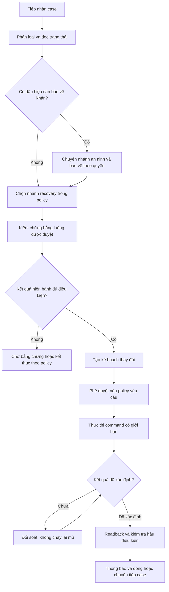

# Recovery support runbook — Sổ tay hỗ trợ khôi phục tài khoản

## 1. Mục tiêu của runbook

Một người dùng liên hệ hỗ trợ vì mất điện thoại, không còn MFA hoặc passkey, đồng thời cần truy cập tài khoản gấp. Nhân viên hỗ trợ phải biết kiểm tra điều gì, được phép làm gì và khi nào phải dừng. Nếu câu trả lời chỉ là “xác minh người dùng rồi reset”, mỗi người có thể hiểu “xác minh” theo một cách khác.

Trong module `SECURITY_AUTHENTICATION_ACCOUNT_RECOVERY`, recovery support runbook là tài liệu vận hành giúp xử lý các trường hợp mất mật khẩu, yếu tố xác thực hoặc thiết bị mà vẫn giữ kiểm chứng danh tính, chống lạm dụng, token dùng một lần và kiểm soát session.

Một runbook tốt không chỉ liệt kê thao tác. Mỗi bước phải có:

- Điều kiện bắt đầu.
- Vai trò được thực hiện.
- Dữ kiện cần đọc từ nguồn đáng tin.
- Hành động được phép.
- Kết quả mong đợi.
- Nhánh xử lý khi kết quả khác dự kiến.
- Bằng chứng cần lưu trước khi chuyển bước.

Bài thuộc chương Documentation. Các tên vai trò, mã trạng thái, biểu mẫu và công cụ bên dưới là thiết kế minh họa; chúng không khẳng định repository hay hệ thống hiện có đã triển khai những chức năng đó.

## 2. Phạm vi và ranh giới của tài liệu

### 2.1. Runbook phục vụ vận hành, không tự tạo chính sách xác minh

Runbook giải thích cách thực hiện chính sách recovery đã được phê duyệt. Nó không trao cho nhân viên quyền tự chọn một phương pháp yếu hơn khi người yêu cầu không vượt qua quy trình.

Ví dụ:

```text
Policy quyết định:
  Bằng chứng nào đủ cho hành động thay MFA ở trường hợp này?

Runbook quyết định cách thao tác:
  Mở hồ sơ ở đâu, khởi tạo bước kiểm tra nào,
  đọc kết quả nào và chuyển cho vai trò nào?
```

Nếu chính sách chưa có phương án cho một tình huống, trạng thái vận hành là cần đánh giá chính sách hoặc không thể khôi phục theo chính sách hiện tại. Không biến sự thiếu hướng dẫn thành quyền reset thủ công.

### 2.2. Hỗ trợ không phải đường vòng qua MFA

OWASP nhấn mạnh cơ chế reset MFA cần cho người mất yếu tố xác thực, nhưng không được trở thành cách để kẻ tấn công vượt MFA và chiếm tài khoản. [Nguồn: OWASP Multifactor Authentication Cheat Sheet — Resetting MFA](https://cheatsheetseries.owasp.org/cheatsheets/Multifactor_Authentication_Cheat_Sheet.html).

Trong thiết kế của bài, các thao tác sau không phải lối tắt hợp lệ:

- Gỡ MFA vì người gọi biết email và thông tin hồ sơ.
- Chấp nhận ảnh chụp màn hình đăng nhập như bằng chứng duy nhất.
- Gửi thử thách sang số điện thoại mới do claimant vừa đưa.
- Tắt giới hạn thử hoặc thời gian chờ để xử lý ticket nhanh.
- Chỉnh trực tiếp database để bỏ qua máy trạng thái recovery.

Những dữ kiện như chức danh, giọng nói tự tin hoặc mức độ khẩn cấp không thay thế bằng chứng mà chính sách yêu cầu.

### 2.3. Tách tài liệu theo người được đọc

| Lớp tài liệu | Nội dung phù hợp | Không nên đưa vào |
| --- | --- | --- |
| Hướng dẫn công khai | Cách mở yêu cầu, các bước người dùng cần chuẩn bị | Ngưỡng phát hiện lạm dụng và dữ liệu tài khoản khác |
| Runbook hỗ trợ | Quy trình, vai trò, cách đọc trạng thái và chuyển tuyến | Secret, token thật hoặc quyền truy cập dùng chung |
| Tài liệu chuyên trách hạn chế | Công cụ bảo vệ tài khoản, điều tra và hành động đặc quyền | Mật khẩu hardcode hoặc cơ chế bỏ kiểm chứng |

Không coi việc giấu quy trình là biện pháp bảo mật chính. Quyền thực thi phải được backend kiểm soát dù người yêu cầu đã biết các bước vận hành.

## 3. Cấu trúc quản trị tối thiểu của một runbook

### 3.1. Thông tin kiểm soát tài liệu

Một bản runbook triển khai cần có phần đầu tương tự:

```yaml
runbookId: recovery-support
documentVersion: example-v3
ownerRole: IdentityOperations
reviewerRoles:
  - SecurityOperations
  - SupportOperations
policyRef: recovery-policy-example-v8
toolContractRef: support-console-example-v5
audience: internal-support
reviewTrigger:
  - recovery-policy-change
  - support-tool-permission-change
  - recovery-incident
  - scheduled-review
```

Các giá trị là ví dụ định dạng, không phải cấu hình cần ghi vào module.

Một tài liệu ghi “review định kỳ” nhưng không có owner sẽ khó được cập nhật. Khi policy hoặc công cụ đổi, phải biết ai quyết định tài liệu còn dùng được hay cần tạm dừng một nhánh.

### 3.2. Điều kiện sẵn sàng trước ca trực

Nhân viên chỉ nên bắt đầu thao tác đặc quyền khi có:

1. Tài khoản nhân viên riêng, xác thực phù hợp và quyền theo vai trò.
2. Công cụ đang được phép sử dụng cho đúng môi trường và tenant.
3. Phiên bản runbook tương thích với policy đang có hiệu lực.
4. Danh mục chuyển tuyến hiện hành và người nhận ca.
5. Khả năng ghi audit của các hành động bắt buộc.

Nếu công cụ không hiển thị policy hoặc revision cần thiết, không đoán từ thông báo trên ticket cũ. Chuyển cho owner công cụ để xác định đường thao tác an toàn.

Trong thiết kế này, hành động thay đổi recovery yêu cầu audit bền vững. Nếu đường audit bắt buộc không hoạt động, dừng hành động đó và chuyển sự cố vận hành; không thực hiện rồi hứa bổ sung log sau.

### 3.3. Tên công cụ phải có liên kết thật khi đưa vào vận hành

Bài dùng tên chức năng như “xem trạng thái attempt”, “tạo kế hoạch thay đổi” và “đối soát command”. Chúng mô tả năng lực cần có.

Một runbook thật phải liên kết tới đúng công cụ, quyền truy cập và tài liệu sử dụng đã được duyệt. Không phát hành các lệnh giả hoặc đường dẫn placeholder như thể nhân viên có thể chạy ngay trong production.

## 4. Vai trò và quyền quyết định

| Vai trò minh họa | Được làm | Cần chuyển tuyến khi |
| --- | --- | --- |
| Hỗ trợ tuyến đầu | Tiếp nhận, hướng dẫn luồng chính thức, xem dữ liệu được che theo quyền | Cần quyết định bằng chứng hoặc thay đổi nhạy cảm |
| Chuyên viên recovery | Khởi tạo bước kiểm chứng được phép, chuẩn bị kế hoạch, đối soát trạng thái | Có nghi ngờ chiếm đoạt, tranh chấp hoặc thiếu phương án policy |
| Người duyệt được ủy quyền | Xét kế hoạch và bằng chứng trong phạm vi được cấp | Kế hoạch vượt quyền hoặc cần điều tra sự cố |
| Đội an ninh | Đánh giá dấu hiệu lạm dụng, thực hiện bảo vệ theo quyền ứng phó | Cần phối hợp nhiều hệ thống hoặc quyết định chính sách |
| Dịch vụ IAM/recovery | Kiểm tra điều kiện và thực thi command có giới hạn | Bất kỳ điều kiện bắt buộc nào không còn đúng |

Không dùng tài khoản chung cho cả ca trực. Audit phải phân biệt người tiếp nhận, người tạo kế hoạch, người phê duyệt và dịch vụ thực thi.

Nếu một hành động yêu cầu hai người, người yêu cầu và người duyệt phải là các chủ thể khác nhau với quyền thích hợp. Hai lần nhấn nút của cùng một người không tạo thành kiểm soát hai người.

Người duyệt không được thay thế kết quả kiểm chứng bằng câu “tôi tin người gọi”. Vai trò phê duyệt chỉ có ý nghĩa trong phạm vi policy và bằng chứng hiện hành.

Quản trị viên của một tổ chức cũng không tự trở thành chủ sở hữu tài khoản cá nhân của mọi thành viên. Quyền đại diện phải được xác định, kiểm tra và ghi riêng.

## 5. Mô hình trạng thái giúp nhân viên biết hồ sơ đang ở đâu

Một support case khác với recovery attempt. Một case có thể theo dõi nhiều attempt do hết hạn hoặc người dùng bắt đầu lại.



Sơ đồ là khung định hướng, không có nghĩa mọi case bị nghi ngờ đều được phép đi tiếp. Một incident hold hoặc quyết định từ chối có thể chặn nhánh thay đổi cho tới khi được xử lý đúng quyền.

Các trạng thái hồ sơ minh họa:

| Trạng thái | Ý nghĩa |
| --- | --- |
| `OPEN_TRIAGE` | Đang phân loại, chưa kết luận danh tính |
| `WAITING_VERIFICATION` | Đang chờ kết quả luồng kiểm chứng |
| `WAITING_REVIEW` | Cần vai trò được chỉ định đánh giá |
| `READY_FOR_CONTROLLED_CHANGE` | Có thể chuẩn bị hoặc thực thi theo điều kiện hiện hành |
| `EXECUTION_UNCERTAIN` | Command đã được gửi nhưng kết quả chưa rõ |
| `POSTCHECK_REQUIRED` | Cần kiểm tra hậu điều kiện |
| `RESOLVED` | Đạt điều kiện đóng case đã định nghĩa |
| `NOT_RECOVERABLE_UNDER_CURRENT_POLICY` | Không có đủ điều kiện khôi phục theo policy hiện tại |

Trạng thái của ticket không phải capability. Sửa ticket sang “approved” không được tự tạo quyền thay authenticator.

## 6. Bước 1 — Tiếp nhận mà chưa xác nhận chủ tài khoản

### 6.1. Mục tiêu và dữ liệu tối thiểu

Vai trò tuyến đầu tạo case, ghi nhận điều người yêu cầu trình bày và xác định đường liên hệ hỗ trợ.

Dữ liệu khởi đầu có thể gồm:

```text
case_ref
received_at
support_channel
claimant_contact_ref
requested_action
reported_loss_type
suspected_unauthorized_change
existing_attempt_ref nếu có
assigned_support_actor
```

`claimant_contact_ref` là kênh liên hệ của người đang yêu cầu, chưa mặc định là recovery address của tài khoản. Không lấy nó thay cho địa chỉ đã đăng ký.

Khi chưa xác minh, cách gọi đúng là claimant hoặc người yêu cầu. Không đánh dấu `verified_owner = true` vì người đó mở ticket từ một địa chỉ có tên quen thuộc.

### 6.2. Hướng dẫn không chia sẻ secret trong hội thoại

Nhân viên nhắc người yêu cầu không gửi mật khẩu, OTP, mã khôi phục, seed TOTP, mã mở khóa thiết bị hoặc private key vào ticket/chat.

Nếu một bằng chứng dạng secret được policy chấp nhận, người dùng nhập vào luồng xác minh chính thức. Nhân viên đọc kết quả kiểm chứng hoặc tham chiếu quyết định, không đọc giá trị secret.

Không yêu cầu xuất private key passkey hoặc chia sẻ quyền điều khiển thiết bị chỉ để “giúp đăng nhập”. Việc đăng ký authenticator mới phải qua giao diện và quyền thích hợp.

### 6.3. Bảo vệ thông tin tài khoản

Không xác nhận cho người chưa có quyền rằng email nào tồn tại, số nào là recovery address hoặc lần đăng nhập cuối xảy ra ở đâu.

Mẫu phản hồi ban đầu có thể là:

> Chúng tôi đã tiếp nhận yêu cầu. Bạn vui lòng sử dụng luồng khôi phục chính thức để thực hiện các bước phù hợp. Không gửi mật khẩu hoặc mã xác thực trong cuộc hội thoại này.

Mẫu này phải được chỉnh theo dịch vụ. Nó không thay thế thông báo về dữ liệu hoặc thông tin cần cung cấp trong luồng xác minh thực tế.

## 7. Bước 2 — Phân loại khẩn cấp và đọc trạng thái đáng tin

### 7.1. Phân biệt mất quyền truy cập với nghi bị chiếm đoạt

Một số tín hiệu cần đưa vào nhánh an ninh:

- Người dùng báo thay MFA hoặc recovery address mà họ không yêu cầu.
- Có nhiều case hoặc attempt cạnh tranh trên cùng tài khoản.
- Yêu cầu đổi ngay cả mật khẩu, kênh recovery và phương thức MFA.
- Công cụ ghi nhận thay đổi gần đây có rủi ro theo policy.
- Có sự cố diện rộng ảnh hưởng luồng gửi hoặc kiểm chứng.

Đây là tín hiệu cần xem xét, không phải kết luận người yêu cầu là chủ tài khoản hay kẻ tấn công.

Một cuộc gọi khẩn chưa được xác minh cũng có thể là cách gây khóa tài khoản nạn nhân. Hành động bảo vệ tạm thời phải theo policy báo mất và quyền ứng phó, có giới hạn và audit; không cho tuyến đầu khóa vĩnh viễn tài khoản chỉ từ một lời tố cáo.

### 7.2. Đọc snapshot trước khi quyết định

Công cụ được duyệt nên cung cấp tập dữ kiện theo quyền:

| Dữ kiện | Mục đích |
| --- | --- |
| Tenant và account reference nội bộ | Xác định đúng phạm vi |
| Attempt reference và trạng thái | Tránh tác động nhầm lần thử |
| Revision hiện hành | Phát hiện snapshot đã cũ |
| Policy và phiên bản | Chọn đúng quy trình |
| Verification decision reference | Đọc kết quả thay vì secret |
| Incident hold hoặc điều kiện chờ | Biết có được phép tiếp tục không |
| Command đang chạy và kết quả gần nhất | Tránh thao tác trùng |
| Tình trạng delivery được phép xem | Phân biệt gửi, giao và kiểm chứng |

Không mở rộng phạm vi truy vấn theo dữ liệu client tự khai. Công cụ phải kiểm tra quyền tenant/account ở backend.

Không tải toàn bộ hồ sơ xác minh chỉ để xem một trạng thái. Khi chỉ cần kết quả, dùng quyết định và provenance thích hợp.

### 7.3. Kết quả của bước phân loại

Trước khi sang bước sau, case cần có:

```text
triage_category
policy_ref
current_attempt_ref
current_revision
risk_review_required
assigned_owner
next_action
next_review_at nếu phải chờ
```

“Đang xử lý” mà không có owner hoặc bước tiếp theo chưa đủ để bàn giao.

## 8. Bước 3 — Chọn nhánh recovery đã được phê duyệt

### 8.1. Ma trận nhánh hỗ trợ

| Tình huống | Hướng xử lý của runbook | Điều không được suy ra |
| --- | --- | --- |
| Quên mật khẩu nhưng còn authenticator khác | Dẫn tới nhánh phù hợp với policy hiện hành | Mọi trường hợp đều cần gỡ MFA |
| Mất thiết bị nhưng còn phương thức dự phòng | Dùng luồng kiểm tra phương thức dự phòng được duyệt | Chỉ biết địa chỉ nhận đã đủ chứng minh |
| Mất mọi authenticator cần thiết | Đọc phương án recovery đã cấu hình cho tài khoản | Nhân viên được tự chọn một câu hỏi cá nhân |
| Hồ sơ từng được identity proofing | Có thể xét nhánh kiểm chứng lại nếu policy cho phép | Mọi giấy tờ có tên trùng đều gắn được với tài khoản |
| Không có liên kết danh tính đã được thiết lập | Dùng phương án recovery mà policy thực sự hỗ trợ | Thu giấy tờ mới sẽ tự tạo bằng chứng sở hữu quá khứ |
| Nghi account takeover | Chuyển nhánh an ninh và kiểm tra độc lập | Đổi mật khẩu đơn lẻ đã loại bỏ mọi quyền của kẻ tấn công |
| Lỗi gửi hoặc lỗi provider | Chẩn đoán vận hành và fallback được phép | Được đổi sang địa chỉ mới tùy claimant |

Không có cột “nhân viên thấy hợp lý thì reset”. Mọi nhánh thay đổi phải có policy tương ứng.

### 8.2. Không tự tạo lại lịch sử identity proofing

Trong phạm vi NIST SP 800-63B-4, yêu cầu recovery phụ thuộc IAL/AAL; tài khoản chưa được identity proofing không có lựa chọn reproofing dựa trên liên kết danh tính ban đầu chưa tồn tại. Hướng dẫn cũng yêu cầu thông báo sự kiện recovery. Khi áp dụng khung này, runbook phải dẫn tới đúng chính sách tương ứng. [Nguồn: NIST SP 800-63B-4, mục 4.2](https://pages.nist.gov/800-63-4/sp800-63b.html).

Điều đó giúp tránh một lỗi vận hành: tài khoản ban đầu chỉ đăng ký bằng bí danh, nhưng hỗ trợ nhận ảnh giấy tờ mới rồi coi tên trên giấy là bằng chứng người đó đã tạo tài khoản.

Nếu dịch vụ có phương án khác dựa trên phân tích rủi ro, phương án đó phải được thiết kế và phê duyệt trước. Nhân viên không tự sáng tạo nó trong khi xử lý case.

### 8.3. Điều kiện dừng ở bước chọn nhánh

Dừng hành động thay đổi khi:

- Không tìm được policy có hiệu lực cho tình huống.
- Phạm vi tenant/account không nhất quán.
- Có incident hold chưa được giải quyết.
- Có command đang thực thi với kết quả chưa rõ.
- Yêu cầu vượt quyền của vai trò hiện tại.

Dừng hành động không đồng nghĩa bỏ mặc case. Cần ghi lý do, người nhận chuyển tuyến và nội dung phản hồi phù hợp cho claimant.

## 9. Bước 4 — Thực hiện và đọc kết quả kiểm chứng

### 9.1. Nhân viên khởi tạo luồng, verifier quyết định kết quả

Chuyên viên recovery có thể khởi tạo một bước kiểm chứng trong phạm vi được cấp. Người yêu cầu cung cấp bằng chứng qua luồng an toàn tương ứng.

Kết quả cần được backend biểu diễn rõ:

```text
verification_decision_ref
subject_binding_ref
attempt_ref
policy_ref
outcome
issued_at
valid_until
evidence_scope
revoked_at nếu có
```

Một quyết định PASS cho một mục đích không tự cho phép mọi thay đổi. Ví dụ, kết quả đủ để xem tiến độ hồ sơ không mặc định đủ để thay MFA và recovery address cùng lúc.

Nếu kết quả là `PENDING`, `FAIL`, `EXPIRED` hoặc đã bị thu hồi, nhân viên không được sửa field thành PASS. Nhánh tiếp theo phải do policy quyết định: tiếp tục chờ, kiểm tra lại, chuyển tuyến hoặc kết thúc.

### 9.2. Xem provenance thay vì chỉ nhìn một nhãn màu xanh

Cần biết quyết định thuộc account/attempt nào, policy nào, còn hiệu lực không và có đáp ứng hành động đang yêu cầu không.

Một ảnh chụp kết quả PASS trong ticket không phải nguồn trạng thái hiện hành. Công cụ phải đọc lại từ nguồn quyết định đáng tin.

Nếu có bằng chứng mới hoặc dấu hiệu nghi ngờ sau khi PASS, điều kiện có thể thay đổi. Runbook cần dẫn tới việc xem xét lại hoặc áp dụng hold đúng quyền, thay vì coi PASS là vĩnh viễn.

### 9.3. Chứng từ nhạy cảm phải ở đúng nơi lưu

Nếu một nhánh policy cần hồ sơ xác minh, chỉ yêu cầu dữ liệu cần cho nhánh đó và dùng kênh thu thập được duyệt.

Không kéo ảnh giấy tờ từ kho xác minh sang ticket để người bàn giao “dễ xem”. Ticket chỉ nên lưu tham chiếu và thông tin cần thiết cho quyết định hỗ trợ.

Bộ phận hỗ trợ không tự đặt thời hạn lưu hồ sơ hoặc lấy consent chung làm quyền sử dụng cho mục đích khác. Các hoạt động đó cần theo chính sách dữ liệu của dịch vụ.

## 10. Bước 5 — Lập kế hoạch thay đổi có phạm vi cụ thể

### 10.1. Kế hoạch là dữ liệu backend, không phải lời nhắn tự do

Sau khi có điều kiện phù hợp, chuyên viên tạo preview của thay đổi. Một cấu trúc minh họa:

```yaml
planRef: plan-example-41
caseRef: case-example-217
scope:
  tenantRef: tenant-example
  accountRef: account-internal-example
  attemptRef: attempt-example-9
action: REPLACE_MFA
targetAuthenticatorRef: staged-authenticator-example
verificationDecisionRef: verification-example-88
policyRef: recovery-policy-example-v8
expectedAttemptRevision: 17
notificationPolicyRef: recovery-notify-example-v3
sessionControlPolicyRef: recovery-session-example-v4
approvalRequired: true
requesterActorRef: support-actor-example-A
notBefore: server-defined
expiresAt: server-defined
```

Đây là bản mô tả, không phải grant thực thi. Việc biết `planRef` không được coi là đủ quyền chạy kế hoạch.

Preview cần nêu những gì sẽ thay và những gì nằm ngoài phạm vi. Thay MFA không nên âm thầm đổi cả recovery email hoặc cấp quyền quản trị.

`targetAuthenticatorRef` phải liên kết với quá trình đăng ký và kiểm chứng authenticator mới được backend quản lý. Không nhận một private key từ ticket rồi nhập vào hệ thống.

### 10.2. Đọc lại trước khi xin phê duyệt

Người tạo kế hoạch kiểm tra:

- Scope khớp case, account và attempt.
- Hành động khớp yêu cầu đã được kiểm chứng.
- Phương thức mới được liên kết đúng luồng.
- Kết quả verification còn hiệu lực và đúng phạm vi.
- Policy và revision chưa đổi.
- Điều kiện chờ, thông báo và session control được nêu rõ.
- Kế hoạch còn thời hạn và chưa được sử dụng.

Preview không phải một khóa giữ trạng thái. Người dùng có thể hủy attempt, một case khác có thể tạo thay đổi hoặc đội an ninh có thể thêm hold sau khi preview được tạo.

Vì vậy, backend vẫn phải kiểm tra lại khi thực thi.

### 10.3. Phê duyệt không phải miễn kiểm chứng

Nếu policy yêu cầu, người duyệt đọc kế hoạch và các quyết định liên quan qua công cụ chính thức.

Approval phải gắn với phiên bản cụ thể của kế hoạch, scope, action và dữ kiện cần thiết. Nếu target hoặc policy thay đổi, không tái dùng approval cũ cho một payload mới.

Không chấp nhận ảnh chụp lời đồng ý trên chat thay cho approval record. Không nhờ đồng nghiệp duyệt hộ bằng tài khoản của người khác.

## 11. Minh họa Java: chặn kế hoạch đã cũ

Một runbook dễ thi hành cần được công cụ hỗ trợ. Ví dụ dưới đây minh họa một phần kiểm tra độ hiện hành của plan; nó không phải toàn bộ cơ chế phân quyền hoặc xác minh danh tính.

Tất cả đối tượng phải do backend tải từ nguồn đáng tin và đã kiểm tra cấu trúc, không phải các cờ do trình duyệt tự khai.

```java
import java.time.Instant;
import java.util.Objects;

record RecoveryScope(
        String tenantRef,
        String accountRef,
        String attemptRef) {
}

record PlannedChange(
        RecoveryScope scope,
        String policyRef,
        String verificationDecisionRef,
        long expectedRevision,
        Instant notBefore,
        Instant expiresAt) {
}

record CurrentRecoveryState(
        RecoveryScope scope,
        String policyRef,
        String verificationDecisionRef,
        long revision,
        boolean verificationCurrentlyValid,
        boolean incidentHold) {
}

final class RecoveryPlanFreshnessGuard {

    void requireCurrent(
            PlannedChange plan,
            CurrentRecoveryState current,
            Instant serverNow) {

        if (!Objects.equals(plan.scope(), current.scope())) {
            throw new SecurityException("Recovery scope mismatch");
        }

        if (!Objects.equals(plan.policyRef(), current.policyRef())
                || plan.expectedRevision() != current.revision()) {
            throw new IllegalStateException("Recovery plan is stale");
        }

        if (!Objects.equals(
                plan.verificationDecisionRef(),
                current.verificationDecisionRef())
                || !current.verificationCurrentlyValid()) {
            throw new SecurityException(
                    "Current verification does not match plan");
        }

        if (current.incidentHold()) {
            throw new IllegalStateException(
                    "Recovery requires incident review");
        }

        if (!plan.notBefore().isBefore(plan.expiresAt())
                || serverNow.isBefore(plan.notBefore())
                || !serverNow.isBefore(plan.expiresAt())) {
            throw new IllegalStateException(
                    "Recovery plan is outside its execution window");
        }
    }
}
```

Sau khi helper trả thành công, trạng thái vẫn có thể thay đổi. Trong dịch vụ thật, kiểm tra revision và chuyển trạng thái phải nằm trong cơ chế bảo đảm cạnh tranh thích hợp tại điểm thực thi.

Dịch vụ còn phải kiểm tra quyền nhân viên, action, approval, quyền với target authenticator, grant dùng một lần và idempotency. Không gọi helper này rồi suy ra toàn bộ authorization đã được hoàn tất.

Runbook nên ghi rõ: khi nhận lỗi stale, tải trạng thái mới và lập kế hoạch lại nếu policy còn cho phép. Không sửa `expectedRevision` một cách máy móc để ép command qua kiểm tra.

## 12. Bước 6 — Thực thi có kiểm soát và xử lý kết quả chưa rõ

### 12.1. Trước khi gửi command

Vai trò có quyền thực thi xác định plan hiện hành và command idempotency key do hệ thống quản lý.

Backend phải kiểm tra lại các điều kiện trong cùng cơ chế bảo vệ tại thời điểm thực thi. Một approval tồn tại từ trước không làm mất hiệu lực của yêu cầu kiểm tra hold hoặc bằng chứng vừa bị thu hồi.

Nhân viên dùng command nghiệp vụ được duyệt. Không thực hiện một chuỗi chỉnh database thủ công để mô phỏng kết quả của command.

### 12.2. Phân loại kết quả ngay sau thao tác

| Kết quả | Hành động tiếp theo |
| --- | --- |
| Chưa được chấp nhận thực thi | Đọc mã nguyên nhân và xử lý theo nhánh được duyệt |
| Đã chấp nhận, đang chạy | Theo dõi command hiện có |
| Hoàn tất với bằng chứng backend | Sang bước kiểm tra hậu điều kiện |
| Thất bại có kết quả cuối xác định | Giữ nguyên bằng chứng, xét retry theo hợp đồng |
| Timeout hoặc mất kết nối, kết quả chưa rõ | Chuyển `EXECUTION_UNCERTAIN` và đối soát |
| Mới hoàn tất một phần | Giữ trạng thái kiểm soát, chuyển chuyên trách nếu cần |

HTTP timeout không chứng minh thao tác chưa xảy ra. Không tạo một command mới ngay để “thử lại cho chắc”.

### 12.3. Đối soát trước khi retry

Tra trạng thái bằng `command_ref` hoặc khóa idempotency được hệ thống lưu. Đọc trạng thái từ nguồn thực thi, không chỉ từ log giao diện hỗ trợ.

Nếu hợp đồng cho phép gửi lại cùng command bằng cùng khóa và cùng payload, thực hiện đúng hợp đồng đó. Không đổi khóa chỉ vì lần gọi trước không trả lời.

Nếu không xác định được kết quả, tiếp tục chuyển tuyến có owner. Không suy đoán thất bại để chạy thêm thay đổi, cũng không báo thành công chỉ vì người dùng nói đã thấy một email.

### 12.4. Không rollback bằng cách phục hồi yếu tố đã mất

Nếu thay đổi chỉ hoàn tất một phần, runbook cần dẫn tới nhánh hoàn tất an toàn hoặc xử lý sự cố.

Khôi phục lại authenticator cũ, số điện thoại cũ hoặc session cũ không phải rollback mặc định: chúng có thể đã mất hoặc bị xâm phạm.

Một thay đổi bảo vệ có thể không đảo ngược được theo cách thông thường. Tài liệu phải nói rõ hành động bù nào đã được duyệt và ai có quyền quyết định, thay vì dùng câu chung “rollback nếu lỗi”.

## 13. Bước 7 — Kiểm tra hậu điều kiện bằng readback

### 13.1. Đóng thành công cần hơn một nút xanh

Một bộ hậu điều kiện minh họa cho thay MFA:

| Hậu điều kiện | Bằng chứng phù hợp |
| --- | --- |
| Target authenticator được gắn đúng account | Trạng thái backend và binding reference |
| Yếu tố cần vô hiệu không còn được chấp nhận | Kết quả thực thi chính sách authenticator |
| Quyền recovery dùng một lần đã tiêu thụ | Trạng thái grant/attempt |
| Session control bắt buộc có hiệu lực | Xác nhận enforcement theo kiến trúc |
| Attempt và command có kết quả cuối nhất quán | Readback từ nguồn nghiệp vụ |
| Thông báo bắt buộc đạt mốc chính sách | Notification record và trạng thái tương ứng |
| Audit chứa actor, action, scope và outcome | Tham chiếu sự kiện audit |

Không yêu cầu người dùng gửi mã cũ để nhân viên “thử xem còn dùng được không”. Hậu điều kiện cần được công cụ và dịch vụ xác nhận theo quy trình kiểm tra được phép.

### 13.2. “Đã yêu cầu thu hồi session” khác “đã có hiệu lực”

Một công việc thu hồi mới nằm trong hàng đợi chưa chứng minh session cũ đã bị chặn tại các dịch vụ sử dụng nó.

Với kiến trúc có access token tự chứa, hiệu lực thu hồi phụ thuộc cơ chế kiểm tra như session state, token version hoặc các điều kiện enforcement đã thiết kế. Không hứa mọi token lập tức vô hiệu nếu hệ thống chưa có cơ chế tương ứng.

Runbook phải liên kết tới hậu điều kiện thực tế của dịch vụ. Nếu chính sách yêu cầu enforcement trước khi hoàn tất, case phải chờ bằng chứng đó.

Cũng cần phân biệt access session, refresh token, trạng thái “ghi nhớ thiết bị” và capability recovery. Không giả định một thao tác logout duy nhất đã xử lý tất cả.

### 13.3. Thông báo cần có trạng thái và phạm vi rõ

Tạo yêu cầu gửi, provider nhận và người dùng đọc là các mốc khác nhau. Runbook cần dùng mốc mà chính sách thực sự yêu cầu.

Nếu thông báo đang chậm, ghi đúng “notification pending” và chuyển tuyến nếu vượt điều kiện vận hành. Không sửa trạng thái gửi thành delivered để đóng ticket.

Kênh nhận thông báo lấy từ chính sách và các dữ kiện đã được kiểm soát. Không âm thầm gửi thông tin nhạy cảm sang địa chỉ mới của claimant.

## 14. Nhánh riêng: nghi tài khoản bị chiếm đoạt

OWASP lưu ý đặt lại mật khẩu đơn lẻ có thể chưa lấy lại quyền kiểm soát khi kẻ tấn công còn session hoặc đã đổi thông tin recovery. Hướng dẫn đề nghị dùng bằng chứng độc lập đã thiết lập trước, xem lại thay đổi trái phép, xử lý authenticator bị xâm phạm và thu hồi quyền còn tồn tại sau recovery. [Nguồn: OWASP Forgot Password Cheat Sheet — Account Recovery After Suspected Compromise](https://cheatsheetseries.owasp.org/cheatsheets/Forgot_Password_Cheat_Sheet.html).

Với nhánh này, thiết kế runbook cần có các bước bổ sung:

1. Gán owner an ninh và liên kết incident nếu có.
2. Đọc timeline thay đổi từ nguồn đáng tin.
3. Phân biệt thông tin đã được thiết lập với thông tin mới bị nghi thay.
4. Xác định hành động bảo vệ tạm thời được phép và ảnh hưởng của nó.
5. Thực hiện kiểm chứng độc lập theo policy.
6. Lập kế hoạch thay đổi và loại bỏ quyền trái phép trong phạm vi đã duyệt.
7. Xác minh hậu điều kiện và cung cấp cách phản hồi khi có thay đổi không được yêu cầu.

Không tự động dùng địa chỉ cũ nhất làm địa chỉ an toàn. Địa chỉ đó có thể đã được đổi vì mất quyền kiểm soát trước đây.

Không để việc người yêu cầu biết một recovery address mới chứng minh thay đổi đó hợp lệ. Cần kiểm tra provenance và thời điểm thiết lập.

Nếu phát hiện credential hoặc quyền ứng dụng khác có thể bị ảnh hưởng, chuyển theo quy trình ứng phó tương ứng. Không tự thu hồi mọi loại khóa ngoài phạm vi chỉ vì runbook đang xử lý reset MFA.

## 15. Nhánh riêng: sự cố vận hành hoặc provider

### 15.1. Các tình huống dễ bị nhầm với thất bại xác minh

| Tình huống | Nhân viên nên làm | Không nên làm |
| --- | --- | --- |
| Thử thách chưa được giao | Kiểm tra trạng thái gửi được phép xem | Kết luận người dùng nhập sai |
| Callback mất hoặc chậm | Đối soát theo chức năng được duyệt | Ghi tay delivered |
| Provider lỗi diện rộng | Liên kết incident và áp dụng routing đã duyệt | Gửi sang một kênh yếu hơn tùy ý |
| Attempt hết hạn | Hướng dẫn tạo lại theo policy | Gia hạn trực tiếp token cũ |
| Verification engine lỗi | Chờ hoặc chuyển tuyến vận hành | Đổi kết quả thành PASS |
| Audit hoặc command service lỗi | Dừng thay đổi cần thành phần đó | Dùng SQL làm đường thay thế |
| Công cụ hỗ trợ không truy cập được | Tiếp nhận và bàn giao theo quy trình | Dùng tài khoản dùng chung hoặc sao chép secret |

Một sự cố diện rộng cần incident owner thay vì nhiều nhân viên tự thử các cách reset khác nhau. Case riêng vẫn cần correlation với incident để tránh mất dấu người dùng bị ảnh hưởng.

### 15.2. Giới hạn resend và xử lý trường hợp chưa rõ

Resend cần theo rate limit và chính sách hiệu lực của challenge. Nhân viên không được phát liên tiếp nhiều mã để thử xem kênh nào tới trước.

Nếu chưa rõ provider đã nhận request, cần đối soát trước khi tạo message mới khi hợp đồng yêu cầu. Một timeout có thể vẫn dẫn tới giao thông điệp sau đó.

Thông điệp đến muộn không làm token hết hạn hoặc attempt đã kết thúc có hiệu lực trở lại.

### 15.3. Thời hạn phản hồi khác thời hạn hạ kiểm soát

Runbook cần có kỳ cập nhật cho case và owner khi phải chờ. Thời gian cam kết hỗ trợ không được hiểu thành “quá giờ thì bỏ kiểm chứng”.

Nếu vượt khả năng xử lý, ưu tiên chuyển tuyến và thông báo tiến độ đúng thực tế. Không hứa chắc tài khoản sẽ được khôi phục khi chưa có đủ bằng chứng.

## 16. Giao tiếp, audit và bàn giao ca

### 16.1. Mẫu thông điệp phải khớp trạng thái

**Đang chờ kiểm chứng:**

> Yêu cầu đang chờ hoàn tất bước kiểm chứng trong luồng chính thức. Nhân viên hỗ trợ không yêu cầu bạn gửi mã xác thực hoặc mật khẩu qua cuộc hội thoại.

**Kết quả thao tác chưa rõ:**

> Chúng tôi đang đối soát kết quả thao tác để tránh thay đổi trùng. Bạn chưa cần thực hiện lại theo cùng hướng dẫn cho tới khi có cập nhật tiếp theo.

**Không đủ điều kiện khôi phục:**

> Với các điều kiện hiện có, yêu cầu chưa đáp ứng phương án khôi phục được hỗ trợ. Chúng tôi sẽ thông tin bước xem xét tiếp theo nếu chính sách có cung cấp.

Các mẫu phải được điều chỉnh theo policy và thông tin người nhận được phép biết. Không tiết lộ điều kiện phát hiện gian lận chi tiết hoặc địa chỉ recovery khác trong phản hồi.

### 16.2. Audit giữ bằng chứng quyết định, không giữ secret

OWASP khuyến nghị loại bỏ hoặc bảo vệ các dữ liệu như access token, mật khẩu và secret khỏi log, đồng thời hạn chế truy cập nhật ký. [Nguồn: OWASP Logging Cheat Sheet — Data to exclude](https://cheatsheetseries.owasp.org/cheatsheets/Logging_Cheat_Sheet.html).

Một sự kiện audit cho thay đổi có thể gồm:

```json
{
  "eventType": "SUPPORT_RECOVERY_COMMAND_RECONCILED",
  "caseRef": "case-example-217",
  "attemptRef": "attempt-example-9",
  "planRef": "plan-example-41",
  "commandRef": "command-example-62",
  "actorRef": "support-actor-example-A",
  "approverRef": "support-actor-example-B",
  "policyRef": "recovery-policy-example-v8",
  "result": "POSTCHECK_REQUIRED",
  "reasonCategory": "EXECUTION_RESULT_CONFIRMED"
}
```

Case reference và plan reference không được mang quyền bearer. Một hệ thống chỉ biết các ID này vẫn cần xác thực và phân quyền khi đọc hoặc thực thi.

Không đưa raw OTP, recovery code, ảnh giấy tờ hoặc reset URL vào phần “reason”. Nếu người dùng đã gửi secret vào ticket, xử lý việc lộ secret theo quy trình tương ứng và tránh sao chép nó sang các hệ thống khác.

### 16.3. Mẫu bàn giao có thể tiếp tục thực hiện

```text
CASE_REF:
CURRENT_OWNER:
NEXT_OWNER:
RUNBOOK_VERSION:
POLICY_REF:
TENANT_ACCOUNT_SCOPE_REF:
ATTEMPT_REF:
LAST_CONFIRMED_REVISION:
CURRENT_STATE:
VERIFICATION_DECISION_REF:
PLAN_REF:
COMMAND_REF:
KNOWN_RESULT:
UNCERTAIN_PART:
REQUIRED_POSTCHECKS:
BLOCKING_CONDITION:
NEXT_ACTION:
NEXT_REVIEW_AT:
USER_MESSAGE_LAST_SENT_AT:
INCIDENT_REF_IF_ANY:
```

Chỉ điền dữ liệu theo quyền và nhu cầu. Không dán nội dung hồ sơ nhạy cảm để thay thế tham chiếu.

Người nhận ca đọc lại trạng thái hiện hành trước khi hành động. Một snapshot trong bàn giao có thể đã cũ nếu người dùng hủy yêu cầu hoặc hệ thống hoàn tất command sau đó.

“Đã ping đội khác” chưa xác định ownership. Cần biết vai trò hoặc nhóm nào đã nhận bước tiếp theo theo cơ chế vận hành của dịch vụ.

## 17. Ví dụ một case mất điện thoại được xử lý có kiểm soát

Ví dụ giả định: người dùng không còn thiết bị MFA nhưng có phương án dự phòng phù hợp với policy của tài khoản. Bài không ấn định rằng một loại bằng chứng đơn lẻ luôn đủ cho mọi mức bảo đảm.

| Thời điểm minh họa | Dữ kiện và hành động | Bằng chứng được giữ |
| --- | --- | --- |
| 09:00 | Tiếp nhận, ghi claimant và loại yêu cầu | Case reference, actor tiếp nhận |
| 09:05 | Đọc snapshot, không có command chưa rõ hoặc hold chặn | Policy và revision hiện hành |
| 09:10 | Hướng dẫn luồng dự phòng được phép | Attempt và verification reference |
| 09:20 | Verifier trả kết quả đủ điều kiện cho hành động | Quyết định còn hiệu lực, đúng scope |
| 09:23 | Người dùng hoàn tất bước chứng minh khả năng dùng authenticator mới | Staged authenticator reference |
| 09:25 | Tạo và đọc preview thay MFA | Plan gắn revision và target |
| 09:28 | Người có quyền khác duyệt theo policy | Approval record cho đúng plan |
| 09:30 | Gửi command; giao diện timeout | Command reference, chưa kết luận |
| 09:31 | Đối soát thấy thay đổi đã lưu, kiểm soát session còn chờ | Trạng thái partial/postcheck |
| 09:34 | Backend xác nhận hậu điều kiện bắt buộc đạt | Binding, enforcement và attempt outcome |
| 09:36 | Thông báo theo policy, đóng hoặc chuyển việc còn lại | Notification record và case outcome |

Điểm đáng chú ý là ở 09:30, nhân viên không chạy command mới chỉ vì timeout. Ở 09:31, việc authenticator mới đã được lưu cũng chưa đủ để báo hoàn tất nếu kiểm soát bắt buộc còn chờ.

Nếu bước kiểm chứng không đạt hoặc phát hiện hold, chuỗi này phải chuyển nhánh. Ví dụ không mô tả một đường bắt buộc phải dẫn tới reset.

## 18. Điều kiện đóng case và cách duy trì runbook

### 18.1. Phân biệt kết quả đóng

| Kết quả | Điều kiện minh họa |
| --- | --- |
| Khôi phục hoàn tất | Hậu điều kiện theo policy đạt, kết quả đã xác định |
| Người dùng hủy | Có bằng chứng hủy và xử lý capability còn chờ |
| Không đủ điều kiện | Có quyết định theo policy, phản hồi và đường xem xét nếu có |
| Chuyển sang incident | Có owner nhận trách nhiệm và tham chiếu sự cố |
| Chờ phần việc khác | Phần việc được xác định, có owner; không ghi như đã hoàn tất |

Không đóng “resolved” chỉ vì nhân viên đã gửi hướng dẫn. Tùy mục tiêu case, kết quả có thể là đã hướng dẫn, đang chờ hoặc đã khôi phục; các nhãn phải được phân biệt.

### 18.2. Diễn tập bằng các tình huống có điều kiện dừng

Một chương trình diễn tập có thể dùng:

- Claimant thúc ép bỏ MFA vì đang có giao dịch khẩn.
- Verification PASS đã hết hiệu lực trước lúc thực thi.
- Target authenticator bị thay sau khi có approval.
- Người tạo và người duyệt thực ra là cùng actor.
- Command timeout nhưng đã thực thi.
- Thay đổi lưu thành công nhưng session control chưa có hiệu lực.
- Kênh recovery vừa bị đổi trong một sự cố nghi chiếm đoạt.
- Công cụ hiển thị account thuộc tenant khác.

Mục tiêu là kiểm tra nhân viên và công cụ có dừng ở đúng cổng, giữ bằng chứng và chuyển tuyến rõ hay không. Không thực hiện thay đổi trên tài khoản thật chỉ để diễn tập nếu chưa có môi trường và phạm vi được duyệt.

### 18.3. Cập nhật tài liệu khi hệ thống thay đổi

Owner cần xem lại runbook khi policy, công cụ, vai trò, phương thức recovery hoặc hành vi enforcement đổi.

Một bản cập nhật nên ghi điều thay đổi, nhánh bị ảnh hưởng, cách xác minh tài liệu tương thích và thời điểm ngừng dùng bản cũ. Nếu có bản dịch, phải biết các phiên bản đang diễn đạt cùng một quy trình hay chưa.

Số case xử lý nhanh hoặc completion rate có thể hỗ trợ vận hành, nhưng không được dùng đơn lẻ để khuyến khích reset dễ hơn. Cần xem cả thao tác bị chặn đúng, sự cố, lỗi bằng chứng và chất lượng bàn giao.

Nhân viên dùng runbook phải xác định được **ai đang yêu cầu, bằng chứng nào còn hiệu lực, hành động nào được cấp và hậu điều kiện nào đã được xác nhận**. Khi thiếu một trong các dữ kiện đó, bước tiếp theo phải là một nhánh rõ ràng trong quy trình, không phải quyết định tùy hứng của người đang trực.
