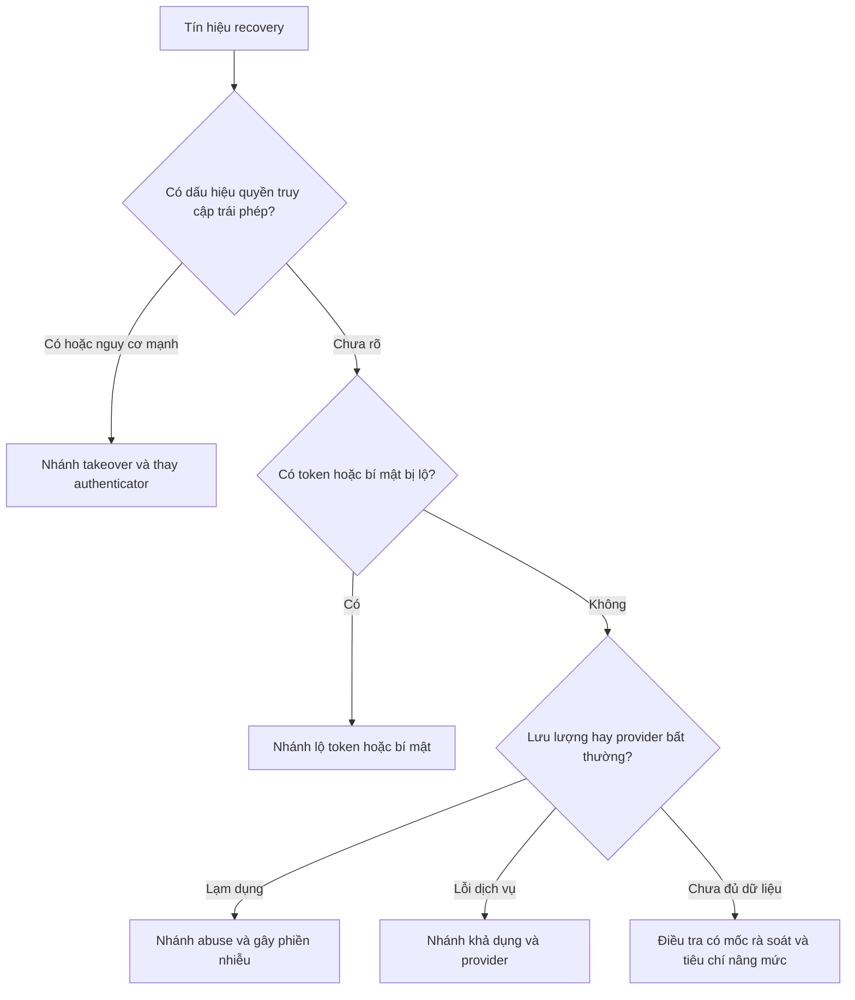

# Recovery incident runbook — Runbook ứng phó sự cố khôi phục tài khoản

## 1. Mục đích và cách sử dụng

**Recovery incident runbook** là tài liệu tác nghiệp để đội trực xử lý một sự cố liên quan luồng khôi phục tài khoản. Tài liệu phải giúp người thực hiện biết khi nào kích hoạt, cần xác minh điều gì, ai có quyền quyết định, hành động nào được phép và bằng chứng nào cho thấy hành động đã đạt mục tiêu.

Trong module `SECURITY_AUTHENTICATION_ACCOUNT_RECOVERY`, phạm vi gồm khôi phục khi mất mật khẩu, MFA, passkey hoặc thiết bị xác thực. Sự cố có thể liên quan đánh giá rủi ro, token dùng một lần, xác minh danh tính, chống lạm dụng, thay authenticator và kiểm soát session.

Runbook không chỉ là danh sách “reset password, revoke session”. Một sự cố có thể để lại địa chỉ recovery do kẻ tấn công thêm vào, grant hỗ trợ chưa bị thu hồi hoặc refresh token vẫn hoạt động sau khi người dùng đã đổi mật khẩu.

Bài học này cung cấp một **mẫu runbook có giải thích**. Các ID, schema, vai trò, mức độ và mốc thời gian đều là ví dụ. Trước khi dùng trong vận hành, tổ chức phải điền công cụ thực tế, người trực, quyền thực thi và policy của dịch vụ.

NIST SP 800-61 Rev. 3 đặt ứng phó sự cố trong hoạt động quản lý rủi ro theo CSF 2.0, kết nối chuẩn bị với phát hiện, ứng phó và phục hồi. Runbook dưới đây là một cách cụ thể hóa công việc đó cho account recovery, không phải bản chép quy trình bắt buộc của mọi tổ chức. [NIST SP 800-61 Rev. 3](https://csrc.nist.gov/pubs/sp/800/61/r3/final)

### 1.1. Thông tin đầu tài liệu

Một runbook thực tế nên có metadata như sau:

```yaml
runbook_id: RB-ACCOUNT-RECOVERY-INCIDENT
version: example-v1
service: SECURITY_AUTHENTICATION_ACCOUNT_RECOVERY
owner_role: identity-security-owner
primary_responder_role: identity-oncall
incident_commander_role: incident-command
supported_flows:
  - password-recovery
  - mfa-recovery
  - passkey-recovery
  - lost-device-recovery
contact_directory: REQUIRED_BEFORE_OPERATIONAL_USE
approved_admin_tool: REQUIRED_BEFORE_OPERATIONAL_USE
evidence_repository: REQUIRED_BEFORE_OPERATIONAL_USE
last_exercised_at: REQUIRED_BEFORE_OPERATIONAL_USE
```

Không ghi secret, token hoặc số điện thoại cá nhân không được quản lý vào một bản runbook được phân phối rộng. Liên kết tới nguồn liên hệ được duy trì và có quyền truy cập phù hợp.

### 1.2. Bảng hành động nhanh

| Giai đoạn | Mục tiêu | Kết quả phải ghi |
|---|---|---|
| Kích hoạt | Xác nhận đây là tín hiệu cần xử lý | Incident ID, người phụ trách, mức độ tạm thời |
| Triage | Phân biệt tấn công, lỗi dịch vụ và báo cáo chưa đủ chứng cứ | Phạm vi đã biết, giả thuyết, điều còn chưa rõ |
| Ngăn chặn | Chặn tác động đang diễn ra trong phạm vi phù hợp | Hành động, đối tượng, quyền duyệt, kết quả |
| Khắc phục | Loại bỏ nguyên nhân hoặc đường đi của sự cố | Thay đổi đã áp dụng và rủi ro còn lại |
| Khôi phục | Giúp chủ tài khoản thật lấy lại quyền theo phương án được duyệt | Bằng chứng xác minh, trạng thái authenticator và session |
| Xác minh | Chứng minh đường tấn công bị chặn và luồng hợp lệ hoạt động | Kết quả kiểm tra cụ thể |
| Bàn giao, đóng | Không để công việc dở dang hoặc quyền tạm tồn tại | Chủ sở hữu, điều kiện đóng, theo dõi sau sự cố |

## 2. Khi nào kích hoạt và phân loại mức độ?

### 2.1. Các trigger điển hình

- Người dùng báo một lần đổi mật khẩu, gỡ MFA hoặc đăng ký passkey mà họ không thực hiện.
- Một token recovery được dùng lại nhưng hệ thống vẫn chấp nhận.
- Phát hiện reset link, recovery code hoặc bearer token đi vào log, công cụ phân tích hoặc ticket.
- Có nhiều yêu cầu recovery bất thường, tăng chi phí SMS hoặc email.
- Agent hỗ trợ thực hiện ngoại lệ ngoài phạm vi hoặc tài khoản agent có dấu hiệu bị chiếm quyền.
- Session cũ tiếp tục được chấp nhận sau tác vụ thu hồi.
- Provider gửi thông báo sai đích, trả kết quả mâu thuẫn hoặc không đáp ứng.
- Recovery tăng lỗi hoặc ngừng hoạt động sau một deployment.
- Phát hiện lỗi liên kết tenant, account, case hoặc authenticator.

Một trigger không tự chứng minh đã có account takeover. Nhưng cũng không cần đợi kết luận đầy đủ mới bắt đầu bảo vệ người dùng khi có nguy cơ đang diễn ra.

### 2.2. Ma trận mức độ minh họa

| Mức | Ví dụ | Hướng điều phối |
|---|---|---|
| SEV-1 | Chiếm quyền tài khoản đặc quyền, lỗi xuyên tenant, chiến dịch có nhiều recovery trái phép đang tiếp diễn | Kích hoạt chỉ huy sự cố và các đội liên quan ngay theo policy |
| SEV-2 | Một hoặc một số tài khoản có dấu hiệu mạnh bị chiếm quyền, token lộ trong phạm vi chưa rõ | Đội identity và security phối hợp, có người quyết định phạm vi ngăn chặn |
| SEV-3 | Tín hiệu nghi ngờ hoặc lạm dụng đã bị chặn, chưa có bằng chứng quyền truy cập trái phép | Điều tra có theo dõi và tiêu chí nâng mức |
| Sự cố khả dụng | Provider lỗi hoặc release gây kẹt recovery, chưa thấy dấu hiệu xâm nhập | Điều phối vận hành, tiếp tục kiểm tra tác động an ninh |

Các mức không phải nhãn cố định. Phải nâng hoặc hạ khi có dữ liệu mới, và ghi rõ căn cứ.

Lỗi provider không được dùng làm lý do mở bypass cho mọi người. Ngược lại, đang điều tra an ninh không có nghĩa phải dừng toàn bộ login và recovery khi phạm vi ảnh hưởng có thể hẹp hơn.

## 3. Vai trò, quyền quyết định và ranh giới thao tác

| Vai trò | Trách nhiệm chính |
|---|---|
| Incident commander | Điều phối, quyết định ưu tiên và phạm vi theo thẩm quyền |
| Identity responder | Phân tích recovery, token, authenticator và quyền tạm |
| Session/platform responder | Xác minh session store, cache, token issuer và dịch vụ tiêu thụ |
| Security investigator | Nối sự kiện, xác định đường tấn công, quản lý bằng chứng |
| Support liaison | Tiếp nhận báo cáo, liên hệ người dùng qua kênh phù hợp |
| Communications owner | Chuẩn hóa thông tin cập nhật nội bộ và bên ngoài |
| Privacy/legal contact | Đánh giá nghĩa vụ thông báo hoặc vấn đề dữ liệu khi cần |
| Scribe | Ghi timeline, quyết định, hành động và điểm chưa rõ |

Một người có thể kiêm vai trò trong tổ chức nhỏ, nhưng quyền và trách nhiệm vẫn cần rõ. Thao tác rủi ro cao nên có cơ chế kiểm tra hoặc phê duyệt độc lập theo policy.

### 3.1. Điều kiện trước một hành động thay đổi trạng thái

Trước khi thực thi, cần xác định:

```text
incidentId
environment
tenant scope
account/case/authenticator/token-family scope
action
reason
operator
authorization or preapproved playbook reference
expected precondition
verification plan
fallback if partial failure
```

Đây là thông tin của công việc, không phải yêu cầu công khai secret cho mọi thành viên phòng sự cố.

Phải dùng công cụ quản trị được duyệt, có phân quyền, audit và khả năng kiểm tra kết quả. Tránh sửa trực tiếp database để vượt policy, đặc biệt khi các service khác còn giữ cache hoặc trạng thái riêng.

### 3.2. Những điều không làm theo phản xạ

- Không yêu cầu người dùng gửi mật khẩu, OTP, recovery code hoặc private key.
- Không nhấn vào reset link của người dùng để “xem thử” và vô tình tiêu thụ token.
- Không khôi phục địa chỉ hoặc số điện thoại cũ chỉ vì nó xuất hiện trong lịch sử.
- Không vô hiệu hóa mọi authenticator trước khi hiểu phạm vi và đường hỗ trợ chủ tài khoản thật.
- Không đổi khóa ký toàn hệ thống chỉ vì một token của một tài khoản bị lộ.
- Không xóa log, ticket hoặc grant cũ để làm dữ liệu “sạch”.
- Không coi phản hồi API accepted là bằng chứng thao tác đã hoàn tất.

## 4. Triage ban đầu: xác định điều gì đang xảy ra

Các mốc như “5 phút đầu” hoặc “15 phút đầu” nên được tổ chức đặt theo khả năng và severity. Chúng là mục tiêu điều phối, không phải lý do trì hoãn hành động cần thiết hoặc một cam kết pháp lý chung.

### 4.1. Mở hồ sơ và thiết lập kênh xử lý

Ghi thời gian nhận tín hiệu, nguồn báo cáo, incident ID và người chịu trách nhiệm. Chọn kênh điều phối đã được bảo vệ; nếu nghi ngờ hệ thống chat hoặc tài khoản trực bị xâm nhập, dùng phương án liên lạc dự phòng theo kế hoạch.

Tránh đưa email đầy đủ, reset URL hoặc ảnh giấy tờ vào tiêu đề incident và kênh rộng. Dùng tham chiếu tới kho bằng chứng có quyền riêng.

### 4.2. Xác định ranh giới ban đầu

Trả lời các câu hỏi:

1. Sản phẩm, môi trường, tenant và luồng recovery nào bị ảnh hưởng?
2. Có thay đổi authenticator, mật khẩu hoặc kênh recovery nào đã hoàn tất không?
3. Ai hoặc hệ thống nào phê duyệt và thực hiện?
4. Session hoặc token nào được cấp sau thay đổi?
5. Tín hiệu bắt đầu từ lúc nào và còn tiếp diễn không?
6. Có deployment, feature flag, policy hoặc provider change liên quan không?
7. Có tài khoản đặc quyền hoặc dữ liệu nhạy cảm trong phạm vi không?

Phân biệt “đã xác nhận”, “đang nghi ngờ” và “chưa biết”. Không dùng một IP trùng để kết luận toàn bộ các tài khoản cùng IP đã bị chiếm quyền; cũng không coi IP khác là bằng chứng các vụ độc lập.

### 4.3. Lưu bằng chứng tối thiểu và ngăn chặn song song

Thu thập các ID, trạng thái và event thiết yếu trước hành động nếu điều kiện cho phép. Khi người dùng đang bị chiếm quyền hoặc tác động tiếp diễn, không chờ hoàn tất mọi bước forensic mới ngăn chặn.

Ghi rõ hành động khẩn đã làm thay đổi trạng thái nào và thông tin nào chưa kịp thu thập. Một runbook tốt hỗ trợ phối hợp hai công việc, thay vì ép “thu đủ log” thành điều kiện tuyệt đối.

### 4.4. Điều kiện chuyển nhánh



Các nhánh có thể cùng áp dụng. Một provider bị xâm nhập có thể đồng thời gây lỗi khả dụng, lộ dữ liệu và recovery trái phép.

## 5. Điều tra và khoanh vùng bằng dữ liệu có cấu trúc

### 5.1. Inventory cần thu thập

| Nhóm dữ liệu | Cần xác định |
|---|---|
| Recovery case | Loại luồng, thời gian, quyết định, policy version và trạng thái |
| Challenge | ID, phương thức, số lần thử, thời điểm phát hành và tiêu thụ |
| Token/grant | ID hoặc family, phạm vi, hiệu lực, trạng thái thu hồi |
| Authenticator | Tham chiếu nội bộ, loại, thời điểm đăng ký/gỡ và actor liên quan |
| Kênh recovery | Thay đổi trước và sau sự cố, ai thực hiện, kênh nào còn an toàn |
| Session | Phiên được cấp, nguồn phát hành, token family và propagation thu hồi |
| Support | Agent, approval, ngoại lệ và quyền quản trị đã dùng |
| Provider | Transaction ID, tình trạng gửi, webhook và thay đổi cấu hình |
| Nền tảng | Deployment, feature flag, secret/key version và cache liên quan |

Giữ nhận định ở mức dữ liệu chứng minh được. “Provider báo delivered” không chứng minh người dùng thật đã đọc thông báo. “Token được chấp nhận” không chứng minh người thao tác là chủ tài khoản.

### 5.2. Truy vấn đọc minh họa theo case

Giả sử hệ thống có một bảng ledger giả định. Query dưới đây chỉ phục vụ minh họa điều tra, không phải schema đã tồn tại trong project.

Các tham số phải do công cụ có phân quyền bind; không nối chuỗi từ chat hoặc từ người báo cáo.

```sql
SELECT
    event_id,
    recovery_case_id,
    account_ref,
    event_type,
    actor_kind,
    actor_ref,
    reason_code,
    policy_version,
    occurred_at,
    recorded_at
FROM recovery_event_ledger
WHERE tenant_ref = :authorized_tenant_ref
  AND recovery_case_id = :authorized_case_id
  AND occurred_at >= :start_at
  AND occurred_at < :end_at
ORDER BY occurred_at, event_id;
```

Khi nghi ngờ clock skew hoặc dữ liệu đến muộn, tra thêm theo `recorded_at` và mở cửa sổ phù hợp. Không khẳng định không có event chỉ vì một query theo một đồng hồ trả rỗng.

Nếu công cụ phân trang hoặc giới hạn số dòng, phải lưu cursor và ghi phạm vi đã xem. Không dùng một trang kết quả đầu làm bằng chứng đã quét đủ toàn bộ incident.

### 5.3. Tổng hợp phạm vi ban đầu

```sql
SELECT
    event_type,
    COUNT(*) AS event_count,
    COUNT(DISTINCT recovery_case_id) AS distinct_cases
FROM recovery_event_ledger
WHERE tenant_ref = :authorized_tenant_ref
  AND occurred_at >= :start_at
  AND occurred_at < :end_at
  AND event_type IN (
      'RECOVERY_COMPLETED',
      'AUTHENTICATOR_BOUND',
      'AUTHENTICATOR_DISABLED',
      'RECOVERY_CHANNEL_CHANGED',
      'SESSION_REVOCATION_REQUESTED',
      'SESSION_REVOCATION_CONFIRMED'
  )
GROUP BY event_type
ORDER BY event_type;
```

Query giả định event delivery đã được dedup. Các số case theo loại có thể chồng lấp, không cộng chúng lại thành tổng tài khoản bị ảnh hưởng.

Sau tổng hợp, đội điều tra cần đối chiếu từng liên kết và trạng thái thực tế. Một event `SESSION_REVOCATION_REQUESTED` chưa có event xác nhận là một công việc chưa được chứng minh hoàn tất.

## 6. Nhánh A — Nghi ngờ hoặc xác nhận chiếm quyền qua recovery

### 6.1. Mục tiêu

Chặn quyền của người không được phép, giữ một đường khôi phục được kiểm soát cho chủ tài khoản thật và loại bỏ những thay đổi tạo khả năng quay lại.

### 6.2. Hành động có thứ tự và kết quả cần kiểm tra

| Bước | Thực hiện theo phạm vi được duyệt | Xác minh |
|---|---|---|
| A1 | Hạn chế các hành động nhạy cảm hoặc recovery tiếp diễn khi rủi ro yêu cầu | Trạng thái được các service liên quan thực thi |
| A2 | Thu hồi grant, challenge hoặc request recovery đáng ngờ còn hiệu lực | Không thể tiếp tục hoặc replay đúng các đối tượng đó |
| A3 | Đánh giá và thu hồi session/token family trong phạm vi sự cố | Tài nguyên được bảo vệ và refresh endpoint từ chối quyền cũ |
| A4 | Xác định authenticator hoặc kênh do người không có quyền thêm vào | Có bằng chứng liên kết, không xóa tùy ý yếu tố hợp lệ |
| A5 | Xác minh chủ tài khoản qua phương án phù hợp đã được duyệt | Không dựa chỉ vào kênh vừa bị thay đổi |
| A6 | Loại bỏ thay đổi trái phép và đăng ký lại khi được phép | Authenticator, kênh và quyền của chủ thật khớp kết quả xác minh |
| A7 | Kiểm tra session mới, thông báo và hậu điều kiện | Không còn đường quay lại đã xác định |

Một báo cáo đơn lẻ có thể bị dùng để gây khóa tài khoản người khác. Quyết định hạn chế trước khi xác minh phải dựa trên quy trình rủi ro và thẩm quyền ứng phó, có phạm vi và khả năng rà soát; không cấp cho bất kỳ người gọi nào quyền vô hiệu hóa tài khoản mục tiêu.

### 6.3. Không chỉ đổi mật khẩu

OWASP lưu ý một password reset có thể chưa khôi phục quyền kiểm soát khi kẻ tấn công còn session hoặc đã thay thông tin recovery/MFA. Runbook vì vậy phải xem cả các thay đổi bảo mật và đường truy cập liên quan, thay vì chỉ xác nhận “password changed”. [OWASP Forgot Password — Account Recovery After Suspected Compromise](https://cheatsheetseries.owasp.org/cheatsheets/Forgot_Password_Cheat_Sheet.html#account-recovery-after-suspected-compromise)

Đối với passkey, responder quản lý credential binding ở phía dịch vụ. Việc xóa một binding không chứng minh đã xóa private key khỏi thiết bị hoặc hệ sinh thái đồng bộ của người dùng; tiêu chí an ninh là credential bị thu hồi không còn được dịch vụ chấp nhận trong phạm vi cần bảo vệ.

Một MFA hoặc passkey còn hợp lệ có thể là đường hỗ trợ xác minh, nhưng phải đánh giá độc lập trạng thái của nó. Không coi mọi authenticator có trước incident đều chắc chắn an toàn.

### 6.4. Điểm dừng và nâng mức

Dừng việc cấp lại quyền, tiếp tục bảo vệ tài khoản và chuyển đánh giá khi:

- Không xác định được chủ tài khoản theo phương án phù hợp.
- Bằng chứng giữa các nguồn mâu thuẫn.
- Phát hiện tài khoản hỗ trợ hoặc provider cũng bị xâm nhập.
- Hành động cần thiết vượt quyền hoặc phạm vi đã duyệt.
- Một service vẫn chấp nhận session hoặc authenticator đã bị thu hồi.

Điểm dừng không đồng nghĩa bỏ incident. Cần chủ sở hữu, trạng thái đang bảo vệ và bước xử lý tiếp theo.

## 7. Nhánh B — Reset token, recovery code hoặc bí mật bị lộ

### 7.1. Trước hết xác định thứ gì thực sự lộ

| Dữ liệu phát hiện | Ý nghĩa cần đánh giá |
|---|---|
| ID challenge không có quyền xác thực | Không tự là bearer token; vẫn có thể là dữ liệu nhạy cảm về hoạt động |
| Verifier hash của token entropy cao | Không đồng nghĩa có thể dùng ngay; đánh giá thiết kế và phạm vi đọc/ghi |
| Reset URL hoặc token thô còn hiệu lực | Có thể cho phép tiếp tục recovery trong điều kiện tương ứng |
| Recovery code chưa dùng | Có thể là bí mật khôi phục cần vô hiệu hóa và cấp lại phù hợp |
| Khóa riêng ký token | Có thể cho phép giả mạo ngoài phạm vi một case |
| API secret của provider | Có thể ảnh hưởng gửi thông báo, truy cập dữ liệu hoặc chi phí theo quyền thực tế |

Không đưa token vào phòng chat để hỏi “có phải token thật không?”. Ghi vị trí bằng chứng và dùng người có quyền kiểm tra trong môi trường phù hợp.

### 7.2. Ngăn nguồn rò và quản lý token đã lộ

1. Xác định nguồn: log request, trace, công cụ analytics, referrer, email, ticket hay tài khoản nội bộ.
2. Hạn chế truy cập nguồn lộ và dừng việc tiếp tục ghi bí mật.
3. Bảo toàn bằng chứng có kiểm soát trước khi xử lý bản sao theo quy trình.
4. Xác định token hoặc family bị ảnh hưởng, thời gian hiệu lực và hành động đã xảy ra.
5. Vô hiệu hóa phạm vi cần thiết bằng cơ chế được service thực thi.
6. Kiểm tra token cũ không còn được chấp nhận mà không tái sử dụng bí mật của người dùng trong môi trường không an toàn.
7. Nếu đã có thay đổi trái phép, chuyển hoặc mở rộng sang nhánh takeover.

Không mở reset link bằng trình duyệt cá nhân hoặc công cụ có gửi dữ liệu ra ngoài để “kiểm tra hết hạn”. Xác minh bằng trạng thái phía server và bài kiểm tra được kiểm soát.

### 7.3. Opaque token và token tự chứa

Với token opaque, thu hồi có thể dựa trên record phía server hoặc một generation của phạm vi tương ứng. Phải đối chiếu cả cache và consumer thực tế.

Với token tự chứa, đổi cờ trong database không tự có tác dụng nếu verifier không kiểm tra cờ đó. Có thể cần cơ chế denylist, version/generation, thời gian sống hoặc thay đổi trust theo thiết kế. Runbook phải nói chính xác hệ thống đang dùng cơ chế nào và độ trễ tối đa là bao nhiêu.

Đổi khóa ký mới nhưng vẫn tin khóa cũ không loại bỏ khả năng dùng token giả mạo bằng khóa cũ đã lộ. Nếu sự cố là khóa riêng bị xâm nhập, cần phối hợp issuer, verifier, key cache và các loại token cùng dùng khóa đó. Phạm vi có thể lớn hơn account recovery.

Không thực hiện rotation diện rộng như một thao tác mặc định cho mọi token lẻ. Cần phân biệt compromise của một bearer token với compromise của hệ thống phát hành.

## 8. Nhánh C — Lạm dụng request, dò tài khoản và gây phiền nhiễu

### 8.1. Đánh giá trước khi tăng chặn

Xác định tăng ở edge, intake, phát hành challenge hay gửi thông báo. Kiểm tra cùng lúc retry của client, provider timeout và thay đổi policy để tránh nhầm lỗi vận hành với chiến dịch tấn công.

Các bằng chứng có thể gồm tập thời gian, loại endpoint, nhóm phương thức, số case duy nhất và tác động thông báo. Không lấy một rule tự gắn nhãn suspected làm bằng chứng confirmed duy nhất.

### 8.2. Biện pháp có thể áp dụng theo playbook

- Giới hạn tần suất và quota theo các chiều phù hợp với thiết kế.
- Dedupe yêu cầu gửi lại, bảo vệ chi phí và kiểm soát hàng đợi.
- Tăng kiểm tra hoặc đưa một nhóm hành vi vào review.
- Ngăn khác biệt phản hồi làm lộ tài khoản.
- Hạn chế một nguồn hoặc pattern có bằng chứng phù hợp, theo dõi tác động phụ.
- Phối hợp provider về lưu lượng, delivery và dấu hiệu lạm dụng.

Một IP có thể đại diện cho nhiều người dùng qua NAT, mạng doanh nghiệp hoặc mạng di động. Chặn theo IP quá rộng có thể biến biện pháp phòng vệ thành sự cố khả dụng.

Không khóa tài khoản chỉ vì có người ngoài gửi nhiều yêu cầu reset tới nó. Hành động bảo vệ phải tránh tạo cơ chế gây từ chối dịch vụ vào tài khoản mục tiêu.

### 8.3. Tiêu chí theo dõi

Theo dõi số yêu cầu và chi phí, tỷ lệ case bị ảnh hưởng, recovery hợp lệ, khiếu nại, backlog và bằng chứng về truy cập trái phép. Một metric về tỷ lệ bị chặn không đủ để kết luận đã kiểm soát sự cố.

## 9. Nhánh D — Provider hoặc release làm recovery không hoạt động

### 9.1. Phân biệt lỗi khả dụng và xâm nhập

Provider timeout, webhook chậm hoặc release lỗi không tự chứng minh có compromise. Nhưng cần điều tra thêm khi có sai đích thông báo, chữ ký webhook không hợp lệ, trạng thái bất khả thi hoặc thay đổi cấu hình không được phép.

Lưu thông tin provider transaction và kết quả quan sát. Không chuyển nguyên payload chứa dữ liệu người dùng sang một kênh hỗ trợ bên ngoài không được duyệt.

### 9.2. Phương án giảm tác động

| Tình huống | Hướng đánh giá |
|---|---|
| Provider chậm, chưa rõ đã gửi chưa | Retry có idempotency và giới hạn, tránh gửi dồn |
| Một phương thức không dùng được | Chọn phương án thay thế đã được duyệt nếu còn đáp ứng điều kiện |
| Release gây lỗi validation | Cân nhắc rollback code/config về bản an toàn có căn cứ |
| Queue tích tụ request | Quản lý backlog, hủy request quá hạn và bảo vệ quota |
| Không còn phương án recovery an toàn | Giữ giới hạn, thông báo trạng thái và điều phối hỗ trợ |

Chuyển từ passkey recovery sang một kênh yếu hơn chỉ vì provider khác đang hoạt động có thể làm thay đổi rủi ro. Không bật phương án ngoài policy mà không qua cơ chế quyết định phù hợp.

Khi dịch vụ hồi phục, không tự phát lại toàn bộ request cũ. Token có thể hết hạn, người dùng đã bắt đầu case mới hoặc email đích đã thay đổi. Cần kiểm tra trạng thái hiện tại trước khi phát hành hoặc gửi lại.

## 10. Hợp đồng thực thi và xử lý lỗi từng phần

Một runbook cần mô tả cách thay đổi trạng thái có thể kiểm tra được, thay vì chỉ ghi tên một thao tác.

### 10.1. Manifest công việc minh họa

```json
{
  "incidentId": "inc_demo_20261124_07",
  "actionId": "action_demo_34",
  "idempotencyKey": "incident-action-demo-34",
  "environment": "example-production-scope",
  "tenantRef": "tenant_demo",
  "accountRef": "acct_random_61",
  "recoveryCaseId": "rc_demo_509",
  "operation": "RESTRICT_AND_REVOKE_SCOPED_ACCESS",
  "expectedAccountRevision": 18,
  "authorizationRef": "approval_demo_72",
  "targets": {
    "recoveryGrantRefs": ["grant_demo_11"],
    "authenticatorRefs": ["auth_demo_suspected"],
    "sessionFamilyRefs": ["family_demo_26"]
  },
  "reasonCode": "SUSPECTED_UNAUTHORIZED_RECOVERY"
}
```

Đây là dữ liệu minh họa cho một công cụ quản trị, không phải endpoint hoặc API đã được triển khai. Các reference không chứa bí mật có thể dùng đăng nhập.

Công cụ thực tế cần kiểm tra người thực hiện, phạm vi tenant, quyền cho từng operation và trạng thái hiện tại. Không tin `authorizationRef` chỉ vì client gửi một chuỗi giống ID phê duyệt.

### 10.2. Trình tự thực thi khái niệm

```text
Nhận manifest đã được phân quyền
    -> kiểm tra scope và precondition
    -> ghi execution có actionId và idempotency key
    -> cam kết hạn chế trong phạm vi được duyệt
    -> điều phối các thao tác thu hồi
    -> ghi kết quả từng target
    -> xác minh tại các điểm chấp nhận quyền
    -> chỉ đánh dấu hoàn tất khi đủ hậu điều kiện
```

Nếu scope, revision hoặc quyền khác với kế hoạch, công cụ phải trả kết quả có cấu trúc để responder đánh giá lại. Không tự mở rộng từ một account sang toàn tenant khi một target không tìm thấy.

### 10.3. Không đồng nhất accepted với completed

| Trạng thái | Có thể kết luận |
|---|---|
| `REQUEST_ACCEPTED` | Công cụ đã nhận công việc |
| `STATE_UPDATED` | Một nguồn trạng thái đã cập nhật |
| `PROPAGATING` | Các thành phần phụ thuộc chưa xác minh đầy đủ |
| `PARTIAL` | Một số target đạt, một số còn lỗi hoặc chưa rõ |
| `VERIFIED` | Các hậu điều kiện đã được kiểm tra theo phạm vi |
| `FAILED` | Có lỗi cần xử lý, không được coi là thành công |

Một request revoke có thể thành công ở session store nhưng cache của một API vẫn chấp nhận quyền cũ. Runbook phải ghi service nào đã kiểm tra, phương pháp, thời gian và giới hạn còn lại.

OWASP nhấn mạnh việc vô hiệu hóa session ở phía server và quản lý vòng đời session; xóa cookie phía client không đủ để chứng minh session hết hiệu lực. Trong runbook này, bằng chứng xác minh phải đến từ điểm thực sự chấp nhận quyền. [OWASP Session Management Cheat Sheet](https://cheatsheetseries.owasp.org/cheatsheets/Session_Management_Cheat_Sheet.html)

### 10.4. Retry, race và giới hạn rollback

Nếu responder gọi lại cùng action sau timeout, công cụ nên trả hoặc tiếp tục execution cũ theo idempotency. Không tạo thêm một lần đổi authenticator chỉ vì chưa nhận được phản hồi.

Cần xét các thao tác đang chạy: một refresh request hoặc một worker đăng ký authenticator có thể đã đọc trạng thái trước khi thu hồi. Cơ chế version, fencing hoặc transaction phải ngăn chúng cam kết quyền mới trái với quyết định đã có hiệu lực.

Rollback code hoặc config không được hạ security generation, gỡ một quyết định thu hồi còn hiệu lực hoặc phục hồi grant cũ từ backup. Nếu một biện pháp ngăn chặn gây tác động phụ, thiết kế hành động sửa riêng trong phạm vi đã duyệt, thay vì quay ngược toàn bộ trạng thái bảo mật.

## 11. Khôi phục quyền cho chủ tài khoản thật

### 11.1. Chọn cơ sở tin cậy

NIST SP 800-63B-4 mô tả account recovery và các điều kiện cho phương thức recovery, bao gồm yêu cầu tài liệu hóa phương thức thay thế dựa trên rủi ro và thông báo recovery. Khi dùng hướng dẫn này, responder phải áp dụng đầy đủ profile của dịch vụ, không tự sáng tạo một phương thức mới trong lúc xử lý. [NIST SP 800-63B-4 — Account Recovery](https://pages.nist.gov/800-63-4/sp800-63b.html#account-recovery)

Runbook cần chỉ tới phương án đã được tổ chức chấp nhận và nêu điều kiện của nó. Nếu không có đủ bằng chứng để liên kết người yêu cầu với tài khoản, giữ bảo vệ và chuyển xử lý; không cấp lại quyền chỉ vì incident đã kéo dài.

Địa chỉ vừa được đổi trong chính recovery đáng ngờ không nên là cơ sở duy nhất để xác minh. Một địa chỉ cũ cũng không tự an toàn: nó có thể đã bị mất hoặc thay vì lý do chính đáng.

### 11.2. Kiểm kê trước khi mở lại

Sau khi xác minh, cùng chủ tài khoản hoặc qua quy trình có thẩm quyền kiểm tra:

- Các authenticator hiện tại và thay đổi trong cửa sổ sự cố.
- Email, số điện thoại và recovery contact liên quan.
- Recovery code, pending challenge và case đang treo.
- Session, refresh token family và thiết bị được tin cậy.
- API token hoặc quyền ứng dụng liên kết nếu có liên hệ với incident.
- Các thay đổi nghiệp vụ nhạy cảm được thực hiện bằng quyền phát sinh từ sự cố.

Không mặc định mọi API token hoặc ứng dụng liên kết đều bị compromise. Phải đánh giá đường cấp quyền và phạm vi tác động, rồi ghi quyết định.

### 11.3. Recovery session và session đầy đủ

Trong quá trình khôi phục, chỉ cấp quyền cần thiết cho từng bước theo thiết kế. Một recovery session phục vụ đăng ký lại authenticator không tự phải có quyền đọc toàn bộ dữ liệu hoặc thay đổi thanh toán.

Khi quá trình hoàn tất, dùng cơ chế đăng nhập và xác thực đã được duyệt để cấp quyền tiếp theo. Cần tránh gắn session mới vào một ngữ cảnh đang bị nghi ngờ hoặc tái dùng ID phiên trước xác thực không phù hợp.

Kết quả phải thể hiện rõ điều kiện nào đã hoàn tất, điều kiện nào còn chờ và các giới hạn đang được giữ.

## 12. Bảo toàn bằng chứng và timeline

### 12.1. Ghi timeline theo sự kiện và mức chắc chắn

Một entry minh họa:

```json
{
  "incidentId": "inc_demo_20261124_07",
  "entryId": "timeline_demo_18",
  "observedAt": "2026-11-24T02:12:00Z",
  "occurredAt": "2026-11-24T02:08:00Z",
  "classification": "CONFIRMED_FACT",
  "summaryCode": "UNRECOGNIZED_AUTHENTICATOR_BOUND",
  "evidenceRefs": ["ev_demo_91"],
  "operatorRef": "responder_demo_05"
}
```

Ghi UTC hoặc múi giờ rõ ràng. Giữ riêng thời điểm hành vi, thời điểm được hệ thống ghi và thời điểm responder biết. Khi đồng hồ nguồn sai lệch, ghi điều đó thay vì ép một timeline có vẻ chính xác tuyệt đối.

Phân loại entry như fact, hypothesis, action hoặc decision giúp người đọc không nhầm một giả thuyết ban đầu với kết luận cuối.

### 12.2. Những bằng chứng cần giữ có kiểm soát

- Metadata sự kiện và trạng thái trước/sau thay đổi.
- Policy, config và release version liên quan.
- Quyết định, approval, grant và execution ID.
- Kết quả provider và kết quả xác minh tại consumer.
- Biên bản bàn giao và thông báo đã được duyệt.
- Manifest bản xuất, checksum và người nhận có thẩm quyền.

Checksum hỗ trợ kiểm tra nội dung có đổi, nhưng không tự chứng minh nguồn gốc nếu cả file lẫn checksum đều có thể bị sửa. Cần bảo vệ kho và dấu vết truy cập tương ứng.

Không sao chép toàn bộ tài liệu định danh, reset link hoặc session token vào timeline. Nếu phải giữ một artifact nhạy cảm để điều tra, dùng kho phù hợp và quyền riêng, có lịch lưu và xử lý theo policy.

## 13. Giao tiếp trong và sau sự cố

### 13.1. Cập nhật nội bộ

Một mẫu ngắn:

```text
Incident: <incident-id>
Severity/status: <mức hiện tại và giai đoạn>
Known impact: <phạm vi đã xác nhận>
Unknowns: <điểm chưa xác định>
Containment: <đã thực hiện, đang chờ, chưa xác minh>
User impact: <tác động và đường hỗ trợ>
Next action/owner: <công việc, người phụ trách>
Next update: <thời điểm hoặc điều kiện cập nhật>
Evidence: <tham chiếu có quyền truy cập>
```

Tránh khẳng định “đã chặn hoàn toàn” khi còn service chưa xác minh. Nếu phạm vi đang thay đổi, nói rõ số liệu tạm thời.

### 13.2. Thông báo cho người dùng

Thông báo cần xuất phát từ kênh chính thức, nói rõ hành động người dùng nên thực hiện và đường liên hệ. Không yêu cầu gửi secret hoặc cài công cụ lạ để “xác minh khẩn”.

Ví dụ nội dung minh họa:

> Chúng tôi đang xử lý một thay đổi bảo mật liên quan đến tài khoản của bạn. Một số chức năng có thể bị hạn chế trong thời gian xác minh. Hãy mở ứng dụng hoặc trang hỗ trợ chính thức theo cách bạn thường dùng. Chúng tôi không yêu cầu bạn cung cấp mật khẩu, OTP hoặc recovery code qua cuộc gọi hay tin nhắn.

Không phải mọi incident dùng cùng một thông báo. Chọn nội dung theo sự thật đã xác nhận, kênh còn an toàn và quy trình giao tiếp của tổ chức.

### 13.3. Nghĩa vụ thông báo

Liên hệ vai trò phụ trách để xác định nghĩa vụ, đối tượng nhận, nội dung và thời hạn áp dụng. Không suy ra một thời hạn pháp lý chung chỉ từ việc tài liệu viết bằng tiếng Việt hoặc từ nhãn severity.

Runbook nên có đường escalation và người chịu trách nhiệm quyết định; không để responder vừa điều tra kỹ thuật vừa tự phỏng đoán mọi nghĩa vụ bên ngoài.

## 14. Xác minh trước khi mở lại hoặc đóng sự cố

### 14.1. Kiểm tra âm và dương

Runbook cần cả hai loại:

- **Kiểm tra âm**: đường truy cập cũ hoặc trái phép bị từ chối.
- **Kiểm tra dương**: chủ tài khoản thật hoặc tài khoản kiểm thử được phép có thể hoàn tất luồng hợp lệ.

Chỉ thấy lỗi đăng nhập không chứng minh đã chặn đúng quyền cũ; có thể toàn bộ dịch vụ đang lỗi.

| Điều kiện | Cách xác minh phù hợp |
|---|---|
| Grant recovery bị thu hồi | Công cụ trạng thái và kiểm tra có kiểm soát cho thấy không thể tiếp tục |
| Token đã tiêu thụ không dùng lại | Tình huống kiểm thử được duyệt xác nhận replay bị từ chối |
| Session cũ không truy cập tài nguyên | Điểm bảo vệ thực tế từ chối quyền cũ, không chỉ UI đã logout |
| Refresh token cũ không cấp quyền mới | Refresh endpoint và token family có trạng thái phù hợp |
| Authenticator trái phép không còn hiệu lực | Không còn được account chấp nhận theo binding và policy |
| Thay đổi kênh recovery đã được xử lý | Trạng thái hiện tại khớp quyết định sau xác minh |
| Recovery hợp lệ hoạt động | Đi qua các bước cần thiết và nhận đúng quyền |
| Giới hạn tenant được giữ | Case và quyền của tenant khác không bị tác động ngoài phạm vi |
| Thông báo được yêu cầu gửi | Có trạng thái quan sát được; không suy ra đã đọc nếu chưa có cơ sở |
| Audit vẫn hoạt động | Event mới xuất hiện đúng và không chứa bí mật |
| Queue và provider ổn định | Không tiếp tục phát request cũ ngoài điều kiện hiện tại |

Không dùng token thật của người dùng trong một công cụ hoặc môi trường chưa được phép để thực hiện kiểm tra âm. Có thể dựa trên trạng thái đáng tin cậy và các cơ chế kiểm thử an toàn được thiết kế từ trước. Nếu chưa có cách xác minh đầy đủ, ghi giới hạn thay vì báo PASS.

Timeout, lỗi DNS hoặc HTTP 500 không phải là bằng chứng quyền bị từ chối đúng vì đã thu hồi. Cần phân biệt lỗi hạ tầng với một quyết định authorization thực sự.

### 14.2. Điều kiện mở lại theo phạm vi

Có thể mở lại từng nhóm hoặc từng chức năng sau khi:

1. Đường tấn công đã xác định được chặn hoặc được quản lý bằng kiểm soát đã duyệt.
2. Các trạng thái bảo mật và hậu điều kiện có bằng chứng phù hợp.
3. Các kiểm tra hợp lệ và trái phép đạt yêu cầu.
4. Monitoring và nguồn bằng chứng hoạt động.
5. Có người theo dõi và điều kiện dừng khi tín hiệu tái diễn.

Không nhất thiết chờ mọi công việc cải tiến dài hạn xong mới khôi phục dịch vụ. Tuy nhiên, rủi ro còn lại phải có quyết định, người chịu trách nhiệm và giới hạn rõ.

### 14.3. Điều kiện đóng incident

Một checklist đóng có thể gồm:

- Phạm vi xác nhận, mức độ tác động và giới hạn điều tra đã được ghi.
- Các công việc `PARTIAL` hoặc chưa rõ đã hoàn tất hoặc được bàn giao chính thức với rủi ro được đánh giá.
- Không còn grant hoặc quyền quản trị tạm chưa được rà soát.
- Chủ tài khoản có đường truy cập an toàn theo quyết định đã phê duyệt.
- Các thông báo và nghĩa vụ liên quan đã được xử lý theo quy trình.
- Bằng chứng nằm trong kho phù hợp, với ownership và lịch xử lý.
- Có thời gian theo dõi sau phục hồi và điều kiện tái mở.
- Post-incident review và công việc sửa gốc có chủ sở hữu.

“Không thấy thêm alert trong 10 phút” không đủ để chứng minh an toàn nếu telemetry đang lỗi hoặc nhãn điều tra có độ trễ nhiều ngày.

## 15. Tình huống xuyên suốt: MFA bị thay sau recovery đáng ngờ

Các thời điểm sau chỉ là ví dụ, ghi bằng UTC.

| Thời điểm | Quan sát hoặc hành động | Điều cần tránh |
|---|---|---|
| 02:00 | Người dùng báo không nhận ra việc gỡ MFA | Không coi báo cáo là kết luận cuối hoặc bỏ qua ngay |
| 02:03 | Responder mở incident, xác định tenant/account và nguồn báo cáo | Không dán reset link vào kênh rộng |
| 02:07 | Ledger cho thấy recovery vừa hoàn tất, có authenticator mới và session mới | Không kết luận tất cả authenticator cũ đều đã compromise |
| 02:10 | Chọn phạm vi hạn chế, thu hồi grant và session liên quan theo playbook | Không đổi thành thao tác toàn tenant ngoài phạm vi |
| 02:13 | Một API còn chấp nhận quyền cũ do cache | Không đánh dấu ngăn chặn hoàn tất |
| 02:18 | Đội platform xử lý propagation và xác minh lại tại API | Không chỉ xem trạng thái database |
| 02:25 | Chủ tài khoản được xác minh qua phương án phù hợp | Không dùng duy nhất email vừa bị đổi |
| 02:35 | Thay đổi trái phép được xử lý, chủ thật đăng ký lại theo luồng | Không khôi phục mù các địa chỉ hoặc thiết bị cũ |
| 02:45 | Kiểm tra âm/dương và thông báo có kết quả phù hợp | Không coi provider accepted là người dùng đã đọc |
| Sau đó | Theo dõi, điều tra nguyên nhân và đóng theo checklist | Không bỏ lại quyền tạm hoặc công việc chưa có owner |

Trong ví dụ này, trạng thái ngăn chặn chưa hoàn tất tại 02:13 dù một số API quản trị đã báo thành công. Bằng chứng tại điểm chấp nhận quyền mới giúp đội nhận ra cache là một phần của phạm vi.

Nguyên nhân có thể là lỗi policy hỗ trợ, token bị lộ hoặc việc xác minh không đủ. Runbook không nên chọn sẵn một nguyên nhân rồi ép mọi bằng chứng theo nó.

### 15.1. Nếu người báo cáo cũng có dấu hiệu giả mạo

Giữ cơ chế bảo vệ đã được quyết định theo dữ liệu rủi ro, nhưng không chuyển quyền tài khoản cho người báo cáo. Xử lý mâu thuẫn qua quy trình xác minh và escalation.

Đội hỗ trợ phải phân biệt “đang bảo vệ tài khoản vì tín hiệu rủi ro” với “đã xác nhận bạn là chủ tài khoản”. Đây là hai quyết định khác nhau.

## 16. Bàn giao và theo dõi sau phục hồi

Một handoff cần có:

```text
Incident và severity hiện tại
Người nhận và thời điểm nhận trách nhiệm
Phạm vi đã xác nhận, nghi ngờ và chưa biết
Hành động đã làm cùng execution ID
Target còn PARTIAL hoặc chưa xác minh
Quyền tạm, flag hoặc hạn chế còn hiệu lực
Bằng chứng và công cụ cần truy cập
Công việc tiếp theo, owner và mốc rà soát
Điều kiện nâng mức, mở lại hoặc dừng rollout
Thời điểm cập nhật tiếp theo
```

Không chỉ chuyển một đường dẫn ticket rồi giả định ca trực sau hiểu toàn bộ trạng thái. Người nhận cần xác nhận ownership theo cơ chế vận hành của tổ chức.

Sau phục hồi, theo dõi cả truy cập trái phép có thể tái diễn và việc người dùng hợp lệ còn bị kẹt. Nếu bảo vệ session đã chặt hơn nhưng recovery hoàn toàn không hoàn tất được, incident về tác động người dùng chưa chắc đã kết thúc.

Các thời gian đo lường nên có định nghĩa rõ: thời điểm phát hiện, nhận trách nhiệm, ngăn chặn đã xác minh, khôi phục chức năng và xác minh chủ tài khoản. Không gộp tất cả vào một con số “time to resolve”.

## 17. Duy trì và diễn tập runbook

### 17.1. Tài liệu phải theo kịp hệ thống

Rà soát khi có thay đổi:

- Luồng recovery hoặc phương án xác minh.
- Kiến trúc token, session, key và cache.
- Provider, webhook hoặc hàng đợi.
- Công cụ quản trị, RBAC và quy trình phê duyệt.
- Tenant model và phạm vi dịch vụ.
- Policy về bằng chứng, giao tiếp hoặc nghĩa vụ liên quan.

Mỗi bước tham chiếu công cụ cần có người chịu trách nhiệm duy trì. Một lệnh cũ không còn hoạt động có thể gây chậm hoặc khiến responder chọn một cách sửa tay không được kiểm soát.

### 17.2. Diễn tập với dữ liệu và quyền phù hợp

Các kịch bản nên gồm:

| Kịch bản | Năng lực cần kiểm tra |
|---|---|
| Một reset token thô xuất hiện trong log | Phân loại dữ liệu, ngăn nguồn rò, thu hồi đúng scope |
| Gỡ MFA trái phép qua hỗ trợ | Nối approval, grant, actor và authenticator |
| Session revoke trả accepted nhưng cache còn quyền | Nhận diện lỗi từng phần và kiểm tra consumer |
| Hai responder cùng thao tác | Idempotency, ownership và tránh xung đột |
| Provider phục hồi sau backlog lớn | Không phát lại request quá hạn hoặc đã bị thay thế |
| Cùng case ID ở hai tenant | Không trộn dữ liệu hoặc tác động xuyên tenant |
| Rollback một release trong khi incident đang mở | Giữ nguyên quyết định thu hồi và hạn chế bảo mật |
| Không đủ bằng chứng danh tính | Có đường escalation, không cấp lại quyền tùy tiện |
| Telemetry ngừng gửi giữa incident | Không kết luận an toàn từ việc không có alert |
| Người trực chính vắng mặt | Tìm được người có thẩm quyền và thực hiện handoff |

Diễn tập giúp sửa tài liệu và công cụ; không nên chỉ kiểm tra mọi người đã đọc tài liệu hay chưa.

### 17.3. Post-incident review

Review cần tách:

- Điều đã xảy ra và tác động đã xác nhận.
- Vì sao kiểm soát phòng ngừa hoặc phát hiện không đạt mong đợi.
- Hành động nào hữu ích, hành động nào gây tác động phụ.
- Phần nào của runbook thiếu, sai hoặc khó thực hiện.
- Công việc sửa code, policy, đào tạo, quyền và monitoring.
- Owner, điều kiện nghiệm thu và thời gian theo dõi.

Không dùng việc chỉnh runbook để thay thế một bug cần sửa trong code. Một hệ thống vẫn chấp nhận token đã tiêu thụ cần biện pháp kỹ thuật, không chỉ thêm dòng “hãy cẩn thận với replay”.

## 18. Bài tập xây dựng runbook

Giả sử nền tảng có recovery mật khẩu, MFA và passkey; session nằm ở nhiều service và thông báo đi qua provider ngoài.

Hãy tạo một phiên bản runbook cho tình huống reset link bị ghi vào trace và có một case đã hoàn tất đáng ngờ. Cần chỉ rõ:

1. Trigger, severity tạm thời và người chịu trách nhiệm.
2. Dữ liệu phải thu thập trước và trong khi ngăn chặn.
3. Phạm vi token, case, account và tenant cần đánh giá.
4. Cách phân biệt token lẻ bị lộ với khóa phát hành bị xâm nhập.
5. Hành động quản trị và bằng chứng xác minh từng target.
6. Cách phục hồi chủ tài khoản nếu kênh recovery vừa bị thay.
7. Cách kiểm tra session cũ và request đang chạy.
8. Thông tin cần bàn giao nếu một consumer vẫn chưa xác minh.
9. Điều kiện mở lại và đóng incident.
10. Một cải tiến code hoặc kiến trúc cần có sau sự cố.

Một bài làm tốt phải cho biết responder tiếp theo cần làm gì, cần quyền gì và dựa vào đâu để nói bước đó đã hoàn tất.

## 19. Tài liệu tham khảo

- [NIST SP 800-61 Rev. 3 — Incident Response Recommendations and Considerations for Cybersecurity Risk Management](https://csrc.nist.gov/pubs/sp/800/61/r3/final): nền tảng tổ chức ứng phó trong quản lý rủi ro.
- [NIST SP 800-63B-4 — Authentication and Authenticator Management](https://pages.nist.gov/800-63-4/sp800-63b.html): tham khảo Account Recovery và vòng đời authenticator.
- [OWASP Forgot Password Cheat Sheet](https://cheatsheetseries.owasp.org/cheatsheets/Forgot_Password_Cheat_Sheet.html): tham khảo recovery sau nghi ngờ compromise.
- [OWASP Session Management Cheat Sheet](https://cheatsheetseries.owasp.org/cheatsheets/Session_Management_Cheat_Sheet.html): tham khảo vòng đời và vô hiệu hóa session.

Các bảng, truy vấn, trạng thái và manifest trong bài là ví dụ tài liệu tác nghiệp. Chúng cần được gắn với công cụ, policy và quyền thực tế trước khi dùng để điều hành một incident.
