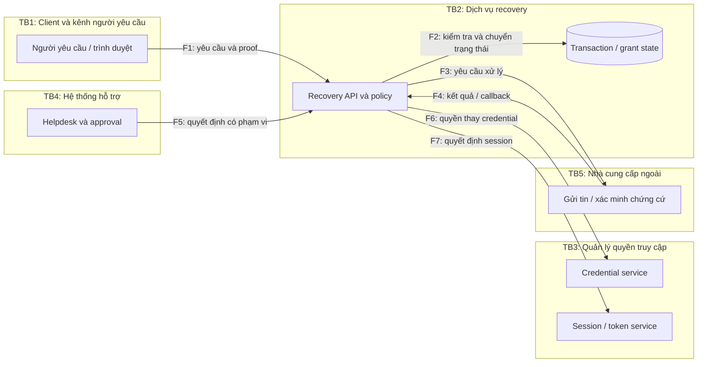

# Recovery threat documentation — Tài liệu hóa đe dọa trong khôi phục tài khoản

## 1. Tài liệu này giúp ra quyết định gì?

Một sơ đồ “gửi mã → kiểm tra mã → đặt lại mật khẩu” chưa cho biết hệ thống bảo vệ tài khoản thế nào khi hộp thư đã bị chiếm, nhân viên hỗ trợ bị đánh lừa hoặc một grant được dùng đồng thời ở hai vùng xử lý. Nếu các giả định này chỉ nằm trong trí nhớ người thiết kế, nhóm triển khai và vận hành rất dễ hiểu khác nhau về quyền mà recovery được phép cấp.

**Recovery threat documentation** là hồ sơ mô tả những điều có thể gây hại trong luồng khôi phục tài khoản, điều kiện để chúng xảy ra, tác động, cách xử lý và căn cứ để kiểm tra cách xử lý đó. Hồ sơ cần giúp người đọc trả lời: “Tình huống nào đang được xét, ranh giới nào có thể bị vượt qua, ai chịu trách nhiệm và còn phần nào chưa biết?”.

Trong `SECURITY_AUTHENTICATION_ACCOUNT_RECOVERY`, phạm vi bao gồm việc mất mật khẩu, MFA, passkey hoặc thiết bị xác thực; việc cấp quyền thay thế phương tiện và kiểm soát session sau recovery cũng thuộc phân tích. Không kết thúc mô hình ngay khi người dùng mở được trang đặt mật khẩu mới.

Tài liệu threat hỗ trợ thiết kế và đánh giá rủi ro. Nó không thay thế runbook xử lý sự cố, hướng dẫn người dùng hay báo cáo kiểm thử. Một threat được mô tả không có nghĩa đã tìm thấy lỗ hổng thực tế; một kiểm soát được liệt kê cũng không có nghĩa đã được triển khai hoặc xác minh.

Các sơ đồ, ID, policy và tình huống trong bài là ví dụ học tập. Chúng không phải kết luận kiểm toán đối với module hoặc bằng chứng một hệ thống đã bị khai thác.

## 2. Dùng thuật ngữ để tránh biến giả định thành sự thật

| Khái niệm | Ý nghĩa trong hồ sơ | Ví dụ recovery |
| --- | --- | --- |
| Tài sản | Thứ cần được bảo vệ | Quyền gắn authenticator mới vào account |
| Tác nhân | Người hoặc hệ thống có thể tác động | Người lạ, người đang giữ session bị đánh cắp, nhân viên có quyền giới hạn |
| Đe dọa, threat | Tình huống có thể gây hại | Grant reset password được dùng để thay MFA |
| Điểm yếu, vulnerability | Một thiếu sót có bằng chứng trong triển khai hoặc thiết kế | Backend quản lý MFA thực sự chấp nhận grant sai purpose |
| Rủi ro | Đánh giá khả năng và hậu quả trong một bối cảnh | Tài khoản đặc quyền có thể bị chuyển quyền kiểm soát |
| Giả định | Điều được tạm coi đúng để phân tích | Chứng cứ từ provider được gắn với đúng transaction |
| Bất biến bảo vệ | Tính chất cần giữ trên mọi đường đi thuộc phạm vi | Reset một yếu tố không tự cấp quyền thay yếu tố khác |
| Biện pháp | Cách ngăn, giảm hoặc phát hiện tình huống | Kiểm tra purpose và quyền thao tác tại backend |
| Bằng chứng | Dữ liệu hỗ trợ kết luận về biện pháp | Test tích hợp, cấu hình deployment, dấu quyết định đã che dữ liệu |
| Sự cố | Sự kiện gây hại hoặc nghi gây hại đang được xử lý | Có dấu hiệu recovery không được chủ tài khoản công nhận |

Không viết “đã có vulnerability chiếm account” chỉ vì có một kịch bản khả dĩ chưa được xác nhận. Ghi rõ mức thông tin: giả thuyết cần kiểm tra, kết quả review thiết kế, lỗi đã tái hiện trong môi trường được phép hoặc sự kiện vận hành đã xác minh.

Tương tự, không dùng “provider an toàn” như một sự thật vô điều kiện. Cần nêu thuộc tính nào đang dựa vào provider, phần nào do ứng dụng phải kiểm tra và khi giả định đó không còn đúng thì điều gì xảy ra.

## 3. Chốt phạm vi và nguồn trước khi viết danh sách threat

### 3.1. Phạm vi phải có đường vào và tác động cuối

Hồ sơ nên nhận diện sản phẩm, loại tài khoản, tenant hoặc nhóm tenant, phiên bản kiến trúc, loại recovery, kênh hỗ trợ và những hệ thống có thể tạo tác động cuối. Nếu có IdP, phải nói rõ phần nào do IdP sở hữu và phần nào ứng dụng vẫn quyết định.

Một phạm vi minh họa:

```text
Model: TM-RECOVERY-EXAMPLE
Service: SECURITY_AUTHENTICATION_ACCOUNT_RECOVERY
Architecture baseline: architecture-example-v4
Flows: password reset, MFA loss, passkey/device loss, assisted recovery
Account classes: customer accounts in the example design
Interfaces: web, mobile API, helpdesk API and provider callbacks
End effects: credential binding, credential removal and session decisions
Not assessed: implementation outside the example architecture
Open questions: recorded separately; not treated as verified assumptions
```

Nếu loại trừ một thành phần, ghi lý do và những phụ thuộc còn lại. “Provider ngoài phạm vi” không đủ để bỏ qua tình huống callback sai account, kết quả bị phát lại hoặc provider timeout khiến ứng dụng mở nhánh yếu hơn.

### 3.2. Nguồn tham chiếu và giới hạn sử dụng

OWASP mô tả threat modeling như một quá trình có hệ thống, cần mô hình hóa hệ thống, nhận diện điều có thể sai, chọn cách xử lý và kiểm tra kết quả. Sơ đồ cần làm rõ luồng dữ liệu và ranh giới tin cậy. Xem [OWASP — Threat Modeling Cheat Sheet](https://cheatsheetseries.owasp.org/cheatsheets/Threat_Modeling_Cheat_Sheet.html).

OWASP Forgot Password Cheat Sheet nêu các điểm như tránh tiết lộ account, bảo vệ token và không dựa tùy ý vào Host header để dựng reset URL. Các điểm đó là đầu vào để đặt câu hỏi, không thay thế mô hình của mọi luồng MFA hoặc passkey. Xem [OWASP — Forgot Password Cheat Sheet](https://cheatsheetseries.owasp.org/cheatsheets/Forgot_Password_Cheat_Sheet.html).

OWASP cũng nhấn mạnh quy trình reset MFA cần tránh trở thành đường vượt MFA; cách phục hồi phải được đánh giá theo bối cảnh ứng dụng. Xem [OWASP — Multifactor Authentication Cheat Sheet, Resetting MFA](https://cheatsheetseries.owasp.org/cheatsheets/Multifactor_Authentication_Cheat_Sheet.html#resetting-mfa).

NIST SP 800-63B-4 phân biệt recovery với trường hợp thay authenticator khi vẫn còn phương tiện xác thực khác; yêu cầu cụ thể liên quan đến mô hình bảo đảm và phương thức áp dụng. Không tự suy một email OTP đủ cho mọi loại account. Xem [NIST — Authenticator Event Management](https://pages.nist.gov/800-63-4/sp800-63b/events/).

Các nguồn được đối chiếu ngày 24/11/2026. Những mã threat và tiêu chí kỹ thuật bên dưới do bài học đề xuất để tổ chức hồ sơ, không phải mã yêu cầu chính thức của các nguồn trên.

## 4. Kiểm kê tài sản và năng lực tác nhân

### 4.1. Tài sản không chỉ là mật khẩu

| Tài sản | Tại sao cần bảo vệ? | Tác động nếu bị sử dụng sai |
| --- | --- | --- |
| Quyền quyết định account nào được recovery | Xác định đối tượng của toàn bộ quy trình | Chuyển quyền sang account hoặc tenant khác |
| Token, mã và recovery grant | Mang quyền thực hiện một bước | Người có bí mật hoặc quyền sai có thể tiếp tục luồng |
| Bằng chứng danh tính và kết quả xác minh | Căn cứ cấp quyền thay phương tiện | Gắn bằng chứng sai chủ thể, dùng lại quyết định cũ |
| Danh sách authenticator | Quy định phương tiện nào có thể xác thực | Gắn phương tiện của đối phương hoặc loại bỏ phương tiện hợp lệ |
| Địa chỉ recovery và notification | Kênh chứng minh quyền hoặc phát hiện thay đổi | Đối phương nhận mã hoặc chủ account không biết có thay đổi |
| Session, refresh token và access token | Quyền truy cập tiếp diễn | Đối phương vẫn hoạt động sau khi người dùng tưởng đã lấy lại account |
| Quyền của nhân viên hỗ trợ | Khả năng xem dữ liệu và phê duyệt ngoại lệ | Lạm dụng hoặc vượt quy trình bằng công cụ nội bộ |
| Dấu quyết định và cấu hình policy | Khả năng giải thích, điều tra và thực thi | Không biết ai cấp quyền; policy bị đổi ngoài kiểm soát |
| Khả năng recovery của người dùng hợp lệ | Tính sẵn sàng của tài khoản | Quấy rối, làm cạn giới hạn hoặc khóa người dùng ra ngoài |

### 4.2. Ghi năng lực cụ thể thay vì gọi chung là “hacker”

Các nhóm tác nhân có thể khác nhau rất nhiều: người chỉ biết email, người đã kiểm soát hộp thư, người có một recovery code, người giữ session bị đánh cắp, nhân viên hỗ trợ có quyền hạn giới hạn hoặc bên có khả năng gửi request đồng thời.

Một kịch bản phải nói tác nhân đang có gì và chưa có gì. Ví dụ “đối phương có hộp thư nhưng không có MFA” khác với “đối phương đã có session được cấp sau xác thực đủ yếu tố”. Nếu gộp hai trường hợp, nhóm dễ đánh giá sai điều kiện để thay authenticator.

Không giả định mọi kẻ tấn công có thể sửa database hoặc chiếm toàn bộ IdP. Có thể xét các tình huống xâm phạm mạnh hơn, nhưng phải ghi thành lớp năng lực riêng để không làm mọi threat đều trở thành cùng một kịch bản toàn quyền.

## 5. Vẽ dữ liệu và ranh giới quyền

Sơ đồ kiến trúc minh họa dưới đây chưa thể hiện mọi chi tiết triển khai. Mã cạnh `F*` và ranh giới `TB*` dùng để tham chiếu trong threat record.



Nằm trong một subgraph không có nghĩa mọi lời gọi đều đáng tin. Sơ đồ biểu diễn vùng có trách nhiệm hoặc quyền hạn khác nhau; vẫn phải xác thực và kiểm tra quyền ở các điểm cần thiết. Một mạng nội bộ không thay thế ràng buộc account, tenant, purpose và transaction.

### 5.1. Bảng cạnh làm sơ đồ có thể kiểm tra

| Cạnh | Dữ liệu hoặc quyết định đi qua | Câu hỏi cần ghi trong tài liệu |
| --- | --- | --- |
| F1 | Định danh, proof, tín hiệu request | Trường nào người yêu cầu kiểm soát; trường nào backend tự lấy? |
| F2 | Trạng thái và quyền dùng một lần | Ai có quyền chuyển trạng thái; có tranh chấp đồng thời không? |
| F3 | Địa chỉ liên hệ hoặc chứng cứ cần xử lý | Dữ liệu tối thiểu là gì; tuyến provider nào được phép? |
| F4 | Kết quả gửi, kết quả xác minh hoặc callback | Làm sao biết nguồn, độ mới và ngữ cảnh của kết quả? |
| F5 | Phê duyệt hoặc yêu cầu ngoại lệ | Vai trò nào được làm gì; có tách quyền cần thiết không? |
| F6 | Quyền đổi mật khẩu hoặc authenticator | Service đích tự kiểm tra quyền nào thay vì tin lời gọi chung? |
| F7 | Thu hồi hoặc hạn chế quyền tiếp diễn | Hành động có hiệu lực ở đâu, khi nào và lỗi được xử lý ra sao? |

Tài liệu nên bổ sung luồng log, backup, tác vụ nền và IdP nếu tồn tại trong kiến trúc thật. Không bỏ chúng chỉ vì sơ đồ ban đầu đã đẹp; chúng có thể giữ token, quyết định hoặc dữ liệu cần bảo vệ.

### 5.2. Liên kết threat với ranh giới

Một dòng “rủi ro giả mạo callback” cần chỉ rõ F4, nguồn phát callback, bằng chứng nguồn gửi, cách gắn với transaction và service sử dụng kết quả. Nếu chỉ ghi tên rủi ro, người triển khai không biết phải chặn ở đâu.

Tương tự, rủi ro helpdesk vượt quyền cần xem cả F5 và F6. Phê duyệt trên giao diện không đủ nếu credential service cho phép một lời gọi nội bộ khác bỏ qua toàn bộ điều kiện.

## 6. Ghi trạng thái và các bất biến bảo vệ

Một mô hình trạng thái phục vụ thảo luận:

```text
REQUESTED → EVIDENCE_PENDING → VERIFIED_FOR_PURPOSE
          → POLICY_CONDITIONS_MET → ACTION_COMMITTED → COMPLETED

Các nhánh kết thúc khác: DENIED / EXPIRED / CANCELLED / REVOKED
Các trạng thái chờ kỹ thuật cần được mô tả riêng nếu thực tế có tồn tại.
```

Đây là mô hình minh họa, không phải yêu cầu code phải có đúng các enum này. Điều quan trọng là phân biệt “có proof”, “proof đã được kiểm tra”, “đủ quyền cho purpose cụ thể” và “hành động đã có hiệu lực”.

Một bộ bất biến nội bộ có thể được viết như sau:

- Một grant chỉ cho phép các hành động đã được cấp cho đúng account, tenant và transaction.
- Proof dùng cho transaction này không tự dùng được ở transaction khác.
- Trạng thái do client khai không đủ để chuyển backend sang đã xác minh.
- Quyền dùng một lần không tạo thêm tác động khi replay hoặc request đồng thời.
- Reset mật khẩu không tự cấp quyền thay MFA hoặc gắn passkey.
- Lỗi provider hoặc hết thời gian chờ không tự làm điều kiện xác minh biến mất.
- Thay địa chỉ nhận mã hoặc notification phải tuân thủ quyền riêng của hành động đó.
- Kết thúc recovery không được tuyên bố mạnh hơn trạng thái credential và session thực tế đã đạt.

Mỗi bất biến cần được nối tới điểm thực thi và phép kiểm tra. Không viết “mọi thứ đều fail-closed” như một câu bảo đảm chung: phải chỉ rõ lỗi nào dẫn tới dừng, chờ, retry hoặc chuyển cấp, và có quyền nào đã được cấp trước lúc lỗi hay chưa.

## 7. Danh mục gợi ý để không bỏ sót đường khôi phục

Bảng dưới là tập câu hỏi cho kiến trúc minh họa. Mỗi dòng cần được đánh giá theo phạm vi thực tế; không tự coi tất cả là lỗ hổng đã tồn tại. Các mã `T-REC-*` do bài học đặt.

| Mã | Kịch bản cần xem xét | Điểm hoặc ranh giới liên quan | Tác động cần đánh giá |
| --- | --- | --- | --- |
| T-REC-01 | Phản hồi hoặc timing cho biết một định danh có account | F1 và luồng tạo transaction | Tiết lộ danh tính và hỗ trợ nhắm mục tiêu |
| T-REC-02 | Token hoặc reset link bị lộ qua URL, log, referrer hoặc đích gửi sai | F1, F3 và luồng telemetry | Chủ thể không được phép có quyền tiếp tục recovery |
| T-REC-03 | Proof hoặc kết quả xác minh bị gắn sang account/transaction khác | F1, F2, F4 | Dùng bằng chứng hợp lệ cho chủ thể không tương ứng |
| T-REC-04 | Grant đúng chữ ký nhưng được dùng sai purpose | F2, F6 | Từ quyền reset mật khẩu sang thay MFA hoặc gắn passkey |
| T-REC-05 | Replay hoặc request đồng thời tạo nhiều tác động | F2, F6 và tác vụ nền | Một lần cấp quyền dẫn tới nhiều lần thay đổi ngoài ý định |
| T-REC-06 | Nhân viên hỗ trợ bị đánh lừa hoặc vượt phạm vi quyền | F5, F6 | Recovery thủ công đi vòng qua policy |
| T-REC-07 | Callback giả, cũ hoặc hợp lệ về nguồn nhưng sai ngữ cảnh | F4 | Backend tin nhầm kết quả gửi hoặc xác minh |
| T-REC-08 | Grant hết hạn hoặc bị thu hồi vẫn được dùng ở một nhánh | F2, F6 | Quyền cũ tiếp tục có tác dụng |
| T-REC-09 | Tráo tenant hoặc dùng định danh không gắn tenant | F1, F4, F5, F6 | Thay đổi tài khoản ngoài phạm vi tenant được phép |
| T-REC-10 | Credential được thay nhưng quyền truy cập của đối phương còn hiệu lực ngoài policy | F7 và các service kiểm tra token | Chiếm account tiếp diễn sau recovery |
| T-REC-11 | Spam recovery làm cạn giới hạn, tài nguyên hoặc khả năng nhận tin | F1, F3, hàng đợi hỗ trợ | Người dùng hợp lệ khó lấy lại account hoặc bị quấy rối |
| T-REC-12 | Provider timeout hoặc failover làm hệ thống chọn nhánh yếu hơn | F3, F4 và bộ chọn policy | Thiếu bằng chứng nhưng vẫn được cấp quyền |
| T-REC-13 | Log thiếu hoặc chứa bí mật recovery | Các luồng ghi dấu quyết định | Không truy vết được, hoặc telemetry thành nguồn lộ quyền |
| T-REC-14 | Thay địa chỉ recovery trước rồi dùng ngay để khôi phục | Luồng quản lý địa chỉ và F3 | Biến thay đổi thông tin liên hệ thành đường chiếm account |

Có thể dùng STRIDE như bộ câu hỏi bổ sung: giả mạo, sửa đổi trái phép, chối bỏ, lộ thông tin, từ chối dịch vụ và nâng quyền. Các nhóm đó giúp rà soát có cấu trúc; tên nhóm không thay thế câu chuyện recovery cụ thể. Cách dùng STRIDE trong threat modeling được giới thiệu trong [OWASP Threat Modeling Cheat Sheet](https://cheatsheetseries.owasp.org/cheatsheets/Threat_Modeling_Cheat_Sheet.html#threat-identification).

Không cần tạo đúng một threat cho mỗi nhóm hoặc ép đủ số lượng. Một kịch bản có thể liên quan nhiều nhóm; điều cần giữ là tác nhân, điều kiện, đường đi và hậu quả.

## 8. Cách viết một threat để người khác kiểm tra được

Một cấu trúc câu hữu ích:

> Khi [điều kiện ban đầu], [tác nhân có năng lực cụ thể] có thể [hành động] qua [điểm vào hoặc luồng], khiến [bất biến bị vi phạm] và dẫn tới [tác động].

Ví dụ chưa tốt:

> MFA có nguy cơ bị bypass.

Ví dụ có thể làm việc tiếp:

> Khi đối phương đã kiểm soát hộp thư nhưng chưa có MFA của account, họ có thể dùng grant của luồng reset password tại chức năng thay MFA nếu backend đích không kiểm tra purpose. Khi đó quyền reset một yếu tố bị mở rộng thành quyền đăng ký phương tiện của đối phương.

Câu thứ hai vẫn là giả thuyết nếu chưa có bằng chứng về backend. Tài liệu cần ghi điều kiện “nếu backend không kiểm tra” và kế hoạch xác minh, thay vì khẳng định triển khai đang sai.

### 8.1. Tiền điều kiện và điều kiện thành công

Tiền điều kiện mô tả thứ tác nhân đã có trước kịch bản. Điều kiện thành công mô tả tác động cuối được xem là vi phạm. Không dùng response `200` làm điều kiện thành công duy nhất nếu hành động gây hại là gắn một authenticator mới.

Một kết quả idempotent có thể trả cùng response cho retry mà không tạo thêm tác động. Ngược lại, response lỗi vẫn có thể xuất hiện sau khi một phần tác động đã được commit. Tài liệu phải chỉ ra trạng thái và quyền cần quan sát sau phép thử.

### 8.2. Chuỗi nhiều bước và quan hệ AND/OR

Một cây mục tiêu giả định:

```text
Mục tiêu: có phương tiện xác thực do đối phương kiểm soát trên account nạn nhân
|
+-- Nhánh A [AND]
|   +-- Đã kiểm soát hộp thư theo kịch bản giả định
|   +-- Nhận được quyền reset mật khẩu
|   +-- Tìm thấy đường dùng quyền đó cho hành động thay MFA/passkey
|
+-- Nhánh B [AND]
|   +-- Có thể tiếp cận quy trình hỗ trợ
|   +-- Làm quy trình chấp nhận bằng chứng không đủ hoặc sai chủ thể
|   +-- Có đường phê duyệt dẫn tới quyền gắn authenticator
|
+-- Nhánh C [AND]
    +-- Có grant hoặc quyết định đã được cấp trong một ngữ cảnh
    +-- Có thể đổi account/tenant hoặc phát lại sang ngữ cảnh khác
    +-- Điểm thực thi không giữ ràng buộc tương ứng
```

Các nhánh A, B, C là những khả năng thay thế ở mức mục tiêu; các điều kiện trong từng nhánh phải phối hợp. Cây này không nói hệ thống thật có tất cả các đường trên. Nó giúp nhóm thấy cần kiểm tra ranh giới nào và điều kiện nào chưa biết.

Nếu bỏ nhãn AND/OR, người đọc có thể hiểu nhầm chỉ cần biết email là đã đủ chiếm account. Tài liệu threat cần mô tả mối liên hệ có điều kiện, không phóng đại năng lực của tác nhân.

## 9. Threat record minh họa

YAML sau là mẫu hồ sơ threat độc lập, không phải schema của file thông tin bài học và không phải cấu hình đang áp dụng. Các ID, owner và tham chiếu đều là dữ liệu giả; hồ sơ được để ở trạng thái chưa xác minh.

```yaml
threatId: T-REC-04-EXAMPLE
modelId: TM-RECOVERY-EXAMPLE
title: Password-reset grant authorizes MFA replacement
architectureVersion: architecture-example-v4
scenarioState: hypothesis

scope:
  service: SECURITY_AUTHENTICATION_ACCOUNT_RECOVERY
  flows:
    - password-reset
    - mfa-replacement
    - passkey-enrollment
  boundaries:
    - TB2
    - TB3
  dataFlows:
    - F2
    - F6

actor:
  capability: controls-registered-mailbox-in-this-scenario
  lacks:
    - currently-bound-mfa
    - authority-to-replace-authenticators

preconditions:
  - password-reset-can-issue-a-scoped-grant
  - target-endpoint-can-be-reached-by-the-requester
  - purpose-enforcement-at-target-is-not-yet-verified

securityInvariant: >-
  A password-reset grant cannot authorize MFA replacement
  or passkey enrollment without the required separate authorization.

impact:
  asset: account-authenticator-binding-authority
  consequence: unauthorized-control-of-an-authenticator
  affectedPopulation: pending-scope-assessment

assumptions:
  - id: A-MAILBOX-EXAMPLE
    statement: mailbox-compromise-is-an-explicit-attacker-capability
    basis: scenario-selection-not-a-verified-incident
  - id: A-ENDPOINT-EXAMPLE
    statement: target-reachability-must-be-confirmed-in-approved-test-scope
    basis: open-question

controls:
  - controlId: C-PURPOSE-EXAMPLE
    state: proposed
    enforcementPoint: credential-service-authorization
    ownerRole: identity-platform-example
    action: validate-purpose-and-action-specific-authority

verification:
  state: planned
  cases:
    - reject-password-grant-for-mfa-replacement
    - reject-password-grant-for-passkey-enrollment
    - preserve-existing-authenticators-on-rejection
  implementationRef: null
  testReportRef: null
  deploymentRef: null

risk:
  initialAssessment: not-assessed
  residualAssessment: not-assessed
  uncertainty: target-enforcement-not-yet-verified

response:
  disposition: pending-decision
  acceptanceRef: null
  nextAction: inspect-and-test-target-authorization-in-approved-environment
```

`scenarioState: hypothesis` không đồng nghĩa đã có vulnerability. `controls[].state: proposed` không đồng nghĩa đã có code. `verification.state: planned` không đồng nghĩa test đã chạy. Giữ các mức này riêng giúp người đọc không suy quá mức từ việc hồ sơ được điền đầy đủ.

Trong hồ sơ thực tế, mỗi open question cần người xử lý và điều kiện hoặc thời hạn xem xét lại phù hợp. Không điền một đường dẫn báo cáo giả hoặc tên người phê duyệt không tồn tại để tránh giá trị `null`.

## 10. Ví dụ chi tiết: hộp thư bị chiếm và ranh giới MFA

### 10.1. Bối cảnh và điều cần bảo vệ

Kiến trúc giả định cho phép người kiểm soát một kênh đã đăng ký bắt đầu reset password, nhưng việc thay MFA cần một kế hoạch recovery khác. Threat model chủ động xét trường hợp hộp thư đã bị đối phương kiểm soát; không giả định kênh đó luôn an toàn.

Tài sản cần giữ là quyền quản lý authenticator. Mục tiêu không phải ngăn mọi người đang giữ hộp thư đi tới trang reset, mà là ngăn quyền của một luồng bị mở rộng sang hành động khác ngoài policy.

### 10.2. Điểm quyết định phải được mô tả

Tài liệu nên ghi grant chứa hoặc tham chiếu những ràng buộc nào, service nào có thẩm quyền kiểm tra và endpoint nào tạo tác động cuối. Kiểm tra ở giao diện hoặc ở một API gateway chưa chứng minh mọi đường nội bộ đều bị giới hạn.

Một biện pháp đề xuất có thể là credential service tự xác minh purpose, account, tenant, trạng thái, thời hạn và quyền cho hành động cụ thể. Các lời gọi từ web, mobile, helpdesk và tác vụ nền phải đi qua ranh giới quyền tương ứng hoặc có cơ chế tương đương được mô tả.

Không dùng “token đã ký” làm kết luận đủ quyền. Chữ ký có thể giúp xác minh tính toàn vẹn và nguồn cấp theo thiết kế, nhưng ý nghĩa quyền vẫn phụ thuộc kiểm tra ngữ cảnh và hành động được phép.

### 10.3. Tiêu chí kiểm tra có thể bác bỏ tuyên bố

| Phép kiểm tra dự kiến | Kết quả cần quan sát |
| --- | --- |
| Dùng grant reset password tại thao tác thay MFA | Backend từ chối vì thiếu quyền phù hợp; không xóa hoặc thay yếu tố hiện có |
| Dùng grant đó để đăng ký passkey | Không tạo registration có hiệu lực nếu chưa có thẩm quyền tương ứng |
| Thực hiện cùng tác động qua công cụ hỗ trợ | Không có đường mở rộng quyền chỉ vì request xuất phát từ giao diện nội bộ |
| Thử grant account hoặc tenant khác | Không đọc hoặc thay đổi đối tượng ngoài phạm vi |
| Thử sau thời hạn hoặc sau thu hồi | Quyền không tiếp tục có tác dụng |
| Thực hiện password reset hợp lệ | Chỉ có tác động mà policy của luồng đó cho phép |

Đây là kế hoạch kiểm tra, chưa phải bằng chứng PASS. Kết quả cần gắn với phiên bản code, policy, cấu hình và phạm vi đã thử. Nếu còn một đường helpdesk chưa được kiểm tra, hồ sơ phải giữ giới hạn đó.

### 10.4. Rủi ro còn lại

Chặn sai purpose không giải quyết mọi rủi ro khi hộp thư bị chiếm. Đối phương vẫn có thể tác động trong những quyền mà policy hợp lệ cấp qua kênh đó. Threat record cần nêu rõ rủi ro còn lại, thay vì đóng toàn bộ chủ đề “mailbox compromise” sau một test từ chối.

Nếu có thay đổi chính sách cho phép recovery mạnh hơn qua tổ hợp bằng chứng khác, đánh giá lại tổ hợp và các giả định về sự độc lập của bằng chứng. Không tự coi hai lần kiểm tra qua cùng một kênh đã bị chiếm là hai nguồn bảo vệ độc lập.

## 11. Ví dụ chi tiết: quyền một lần và lỗi phân tán

### 11.1. Mô tả threat theo tác động

Một mô tả kiểm tra được:

> Khi một grant còn hợp lệ có thể được tiêu thụ bởi nhiều tiến trình, request đồng thời hoặc retry sau lỗi có thể tạo nhiều thay đổi authenticator nếu việc nhận quyền và thực hiện tác động không giữ đúng bất biến dùng một lần.

Threat này không đòi tác nhân biết cách giả chữ ký. Ngay một grant hợp lệ cũng có thể bị sử dụng ngoài số lần cho phép nếu hệ thống xử lý sai trạng thái. Tác nhân và mục đích thử cần được ghi rõ; không đánh đồng mọi retry của người dùng với hành vi tấn công.

### 11.2. Tài liệu phải nói tới nơi có thẩm quyền tiêu thụ

Cần chỉ ra grant lưu ở đâu, điểm nào chuyển nó sang đã tiêu thụ, tác động credential nằm trong cùng hay khác transaction, và retry sau từng điểm lỗi đi về trạng thái nào.

Nếu grant và credential ở cùng database, có thể phân tích cơ chế transaction hoặc conditional update đang được chọn. Nếu credential ở service khác, một transaction cục bộ không tự bao phủ cả lời gọi từ xa. Tài liệu phải mô tả giao thức idempotency, trạng thái trung gian và khôi phục sau lỗi tương ứng.

Outbox hỗ trợ nhất quán giữa trạng thái cục bộ và việc phát ý định hoặc sự kiện theo thiết kế; nó không tự khiến mọi side effect ở provider hoặc service ngoài xảy ra đúng một lần. Đừng dùng tên một mẫu kiến trúc để thay phần phân tích ranh giới.

### 11.3. Kế hoạch kiểm tra và quan sát

| Điểm gây lỗi hoặc cạnh tranh | Điều cần kiểm tra |
| --- | --- |
| Hai tiến trình nhận cùng grant | Chỉ tác động được phép có hiệu lực; không có credential bổ sung ngoài ý định |
| Crash sau giữ quyền nhưng trước thay credential | Có trạng thái phục hồi rõ; không kẹt vĩnh viễn hoặc tự cấp quyền mới không kiểm soát |
| Timeout sau khi service đích có thể đã commit | Retry có thể xác định hoặc đối soát kết quả; không nhân side effect |
| Callback hoặc sự kiện tới lặp | Không tạo thêm quyền từ một quyết định đã xử lý |
| Chuyển vùng khi bản sao trạng thái chậm | Không tự dùng bản sao cũ để cho phép lại grant đã bị tiêu thụ |
| Response lỗi nhưng đã có thay đổi | Hệ thống phát hiện và xử lý trạng thái thực tế; không chỉ dựa vào HTTP code |

Kết luận cần dựa trên thay đổi bền vững, authenticator có hiệu lực và quyền sau thao tác. Hai response giống nhau có thể là idempotency hợp lệ; một response báo lỗi chưa chứng minh không có tác động.

## 12. Nối threat với biện pháp và bằng chứng

Một threat có ích khi dẫn tới quyết định có chủ sở hữu. Các biện pháp cần tách thành những việc ngăn chặn, phát hiện hoặc hỗ trợ phản ứng, vì chúng tạo hiệu quả khác nhau.

Gửi notification có thể giúp chủ account phát hiện một thay đổi. Nó không tự ngăn thay đổi sai quyền. Rate limit có thể làm việc đoán mã khó hơn; nó không sửa grant bị dùng sai purpose. Nhật ký đầy đủ giúp điều tra; nó không tự thu hồi session của đối phương.

| Threat hoặc mục tiêu | Biện pháp đề xuất trong ví dụ | Bằng chứng phù hợp cần có | Giới hạn của bằng chứng |
| --- | --- | --- | --- |
| Sai purpose | Kiểm tra quyền theo hành động tại service tạo tác động | Test grant khác purpose qua các đường vào; review điểm thực thi | Test một endpoint chưa bao phủ mọi đường nội bộ |
| Replay hoặc race | Cơ chế trạng thái và idempotency phù hợp với ranh giới dữ liệu | Test đồng thời, timeout, crash và đối soát side effect | Unit test đơn luồng chưa chứng minh hành vi phân tán |
| Sai tenant | Ràng buộc tenant trong quyết định và đối tượng đích | Test request/callback/approval sai tenant | Tenant ID có trong payload chưa chứng minh được kiểm tra |
| Helpdesk vượt quyền | Quyền theo thao tác, vụ việc và policy; phê duyệt nếu mô hình yêu cầu | Ma trận quyền, test vai trò không đủ quyền, mẫu quyết định đã che dữ liệu | Tài liệu đào tạo chưa chứng minh backend giới hạn quyền |
| Callback sai ngữ cảnh | Xác minh nguồn và liên kết với request, account, transaction, purpose | Test callback giả, cũ, lặp và gắn sai đối tượng | Xác minh nguồn không chứng minh nội dung đủ để cấp mọi quyền |
| Session tiếp diễn ngoài policy | Quy trình thu hồi hoặc hạn chế có phạm vi và thời điểm rõ | Test token cũ ở từng nơi kiểm tra thuộc phạm vi | Xóa một bản ghi session chưa chứng minh gateway đều chặn |
| Lộ token qua telemetry | Schema log theo trường cho phép; kiểm soát pipeline | Kiểm tra log, trace, proxy và hàng đợi với dữ liệu thử nghiệm | Kiểm tra log ứng dụng chưa bao phủ provider hoặc edge |
| Quấy rối qua recovery | Giới hạn phù hợp, xử lý resend và cơ chế khôi phục cho người hợp lệ | Thử tải và lạm dụng trên account thử nghiệm | Chặn theo IP đơn lẻ chưa bao phủ nguồn phân tán |

Một evidence record nên xác định phiên bản code, policy, cấu hình, môi trường, phạm vi thử, phương pháp, kết quả và giới hạn. Nếu chưa có evidence, ghi thiếu và next action; không điền `PASS` chỉ vì đã liên kết một pull request.

### 12.1. Mỗi kết luận phải có phạm vi

Có thể ghi: “Đã xác minh đường web và mobile ở baseline được nêu; đường helpdesk còn chờ kiểm tra”. Câu này hữu ích hơn “đã xử lý threat” khi vẫn còn một đường có cùng quyền tạo tác động chưa được đánh giá.

Không cần phủ định giá trị của evidence cũ khi có khoảng trống mới. Giữ bằng chứng theo đúng phạm vi của nó, ghi phần bị ảnh hưởng và mở lại những kết luận không còn đủ căn cứ.

### 12.2. Dấu quyết định phải hỗ trợ đối soát

Một sự kiện quyết định có thể ghi mã tham chiếu transaction, policy version, loại hành động, nhóm kết quả, mã lý do và vai trò thực hiện. Những trường này giúp nối thao tác với threat và test mà không lưu bí mật.

Nếu dùng công cụ hỗ trợ tự động phân tích ticket hoặc tài liệu, nội dung người yêu cầu gửi vẫn là dữ liệu không đáng tin cậy. Văn bản trong ticket không được tự trở thành chỉ thị thay policy, bỏ xác minh hoặc gọi công cụ cấp quyền. Tài liệu threat cần mô tả ranh giới giữa nội dung hỗ trợ và thẩm quyền backend nếu thành phần đó thực sự tồn tại.

## 13. Ưu tiên rủi ro và ghi phần chưa chắc chắn

Một threat record nên mô tả hậu quả, khả năng thực hiện trong bối cảnh đã chọn, số đối tượng có thể bị ảnh hưởng và mức độ tin cậy của đánh giá. Không phải mọi câu hỏi chưa rõ đều cần cùng mức ưu tiên, nhưng “chưa biết” cũng không thể mặc nhiên bằng “rủi ro thấp”.

Một cách ghi định tính trong ví dụ:

```text
Threat: T-REC-04-EXAMPLE
Impact: có thể chuyển quyền quản lý authenticator của account
Exposure: phụ thuộc các endpoint và loại grant thực tế; chưa kiểm kê đủ
Likelihood basis: kịch bản đã giả định đối phương kiểm soát hộp thư
Confidence: thấp về triển khai đích, cần xác minh enforcement
Priority rationale: hậu quả lớn và ranh giới quyền chưa có bằng chứng
Next action: kiểm kê đường tạo tác động, review và test trong phạm vi được phép
```

Không gọi “khả năng cao” chỉ vì kịch bản đáng sợ. Nếu lý do là endpoint public, tác nhân chỉ cần một quyền phổ biến hoặc có bằng chứng lỗi tương tự trong hệ thống, ghi lý do đó. Nếu là giả định để stress-test thiết kế, ghi đúng là giả định.

### 13.1. Điểm số không tự tạo độ chính xác

Tổ chức có thể dùng thang định tính hoặc phương pháp chấm điểm đã chọn. Khi đó cần định nghĩa ý nghĩa các mức, nguồn căn cứ và cách ưu tiên xử lý. Nhân hai số do nhóm tự ước lượng không tự tạo ra xác suất hay giá trị thiệt hại đã được hiệu chuẩn.

Đối với recovery của account đặc quyền, hậu quả có thể khác account thông thường. Nếu cùng một điểm yếu có tác động rất khác theo loại account, giữ phân tích đó thay vì lấy một điểm trung bình che mất nhóm nghiêm trọng.

### 13.2. Phản ứng và rủi ro còn lại

Một quyết định có thể là loại bỏ đường tạo quyền không cần thiết, bổ sung kiểm soát, giới hạn phạm vi hoặc chấp nhận phần rủi ro còn lại theo thẩm quyền. Dựa vào provider không làm rủi ro biến mất; phải xác định phần được chuyển trách nhiệm và phần nhóm vẫn phải thực thi.

Nếu chấp nhận rủi ro, ghi người hoặc vai trò có thẩm quyền, lý do, phạm vi, thời hạn hoặc điều kiện đánh giá lại và các biện pháp kèm theo. Không coi im lặng của người review hoặc một issue đóng là bằng chứng chấp nhận.

Không đóng threat chỉ vì một biện pháp phát hiện đã được thêm. Nếu mục tiêu ban đầu là ngăn cấp sai quyền, một cảnh báo sau khi cấp quyền chỉ xử lý một phần; phần còn lại phải được đánh giá và công bố.

## 14. Tổ chức hồ sơ để vừa dùng được vừa bảo vệ được

Một bộ hồ sơ threat có thể gồm phần tóm tắt, sơ đồ hệ thống, danh sách tài sản, giả định, threat register, quyết định xử lý, liên kết test và lịch sử thay đổi. Không nhất thiết phải dùng nhiều tệp; cấu trúc phải đủ rõ để người có trách nhiệm tìm được thông tin.

### 14.1. Phân lớp nội dung theo nhu cầu truy cập

| Nhóm nội dung | Người cần dùng | Cách bảo vệ cần xem xét |
| --- | --- | --- |
| Nguyên tắc và mô hình khái quát | Nhóm phát triển, vận hành và hỗ trợ phù hợp | Dễ tìm, có phiên bản và owner |
| Chi tiết enforcement và kịch bản kiểm thử | Người triển khai và người kiểm tra có thẩm quyền | Quyền truy cập theo phạm vi công việc |
| Evidence có dữ liệu nhạy cảm | Nhóm được phép điều tra hoặc đánh giá | Kho riêng, kiểm soát đọc/xuất và lưu giữ phù hợp |
| Runbook sự cố | Nhóm trực và người phản ứng được chỉ định | Hướng dẫn hành động cụ thể, kiểm soát thay đổi |
| Hướng dẫn recovery công khai | Người sử dụng dịch vụ | Không chứa bí mật, cấu hình nhạy cảm hoặc dữ liệu người khác |

Phân quyền tài liệu không thay thế kiểm soát kỹ thuật của sản phẩm. Mục đích là bảo vệ dữ liệu và thông tin vận hành không cần công khai, đồng thời vẫn cho đúng người tiếp cận đủ để review.

Không đặt reset URL còn hiệu lực, OTP, recovery code, session cookie, khóa hoặc ảnh giấy tờ thật trong ví dụ. Dùng dữ liệu tổng hợp và liên kết evidence được phân quyền. Một đường dẫn evidence chỉ có giá trị khi người có trách nhiệm có thể xác minh được nó theo quy trình phù hợp.

### 14.2. Giữ traceability mà không sao chép bí mật

Threat ID nên ổn định qua các lần chỉnh sửa để liên kết tới quyết định, test và issue. Khi tách một threat thành nhiều kịch bản, giữ quan hệ với ID cũ và giải thích phần nào đã đổi; không tái sử dụng ID cũ cho một ý nghĩa không liên quan.

Liên kết evidence bằng mã hoặc đường dẫn tới kho được quản lý. Tài liệu tóm tắt có thể nói kết quả, phạm vi và giới hạn mà không nhúng toàn bộ payload nhạy cảm.

Bản chụp cấu hình hoặc checksum có thể hỗ trợ xác nhận phiên bản và phát hiện thay đổi. Chúng không tự chứng minh kiểm soát đúng hoặc evidence phản ánh sự thật; vẫn cần nguồn gốc, phương pháp kiểm tra và người đánh giá.

## 15. Cập nhật threat model cùng thay đổi hệ thống

Một threat model có thể đúng ở một baseline nhưng trở nên thiếu khi thêm đường recovery mới. Vì vậy cần owner của mô hình, owner từng threat hoặc biện pháp, phiên bản kiến trúc/policy và các tín hiệu bắt buộc xem xét lại.

| Thay đổi | Phần tài liệu cần rà soát |
| --- | --- |
| Thêm luồng mobile hoặc API đối tác | Inventory đường vào và quyền tạo tác động cuối |
| Cho helpdesk thao tác mới | Tác nhân nội bộ, ranh giới quyền và phê duyệt |
| Thay provider gửi tin hoặc xác minh | Dữ liệu qua ranh giới, callback, lỗi và trách nhiệm chia sẻ |
| Thêm recovery code hoặc phương án mất toàn bộ thiết bị | Năng lực tác nhân, phương thức, trạng thái và bất biến |
| Thay đổi luồng quản lý email/số điện thoại | Đường đổi kênh trước khi nhận mã và notification |
| Thay grant hoặc cách kiểm tra token | Purpose, audience/ngữ cảnh theo thiết kế, hết hạn, thu hồi và replay |
| Thêm vùng xử lý hoặc đổi cơ chế lưu trạng thái | Race, nhất quán, failover, backup và hồi sinh quyền cũ |
| Đổi session/IdP integration | Hiệu lực thu hồi và quyền truy cập tiếp diễn |
| Có sự cố hoặc kết quả test mới | Giả định, likelihood, bằng chứng, biện pháp và rủi ro còn lại |

Thay đổi tài liệu cần giữ được lịch sử quyết định. Một threat đã được xác minh ở phiên bản cũ không tự tiếp tục được coi là verified nếu điểm enforcement hoặc policy liên quan đã đổi.

### 15.1. Giả định có owner và điều kiện xem xét lại

Ví dụ “callback luôn gắn đúng transaction” phải được tách thành hợp đồng hoặc kiểm soát có thể kiểm tra. Nếu chưa biết provider có hỗ trợ ngữ cảnh đó hay không, ghi open question và giao người xác minh. Không dùng giả định làm chỗ đẩy một ranh giới an toàn chưa được thiết kế.

Một giả định phục vụ mô hình năng lực đối phương, như “hộp thư có thể bị chiếm”, khác với một giả định về hệ thống, như “credential service kiểm tra purpose”. Giả định thứ nhất chọn tình huống phân tích; giả định thứ hai có thể cần evidence trước khi kết luận biện pháp hiệu quả.

### 15.2. Review không chỉ là xin một dấu phê duyệt

Người review cần có đủ thông tin để đặt câu hỏi về đường bị bỏ sót, quyền sau recovery và các giả định chưa có căn cứ. Đại diện backend, vận hành, hỗ trợ và các owner phụ thuộc có thể nắm những phần khác nhau của hệ thống.

Ghi rõ quyết định, câu hỏi còn mở và next action. Nếu một câu hỏi quan trọng chưa có câu trả lời, hồ sơ không nên biểu diễn rằng toàn bộ mô hình đã được xác nhận chỉ vì cuộc họp đã kết thúc.

## 16. Những lỗi tài liệu làm mất giá trị phân tích

| Cách viết hoặc tổ chức sai | Vấn đề | Cách làm rõ |
| --- | --- | --- |
| Chỉ có danh sách từ khóa như phishing, replay, MFA bypass | Không biết kịch bản áp dụng ở đâu | Ghi tác nhân, điều kiện, luồng và hậu quả |
| Mọi tác nhân đều được giả định toàn quyền | Không phân biệt ranh giới còn cần bảo vệ | Chia lớp năng lực và xét từng kịch bản |
| “Có HTTPS nên token an toàn” | Chưa xét đích gửi, log, client hoặc quyền sử dụng | Theo dõi vòng đời token qua từng tuyến |
| “Token có chữ ký nên được phép thay MFA” | Nhầm toàn vẹn với quyền hành động | Ghi purpose và kiểm tra quyền tại điểm tác động |
| “Helpdesk được tin cậy” | Bỏ qua lừa đảo, sai sót và vượt quyền | Mô tả quyền cụ thể, phạm vi dữ liệu và backend enforcement |
| “Có unit test” được dùng để đóng threat race | Thiếu bằng chứng về cạnh tranh và lỗi phân tán | Thiết kế test đúng ranh giới và quan sát side effect |
| Issue đã đóng được hiểu là rủi ro đã hết | Trạng thái công việc khác với kết luận bảo vệ | Ghi evidence và residual risk riêng |
| Sơ đồ chỉ có web reset password | Bỏ mobile, hỗ trợ, callback và session | Kiểm kê mọi đường có cùng tác động |
| Tệp chứa token hoặc chứng cứ thật để minh họa | Tạo thêm nguồn lộ bí mật | Dùng dữ liệu tổng hợp và kho evidence được phân quyền |
| Model không gắn phiên bản | Không biết kết luận áp dụng deployment nào | Gắn baseline và điều kiện xem xét lại |

Tài liệu quá dài nhưng không chỉ ra owner, quyết định hoặc phép kiểm tra vẫn khó sử dụng. Ngược lại, một threat record ngắn nhưng có đầy đủ điều kiện, điểm thực thi và next action có thể giúp nhóm giải quyết vấn đề ngay.

## 17. Bài tập tự kiểm tra

**Tình huống:** Một ứng dụng có web recovery, mobile API và công cụ hỗ trợ. Nhóm ghi “reset password không bypass MFA” vì giao diện web không hiển thị nút thay MFA. Công cụ hỗ trợ có chức năng gắn authenticator sau khi ticket được đánh dấu đã xử lý. Chưa rõ backend kiểm tra quyền nào ở thao tác đó.

**Câu 1: Có thể khẳng định đã tìm thấy vulnerability chưa?**

Chưa chỉ từ mô tả trên. Có một ranh giới chưa được xác minh và một threat cần đánh giá. Cần kiểm tra quyền backend và điều kiện thực hiện trong môi trường được phép trước khi khẳng định triển khai có lỗi.

**Câu 2: Bất biến cần ghi là gì?**

Quyền của luồng reset password hoặc trạng thái ticket không tự cấp thẩm quyền gắn MFA/passkey. Hành động đó phải được cấp quyền theo policy tương ứng cho đúng account, tenant và transaction.

**Câu 3: Những đường nào cần kiểm tra?**

Các đường có thể tạo cùng tác động: web, mobile, API của công cụ hỗ trợ và tác vụ nền nếu tồn tại. Không cần giả định đường chưa được biết là chắc chắn có; cần inventory và ghi open question.

**Câu 4: Bằng chứng nào có sức thuyết phục hơn ảnh chụp giao diện không có nút?**

Review điểm backend tạo tác động, ma trận quyền và các test dùng grant hoặc vai trò không đủ quyền, kèm quan sát authenticator không bị thay đổi. Kết quả phải ghi baseline, phạm vi và phần chưa kiểm tra.

**Câu 5: Nếu test từ chối đúng qua web và mobile nhưng helpdesk chưa được thử thì ghi trạng thái thế nào?**

Ghi phần đã xác minh theo hai đường đó và giữ khoảng trống helpdesk. Không nâng kết luận thành bao phủ toàn hệ thống; giao owner và next action cho phần còn lại.

**Câu 6: Nếu thêm notification sau thao tác, có thể đóng threat cấp sai quyền không?**

Không chỉ vì thêm notification. Nó có thể hỗ trợ phát hiện và phản ứng, nhưng không tự sửa cơ chế cấp quyền. Cần đánh giá phần giảm rủi ro thực tế và phần rủi ro còn lại.

## 18. Điều kiện để bàn giao một tài liệu threat có thể sử dụng

Trước khi dùng hồ sơ để hỗ trợ quyết định triển khai, người đọc cần tìm được các nội dung sau:

- Phạm vi, baseline kiến trúc và các đường recovery có thể tạo tác động.
- Tài sản, tác nhân, năng lực ban đầu, sơ đồ dữ liệu và ranh giới quyền.
- Giả định được phân biệt với sự thật đã xác minh và câu hỏi chưa rõ.
- Các threat có điều kiện, đường đi, bất biến bị đe dọa và tác động cụ thể.
- Biện pháp có owner, trạng thái triển khai và điểm thực thi rõ.
- Kế hoạch kiểm tra, evidence thực tế nếu có, phạm vi kết luận và giới hạn.
- Rủi ro còn lại, quyết định xử lý và điều kiện mở lại khi hệ thống thay đổi.
- Quyền truy cập tài liệu và cách bảo vệ dữ liệu dùng làm bằng chứng.

Một hồ sơ tốt cho phép nhóm lần từ câu chuyện gây hại tới quyết định thiết kế và phép kiểm tra tương ứng, rồi lần ngược từ thay đổi triển khai tới các threat cần đánh giá lại. Nó giữ cho quyền khôi phục mật khẩu, MFA, passkey và session được giải thích bằng các ranh giới có thể kiểm chứng, thay vì bằng sự tin tưởng ngầm giữa các thành phần.


