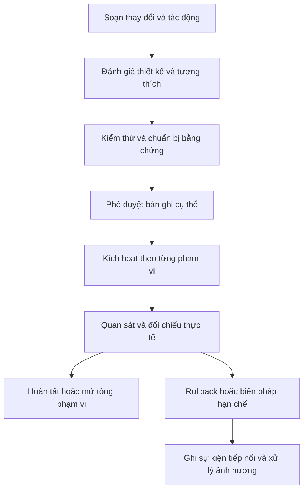

# Recovery change log — Lịch sử thay đổi luồng khôi phục tài khoản

## 1. Recovery change log ghi lại điều gì?

**Recovery change log** là lịch sử có cấu trúc của các thay đổi làm ảnh hưởng đến cách hệ thống khôi phục tài khoản. Một mục thay đổi tốt cho biết hành vi cũ, hành vi mới, lý do thay đổi, phạm vi áp dụng, thời điểm có hiệu lực, cách xử lý yêu cầu đang chạy và bằng chứng xác nhận việc triển khai.

Trong phạm vi `SECURITY_AUTHENTICATION_ACCOUNT_RECOVERY`, đối tượng cần theo dõi bao gồm khôi phục khi mất mật khẩu, MFA, passkey hoặc thiết bị xác thực. Thay đổi có thể xuất phát từ mã nguồn, chính sách, cấu hình, feature flag, nhà cung cấp xác minh hoặc quy trình hỗ trợ. Vì vậy, chỉ có danh sách commit của ứng dụng là chưa đủ để giải thích hành vi thực tế.

Ví dụ, một đội giảm thời hạn liên kết đặt lại mật khẩu từ 15 phút xuống 10 phút. Dòng ghi chú “cải thiện bảo mật recovery” không trả lời được các câu hỏi sau:

- Liên kết đã phát hành trước thời điểm thay đổi còn dùng được theo hạn cũ không?
- Cấu hình mới áp dụng cho tất cả khu vực hay chỉ một nhóm thử nghiệm?
- Nếu người dùng đã hoàn tất xác minh nhưng chưa đổi mật khẩu, họ có cần bắt đầu lại không?
- Nếu phải rollback ứng dụng, liên kết đã dùng hoặc đã bị thu hồi có hoạt động trở lại không?
- Bộ phận hỗ trợ căn cứ vào phiên bản nào để giải thích một trường hợp cụ thể?

Recovery change log giúp trả lời những câu hỏi đó bằng dữ liệu kiểm chứng được. Nó là tài liệu về **sự thay đổi của cơ chế bảo vệ**, không phải kho chứa bí mật xác thực hoặc hồ sơ xác minh của từng người dùng.

Sau bài học, người học có thể thiết kế một mục change log đủ thông tin, liên kết thay đổi với phiên bản chính sách, mô tả tương thích cho yêu cầu đang chạy và dùng lịch sử thay đổi khi điều tra sự cố.

Tất cả mã định danh, ngày giờ, chỉ số, phiên bản và giá trị cấu hình trong ví dụ dưới đây đều là dữ liệu giả định phục vụ học tập. Các thời hạn và ngưỡng minh họa không phải giá trị chuẩn cho mọi hệ thống.

## 2. Phân biệt change log với những tài liệu liên quan

Nhiều hệ thống đã có release note và audit log nhưng vẫn không tái dựng được việc thay đổi recovery. Nguyên nhân thường là mỗi tài liệu giải quyết một câu hỏi khác nhau.

| Tài liệu hoặc nguồn dữ liệu | Câu hỏi chính | Ví dụ trong recovery | Giới hạn |
| --- | --- | --- | --- |
| Git history | Mã nguồn nào đã thay đổi? | Sửa hàm kiểm tra hạn token | Không tự phản ánh cấu hình đang bật trong production |
| ADR hoặc quyết định thiết kế | Vì sao chọn phương án này? | Vì sao tách luồng mất MFA khỏi đặt lại mật khẩu | Không chứng minh phương án đã có hiệu lực |
| Recovery change log | Hành vi recovery đã thay đổi thế nào và trong phạm vi nào? | Revision mới thay đổi TTL và quy tắc chuyển tiếp | Cần đối chiếu với bằng chứng triển khai |
| Deployment/configuration event | Thành phần nào thực sự được kích hoạt lúc nào? | Config revision được bật tại khu vực A | Không thay phần giải thích quyết định và tác động |
| Recovery audit event | Một yêu cầu cụ thể đã đi qua quyết định nào? | Yêu cầu bị từ chối vì recovery epoch đã bị thu hồi | Không thay lịch sử thay đổi toàn hệ thống |
| Runbook | Người vận hành phải làm gì? | Dừng phát hành token khi nhà cung cấp có sự cố | Mô tả thao tác hiện hành, không tự lưu mọi phiên bản đã áp dụng |
| Release note cho người dùng | Người dùng cần biết hoặc làm gì? | Đăng nhập lại sau khi khôi phục thành công | Cần lược bỏ chi tiết nội bộ không phục vụ người dùng |

Một chuỗi liên kết có ích là:

```text
Change ID
  -> quyết định thiết kế
  -> artifact mã nguồn + artifact cấu hình
  -> kết quả kiểm thử
  -> sự kiện kích hoạt theo phạm vi
  -> phiên bản chính sách trong recovery audit event
```

Các liên kết này cho phép đi theo cả hai chiều. Từ một thay đổi, đội vận hành tìm được yêu cầu chịu ảnh hưởng. Từ một yêu cầu bất thường, đội điều tra xác định được chính sách và các thay đổi đã tác động đến nó.

Một tài liệu ghi “đã triển khai” chưa đủ chứng minh production đã dùng chính sách đó. Cần có deployment event, cấu hình quan sát được hoặc bằng chứng tương đương từ hệ thống thực thi. Ngược lại, việc một binary đã được triển khai không chứng minh feature flag bên trong binary đã được kích hoạt.

## 3. Những thay đổi nào phải được ghi nhận?

Tiêu chí thực tế là: **thay đổi có thể làm thay đổi điều kiện được khôi phục, mức rủi ro, trải nghiệm hoặc khả năng giải thích quyết định hay không?** Nếu có, nên tạo mục change log hoặc liên kết nó vào một thay đổi đã được quản lý.

### 3.1. Thay đổi token và mã khôi phục

Nhóm này bao gồm thời hạn sử dụng, cách phát hành, cách lưu dấu kiểm tra, điều kiện dùng một lần, ràng buộc với tài khoản và tenant, điều kiện thu hồi, quy tắc phát hành lại, định dạng và phiên bản parser.

Một thay đổi từ token định dạng A sang B cần nói rõ thành phần nào phát hành B, thành phần nào còn chấp nhận A và thời điểm kết thúc chấp nhận A. Không thể chỉ ghi “hỗ trợ token mới” rồi bỏ qua liên kết cũ còn trong hộp thư người dùng.

Các nguyên tắc nền như token đủ khó đoán, có thời hạn phù hợp và bị vô hiệu sau khi sử dụng được trình bày trong [OWASP Forgot Password Cheat Sheet](https://cheatsheetseries.owasp.org/cheatsheets/Forgot_Password_Cheat_Sheet.html). Change log của sản phẩm phải chỉ ra thay đổi cụ thể nào đã tác động đến cách thực thi những nguyên tắc đó.

### 3.2. Thay đổi bằng chứng và mức xác minh

Ví dụ gồm thay đổi bằng chứng cần có khi mất MFA, điều kiện chuyển sang xác minh thủ công, quy tắc dùng thiết bị đã đăng ký hoặc quy trình đăng ký lại authenticator.

Đối với passkey, cần diễn đạt chính xác rằng hệ thống thay đổi cách chứng minh quyền sở hữu tài khoản và đăng ký authenticator mới. Không mô tả khôi phục tài khoản như khả năng lấy lại khóa riêng passkey từ máy chủ. Việc đồng bộ hoặc phục hồi credential ở phía nhà cung cấp passkey là một cơ chế riêng, cần phân biệt với quy trình của dịch vụ.

Nếu một thay đổi cho phép dùng phương thức yếu hơn khi nhà cung cấp mạnh hơn bị lỗi, đó là thay đổi đường đi của cơ chế xác minh. Nó cần được xem xét như một thay đổi bảo mật, kể cả khi mục đích ban đầu chỉ là giảm lỗi vận hành.

### 3.3. Thay đổi kiểm soát lạm dụng

Phải xem xét các thay đổi về giới hạn yêu cầu, resend, số lần nhập sai, chống tự động hóa, tín hiệu rủi ro và hành vi khi các dịch vụ kiểm soát đó không phản hồi.

Nội dung nội bộ cần đủ chi tiết để vận hành và kiểm tra. Bản thông báo công khai thường chỉ cần nêu tác động người dùng, cách xử lý khi gặp giới hạn và kênh hỗ trợ. Không mặc định công khai mọi ngưỡng hoặc tín hiệu phát hiện chỉ vì chúng xuất hiện trong change log nội bộ.

### 3.4. Thay đổi hậu quả sau khôi phục

Việc đặt lại mật khẩu, thay MFA hoặc đăng ký authenticator mới có thể tác động đến session, refresh token, thiết bị tin cậy và các yêu cầu recovery đang chờ. Change log phải nêu rõ từng loại trạng thái bị thu hồi, giữ lại hoặc yêu cầu xác minh thêm.

“Đăng xuất mọi nơi” là một mô tả quá rộng nếu triển khai thực tế chỉ thu hồi refresh token mà access token còn sống đến hết hạn. Tài liệu cần mô tả đúng mô hình session và giới hạn hiệu lực của việc thu hồi mà hệ thống đã triển khai.

### 3.5. Thay đổi trải nghiệm và hỗ trợ

Thay đổi thông báo, ngôn ngữ, màn hình chờ, cách thể hiện thời hạn, accessibility hoặc kịch bản hỗ trợ cũng có thể làm thay đổi khả năng hoàn tất recovery.

Ví dụ, giao diện hiển thị “liên kết hết hạn sau 15 phút” trong khi backend đã áp dụng 10 phút là một sai lệch cần ghi nhận và sửa. Thay đổi chỉ nằm trong email template cũng có thể khiến liên kết không hoạt động hoặc khiến người dùng hiểu sai yêu cầu xác minh.

## 4. Cấu trúc của một mục change log có thể kiểm chứng

Không cần dùng một schema giống nhau cho mọi tổ chức. Tuy nhiên, nên trả lời đủ các nhóm thông tin sau.

| Nhóm | Nội dung nên có | Sai sót thường gặp |
| --- | --- | --- |
| Định danh | Change ID ổn định, phiên bản bản ghi, chủ sở hữu | Chỉ dùng tên release không duy nhất |
| Lý do | Vấn đề, mục tiêu, rủi ro cần giảm | “Tăng cường bảo mật” không có hành vi cụ thể |
| Hành vi | Trước/sau, phương thức recovery chịu tác động | Chỉ liệt kê file mã nguồn |
| Phạm vi | Môi trường, khu vực, cohort, tenant policy | Ghi “production” khi mới bật một phần |
| Thời gian | Thời điểm dự kiến, thời điểm kích hoạt thực tế | Dùng ngày sửa tài liệu làm ngày có hiệu lực |
| Tương thích | Yêu cầu mới, token cũ, yêu cầu đang chạy, client cũ | Ngầm giả định mọi đối tượng dùng chính sách mới |
| Phiên bản | App, config, policy, template hoặc provider mapping | Dùng một số version đại diện cho mọi thành phần |
| Kiểm chứng | Test run, deployment event, quan sát sau triển khai | Chỉ có tên người phê duyệt |
| Rollback | Điều kiện kích hoạt, thao tác được phép, giới hạn | Tưởng rollback khôi phục cả trạng thái đã thu hồi |
| Truyền thông | Runbook, hỗ trợ, thông báo người dùng | Backend thay đổi nhưng hướng dẫn vẫn cũ |
| Bảo vệ dữ liệu | Phân loại truy cập, dữ liệu bị loại bỏ | Đính kèm token thật hoặc giấy tờ xác minh |

Chủ sở hữu phải là vai trò hoặc đội có trách nhiệm duy trì thay đổi. Định danh người phê duyệt có thể nằm trong hệ thống kiểm soát thay đổi có phân quyền, thay vì sao chép tên và thông tin liên lạc sang mọi tài liệu.

### Ví dụ bản ghi phê duyệt

Ví dụ sau minh họa một bản ghi đã được phê duyệt, chưa tự khẳng định đã được kích hoạt. Các trường và quy ước là thiết kế minh họa của bài học.

```yaml
schema_version: 1
change_id: REC-CHANGE-0042
record_revision: 1
record_kind: APPROVED_CHANGE
title: Giam TTL cho lien ket dat lai mat khau moi
owner_team: identity-platform
service: SECURITY_AUTHENTICATION_ACCOUNT_RECOVERY
decision_ref: ADR-REC-0042

scope:
  environment: production
  regions:
    - region-a
  cohort_definition_ref: COHORT-RESET-0042
  recovery_methods:
    - PASSWORD_RESET_EMAIL

reason:
  problem: Thoi gian lien ket con hieu luc dai hon muc tieu rui ro
  goal: Rut ngan cua so su dung cua lien ket moi

versions:
  policy_before: recovery-policy-r17
  policy_after: recovery-policy-r18
  config_before: recovery-config-r51
  config_after: recovery-config-r52
  application_release: identity-service-7.4.0
  artifact_manifest_ref: ARTIFACT-REC-0042

behavior:
  token_ttl_before_seconds: 900
  token_ttl_after_seconds: 600
  effective_boundary: SERVER_SELECTED_POLICY_AT_ISSUANCE
  existing_tokens: KEEP_PERSISTED_EXPIRY_UNLESS_REVOKED
  existing_requests: KEEP_PINNED_POLICY_WITH_CURRENT_REVOCATION_CHECKS
  single_use_enforcement: UNCHANGED_ATOMIC_CONSUMPTION

activation_plan:
  not_before: '2030-04-09T14:00:00Z'
  deployment_plan_ref: DEPLOY-PLAN-0042
  activation_evidence_required: true

verification:
  test_run_ref: TEST-RUN-0042
  required_cases:
    - TOKEN_ISSUED_BEFORE_BOUNDARY
    - TOKEN_ISSUED_AFTER_BOUNDARY
    - CONCURRENT_REDEMPTION
    - REVOKED_TOKEN_AFTER_APPLICATION_ROLLBACK

rollback:
  procedure_ref: RUNBOOK-ROLLBACK-0042
  target_config: recovery-config-r51
  restore_consumed_tokens: false
  restore_revoked_tokens: false
  extend_existing_token_expiry: false

communications:
  support_runbook_revision: support-recovery-r12
  email_template_revision: reset-email-r08
  public_notice_ref: NOTICE-REC-0042

approval_ref: APPROVAL-REC-0042
approved_at: '2030-04-09T12:30:00Z'
```

Các mã `ADR-REC-0042`, `TEST-RUN-0042` và những mã tương tự là tham chiếu giả định, không phải tuyên bố đã có bằng chứng thật. Trong hệ thống thực tế, tham chiếu phải phân giải được đến artifact phù hợp quyền truy cập, có phiên bản và có chính sách lưu giữ rõ ràng.

`not_before` biểu thị thời điểm sớm nhất dự kiến được kích hoạt. Thời điểm có hiệu lực thực tế phải lấy từ sự kiện activation theo từng phạm vi. Nếu triển khai bị hoãn, không sửa ngược `not_before` để tạo cảm giác kế hoạch và thực tế luôn trùng nhau.

## 5. Tách phiên bản ứng dụng, chính sách và cấu hình

Một binary có thể phục vụ nhiều policy revision cùng lúc. Một cấu hình có thể bật hành vi đã có sẵn trong binary từ vài tuần trước. Vì thế, không dùng duy nhất `application_release` để suy ra quy tắc recovery.

Nên phân biệt các định danh sau:

- **Application release:** phiên bản mã nguồn thực thi.
- **Policy revision:** phiên bản ý nghĩa nghiệp vụ và bảo mật của quyết định recovery.
- **Configuration revision:** tập giá trị cấu hình cụ thể và nguồn cấp cấu hình.
- **Token format version:** phiên bản cấu trúc và cách giải mã token, nếu có.
- **Message/template revision:** phiên bản nội dung giao tiếp với người dùng.
- **Rollout revision:** định nghĩa nhóm áp dụng và trạng thái phân phối chính sách.

Ví dụ `identity-service-7.4.0` hỗ trợ cả `recovery-policy-r17` và `r18`, nhưng chỉ region A đang phát hành token mới theo `r18`. Một ticket ở region B chưa thể được giải thích bằng quy tắc mới chỉ vì đội phát triển đã phát hành binary 7.4.0.

Không suy ra “bảo mật hơn” bằng cách so sánh số revision. Revision r19 có thể đổi nhà cung cấp hoặc sửa thông báo mà không tăng mức xác minh. Hai policy cũng có thể khác nhau theo nhiều chiều: hạn token ngắn hơn nhưng yêu cầu bằng chứng nhẹ hơn. Không có phép `max(version)` hoặc “chọn policy mới nhất” đủ để quyết định policy nào phù hợp cho một yêu cầu cũ.

Nếu tổ chức dùng Semantic Versioning cho một API, điều đó không tự định nghĩa cách version recovery policy. Cần mô tả riêng những gì được xem là thay đổi tương thích, thay đổi cần xác minh lại và thay đổi phải dừng yêu cầu cũ.

## 6. Thời điểm có hiệu lực và yêu cầu đang chạy

Đây là phần quan trọng nhất khi change log được dùng để giải thích một trường hợp thật. Recovery thường kéo dài qua nhiều bước và có thể diễn ra trên nhiều thiết bị, khu vực hoặc dịch vụ.

### 6.1. Các mốc thời gian khác nhau

Không gộp các mốc sau vào một trường `date`:

| Mốc | Ý nghĩa |
| --- | --- |
| `authored_at` | Bản ghi được tạo |
| `approved_at` | Phạm vi thay đổi được phê duyệt |
| `scheduled_at` | Thời điểm dự kiến thực hiện |
| `activated_at` | Hệ thống thực thi đã kích hoạt trong phạm vi cụ thể |
| `observed_at` | Hệ thống quan sát nhận được bằng chứng |
| `superseded_at` | Một thay đổi khác thay thế hành vi này |
| `rolled_back_at` | Đã áp dụng hành vi rollback trong phạm vi cụ thể |

Timestamp nên có timezone rõ ràng. Ví dụ sử dụng UTC với hậu tố `Z`; giao diện có thể hiển thị thêm giờ địa phương. Đối với nhiều hệ thống phân tán, đồng hồ có thể lệch, sự kiện có thể đến muộn. Ngoài timestamp, cần định danh sự kiện, revision được áp dụng và quan hệ nhân quả hoặc sequence do nguồn có thẩm quyền cấp khi phù hợp.

Không dùng thời điểm client hiển thị trang để chọn policy. Trạng thái ở backend và cơ chế chọn policy tại điểm thực thi mới quyết định hành vi.

### 6.2. Ví dụ ranh giới TTL

Giả sử region A kích hoạt `recovery-policy-r18` lúc `14:00:00Z`:

| Token | Thời điểm phát hành | Policy đã lưu | Hạn đã lưu | Hành vi theo ví dụ |
| --- | --- | --- | --- | --- |
| A | `13:55:00Z` | r17 | `14:10:00Z` | Giữ hạn đã lưu, vẫn kiểm tra sử dụng và thu hồi |
| B | `14:01:00Z` | r18 | `14:11:00Z` | Dùng TTL mới 10 phút |

Không tính lại hạn token A thành `14:05:00Z` chỉ vì cấu hình hiện tại là 10 phút, trừ khi thay đổi đã chủ động phê duyệt hành vi đó. Nếu cần rút ngắn hiệu lực của token cũ vì rủi ro, phải ghi rõ cơ chế vô hiệu hoặc hạn chế bổ sung, phạm vi và thông báo tương ứng.

Cũng không kéo dài hạn token B đến `14:16:00Z` khi rollback cấu hình về 15 phút. Hạn đã được cấp cho một token cụ thể cần có ngữ nghĩa ổn định theo thiết kế, không tăng giảm ngẫu nhiên theo giá trị config tại mỗi lần kiểm tra.

### 6.3. Pin policy có giới hạn

Một phương án là lưu `policyRevision` trên recovery request và các giá trị đã quyết định tại thời điểm phát hành, chẳng hạn `expiresAt`. Như vậy, một yêu cầu đang chạy có thể tiếp tục theo quy tắc đã được cam kết.

Tuy nhiên, “pin policy” không có nghĩa là bỏ qua trạng thái bảo mật hiện tại. Những kiểm tra như tài khoản bị khóa, token đã dùng, recovery epoch bị thu hồi, authenticator bị đánh dấu xâm phạm hoặc lệnh dừng khẩn cấp vẫn cần được thực thi theo thiết kế.

Có thể mô tả quyết định tại thời điểm hoàn tất như sau:

```text
Quyết định hoàn tất
  = điều kiện của yêu cầu theo policy đã gắn
  + trạng thái token/yêu cầu hiện tại
  + trạng thái bảo mật có thẩm quyền hiện tại
  + ràng buộc khẩn cấp đang áp dụng
```

Dấu cộng ở đây là tập các điều kiện phải kiểm tra, không phải phép cộng điểm rủi ro. Hệ thống phải định nghĩa rõ điều kiện nào có thể phủ quyết yêu cầu cũ, thay vì trộn tùy ý các trường của hai policy thành một policy chưa từng được phê duyệt.

Khi một ràng buộc mới không thể áp dụng an toàn cho yêu cầu cũ, lựa chọn có thể là yêu cầu xác minh bổ sung, chuyển xử lý thủ công hoặc bắt đầu lại. Change log cần ghi rõ lựa chọn đã được quyết định và trải nghiệm tương ứng.

## 7. Mô tả tác động theo từng phương thức khôi phục

Một mục change log không nên ghi chung “recovery thay đổi” nếu chỉ một phương thức bị tác động. Phân loại rõ giúp tránh áp dụng nhầm quy tắc của đặt lại mật khẩu vào luồng mất MFA hoặc passkey.

| Phương thức hoặc tình huống | Thông tin cần làm rõ trong thay đổi |
| --- | --- |
| Quên mật khẩu nhưng còn MFA | Đặt lại mật khẩu có giữ yêu cầu MFA khi đăng nhập không; session nào bị tác động |
| Mất MFA nhưng còn mật khẩu | Bằng chứng bổ sung, thời gian chờ, quyền của hỗ trợ, điều kiện đăng ký MFA mới |
| Mất passkey hoặc thiết bị giữ passkey | Cách chứng minh tài khoản, đăng ký credential mới, xử lý credential cũ |
| Dùng recovery code | Quy tắc tiêu thụ một lần, thay bộ mã, vô hiệu bộ mã cũ |
| Mất mọi phương thức xác thực | Điều kiện xét duyệt thủ công, giới hạn quyền sau khôi phục, tuyến escalation |
| Nghi bị chiếm tài khoản | Phạm vi chặn, vô hiệu bằng chứng bị nghi xâm phạm, xử lý session và recovery còn chờ |

Ví dụ, thay đổi yêu cầu xác minh bổ sung cho “mất MFA” không tự có nghĩa mọi người quên mật khẩu đều phải đi qua hỗ trợ. Tài liệu phải chỉ ra điều kiện phân luồng và policy thực thi điều kiện đó.

Với session, nên liệt kê theo loại: session ứng dụng web, refresh token, session ở nhà cung cấp danh tính, remembered device và session quản trị. Nếu sản phẩm chỉ kiểm soát một phần trong số đó, giới hạn này phải xuất hiện trong mô tả tác động và hướng dẫn hỗ trợ.

## 8. Vòng đời thay đổi và bằng chứng triển khai

Một quy trình đơn giản có thể dùng các bước sau. Tên trạng thái là quy ước minh họa, không phải trạng thái bắt buộc của mọi nền tảng.



### 8.1. Trước khi kích hoạt

Bản nháp cần xác định hành vi trước/sau và các bất biến phải giữ. Bản phê duyệt nên gắn với đúng artifact mã nguồn, config, kế hoạch rollout và kết quả kiểm thử. Nếu artifact thay đổi sau phê duyệt, phải đánh giá lại phần liên quan; không dùng phê duyệt của artifact cũ để hợp thức hóa artifact mới.

Một thay đổi nhỏ về wording có thể chỉ cần người sở hữu nội dung và sản phẩm xem xét. Thay đổi bằng chứng định danh, đường đi fallback hoặc điều kiện ghi đè của hỗ trợ cần mức xem xét phù hợp tác động. Cách phân quyền do tổ chức xác định, thay vì biến mọi thay đổi thành cùng một thủ tục.

### 8.2. Trong lúc kích hoạt

Mỗi phạm vi cần có sự kiện riêng hoặc một cấu trúc biểu diễn được trạng thái riêng. Nếu một vùng thành công và vùng khác thất bại, không gắn một nhãn “deployed” toàn cục rồi bỏ qua khác biệt.

Ví dụ sự kiện activation:

```json
{
  "eventId": "ACTIVATION-0042-A",
  "eventType": "RECOVERY_POLICY_ACTIVATED",
  "changeId": "REC-CHANGE-0042",
  "approvedRecordRevision": 1,
  "environment": "production",
  "scopeRef": "COHORT-RESET-0042-REGION-A",
  "policyRevision": "recovery-policy-r18",
  "configRevision": "recovery-config-r52",
  "activatedAt": "2030-04-09T14:00:00Z",
  "observedAt": "2030-04-09T14:00:03Z",
  "deploymentEvidenceRef": "DEPLOY-EVENT-0042-A"
}
```

Sự kiện này cũng chỉ là dữ liệu minh họa. Trong vận hành, nguồn phát sự kiện cần có quyền xác nhận activation. Một webhook tự khai `eventType` như trên chưa đủ đáng tin nếu chưa xác thực nguồn và chưa đối chiếu việc áp dụng config.

### 8.3. Sau khi kích hoạt

Theo dõi cả an toàn và khả năng khôi phục của chủ tài khoản hợp lệ. Ví dụ: tỷ lệ hoàn tất, tỷ lệ hết hạn, tỷ lệ chuyển hỗ trợ, thời gian giao thông báo, lỗi tiêu thụ token, chênh lệch hành vi giữa các vùng và số lần policy không thể phân giải.

Không coi tỷ lệ hoàn tất cao hơn là bằng chứng thay đổi an toàn hơn. Nó có thể đến từ việc giảm kiểm soát hoặc thay đổi mẫu người dùng. Cũng không coi số ticket ít hơn là bằng chứng không có tác động: người dùng có thể bỏ cuộc trước khi liên hệ.

Khi rollout theo phần trăm, cần theo dõi cohort được chọn bằng quy tắc gì và có ổn định trên một yêu cầu hay không. Nếu mỗi bước bốc lại cohort, người dùng có thể nhận email theo policy cũ nhưng hoàn tất theo policy mới mà hệ thống không có chủ đích.

## 9. Rollback recovery không phải quay ngược mọi dữ liệu

Rollback ứng dụng hoặc cấu hình chỉ thay đổi cách thực thi từ thời điểm rollback theo phạm vi được định nghĩa. Nó không tự đảo ngược hậu quả đã phát sinh của recovery.

Các ví dụ trạng thái đã xảy ra cần được xử lý riêng:

- Token đã bị tiêu thụ hoặc thu hồi.
- Recovery code đã sử dụng.
- Mật khẩu đã đổi.
- Authenticator cũ đã bị gỡ hoặc authenticator mới đã được đăng ký.
- Session hoặc refresh token đã bị thu hồi.
- Thông báo đã được gửi hoặc dữ liệu đã chuyển sang nhà cung cấp.

Không phục hồi token đã tiêu thụ từ bản backup chỉ để “khớp với phiên bản trước”. Một thao tác như vậy có thể làm sống lại quyền khôi phục đã kết thúc. Tương tự, không tự khôi phục authenticator đã được xác định là bị xâm phạm.

Một mục rollback tốt trả lời ba câu hỏi riêng:

1. Sau rollback, yêu cầu mới dùng hành vi nào?
2. Yêu cầu đang chạy và bằng chứng đã phát hành được xử lý thế nào?
3. Trạng thái bảo mật đã thay đổi cần biện pháp khắc phục nào và ai có thẩm quyền thực hiện?

Trong ví dụ TTL, rollback có thể cho phép token mới quay lại hạn 15 phút sau đánh giá rủi ro. Token đã phát hành theo hạn 10 phút vẫn giữ hạn đã lưu, còn token đã tiêu thụ vẫn bị từ chối. Nếu lý do đổi TTL ban đầu là một mối đe dọa đang khai thác, quay về 15 phút có thể không được phép; phương án xử lý phải là hạn chế phạm vi hoặc tạm dừng phát hành theo runbook đã được duyệt.

Change log phải phản ánh **rollback đã thực hiện**, bao gồm phạm vi, thời gian và giới hạn. Không xóa mục thay đổi ban đầu rồi thay bằng “không có thay đổi” vì một giai đoạn production đã thực sự vận hành theo hành vi mới.

## 10. Liên kết change log với recovery audit event

Change log giải thích cơ chế; audit event giúp biết cơ chế nào đã tham gia một quyết định cụ thể. Hai nguồn nên liên kết bằng các định danh ổn định, không bằng cách sao chép toàn bộ nội dung tài liệu vào từng log.

Một audit event giả định:

```json
{
  "eventId": "RECOVERY-EVENT-0088",
  "eventType": "RECOVERY_COMPLETION_DENIED",
  "requestRef": "RECOVERY-REQUEST-0088",
  "scopeRef": "RECOVERY-SCOPE-A",
  "policyRevision": "recovery-policy-r18",
  "configRevision": "recovery-config-r52",
  "decisionChangeId": "REC-CHANGE-0042",
  "reasonCode": "TOKEN_EXPIRED",
  "occurredAt": "2030-04-09T14:12:00Z"
}
```

`requestRef` là định danh tương quan, không phải token recovery. Nó không cấp quyền hoàn tất yêu cầu và cũng không được dùng thay việc kiểm tra quyền truy cập khi tra cứu hồ sơ. Các định danh tương quan vẫn có thể liên kết với dữ liệu cá nhân nên cần được quản lý theo phân loại dữ liệu của hệ thống.

Một quyết định có thể chịu ảnh hưởng của nhiều thay đổi: policy của request, revision của kiểm soát khẩn cấp, config provider hoặc quy tắc tenant. Khi đó nên lưu các revision thực sự tham gia quyết định và tham chiếu phù hợp; không ép tất cả về một `changeId` duy nhất rồi làm mất nguyên nhân.

Với hệ thống phân tán, event có thể được gửi lại. `eventId` ổn định và cơ chế xử lý trùng giúp tránh đếm hai lần một activation hoặc một quyết định. Thứ tự nhận event không luôn là thứ tự xảy ra; khi cần tái dựng, phải dùng quan hệ sự kiện và nguồn thời gian đã xác định.

### Điều tra một trường hợp cụ thể

Giả sử người dùng báo liên kết hết hạn sớm. Người điều tra có quyền phù hợp thực hiện:

1. Tìm request bằng tham chiếu hỗ trợ đã xác minh, không yêu cầu người dùng gửi nguyên liên kết chứa token vào ticket.
2. Đọc `issuedAt`, `expiresAt`, policy đã gắn và kết quả kiểm tra thực tế.
3. Xác định khu vực, cohort và config đã được sử dụng tại thời điểm phát hành.
4. Đối chiếu activation event với mục change log tương ứng.
5. Kiểm tra email template và hướng dẫn đã được gửi cho request đó.
6. Kết luận đó là hành vi đúng theo policy, sai lệch triển khai, sai nội dung thông báo hay vấn đề phân phối email.

Nếu không có bằng chứng phiên bản thực tế, kết luận phải thể hiện phần chưa xác định. Không suy đoán policy chỉ từ giờ người dùng nhớ được hoặc từ nhãn release đang hiển thị trên dashboard hiện tại.

## 11. Dữ liệu nhạy cảm và tính toàn vẹn của lịch sử

Recovery change log thường được nhiều đội đọc hơn hồ sơ xác minh tài khoản. Vì vậy, phải thiết kế nội dung để không biến nó thành đường rò dữ liệu.

OWASP khuyến nghị loại bỏ hoặc bảo vệ các dữ liệu nhạy cảm như mật khẩu, access token, định danh session và thông tin cá nhân khi ghi log. Bài học áp dụng nguyên tắc tối thiểu hóa đó cho change log và artifact đính kèm: chỉ lưu thông tin cần để giải thích thay đổi, còn bằng chứng nhạy cảm đặt trong hệ thống có quyền truy cập phù hợp. Xem [OWASP Logging Cheat Sheet — Data to exclude](https://cheatsheetseries.owasp.org/cheatsheets/Logging_Cheat_Sheet.html#data-to-exclude).

### 11.1. Nội dung không nên đưa vào change log

Không đưa token thật, OTP, recovery code, mật khẩu, session cookie, khóa bí mật, URL chứa token, ảnh giấy tờ hoặc toàn bộ đoạn hội thoại xác minh vào bản ghi thay đổi. Ví dụ minh họa nên dùng dữ liệu tổng hợp và được ghi rõ là giả định.

Hash một dữ liệu không tự làm nó an toàn để công khai. Hash của dữ liệu có miền giá trị nhỏ có thể bị thử hết; định danh đã băm cũng có thể tiếp tục cho phép liên kết giữa các nguồn. Nếu cần kiểm tra toàn vẹn artifact, hãy băm artifact đã được phép lưu và bảo vệ chính artifact đó bằng quyền truy cập phù hợp.

Các screenshot phải được xem xét cả vùng URL, nội dung email, mã QR, dữ liệu tự điền và metadata. Việc che một dòng trên màn hình không bảo đảm file gốc hoặc revision trước của tài liệu đã hết chứa dữ liệu nhạy cảm.

### 11.2. Append-only và bản sửa đính chính

Có thể cho phép chỉnh sửa tự do khi bản ghi còn là draft. Sau khi một revision được phê duyệt hoặc dùng làm bằng chứng, nên giữ revision đó và ghi đính chính bằng một revision hoặc sự kiện mới có tham chiếu.

Ví dụ:

```text
REC-CHANGE-0042 / approved revision 1
  -> ACTIVATION-0042-A
  -> CORRECTION-0042-01: sửa mô tả phạm vi, không sửa thời điểm thực thi
  -> ROLLBACK-0042-A
```

Bản hiển thị hiện tại có thể tổng hợp chuỗi sự kiện thành trạng thái dễ đọc. Tuy nhiên, phải giữ được bản ghi nguồn và chỉ rõ nội dung nào được đính chính. Không sửa timestamp cũ để làm mất sự khác biệt giữa kế hoạch và thực tế.

`Append-only` ở mức API chưa đủ nếu một tài khoản quản trị vẫn có thể sửa trực tiếp dữ liệu và xóa mọi dấu vết. Các biện pháp như giới hạn quyền ghi, audit truy cập, lưu trữ bất biến theo chính sách và kiểm tra toàn vẹn giúp tăng độ tin cậy. Một chuỗi hash tự quản lý cũng chưa tự chứng minh dữ liệu không bị thay nếu kẻ sửa có thể viết lại cả chuỗi và điểm neo.

### 11.3. Lưu giữ và quyền truy cập

Thời gian lưu giữ cần phù hợp yêu cầu điều tra, thời gian tương thích của policy, nghĩa vụ của tổ chức và phân loại dữ liệu. Không lấy một con số chung áp dụng cho cả tài liệu công khai, hồ sơ phê duyệt và bằng chứng xác minh cá nhân.

Cần xác định ai được đọc bản kỹ thuật, ai được phê duyệt, ai được bổ sung sự kiện và ai được xuất báo cáo. Việc xuất một bản change log hoặc evidence bundle sang công cụ khác cũng phải giữ phân loại truy cập tương ứng.

## 12. Ví dụ Java: kiểm tra chất lượng cấu trúc bản ghi

Tự động hóa hữu ích cho việc phát hiện thiếu trường, thiếu kế hoạch xử lý token cũ hoặc thiếu tham chiếu kiểm thử. Nó không thể tự kết luận một chính sách khôi phục là an toàn chỉ vì YAML đúng schema.

Ví dụ Java 17 sau minh họa các điều kiện tối thiểu trước khi nhận một bản ghi phê duyệt. Chương trình chỉ xử lý metadata change log; nó không phát hành token hay thực hiện recovery.

```java
import java.time.Instant;
import java.util.ArrayList;
import java.util.List;
import java.util.Objects;

public final class RecoveryChangeValidator {
    public enum ExistingRequestTreatment {
        KEEP_PINNED_POLICY_WITH_REVOCATION_CHECKS,
        REQUIRE_ADDITIONAL_VERIFICATION,
        CANCEL_AND_RESTART
    }

    public record RecoveryChange(
            String changeId,
            String ownerTeam,
            String policyBefore,
            String policyAfter,
            String scopeRef,
            Instant approvedAt,
            Instant notBefore,
            ExistingRequestTreatment existingRequestTreatment,
            String testEvidenceRef,
            String rollbackProcedureRef,
            boolean restoreConsumedTokens,
            boolean restoreRevokedTokens) {
    }

    public static List<String> validate(RecoveryChange change) {
        Objects.requireNonNull(change, "change");
        List<String> errors = new ArrayList<>();

        requireText(change.changeId(), "changeId", errors);
        requireText(change.ownerTeam(), "ownerTeam", errors);
        requireText(change.policyBefore(), "policyBefore", errors);
        requireText(change.policyAfter(), "policyAfter", errors);
        requireText(change.scopeRef(), "scopeRef", errors);
        requireText(change.testEvidenceRef(), "testEvidenceRef", errors);
        requireText(change.rollbackProcedureRef(), "rollbackProcedureRef", errors);

        if (change.approvedAt() == null) {
            errors.add("APPROVAL_TIME_REQUIRED");
        }
        if (change.notBefore() == null) {
            errors.add("ACTIVATION_PLAN_TIME_REQUIRED");
        }
        if (change.approvedAt() != null && change.notBefore() != null
                && change.approvedAt().isAfter(change.notBefore())) {
            errors.add("PLANNED_ACTIVATION_PRECEDES_APPROVAL");
        }
        if (change.existingRequestTreatment() == null) {
            errors.add("EXISTING_REQUEST_TREATMENT_REQUIRED");
        }
        if (change.restoreConsumedTokens()) {
            errors.add("CONSUMED_TOKENS_MUST_NOT_BE_RESTORED");
        }
        if (change.restoreRevokedTokens()) {
            errors.add("REVOKED_TOKENS_MUST_NOT_BE_RESTORED");
        }

        return List.copyOf(errors);
    }

    private static void requireText(
            String value, String field, List<String> errors) {
        if (value == null || value.isBlank()) {
            errors.add("MISSING_FIELD:" + field);
        }
    }

    public static void main(String[] args) {
        RecoveryChange change = new RecoveryChange(
                "REC-CHANGE-0042",
                "identity-platform",
                "recovery-policy-r17",
                "recovery-policy-r18",
                "COHORT-RESET-0042-REGION-A",
                Instant.parse("2030-04-09T12:30:00Z"),
                Instant.parse("2030-04-09T14:00:00Z"),
                ExistingRequestTreatment.KEEP_PINNED_POLICY_WITH_REVOCATION_CHECKS,
                "TEST-RUN-0042",
                "RUNBOOK-ROLLBACK-0042",
                false,
                false);

        System.out.println(validate(change)); // []
    }
}
```

Validator này có giới hạn có chủ đích:

- Chuỗi tham chiếu không rỗng chưa chứng minh evidence tồn tại hoặc kiểm thử đã thành công.
- `scopeRef` có giá trị chưa chứng minh bộ chọn cohort trong production dùng đúng phạm vi.
- Các cờ rollback chỉ diễn đạt hợp đồng; cần kiểm tra đường thực thi để bảo đảm không làm sống lại token.
- Thời gian hợp lệ chưa chứng minh activation đã xảy ra.
- Chương trình không kiểm tra secret, phân quyền phê duyệt hoặc chữ ký artifact.

Nếu đưa vào pipeline thực tế, cần thêm bước phân giải tham chiếu, xác minh artifact, kiểm tra quyền và đối chiếu sự kiện triển khai. Không gọi `validate()` rồi tự gắn nhãn “security approved”.

Luồng khẩn cấp có thể có cơ chế phê duyệt và bằng chứng khác. Khi đó nên có loại bản ghi và quy tắc rõ ràng cho luồng đó, thay vì sửa ngược `approvedAt` để vượt validator của luồng thông thường.

## 13. Kiểm chứng thay đổi bằng các tình huống có ý nghĩa

Bộ kiểm chứng cần bám vào phần hành vi thực sự thay đổi. Với ví dụ TTL, kiểm tra việc đọc đúng số 600 trong config là chưa đủ; cần quan sát kết quả ở ranh giới thời gian và qua các trạng thái token.

| Tình huống | Điều cần chứng minh |
| --- | --- |
| Token phát hành trước activation | Dùng hạn đã lưu và policy đã gắn theo hợp đồng chuyển tiếp |
| Token phát hành sau activation | Dùng policy và TTL mới trong đúng scope |
| Hai yêu cầu cùng tiêu thụ token | Chỉ một lần hoàn tất thành công theo cơ chế atomic của hệ thống |
| Token đã bị thu hồi trước rollback | Vẫn bị từ chối sau rollback |
| Token đã dùng trước rollback | Không dùng lại được |
| Token mới của scope ngoài rollout | Không bị áp nhầm policy thử nghiệm |
| Request bắt đầu ở vùng A và tiếp tục ở vùng B | Policy và trạng thái có thẩm quyền được phân giải nhất quán |
| Email đến chậm | Nội dung hướng dẫn đúng, không phát sinh gia hạn ngầm |
| Audit pipeline nhận event trùng hoặc muộn | Không tạo trạng thái activation hoặc số liệu sai |
| Config revision không tồn tại hoặc không đọc được | Đi theo hành vi lỗi đã được thiết kế, không tự hạ mức xác minh |

Một vấn đề quan trọng là tính nhất quán giữa các node. Nếu token đã được tiêu thụ trên node A nhưng node B vẫn chấp nhận bản sao trạng thái cũ, ghi đúng change log không sửa được lỗi đó. Artifact kiểm thử phải chứng minh cơ chế thực thi đáp ứng bất biến, còn change log ghi lại kết quả và các giới hạn đã biết.

Đối với thay đổi session, kiểm chứng cả loại session được tuyên bố thu hồi và độ trễ hiệu lực thực tế. Đối với thay đổi MFA hoặc passkey, kiểm chứng việc yêu cầu xác minh và đăng ký authenticator đúng luồng, thay vì chỉ kiểm tra màn hình mới xuất hiện.

## 14. Viết thông báo cho các đối tượng khác nhau

Cùng một thay đổi có thể cần nhiều cách trình bày. Nên giữ Change ID hoặc mapping nội bộ để liên kết, trong khi chọn thông tin phù hợp từng đối tượng.

### 14.1. Bản kỹ thuật nội bộ

Ví dụ:

> REC-CHANGE-0042 giảm TTL token đặt lại mật khẩu mới từ 900 xuống 600 giây cho cohort đã xác định tại region A. Token cũ giữ `expiresAt` đã lưu và tiếp tục chịu kiểm tra thu hồi. Thời điểm activation thực tế được ghi trong ACTIVATION-0042-A. Không thay cơ chế tiêu thụ một lần hoặc chính sách session. Rollback không khôi phục token đã dùng, đã thu hồi hoặc kéo dài hạn token hiện có.

Bản nội bộ liên kết đến kế hoạch rollout, test run, artifact và runbook. Nếu có điều kiện phát hiện lạm dụng cần hạn chế truy cập, đặt chi tiết đó trong nguồn bằng chứng có quyền phù hợp.

### 14.2. Hướng dẫn hỗ trợ

Ví dụ:

> Một số liên kết đặt lại mật khẩu mới có thời hạn ngắn hơn. Khi tiếp nhận phản ánh, dùng tham chiếu yêu cầu để kiểm tra thời điểm phát hành và hạn hệ thống đã lưu. Nếu liên kết hết hạn, hướng dẫn người dùng tạo yêu cầu mới theo quy trình. Không yêu cầu người dùng gửi token hoặc nguyên liên kết vào ticket. Không hứa gia hạn liên kết cũ.

Hướng dẫn cần chỉ rõ tuyến escalation nếu dữ liệu hệ thống mâu thuẫn với email người dùng nhận được. Nhân viên hỗ trợ không nên tự bỏ qua policy mới chỉ vì tài liệu cũ còn ghi hạn dài hơn.

### 14.3. Thông báo cho người dùng

Ví dụ, nếu thông báo này đúng với phạm vi thực tế đã kích hoạt:

> Chúng tôi đã điều chỉnh thời hạn của liên kết đặt lại mật khẩu mới. Vui lòng dùng liên kết trong thời gian được nêu ở email. Nếu liên kết hết hạn, bạn có thể gửi yêu cầu mới. Bộ phận hỗ trợ không cần mật khẩu hoặc mã khôi phục của bạn để tiếp nhận phản ánh.

Nếu rollout chỉ áp dụng một nhóm, cách diễn đạt không được tạo ấn tượng toàn bộ người dùng đã chuyển. Nếu thay đổi đòi hỏi đăng nhập lại, có thời gian chờ hoặc cần thực hiện bước bổ sung, phải nói cụ thể phần người dùng cần làm.

Tránh hứa tuyệt đối như “tài khoản không thể bị chiếm đoạt” hoặc “mọi phiên đăng nhập đều kết thúc ngay” khi hệ thống không bảo đảm điều đó. Nội dung đúng và có ích cho người dùng quan trọng hơn một thông điệp bảo mật chung chung.

## 15. Thay đổi khẩn cấp, đính chính và sai lệch tài liệu

Trong một sự cố, đội vận hành có thể cần dừng một kênh recovery, thu hồi một thế hệ token hoặc chặn một luồng hỗ trợ. Quy trình khẩn cấp nên được thiết kế trước với thẩm quyền và dấu vết tối thiểu phù hợp, thay vì dựa vào thao tác không được ghi nhận.

Một bản ghi khẩn cấp nên có Change ID, Incident ID, người hoặc vai trò có thẩm quyền, thời điểm thực thi thật, scope, revision thực thi, đối tượng bị vô hiệu và bằng chứng quan sát. Phần đánh giá đầy đủ có thể được bổ sung sau theo quy trình, nhưng không được ghi lùi ngày phê duyệt hoặc thay đổi lịch sử activation.

Ví dụ: lúc 16:20 đội vận hành dừng phát hành email reset tại một khu vực do phát hiện sai cấu hình domain. Bản ghi được hoàn thiện lúc 16:45 phải phân biệt hai thời điểm đó. Hệ thống có thể còn gửi các email đã nằm trong queue; mục thay đổi cần nêu đã xử lý queue và token đã phát hành thế nào, thay vì mặc định việc dừng API đã dừng toàn bộ đường gửi.

Nếu phát hiện change log ghi “thu hồi toàn bộ recovery token” nhưng triển khai chỉ thu hồi một tenant, cần:

1. Giữ bằng chứng bản ghi và trạng thái thực tế tại thời điểm phát hiện.
2. Đính chính phạm vi bằng bản ghi có liên kết.
3. Đánh giá tác động của khoảng thời gian tài liệu không khớp.
4. Sửa nguồn điều khiển hoặc tài liệu theo quyết định đúng thẩm quyền.
5. Cập nhật hướng dẫn hỗ trợ và thông báo nếu sai lệch ảnh hưởng người dùng.

Không tự động mở rộng tác động trên production để làm cho hệ thống khớp một câu đã ghi sai. Tài liệu không phải quyền thực thi thao tác thu hồi hoặc thay đổi tài khoản.

## 16. Duy trì change log như một phần của hệ thống recovery

Change log có giá trị lâu dài khi có thể tra cứu, kiểm chứng và đối chiếu với hành vi thực tế. Một bản ghi giàu chữ nhưng thiếu định danh, phạm vi và evidence vẫn khó sử dụng khi xảy ra sự cố.

Một quy trình duy trì có thể gồm:

- Khi đề xuất thay đổi: tạo bản ghi, xác định hành vi trước/sau và đối tượng đang tồn tại.
- Khi kiểm thử: gắn kết quả theo artifact và các tình huống chuyển tiếp thực tế.
- Khi phê duyệt: cố định revision được phê duyệt và phạm vi được phép kích hoạt.
- Khi triển khai: bổ sung activation event theo từng scope và revision thực thi.
- Khi quan sát: ghi kết quả, sai lệch, rollback hoặc quyết định mở rộng rollout.
- Khi thay thế: liên kết thay đổi kế tiếp, giữ lịch sử và áp dụng chính sách lưu giữ.

Có thể kiểm tra định kỳ các dấu hiệu drift: policy có trong production nhưng không có change record; change record tuyên bố active nhưng không có evidence; runbook và template còn phiên bản cũ; evidence link không thể truy cập; hoặc không thể tái dựng policy cho một recovery request trong thời hạn cần điều tra.

Khi cần ưu tiên, hãy bắt đầu từ ba câu hỏi có giá trị trực tiếp: **hành vi nào đã đổi, người dùng/yêu cầu nào bị ảnh hưởng và bằng chứng nào xác nhận thời điểm có hiệu lực?** Sau đó bổ sung tương thích, rollback và truyền thông theo mức tác động của thay đổi. Đó là nền tảng để lịch sử thay đổi hỗ trợ việc khôi phục tài khoản an toàn và có thể giải thích.
