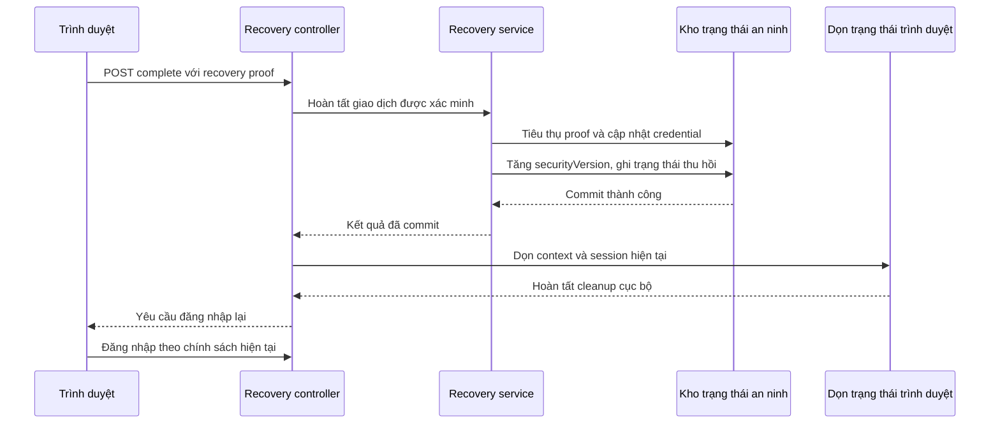

# SecurityContext sau khi khôi phục tài khoản

## 1. Recovery thành công phải dẫn đến trạng thái xác thực nào?

Trong module `SECURITY_AUTHENTICATION_ACCOUNT_RECOVERY`, việc người dùng đặt lại được mật khẩu, thay MFA hoặc đăng ký lại passkey mới chỉ giải quyết một phần của quá trình lấy lại quyền kiểm soát tài khoản. Hệ thống còn phải quyết định những phiên nào tiếp tục được dùng, bằng chứng nào đã hết hiệu lực và request kế tiếp được nhìn nhận là ai.

Hãy xét tình huống một người dùng mất điện thoại và khôi phục tài khoản từ laptop công cộng. Trước recovery, trình duyệt có thể đang giữ một session ẩn danh, một session của chính người đó hoặc thậm chí một session của người khác. Trong khi đó, điện thoại bị mất vẫn có refresh token; một trình duyệt của kẻ tấn công vẫn có session đã xác thực. Chỉ cập nhật mật khẩu rồi trả về thông báo thành công không xử lý được các trạng thái này.

`SecurityContext` là điểm nối giữa kết quả xác minh và cơ chế phân quyền của Spring Security. Bài học này tập trung vào cách xử lý điểm nối đó trong ứng dụng Servlet: xóa ngữ cảnh hiện tại, ngăn khôi phục lại ngữ cảnh cũ, thiết lập ngữ cảnh mới khi đủ điều kiện và phối hợp với việc thu hồi các phiên còn lại.

Sau bài học, bạn cần giải thích và thiết kế được bốn điều:

- Recovery proof cho phép thao tác gì, có đủ để đăng nhập hay chưa.
- Ngữ cảnh của request hiện tại và trạng thái xác thực của request sau được quản lý ở đâu.
- Khi credential thay đổi, session và token cũ bị từ chối bằng cơ chế nào.
- Một request mới chỉ nhận quyền phù hợp với yếu tố xác thực thực sự đã hoàn thành.

Các ví dụ Java sử dụng mô hình Servlet với `jakarta.servlet` và cách tích hợp explicit save được mô tả trong tài liệu Spring Security 6.5. Đây là ví dụ về ranh giới tích hợp, không phải toàn bộ ứng dụng recovery. Những thành phần như xác minh token, lưu credential, MFA và thu hồi token phải được ứng dụng triển khai theo chính sách của mình.

## 2. Tách bốn loại trạng thái trước khi viết code

### 2.1. Ngữ cảnh đang được sử dụng trong request

`SecurityContextHolder` cung cấp `SecurityContext`; context chứa `Authentication`, còn authentication mang principal và authorities. Với cấu hình Servlet thông thường, holder gắn với thread xử lý. Khi đặt một authentication vào đây, code phía sau có thể dùng nó cho quyết định phân quyền. Vì vậy, thao tác gán context là một hành động trao quyền, không chỉ là cập nhật dữ liệu hiển thị. Xem [kiến trúc xác thực Servlet của Spring Security](https://docs.spring.io/spring-security/reference/servlet/authentication/architecture.html).

Ví dụ, một service có kiểm tra quyền sẽ quan sát ngữ cảnh đã được thiết lập trước lúc gọi service đó. Nếu controller recovery tự cấp `ROLE_USER` chỉ vì đã nhận được mã email, mọi kiểm tra chỉ yêu cầu role này có thể cho người đang recovery truy cập tài nguyên nghiệp vụ.

### 2.2. Nguồn khôi phục context cho request tiếp theo

Ngữ cảnh trong holder không phải là cơ sở dữ liệu session. `SecurityContextRepository` đảm nhiệm việc lưu và khôi phục context theo cơ chế đã chọn. Với ứng dụng dùng HTTP session, repository thường liên kết context với session; một request sau có thể nạp lại authentication từ đó.

Hệ quả quan trọng: xóa holder hiện tại chưa chứng minh rằng request sau sẽ trở thành ẩn danh. Nếu bản đã lưu vẫn tồn tại, request sau có thể nạp nó trở lại. Chiều ngược lại cũng đúng: đặt một context mới trong holder chưa chứng minh rằng request sau đã đăng nhập. Khi cơ chế yêu cầu explicit save, ứng dụng phải lưu context nếu muốn duy trì nó qua request. Xem [Persisting Authentication, Spring Security 6.5](https://docs.spring.io/spring-security/reference/6.5/servlet/authentication/persistence.html).

### 2.3. Trạng thái an ninh bền vững của tài khoản

Một tài khoản còn có password hash, credential đang hoạt động, trạng thái khóa, yêu cầu MFA, các session đang tồn tại và phiên bản an ninh của tài khoản. Các dữ liệu này không tự biến mất khi gọi `SecurityContextHolder.clearContext()`.

Một thiết kế có thể lưu `securityVersion` của tài khoản. Session hoặc token được cấp tại phiên bản 12 chỉ được chấp nhận khi phiên bản hiện tại vẫn là 12. Sau recovery, tăng lên 13 khiến bằng chứng của phiên bản 12 bị từ chối tại nơi thực thi kiểm tra phiên bản. Đây là cơ chế do ứng dụng thiết kế; Spring Security không tự thêm phép so sánh này chỉ vì có field trong principal.

### 2.4. Trạng thái của giao dịch recovery

Recovery thường có các trạng thái như đã gửi challenge, đã xác minh bằng chứng, chờ thay credential, chờ đăng ký MFA mới và hoàn thành. Đây là trạng thái của quy trình nghiệp vụ bảo mật.

Không nên suy diễn toàn bộ quy trình từ việc `Authentication` có tồn tại hay không. Một người có thể đã chứng minh quyền đặt lại mật khẩu nhưng chưa đủ điều kiện thực hiện chuyển tiền. Một người đã đăng nhập cũng có thể đang bị yêu cầu tái xác thực trước khi đổi passkey.

| Loại trạng thái | Ví dụ | Phạm vi cần xử lý sau recovery |
|---|---|---|
| Context hiện tại | Authentication mà request đang dùng | Xóa hoặc thay thế có kiểm soát |
| Context đã lưu | Authentication liên kết với HTTP session | Xóa, vô hiệu hóa hoặc lưu phiên mới |
| Trạng thái tài khoản | Credential, trạng thái MFA, securityVersion | Cập nhật bền vững và dùng để chặn bằng chứng cũ |
| Giao dịch recovery | Challenge đã dùng, bước tiếp theo, hạn dùng | Kết thúc hoặc chuyển đúng trạng thái |

## 3. Xây dựng chính sách hậu recovery trước khi chọn API

### 3.1. Luồng cơ sở: hoàn tất recovery rồi đăng nhập lại

Với luồng đặt lại mật khẩu, chính sách dễ kiểm soát là hoàn tất thay đổi, thu hồi quyền truy cập cũ theo phạm vi đã chọn, xóa trạng thái xác thực của trình duyệt hiện tại và yêu cầu đăng nhập qua cơ chế thông thường. OWASP cũng khuyến nghị không tự động đăng nhập sau khi đặt lại mật khẩu để tránh tăng độ phức tạp của xác thực và quản lý session. Xem [Forgot Password Cheat Sheet](https://cheatsheetseries.owasp.org/cheatsheets/Forgot_Password_Cheat_Sheet.html).

Đăng nhập lại có ý nghĩa cụ thể: người dùng sử dụng credential hiện còn hợp lệ, hoàn thành MFA nếu tài khoản yêu cầu, qua kiểm tra rủi ro và được cấp phiên theo chính sách hiện tại. Luồng recovery không phải tự tái tạo tất cả hành vi này trong một controller riêng.

### 3.2. Luồng tiếp tục hạn chế

Nếu người dùng khôi phục MFA hoặc passkey, ứng dụng có thể cần một bước trung gian để đăng ký yếu tố mới. Quyền tiếp tục đó cần giới hạn vào giao dịch recovery đã xác minh: đúng tài khoản, đúng tenant, đúng mục đích, đúng thời hạn và đúng số lần sử dụng.

Một lựa chọn là giữ context nghiệp vụ ở trạng thái ẩn danh, còn quyền tiếp tục được xác minh bằng một recovery grant lưu phía server. Endpoint đăng ký yếu tố mới kiểm tra grant này trực tiếp. Một lựa chọn khác là dùng authentication riêng cho recovery, nhưng mọi vùng nghiệp vụ phải kiểm tra mức bảo đảm tương ứng và từ chối authentication này.

Không được coi `.authenticated()` là hàng rào đủ mạnh giữa recovery và đăng nhập đầy đủ nếu chính ứng dụng đã tạo một authentication recovery có cờ authenticated. Cờ kỹ thuật này không tự mô tả việc MFA đã hoàn thành hay chưa.

### 3.3. Luồng tạo phiên mới sau recovery

Một sản phẩm có thể chủ động thiết kế việc cấp phiên mới ngay sau một quá trình recovery đáp ứng đầy đủ chính sách xác thực. Khi đó, thiết kế phải chứng minh đủ điều kiện đăng nhập, thay vì dùng kết quả “reset thành công” làm bằng chứng duy nhất.

Ví dụ, tài khoản quản trị yêu cầu hai yếu tố độc lập. Một mã gửi qua email cho phép thay mật khẩu nhưng không nhất thiết đáp ứng yêu cầu thứ hai. Nếu passkey đã mất là yếu tố còn lại, tài khoản cần đi qua quy trình phục hồi và đăng ký lại theo chính sách; không được gắn nhãn “MFA complete” vào phiên mới chỉ để giao diện tiếp tục hoạt động.

| Kết quả đã đạt | Trạng thái phù hợp của quyền truy cập | Hành động tiếp theo |
|---|---|---|
| Challenge chưa được xác minh | Không có quyền tài khoản | Tiếp tục xác minh với giới hạn thử |
| Được phép thay mật khẩu | Chỉ được thực hiện thao tác reset tương ứng | Tiêu thụ grant và cập nhật credential |
| Mật khẩu đã thay, chưa đăng nhập lại | Context nghiệp vụ trống | Đăng nhập bằng credential còn hợp lệ |
| MFA mới đang đăng ký | Chỉ được tiếp tục enrollment đã cho phép | Chứng minh possession và hoàn tất binding |
| Đã đủ mọi điều kiện đăng nhập | Có thể tạo phiên mới | Áp dụng session strategy và lưu context |
| Tài khoản bị đình chỉ bởi chính sách rủi ro | Không cấp phiên nghiệp vụ | Đi qua quy trình xử lý phù hợp |

## 4. Luồng xử lý khuyến nghị và ranh giới commit



Sơ đồ mô tả một thiết kế trong đó credential, token recovery và phiên bản an ninh nằm trong cùng miền giao dịch. Nếu chúng ở các hệ thống khác nhau, cần xác định rõ nguồn trạng thái quyết định việc chấp nhận truy cập, cơ chế retry và khoảng trễ thu hồi; không thể coi các thao tác mạng rời rạc là một transaction nguyên tử.

Một service hoàn tất recovery nên chịu trách nhiệm cho các bất biến nghiệp vụ sau:

1. Xác định tài khoản đích từ bằng chứng đã được xác minh phía server.
2. Kiểm tra mục đích, thời hạn, tenant, trạng thái và điều kiện sử dụng proof.
3. Ngăn hai request cùng tiêu thụ thành công một proof bằng cập nhật có điều kiện hoặc khóa phù hợp.
4. Ghi credential mới và vô hiệu hóa credential thuộc phạm vi recovery đã quyết định.
5. Cập nhật trạng thái thu hồi hoặc phiên bản dùng để từ chối bằng chứng cũ.
6. Ghi sự kiện an ninh bền vững cần thiết mà không lưu secret trong log.

Controller xử lý các tác động gắn với request và response sau khi service trả về kết quả đã commit. Nếu phương thức controller vẫn nằm trong transaction chưa commit, việc xóa session rồi trả response “thành công” trước khi database commit sẽ tạo thứ tự sai.

Không giữ một database transaction mở trong khi gửi email, gọi hàng loạt thiết bị hoặc chờ xóa session ở nhiều node. Có thể ghi outbox trong transaction để xử lý các tác động phụ. Tuy vậy, nếu thu hồi session chỉ dựa vào consumer bất đồng bộ, thiết kế phải thừa nhận khoảng trễ đó. Một kiểm tra phiên bản an ninh tại request có thể làm hàng rào trước khi cleanup vật lý hoàn tất.

## 5. Vì sao chỉ clearContext() chưa đủ?

Đoạn code sau chỉ thể hiện việc xóa context gắn với holder hiện tại:

```java
SecurityContextHolder.clearContext();
```

Nó không diễn đạt việc thu hồi toàn bộ session của tài khoản, xóa refresh token, vô hiệu hóa remember-me, kết thúc session tại nhà cung cấp danh tính hoặc hủy một request đã chạy ở thread khác.

Một lỗi thực tế có thể diễn ra như sau:

```text
Request 1 nạp context C từ session S.
Recovery hoàn tất và xóa holder của Request 1.
Session S vẫn giữ bản context đã lưu.
Request 2 gửi lại cookie của S.
Repository nạp lại context từ S.
Người dùng vẫn có quyền truy cập.
```

Ở chiều khác, chỉ gọi `session.invalidate()` rồi tiếp tục chạy logic nhạy cảm trong cùng request cũng không phải cách diễn đạt đầy đủ: code đang xử lý có thể vẫn quan sát authentication đã được nạp. Hãy dùng cơ chế cleanup nhất quán với repository và holder của ứng dụng, đồng thời kết thúc luồng xử lý nghiệp vụ sau kết quả recovery.

`SecurityContextLogoutHandler` là thành phần Spring Security dùng để xử lý context và HTTP session của request. Trong một endpoint tùy biến cần kết thúc trạng thái xác thực, nó là điểm tích hợp quan trọng. Các tác vụ như remember-me, CSRF và thu hồi toàn bộ tài khoản vẫn phải được phối hợp theo cấu hình thực tế. Xem [Handling Logouts](https://docs.spring.io/spring-security/reference/servlet/authentication/logout.html).

## 6. Tích hợp cleanup vào ứng dụng dùng HTTP session

### 6.1. Dùng chung repository cho nạp, lưu và xóa

Ví dụ sau khai báo các thành phần dùng trong một ứng dụng Servlet có session. Ứng dụng này không sử dụng remember-me; nếu hệ thống thực tế có remember-me, phải bổ sung handler và cơ chế thu hồi tương ứng như mục 10.

```java
import org.springframework.context.annotation.Bean;
import org.springframework.context.annotation.Configuration;
import org.springframework.security.web.authentication.logout.CompositeLogoutHandler;
import org.springframework.security.web.authentication.logout.LogoutHandler;
import org.springframework.security.web.authentication.logout.SecurityContextLogoutHandler;
import org.springframework.security.web.context.DelegatingSecurityContextRepository;
import org.springframework.security.web.context.HttpSessionSecurityContextRepository;
import org.springframework.security.web.context.RequestAttributeSecurityContextRepository;
import org.springframework.security.web.context.SecurityContextRepository;
import org.springframework.security.web.csrf.CsrfLogoutHandler;
import org.springframework.security.web.csrf.CsrfTokenRepository;
import org.springframework.security.web.csrf.HttpSessionCsrfTokenRepository;

@Configuration
class RecoveryContextComponents {

    @Bean
    SecurityContextRepository securityContextRepository() {
        return new DelegatingSecurityContextRepository(
                new RequestAttributeSecurityContextRepository(),
                new HttpSessionSecurityContextRepository());
    }

    @Bean
    CsrfTokenRepository csrfTokenRepository() {
        return new HttpSessionCsrfTokenRepository();
    }

    @Bean
    LogoutHandler recoveryBrowserLogout(
            SecurityContextRepository contextRepository,
            CsrfTokenRepository csrfRepository) {

        SecurityContextLogoutHandler contextLogout =
                new SecurityContextLogoutHandler();
        contextLogout.setSecurityContextRepository(contextRepository);
        contextLogout.setInvalidateHttpSession(true);
        contextLogout.setClearAuthentication(true);

        return new CompositeLogoutHandler(
                new CsrfLogoutHandler(csrfRepository),
                contextLogout);
    }
}
```

Trong `SecurityFilterChain` hiện có, dùng chính các repository này. Đoạn dưới là phần cấu hình cần ghép vào chain của ứng dụng, không khai báo một chain thay thế bỏ qua các quy tắc MFA hoặc phân quyền sẵn có:

```java
http.securityContext(context -> context
        .requireExplicitSave(true)
        .securityContextRepository(contextRepository));

http.csrf(csrf -> csrf
        .csrfTokenRepository(csrfRepository));
```

Nếu ứng dụng dùng `SecurityContextHolderStrategy` tùy biến, handler và các thành phần xử lý xác thực cũng phải dùng strategy tương ứng. Với nhiều chain, cần kiểm tra chain nào bắt endpoint recovery, login và tài nguyên nghiệp vụ. Một bean repository tồn tại chưa có nghĩa mọi chain đã sử dụng nó.

Các ví dụ chủ động chọn `HttpSessionCsrfTokenRepository`. Không thay nó bằng cookie repository trong một vị trí mà quên đổi phần cấu hình còn lại. Nguồn nạp, nguồn kiểm tra và nơi cleanup của cùng loại trạng thái phải khớp nhau.

### 6.2. Controller chỉ thực hiện nhánh hậu commit

Trong ví dụ dưới, `RecoveryApplicationService` là thành phần ứng dụng, không phải API có sẵn của Spring. Hợp đồng của `complete` yêu cầu xác minh proof, xử lý thay đổi an ninh và chỉ trả về sau commit thành công. `RecoveryCommand` phải được thiết kế để không đưa proof hoặc mật khẩu vào `toString()`, tracing hay request-body logging.

```java
import jakarta.servlet.http.HttpServletRequest;
import jakarta.servlet.http.HttpServletResponse;
import org.springframework.http.CacheControl;
import org.springframework.http.ResponseEntity;
import org.springframework.security.core.Authentication;
import org.springframework.security.core.context.SecurityContextHolder;
import org.springframework.security.web.authentication.logout.LogoutHandler;
import org.springframework.web.bind.annotation.PostMapping;
import org.springframework.web.bind.annotation.RequestBody;
import org.springframework.web.bind.annotation.RestController;

@RestController
final class RecoveryCompletionController {

    private final RecoveryApplicationService recoveryService;
    private final LogoutHandler recoveryBrowserLogout;

    RecoveryCompletionController(
            RecoveryApplicationService recoveryService,
            LogoutHandler recoveryBrowserLogout) {
        this.recoveryService = recoveryService;
        this.recoveryBrowserLogout = recoveryBrowserLogout;
    }

    @PostMapping("/recovery/complete")
    ResponseEntity<RecoveryCompletionView> complete(
            @RequestBody RecoveryCommand command,
            HttpServletRequest request,
            HttpServletResponse response) {

        // Xác minh command và commit thay đổi trước khi trả về.
        recoveryService.complete(command);

        Authentication browserAuthentication =
                SecurityContextHolder.getContext().getAuthentication();

        recoveryBrowserLogout.logout(
                request, response, browserAuthentication);

        return ResponseEntity.ok()
                .cacheControl(CacheControl.noStore())
                .body(new RecoveryCompletionView("SIGN_IN_REQUIRED"));
    }

    record RecoveryCompletionView(String nextAction) {
    }
}
```

Authentication lấy trong controller chỉ dùng để dọn trạng thái của trình duyệt hiện tại. Tài khoản đích của recovery phải do service xác định từ proof và trạng thái phía server. Không truyền `browserAuthentication.getName()` làm tài khoản cần reset chỉ vì trình duyệt tình cờ đang đăng nhập.

Nếu trình duyệt đang đăng nhập tài khoản A nhưng proof thuộc tài khoản B, hệ thống cần chính sách rõ ràng. Ví dụ trên chủ động kết thúc phiên trình duyệt sau recovery và yêu cầu đăng nhập lại, kể cả khi phiên đó thuộc A. Giao diện phải thông báo hành vi này trước bước xác nhận; hệ thống không được âm thầm đổi principal A thành B. Việc thu hồi truy cập toàn tài khoản vẫn nhắm B dựa trên kết quả xác minh, không dựa trên session A.

Đây không phải endpoint đăng nhập. Nó không tạo authentication mới, không lấy authorities từ client và không đưa recovery proof vào session nghiệp vụ. Trong ứng dụng dùng cookie, endpoint vẫn đi qua CSRF protection phù hợp. `permitAll` cho một endpoint recovery không thay thế việc xác minh proof trong service.

## 7. Khi nào cần tạo và lưu SecurityContext mới?

### 7.1. Gán holder và lưu repository là hai việc khác nhau

Khi dùng `SecurityContextHolderFilter` cùng explicit save, filter nạp context nhưng không tự lưu mọi thay đổi mà controller thực hiện. Vì vậy, custom authentication flow cần xác định rõ thời điểm gọi `saveContext` nếu muốn tạo phiên duy trì qua request.

Điều đó không có nghĩa mọi controller recovery đều cần `saveContext` để đăng nhập. Nhánh yêu cầu đăng nhập lại ở mục 6 kết thúc context hiện tại. Nhánh tạo phiên mới chỉ xuất hiện sau khi cơ chế xác thực đã trả về kết quả đáp ứng đầy đủ chính sách.

### 7.2. Thứ tự cho một cơ chế đăng nhập tùy biến

Ví dụ sau minh họa thứ tự xử lý ở nhánh hậu xác thực của ứng dụng. Các biến như `fullLoginPolicy`, `sessionStrategy`, `authenticationManager`, `successHandler` và `contextLogout` là những thành phần đã cấu hình tương thích với chain. Đoạn này không phải endpoint nhận một đối tượng `Authentication` do client gửi lên.

```java
Authentication verified = authenticationManager.authenticate(loginRequest);

// Chính sách ứng dụng: đúng subject, tenant, trạng thái tài khoản,
// securityVersion hiện tại và đủ mọi yếu tố yêu cầu.
fullLoginPolicy.requireCompleteAuthentication(verified);

// Strategy phải được cấp cho cơ chế tùy biến này một cách tường minh.
sessionStrategy.onAuthentication(verified, request, response);

SecurityContext freshContext = SecurityContextHolder.createEmptyContext();
freshContext.setAuthentication(verified);
SecurityContextHolder.setContext(freshContext);

try {
    contextRepository.saveContext(freshContext, request, response);
} catch (RuntimeException saveFailure) {
    contextLogout.logout(request, response, verified);
    throw saveFailure;
}

successHandler.onAuthenticationSuccess(request, response, verified);
```

`fullLoginPolicy` không thể chỉ kiểm tra `verified.isAuthenticated()`. Nó cần phân biệt kết quả đăng nhập đầy đủ với anonymous, remember-me hoặc authentication phục vụ bước trung gian theo mô hình của ứng dụng. Nếu `AuthenticationManager` hiện tại chỉ kiểm tra mật khẩu, kết quả của nó không chứng minh MFA đã hoàn thành.

Trong ví dụ, `contextLogout` là handler đã trỏ đến đúng repository. Nhánh lỗi minh họa việc bỏ trạng thái vừa thiết lập khi lưu thất bại; hệ thống thực tế còn phải xử lý lỗi cleanup và không trả response đăng nhập thành công nếu chưa xác định được kết quả.

Tạo một `SecurityContext` mới giúp tránh việc sửa trực tiếp một context đang được nhiều request cùng quan sát. Các cập nhật credential, authority hoặc yếu tố xác thực cũng không nên được thực hiện bằng cách sửa một principal mutable dùng chung trong các session.

### 7.3. Không chuyển recovery token thành login token

Đoạn sau là ví dụ sai về ranh giới tin cậy:

```java
// Sai: quyền được tạo từ dữ liệu chưa qua cơ chế đăng nhập đầy đủ.
Authentication elevated =
        UsernamePasswordAuthenticationToken.authenticated(
                requestEmail,
                resetToken,
                List.of(new SimpleGrantedAuthority("ROLE_USER")));
```

Hàm tạo hoặc factory tạo authentication đã xác thực không tự kiểm tra mật khẩu, MFA, token một lần hay quyền sở hữu email. Nếu code ứng dụng tự gọi nó, ứng dụng đang chịu trách nhiệm chứng minh mọi điều kiện cần thiết.

Recovery token cũng không nên trở thành `credentials` của authentication được lưu lâu dài. Principal của phiên mới nên chứa định danh ổn định và thông tin cần cho kiểm tra quyền; secret phải được xử lý và loại bỏ theo vòng đời của cơ chế xác thực.

## 8. Session fixation và các chiến lược xác thực phiên

Tạo phiên mới sau khi đủ điều kiện xác thực phải đi qua cơ chế bảo vệ session tương ứng. Đổi session ID hoặc tạo phiên mới giúp ngăn việc một session ID đã biết trước trở thành phiên đăng nhập có quyền.

Đối với cơ chế xác thực tùy biến, không được giả định việc chỉ gán holder sẽ khiến một filter khác tự gọi `SessionAuthenticationStrategy`. Tài liệu Spring Security 6 mô tả cơ chế xác thực phải chủ động gọi strategy trong mô hình mặc định mới. Xem [Authentication Persistence and Session Management](https://docs.spring.io/spring-security/reference/6.5/servlet/authentication/session-management.html).

Một strategy thực tế có thể cần phối hợp các thành phần về chống fixation, giới hạn số phiên, đăng ký session và làm mới trạng thái CSRF. Thứ tự và thành phần phải phù hợp với cấu hình ứng dụng. Chỉ gọi `request.changeSessionId()` không tự thực hiện tất cả các trách nhiệm đó.

Ví dụ về một luồng không đạt yêu cầu:

```text
Trình duyệt có session S trước recovery.
Controller gắn ROLE_USER vào context đã nạp từ S.
Controller không gọi session strategy.
Controller trả redirect thành công.
S trở thành session có quyền mà không qua ranh giới tạo phiên đã thiết kế.
```

Trong luồng yêu cầu đăng nhập lại, session recovery cũ được kết thúc; cơ chế login thông thường chịu trách nhiệm tạo hoặc chuyển session đúng cách. Trong luồng tiếp tục hạn chế, trạng thái cần thiết phải được lưu có chủ đích. Không sao chép toàn bộ attributes từ session cũ sang session mới chỉ để giữ giao diện thuận tiện: các giá trị như account đang recovery, saved request hoặc cờ “đã MFA” có thể đã không còn hợp lệ.

## 9. Thu hồi phiên toàn tài khoản và xử lý request đồng thời

### 9.1. Cleanup trình duyệt không đại diện cho mọi thiết bị

`SecurityContextLogoutHandler` nhận request hiện tại. Nó không tự liệt kê mọi browser, mobile app hay refresh-token family của tài khoản. Phạm vi thu hồi toàn tài khoản cần được triển khai bằng các kho session và token tương ứng.

Với session server-side, có thể tra theo account ID để xóa hoặc đánh dấu session không còn hợp lệ. Nếu session ở nhiều node, kho chỉ nằm trong bộ nhớ một JVM không cung cấp cái nhìn đầy đủ. Nếu dùng một session registry, phải hiểu việc đánh dấu hết hạn được thực thi tại đâu; không giả định một flag trong registry luôn xóa ngay dữ liệu ở mọi node.

Với refresh token, cần thu hồi các token hoặc family thuộc phạm vi đã chọn. Với credential bị mất, phải vô hiệu hóa credential đó ở nguồn xác thực. Việc xóa session không thay thế việc tắt passkey hoặc authenticator đã được xác định là bị chiếm quyền.

### 9.2. Cửa sổ giữa thay credential và thu hồi vật lý

Giả sử tài khoản đang có `securityVersion = 21`:

```text
T0: Request A nạp context của phiên bản 21.
T1: Recovery B commit credential mới và securityVersion = 22.
T2: Tác vụ cleanup bắt đầu xóa các session cũ.
T3: Request A cố thực hiện một thao tác nhạy cảm.
```

Nếu chỉ dựa vào cleanup ở T2, request A có thể đã giữ authentication cũ từ T0. Xóa dữ liệu session không thể quay ngược thời gian để gỡ mọi quyết định mà thread khác đã thực hiện.

Một thiết kế có hàng rào phiên bản đặt điều kiện sau ở vị trí thực thi truy cập:

```text
session.accountId phải đúng đối tượng được truy cập
session.tenantId phải đúng tenant của thao tác
session.securityVersion phải bằng account.securityVersion hiện tại
account phải đang ở trạng thái cho phép truy cập
```

Với thao tác có hậu quả lớn, có thể kiểm tra lại phiên bản trong transaction nghiệp vụ hoặc dùng cập nhật có điều kiện gắn với phiên bản. Nếu cần bảo đảm thứ tự chặt giữa recovery và hành động nhạy cảm, cả hai luồng phải phối hợp bằng khóa hoặc điều kiện transaction thích hợp. Một phép đọc kiểm tra trước đó rất lâu không loại bỏ được race.

Cache ảnh hưởng trực tiếp đến mức bảo đảm. Nếu node còn tin phiên bản 21 trong 30 giây, tuyên bố “mọi phiên cũ mất quyền ngay khi recovery commit” là không chính xác. Cần quyết định rõ độ trễ chấp nhận được, đường kiểm tra authoritative cho thao tác nhạy cảm và hành vi khi nguồn trạng thái không truy cập được.

### 9.3. Race khi lưu context trở lại

Một request khác có thể đã nạp context trước recovery rồi thực hiện một nhánh lưu context sau đó. Khả năng cụ thể phụ thuộc repository, filter và ứng dụng, nhưng về thiết kế cần ngăn việc bản cũ được chấp nhận chỉ vì nó vừa được lưu lại.

Gắn phiên bản an ninh vào authentication không tự giải quyết vấn đề. Nơi nạp hoặc nơi kiểm tra quyền phải từ chối phiên bản cũ, và nhánh cấp phiên mới phải đọc trạng thái tài khoản hiện tại. Nếu có một service tự tạo context bằng bản user cache trước recovery, chính service đó cũng cần chịu ràng buộc này.

Cleanup vật lý giúp giảm rác và ngăn tái sử dụng session; kiểm tra hợp lệ tại điểm sử dụng quyết định quyền thực tế. Hai việc bổ sung cho nhau.

## 10. Remember-me, CSRF, cookie và saved request

### 10.1. Remember-me có thể khôi phục quyền sau khi session bị xóa

Một cookie remember-me hợp lệ có thể khiến request mới được xác thực lại bằng cơ chế remember-me. Do đó, một bài kiểm tra chỉ xác nhận “session cũ đã bị invalidated” chưa đủ cho ứng dụng có tính năng này.

Cần phân biệt cleanup cookie ở trình duyệt đang recovery và thu hồi remember-me ở cấp tài khoản. Trình duyệt bị mất hoặc bị chiếm quyền không nhận được lệnh xóa cookie từ response hiện tại. Persistent remember-me cần cơ chế thu hồi token phía server. Với token tự chứa, cần kiểm tra cách token được xác minh và bằng chứng nào làm nó không còn hợp lệ sau recovery.

Không mặc định việc đổi password hash luôn vô hiệu hóa mọi triển khai remember-me. Điều này phụ thuộc cơ chế cụ thể. Nếu thêm remember-me vào ví dụ mục 6, hãy phối hợp handler của cơ chế đó trong cleanup cục bộ và thu hồi thông tin tương ứng tại service an ninh.

### 10.2. CSRF vẫn cần được xử lý ở endpoint công khai

Một endpoint cho phép người chưa đăng nhập truy cập vẫn có thể nhận cookie trình duyệt và thay đổi trạng thái. `permitAll` là quyết định phân quyền của endpoint, không phải bằng chứng request do người dùng chủ động gửi.

Trong ứng dụng dùng session cookie, giữ bảo vệ CSRF phù hợp cho thao tác hoàn tất recovery. Recovery proof có mục đích chứng minh quyền recovery; CSRF token bảo vệ một ranh giới khác. Không tắt CSRF toàn ứng dụng chỉ vì frontend vừa gặp lỗi 403 sau khi session cũ bị kết thúc.

Khi authentication hoặc logout làm mất CSRF token cũ, frontend cần lấy token mới trước request thay đổi trạng thái tiếp theo. Cách lấy token phụ thuộc repository và request handler được dùng, đặc biệt với SPA. Xem [CSRF trong Spring Security](https://docs.spring.io/spring-security/reference/servlet/exploits/csrf.html).

### 10.3. Cookie trình duyệt và hiệu lực server-side

Xóa cookie ở response phải khớp tên, domain và path của cookie được cấp. Tên cookie session có thể là `JSESSIONID`, `SESSION` hoặc tên riêng tùy hạ tầng; không hardcode một tên rồi suy ra toàn bộ session đã bị thu hồi.

Cookie bị xóa ở trình duyệt hiện tại không chứng minh rằng một bản sao đã đánh cắp không còn được chấp nhận. Chiều quyết định là server từ chối session/token cũ. Các cookie phiên cần được cấu hình các thuộc tính bảo vệ theo ngữ cảnh triển khai, và thông tin session hoặc recovery proof không được đưa vào URL chuyển tiếp.

### 10.4. Saved request không phải đích chuyển tiếp luôn an toàn

Trước recovery, người dùng có thể đã yêu cầu một trang nhạy cảm rồi bị chuyển sang login. Nếu tiếp tục dùng saved request cũ sau một luồng thay đổi danh tính, ứng dụng có thể điều hướng sai ngữ cảnh hoặc tạo trải nghiệm khó hiểu về quyền hiện tại.

Chính sách có thể chuyển tới một trang hoàn tất cố định hoặc trang đăng nhập cố định. Nếu cho phép return URL, cần xác thực đích theo chính sách chống open redirect. Với nhánh session mới, chỉ giữ những giá trị chuyển tiếp đã kiểm tra; không dùng một URL client gửi làm cơ sở trao thêm quyền.

## 11. MFA, passkey và thời điểm quyền mới có hiệu lực

### 11.1. Không tái sử dụng dấu vết MFA của phiên trước

Một context cũ có thể chứa authorities, thời điểm đăng nhập hoặc bằng chứng xác thực liên quan đến thiết bị vừa bị mất. Sao chép authentication cũ sau recovery có nguy cơ giữ lại kết luận đã hết căn cứ.

Ví dụ, người dùng mất điện thoại TOTP. Quy trình cho phép người dùng dùng recovery code để bắt đầu đăng ký TOTP mới. Nếu hệ thống giữ cờ “MFA đã hoàn thành” từ session cũ rồi cho đổi địa chỉ nhận recovery, kẻ có session cũ có thể đi qua một chuỗi thao tác không còn được chính sách cho phép.

Khi thiết lập phiên mới, nguồn của mỗi khẳng định phải rõ ràng: yếu tố nào vừa được chứng minh, thời điểm nào, bằng phương thức nào và còn hiệu lực cho thao tác nào. Không đặt `auth_time` hoặc dữ liệu tương đương thành “bây giờ” chỉ vì database vừa được cập nhật; nó phải phản ánh sự kiện xác thực có thật theo mô hình của hệ thống.

### 11.2. Enrollment không đồng nghĩa có quyền nghiệp vụ

Một recovery grant cho phép thêm passkey cần ràng buộc với challenge đăng ký, tài khoản, tenant và phiên giao dịch recovery. Thành công của bước thêm passkey phải được xác minh phía server theo giao thức và chính sách đã chọn.

Trong khoảng chờ hoàn tất, chặn những thao tác không thuộc recovery như truy xuất dữ liệu riêng tư, đổi quyền, tạo API key hoặc thay toàn bộ địa chỉ liên hệ. Nếu dùng authentication trung gian, các resource chỉ kiểm tra “đã authenticated” là những điểm cần thiết kế lại để không nhận nhầm loại authentication đó.

### 11.3. Principal và authorities phải được tạo từ trạng thái hiện tại

Quyền trong session cũ có thể không còn đúng sau khi tài khoản bị đình chỉ, đổi tenant, thay role hoặc áp dụng hạn chế hậu recovery. Nhánh tạo phiên mới cần lấy thông tin từ nguồn hiện tại và thực thi chính sách tương ứng.

Không nhận `accountId`, `tenantId`, danh sách role hay “MFA passed” do client khai báo để xây dựng authentication. Nếu token recovery có claim, claim vẫn phải được kiểm tra theo định dạng, chữ ký nếu có, mục đích và trạng thái server-side của quy trình. Một token có cấu trúc hợp lệ không tự chứng minh rằng nó chưa bị dùng hoặc chưa bị thu hồi.

## 12. Ứng dụng stateless, JWT và nhà cung cấp danh tính

Trong resource server xác thực bằng bearer token, authentication có thể được xây dựng lại ở mỗi request từ token. Spring Security có cơ chế xác minh JWT và chuyển kết quả thành authentication; đây là một đường xác thực riêng với HTTP session. Xem [OAuth 2.0 Resource Server JWT](https://docs.spring.io/spring-security/reference/servlet/oauth2/resource-server/jwt.html).

Do đó, xóa holder ở request recovery hoặc invalidating một HTTP session không làm một JWT đã phát hành tự mất chữ ký hợp lệ. Nếu hệ thống chỉ kiểm tra chữ ký và thời hạn, access token cũ có thể tiếp tục được chấp nhận cho tới hết hạn.

Các lựa chọn thiết kế gồm access token sống ngắn, kiểm tra phiên bản an ninh, denylist, introspection hoặc kiểm tra trạng thái phiên tại một thành phần có thẩm quyền. Phải chọn theo yêu cầu thu hồi và đặc tính vận hành; không trình bày một danh sách token bị thu hồi ở authorization server như thể mọi resource server đã tự động biết.

Refresh token cần được thu hồi ở nơi phát hành. Nếu có token rotation, phải xác định phạm vi family và cách xử lý reuse. Thay mật khẩu trong service local không tự chứng minh rằng authorization server đã thu hồi token, nhất là khi hai hệ thống có nguồn danh tính độc lập.

Với OIDC hoặc SAML, logout local và session tại identity provider là hai phạm vi khác nhau. Một phiên local bị xóa có thể được tạo lại nếu người dùng vẫn có session SSO hợp lệ và chính sách cho phép. Khi recovery xử lý nguy cơ chiếm đoạt tài khoản, cần phối hợp với nguồn danh tính đang thực sự kiểm soát credential và mức bảo đảm đăng nhập.

Không chọn `SessionCreationPolicy.STATELESS` chỉ để tránh phải xử lý cleanup session trong một ứng dụng vẫn xác thực bằng cookie session. Chính sách lưu context phải phù hợp với cơ chế xác thực, còn yêu cầu thu hồi vẫn tồn tại ở cấp token hoặc phiên của hệ thống.

## 13. Xử lý lỗi để không khôi phục quyền bằng dữ liệu cũ

### 13.1. Recovery chưa commit

Nếu proof hết hạn, đã dùng hoặc không đủ điều kiện, service không được trả kết quả hoàn tất. Controller không tạo context của tài khoản mà client khai báo. Chính sách đối với session trình duyệt đang có cần rõ ràng: có thể giữ phiên hiện tại khi một nỗ lực recovery không hợp lệ, nhưng tuyệt đối không nâng quyền vì nỗ lực đó.

### 13.2. Recovery đã commit nhưng cleanup cục bộ lỗi

Đây là hai kết quả khác nhau: credential có thể đã đổi thành công, còn cleanup của response hoặc kho session gặp sự cố. Không hoàn tác credential bằng cách ghi lại password hash cũ từ controller. Cần giữ trạng thái đã commit làm nguồn chuẩn và bảo đảm các session cũ bị chặn bởi cơ chế thu hồi đã thiết kế.

Response và giao diện cần diễn đạt khả năng trạng thái đã thay đổi mà người dùng chưa thấy kết quả. Một luồng tra cứu hoặc tiếp tục an toàn có thể yêu cầu bằng chứng phù hợp mà không phát sinh thêm quyền. Không đưa token đã tiêu thụ trở lại trạng thái dùng được chỉ để request retry “thành công”.

### 13.3. Lưu context mới thất bại

Nếu nhánh đăng nhập mới không lưu được context, không trả về “đã đăng nhập” rồi hy vọng request sau sửa được. Dọn context của request và trạng thái session vừa tạo theo khả năng của hạ tầng. Việc không xác định được kết quả lưu cần được phản ánh thành thất bại cấp phiên, còn kết quả recovery trước đó vẫn được xử lý theo trạng thái đã commit.

### 13.4. Timeout không chứng minh transaction thất bại

Client mất kết nối có thể xảy ra sau commit. Idempotency hoặc trạng thái operation phía server giúp phân biệt retry với một yêu cầu recovery mới. Cơ chế này phải giới hạn chủ thể và dữ liệu được trả lại, không biến operation ID thành một cách công khai tra cứu tài khoản.

Trong mọi nhánh lỗi, tránh dùng khối `finally` để lưu lại context đã nạp đầu request. Một mẫu “luôn restore authentication cũ cho chắc” có thể hoàn tác chính quyết định thu hồi mà luồng recovery vừa thực hiện.

## 14. Async và công việc chạy nền

Context gắn với thread không tự có cùng vòng đời với mọi công việc bất đồng bộ. Spring Security cung cấp các wrapper như `DelegatingSecurityContextRunnable` để truyền context và dọn sau khi chạy; việc truyền context phải có chủ đích. Xem [Concurrency Support](https://docs.spring.io/spring-security/reference/servlet/integrations/concurrency.html).

Trong recovery, tác vụ gửi thông báo thường chỉ cần một sự kiện với account ID nội bộ, operation ID và loại thay đổi. Nó không cần mang theo toàn bộ authentication của người đang recovery hoặc recovery token còn hiệu lực.

Đối với công việc thực hiện hành động nhạy cảm sau đó, một context được chụp trước recovery không tự trở thành bằng chứng còn hợp lệ lúc tác vụ chạy. Tác vụ cần kiểm tra lại trạng thái tài khoản, phiên bản và quyền phù hợp tại thời điểm thực thi, hoặc hoạt động dưới một danh tính service với quyền được thiết kế riêng.

Không dùng `MODE_INHERITABLETHREADLOCAL` như cách giải quyết chung cho executor pool. Thread có thể được tái sử dụng và thời điểm thừa kế không tương ứng từng request. Nếu có wrapper truyền context, kiểm tra cả nguồn context lẫn việc cleanup và nhu cầu nghiệp vụ thực tế.

## 15. Thiết kế kiểm thử dựa trên request tiếp theo

Một unit test kiểm tra `clearContext()` được gọi chỉ chứng minh một lời gọi kỹ thuật. Bằng chứng quan trọng là hệ thống xử lý thế nào với session, cookie hoặc token cũ sau khi recovery hoàn tất.

Các kịch bản dưới đây là tiêu chí kiểm thử cho ứng dụng triển khai bài học; chúng không có nghĩa mọi cơ chế đã được cài đặt chỉ từ các đoạn code minh họa.

| Kịch bản | Điều cần quan sát |
|---|---|
| Hoàn tất reset bằng proof hợp lệ | Credential được cập nhật và proof không dùng lại được |
| Truy cập tài nguyên bằng cookie phiên cũ | Không tiếp tục được chấp nhận như phiên còn hợp lệ |
| Trình duyệt đang có session của tài khoản khác | Không tự đổi principal sang tài khoản recovery |
| Nhánh yêu cầu đăng nhập lại | Response hoàn tất không cấp authentication nghiệp vụ mới |
| Có remember-me cũ | Không tự khôi phục quyền trái chính sách thu hồi |
| Session trên thiết bị khác | Bị từ chối theo phạm vi và thời hạn thu hồi đã cam kết |
| JWT cũ còn hạn | Kết quả khớp chính sách thu hồi thực sự ở resource server |
| MFA chưa hoàn thành | Không truy cập được vùng yêu cầu mức bảo đảm đầy đủ |
| Tạo phiên mới bằng custom flow | Session strategy chạy và context được lưu trước response thành công |
| Thiếu hoặc sai CSRF token trong luồng cookie | Request thay đổi trạng thái bị chặn đúng cấu hình |
| Hai request đồng thời dùng cùng proof | Chỉ một request thực hiện thay đổi được phép |
| Request cũ chạy song song recovery | Không vượt qua hàng rào phiên bản tại thao tác được bảo vệ |
| Kho session hoặc nguồn trạng thái bị lỗi | Không cấp quyền từ một giả định chưa xác minh |
| Async task giữ context trước recovery | Không thực hiện hành động nhạy cảm bằng quyền đã thu hồi |

Một luồng kiểm thử tích hợp nên đi qua filter chain thật:

```text
1. Đăng nhập theo cơ chế thật của ứng dụng, nhận session hoặc token cũ.
2. Gọi một tài nguyên được bảo vệ để chứng minh bằng chứng cũ hoạt động.
3. Thực hiện recovery bằng proof hợp lệ và CSRF token nếu cần.
4. Gửi request độc lập bằng cookie/token cũ.
5. Kiểm tra server từ chối hoặc yêu cầu xác thực lại theo chính sách.
6. Đăng nhập lại bằng credential hiện tại và hoàn thành MFA cần thiết.
7. Kiểm tra quyền của phiên mới và sự từ chối credential đã vô hiệu hóa.
```

Khi dùng MockMvc, không gắn `.with(user(...))` vào request ở bước 4: thao tác đó có thể tiêm authentication mới và che mất lỗi nạp lại session. Không khẳng định một mã HTTP duy nhất cho mọi ứng dụng; browser có thể nhận redirect tới login, còn API có thể nhận 401 hoặc 403 tùy cơ chế và lý do từ chối. Điều cần chứng minh là bằng chứng cũ không còn thực hiện được thao tác được bảo vệ.

Nếu dùng mock session đã invalidated, kiểm thử có thể dừng ngay trong mock trước khi đi qua hành vi container thực tế. Cần lựa chọn mức kiểm thử phù hợp: kiểm tra repository và filter chain, hoặc chạy qua HTTP với cookie cũ trong môi trường tích hợp. Không biến lỗi của đối tượng test thành bằng chứng rằng server đã thu hồi mọi phiên.

## 16. Quan sát vận hành và ví dụ xuyên suốt

### 16.1. Ghi được quyết định mà không ghi secret

Một sự kiện hậu recovery có thể gồm operation ID, định danh tài khoản nội bộ theo chính sách log, loại credential thay đổi, phiên bản an ninh trước/sau, phạm vi thu hồi, kết quả cleanup cục bộ và quyết định `SIGN_IN_REQUIRED` hoặc `ENROLLMENT_REQUIRED`.

Không ghi recovery token, recovery code, mật khẩu, session ID nguyên vẹn, bearer token hoặc cookie vào log. Kết quả “cleanup đã gửi” cần phân biệt với “nguồn thực thi đã chặn truy cập”. Nếu tác vụ xóa session còn retry nhưng kiểm tra phiên bản đã ngăn quyền cũ, hệ thống nên quan sát được hai trạng thái đó riêng biệt.

Những tín hiệu có ích gồm số lần proof bị reuse, số phiên bản cũ bị từ chối, độ trễ thu hồi, lỗi lưu context và lỗi cleanup. Các metric không nên dùng account ID làm nhãn có độ phân mảnh cao; dữ liệu truy vết theo tài khoản cần cơ chế riêng được kiểm soát.

### 16.2. Người dùng mất điện thoại chứa passkey

Giả sử tài khoản U thuộc tenant T có session S1 ở laptop, refresh-token family F1 ở điện thoại và passkey P1 được xác định đã mất quyền kiểm soát. Chính sách yêu cầu thu hồi các phiên cũ sau khi hoàn tất recovery.

Quá trình được thiết kế như sau:

1. Người dùng hoàn thành bằng chứng recovery được chấp nhận. Kết quả chỉ cho phép tiếp tục giao dịch phục hồi của U trong T.
2. Hệ thống vô hiệu hóa P1, cập nhật trạng thái recovery và tăng phiên bản an ninh. Những thay đổi cần cùng bất biến được commit theo ranh giới giao dịch đã định.
3. Refresh-token family F1 được thu hồi ở nơi phát hành; các resource dùng access token thực thi chính sách thu hồi đã chọn.
4. Các session cũ như S1 bị từ chối theo hàng rào hợp lệ, rồi được cleanup trong kho tương ứng.
5. Trình duyệt recovery kết thúc context cũ hoặc chỉ giữ grant enrollment có phạm vi hẹp. Nó chưa được cấp quyền nghiệp vụ đầy đủ.
6. Người dùng đăng ký và chứng minh sử dụng passkey mới theo quy trình. Hệ thống chỉ cấp phiên nghiệp vụ khi đủ chính sách xác thực hiện tại.
7. Các request sau kiểm tra account, tenant, phiên bản và mức bảo đảm phù hợp. Không phục hồi authentication từ bản sao trước recovery.

Nếu người dùng chỉ cần reset mật khẩu và mọi yếu tố khác vẫn hợp lệ, bước tiếp theo có thể đơn giản là đăng nhập lại theo cơ chế thông thường. Chính sách thay đổi theo loại sự cố, nhưng ranh giới giữa quyền recovery và quyền nghiệp vụ vẫn phải rõ ràng.

## 17. Các câu hỏi cần trả lời khi triển khai

- Bằng chứng recovery hiện cho phép thao tác nào, và điểm nào mới xác nhận đủ điều kiện đăng nhập?
- Context của request hiện tại được dọn bằng thành phần nào; repository nào có thể nạp lại context ở request sau?
- Endpoint recovery và login có chạy qua chain dùng đúng repository, CSRF và session strategy không?
- Tài khoản đích có được suy ra từ proof đã xác minh thay vì session hoặc account ID do client khai báo không?
- Session, remember-me và refresh token ở thiết bị khác bị từ chối ở thành phần nào?
- JWT còn hạn và session SSO có thể tạo lại quyền truy cập bằng con đường nào?
- Điều gì chặn request cũ đang chạy hoặc context cũ bị lưu lại sau recovery?
- Phiên mới phản ánh yếu tố xác thực vừa hoàn thành hay vô tình giữ bằng chứng của thiết bị bị mất?
- Nếu commit thành công nhưng response hoặc cleanup thất bại, người dùng tiếp tục an toàn bằng cách nào?
- Kiểm thử đã gửi request độc lập bằng bằng chứng cũ, thay vì chỉ quan sát holder trong cùng thread, hay chưa?

Thiết kế đạt yêu cầu khi mọi đường khôi phục authentication đều chịu cùng quyết định an ninh hậu recovery. Khi đó, xóa context, lưu context mới và thu hồi các phiên khác trở thành những thao tác có mục đích rõ ràng trong một luồng kiểm soát quyền nhất quán.
