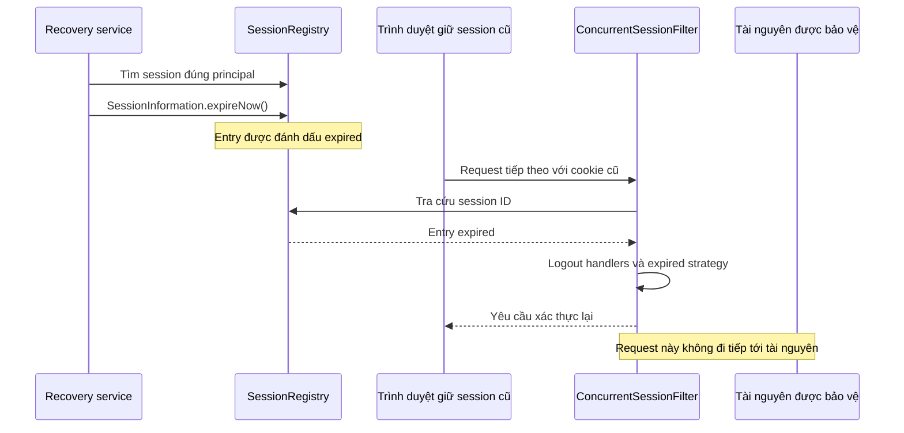

# SessionRegistry integration — Tích hợp quản lý session cho khôi phục tài khoản

## 1. Mục tiêu và phạm vi

Sau khi người dùng khôi phục mật khẩu, MFA, passkey hoặc thiết bị xác thực, hệ thống cần quyết định các phiên đăng nhập trước đó còn được phép làm gì. Thay mật khẩu trong database không tự chứng minh một trình duyệt khác đã mất quyền truy cập: trình duyệt đó có thể đang giữ một HTTP session chứa thông tin xác thực được tạo từ trước.

Trong module `SECURITY_AUTHENTICATION_ACCOUNT_RECOVERY`, tích hợp `SessionRegistry` nối quyết định khôi phục tài khoản với các HTTP session mà Spring Security theo dõi. Bài học tập trung vào ba câu hỏi:

1. Làm sao tìm đúng các session của đúng tài khoản?
2. Đánh dấu session hết hiệu lực được thực thi ở đâu?
3. Làm sao kiểm soát độ trễ, lỗi từng phần và đăng nhập đồng thời với recovery?

Các ví dụ dùng ứng dụng **Servlet**, API `jakarta.servlet` và cách cấu hình `SecurityFilterChain` bằng lambda. Chúng là mẫu học tập để gắn vào ứng dụng có authentication thực tế; không khẳng định phiên bản dependency hoặc cấu trúc Java nào đã tồn tại trong repository. Khi triển khai, chọn bộ Spring Boot, Spring Security và Spring Session tương thích theo dependency management của ứng dụng.

`SessionRegistry` của Servlet không phải API quản lý `WebSession` cho WebFlux. Một hệ thống có cả Servlet, reactive và token bearer phải xác định từng cơ chế chấp nhận quyền truy cập riêng.

## 2. Bài toán xuyên suốt

Giả sử tài khoản nội bộ `tenant-a/account-42` có ba session:

| Session minh họa | Nguồn tạo | Trạng thái ban đầu |
|---|---|---|
| S1 | Trình duyệt cá nhân | Đã đăng nhập |
| S2 | Máy tính làm việc | Đã đăng nhập |
| S3 | Thiết bị không được người dùng nhận ra | Đã đăng nhập |

Người dùng báo mất điện thoại MFA và hoàn tất phương án xác minh được tổ chức chấp nhận. Policy của ví dụ yêu cầu thay phương thức xác thực và thu hồi quyền của tất cả session được cấp trước quyết định recovery.

Nếu chỉ cập nhật MFA rồi trả “thành công”, S3 có thể tiếp tục dùng authentication đã lưu. Nếu chỉ logout trình duyệt đang làm recovery, S1, S2 và S3 ở nơi khác chưa chắc bị tác động.

Thiết kế cần lưu được một quyết định rõ ràng:

> Với tài khoản này, quyền xác thực thuộc thế hệ cũ không còn được chấp nhận sau mốc thay đổi bảo mật đã được commit.

`SessionRegistry` hỗ trợ tìm và đánh dấu các session đã được đăng ký. Nó là một phần của việc thực thi quyết định đó; các giới hạn về snapshot và request đang chạy phải được xử lý thêm.

Policy thu hồi phụ thuộc loại recovery và rủi ro. Không mặc định mọi thao tác gửi email khôi phục, mọi lần nhập sai OTP hoặc mọi lần mở trang hỗ trợ đều phải logout toàn bộ tài khoản. Nếu kẻ tấn công có thể kích hoạt logout chỉ bằng một yêu cầu chưa xác minh, chính recovery trở thành công cụ gây gián đoạn.

## 3. Các thành phần và ranh giới trách nhiệm

| Thành phần | Vai trò trong bài |
|---|---|
| `HttpSession` | Phiên HTTP và các attribute do container hoặc Spring Session quản lý |
| `SecurityContextRepository` | Lưu, tải security context cho request |
| `SessionRegistry` | Tra cứu các bản ghi session theo principal hoặc session ID |
| `SessionInformation` | Thông tin session và cờ hết hiệu lực |
| `SessionAuthenticationStrategy` | Hook liên quan session khi authentication thành công |
| `ConcurrentSessionFilter` | Kiểm tra session đã bị đánh dấu hết hiệu lực trên request đi qua nó |
| `HttpSessionEventPublisher` | Chuyển sự kiện vòng đời Servlet session thành sự kiện Spring |
| Recovery service | Quyết định tài khoản đích, điều kiện xác minh và phạm vi thu hồi |
| Kho trạng thái bảo mật của account | Nguồn bền vững cho quyết định thu hồi theo thiết kế ứng dụng |

Không đồng nhất registry với nơi chứa toàn bộ session. `SessionRegistryImpl` giữ thông tin theo dõi trong bộ nhớ tiến trình; việc có một entry không đồng nghĩa đối tượng registry có thể lấy ra và thao tác trực tiếp mọi `HttpSession` ở mọi máy.

Các thao tác API chính:

| API | Ý nghĩa cần sử dụng đúng |
|---|---|
| `getAllSessions(principal, false)` | Lấy các session được biết tới chưa được đánh dấu expired |
| `getAllSessions(principal, true)` | Bao gồm cả bản ghi đã được đánh dấu expired |
| `getSessionInformation(sessionId)` | Tra cứu một entry; có thể trả về `null` |
| `registerNewSession(sessionId, principal)` | Đăng ký thông tin session |
| `removeSessionInformation(sessionId)` | Gỡ thông tin theo dõi khỏi registry |
| `refreshLastRequest(sessionId)` | Cập nhật thời điểm request gần nhất của entry phù hợp |

Đây là ngữ nghĩa của interface; không được suy thêm rằng gỡ entry đồng nghĩa xóa session khỏi mọi backend. [Spring Security — SessionRegistry](https://docs.spring.io/spring-security/reference/api/java/org/springframework/security/core/session/SessionRegistry.html)

### 3.1. Registry không phải nguồn xác minh danh tính

Có một session trong registry không chứng minh người yêu cầu recovery là chủ tài khoản. Quyền gọi chức năng thu hồi phải được xác định từ luồng recovery đã được xác minh, hoặc từ phiên quản trị có thẩm quyền và phạm vi phù hợp.

Không tạo endpoint công khai kiểu:

```text
POST /recovery/expire-sessions
body: { "username": "tên bất kỳ" }
```

rồi dùng trực tiếp giá trị đó để logout người khác. Một đường dẫn có `permitAll()` vẫn phải kiểm tra token, trạng thái case, số lần thử, điều kiện rủi ro và quyền thực hiện trong tầng nghiệp vụ.

## 4. Active, expired và destroyed khác nhau như thế nào?

`SessionInformation` mô tả session active, expired và destroyed. Gọi `expireNow()` đánh dấu entry là expired. Invalidate session qua cơ chế session thực tế là bước khác. [Spring Security — SessionInformation](https://docs.spring.io/spring-security/reference/api/java/org/springframework/security/core/session/SessionInformation.html)

Trong luồng dùng `ConcurrentSessionFilter`, khi một request mang session đã bị đánh dấu đi qua filter, filter thực hiện logout handler và gọi `SessionInformationExpiredStrategy` thay vì tiếp tục request bình thường. Filter cũng cập nhật hoạt động của session phù hợp. [Spring Security — ConcurrentSessionFilter](https://docs.spring.io/spring-security/reference/api/java/org/springframework/security/web/session/ConcurrentSessionFilter.html)



Từ đó có ba hệ quả thiết kế:

- Một trình duyệt im lặng chưa chắc bị xóa cookie ngay khi server đánh dấu entry.
- Request đã vượt qua điểm kiểm tra trước quyết định thu hồi có thể vẫn đang chạy.
- Endpoint đi qua một security chain khác, không có cơ chế kiểm tra tương ứng, cần được đánh giá riêng.

Không dùng `registry.removeSessionInformation(id)` thay cho `expireNow()`. Với registry trong bộ nhớ, gỡ entry sớm có thể khiến filter không còn thấy cờ expired của session vẫn đang tồn tại. Cleanup entry cần gắn với vòng đời session thực tế.

## 5. Cấu hình nền cho một node

Ví dụ sau minh họa ứng dụng có một node, form login tiêu chuẩn và HTTP session. Authentication provider hoặc `UserDetailsService` phải được ứng dụng cung cấp riêng.

```java
import jakarta.servlet.http.HttpServletResponse;

import org.springframework.context.annotation.Bean;
import org.springframework.context.annotation.Configuration;
import org.springframework.security.config.annotation.web.builders.HttpSecurity;
import org.springframework.security.core.session.SessionRegistry;
import org.springframework.security.core.session.SessionRegistryImpl;
import org.springframework.security.web.SecurityFilterChain;
import org.springframework.security.web.session.HttpSessionEventPublisher;

@Configuration
public class RecoverySecurityConfiguration {

    @Bean
    SessionRegistry sessionRegistry() {
        return new SessionRegistryImpl();
    }

    @Bean
    HttpSessionEventPublisher httpSessionEventPublisher() {
        return new HttpSessionEventPublisher();
    }

    @Bean
    SecurityFilterChain applicationSecurity(
            HttpSecurity http,
            SessionRegistry sessionRegistry) throws Exception {

        http
            .authorizeHttpRequests(authorize -> authorize
                .requestMatchers("/recovery/**").permitAll()
                .anyRequest().authenticated()
            )
            .formLogin(form -> form.permitAll())
            .sessionManagement(session -> {
                session.sessionFixation(fixation ->
                    fixation.changeSessionId()
                );

                session.maximumSessions(-1)
                    .sessionRegistry(sessionRegistry)
                    .expiredSessionStrategy(event -> {
                        var response = event.getResponse();
                        response.setStatus(
                            HttpServletResponse.SC_UNAUTHORIZED
                        );
                        response.setHeader(
                            "Cache-Control", "no-store"
                        );
                        response.setContentType(
                            "application/json;charset=UTF-8"
                        );
                        response.getWriter().write(
                            "{\"code\":\"REAUTHENTICATION_REQUIRED\"}"
                        );
                    });
            });

        return http.build();
    }
}
```

`maximumSessions(-1)` dùng mức không giới hạn số phiên trong ví dụ, đồng thời cấu hình hạ tầng concurrent-session của DSL. Nếu sản phẩm cần giới hạn số phiên, chọn giới hạn và hành vi phù hợp thay vì chép nguyên giá trị này. `sessionRegistry(...)` phải trỏ tới cùng bean mà recovery service sử dụng. [Spring Security — ConcurrencyControlConfigurer](https://docs.spring.io/spring-security/site/docs/current/api/org/springframework/security/config/annotation/web/configurers/SessionManagementConfigurer.ConcurrencyControlConfigurer.html), [ConcurrentSessionControlAuthenticationStrategy](https://docs.spring.io/spring-security/reference/api/java/org/springframework/security/web/authentication/session/ConcurrentSessionControlAuthenticationStrategy.html)

Ví dụ giữ cơ chế CSRF mặc định. Việc cho phép truy cập URL recovery không phải lý do tắt CSRF cho toàn bộ ứng dụng dùng cookie. Các endpoint thay đổi trạng thái cần thiết kế bảo vệ theo phương thức trao đổi thực tế.

### 5.1. Dùng cùng một registry

Lỗi dễ gặp là security configuration tạo một registry, còn recovery service tự `new SessionRegistryImpl()` khác. Service sẽ thấy danh sách rỗng dù người dùng đang đăng nhập.

Truyền registry bằng dependency injection. Không tạo registry mới theo request và không đặt một registry riêng trong mỗi instance service nghiệp vụ.

### 5.2. Theo dõi vòng đời session

`SessionRegistryImpl` xử lý các sự kiện session bị hủy. Với Servlet session, cần đăng ký `HttpSessionEventPublisher` vào môi trường web phù hợp; bean trên minh họa cách cấu hình thường dùng trong ứng dụng Spring Boot Servlet. Với WAR hoặc container tự cấu hình, phải bảo đảm listener thực sự được đăng ký. [Spring Security — SessionRegistryImpl](https://docs.spring.io/spring-security/reference/api/java/org/springframework/security/core/session/SessionRegistryImpl.html)

Nếu thiếu thông báo vòng đời, entry cũ có thể còn lại sau timeout hoặc logout. Điều này ảnh hưởng thống kê và việc áp dụng giới hạn session.

Chỉ nhìn thấy bean trong application context chưa đủ. Cần quan sát logout hoặc timeout thực tế có làm entry tương ứng được cleanup hay không.

### 5.3. Nhiều SecurityFilterChain

Nếu ứng dụng có chain cho web, API và quản trị, hãy lập mapping URL sang chain thực tế. Session cũ phải bị kiểm tra ở mọi đường mà nó còn có thể cấp quyền.

Một expired strategy trả JSON là lựa chọn của ví dụ. Ứng dụng HTML có thể dùng chuyển hướng tới trang đăng nhập phù hợp; API thường cần mã lỗi máy đọc được. Không đưa session ID, địa chỉ liên hệ hoặc lý do điều tra nhạy cảm vào phản hồi.

## 6. Khóa principal phải ổn định và đúng tenant

`getAllSessions(...)` nhận **principal**, không phải luôn nhận username. Với registry trong bộ nhớ, khả năng tìm đúng entry phụ thuộc cách principal được dùng làm khóa.

Ví dụ sai:

```java
// Sai nếu registry đang lưu CustomUserDetails làm principal.
registry.getAllSessions(account.getEmail(), false);
```

Email có thể thay đổi trong chính recovery. Hai tenant cũng có thể có tài khoản mang cùng email. Vì vậy, thiết kế principal nên có định danh bất biến như:

```text
AccountKey = (tenantId, internalAccountId)
```

Trong custom `UserDetails`, `equals()` và `hashCode()` nên nhất quán với định danh account đã chọn. Không đưa password hash, danh sách authority có thể đổi hoặc security generation có thể tăng vào tính đồng nhất của principal.

Đoạn lược trích sau minh họa ý tưởng; các field và phương thức khác của `UserDetails` do ứng dụng cung cấp:

```java
@Override
public boolean equals(Object other) {
    if (this == other) {
        return true;
    }
    if (!(other instanceof AccountPrincipal that)) {
        return false;
    }
    return tenantId.equals(that.tenantId)
        && accountId.equals(that.accountId);
}

@Override
public int hashCode() {
    return java.util.Objects.hash(tenantId, accountId);
}
```

Thiết kế còn phải giữ tính đối xứng giữa các loại principal và tránh một chuỗi kế thừa làm thay đổi quy tắc equality. Principal dùng làm khóa không được thay đổi các field tham gia hash trong lúc còn nằm trong registry.

Khi khôi phục, dùng account ID được lấy từ recovery case đã xác minh rồi ánh xạ về principal tương thích. Không lấy account đích từ một trường email mới do client gửi trong bước cuối.

Nếu hệ thống cũ dùng username làm khóa, phải có kế hoạch xử lý các session gắn với tên cũ khi đổi username. Không giả định tải lại user sau khi đổi email sẽ tự tìm được mọi entry trước đó.

## 7. Service đánh dấu các session quan sát được

Mẫu sau chỉ thực hiện một tác vụ hẹp: tìm các entry của account đã được hệ thống xác định và đánh dấu chúng hết hiệu lực. Nó không xác minh token recovery, không đổi mật khẩu và không tuyên bố mọi request ở mọi node đã bị chặn.

`PrincipalLookup` là ranh giới do ứng dụng triển khai. Với registry trong bộ nhớ, kết quả phải tương thích với principal đã được đăng ký; đây không phải phép ép chuỗi username vào một object bất kỳ.

```java
import java.util.Objects;

import org.springframework.security.core.session.SessionInformation;
import org.springframework.security.core.session.SessionRegistry;
import org.springframework.stereotype.Service;

@Service
public final class LocalSessionExpirationService {

    private final SessionRegistry registry;
    private final PrincipalLookup principalLookup;

    public LocalSessionExpirationService(
            SessionRegistry registry,
            PrincipalLookup principalLookup) {
        this.registry = registry;
        this.principalLookup = principalLookup;
    }

    public ObservedExpiration markAllObserved(AccountRef account) {
        Objects.requireNonNull(account, "account");

        Object principal = Objects.requireNonNull(
            principalLookup.resolve(account),
            "principalLookup returned null"
        );

        var snapshot = registry.getAllSessions(principal, true);

        int marked = 0;
        int alreadyExpired = 0;

        for (SessionInformation info : snapshot) {
            if (info.isExpired()) {
                alreadyExpired++;
            } else {
                info.expireNow();
                marked++;
            }
        }

        return new ObservedExpiration(
            snapshot.size(),
            marked,
            alreadyExpired
        );
    }

    public record AccountRef(String tenantId, String accountId) {
        public AccountRef {
            Objects.requireNonNull(tenantId, "tenantId");
            Objects.requireNonNull(accountId, "accountId");
        }
    }

    public record ObservedExpiration(
        int observed,
        int marked,
        int alreadyExpired
    ) {
    }

    public interface PrincipalLookup {
        Object resolve(AccountRef account);
    }
}
```

Điều kiện sử dụng:

- `AccountRef` được tạo từ dữ liệu server đã xác minh quyền thực hiện, không bind trực tiếp từ request công khai.
- `PrincipalLookup` có một implementation được đăng ký làm bean.
- Service dùng cùng registry với security chain.
- Caller hiểu đây là policy đánh dấu **toàn bộ snapshot hiện thấy**.
- Backend có thể ném lỗi; caller không được nuốt lỗi rồi báo đã thu hồi đầy đủ.

Một kết quả `observed=3, marked=3` chỉ nói vòng lặp đã quan sát và gọi đánh dấu ba entry. Nó không đo số thiết bị thật, số người đang online, số refresh token hay số request đã bị từ chối.

Một kết quả `observed=0` cũng không tự là thành công: có thể tài khoản thực sự không có session, lookup sai principal, registry sai node hoặc một đường authentication chưa đăng ký session.

### 7.1. Vì sao không lấy session ID từ người dùng?

Cookie session là dữ liệu định danh phiên có giá trị bảo mật. Khi cần giao diện “quản lý thiết bị”, có thể cung cấp một ID hiển thị riêng, ánh xạ server-side và kiểm tra ownership. Không trả thẳng toàn bộ session ID cho trình duyệt để dùng như ID quản trị.

Mọi thao tác thu hồi một session cụ thể vẫn phải kiểm tra session đó thuộc đúng account và tenant đã được phép thao tác. Biết một ID không đồng nghĩa có quyền thu hồi hoặc xem metadata của phiên.

### 7.2. Giới hạn cố ý của mẫu service

Snapshot không khóa được mọi authentication đang diễn ra. Mẫu cũng không có dữ liệu thế hệ cấp quyền để phân biệt session mới hợp lệ với session trước recovery.

Do đó, không gắn nguyên `markAllObserved()` vào một consumer outbox retry nhiều lần mà không bổ sung policy. Lần retry sau có thể nhìn thấy session mới được tạo sau recovery và tiếp tục logout người dùng vừa đăng nhập hợp lệ.

Mẫu phù hợp để hiểu API và thao tác logout toàn bộ phiên đang quan sát ở một thời điểm. Các phần tiếp theo mô tả hợp đồng cần bổ sung cho recovery có yêu cầu thu hồi theo mốc bảo mật.

## 8. Thứ tự transaction của recovery và thu hồi session

Một recovery hoàn tất thường có nhiều thay đổi liên quan:

1. Kiểm tra case, token và bằng chứng xác minh.
2. Tiêu thụ token theo thao tác atomic để ngăn dùng lại.
3. Cập nhật mật khẩu hoặc binding authenticator theo policy.
4. Tăng phiên bản bảo mật của account nếu policy yêu cầu.
5. Ghi quyết định thu hồi và công việc cần thực hiện.
6. Áp dụng quyết định tại các cơ chế session và token liên quan.

Đây là **thiết kế đề xuất của bài học**, không phải một transaction phân tán được `SessionRegistry` cung cấp sẵn.

### 8.1. Vì sao không expire trước rồi mới commit?

Nếu đánh dấu session trước nhưng transaction đổi authenticator rollback, người dùng có thể bị logout dù recovery chưa hoàn tất. Trạng thái registry trong bộ nhớ không tự rollback cùng database.

Ngược lại, nếu commit thay đổi rồi process chết trước khi gọi registry, các session cũ có thể chưa được đánh dấu.

Cần tách trạng thái nghiệp vụ đã commit khỏi tiến độ áp dụng thu hồi. Một quy trình bền vững có thể dùng outbox ghi trong cùng transaction với thay đổi account:

```text
BEGIN DATABASE TRANSACTION

  khóa/kiểm tra trạng thái recovery case theo thiết kế
  xác minh token còn hiệu lực và dùng được cho đúng action
  tiêu thụ token bằng điều kiện atomic

  cập nhật credential hoặc authenticator đã được phê duyệt
  tăng account.securityGeneration: 17 -> 18

  ghi recovery outcome
  ghi outbox:
    eventId
    tenantId
    accountId
    invalidateBeforeGeneration = 18
    policyVersion
    reasonCode

COMMIT

consumer:
  đọc event đã commit
  thực hiện thu hồi theo generation và phạm vi
  ghi kết quả từng cơ chế
  retry lỗi có kiểm soát
```

Các tên field và con số trên chỉ minh họa. Nếu account và token nằm ở các kho khác nhau, phải thiết kế tính nhất quán tương ứng; không coi khối `BEGIN ... COMMIT` là có thể tự bao trùm mọi hệ thống.

### 8.2. Callback sau commit chưa phải giao việc bền vững

Một listener `AFTER_COMMIT` trong process có thể hữu ích để giảm độ trễ. Tuy nhiên, process vẫn có thể dừng sau commit trước khi listener hoàn tất. Chỉ có callback không chứng minh công việc sẽ được chạy lại.

Outbox hoặc cơ chế giao việc bền vững cần lưu event và tiến độ. Consumer phải chịu được event trùng, sự cố mạng và việc một phần target đã hoàn tất trong lần trước.

Đừng đặt lại password hash cũ để “rollback recovery” khi thao tác thu hồi session sau commit lỗi. Credential cũ có thể là thứ đang bị compromise. Hãy giữ quyết định bảo mật đã commit, theo dõi phần thu hồi chưa áp dụng và dùng kiểm soát chặn phù hợp.

### 8.3. Khi nào trả kết quả cho người dùng?

Cần định nghĩa rõ sản phẩm cam kết gì:

| Điều đã hoàn tất | Điều có thể thông báo đúng |
|---|---|
| Xác minh recovery chưa xong | Cần tiếp tục bước xác minh phù hợp |
| Credential đã được thay và commit | Thay đổi credential đã được ghi nhận |
| Thu hồi đang được áp dụng | Một phần xử lý bảo mật đang tiếp tục |
| Các điểm chấp nhận quyền đã đạt điều kiện xác minh | Có thể công bố trạng thái hoàn tất theo policy |

Không dùng một biến `success=true` để che việc backend session đang lỗi. Mặt khác, không báo “đổi mật khẩu thất bại” nếu password mới đã commit, khiến người dùng tiếp tục thử token đã tiêu thụ.

Thông tin nội bộ có thể chi tiết theo event và target; phản hồi công khai vẫn phải tránh tiết lộ tài khoản tồn tại, cấu hình MFA hoặc trạng thái phiên của người khác.

## 9. Security generation để bao phủ cuộc đua đăng nhập

Giả sử chỉ dùng một snapshot registry:

```text
T1: Login L đọc credential cũ và bắt đầu xác thực.
T2: Recovery commit thay đổi credential.
T3: Recovery quét registry, chưa thấy session của L.
T4: Login L hoàn tất và đăng ký session.
```

Session của L được hình thành từ trạng thái trước recovery nhưng nằm ngoài snapshot thu hồi. Việc registry có cấu trúc dữ liệu thread-safe không làm bốn bước nghiệp vụ này tự atomic.

### 9.1. Mô hình generation

Thiết kế ví dụ thêm:

```text
Account:
  securityGeneration = G

Authenticated session metadata:
  tenantId
  accountId
  authenticationGeneration = g
```

Khi account tăng từ 17 lên 18, session mang `g=17` bị xem là cũ. Điểm kiểm tra quyền có thể yêu cầu `g == G`.

Hai ràng buộc quan trọng:

- `g` phải gắn với **snapshot dùng để xác thực**. Không xác thực bằng credential thế hệ 17 rồi đọc lại số 18 và ghi vào session như thể authentication đã dùng trạng thái mới.
- `G` phải lấy từ nguồn đáp ứng yêu cầu nhất quán của điểm kiểm tra. Cache cũ có thể cho phép session cũ tiếp tục trong cửa sổ stale.

Nếu login phát hiện generation đã đổi trong lúc xác thực, nó phải từ chối hoặc xác thực lại theo trạng thái mới trước khi cấp quyền. Chỉ đổi số trong session là nâng quyền không có bằng chứng.

### 9.2. SessionRegistry không có sẵn field generation

`SessionInformation` chuẩn không cung cấp một account security generation dành cho thiết kế này. Ứng dụng phải lưu và tra cứu metadata tin cậy ở session, kho chỉ mục bổ sung hoặc thành phần cấp quyền phù hợp.

Không dùng `getLastRequest()` thay cho thời điểm xác thực: session cũ vẫn có thể hoạt động gần đây. Không dùng thời điểm một entry được đọc làm thời điểm session được cấp.

Metadata dùng để phân loại phải do server ghi và được kiểm tra với đúng tenant/account. Nếu không tìm được metadata, cần policy chuyển tiếp rõ ràng; không tự gán phiên bản mới cho session cũ.

### 9.3. Thu hồi có chọn lọc khi event được retry

Với event `invalidateBeforeGeneration=18`, consumer cần phân biệt:

| Metadata quan sát được | Hướng xử lý của policy ví dụ |
|---|---|
| Session generation 17 | Đánh dấu thu hồi |
| Session generation 18, authentication hợp lệ | Giữ nếu không có quyết định mới hơn yêu cầu thu hồi |
| Session generation 19 | Event cũ không được hạ hoặc thu hồi mù theo mốc 18 |
| Không có generation đáng tin cậy | Xử lý theo policy cho phiên legacy/không xác định, ghi rõ kết quả |
| Không khớp tenant/account | Dừng tác động target đó và điều tra mapping |

Đối với session legacy thiếu metadata, policy có thể yêu cầu xác thực lại để an toàn. Điều này cần được quyết định và triển khai có kiểm soát, không âm thầm coi thiếu dữ liệu là quyền mới hợp lệ.

Một consumer phục vụ mô hình này cần thao tác kiểu:

```text
markSessionsIssuedBefore(account, targetGeneration)
```

thay vì luôn gọi `markAllObserved(account)`. Nó phải đọc generation từ dữ liệu server đáng tin và kiểm tra lại điều kiện cần thiết trước khi thay đổi target.

Dedupe event ID giúp tránh làm lặp một event đã hoàn tất, nhưng không tự xử lý được crash sau một phần thao tác. Tác vụ từng target vẫn cần chịu được chạy lại.

### 9.4. Chặn request mới khác với hủy request đang chạy

Khi một điểm chấp nhận quyền đã quan sát generation mới, nó có thể từ chối session cũ tại lần kiểm tra đó. Điều này không quay ngược một lệnh chuyển tiền hoặc thay đổi email đã được thực hiện trước đó.

Với hành động nhạy cảm, có thể cần kiểm tra generation trong cùng ranh giới nhất quán với thao tác nghiệp vụ, hoặc yêu cầu step-up theo policy. Nếu kiểm tra ở đầu request rồi thực hiện ghi dữ liệu rất lâu sau đó, vẫn tồn tại cuộc đua.

WebSocket, tác vụ nền và kết nối dài cần cơ chế kiểm tra hoặc ngắt riêng. Chúng không tự được quét lại bởi một Servlet filter sau mỗi thông điệp chỉ vì HTTP session từng được đánh dấu expired.

## 10. Session hiện tại và việc đăng nhập lại

Sau recovery do nghi ngờ compromise, lựa chọn đơn giản của policy ví dụ là yêu cầu đăng nhập lại bằng credential mới và các bước xác thực cần thiết. Không mặc định tự đăng nhập đầy đủ chỉ vì người dùng đã nhấn link reset.

Một recovery session giới hạn quyền có thể cho phép đăng ký lại authenticator mà chưa được đọc dữ liệu tài khoản. Loại session này phải được phân biệt với authentication đầy đủ trong authorization và trong metadata thu hồi.

### 10.1. Logout trình duyệt đang thực hiện recovery

Đánh dấu mọi entry và xóa context của request hiện tại là hai việc khác nhau. Nếu request recovery đang chạy trong session đã xác thực, ứng dụng cần xử lý session/context hiện tại theo policy, thay vì đợi một request khác mới nhận cờ expired.

Spring Security có chuỗi logout handler để invalidate HTTP session, xử lý security context và các thành phần logout được cấu hình. Với endpoint logout tự viết, phải tích hợp đúng handler và `SecurityContextRepository` đang dùng. Chỉ gọi `SecurityContextHolder.clearContext()` không đủ để chứng minh context đã bị xóa khỏi nơi lưu cho request sau. [Spring Security — Handling Logouts](https://docs.spring.io/spring-security/reference/servlet/authentication/logout.html)

Xóa cookie trên response hiện tại cũng chỉ tác động trình duyệt nhận response đó. Server không gửi được lệnh xóa cookie tới mọi thiết bị đang tắt mạng.

Nếu thay đổi credential đã commit nhưng client mất kết nối trước khi nhận response, hệ thống vẫn phải tiếp tục công việc thu hồi bền vững. Không gắn toàn bộ tính đúng đắn với việc trình duyệt đã hiển thị trang thành công.

### 10.2. Tạo session mới sau xác thực

Khi người dùng đăng nhập lại, cơ chế bảo vệ session fixation phải hoạt động. Session mới cần nhận generation của authentication hợp lệ và được đăng ký theo pipeline thực tế.

Không chọn giữ một session chỉ vì session ID của nó bằng session ID request recovery. Kẻ tấn công có thể đang sở hữu chính session đó, và recovery session có thể chỉ là phiên chưa xác thực hoặc phiên quyền hạn chế.

Nếu sản phẩm có ngoại lệ giữ lại phiên hiện tại, cần chứng minh phiên đó đáp ứng bằng chứng mới, giới hạn quyền và policy đã được duyệt. Đây là quyết định nghiệp vụ bảo mật; registry không tự quyết định ngoại lệ.

## 11. Nhiều node: dùng backend chia sẻ có khả năng tìm theo principal

Nếu node A và node B đều dùng `SessionRegistryImpl` riêng, recovery ở A chỉ quan sát registry của A. Sticky session không biến hai bộ nhớ đó thành một nguồn chung, và restart có thể làm mất thông tin registry dù một session store bên ngoài vẫn còn dữ liệu.

Một lựa chọn là dùng Spring Session cùng repository phù hợp và `SpringSessionBackedSessionRegistry`:

```java
import org.springframework.context.annotation.Bean;
import org.springframework.context.annotation.Configuration;
import org.springframework.security.core.session.SessionRegistry;
import org.springframework.session.FindByIndexNameSessionRepository;
import org.springframework.session.Session;
import org.springframework.session.security.SpringSessionBackedSessionRegistry;

@Configuration
public class ClusterSessionRegistryConfiguration {

    @Bean
    SessionRegistry sessionRegistry(
            FindByIndexNameSessionRepository<? extends Session> repository) {

        return new SpringSessionBackedSessionRegistry<>(repository);
    }
}
```

Đây là cấu hình **thay thế** bean registry trong bộ nhớ, không thêm một bean cùng tên cạnh cấu hình một node. Ứng dụng còn phải cấu hình session repository, kết nối backend và tích hợp session với Servlet request.

Adapter này lấy thông tin từ Spring Session và hỗ trợ quản lý concurrent session trong môi trường nhiều node. Principal lookup phải tạo cùng tên dạng chuỗi mà Spring Session dùng để lập chỉ mục. Adapter không hỗ trợ `getAllPrincipals()`; không dùng nó như API liệt kê mọi người dùng của hệ thống. [Spring Session — SpringSessionBackedSessionRegistry](https://docs.spring.io/spring-session/reference/api/java/org/springframework/session/security/SpringSessionBackedSessionRegistry.html)

### 11.1. Repository có lưu session chưa chắc có chỉ mục account

Constructor yêu cầu `FindByIndexNameSessionRepository`, không chỉ một `SessionRepository` bất kỳ. Hãy xác nhận repository và principal index thực tế. [Spring Session — FindByIndexNameSessionRepository](https://docs.spring.io/spring-session/reference/api/java/org/springframework/session/FindByIndexNameSessionRepository.html)

Với Redis, cần phân biệt repository cơ bản và repository có index. Cách bật index, property và hỗ trợ sự kiện phụ thuộc phiên bản đang dùng; lấy cấu hình đúng phiên bản thay vì ghép property của nhiều đời Spring Boot. [Spring Session — Redis Configurations](https://docs.spring.io/spring-session/reference/configuration/redis.html)

Kiểm tra triển khai phải trả lời được:

- Tên principal trong index có phân biệt tenant không?
- Session tạo từ form login, OAuth login hoặc cơ chế custom có cùng quy tắc định danh không?
- Node B nhìn thấy quyết định thu hồi do node A thực hiện trong điều kiện nào?
- Timeout, deletion và thay session ID có cập nhật index đúng không?
- Khi repository lỗi, ứng dụng xử lý request nhạy cảm và tiến độ thu hồi ra sao?

Không khẳng định “đã dùng Redis” đồng nghĩa mọi index, mọi node và mọi request đều có tính nhất quán tức thì.

### 11.2. Xóa session trong backend

Nếu thiết kế yêu cầu xóa trực tiếp một session đã được xác định và phân quyền, `SessionRepository.deleteById(sessionId)` là API của repository cho thao tác xóa. Đây là đường khác với gỡ entry theo dõi trong registry. [Spring Session — SessionRepository](https://docs.spring.io/spring-session/reference/api/java/org/springframework/session/SessionRepository.html)

Dù xóa backend, request đã tải session hoặc đã lấy authentication trước đó có thể vẫn đang chạy. Việc xóa cũng cần được kiểm chứng với flush/save mode, cập nhật đồng thời và cơ chế đọc cache của ứng dụng.

Không sửa tay Redis key theo một prefix phỏng đoán để thay API repository. Cách đó có thể bỏ qua index, sự kiện và quy tắc lưu của implementation.

### 11.3. Chỉ mục account và định danh tenant

Giả sử hai tenant có người dùng cùng username `minh`. Nếu principal index chỉ là `minh`, chức năng thu hồi có thể tác động nhầm phạm vi.

Một quy ước tên index có thể dùng tenant ID và account ID nội bộ với cách mã hóa không nhập nhằng. Quy ước phải được áp dụng từ lúc tạo authentication tới lúc ghi session và lúc recovery lookup. Chỉ ghép thêm tenant trong recovery mà không đổi đường đăng nhập sẽ tạo hai cách định danh không khớp.

Việc session cũ dùng một principal khác sau migration cần được giải quyết bằng kế hoạch chuyển tiếp. Không dùng `getAllPrincipals()` để quét toàn bộ rồi thử đoán tài khoản đích.

## 12. Authentication tự viết phải tham gia pipeline session

Một controller tự gọi authentication manager rồi đặt `SecurityContextHolder` có thể thiếu bước đăng ký session, bảo vệ fixation hoặc lưu context.

Trong Spring Security 6, authentication mechanism chịu trách nhiệm gọi `SessionAuthenticationStrategy`; không nên dựa vào giả định một `SessionManagementFilter` mặc định sẽ tự phát hiện mọi authentication mới. Việc lưu context qua repository cũng cần được thực hiện đúng khi tự viết cơ chế đăng nhập. [Spring Security — Authentication Persistence and Session Management](https://docs.spring.io/spring-security/reference/servlet/authentication/session-management.html)

Pipeline khái niệm:

```text
xác thực credential và các yếu tố cần thiết
    -> áp dụng session authentication strategy phù hợp
    -> tạo/đặt security context
    -> lưu context qua repository được cấu hình
    -> trả response
```

Nếu ghép chiến lược concurrent control, fixation và registration, phải giữ thứ tự phù hợp: kiểm tra concurrency trước, xử lý session ID, rồi đăng ký session với ID sau xử lý fixation. `RegisterSessionAuthenticationStrategy` là thành phần đăng ký session sau authentication thành công. [Spring Security — RegisterSessionAuthenticationStrategy](https://docs.spring.io/spring-security/reference/api/java/org/springframework/security/web/authentication/session/RegisterSessionAuthenticationStrategy.html)

Không chỉ gọi thêm `registerNewSession()` để làm dashboard hiện số phiên rồi bỏ qua các bước còn lại. Ngược lại, nếu authentication filter tiêu chuẩn đã được DSL cấu hình đầy đủ, không tự chèn thêm một pipeline thứ hai gây thực thi lặp.

Cần kiểm tra từng cơ chế đăng nhập của sản phẩm. Việc form login được theo dõi không chứng minh đường passkey hoặc đăng nhập hỗ trợ tự viết cũng được đăng ký.

## 13. Các quyền truy cập ngoài HTTP session

| Cơ chế | Thu hồi HTTP session chưa giải quyết điều gì? | Kiểm soát cần đánh giá riêng |
|---|---|---|
| Remember-me | Cookie hoặc token bền vững có thể tạo authentication trở lại | Thu hồi token/đổi điều kiện chấp nhận theo thiết kế |
| OAuth refresh token | Có thể tiếp tục đổi lấy access token | Thu hồi grant hoặc token family phù hợp |
| JWT access token | Resource server có thể xác minh độc lập với session | Version/introspection/denylist hoặc giới hạn hiệu lực theo kiến trúc |
| API key | Thường không phụ thuộc phiên trình duyệt | Chính sách vòng đời và phạm vi key |
| SSO ở Identity Provider | Local logout không tự đăng xuất mọi relying party | Phối hợp logout/revocation theo protocol và nhà cung cấp |
| WebSocket | Kết nối đã mở không phải một chuỗi Servlet request mới | Kiểm tra quyền theo message hoặc đóng kết nối phù hợp |
| Recovery grant | Quyền tạm của luồng khôi phục có thể nằm ở kho khác | Tiêu thụ, hết hạn và thu hồi đúng case/action |

Bảng là bản đồ thiết kế, không phải yêu cầu luôn thu hồi mọi loại credential. Phạm vi cần bám theo bằng chứng compromise và policy recovery đã chọn.

Ví dụ, nếu thu hồi HTTP session nhưng giữ nguyên persistent remember-me token đang bị đánh cắp, kẻ tấn công có thể tạo authentication mới. Authentication mới đó có thể được ghi nhận như một session mới; registry không biết rằng bằng chứng đầu vào của nó lẽ ra phải bị từ chối.

Tương tự, đăng ký một `HttpSession` cho web không biến registry thành danh sách toàn bộ access token của một mobile app. Không báo “đã logout mọi thiết bị” chỉ từ số entry registry đã đánh dấu.

## 14. Các tình huống kiểm chứng triển khai

Kiểm tra phải quan sát **quyền truy cập tại tài nguyên**, không chỉ cờ trong registry.

### 14.1. Kịch bản cơ bản với hai trình duyệt

1. Đăng nhập cùng account bằng hai client độc lập, tạo session S1 và S2.
2. Xác nhận cả hai truy cập được một endpoint bảo vệ phù hợp.
3. Hoàn tất recovery qua luồng xác minh hợp lệ.
4. Gửi request mới bằng từng cookie cũ.
5. Xác nhận request bị từ chối hoặc đi vào luồng xác thực lại như policy.
6. Đăng nhập bằng credential mới và kiểm tra đường hợp lệ hoạt động.

Cần kiểm tra cả âm và dương. Hai session đều nhận HTTP 500 vì backend hỏng không chứng minh thu hồi đúng. Trang UI hiện “đã đăng xuất” cũng không thay thế việc API từ chối quyền cũ.

### 14.2. Ma trận hành vi

| Tình huống | Điều cần chứng minh |
|---|---|
| Recovery chưa được xác minh | Không cho phép thu hồi phiên của tài khoản tùy ý |
| Hai account cùng tenant | Chỉ account đích bị tác động |
| Cùng username ở hai tenant | Không thu hồi xuyên tenant |
| Thay email trong recovery | Vẫn xác định đúng session trước khi đổi |
| Entry expired còn trong registry | Request mới bị chặn qua chain thực tế |
| Session timeout hoặc logout | Entry/index được cleanup đúng |
| Authentication custom | Session được đăng ký và lưu đúng |
| Một chain khác dùng cùng cookie | Không có đường bảo vệ bị bỏ sót |
| Hai node và load balancer | Cookie cũ không được chấp nhận ở node còn lại sau điều kiện thu hồi đã cam kết |
| Login đồng thời recovery | Authentication từ trạng thái cũ không được gán generation mới |
| Event trùng hoặc đến muộn | Phiên mới hợp lệ không bị event cũ thu hồi mù |
| Backend session lỗi | Tiến độ không bị báo hoàn tất giả |
| Process dừng sau commit | Công việc bền vững được tiếp tục |
| Remember-me hoặc refresh token còn tồn tại | Không tái tạo quyền bằng bằng chứng đã bị thu hồi |
| Request nhạy cảm đang chạy | Hành vi phù hợp với ranh giới nhất quán đã công bố |

Có thể dùng MockMvc cho filter chain và nhiều session giả lập, nhưng kiểm chứng timeout thật, listener container, Redis và nhiều node cần môi trường tương ứng. Test chỉ gọi `expireNow()` rồi thấy `isExpired()` bằng true mới chứng minh thay đổi entry, chưa chứng minh đường HTTP thực thi thu hồi.

### 14.3. Kiểm tra phản hồi

Phản hồi expired không nên làm lộ trạng thái điều tra hoặc session ID. Client cần xử lý mã xác thực lại theo một lần chuyển trạng thái có kiểm soát, tránh retry vô hạn request cũ hoặc tự phát lại hành động ghi dữ liệu sau khi login.

Với redirect HTML, xác nhận URL đích truy cập được và không tạo vòng lặp. Với API, xác nhận code và content type ổn định theo contract.

## 15. Quan sát, lỗi từng phần và hoàn tất công việc

Một event vận hành có thể mô tả tiến độ như sau; mọi giá trị dưới đây là giả định:

```json
{
  "eventId": "recovery-session-revoke-demo-18",
  "tenantRef": "tenant-demo-a",
  "accountRef": "account-demo-42",
  "targetGeneration": 18,
  "mechanism": "HTTP_SESSION",
  "outcome": "MARKED_OBSERVED_SESSIONS",
  "observedCount": 3,
  "markedCount": 3,
  "attempt": 1,
  "verificationState": "PENDING"
}
```

Không ghi reset token, OTP, password hash, cookie hoặc session ID thô vào log thông thường. Nếu cần đối chiếu một session qua log, dùng tham chiếu hoặc fingerprint được quản lý; không biến logging thành một kho bearer credential.

Tách các trạng thái:

```text
Quyết định recovery đã commit
    -> công việc thu hồi được nhận
    -> từng cơ chế được áp dụng
    -> xác minh đạt policy
    -> công việc hoàn tất
```

Không coi mọi trạng thái sau “đã nhận” là tương đương. Với lỗi từng phần, lưu target nào đã xử lý, target nào còn chờ và lý do để có thể tiếp tục.

Một số chỉ số hữu ích:

- Độ trễ từ commit quyết định tới áp dụng tại từng cơ chế.
- Số event pending, retry và lỗi không thể tự xử lý.
- Số lookup rỗng bất thường theo loại authentication.
- Số session bị từ chối vì generation cũ.
- Tỷ lệ recovery hợp lệ hoàn tất và số người dùng bị logout lặp.
- Tình trạng repository, index và đường xử lý sự kiện.

Không dùng session ID hoặc account ID làm nhãn metric có cardinality không kiểm soát. Chi tiết điều tra nên nằm trong log hoặc hồ sơ có quyền truy cập phù hợp.

### 15.1. Backend lỗi và chính sách chấp nhận request

Nếu account generation đã tăng nhưng backend registry chưa xử lý xong, một cơ chế kiểm tra generation có thể giúp bảo vệ request mới theo thiết kế. Mức bảo đảm phụ thuộc nguồn dữ liệu, cache và nơi kiểm tra.

Nếu không đọc được trạng thái bảo mật, cần quyết định fail-closed hay giới hạn thao tác theo phân loại rủi ro của sản phẩm. Không âm thầm chấp nhận session cũ cho các hành động nhạy cảm chỉ để trả HTTP 200.

Ngược lại, không biến lỗi thống kê danh sách thiết bị thành lý do vô hiệu hóa toàn bộ recovery không có phương án hỗ trợ. Cần phân biệt chức năng quan sát và quyết định authorization.

## 16. Chẩn đoán các lỗi thường gặp

| Biểu hiện | Giả thuyết cần kiểm tra | Hướng xử lý |
|---|---|---|
| Có người đăng nhập nhưng lookup luôn rỗng | Sai bean registry hoặc sai principal | Kiểm tra dependency injection và định danh thật |
| Chỉ logout được một phần thiết bị | Registry chỉ ở một node hoặc có cơ chế khác | Kiểm tra topology và inventory credential |
| Entry expired nhưng API vẫn trả dữ liệu | Request đã qua filter, sai chain hoặc đường cấp quyền khác | Quan sát chain và điểm authorization thực tế |
| Số phiên tăng mãi | Thiếu hoặc lỗi cleanup vòng đời | Kiểm tra event timeout/logout và index |
| Đổi email xong không tìm thấy phiên cũ | Dùng thuộc tính thay đổi làm khóa | Chuyển về account identity ổn định với kế hoạch migration |
| Người dùng vừa login lại đã bị logout | Retry đang đánh dấu toàn snapshot | Thu hồi theo generation/cutoff có dữ liệu tin cậy |
| Form login hoạt động, passkey custom không có entry | Pipeline custom thiếu registration | Tích hợp session strategy và context repository |
| Redis có session nhưng registry lookup lỗi | Repository thiếu index hoặc principal name không khớp | Kiểm tra repository và quy ước index |
| Gỡ entry xong phiên vẫn chạy | Nhầm cleanup registry với revoke session | Dùng đúng cơ chế đánh dấu/xóa và điểm chặn |
| Logout xong tự login trở lại | Remember-me/refresh/SSO còn cấp quyền | Kiểm tra cơ chế tạo lại authentication |
| Response recovery mất kết nối | Kết quả nghiệp vụ và response không cùng số phận | Tra cứu outcome bằng cơ chế an toàn, tiếp tục công việc bền vững |

Mỗi giả thuyết cần dữ liệu xác nhận. Không giải quyết lookup rỗng bằng cách duyệt mọi account rồi thu hồi hàng loạt, hoặc giải quyết principal mismatch bằng cách bỏ kiểm tra tenant.

## 17. Bài tập thiết kế và hướng giải

Nền tảng chạy ba node, HTTP session lưu trong backend chia sẻ. Người dùng mất điện thoại MFA; sau xác minh, hệ thống tăng account generation từ 31 lên 32 và phát event thu hồi. Một lần login dùng credential cũ đang chạy, đồng thời consumer event bị retry sau khi người dùng đã đăng nhập hợp lệ trở lại.

Hãy thiết kế:

1. Định danh account/principal dùng trên ba node.
2. Nơi lưu generation của authentication và cách bảo vệ dữ liệu đó.
3. Thứ tự tiêu thụ token, đổi binding MFA và phát event.
4. Điều kiện xử lý phiên generation 31 và 32.
5. Cách phục hồi consumer khi đã xử lý một phần session.
6. Cách kiểm tra quyền cũ tại endpoint bảo vệ.
7. Phạm vi remember-me, refresh token và SSO cần đánh giá.

Hướng giải phù hợp:

- Account được định danh bằng tenant và ID nội bộ, thống nhất với principal index.
- Generation gắn với snapshot xác thực; login đang dùng trạng thái 31 không được tự nhận nhãn 32.
- Quyết định recovery và event bền vững được ghi nhất quán với thay đổi account theo khả năng transaction của kiến trúc.
- Event mốc 32 chỉ thu hồi quyền thuộc thế hệ cũ; retry không logout mù phiên 32 được cấp hợp lệ.
- Các session chưa có metadata được xử lý theo policy chuyển tiếp rõ ràng.
- Consumer lưu tiến độ và hỗ trợ thực hiện lại an toàn; kiểm tra generation tại điểm chấp nhận quyền bao phủ cửa sổ snapshot theo yêu cầu.
- Kiểm thử gửi request bằng cookie cũ tới các node và kiểm tra login mới vẫn hoạt động.

Một thiết kế chỉ nêu “gọi `expireNow()` cho mọi session” chưa trả lời được cuộc đua login, retry và các quyền ngoài HTTP session.

## 18. Tài liệu tham khảo

- [Spring Security — SessionRegistry](https://docs.spring.io/spring-security/reference/api/java/org/springframework/security/core/session/SessionRegistry.html): hợp đồng tra cứu và quản lý entry.
- [Spring Security — SessionInformation](https://docs.spring.io/spring-security/reference/api/java/org/springframework/security/core/session/SessionInformation.html): trạng thái session được theo dõi.
- [Spring Security — ConcurrentSessionFilter](https://docs.spring.io/spring-security/reference/api/java/org/springframework/security/web/session/ConcurrentSessionFilter.html): thực thi xử lý entry expired trên request.
- [Spring Security — Authentication Persistence and Session Management](https://docs.spring.io/spring-security/reference/servlet/authentication/session-management.html): tích hợp authentication và session.
- [Spring Security — RegisterSessionAuthenticationStrategy](https://docs.spring.io/spring-security/reference/api/java/org/springframework/security/web/authentication/session/RegisterSessionAuthenticationStrategy.html): đăng ký session sau authentication.
- [Spring Security — Handling Logouts](https://docs.spring.io/spring-security/reference/servlet/authentication/logout.html): xử lý logout và security context.
- [Spring Session — SpringSessionBackedSessionRegistry](https://docs.spring.io/spring-session/reference/api/java/org/springframework/session/security/SpringSessionBackedSessionRegistry.html): adapter registry cho session repository.
- [Spring Session — Redis Configurations](https://docs.spring.io/spring-session/reference/configuration/redis.html): repository và indexing với Redis.

Mẫu account generation, outbox, trạng thái vận hành và recovery policy trong bài là thiết kế minh họa của ứng dụng. Chúng cần được triển khai và kiểm chứng riêng cùng authentication, session backend và các điểm chấp nhận quyền thực tế.


