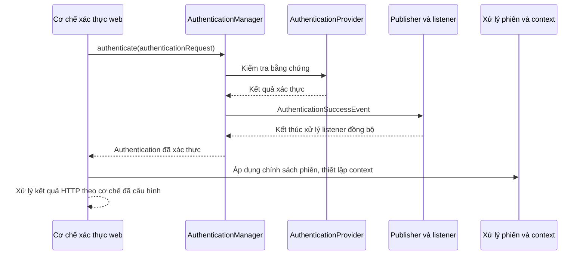

# Authentication event listeners trong luồng khôi phục tài khoản

## 1. Listener giúp quan sát điều gì trong account recovery?

Một hệ thống khôi phục tài khoản cần biết không chỉ việc mật khẩu vừa được thay đổi, mà còn những hoạt động xác thực xảy ra trước và sau thay đổi đó. Ví dụ: nhiều lần đăng nhập thất bại dẫn đến yêu cầu recovery, một recovery code bị thử lặp lại, người dùng đăng nhập bằng passkey mới hoặc một phiên cũ cố quay lại sau khi tài khoản đã được bảo vệ.

Trong module `SECURITY_AUTHENTICATION_ACCOUNT_RECOVERY`, authentication event listeners là một điểm tích hợp để thu thập các tín hiệu này từ Spring Security. Chúng có thể hỗ trợ quan sát, audit, phát hiện lạm dụng và liên kết hoạt động đăng nhập với một giao dịch recovery. Tuy nhiên, listener phải hiểu đúng ý nghĩa của sự kiện: xác thực thành công, recovery hoàn tất và session mới được cấp là các mốc khác nhau.

Nếu một listener nhận sự kiện xác thực thành công rồi tự đánh dấu recovery đã xong, nó có thể bỏ qua bước thay credential hoặc MFA. Nếu listener đồng bộ gửi email qua một dịch vụ đang chậm, một lần đăng nhập bình thường có thể bị kéo dài theo. Nếu listener ghi nguyên đối tượng authentication ra log, mật khẩu hoặc recovery proof có thể bị lộ.

Bài học này xây dựng cách sử dụng listener theo ba ranh giới:

- Sự kiện của cơ chế xác thực mô tả kết quả xác thực mà cơ chế đó vừa xử lý.
- Sự kiện nghiệp vụ recovery mô tả một thay đổi cụ thể trong quy trình khôi phục tài khoản.
- Một cơ chế lưu và giao sự kiện bền vững quyết định các tác động quan trọng có được thực hiện sau lỗi hoặc restart hay không.

Các ví dụ dùng API Spring Security 6.5 và mô hình Servlet. Những kiểu dữ liệu có tiền tố hoặc ý nghĩa recovery, observation và outbox trong bài là thành phần do ứng dụng thiết kế, không phải tính năng recovery được Spring tự cung cấp.

## 2. Phân biệt event, handler và kiểm tra quyền

### 2.1. Authentication event là tín hiệu kết quả

Spring Security cung cấp `AuthenticationEventPublisher` và triển khai `DefaultAuthenticationEventPublisher` để chuyển kết quả xác thực thành application event. Listener có thể nhận `AuthenticationSuccessEvent` hoặc các lớp con của `AbstractAuthenticationFailureEvent` bằng `@EventListener`. Cơ chế này độc lập với việc viết response Servlet. Xem [Authentication Events](https://docs.spring.io/spring-security/reference/6.5/servlet/authentication/events.html).

Event không tự mang ý nghĩa “đã cấp quyền nghiệp vụ đầy đủ”. Nếu ứng dụng dùng một cơ chế xác thực cho bước trung gian, thành công của bước đó chỉ có ý nghĩa theo hợp đồng của cơ chế ấy. Một lần kiểm tra mật khẩu thành công chưa chứng minh người dùng đã hoàn thành MFA mà sản phẩm yêu cầu.

### 2.2. Success handler và failure handler phục vụ luồng HTTP

`AuthenticationSuccessHandler` và `AuthenticationFailureHandler` nằm trong cơ chế xử lý xác thực của web. Chúng có request và response để quyết định redirect, status hoặc body. Listener phù hợp khi muốn quan sát một kết quả mà không gắn logic quan sát trực tiếp vào cách trả HTTP.

Trong luồng có filter xác thực dựa trên `AbstractAuthenticationProcessingFilter`, filter còn thực hiện các bước riêng như session strategy và phát sự kiện interactive success. Vì vậy, không lấy thứ tự listener của manager làm bằng chứng rằng mọi bước trong filter đã hoàn tất. Xem [API của AbstractAuthenticationProcessingFilter](https://docs.spring.io/spring-security/reference/6.5/api/java/org/springframework/security/web/authentication/AbstractAuthenticationProcessingFilter.html).

### 2.3. Chính sách bắt buộc phải nằm trên đường quyết định

Các kiểm tra như token còn hạn, recovery code chưa dùng, account không bị đình chỉ, tenant đúng và MFA đủ mức bảo đảm phải được thực thi trước khi cấp quyền hoặc commit thay đổi tương ứng.

Một listener quan sát bất đồng bộ không phải nơi phù hợp để quyết định liệu request hiện tại có được phép tiếp tục. Nếu hệ thống chỉ tăng bộ đếm trong listener sau khi xác thực, nhiều request song song có thể đã vượt qua giới hạn trước khi listener xử lý.

| Điểm tích hợp | Trách nhiệm phù hợp | Không được suy diễn từ riêng điểm này |
|---|---|---|
| Authentication provider hoặc service xác minh | Kiểm tra bằng chứng và trả kết quả đúng phạm vi | Credential nghiệp vụ đã được thay đổi |
| Authentication event listener | Thu thập tín hiệu, chuẩn hóa quan sát, kích hoạt xử lý phù hợp | Session chắc chắn đã lưu hoặc recovery chắc chắn đã commit |
| Success/failure handler | Kết quả HTTP của một cơ chế xác thực web | Tác động ngoài hệ thống đã giao thành công |
| Recovery application service | Chuyển trạng thái recovery và bảo toàn bất biến | Email đã đến người nhận |
| Transactional outbox và consumer | Lưu ý định giao việc, retry, chống xử lý trùng | Quyền truy cập cũ đã bị chặn nếu chưa có cơ chế thực thi |

## 3. Event được phát từ đâu và vào thời điểm nào?

### 3.1. Đi qua AuthenticationManager đang thực sự được sử dụng

`ProviderManager` ủy quyền cho các provider và phát event qua `AuthenticationEventPublisher` đã cấu hình. Nếu tự tạo manager, phải gắn publisher khi muốn nhận event; một manager tự tạo không mặc nhiên sử dụng mọi publisher bean có trong application context. Cấu trúc manager cha/con cũng có thể làm phát trùng khi cả hai cùng publish. Xem [API của ProviderManager](https://docs.spring.io/spring-security/reference/6.5/api/java/org/springframework/security/authentication/ProviderManager.html).

Điều này giải thích một lỗi tích hợp phổ biến: bean listener và publisher đều có, nhưng login vẫn không tạo quan sát. Endpoint login có thể đang dùng manager khác với manager đã được cấu hình. Recovery service cũng có thể xác minh proof trực tiếp mà không gọi `AuthenticationManager`, nên không đi qua đường phát authentication event.

### 3.2. Mốc thành công của manager đứng trước các mốc khác

Với một luồng web phù hợp, có thể hình dung thứ tự như sau. Sơ đồ chỉ mô tả một đường tích hợp thường gặp; cơ chế tùy biến phải kiểm tra thứ tự thực tế của nó.



Vì event có thể được xử lý trước khi cơ chế gọi hoàn tất việc thiết lập phiên, listener không nên ghi một thông điệp như “session đã được cấp và lưu thành công” chỉ dựa trên `AuthenticationSuccessEvent`.

Một nhánh còn có thể bị từ chối sau khi kiểm tra credential thành công, chẳng hạn bởi chính sách số phiên hoặc điều kiện tiếp tục của ứng dụng. Hãy đặt tên quan sát sát với mốc có bằng chứng: `AUTHENTICATION_ACCEPTED` khác với `SESSION_ESTABLISHED`.

### 3.3. Interactive success là một loại event khác

`InteractiveAuthenticationSuccessEvent` không kế thừa `AuthenticationSuccessEvent`. Hai lớp cùng thuộc họ authentication event nhưng biểu diễn các điểm phát khác nhau. Listener chỉ nhận `AuthenticationSuccessEvent` không tự nhận interactive event qua kế thừa. Xem [API của InteractiveAuthenticationSuccessEvent](https://docs.spring.io/spring-security/reference/6.5/api/java/org/springframework/security/authentication/event/InteractiveAuthenticationSuccessEvent.html).

Nếu đăng ký listener cho cả hai rồi cộng cùng một bộ đếm “đăng nhập thành công”, một tương tác có thể bị tính hai lần. Nếu chỉ nhận interactive event, các cơ chế không phát loại đó có thể bị bỏ sót. Chọn một định nghĩa metric trước, rồi xác định điểm phát phù hợp cho từng cơ chế đăng nhập.

## 4. Khai báo publisher và kiểm tra wiring

### 4.1. Publisher cơ sở

```java
import org.springframework.context.ApplicationEventPublisher;
import org.springframework.context.annotation.Bean;
import org.springframework.context.annotation.Configuration;
import org.springframework.security.authentication.AuthenticationEventPublisher;
import org.springframework.security.authentication.DefaultAuthenticationEventPublisher;

@Configuration
class AuthenticationObservationConfiguration {

    @Bean
    AuthenticationEventPublisher authenticationEventPublisher(
            ApplicationEventPublisher applicationEvents) {
        return new DefaultAuthenticationEventPublisher(applicationEvents);
    }
}
```

Đoạn code mô tả thành phần cần có khi ứng dụng chưa có cấu hình tương đương. Trước khi thêm bean trong một ứng dụng dùng Spring Boot hoặc cấu hình bảo mật có sẵn, cần kiểm tra cấu hình hiệu lực để tránh tạo nhiều publisher hoặc vô tình thay thế thành phần đang dùng.

### 4.2. Manager được tạo thủ công

Nếu ứng dụng chủ động xây dựng một `ProviderManager`, wiring phải tường minh:

```java
import java.util.List;
import org.springframework.security.authentication.AuthenticationEventPublisher;
import org.springframework.security.authentication.AuthenticationProvider;
import org.springframework.security.authentication.ProviderManager;

ProviderManager createManager(
        List<AuthenticationProvider> explicitlySelectedProviders,
        AuthenticationEventPublisher eventPublisher) {

    ProviderManager manager =
            new ProviderManager(explicitlySelectedProviders);
    manager.setAuthenticationEventPublisher(eventPublisher);
    return manager;
}
```

Danh sách provider trong ví dụ là danh sách đã được ứng dụng lựa chọn và sắp thứ tự, không phải yêu cầu tự động gom mọi provider bean. Manager này chỉ có tác dụng nếu cơ chế xác thực đang thực sự gọi nó. Việc tạo thêm một bean manager không bảo đảm một filter tùy biến hoặc endpoint login cũ sẽ chuyển sang dùng manager mới.

Trong ứng dụng có nhiều chain hoặc nhiều phương thức đăng nhập, hãy kiểm kê riêng password, passkey, MFA, bearer token và recovery proof. Mỗi đường có thể dùng cơ chế và điểm phát sự kiện khác nhau. Không giả định một lần cấu hình đã bao phủ mọi đường chỉ vì cùng nằm trong một process.

## 5. Ánh xạ failure event và các exception tùy biến

### 5.1. Exception class ảnh hưởng event nhận được

Publisher mặc định có những ánh xạ như `BadCredentialsException` sang `AuthenticationFailureBadCredentialsEvent`, `LockedException` sang `AuthenticationFailureLockedEvent`, và `CredentialsExpiredException` sang `AuthenticationFailureCredentialsExpiredEvent`. Trong cấu hình mặc định, `UsernameNotFoundException` cũng được ánh xạ vào bad-credentials event.

Điểm cần chú ý là ánh xạ theo lớp exception chính xác, không tự bao phủ mọi lớp con. Một exception mới do ứng dụng tạo có thể không phát failure event như bạn dự đoán. Có thể bổ sung ánh xạ hoặc chọn một event dự phòng cụ thể. Xem [API của DefaultAuthenticationEventPublisher](https://docs.spring.io/spring-security/reference/6.5/api/java/org/springframework/security/authentication/DefaultAuthenticationEventPublisher.html).

Một hệ thống recovery có thể có exception riêng cho việc provider từ chối recovery proof. Việc ánh xạ chỉ có ý nghĩa nếu provider đó thực sự dùng proof như một đầu vào xác thực qua manager. Không cần đổi mọi lỗi nghiệp vụ của recovery service thành `AuthenticationException` chỉ để tận dụng listener.

### 5.2. Định nghĩa event cụ thể

Mỗi public class dưới đây nằm trong file Java tương ứng khi triển khai trong ứng dụng. Thông điệp exception được giữ cố định, không chèn proof hoặc thông tin nhận diện do client gửi.

```java
import org.springframework.security.core.AuthenticationException;

public final class RecoveryProofAuthenticationException
        extends AuthenticationException {

    public RecoveryProofAuthenticationException() {
        super("Recovery proof was rejected");
    }
}
```

```java
import org.springframework.security.authentication.event.AbstractAuthenticationFailureEvent;
import org.springframework.security.core.Authentication;
import org.springframework.security.core.AuthenticationException;

public final class RecoveryProofRejectedEvent
        extends AbstractAuthenticationFailureEvent {

    public RecoveryProofRejectedEvent(
            Authentication authentication,
            AuthenticationException exception) {
        super(authentication, exception);
    }
}
```

Event dự phòng cũng phải là một lớp có thể được khởi tạo:

```java
import org.springframework.security.authentication.event.AbstractAuthenticationFailureEvent;
import org.springframework.security.core.Authentication;
import org.springframework.security.core.AuthenticationException;

public final class UnmappedAuthenticationFailureEvent
        extends AbstractAuthenticationFailureEvent {

    public UnmappedAuthenticationFailureEvent(
            Authentication authentication,
            AuthenticationException exception) {
        super(authentication, exception);
    }
}
```

Không dùng chính `AbstractAuthenticationFailureEvent` làm lớp cần khởi tạo. Nó là lớp abstract. Event tùy biến cần constructor public nhận `(Authentication, AuthenticationException)` để publisher có thể tạo instance theo hợp đồng ánh xạ. Xem [API của AbstractAuthenticationFailureEvent](https://docs.spring.io/spring-security/reference/6.5/api/java/org/springframework/security/authentication/event/AbstractAuthenticationFailureEvent.html).

### 5.3. Cấu hình mapping và fallback

Đây là phiên bản thay thế cho bean publisher cơ sở ở mục 4, không phải một publisher thứ hai được thêm song song:

```java
@Bean
AuthenticationEventPublisher authenticationEventPublisher(
        ApplicationEventPublisher applicationEvents) {

    DefaultAuthenticationEventPublisher publisher =
            new DefaultAuthenticationEventPublisher(applicationEvents);

    publisher.setAdditionalExceptionMappings(Map.of(
            RecoveryProofAuthenticationException.class,
            RecoveryProofRejectedEvent.class));

    publisher.setDefaultAuthenticationFailureEvent(
            UnmappedAuthenticationFailureEvent.class);

    return publisher;
}
```

Fallback tạo khả năng quan sát đối với exception chưa được phân loại; nó không biến mọi lỗi chưa biết thành lỗi người dùng nhập sai. Một sự cố kết nối kho credential và một mã recovery sai có ý nghĩa vận hành khác nhau. Không cộng cả hai vào cùng bộ đếm khóa tài khoản nếu chưa có chính sách phân loại rõ ràng.

## 6. Listener chỉ chuyển dữ liệu cần thiết sang một snapshot an toàn

### 6.1. Không chuyển nguyên Authentication sang hệ thống khác

Authentication event mang một đối tượng `Authentication`. Với failure event, đây có thể là đầu vào chưa được xác thực, chứa principal do client khai báo và credentials chưa được xóa. Với success event, principal, details hoặc một triển khai authentication tùy biến vẫn có thể chứa dữ liệu không nên được serialize.

Do đó, không ghi `event`, `event.getAuthentication()` hoặc `event.getSource()` trực tiếp vào log và không đẩy nguyên chúng vào queue. Việc một lớp có khả năng serialize không có nghĩa toàn bộ dữ liệu bên trong phù hợp để lưu hoặc truyền.

Một adapter nên đọc các trường đã cho phép, phân loại kết quả bằng mã cố định và tạo đối tượng mới không chứa secret. Đây cũng là thời điểm tách dữ liệu dùng cho quan sát khỏi dữ liệu dùng để trao quyền.

### 6.2. Một schema quan sát tối thiểu

```java
import java.time.Instant;
import java.util.UUID;

enum AuthenticationObservationType {
    ACCEPTED,
    REJECTED
}

enum AuthenticationFailureReason {
    NONE,
    BAD_CREDENTIALS,
    LOCKED,
    CREDENTIALS_EXPIRED,
    RECOVERY_PROOF_REJECTED,
    OTHER
}

record VerifiedSubject(UUID accountId, UUID tenantId) {
}

record AuthenticationObservation(
        UUID observationId,
        Instant observedAt,
        AuthenticationObservationType type,
        VerifiedSubject subject,
        AuthenticationFailureReason reason) {
}
```

`VerifiedSubject` chỉ được tạo từ principal mà provider tin cậy đã gắn định danh nội bộ. Trong failure path, ví dụ sẽ để subject trống thay vì coi username client nhập là tài khoản đã xác minh. Nếu cần phân tích theo định danh được thử, dùng trường riêng có nhãn “claimed” và áp dụng chính sách bảo vệ dữ liệu tương ứng.

`observationId` của snapshot giúp nhận diện một lần tạo quan sát. Nó chưa phải khóa chống trùng của một lần đăng nhập: nếu hai điểm phát tạo hai snapshot, mỗi snapshot vẫn có ID mới. Muốn liên kết theo attempt, phải gán và truyền một attempt ID tin cậy ở ranh giới xác thực phù hợp.

### 6.3. Listener mẫu

Các interface dưới đây là hợp đồng của ứng dụng. `ObservationBuffer.offer` là thao tác có giới hạn thời gian, không ghi network đồng bộ và trả `false` khi hết chỗ. Nó phục vụ tín hiệu quan sát có chính sách chấp nhận mất mẫu; các dữ kiện audit bắt buộc phải đi qua đường bền vững riêng.

```java
interface VerifiedAccountPrincipal {
    UUID accountId();
    UUID tenantId();
}

interface ObservationBuffer {
    boolean offer(AuthenticationObservation observation);
}

interface ObservationLossMeter {
    void increment();
}
```

```java
import java.time.Clock;
import java.time.Instant;
import java.util.UUID;
import org.springframework.context.event.EventListener;
import org.springframework.security.authentication.event.AbstractAuthenticationFailureEvent;
import org.springframework.security.authentication.event.AuthenticationFailureBadCredentialsEvent;
import org.springframework.security.authentication.event.AuthenticationFailureCredentialsExpiredEvent;
import org.springframework.security.authentication.event.AuthenticationFailureLockedEvent;
import org.springframework.security.authentication.event.AuthenticationSuccessEvent;
import org.springframework.stereotype.Component;

@Component
final class AuthenticationObservationListener {

    private final ObservationBuffer observations;
    private final ObservationLossMeter lossMeter;
    private final Clock clock;

    AuthenticationObservationListener(
            ObservationBuffer observations,
            ObservationLossMeter lossMeter,
            Clock clock) {
        this.observations = observations;
        this.lossMeter = lossMeter;
        this.clock = clock;
    }

    @EventListener
    public void onSuccess(AuthenticationSuccessEvent event) {
        Object principal = event.getAuthentication().getPrincipal();

        VerifiedSubject subject =
                principal instanceof VerifiedAccountPrincipal account
                        ? new VerifiedSubject(
                                account.accountId(), account.tenantId())
                        : null;

        offer(new AuthenticationObservation(
                UUID.randomUUID(),
                Instant.now(clock),
                AuthenticationObservationType.ACCEPTED,
                subject,
                AuthenticationFailureReason.NONE));
    }

    @EventListener
    public void onFailure(AbstractAuthenticationFailureEvent event) {
        offer(new AuthenticationObservation(
                UUID.randomUUID(),
                Instant.now(clock),
                AuthenticationObservationType.REJECTED,
                null,
                reasonFor(event)));
    }

    private AuthenticationFailureReason reasonFor(
            AbstractAuthenticationFailureEvent event) {
        if (event instanceof RecoveryProofRejectedEvent) {
            return AuthenticationFailureReason.RECOVERY_PROOF_REJECTED;
        }
        if (event instanceof AuthenticationFailureBadCredentialsEvent) {
            return AuthenticationFailureReason.BAD_CREDENTIALS;
        }
        if (event instanceof AuthenticationFailureLockedEvent) {
            return AuthenticationFailureReason.LOCKED;
        }
        if (event instanceof AuthenticationFailureCredentialsExpiredEvent) {
            return AuthenticationFailureReason.CREDENTIALS_EXPIRED;
        }
        return AuthenticationFailureReason.OTHER;
    }

    private void offer(AuthenticationObservation observation) {
        if (!observations.offer(observation)) {
            lossMeter.increment();
        }
    }
}
```

Ứng dụng cần cung cấp các bean của buffer, meter và `Clock`. Marker interface của principal chỉ hữu ích khi các provider phía server kiểm soát việc tạo principal; không deserialize principal từ request rồi coi nó là danh tính tin cậy vì nó triển khai đúng interface.

Ví dụ cố ý không đọc username, exception message, credentials, details, token hay session ID. Nó cũng không đặt lại cờ recovery, không cấp role và không đánh dấu MFA đã hoàn thành. Loại `ACCEPTED` mô tả kết quả xác thực được quan sát; dữ liệu về phương thức và mức bảo đảm cần thêm một bộ phân loại tin cậy nếu sản phẩm có nhiều cơ chế.

## 7. Đừng lấy danh tính sự kiện từ SecurityContextHolder

Một success event có thể được phát lúc manager vẫn chưa trả kết quả cho filter hoặc controller. Tại thời điểm listener chạy, holder có thể còn trống hoặc chứa authentication trước đó.

Vì vậy, đối với authentication đang được quan sát, dùng `event.getAuthentication()` rồi trích xuất theo whitelist. Không lấy `SecurityContextHolder.getContext().getAuthentication()` làm nguồn thay thế chỉ vì listener đang chạy trên request thread.

Trong recovery, trình duyệt còn có thể đang đăng nhập tài khoản A trong khi proof nhắm tài khoản B. Listener đọc holder để suy ra đối tượng recovery sẽ dễ liên kết sai tài khoản. Đối tượng của giao dịch recovery phải được lấy từ kết quả xác minh và trạng thái nghiệp vụ của chính giao dịch đó.

Tương tự, không gọi `setAuthentication` trong listener chỉ để làm cho các listener khác đọc được principal. Điều đó biến đường quan sát thành đường thay đổi quyền. Thành phần xác thực chính phải chịu trách nhiệm thiết lập, lưu và dọn context theo vòng đời của nó.

## 8. Đồng bộ, bất đồng bộ và chính sách khi listener lỗi

### 8.1. Listener mặc định có thể nằm trên đường nóng của login

`SimpleApplicationEventMulticaster` mặc định gọi listener trên thread phát sự kiện. Khi không có error handler tùy biến, exception từ listener có thể lan về publisher và làm dừng lần multicast hiện tại. Xem [API của SimpleApplicationEventMulticaster](https://docs.spring.io/spring-framework/docs/6.2.x/javadoc-api/org/springframework/context/event/SimpleApplicationEventMulticaster.html).

Điều đó khiến các tác vụ như gọi email provider, truy vấn phân tích nhiều giây hoặc chờ SIEM nhận log trở thành phụ thuộc của login nếu đặt trực tiếp trong listener đồng bộ. Một tấn công gửi nhiều yêu cầu xác thực còn có thể làm cạn thread phục vụ bởi chính công việc quan sát.

Cần định nghĩa chính sách lỗi theo trách nhiệm. Tín hiệu metric có thể chấp nhận mất mẫu và ghi nhận bộ đếm mất. Audit bắt buộc cần nguồn lưu bền vững và điều kiện lỗi được thiết kế trên đường nghiệp vụ. Không bao quanh mọi listener bằng `catch (Exception)` rồi bỏ qua, cũng không để một dịch vụ thông báo phụ vô tình quyết định khả năng đăng nhập của toàn hệ thống.

### 8.2. Async không phải cơ chế giao việc bền vững

`@Async` có thể cho listener chạy ở thread khác khi ứng dụng đã cấu hình hỗ trợ async. Context thread-local và transaction không tự đi theo chỉ nhờ thêm annotation; exception của listener async cũng không trở lại caller theo cùng cách như listener đồng bộ. Xem [Asynchronous Listeners trong Spring Framework](https://docs.spring.io/spring-framework/reference/core/beans/context-introduction.html#context-functionality-events-annotation-async).

Một thiết kế hợp lý là listener đồng bộ chỉ tạo snapshot nhỏ, sau đó giao snapshot đã lọc cho worker hoặc queue phù hợp. Không truyền event gốc sang thread khác vì nó còn giữ authentication mutable, details của request hoặc dữ liệu có thể bị xóa sau khi manager hoàn tất.

Nếu dùng executor trong process, cần xác định dung lượng queue, giới hạn thread, chính sách khi đầy, timeout và cách shutdown. Một queue vô hạn có thể tích lũy hàng triệu failure event khi bị tấn công. Một chính sách chạy tác vụ ngay trên caller khi queue đầy lại có thể đưa độ trễ xử lý trở về request thread.

Tác vụ được chấp nhận vào executor vẫn có thể mất khi process chết. Các thông báo hoặc audit có yêu cầu không được mất cần lưu ý định xử lý vào một kho bền vững, thay vì dựa vào việc phương thức async đã được gọi.

### 8.3. Thứ tự listener không thay thế orchestration

`@Order` có thể hỗ trợ sắp thứ tự gọi các listener phù hợp trong một application context. Nó không tạo transaction phân tán, không bảo đảm một tác vụ async hoàn tất trước tác vụ khác và không điều phối thứ tự giữa nhiều node.

Nếu thao tác B chỉ được thực hiện khi A thành công, hãy thể hiện quan hệ đó trong service hoặc state machine. Đừng đặt “tiêu thụ recovery code”, “đổi mật khẩu” và “thu hồi phiên” vào ba listener độc lập rồi dựa vào thứ tự annotation để coi chúng là một giao dịch recovery.

## 9. Sự kiện nghiệp vụ recovery phải có hợp đồng riêng

### 9.1. Đặt tên theo sự thật đã xác nhận

Authentication failure không nhất thiết là thất bại recovery. Authentication success không nhất thiết là recovery thành công. Một hệ thống nên có từ vựng sự kiện phù hợp với các chuyển trạng thái mà nó thực sự triển khai.

| Sự kiện ứng dụng ví dụ | Ý nghĩa dự kiến | Điều kiện trước khi phát |
|---|---|---|
| `RecoveryRequested` | Đã tiếp nhận một yêu cầu theo chính sách | Không khẳng định account tồn tại qua response công khai |
| `RecoveryProofVerified` | Một bằng chứng đã được chấp nhận cho phạm vi cụ thể | Kiểm tra mục đích, hạn dùng và binding phù hợp |
| `RecoveryCompleted` | Trạng thái hoàn tất đã được ghi theo transaction | Tiêu thụ proof và cập nhật credential theo bất biến |
| `RecoveryEnrollmentRequired` | Cần hoàn tất đăng ký yếu tố mới | Chỉ cấp quyền tiếp tục hạn chế |
| `AccountAccessRevocationRequested` | Đã ghi ý định thu hồi theo phạm vi | Có cơ chế thực thi và theo dõi kết quả |
| `AccountAccessRevocationCompleted` | Các nguồn thuộc phạm vi đã xác nhận kết quả | Không chỉ dựa vào việc đã gửi request thu hồi |

Các tên trên là ví dụ thiết kế. Không cần tạo tất cả event nếu quy trình không có mốc tương ứng. Mỗi event cần mô tả rõ nó là ý định, kết quả xử lý hay một sự thật đã được commit.

### 9.2. Payload không chứa bằng chứng có thể tái sử dụng

```java
import java.time.Instant;
import java.util.UUID;

public record RecoveryCompleted(
        UUID eventId,
        UUID operationId,
        UUID accountId,
        UUID tenantId,
        long securityVersion,
        Instant occurredAt) {
}
```

Payload này không chứa password, recovery code, reset URL hoặc bearer token. Nó cũng không chứa `HttpServletRequest`, entity JPA đang managed hay toàn bộ principal. Consumer cần thêm dữ liệu phải truy cập nguồn phù hợp bằng danh tính service và chính sách của chính consumer.

`securityVersion` hỗ trợ nhận biết event cũ so với trạng thái mới hơn của cùng tài khoản. Nó không tự thu hồi quyền; các thành phần kiểm tra session/token phải thực thi quy tắc tương ứng.

## 10. Transactional event listeners và khoảng trống sau commit

### 10.1. AFTER_COMMIT có ý nghĩa khác với @EventListener thông thường

`@TransactionalEventListener` có thể gắn việc xử lý với một phase transaction. Mặc định là `AFTER_COMMIT`; nếu không có transaction phù hợp, listener mặc định không được gọi, trừ khi bật `fallbackExecution`. Xem [Transaction-bound Events](https://docs.spring.io/spring-framework/reference/data-access/transaction/event.html).

Điều này phù hợp để chỉ kích hoạt một tác động phụ sau khi thay đổi recovery đã commit. Nhưng thêm `@TransactionalEventListener` vào listener của `AuthenticationSuccessEvent` không tự biến sự kiện xác thực thành sự kiện hoàn tất recovery. Nếu manager chạy ngoài transaction, listener còn có thể không được gọi như bạn tưởng.

Một transaction gắn với xác thực cũng không nhất thiết bao phủ thay đổi credential. Phải xác định transaction của sự kiện muốn quan sát, không chỉ kiểm tra có annotation `@Transactional` ở một chỗ nào đó.

### 10.2. Ví dụ dịch vụ lưu outbox trong cùng transaction

Đoạn sau là mã minh họa nghiệp vụ. Các repository, kiểu command và policy là thành phần ứng dụng; phương thức truy cập dữ liệu phải được triển khai để bảo đảm khóa hoặc cập nhật có điều kiện phù hợp. Service phải được gọi qua cơ chế transaction thực sự có hiệu lực.

```java
@Transactional
public RecoveryResult complete(RecoveryCommand command) {
    RecoveryGrant grant = grants.requireUsableForUpdate(command.proof());
    Account account = accounts.requireForUpdate(
            grant.accountId(), grant.tenantId());

    policy.requireCompletionAllowed(account, grant, command);

    grant.consume();
    credentialChanges.apply(account, grant, command);
    long version = account.advanceSecurityVersion();

    RecoveryCompleted event = new RecoveryCompleted(
            eventIds.next(),
            grant.operationId(),
            account.id(),
            account.tenantId(),
            version,
            clock.instant());

    // Cùng database và cùng transaction với thay đổi phía trên.
    outbox.append(event);

    // Chỉ hỗ trợ đánh thức dispatcher sau commit.
    applicationEvents.publishEvent(event);

    return new RecoveryResult(grant.operationId(), "SIGN_IN_REQUIRED");
}
```

Ở đây, bản ghi outbox mới là ý định xử lý bền vững. Khi transaction rollback, thay đổi credential, việc tiêu thụ grant và bản ghi outbox đều phải rollback theo cùng phạm vi transaction đã thiết kế.

Listener sau commit có thể dùng để giảm thời gian chờ của dispatcher:

```java
import org.springframework.transaction.event.TransactionPhase;
import org.springframework.transaction.event.TransactionalEventListener;

@TransactionalEventListener(phase = TransactionPhase.AFTER_COMMIT)
public void onRecoveryCompleted(RecoveryCompleted event) {
    outboxDispatcher.signalAvailable();
}
```

`signalAvailable` trong thiết kế này chỉ là tín hiệu đánh thức có giới hạn thời gian và chính sách lỗi phù hợp. Dispatcher vẫn định kỳ đọc outbox, nên mất tín hiệu không làm mất công việc. Consumer đọc dữ liệu đã commit trong transaction riêng của nó.

Không vừa gửi email trực tiếp từ listener vừa để outbox gửi cùng email, trừ khi có thiết kế chống trùng tương ứng. Việc có hai đường phát tác động phụ thường tạo ra hai thông báo dù mỗi đường tự thấy mình chạy đúng một lần.

### 10.3. AFTER_COMMIT không bảo đảm delivery

Process có thể chết sau khi commit database nhưng trước khi listener gửi thông báo. Spring application event trong bộ nhớ không phải một broker bền vững. Một listener được gọi sau commit chỉ bảo đảm mối quan hệ với phase transaction theo hợp đồng, không bảo đảm xử lý xong sau restart.

Cũng không giả định ghi database trong callback sau commit sẽ được commit cùng transaction cũ. Tài nguyên có thể còn truy cập được nhưng transaction đã kết thúc; nếu cần ghi mới, dùng ranh giới transaction phù hợp, chẳng hạn qua service khác mở transaction mới. Xem cảnh báo trong [API của TransactionalEventListener](https://docs.spring.io/spring-framework/docs/6.2.x/javadoc-api/org/springframework/transaction/event/TransactionalEventListener.html).

Outbox giải quyết khoảng trống lưu ý định, nhưng vẫn cần dispatcher, retry, theo dõi lỗi và consumer chống xử lý trùng. Không mô tả việc thêm một bảng outbox như thể đã có cơ chế giao nhận hoàn chỉnh.

## 11. Dùng sự kiện để hỗ trợ phát hiện lạm dụng

### 11.1. Tách loại thất bại trước khi đếm

Một mã recovery sai, một tài khoản đang khóa, một provider không hỗ trợ loại authentication và một sự cố kho dữ liệu không nên tự động dẫn đến cùng một hành động.

Ví dụ, nếu sự cố database được tính là sai mật khẩu, hệ thống có thể khóa hàng loạt tài khoản trong lúc hạ tầng đang lỗi. Nếu mọi login success đều xóa bộ đếm recovery, kẻ biết mật khẩu nhưng chưa có MFA có thể làm suy yếu giới hạn thử ở bước phục hồi yếu tố thứ hai.

Định nghĩa bộ đếm theo mục đích: thử mật khẩu, thử proof, thử recovery code, xác minh MFA hoặc yêu cầu gửi challenge. Mỗi bộ đếm cần có phạm vi, cửa sổ thời gian và điều kiện reset riêng.

### 11.2. Không dựa vào một IP hoặc một account để ra mọi quyết định

IP có thể dùng chung qua NAT hoặc proxy. Định danh account do client nhập có thể được dùng để tấn công khóa tài khoản của nạn nhân. Tenant lấy trực tiếp từ header không kiểm chứng cũng có thể làm sai miền thống kê.

Một chính sách chống lạm dụng có thể kết hợp tín hiệu theo account đã phân giải an toàn, định danh được thử, thiết bị, mạng và giao dịch recovery. Khi ghi nhận các chiều này, nguồn và độ tin cậy phải rõ ràng. Thông tin forwarded từ proxy chỉ được tin trong cấu hình proxy tin cậy của hệ thống.

### 11.3. Enforcement phải đứng trước thao tác cần bảo vệ

Listener có ích để bổ sung risk model hoặc dữ liệu điều tra. Tuy nhiên, giới hạn bắt buộc như “proof chỉ được thử tối đa N lần” cần được kiểm tra và cập nhật nguyên tử tại nơi xác minh proof.

Với nhiều node, một biến đếm trong bộ nhớ listener của node A không kiểm soát được request đang chạy tại node B. Nếu dùng kho dùng chung, cần chọn thao tác và mô hình nhất quán phù hợp. Nếu chọn xử lý rủi ro bất đồng bộ, phải thừa nhận khoảng trễ và không gọi nó là hàng rào tức thời cho request hiện tại.

## 12. Bảo vệ dữ liệu trong log, metric và thông báo

### 12.1. Log theo whitelist

Nên ghi mã sự kiện, kết quả, thời điểm, nguồn xử lý và định danh tương quan cần thiết. Không ghi mật khẩu, OTP, recovery code, reset token, session cookie hoặc access token. Dữ liệu định danh cá nhân, địa chỉ mạng và thiết bị cần có chính sách thu thập, truy cập và thời hạn lưu phù hợp. Xem [OWASP Logging Cheat Sheet](https://cheatsheetseries.owasp.org/cheatsheets/Logging_Cheat_Sheet.html).

Exception message không phải trường dữ liệu an toàn mặc định: một exception tùy biến có thể đã ghép username hoặc token vào message. Dùng reason code đã phân loại thay vì serialize toàn bộ exception trong đường audit thông thường. Khi cần stack trace cho lỗi kỹ thuật, bảo đảm các lớp tạo exception cũng không chèn secret.

Đầu vào có ký tự xuống dòng hoặc ký tự điều khiển có thể làm sai cấu trúc log nếu ghép chuỗi không kiểm soát. Structured logging giúp giữ ranh giới trường nhưng vẫn cần giới hạn độ dài và schema; nó không tự loại bỏ dữ liệu nhạy cảm.

### 12.2. Định danh được thử khác với account đã xác minh

Một failure event có principal tên `victim@example.test` chỉ chứng minh có ai đó đã đưa chuỗi đó vào một yêu cầu, không chứng minh nạn nhân đã gửi yêu cầu. Đừng gửi email cảnh báo mỗi lần nhìn thấy chuỗi này mà không có giới hạn, vì kẻ tấn công có thể dùng tính năng cảnh báo để quấy rối người dùng.

Nếu cần một khóa tương quan cho identifier được thử, có thể thiết kế pseudonym bằng HMAC với khóa quản lý riêng. Đây vẫn là dữ liệu cần kiểm soát: không coi hash không khóa của email là ẩn danh, và không dùng pseudonym làm bằng chứng danh tính.

### 12.3. Metric có số lượng nhãn hữu hạn

Các nhãn như outcome, phương thức đã phân loại và reason code có tập giá trị hữu hạn phù hợp với metric tổng hợp. Account ID, email, raw URL hoặc operation ID sẽ tạo cardinality lớn và có thể làm lộ dữ liệu.

Thông tin chi tiết để điều tra theo operation hoặc account nên đi qua kho audit có quyền truy cập phù hợp. Chỉ số mất event, queue đầy và độ trễ xử lý cũng cần được quan sát; dashboard không có failure event có thể là do publisher bị ngắt, không phải do hệ thống không bị thử tấn công.

## 13. Correlation, chống trùng và thứ tự trong hệ thống nhiều node

### 13.1. Phân biệt ba loại ID

Một mô hình thực tế thường cần `attemptId` cho một lần xác thực, `operationId` cho giao dịch recovery và `eventId` cho một sự kiện đã tạo. Chúng không nhất thiết là cùng một giá trị.

Một operation có thể chứa nhiều attempt. Một attempt có thể tạo nhiều sự kiện ở các mốc khác nhau. Một event có thể được giao lại nhiều lần. Nếu dùng một UUID mới ở mỗi lần retry consumer, downstream sẽ không nhận ra đó là giao lại của cùng sự kiện.

ID tương quan được client gửi có thể hỗ trợ tracing sau khi được kiểm tra cú pháp và giới hạn, nhưng không nên là nguồn duy nhất của khóa nghiệp vụ hoặc quyền truy cập. Một attacker không được phép chọn operation ID của người khác để làm event của mình có vẻ thuộc giao dịch đó.

### 13.2. Consumer cần chịu được giao lại

Ví dụ, một event `RecoveryCompleted` có ID E1 được xử lý, nhưng consumer crash trước khi ghi nhận ack. Dispatcher gửi lại E1. Consumer nên có khóa idempotency phù hợp cho từng tác động phụ, chẳng hạn `(consumer, eventId, action)`.

Chỉ ghi “đã xử lý” sau tác động phụ vẫn có cửa sổ gửi lặp nếu tác động ngoài hệ thống không cùng transaction. Có thể cần idempotency key tại nhà cung cấp, delivery record hoặc một quy trình retry có trạng thái. Không tuyên bố exactly-once chỉ vì có unique constraint trong một bảng nội bộ.

### 13.3. Event cũ không được làm lùi trạng thái mới

Giả sử recovery ở version 8 đã hoàn tất, sau đó tài khoản lại bị thu hồi và lên version 9. Một consumer xử lý trễ event của version 8 không được mở khóa hoặc khôi phục credential dựa trên dữ liệu cũ.

Consumer cần hiểu nó đang làm tác động phụ độc lập hay cập nhật trạng thái an ninh. Nếu cập nhật trạng thái, phải kiểm tra phiên bản và chuyển trạng thái hợp lệ. Với thông báo, nội dung phải mô tả đúng thời điểm sự kiện và tránh dẫn người dùng tới một grant đã hết hạn như thể nó còn sử dụng được.

## 14. Kiểm thử mapping và wiring một cách tách bạch

### 14.1. Unit test cho publisher

Một test nhỏ có thể chứng minh custom exception được ánh xạ đúng. Đây chỉ là test publisher, chưa chứng minh filter hoặc manager của ứng dụng đã dùng publisher đó.

```java
import java.util.ArrayList;
import java.util.List;
import java.util.Map;
import org.junit.jupiter.api.Test;
import org.springframework.security.authentication.DefaultAuthenticationEventPublisher;
import org.springframework.security.authentication.UsernamePasswordAuthenticationToken;
import org.springframework.security.core.Authentication;

import static org.assertj.core.api.Assertions.assertThat;

class AuthenticationEventMappingTest {

    @Test
    void mapsRecoveryProofFailure() {
        List<Object> emitted = new ArrayList<>();

        DefaultAuthenticationEventPublisher publisher =
                new DefaultAuthenticationEventPublisher(emitted::add);

        publisher.setAdditionalExceptionMappings(Map.of(
                RecoveryProofAuthenticationException.class,
                RecoveryProofRejectedEvent.class));

        Authentication request =
                UsernamePasswordAuthenticationToken.unauthenticated(
                        "unverified-identifier", "test-only-secret");

        publisher.publishAuthenticationFailure(
                new RecoveryProofAuthenticationException(), request);

        assertThat(emitted).hasSize(1);
        assertThat(emitted.get(0))
                .isInstanceOf(RecoveryProofRejectedEvent.class);
    }
}
```

Token username/password trong test chỉ là vật mang dữ liệu để kiểm tra publisher; nó không minh họa provider xác thực recovery proof. Test cho provider thật cần dùng loại authentication và hợp đồng của provider đó.

Bổ sung test cho exception chưa có mapping để chứng minh fallback nhận được sự kiện, và test cho lớp exception khác có quan hệ kế thừa để tránh giả định ánh xạ bao phủ mọi lớp con. Test cũng nên xác nhận snapshot đầu ra không chứa chuỗi secret đã cố ý đưa vào authentication đầu vào.

### 14.2. Integration test cho đường xác thực thật

Một kiểm thử tích hợp nên thực hiện login hoặc bước xác thực qua cơ chế mà ứng dụng đang dùng, rồi quan sát listener. Nếu test chỉ gọi `applicationEventPublisher.publishEvent(new AuthenticationSuccessEvent(...))`, nó mới chứng minh Spring gọi listener cho một event được tạo thủ công.

Tương tự, trực tiếp gọi `listener.onFailure(event)` không kiểm tra bean scanning, application context, publisher hay manager wiring. Các test nhỏ này có ích ở phạm vi của chúng nhưng không thay thế kiểm thử đường đi thật.

| Kịch bản | Bằng chứng cần kiểm tra |
|---|---|
| Password login thành công | Có quan sát đúng mốc, không tự đánh dấu recovery hoàn tất |
| Credential sai | Có failure event đã phân loại, không lộ credential trong snapshot |
| Custom manager | Publisher được gắn vào manager mà request thực sự dùng |
| Manager có parent | Số event khớp thiết kế, không nhân đôi quan sát nghiệp vụ |
| Cơ chế xác thực trung gian | Không bị ghi nhận nhầm là hoàn tất mọi yếu tố |
| Recovery service xác minh trực tiếp | Có event nghiệp vụ tương ứng, không kỳ vọng authentication event tự xuất hiện |
| Recovery transaction rollback | Không có outbox record đã commit hoặc thông báo hoàn tất |
| Recovery transaction commit | Có ý định xử lý bền vững và listener đúng phase nếu được dùng |
| Event được phát ngoài transaction | Hành vi transactional listener khớp cấu hình fallback |
| Buffer đầy hoặc executor bị từ chối | Chính sách lỗi và chỉ số mất tín hiệu hoạt động đúng |
| Consumer nhận lại cùng event | Tác động phụ tuân thủ chiến lược chống trùng |
| Restart sau commit | Outbox chưa xử lý vẫn được dispatcher tiếp tục |
| Event cũ xử lý sau version mới | Không làm lùi trạng thái bảo mật |

Test transaction cần thực sự commit hoặc rollback tại ranh giới phù hợp. Một test được framework tự rollback cuối phương thức sẽ không tạo cùng điều kiện với production commit cho `AFTER_COMMIT`. Nếu dùng async, chờ theo điều kiện có timeout thay vì ngủ một khoảng cố định rồi suy ra listener đã chạy.

## 15. Ví dụ xuyên suốt: mất MFA và đăng nhập lại

Một người dùng U mất điện thoại chứa ứng dụng MFA. Hệ thống cho phép dùng recovery code đã đăng ký trước đó để bắt đầu một quy trình khôi phục có hạn chế.

1. Người dùng gửi một recovery code sai. Nơi xác minh tăng bộ đếm thử theo chính sách nguyên tử. Nếu đi qua recovery authentication provider, manager phát failure event được ánh xạ; listener tạo snapshot không chứa code.
2. Người dùng gửi code hợp lệ. Kết quả chỉ chứng minh quyền tiếp tục giao dịch recovery. Nếu có success event, hệ thống ghi nhận thành công của cơ chế đó, chưa ghi “đăng nhập đầy đủ”.
3. Recovery service tiêu thụ bằng chứng theo quy trình, thay trạng thái credential và cập nhật version khi hoàn tất các điều kiện. Nó ghi `RecoveryCompleted` vào outbox trong cùng transaction với thay đổi cần bảo toàn.
4. Sau commit, dispatcher được đánh thức hoặc tự đọc bản ghi còn chờ. Consumer gửi thông báo theo chính sách và theo dõi việc thu hồi các nguồn truy cập thuộc phạm vi.
5. Trình duyệt được yêu cầu hoàn tất enrollment hoặc đăng nhập lại. Quyền tiếp tục recovery không được dùng để truy cập vùng nghiệp vụ yêu cầu MFA đầy đủ.
6. Người dùng hoàn thành phương thức xác thực hiện tại. Authentication event của lần này được liên kết với một attempt mới; ứng dụng cấp phiên theo chính sách của cơ chế đăng nhập.
7. Nếu một session hoặc token cũ cố truy cập, nguồn thực thi thu hồi từ chối theo thiết kế. Sự kiện quan sát hỗ trợ điều tra, còn quyết định từ chối nằm trên đường kiểm tra truy cập.

Chuỗi này cho phép trả lời những câu hỏi khác nhau bằng bằng chứng khác nhau: proof nào bị từ chối, giao dịch nào đã commit, tác động phụ nào còn chờ và phiên mới được tạo từ phương thức nào. Một event “success” chung không đủ để thay thế tất cả các mốc đó.

## 16. Các lỗi cần tránh khi triển khai listener

- Đọc principal từ holder rồi gán cho mọi event, dù authentication của event chưa được đặt vào holder.
- Xem principal trong failure event là account đã xác minh thay vì một định danh đang được thử.
- Gửi email trực tiếp trong listener đồng bộ khiến latency của email provider trở thành latency của login.
- Thêm `@Async` rồi cho rằng công việc được lưu bền vững hoặc transaction đã đi theo thread mới.
- Đặt logic cấp role, tiêu thụ recovery code hoặc reset MFA trong listener quan sát.
- Chỉ ánh xạ exception cha rồi giả định mọi exception con đều tạo cùng failure event.
- Đếm cả manager success và interactive success như hai lần login độc lập.
- Gắn `@TransactionalEventListener` vào event phát ngoài transaction rồi không nhận ra listener không được gọi.
- Ghi raw authentication, details, exception message hoặc reset URL vào log và queue.
- Dùng UUID mới ở mỗi lần giao lại rồi cho rằng consumer đã có khóa chống trùng.
- Chỉ có một bộ đếm trong bộ nhớ của một node nhưng tuyên bố giới hạn thử có hiệu lực toàn hệ thống.
- Dùng listener sau commit để ghi thay đổi mới mà không xác định transaction mới và chính sách lỗi.

Authentication event listeners có giá trị khi tên sự kiện, dữ liệu và thời điểm xử lý đều phản ánh đúng mốc đã được chứng minh. Trong account recovery, hãy giữ quyết định an ninh trên đường xác minh và commit, rồi dùng listener để quan sát hoặc kết nối các tác động theo một hợp đồng rõ ràng về dữ liệu, lỗi và giao nhận.
