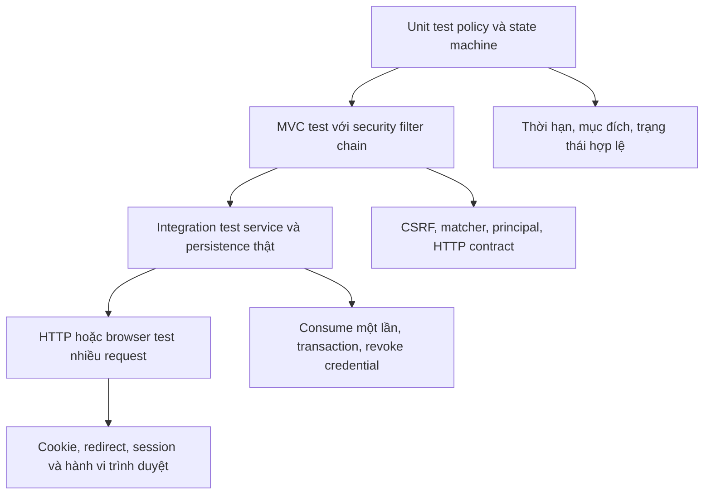

# Spring Security test support trong luồng khôi phục tài khoản

## 1. Mục tiêu của bài học

Một endpoint khôi phục trả về `204 No Content` chưa đủ chứng minh tài khoản được bảo vệ đúng. Request có thể đã bỏ qua filter chain, một principal giả có thể đang che lỗi đăng nhập, hoặc session ở request tiếp theo vẫn giữ quyền mà người dùng đáng lẽ chưa được có.

Trong module **SECURITY_AUTHENTICATION_ACCOUNT_RECOVERY**, bài học này sử dụng Spring Security Test để quan sát ranh giới giữa HTTP, danh tính và nghiệp vụ recovery. Bối cảnh gồm người dùng mất mật khẩu, MFA, passkey hoặc thiết bị xác thực. Mục tiêu là kiểm tra ai được gọi một thao tác, bằng chứng nào được kiểm tra tại đâu, và quyền truy cập còn lại sau thao tác đó.

Sau bài học, bạn cần làm được các việc sau:

- Gắn Spring Security vào MockMvc và xác nhận request thực sự đi qua cấu hình bảo mật cần kiểm tra.
- Chọn đúng công cụ để tạo anonymous request, principal giả, hoặc request xác thực bằng cơ chế thật.
- Kiểm thử CSRF độc lập với recovery proof và quyền hạn của người dùng.
- Kiểm tra request bị từ chối trước khi nghiệp vụ gây tác dụng phụ.
- Kiểm tra method security qua Spring bean được proxy.
- Theo dõi quyền qua nhiều request để phát hiện tự đăng nhập, lưu context sai hoặc thu hồi session không đầy đủ.
- Xác định phần nào cần service và persistence thật thay vì chỉ dùng mock.

Ví dụ dùng Java 17+, Servlet MVC, JUnit Jupiter và API Spring Security **6.5**. Đây là mốc API để đọc ví dụ, không phải tuyên bố về phiên bản mới nhất hay yêu cầu nâng cấp hệ thống. Khi áp dụng, dùng dependency được BOM của dự án quản lý và đọc tài liệu đúng dòng phiên bản.

## 2. Viết yêu cầu bảo mật trước khi viết test

Giả sử ứng dụng có chính sách sau:

1. Người chưa đăng nhập được khởi tạo recovery và gửi bằng chứng hoàn tất recovery.
2. Hai endpoint này vẫn áp dụng CSRF trong giao diện web dùng session/cookie.
3. Hoàn tất đặt lại mật khẩu không tự tạo phiên đăng nhập đầy đủ.
4. Quyền duyệt hồ sơ recovery dành cho nhân viên hỗ trợ không đồng nghĩa với quyền dùng tài khoản của người được hỗ trợ.
5. Bằng chứng recovery chỉ được dùng đúng mục đích, đúng đối tượng, đúng thời hạn và đúng số lần.

Đây là chính sách minh họa của bài học. Một hệ thống cho phép đăng nhập sau recovery phải có bộ test riêng cho yêu cầu xác thực, session fixation và quyền được cấp; không thể đổi một assertion rồi xem như hai chính sách tương đương.

| Bất biến cần giữ | Dấu hiệu quan sát ở HTTP | Bằng chứng cần quan sát thêm |
| --- | --- | --- |
| Anonymous có thể bắt đầu recovery | Request hợp lệ nhận phản hồi đã công bố | Không bị chuyển sang trang đăng nhập; không tạo full authentication |
| CSRF không hợp lệ bị chặn | Với cấu hình mẫu: `403` | Recovery service chưa được gọi |
| Proof không hợp lệ không đổi credential | Phản hồi lỗi theo contract | Credential, token và trạng thái tài khoản không bị cập nhật trái phép |
| Recovery không trở thành đăng nhập đầy đủ | Request tiếp theo tới tài nguyên bảo vệ bị từ chối | Không có context đầy đủ được lưu vào session hoặc credential khác |
| Quyền hỗ trợ có phạm vi riêng | Reviewer được vào endpoint hỗ trợ nhưng không vào profile người dùng | Kiểm tra object/tenant ở nghiệp vụ thật |
| Proof dùng một lần | Lần dùng lại không được hoàn tất | Một lần chuyển trạng thái thành công trong persistence |

Mã trạng thái phải gắn với cấu hình cụ thể. API có entry point trả `401` sẽ khác ứng dụng form login chuyển hướng `302`. `403` cũng có thể phát sinh từ CSRF hoặc authorization; cần kiểm tra tầng nào đã từ chối trước khi kết luận.

## 3. Spring Security Test đứng ở đâu trong kiến trúc kiểm thử?

Một mô hình hữu ích cho recovery là chia kiểm thử theo ranh giới thực thi:



Các tầng bổ sung cho nhau. MockMvc có filter chain thích hợp để bắt lỗi matcher hoặc thiếu CSRF. Nó không tự tạo ra bằng chứng về tính nguyên tử của câu lệnh cập nhật token trong cơ sở dữ liệu. Một test dùng service mock cũng không chứng minh provider email, MFA hay passkey đang hoạt động.

Hãy ghi rõ ranh giới ngay trong tên hoặc mô tả test:

```text
MVC: csrf_invalid_does_not_invoke_recovery_service
SERVICE: consumed_proof_cannot_change_password_again
PERSISTENCE: concurrent_consumption_has_exactly_one_winner
HTTP: old_browser_session_cannot_access_profile_after_revocation
```

Tên test chứa điều kiện và kết quả giúp tránh việc gắn nhãn “security integration” cho một test chỉ gọi controller trực tiếp.

## 4. Chuẩn bị thư viện và nối filter chain

Trong dự án đã quản lý dependency Spring, thêm thư viện test phù hợp. Ví dụ Gradle sau chỉ minh họa dependency, giả định phiên bản được BOM quản lý:

```groovy
dependencies {
    testImplementation("org.springframework.security:spring-security-test")
    testImplementation("org.springframework:spring-test")
    testImplementation("org.junit.jupiter:junit-jupiter")
    testImplementation("org.mockito:mockito-core")
    testImplementation("org.assertj:assertj-core")
}

test {
    useJUnitPlatform()
}
```

Ứng dụng mẫu còn cần thư viện MVC, Security và JSON tương ứng. Với Spring Boot, starter test và dependency quản lý sẵn thường cung cấp một phần các thư viện này. Không ghép ngẫu nhiên `spring-security-test` từ một dòng khác với runtime.

Khi tự dựng MockMvc từ web application context, dùng cấu hình tích hợp sau:

```java
import static org.springframework.security.test.web.servlet.setup
        .SecurityMockMvcConfigurers.springSecurity;

mockMvc = MockMvcBuilders.webAppContextSetup(webContext)
        .apply(springSecurity())
        .build();
```

`springSecurity()` nối hỗ trợ Spring Security Test với MockMvc, bao gồm filter bảo mật và hỗ trợ test context. Vì vậy, gọi controller trực tiếp hoặc dựng `standaloneSetup` mà thiếu cấu hình filter tương ứng không cung cấp cùng bằng chứng. Xem [thiết lập MockMvc với Spring Security](https://docs.spring.io/spring-security/reference/6.5/servlet/test/mockmvc/setup.html).

Nếu framework đã tự cấu hình MockMvc, xác minh filter đang được bật và cấu hình ứng dụng thực sự được nạp. Không thêm filter lần thứ hai chỉ vì muốn “chắc chắn”. Một cách quan sát hữu ích là gửi request thiếu CSRF vào endpoint có bảo vệ và xác nhận service không được gọi.

Với nhiều `SecurityFilterChain`, test phải nạp đúng tập cấu hình và gửi request vào từng nhóm đường dẫn liên quan. Một chain thử nghiệm bắt mọi request có thể che lỗi thứ tự hoặc lỗi `securityMatcher` ở cấu hình triển khai thật.

## 5. Phân biệt công cụ tạo danh tính trong test

| Công cụ | Test nhận được gì? | Không thể suy ra điều gì chỉ từ công cụ này? |
| --- | --- | --- |
| `anonymous()` | Request mang ngữ cảnh anonymous để kiểm tra đường công khai | Proof recovery đã hợp lệ |
| `user("alice")` | Principal giả theo request | Mật khẩu của Alice đã được kiểm tra |
| `@WithMockUser` | Security context giả cho test | Account có tồn tại hoặc provider xác thực đã chạy |
| `authentication(auth)` | Authentication do test tạo | Token ngoài hệ thống đã được xác minh chữ ký hay tiêu thụ |
| `@WithUserDetails` | Principal nạp từ `UserDetailsService` trong context | Một lần đăng nhập bằng credential đã thành công |
| `@WithSecurityContext` | Context tùy biến do factory của test tạo | Context có cùng nguồn gốc tin cậy như context production |
| `httpBasic(...)` hoặc `formLogin(...)` | Request mang credential qua giao thức tương ứng | Provider, repository hay hệ thống bên ngoài không bị mock ở phía sau |

`user(...)`, `anonymous()` và `authentication(...)` là request post-processor. Chúng giúp đặt điều kiện đầu vào để kiểm tra authorization; không nên được dùng làm bằng chứng rằng cơ chế đăng nhập đã hoạt động. Xem [chạy MockMvc với danh tính trong test](https://docs.spring.io/spring-security/reference/6.5/servlet/test/mockmvc/authentication.html).

`@WithMockUser` mặc định dùng principal loại `User` của Spring Security. `roles = "SUPPORT"` tạo authority có tiền tố `ROLE_`; với quyền ứng dụng như `RECOVERY_REVIEW`, dùng `authorities`. `@WithUserDetails` yêu cầu người dùng tồn tại trong `UserDetailsService` được chọn. `@WithSecurityContext` phù hợp khi cần principal tùy biến. Xem [test context và method security](https://docs.spring.io/spring-security/reference/6.5/servlet/test/method.html).

Một nhầm lẫn nguy hiểm là dùng `@WithMockUser` cho mọi test hoàn tất recovery. Điều này làm test bắt đầu với người đã được xác thực, trong khi tình huống cần bảo vệ lại là người đang mất phương thức xác thực. Mỗi test phải xác định rõ người gọi đang anonymous, có phiên đầy đủ hay chỉ có quyền recovery hạn chế.

## 6. Một fixture MVC nhỏ để nhìn rõ các ranh giới

Các đoạn mã trong mục này là một ứng dụng minh họa độc lập. Các type đặt cùng package; mỗi public type nằm trong file Java tương ứng. Chúng không phải bản triển khai recovery hoàn chỉnh. Trong test của sản phẩm, thay cấu hình minh họa bằng cấu hình thật và chỉ mock những dependency đúng với ranh giới test đã chọn.

### 6.1. Cấu hình bảo mật mẫu

```java
import org.springframework.context.annotation.Bean;
import org.springframework.context.annotation.Configuration;
import org.springframework.http.HttpMethod;
import org.springframework.http.HttpStatus;
import org.springframework.security.config.Customizer;
import org.springframework.security.config.annotation.web.builders.HttpSecurity;
import org.springframework.security.config.annotation.web.configuration.EnableWebSecurity;
import org.springframework.security.web.SecurityFilterChain;
import org.springframework.security.web.authentication.HttpStatusEntryPoint;
import org.springframework.security.web.savedrequest.NullRequestCache;

@Configuration(proxyBeanMethods = false)
@EnableWebSecurity
public class RecoverySecurityConfig {

    @Bean
    SecurityFilterChain recoveryChain(HttpSecurity http) throws Exception {
        http
            .authorizeHttpRequests(auth -> auth
                .requestMatchers(HttpMethod.POST,
                    "/recovery/requests", "/recovery/complete").permitAll()
                .requestMatchers(HttpMethod.GET, "/account/profile")
                    .hasAuthority("ACCOUNT_SESSION")
                .requestMatchers(HttpMethod.GET, "/support/recovery/**")
                    .hasAuthority("RECOVERY_REVIEW")
                .anyRequest().denyAll())
            .csrf(Customizer.withDefaults())
            .requestCache(cache -> cache
                .requestCache(new NullRequestCache()))
            .exceptionHandling(errors -> errors
                .authenticationEntryPoint(
                    new HttpStatusEntryPoint(HttpStatus.UNAUTHORIZED)));
        return http.build();
    }
}
```

Fixture này chủ động không cấu hình một phương thức login: các test MVC phía dưới cung cấp principal giả khi kiểm tra authorization. Nó không mô phỏng đăng nhập thật. Entry point được chọn để trường hợp anonymous truy cập profile trả `401` dễ quan sát.

`permitAll()` cho phép qua bước authorization của các endpoint recovery; request vẫn đi qua các filter còn lại. Custom filter nằm trước bước authorization cũng cần xử lý đúng đường recovery công khai. Các quy tắc matcher và thứ tự xử lý được mô tả trong [request authorization của Spring Security](https://docs.spring.io/spring-security/reference/6.5/servlet/authorization/authorize-http-requests.html).

Authority `ACCOUNT_SESSION` trong ví dụ là quy ước ứng dụng để phân biệt quyền đầy đủ. Production phải có cơ chế đáng tin cậy để cấp quyền đó; client hoặc recovery proof không được tự quyết định danh sách authority.

### 6.2. Contract nghiệp vụ và controller mẫu

```java
public interface RecoveryOperations {
    void request(String identifier);
    void complete(String proof, String newPassword);
}
```

```java
public class InvalidRecoveryProofException extends RuntimeException {
    public InvalidRecoveryProofException() {
        super("Recovery proof rejected");
    }
}
```

```java
import java.util.Map;

import org.springframework.http.CacheControl;
import org.springframework.http.ResponseEntity;
import org.springframework.security.core.annotation.AuthenticationPrincipal;
import org.springframework.security.core.userdetails.UserDetails;
import org.springframework.web.bind.annotation.ExceptionHandler;
import org.springframework.web.bind.annotation.GetMapping;
import org.springframework.web.bind.annotation.PathVariable;
import org.springframework.web.bind.annotation.PostMapping;
import org.springframework.web.bind.annotation.RequestBody;
import org.springframework.web.bind.annotation.RestController;

@RestController
public class RecoveryController {
    private final RecoveryOperations recovery;

    public RecoveryController(RecoveryOperations recovery) {
        this.recovery = recovery;
    }

    public record RequestBodyData(String identifier) {
        @Override
        public String toString() {
            return "RequestBodyData[REDACTED]";
        }
    }

    public record CompletionBody(String proof, String newPassword) {
        @Override
        public String toString() {
            return "CompletionBody[REDACTED]";
        }
    }

    @PostMapping("/recovery/requests")
    public ResponseEntity<Void> request(@RequestBody RequestBodyData body) {
        recovery.request(body.identifier());
        return ResponseEntity.accepted()
            .cacheControl(CacheControl.noStore()).build();
    }

    @PostMapping("/recovery/complete")
    public ResponseEntity<Void> complete(@RequestBody CompletionBody body) {
        recovery.complete(body.proof(), body.newPassword());
        return ResponseEntity.noContent()
            .cacheControl(CacheControl.noStore()).build();
    }

    @GetMapping("/account/profile")
    public Map<String, String> profile(
            @AuthenticationPrincipal UserDetails principal) {
        return Map.of("username", principal.getUsername());
    }

    @GetMapping("/support/recovery/{caseId}")
    public Map<String, String> review(
            @PathVariable("caseId") String caseId) {
        return Map.of("caseId", caseId, "state", "PENDING_REVIEW");
    }

    @ExceptionHandler(InvalidRecoveryProofException.class)
    public ResponseEntity<Void> invalidProof() {
        return ResponseEntity.badRequest()
            .cacheControl(CacheControl.noStore()).build();
    }
}
```

Endpoint hỗ trợ chỉ trả dữ liệu minh họa để quan sát rule HTTP. Nó chưa kiểm tra tenant, quyền trên từng hồ sơ hay phê duyệt thủ công. Interface `RecoveryOperations` là vị trí thay thế giữa mock ở MVC test và implementation thật ở integration test.

Validation độ dài, định dạng input, password policy, rate limit, lưu hash của proof, transaction và phát thông báo không được triển khai trong fixture này. Test sản phẩm cần bao phủ chúng ở tầng thực thi tương ứng. Việc che `toString()` chỉ giảm một nguồn rò rỉ do log DTO; nó không che request body trong HTTP logger hoặc log của Mockito.

### 6.3. Bean dùng riêng cho MVC test

```java
import static org.mockito.Mockito.mock;

import org.springframework.context.annotation.Bean;
import org.springframework.context.annotation.Configuration;
import org.springframework.web.servlet.config.annotation.EnableWebMvc;

@Configuration(proxyBeanMethods = false)
@EnableWebMvc
public class RecoveryMvcFixture {
    @Bean
    RecoveryOperations recoveryOperations() {
        return mock(RecoveryOperations.class);
    }

    @Bean
    RecoveryController recoveryController(RecoveryOperations operations) {
        return new RecoveryController(operations);
    }
}
```

Mock chỉ tồn tại ở seam nghiệp vụ. Security filter chain, request mapping, exception handler và JSON conversion vẫn chạy qua web context của test. Classpath cần có JSON converter, chẳng hạn Jackson phù hợp với dòng Spring đang dùng.

## 7. Test đường công khai và CSRF

### 7.1. Khung test

```java
import static org.hamcrest.Matchers.containsString;
import static org.mockito.ArgumentMatchers.anyString;
import static org.mockito.ArgumentMatchers.eq;
import static org.mockito.Mockito.doThrow;
import static org.mockito.Mockito.reset;
import static org.mockito.Mockito.verify;
import static org.mockito.Mockito.verifyNoInteractions;
import static org.springframework.security.test.web.servlet.request
        .SecurityMockMvcRequestPostProcessors.anonymous;
import static org.springframework.security.test.web.servlet.request
        .SecurityMockMvcRequestPostProcessors.csrf;
import static org.springframework.security.test.web.servlet.request
        .SecurityMockMvcRequestPostProcessors.user;
import static org.springframework.security.test.web.servlet.response
        .SecurityMockMvcResultMatchers.unauthenticated;
import static org.springframework.security.test.web.servlet.setup
        .SecurityMockMvcConfigurers.springSecurity;
import static org.springframework.test.web.servlet.request
        .MockMvcRequestBuilders.get;
import static org.springframework.test.web.servlet.request
        .MockMvcRequestBuilders.post;
import static org.springframework.test.web.servlet.result
        .MockMvcResultMatchers.content;
import static org.springframework.test.web.servlet.result
        .MockMvcResultMatchers.header;
import static org.springframework.test.web.servlet.result
        .MockMvcResultMatchers.jsonPath;
import static org.springframework.test.web.servlet.result
        .MockMvcResultMatchers.status;

import org.junit.jupiter.api.BeforeEach;
import org.junit.jupiter.api.Test;
import org.junit.jupiter.api.parallel.Execution;
import org.junit.jupiter.api.parallel.ExecutionMode;
import org.springframework.beans.factory.annotation.Autowired;
import org.springframework.http.MediaType;
import org.springframework.security.core.authority.SimpleGrantedAuthority;
import org.springframework.test.context.junit.jupiter.web.SpringJUnitWebConfig;
import org.springframework.test.web.servlet.MockMvc;
import org.springframework.test.web.servlet.setup.MockMvcBuilders;
import org.springframework.web.context.WebApplicationContext;

@SpringJUnitWebConfig(classes = {
    RecoverySecurityConfig.class, RecoveryMvcFixture.class
})
@Execution(ExecutionMode.SAME_THREAD)
class RecoveryMvcSecurityTest {
    @Autowired WebApplicationContext webContext;
    @Autowired RecoveryOperations recovery;

    MockMvc mvc;

    @BeforeEach
    void setUp() {
        reset(recovery);
        mvc = MockMvcBuilders.webAppContextSetup(webContext)
            .apply(springSecurity())
            .build();
    }

    // Các method test ở những mục dưới được đặt trong class này.
}
```

Mock thuộc application context nên có thể sống qua nhiều method. Ví dụ reset mock trước mỗi test và chạy các method tuần tự. Nếu nhiều class dùng chung context này và được chạy song song, vẫn cần cấu hình cô lập hoặc khóa tài nguyên chung; `SAME_THREAD` trên một class không tự giải quyết chia sẻ mock với class khác.

### 7.2. Anonymous được bắt đầu recovery khi có CSRF hợp lệ

```java
@Test
void anonymousCanRequestRecoveryWithValidCsrf() throws Exception {
    mvc.perform(post("/recovery/requests")
            .with(anonymous())
            .with(csrf())
            .contentType(MediaType.APPLICATION_JSON)
            .content("""
                {"identifier":"learner@example.test"}
                """))
        .andExpect(status().isAccepted())
        .andExpect(unauthenticated())
        .andExpect(header().string("Cache-Control", containsString("no-store")))
        .andExpect(header().doesNotExist("Location"))
        .andExpect(content().string(""));

    verify(recovery).request("learner@example.test");
}
```

Test đồng thời quan sát đường anonymous, response contract và việc service được gọi đúng input. Nó không chứng minh identifier tồn tại hay thư recovery đã được gửi. Đặc biệt, service mock nhận mọi giá trị không phải bằng chứng chống account enumeration.

### 7.3. Thiếu CSRF phải bị chặn trước nghiệp vụ

```java
@Test
void missingCsrfDoesNotReachRecoveryService() throws Exception {
    mvc.perform(post("/recovery/requests")
            .with(anonymous())
            .contentType(MediaType.APPLICATION_JSON)
            .content("""
                {"identifier":"learner@example.test"}
                """))
        .andExpect(status().isForbidden());

    verifyNoInteractions(recovery);
}
```

### 7.4. CSRF sai cũng phải bị chặn

```java
@Test
void invalidCsrfDoesNotReachRecoveryService() throws Exception {
    mvc.perform(post("/recovery/complete")
            .with(anonymous())
            .with(csrf().useInvalidToken())
            .contentType(MediaType.APPLICATION_JSON)
            .content("""
                {"proof":"fixture-proof","newPassword":"Fixture-pass-742!"}
                """))
        .andExpect(status().isForbidden());

    verifyNoInteractions(recovery);
}
```

Spring Security Test cung cấp `csrf()` cho token hợp lệ, `csrf().asHeader()` để gửi qua header và `csrf().useInvalidToken()` cho trường hợp token sai. Đây là các công cụ tạo điều kiện kiểm thử CSRF. Xem [kiểm thử với CSRF protection](https://docs.spring.io/spring-security/reference/6.5/servlet/test/mockmvc/csrf.html).

CSRF token và recovery proof có hai mục đích khác nhau. Trong thiết kế mẫu, CSRF bảo vệ request web theo chính sách của ứng dụng; recovery proof chứng minh quyền thực hiện hành động recovery cụ thể. Một giá trị hợp lệ không thay thế cho giá trị kia.

Nếu kiểm tra proof hết hạn mà quên CSRF, request có thể bị chặn trước khi validator proof chạy. Test sẽ xanh dù validator hết hạn bị lỗi. Vì vậy, mỗi test âm nên giữ các điều kiện không liên quan ở trạng thái hợp lệ.

| CSRF | Recovery proof | Tầng cần được quan sát |
| --- | --- | --- |
| Thiếu hoặc sai | Bất kỳ | Filter từ chối; không gọi nghiệp vụ |
| Hợp lệ | Không hợp lệ | Nghiệp vụ từ chối; không đổi credential |
| Hợp lệ | Hợp lệ | Nghiệp vụ hoàn tất theo policy |
| Hợp lệ | Đã dùng | Nghiệp vụ từ chối lần dùng lại |

Với browser flow thật, cần thêm test lấy token theo cách giao diện sử dụng rồi gửi lại cùng session/cookie. Helper `csrf()` không tự chứng minh trang web đã render token đúng, JavaScript đọc đúng cookie, hoặc reverse proxy đã giữ đúng header. CSRF mặc định áp dụng cho các HTTP method không an toàn; cách lưu và gửi token phụ thuộc cấu hình. Xem [CSRF trong Servlet application](https://docs.spring.io/spring-security/reference/6.5/servlet/exploits/csrf.html).

## 8. Kiểm tra proof và quyền truy cập mà không đánh đồng chúng

### 8.1. Service báo proof bị từ chối

```java
@Test
void rejectedProofReturnsGenericFailureWithoutAuthentication() throws Exception {
    doThrow(new InvalidRecoveryProofException())
        .when(recovery).complete(eq("rejected-proof"), anyString());

    mvc.perform(post("/recovery/complete")
            .with(anonymous())
            .with(csrf())
            .contentType(MediaType.APPLICATION_JSON)
            .content("""
                {"proof":"rejected-proof","newPassword":"Fixture-pass-742!"}
                """))
        .andExpect(status().isBadRequest())
        .andExpect(unauthenticated())
        .andExpect(content().string(""));

    verify(recovery).complete("rejected-proof", "Fixture-pass-742!");
}
```

Test này chứng minh controller chuyển lỗi nghiệp vụ sang phản hồi mẫu và không tạo authenticated result. Nó chưa chứng minh vì sao proof bị từ chối. Các trường hợp hết hạn, sai mục đích, sai account, sai tenant và dùng lại cần chạy implementation validator thật.

Không nên cấu hình mock trả lỗi cho một chuỗi tên `expired-token` rồi ghi nhận đã kiểm thử thời hạn token. Tên fixture chỉ thể hiện ý định, còn bằng chứng thời hạn phải đến từ thời gian phát hành, thời gian hết hạn, clock và validator.

### 8.2. Chỉ có quyền recovery không được đọc profile

```java
@Test
void recoveryOnlyAuthorityCannotReadAccountProfile() throws Exception {
    mvc.perform(get("/account/profile")
            .with(user("recovering-user").authorities(
                new SimpleGrantedAuthority("RECOVERY_ONLY"))))
        .andExpect(status().isForbidden());

    verifyNoInteractions(recovery);
}
```

Principal giả ở đây đã có authentication nhưng thiếu `ACCOUNT_SESSION`. Kết quả cần quan sát là `403`. Một rule chỉ dùng `.authenticated()` cho profile sẽ không phân biệt được mức quyền minh họa này, nên đây là test có khả năng bắt thay đổi cấu hình gây mở quyền.

### 8.3. Quyền reviewer không trở thành quyền tài khoản

```java
@Test
void reviewerCanReadSupportCaseButCannotReadAccountProfile() throws Exception {
    mvc.perform(get("/support/recovery/case-42")
            .with(user("reviewer").authorities(
                new SimpleGrantedAuthority("RECOVERY_REVIEW"))))
        .andExpect(status().isOk())
        .andExpect(jsonPath("$.caseId").value("case-42"));

    mvc.perform(get("/account/profile")
            .with(user("reviewer").authorities(
                new SimpleGrantedAuthority("RECOVERY_REVIEW"))))
        .andExpect(status().isForbidden());
}
```

Hai request đều chủ động đặt principal vì mục tiêu của test là so sánh rule authorization theo request. Cách này không phù hợp để kiểm tra context có được lưu vào session hay không; mục tiếp theo sử dụng request kế tiếp không chèn user.

Ở hệ thống thật, thêm các ca reviewer sai tenant, thiếu quyền trên hồ sơ cụ thể và reviewer là chủ tài khoản đang recovery nếu chính sách yêu cầu phân tách nhiệm vụ. Authority chung chỉ là điều kiện đầu vào, chưa phải quyền trên mọi object.

### 8.4. Positive control cho tài nguyên được bảo vệ

```java
@Test
void fullAccountAuthorityCanReadProfile() throws Exception {
    mvc.perform(get("/account/profile")
            .with(user("learner").authorities(
                new SimpleGrantedAuthority("ACCOUNT_SESSION"))))
        .andExpect(status().isOk())
        .andExpect(jsonPath("$.username").value("learner"));
}
```

Positive control giúp phân biệt test âm có giá trị với một endpoint hỏng luôn trả lỗi. Nếu cả người hợp lệ cũng bị chặn, việc người không hợp lệ bị chặn chưa chứng minh rule hoạt động đúng.

## 9. Theo dõi SecurityContext qua request tiếp theo

`authenticated()` và `unauthenticated()` cung cấp assertion về trạng thái authentication của kết quả MockMvc. Chúng có ích hơn việc chỉ đọc status khi cần kiểm tra tác động lên danh tính. Tuy vậy, kết quả của một request chưa mô tả đủ trạng thái phiên trong tương lai. Xem [SecurityMockMvcResultMatchers](https://docs.spring.io/spring-security/reference/6.5/servlet/test/mockmvc/result-matchers.html).

Với policy không tự đăng nhập sau đặt lại mật khẩu, kiểm tra thêm request vào profile bằng session mà trình duyệt có thể tiếp tục mang theo:

```java
// Thêm import vào class RecoveryMvcSecurityTest:
// import org.springframework.mock.web.MockHttpSession;
// import org.springframework.test.web.servlet.MvcResult;
// import org.springframework.test.web.servlet.request.MockHttpServletRequestBuilder;

@Test
void completionDoesNotGrantProfileAccessToNextRequest() throws Exception {
    MockHttpSession browserSession = new MockHttpSession();

    MvcResult completion = mvc.perform(post("/recovery/complete")
            .session(browserSession)
            .with(csrf())
            .contentType(MediaType.APPLICATION_JSON)
            .content("""
                {"proof":"fixture-proof","newPassword":"Fixture-pass-742!"}
                """))
        .andExpect(status().isNoContent())
        .andExpect(unauthenticated())
        .andReturn();

    MockHttpServletRequestBuilder next = get("/account/profile");
    MockHttpSession continuingSession = (MockHttpSession)
        completion.getRequest().getSession(false);
    if (continuingSession != null && !continuingSession.isInvalid()) {
        next.session(continuingSession);
    }

    mvc.perform(next)
        .andExpect(status().isUnauthorized())
        .andExpect(unauthenticated());

    verify(recovery).complete("fixture-proof", "Fixture-pass-742!");
}
```

Request kế tiếp không dùng `user()`, `authentication()`, `@WithMockUser` hoặc default request có principal. Đây là điều kiện quan trọng: chèn một principal mới sẽ thay đổi trạng thái cần quan sát và che lỗi lưu hoặc xóa context.

Do fixture đang mock `RecoveryOperations`, test trên kiểm tra đường HTTP hiện có với seam nghiệp vụ được thay thế. Để phát hiện code production trong service hoặc success handler tự đăng nhập sau recovery, chạy cùng kịch bản với bean thật. Nếu hệ thống phát cookie xác thực, JWT hoặc refresh token ở response, còn phải kiểm tra các credential đó và thử sử dụng ở request tiếp theo.

Spring Security 6 có thay đổi liên quan việc lưu `SecurityContext` và gọi chiến lược quản lý session. Code tự xác thực trong controller/filter cần được kiểm tra với repository và session strategy thực tế, thay vì chỉ kiểm tra `SecurityContextHolder` trong cùng thread. Xem [authentication persistence và session management](https://docs.spring.io/spring-security/reference/6.5/servlet/authentication/session-management.html).

### Trường hợp hệ thống chủ động đăng nhập sau recovery

Nếu policy cho phép đăng nhập, test phải bắt đầu bằng anonymous và đi qua cơ chế recovery thật. Sau thành công cần quan sát đồng thời:

- Account và tenant của principal đúng với proof đã xác minh.
- Authority phù hợp với mức đảm bảo vừa đạt được; quyền nhạy cảm vẫn yêu cầu step-up nếu policy quy định.
- Authentication được lưu và khôi phục ở request kế tiếp theo cấu hình thực tế.
- Session cũ không bị giữ nguyên theo cách vi phạm chính sách chống session fixation.
- Proof đã bị consume và các credential/session cần thu hồi không tiếp tục hoạt động.

Không dùng assertion “đã authenticated” để thay thế toàn bộ những yêu cầu này. Ví dụ mất MFA nhưng đặt lại được mật khẩu không tự chứng minh người dùng đã đạt mức xác thực MFA.

## 10. Kiểm tra method security qua proxy thật

HTTP authorization bảo vệ đường vào MVC, còn service có thể được gọi từ đường khác. Khi nghiệp vụ dùng `@PreAuthorize`, cần kiểm tra trên bean do Spring quản lý và bật method security. Việc khởi tạo `new Service(...)` trong unit test không kích hoạt advice của Spring AOP. Xem [cấu hình method security](https://docs.spring.io/spring-security/reference/6.5/servlet/authorization/method-security.html).

Ví dụ dưới dùng context riêng, không dùng cấu hình MVC ở trên:

```java
public interface RecoveryReviewRepository {
    String loadState(String caseId);
}
```

```java
import org.springframework.security.access.prepost.PreAuthorize;

public class RecoveryReviewService {
    private final RecoveryReviewRepository repository;

    public RecoveryReviewService(RecoveryReviewRepository repository) {
        this.repository = repository;
    }

    @PreAuthorize("hasAuthority('RECOVERY_REVIEW')")
    public String readState(String caseId) {
        return repository.loadState(caseId);
    }
}
```

```java
import static org.mockito.Mockito.mock;

import org.springframework.context.annotation.Bean;
import org.springframework.context.annotation.Configuration;
import org.springframework.security.config.annotation.method.configuration
        .EnableMethodSecurity;

@Configuration(proxyBeanMethods = false)
@EnableMethodSecurity
public class MethodSecurityFixture {
    @Bean
    RecoveryReviewRepository reviewRepository() {
        return mock(RecoveryReviewRepository.class);
    }

    @Bean
    RecoveryReviewService reviewService(RecoveryReviewRepository repository) {
        return new RecoveryReviewService(repository);
    }
}
```

```java
import static org.assertj.core.api.Assertions.assertThat;
import static org.assertj.core.api.Assertions.assertThatThrownBy;
import static org.mockito.Mockito.reset;
import static org.mockito.Mockito.verifyNoInteractions;
import static org.mockito.Mockito.when;

import org.junit.jupiter.api.BeforeEach;
import org.junit.jupiter.api.Test;
import org.springframework.beans.factory.annotation.Autowired;
import org.springframework.security.access.AccessDeniedException;
import org.springframework.security.test.context.support.WithMockUser;
import org.springframework.test.context.junit.jupiter.SpringJUnitConfig;

@SpringJUnitConfig(MethodSecurityFixture.class)
class RecoveryReviewMethodSecurityTest {
    @Autowired RecoveryReviewService service;
    @Autowired RecoveryReviewRepository repository;

    @BeforeEach
    void setUp() {
        reset(repository);
    }

    @Test
    @WithMockUser(authorities = "ACCOUNT_SESSION")
    void accountSessionCannotReadSupportCase() {
        assertThatThrownBy(() -> service.readState("case-42"))
            .isInstanceOf(AccessDeniedException.class);
        verifyNoInteractions(repository);
    }

    @Test
    @WithMockUser(authorities = "RECOVERY_REVIEW")
    void reviewerCanReadSupportCase() {
        when(repository.loadState("case-42")).thenReturn("PENDING_REVIEW");
        assertThat(service.readState("case-42")).isEqualTo("PENDING_REVIEW");
    }
}
```

Test âm giữ một authentication hợp lệ nhưng không có quyền cần thiết. Điều này tập trung kiểm tra authorization, thay vì trộn với trường hợp hoàn toàn không có authentication. Với test thiếu authentication, chọn assertion exception phù hợp với contract của tầng service.

Rule trong ví dụ chỉ kiểm tra authority. Đối với dữ liệu nhiều tenant, cần bổ sung policy theo principal và hồ sơ, rồi kiểm tra reviewer đúng authority nhưng sai tenant vẫn bị chặn. Không thay repository bằng mock luôn trả dữ liệu khi mục tiêu là kiểm tra câu truy vấn đã giới hạn tenant hay chưa.

Cũng cần kiểm tra đường gọi production. Một public method có annotation nhưng được gọi nội bộ qua `this` có thể không đi qua proxy như lời gọi từ bean khác. Test gọi bean proxy thành công không tự chứng minh mọi đường gọi nội bộ đã có cùng ranh giới.

## 11. Principal tùy biến cho account, tenant và quyền recovery

Một ứng dụng có thể dùng principal chứa account ID bất biến và tenant ID. Dùng username giả mặc định sẽ không mô phỏng được điều kiện ấy. Có thể tạo authentication test bằng principal đúng kiểu:

```java
import java.security.Principal;
import java.util.List;
import java.util.UUID;

import org.springframework.security.authentication
        .UsernamePasswordAuthenticationToken;
import org.springframework.security.core.Authentication;
import org.springframework.security.core.authority.SimpleGrantedAuthority;

public record RecoverySubject(UUID accountId, String tenantId)
        implements Principal {
    @Override
    public String getName() {
        return accountId.toString();
    }

    public static Authentication forRecoveryOnly(
            UUID accountId, String tenantId) {
        return UsernamePasswordAuthenticationToken.authenticated(
            new RecoverySubject(accountId, tenantId),
            null,
            List.of(new SimpleGrantedAuthority("RECOVERY_ONLY")));
    }
}
```

```java
// Dùng trong một MVC test đã nối springSecurity():
// import static org.springframework.security.test.web.servlet.request
//     .SecurityMockMvcRequestPostProcessors.authentication;

Authentication limited = RecoverySubject.forRecoveryOnly(
    UUID.fromString("d861194f-d2e8-4f53-b690-d7c48c46bcf3"), "tenant-a");

mvc.perform(get("/account/profile").with(authentication(limited)))
    .andExpect(status().isForbidden());
```

Tên `forRecoveryOnly` chỉ nói test đã tạo principal có authority hạn chế. Factory này không xác minh recovery proof. Không đưa helper test này vào đường xử lý request thật hoặc dùng trường `tenantId` do client cung cấp làm danh tính tin cậy.

Nếu dùng lặp lại nhiều nơi, gói việc tạo context vào annotation riêng với `@WithSecurityContext`. Factory nên có default quyền tối thiểu và yêu cầu account/tenant rõ ràng; tránh default thành admin. Khi cần principal được nạp từ dữ liệu người dùng thật, cân nhắc `@WithUserDetails` và chuẩn bị fixture trước thời điểm listener nạp user.

Với policy dựa trên mức đảm bảo, các biến thể fixture nên thể hiện dữ liệu mà policy thực sự đọc: loại authentication, authority, trạng thái step-up hoặc claim đã được server xác minh. Chỉ thêm một chuỗi `MFA_COMPLETE` vào fixture không chứng minh quá trình MFA đã diễn ra.

## 12. Khi nào cần kiểm thử đăng nhập bằng cơ chế thật?

Authorization test hỏi: “Với danh tính và quyền này, request có được phép không?”. Authentication test hỏi: “Credential được xử lý có tạo đúng danh tính và quyền không?”. Cả hai cần cho recovery nhưng không thể dùng thay nhau.

Ví dụ ứng dụng thực sự bật form login tại `/login`, test sau đi qua request login thay vì chèn user:

```java
// Chạy trong context có form login và user store thật cho mục tiêu test.
// import static org.springframework.security.test.web.servlet.request
//     .SecurityMockMvcRequestBuilders.formLogin;
// import static org.springframework.security.test.web.servlet.response
//     .SecurityMockMvcResultMatchers.authenticated;

mvc.perform(formLogin("/login")
        .user("learner")
        .password("Fixture-new-pass-742!"))
    .andExpect(authenticated().withUsername("learner"));
```

`formLogin(...)` tạo request form phù hợp, bao gồm CSRF hợp lệ theo helper. Nếu ứng dụng đổi URL hoặc tên tham số, helper phải được cấu hình tương ứng. Xem [test form based authentication](https://docs.spring.io/spring-security/reference/6.5/servlet/test/mockmvc/form-login.html).

Một request dùng `httpBasic(...)` đưa credential vào HTTP Basic header để filter xử lý, thay vì dựng authenticated principal trực tiếp. Chỉ dùng khi hệ thống thực sự hỗ trợ cơ chế này; không bật thêm Basic trong sản phẩm chỉ để viết test dễ hơn. Xem [test HTTP Basic authentication](https://docs.spring.io/spring-security/reference/6.5/servlet/test/mockmvc/http-basic.html).

Sau recovery mật khẩu, một integration test có ý nghĩa sẽ tạo user bằng password encoder thật, thực hiện recovery bằng proof do dịch vụ thật phát hành, rồi thử đăng nhập bằng mật khẩu cũ và mới. Nếu chính sách còn yêu cầu MFA, thành công của bước mật khẩu mới chỉ chứng minh bước đó; test tiếp phải kiểm tra giới hạn quyền trước khi hoàn tất MFA.

Với passkey hoặc thiết bị xác thực, test authorization có thể dùng principal mô phỏng để kiểm tra quyền. Kiểm tra xác minh challenge, ceremony, user verification hay ràng buộc credential phải đi qua implementation tương ứng và fixture giao thức thích hợp. Một `@WithMockUser` không thay thế được những kiểm tra ấy.

## 13. Những bất biến cần service và persistence thật

Spring Security Test giúp tạo và quan sát ngữ cảnh HTTP/danh tính. Các bất biến recovery dưới đây còn phụ thuộc vào triển khai nghiệp vụ:

| Tình huống | Dữ liệu cần chuẩn bị | Điều cần xác nhận ngoài status |
| --- | --- | --- |
| Proof hết hạn | Proof có `expiresAt` xác định và clock điều khiển được | Không đổi credential; trạng thái proof được xử lý đúng contract |
| Proof dùng lại | Một proof đã consume thành công | Lần hai không có lần đổi credential hoặc side effect thành công mới |
| Proof sai mục đích | Proof cấp cho một hành động khác | Không dùng được để đổi mật khẩu, gỡ MFA hoặc đổi email |
| Proof sai account/tenant | Hai account hoặc hai tenant độc lập | Không ảnh hưởng account/tenant ngoài phạm vi proof |
| Hai request đồng thời | Cùng một proof, hai transaction riêng | Chính xác một lần chuyển trạng thái được commit |
| MFA recovery | Account có MFA và policy cụ thể | Chỉ factor được phê duyệt thay đổi; không tự nâng mức đảm bảo |
| Passkey recovery | Account có nhiều credential | Credential khác không bị xóa nhầm; credential bị thu hồi không dùng lại |
| Thu hồi session | Nhiều phiên hoặc refresh credential đã cấp | Từng loại credential cũ bị từ chối theo policy và thời điểm cam kết |
| Giới hạn thử sai | Counter và clock điều khiển được | Không vượt budget; có xử lý đúng reset window và phạm vi account/tenant |

### 13.1. Kiểm tra thời hạn bằng clock

Inject `Clock` vào service thay vì gọi thời gian hệ thống rải rác. Khi kiểm tra hết hạn, cố định thời điểm và bao phủ ngay trước, đúng tại và ngay sau `expiresAt` theo quy ước đã chọn. Test phải biết điều kiện hết hạn là `now >= expiresAt` hay một contract khác; không dựa vào độ trễ thực thi.

Không dùng `Thread.sleep()` để chờ token hết hạn. Cách đó vừa chậm vừa tạo lỗi không ổn định khi CI bị tải nặng. Một clock điều khiển được còn giúp test lockout, delay recovery và giới hạn gửi lại thông báo.

### 13.2. Kiểm tra dùng một lần ở mức commit

Kịch bản tuần tự tối thiểu:

1. Phát hành proof bằng service thật cho account fixture.
2. Gửi lần hoàn tất đầu với request web hợp lệ.
3. Đọc lại credential và trạng thái proof sau transaction.
4. Gửi lại cùng proof bằng request hợp lệ mới.
5. Xác nhận credential không đổi lần thứ hai và không phát sinh event thành công mới.

Nếu client retry có idempotency key, tách contract retry cùng operation khỏi việc dùng proof cho operation khác. Phản hồi lặp lại có thể được thiết kế khác nhau, nhưng không được có lần thực thi nhạy cảm thứ hai.

Kịch bản đồng thời cần hai transaction thực sự cùng cạnh tranh dữ liệu. Đồng bộ điểm bắt đầu bằng barrier/latch, dùng connection riêng và kiểm tra kết quả commit. Test chỉ gọi hai thread vào mock hoặc repository in-memory không có cùng điều kiện khóa với production chưa đủ chứng minh tính nguyên tử.

Nếu test dùng transaction bao ngoài tự rollback, chú ý transaction chạy trên thread test khác với các transaction ở worker thread. Spring test transaction thường gắn với thread hiện tại; cấu hình isolation và cleanup phải phù hợp với cách test thực thi. Xem [transaction trong Spring TestContext](https://docs.spring.io/spring-framework/reference/6.2/testing/testcontext-framework/tx.html).

### 13.3. Kiểm tra session bị thu hồi

Một kịch bản thực tế có thể dùng hai browser session A và B của cùng account. Thực hiện recovery từ C, rồi dùng lại từng session cũ mà không chèn principal mới. Nếu hệ thống có refresh token, remember-me hoặc phiên ở ứng dụng khác, kiểm tra từng loại theo chính sách thu hồi; xóa một `HttpSession` cục bộ không tự chứng minh mọi credential đã mất hiệu lực.

Khi có cache hoặc nhiều node, làm rõ thời điểm hiệu lực mà hệ thống cam kết. Test nên quan sát request ở node hoặc storage liên quan. Tránh gọi trực tiếp một map session trong test rồi kết luận toàn bộ cụm đã thu hồi phiên thành công.

## 14. Phản hồi, side effect và dữ liệu nhạy cảm

Một response không chứa proof vẫn có thể làm rò rỉ proof qua log, URL chuyển hướng hoặc failure report của test. Đối với recovery, thiết kế assertion nên bao phủ cả bề mặt phản hồi lẫn tác dụng phụ quan trọng.

Các kiểm tra phù hợp tùy kiến trúc gồm:

- Response và redirect không đưa raw proof, password hoặc recovery code vào vị trí không được phép.
- Audit dùng correlation ID và mã kết quả đã chuẩn hóa, không chép request body chứa bí mật.
- Request bị filter từ chối không gửi thư, không đổi credential và không consume proof.
- Lỗi nghiệp vụ không vô tình trả stack trace hoặc identifier nhạy cảm qua error handler.
- Thông báo khởi tạo recovery có contract công khai nhất quán cho identifier tồn tại và không tồn tại.

Không log toàn bộ `MockMvc` request/response trên mọi test chứa password hoặc proof. Nếu dùng output chẩn đoán trong CI, chuẩn bị fixture giả, giới hạn dữ liệu in ra và áp dụng redaction cho các trường nhạy cảm. Domain DTO đã che `toString()` không đảm bảo công cụ HTTP đã che raw JSON.

Đối với account enumeration, so sánh status, body và header là bước kiểm tra contract. Nó chưa đủ chứng minh không có side channel về thời gian hoặc quota. Các phép đo thời gian cần môi trường và phương pháp phù hợp; một assertion thời gian đơn lẻ trên CI thường khó giải thích và không nên được xem là chứng cứ tuyệt đối.

## 15. Async, cleanup và tính độc lập của test

Recovery thường phát email, ghi audit hoặc thực hiện tác vụ trên executor. Khi test phụ thuộc tác vụ bất đồng bộ, chờ một sự kiện quan sát được với timeout có giới hạn, hoặc dùng cơ chế điều phối của test. Không giả định request trả về nghĩa là mọi side effect đã commit.

Đối với MVC async, test cần theo dõi async result và dispatch tiếp theo trước khi assertion cuối. Với messaging, ưu tiên quan sát event/outbox đã được lưu và kiểm tra consumer ở test riêng, thay vì gọi provider ngoài thật trong mọi MVC test.

Security context cũng có vòng đời. Các listener của Spring Security Test quản lý context của test theo tích hợp tương ứng. Nếu tự đặt context trong unit test, chủ động dọn trong `finally` hoặc teardown. Khi chuyển việc sang thread khác, cần kiểm tra chiến lược truyền context được ứng dụng dùng; không giả định `ThreadLocal` tự đi theo mọi executor.

Ví dụ cleanup cho unit test tự quản lý context:

```java
SecurityContext context = SecurityContextHolder.createEmptyContext();
context.setAuthentication(testAuthentication);
try {
    SecurityContextHolder.setContext(context);
    // Gọi phần logic thực sự đọc context trong thread này.
} finally {
    SecurityContextHolder.clearContext();
}
```

Ở đây `SecurityContext`, `SecurityContextHolder` là các type thuộc `org.springframework.security.core.context`; `testAuthentication` là fixture của test. Đoạn mã không thay thế test qua proxy hay filter chain.

Mỗi test cần dữ liệu account/proof riêng hoặc cơ chế reset rõ ràng. Tránh dùng một proof toàn cục cho nhiều test vì thứ tự consume sẽ làm test phụ thuộc nhau. Với test song song, fixture dùng cùng username, tenant hoặc rate-limit key có thể tranh chấp dù mỗi test có security context riêng.

## 16. Những test xanh nhưng ít giá trị và cách sửa

| Cách viết test | Vì sao có thể bỏ sót lỗi? | Cách làm rõ bằng chứng |
| --- | --- | --- |
| Gọi thẳng controller rồi nhận `204` | Không chạy filter chain | Thêm MVC test có cấu hình security cần kiểm tra |
| Tắt filter để xử lý một lỗi `403` | Có thể đã bỏ chính hàng rào cần kiểm tra | Xác định lỗi CSRF hay authorization, chuẩn bị input hợp lệ tương ứng |
| Dùng mock user cho test đăng nhập | Không kiểm tra credential/provider | Đi qua request xác thực thật ở suite phù hợp |
| Test proof sai nhưng thiếu CSRF | Request bị chặn trước validator | Cho CSRF hợp lệ và quan sát service/DB |
| Chỉ assert status lỗi | Nghiệp vụ có thể đã gây tác dụng phụ | Assert không gọi service hoặc đọc lại state/event |
| Chèn user vào mọi request của flow session | Không còn quan sát việc lưu/khôi phục context | Request tiếp theo chỉ mang session/cookie nhận được |
| Mock toàn bộ service có `@PreAuthorize` | Không kiểm tra method advice thật | Autowire bean thật, mock dependency bên dưới |
| Thử lại proof trên mock đã cấu hình lỗi lần hai | Kết quả do test định sẵn | Kiểm tra consume bằng service và persistence thật |
| Chỉ test anonymous bị chặn | Endpoint có thể đang hỏng với mọi người | Thêm positive control người có quyền |
| Nạp security config “dễ hơn” trong test sản phẩm | Khác matcher và filter production | Nạp cấu hình thật; tách dependency ngoài ở seam cần thiết |

Khi một test thất bại, chẩn đoán theo thứ tự ranh giới: chain nào nhận request, filter nào từ chối, controller có chạy chưa, service có chạy chưa, transaction đã commit chưa, và context nào còn ở request tiếp theo. Cách này chính xác hơn việc thay đổi đồng thời CSRF, role và status mong đợi cho đến khi test xanh.

## 17. Bài thực hành

Giả sử ứng dụng có ba nhóm quyền: anonymous, `RECOVERY_ONLY` và `ACCOUNT_SESSION`; nhân viên hỗ trợ có `RECOVERY_REVIEW`. Policy yêu cầu người khôi phục mật khẩu đăng nhập lại và hoàn tất MFA trước khi thao tác nhạy cảm.

Hãy bổ sung bộ test theo trình tự sau:

1. Chứng minh anonymous gửi yêu cầu recovery hợp lệ mà không bị redirect login.
2. Chứng minh thiếu hoặc sai CSRF không chạm service với các endpoint áp dụng CSRF.
3. Chứng minh service từ chối proof sai mà response không tạo authentication.
4. Dùng service thật để kiểm tra proof hết hạn, dùng lại và sai mục đích.
5. Chứng minh `RECOVERY_ONLY` không truy cập profile hoặc thao tác thay đổi factor.
6. Sau khi hoàn tất recovery, gửi request mới chỉ bằng session/cookie đã nhận và xác nhận phải đăng nhập lại.
7. Đăng nhập bằng credential mới qua cơ chế thật; xác nhận credential cũ thất bại và chưa vượt qua yêu cầu MFA.
8. Tạo hai phiên cũ và chứng minh chính sách thu hồi hoạt động trên cả hai sau recovery.
9. Kiểm tra reviewer có quyền chung nhưng sai tenant không đọc hoặc phê duyệt hồ sơ.
10. Cho hai transaction dùng cùng proof đồng thời và xác nhận chỉ một lần thay đổi credential được commit.

Với mỗi test, ghi lại ba điều: điều kiện tin cậy được dựng bằng fixture, thành phần chạy thật và bất biến quan sát được. Nếu bằng chứng chỉ đến từ mock, giới hạn kết luận ở ranh giới mock đó.

## 18. Ghi nhớ khi áp dụng

Spring Security Test hữu ích nhất khi test dựng chính xác điều kiện về danh tính và để đúng hàng rào bảo mật chạy thật. Trong account recovery, ba câu hỏi cần được trả lời riêng là: request có được đi vào không, proof có cho phép hành động này không, và sau hành động đó người gọi còn quyền gì.

Một bộ test vững chắc kết hợp filter chain thật cho ranh giới HTTP, bean proxy thật cho method security, persistence thật cho tính dùng một lần và request kế tiếp cho vòng đời session. Cách kết hợp này giúp phát hiện lỗi cấu hình lẫn lỗi chuyển trạng thái khi người dùng mất mật khẩu, MFA, passkey hoặc thiết bị xác thực.
