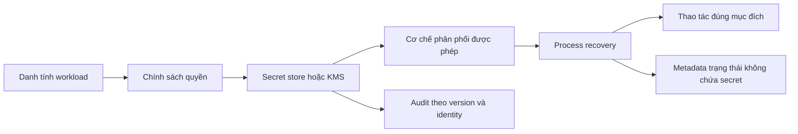

# Secret injection for recovery — Đưa secret vào dịch vụ khôi phục tài khoản

## 1. Mục tiêu và phạm vi

**Secret injection** là việc cung cấp vật liệu bí mật cho một workload tại thời điểm cần sử dụng, thông qua một đường phân phối được xác thực và phân quyền. Mục tiêu là để dịch vụ hoạt động mà không phải nhúng secret production vào mã nguồn, image hoặc tài liệu triển khai.

Trong module `SECURITY_AUTHENTICATION_ACCOUNT_RECOVERY`, secret có thể cho phép gửi thông điệp recovery, kiểm tra webhook, tạo HMAC cho token, giải mã dữ liệu cần bảo vệ hoặc kết nối các kho trạng thái. Lộ một credential gửi email không có cùng tác động với lộ khóa tạo token, nhưng cả hai đều có thể làm suy yếu luồng khôi phục khi người dùng mất mật khẩu, MFA, passkey hoặc thiết bị xác thực.

Bài học xây dựng một quy trình từ định danh workload, nạp secret, kiểm tra khi khởi động, rotation đến xử lý sự cố. Các resource name, property, key ID và mốc thời gian là ví dụ. Không có giá trị secret production trong các đoạn cấu hình.

Các ví dụ Spring Boot và Kubernetes nhằm minh họa một cách tích hợp. Chúng không xác nhận framework, cluster hoặc secret store nào đã có trong project; khi triển khai, cần chọn cấu hình đúng phiên bản và cơ chế vận hành của môi trường đó.

## 2. Kiểm kê đúng những gì là secret

Trước khi chọn env var, volume hay SDK, hãy lập danh sách secret theo **khả năng mà nó cấp**.

| Thành phần | Ví dụ về khả năng | Hậu quả cần đánh giá khi lộ |
|---|---|---|
| API credential của email/SMS provider | Gửi thông điệp trong phạm vi được cấp | Spam, giả mạo thông điệp, chi phí và tác động kênh recovery |
| Webhook verification secret | Kiểm tra tính xác thực thông điệp callback | Có thể giả mạo callback nếu cơ chế xác minh bị vượt qua |
| Khóa HMAC của token hoặc token digest | Tính MAC phục vụ kiểm tra token | Khả năng giả mạo hoặc hỗ trợ tấn công tùy cấu trúc token và trạng thái server |
| Private key ký recovery assertion | Ký thông điệp mà bên khác tin cậy | Cấp assertion giả trong phạm vi verifier chấp nhận |
| Khóa giải mã hoặc quyền dùng KMS | Đọc dữ liệu đã mã hóa | Lộ dữ liệu thuộc phạm vi khóa/quyền |
| Credential database/session store | Đọc hoặc thay đổi trạng thái được cấp phép | Rò rỉ hoặc sửa recovery case, token, session |
| Workload identity credential | Chứng minh danh tính workload | Truy cập secret hoặc dịch vụ theo quyền identity đó |
| Credential của công cụ vận hành | Tạo, cấp hoặc thu hồi quyền trong hệ thống | Lạm dụng quyền quản trị, làm sai quy trình recovery |

Không phải mọi dữ liệu liên quan đến secret đều là secret:

- Key ID hoặc secret version ID thường là metadata, nhưng vẫn có thể nhạy cảm về vận hành.
- KMS key reference không phải vật liệu khóa; quyền gọi KMS mới quyết định workload làm được gì.
- Public key dùng để xác minh chữ ký không cần giữ bí mật như private key.
- Provider endpoint, tenant mapping và policy flag có thể không bí mật, nhưng cần bảo vệ tính toàn vẹn.

Một endpoint cấu hình sai có thể đưa credential tới máy chủ không được tin cậy. Vì vậy, “không bí mật” không đồng nghĩa “ai cũng được sửa”.

### 2.1. Secret hạ tầng khác với token của người dùng

Reset token, OTP, recovery code và bearer session token của người dùng là dữ liệu nhạy cảm phát sinh trong luồng nghiệp vụ. Chúng không phải một bộ cấu hình dùng chung để nhét vào deployment secret.

Không gom tất cả reset token của người dùng vào một Kubernetes Secret hoặc một file cấu hình runtime. Chúng cần cơ chế vòng đời riêng: phát hành, liên kết với account/action, hết hạn, giới hạn thử, tiêu thụ một lần và thu hồi.

Tương tự, private key của passkey thường thuộc authenticator theo mô hình passkey đang sử dụng; dịch vụ không cần thu thập private key của người dùng để “inject lại” khi mất thiết bị.

### 2.2. Metadata cần quản lý

Với mỗi secret hạ tầng, nên có:

```text
logical purpose
environment và tenant scope
owner và on-call
consumer workload identities
secret/key version
cách phân phối
cách ứng dụng nhận thay đổi
quyền upstream thực tế
điều kiện hết hạn/rotation/revocation
các dữ liệu hoặc token cũ còn phụ thuộc
cách xác minh sau thay đổi
```

Đây là thông tin phục vụ thiết kế và vận hành, không phải yêu cầu in giá trị secret ra một inventory chung.

## 3. Chuỗi tin cậy từ secret store tới thao tác recovery

Một chuỗi phân phối điển hình:



Phải kiểm tra từng chặng:

1. **Workload là ai?** Danh tính phải gắn với môi trường và dịch vụ cụ thể.
2. **Được đọc hoặc dùng gì?** Chỉ cấp secret và thao tác cần thiết.
3. **Được phân phối tới đâu?** Đúng pod/container/process, không tới mọi workload trong namespace.
4. **Ứng dụng dùng phiên bản nào?** Cần quan sát metadata thực tế đã nạp.
5. **Ai thu hồi khi có sự cố?** Cần tác động tại nơi chấp nhận credential, không chỉ xóa bản sao cục bộ.

Không giải quyết bài toán bootstrap bằng cách để một mật khẩu secret store lâu dài ngay cạnh các secret mà nó bảo vệ. Khi nền tảng hỗ trợ, có thể dùng workload identity và credential ngắn hạn, có audience và phạm vi phù hợp.

Kubernetes ServiceAccount là danh tính của workload trong Kubernetes. Token tự động mount có thể được tắt bằng `automountServiceAccountToken: false` khi pod không cần nó; cơ chế identity bên ngoài có thể cần token projection riêng theo thiết kế của nền tảng. [Kubernetes — Service Accounts](https://kubernetes.io/docs/concepts/security/service-accounts/)

### 3.1. Đọc secret không phải là quyền duy nhất đáng quan tâm

Một người không có quyền đọc trực tiếp Secret vẫn có thể lấy giá trị nếu được tạo pod dùng Secret đó và có thể điều khiển nội dung pod. Vì vậy, quyền tạo/sửa workload, chọn service account, exec vào container và truy cập công cụ debug cũng nằm trong ranh giới bảo vệ.

Tài liệu Kubernetes cũng khuyến nghị giới hạn secret tới đúng container cần dùng và xem xét quyền tạo pod có sử dụng Secret. [Kubernetes — Good practices for Secrets](https://kubernetes.io/docs/concepts/security/secrets-good-practices/)

Sidecar không cần API key gửi SMS thì không nên được mount API key đó. Việc hai container ở cùng pod không phải lý do sao chép mọi secret sang cả hai.

### 3.2. Phân quyền theo chức năng recovery

Ví dụ một worker gửi notification có thể chỉ cần quyền gửi theo sender/domain được duyệt. Nó không nhất thiết cần khóa HMAC token hoặc quyền sửa authenticator.

Một dịch vụ xác minh token có thể không cần credential của provider nếu notification được thực hiện bởi thành phần khác. Một thành phần vận hành rotation có thể được tạo phiên bản mới nhưng không cần quyền truy cập dữ liệu người dùng.

Tách quyền làm giảm phạm vi tác động, nhưng phải bám vào kiến trúc thực tế. Không chia nhỏ hình thức rồi vẫn cấp cùng một quyền quản trị toàn bộ secret store cho mọi workload.

## 4. Chọn cách injection và hiểu giới hạn

| Cách cung cấp | Điểm phù hợp | Điều phải xử lý |
|---|---|---|
| Environment variable | Runtime có tích hợp env rõ ràng, quy trình restart được quản lý | Rò qua dump/debug; process đang chạy không tự nhận env mới |
| File/volume được mount | Phân phối vật liệu dưới dạng file với quyền đọc cụ thể | Quyền filesystem, cập nhật file, việc process thực sự reload |
| SDK đọc secret store | Cần version, lease hoặc kiểm soát truy cập trực tiếp | Identity, timeout, cache, quyền và bootstrap |
| CSI/agent phân phối file | Tích hợp secret store với runtime qua thành phần nền tảng | Quyền của agent/driver, đồng bộ, bản sao phát sinh và reload |
| Gọi KMS/HSM cho thao tác mật mã | Muốn giới hạn việc xuất vật liệu khóa | Quyền thao tác, latency, quota, khả dụng và audit |

Không có lựa chọn tự động loại bỏ mọi nguy cơ. Khi process đã có quyền đọc một secret để dùng, lỗi thực thi mã trong process có thể sử dụng quyền đó hoặc lấy vật liệu có thể xuất được.

### 4.1. Environment variable

Env var là một phương tiện phân phối, không phải kho bảo mật độc lập. Cần kiểm soát công cụ thu thập environment, crash report, shell debug, agent giám sát và quyền quan sát process.

Không truyền secret qua tham số command-line chỉ để né env var. Command-line có thể xuất hiện trong lịch sử lệnh, thông tin process hoặc bản ghi vận hành.

Với secret từ Kubernetes đưa vào env, cập nhật Secret không làm giá trị env của container đang chạy tự đổi; cần tạo lại container theo quy trình. [Kubernetes — Distribute Credentials Securely Using Secrets](https://kubernetes.io/docs/tasks/inject-data-application/distribute-credentials-secure/)

### 4.2. File mount

File mount cho phép giới hạn vị trí và quyền đọc, đồng thời tách secret khỏi image. Tuy nhiên, file có thể bị process hoặc công cụ debug đọc nếu có quyền tương ứng.

Kubernetes cập nhật nội dung Secret volume theo cơ chế eventually consistent. Mount bằng `subPath` không nhận cập nhật Secret tự động. Điều này chưa nói ứng dụng đã nạp lại giá trị vào bộ nhớ. [Kubernetes — Secrets](https://kubernetes.io/docs/concepts/configuration/secret/)

Khi chọn reload, cần xác định file nào tạo thành một bundle nhất quán và cách ứng dụng thay cả snapshot. Không đọc active key ID từ phiên bản mới rồi lấy key bytes còn thuộc phiên bản cũ.

### 4.3. Dùng khóa qua KMS thay vì đưa key bytes vào process

Một số hệ thống cho phép workload thực hiện MAC hoặc chữ ký thông qua dịch vụ quản lý khóa. Ví dụ AWS KMS cung cấp `GenerateMac` và `VerifyMac` cho HMAC key; key material được sử dụng trong KMS và application gọi API tương ứng. [AWS KMS — HMAC keys](https://docs.aws.amazon.com/kms/latest/developerguide/hmac.html)

Điều này giảm nhu cầu phân phối raw key, nhưng quyền gọi API vẫn là quyền có giá trị. Một process bị chiếm quyền có thể lạm dụng thao tác được cho phép trong phạm vi còn hiệu lực.

Nếu verifier có raw HMAC key thì về mặt mật mã nó cũng có khả năng tạo MAC. Một nhãn “verify-only” trong code không thay đổi tính chất của khóa đối xứng. Muốn phân tách khả năng, cần cơ chế phân quyền dịch vụ hoặc mô hình chữ ký phù hợp.

### 4.4. Base64 không phải mã hóa bảo mật

Kubernetes Secret dùng base64 trong trường `data`; encoding này không bảo vệ nội dung trước người đã đọc được dữ liệu. Cần cấu hình bảo vệ dữ liệu lưu trữ, quyền API và đường phân phối theo threat model. [Kubernetes — Secrets](https://kubernetes.io/docs/concepts/configuration/secret/)

Không commit một giá trị base64 của API key vào Git rồi coi là đã che secret. Tương tự, đổi tên field từ `password` sang `opaque-value` không làm nó bớt nhạy cảm.

## 5. Ví dụ: Kubernetes mount file và Spring Boot config tree

Ví dụ này dùng **Kubernetes Secret đã được cấp sẵn** trong đúng namespace, rồi mount các key cần thiết vào một container. Manifest không chứa secret value và không tự tạo credential.

Giả sử một bundle được quản lý có tên `recovery-runtime-v18`, chứa các key:

```text
provider-api-key
active-token-key-id
token-hmac-key-base64
```

Trong đó `active-token-key-id` là metadata được quản lý cùng bundle; hai key còn lại chứa vật liệu nhạy cảm. Bundle này là mẫu đơn giản với một HMAC key đang active, chưa phải keyring nhiều phiên bản phục vụ rotation.

### 5.1. Trích phần pod spec

```yaml
spec:
  template:
    spec:
      serviceAccountName: account-recovery
      automountServiceAccountToken: false

      securityContext:
        runAsNonRoot: true
        runAsUser: 10001
        runAsGroup: 10001
        fsGroup: 10001

      containers:
        - name: recovery
          image: registry.example.invalid/recovery:example-v18

          securityContext:
            allowPrivilegeEscalation: false
            readOnlyRootFilesystem: true
            capabilities:
              drop:
                - ALL

          volumeMounts:
            - name: recovery-secrets
              mountPath: /run/secrets/recovery
              readOnly: true
            - name: runtime-tmp
              mountPath: /tmp

      volumes:
        - name: recovery-secrets
          secret:
            secretName: recovery-runtime-v18
            optional: false
            defaultMode: 0440
            items:
              - key: provider-api-key
                path: recovery.secrets.provider-api-key
              - key: active-token-key-id
                path: recovery.secrets.active-token-key-id
              - key: token-hmac-key-base64
                path: recovery.secrets.token-hmac-key-base64

        - name: runtime-tmp
          emptyDir: {}
```

Đây là phần minh họa để ghép vào Deployment, chưa bao gồm selector, image thật, resources, probe hoặc toàn bộ policy của môi trường. UID, GID và thư mục ghi phải phù hợp image. `0440` là mode trong ví dụ YAML; hãy kiểm tra quyền đọc thực tế bằng đúng user chạy ứng dụng.

Các đường dẫn trên thuộc filesystem Linux của container, không phải đường dẫn trên máy phát triển.

Mẫu native Secret volume này không cần process gọi Kubernetes API để đọc Secret, nên tắt auto-mount token mặc định. Nếu dùng SDK, CSI hoặc identity federation cần token riêng, phải cấu hình đường identity đó theo nền tảng; không tắt một credential bắt buộc rồi thay bằng tài khoản quản trị chung.

Danh sách `items` giới hạn các key được đưa vào volume này. Secret không được mount sang container khác chỉ vì chúng cùng pod. Việc mount readonly hạn chế ghi qua mount; nó không ngăn một process có quyền đọc sao chép giá trị ra ngoài.

### 5.2. Import vào Spring Environment

Trong cấu hình ứng dụng có thể dùng:

```yaml
spring:
  config:
    import: "configtree:/run/secrets/recovery/"

management:
  endpoints:
    web:
      exposure:
        include: "health"
  endpoint:
    health:
      show-details: never
    env:
      show-values: never
    configprops:
      show-values: never
```

Spring Boot hỗ trợ `configtree:`: tên file tạo thành property name và nội dung file là value. File có dấu chấm trong tên cũng ánh xạ thành property tương ứng. [Spring Boot — Externalized Configuration](https://docs.spring.io/spring-boot/reference/features/external-config.html)

Trong ví dụ:

| File trong mount | Property |
|---|---|
| `recovery.secrets.provider-api-key` | `recovery.secrets.provider-api-key` |
| `recovery.secrets.active-token-key-id` | `recovery.secrets.active-token-key-id` |
| `recovery.secrets.token-hmac-key-base64` | `recovery.secrets.token-hmac-key-base64` |

Không dùng `optional:` cho import bắt buộc trong profile production của ví dụ. Tuy nhiên, import directory thành công chưa chứng minh đủ mọi property: vẫn cần validation các field cần thiết.

Cần quản lý mọi nguồn cấu hình có thể override giá trị, bao gồm env, tham số khởi động và file cấu hình khác. Không chấp nhận tình trạng mount version mới nhưng một biến env cũ vẫn thắng theo thứ tự nguồn cấu hình.

### 5.3. Vì sao không khai báo giá trị mặc định?

Tránh cấu hình kiểu:

```yaml
# Mẫu sai cho khóa mật mã bắt buộc ở production:
recovery:
  secrets:
    token-hmac-key-base64: "development-default"
```

Khi injection lỗi, fallback có thể làm nhiều instance dùng chung một khóa dự đoán được hoặc khóa của môi trường thử nghiệm. Khởi động thành công với sai credential có thể nguy hiểm hơn khởi động thất bại rõ ràng.

Profile local có thể dùng vật liệu thử nghiệm được sinh riêng và provider giả lập. Không cho phép profile production tự chuyển về cấu hình local khi secret store không truy cập được.

## 6. Binding và validation không làm lộ giá trị

Mẫu Java sau minh họa binding bằng `@ConfigurationProperties`, kiểm tra ba field và tránh `toString()` mặc định in toàn bộ record. Nó là code ví dụ, không phải implementation đã có trong module.

```java
import java.util.Arrays;
import java.util.Base64;

import org.springframework.boot.context.properties.ConfigurationProperties;

@ConfigurationProperties(prefix = "recovery.secrets")
public record RecoverySecretProperties(
        String providerApiKey,
        String activeTokenKeyId,
        String tokenHmacKeyBase64) {

    public RecoverySecretProperties {
        if (providerApiKey == null || providerApiKey.isBlank()) {
            throw new IllegalArgumentException(
                "Required recovery provider credential is missing"
            );
        }

        if (activeTokenKeyId == null
                || !activeTokenKeyId.matches("rk-[a-z0-9-]{1,48}")) {
            throw new IllegalArgumentException(
                "Recovery key metadata is invalid"
            );
        }

        if (tokenHmacKeyBase64 == null
                || tokenHmacKeyBase64.isBlank()) {
            throw new IllegalArgumentException(
                "Required recovery token key is missing"
            );
        }

        byte[] decoded = null;

        try {
            decoded = Base64.getDecoder().decode(
                tokenHmacKeyBase64
            );

            if (decoded.length < 32) {
                throw new IllegalArgumentException(
                    "Recovery token key does not meet local policy"
                );
            }
        } catch (IllegalArgumentException ignored) {
            throw new IllegalArgumentException(
                "Recovery token key material is invalid"
            );
        } finally {
            if (decoded != null) {
                Arrays.fill(decoded, (byte) 0);
            }
        }
    }

    @Override
    public String toString() {
        return "RecoverySecretProperties[REDACTED]";
    }
}
```

Đăng ký type cấu hình, ví dụ:

```java
import org.springframework.boot.context.properties.EnableConfigurationProperties;
import org.springframework.context.annotation.Configuration;

@Configuration
@EnableConfigurationProperties(RecoverySecretProperties.class)
public class RecoverySecretConfiguration {
}
```

Constructor binding và các cách đăng ký `@ConfigurationProperties` được mô tả trong tài liệu cấu hình Spring Boot. [Spring Boot — Externalized Configuration](https://docs.spring.io/spring-boot/reference/features/external-config.html)

### 6.1. Những gì kiểm tra trên chứng minh được

Trong ví dụ, policy cục bộ yêu cầu khóa dùng cho HMAC-SHA-256 có tối thiểu 32 byte sau khi decode. Đây là yêu cầu của mẫu ứng dụng, không phải một giá trị mặc định do Spring Boot áp đặt.

Độ dài không chứng minh entropy. Một chuỗi 32 byte lặp lại vẫn là khóa yếu. Vật liệu phải được tạo bằng cơ chế sinh khóa phù hợp hoặc bởi dịch vụ quản lý khóa, không từ tên service, ngày triển khai hay password người vận hành.

Key ID hợp lệ về cú pháp cũng chưa chứng minh key đó được phép dùng. Khi nạp keyring thực tế, còn cần kiểm tra ID thuộc phiên bản/bundle được duyệt, đúng môi trường và đúng mục đích.

### 6.2. Những gì mẫu không bảo vệ hoàn toàn

Override `toString()` chỉ bảo vệ đường gọi đó. Serializer, reflection, debugger hoặc một log statement truy cập trực tiếp accessor vẫn có thể làm lộ secret. Không trả object cấu hình này từ controller và không đưa nó vào trường dữ liệu audit.

Mẫu dùng `String` vì phù hợp binding, nên giá trị có thể tồn tại trong heap và các bản sao nội bộ. `Arrays.fill()` chỉ dọn mảng tạm mà code đang giữ; không xóa được mọi bản sao hoặc bảo đảm JVM không còn vật liệu.

Cần bảo vệ heap dump, core dump, công cụ attach/debug và quyền truy cập máy chạy. Tránh log toàn bộ exception hoặc rejected property value trong lỗi binding; thông báo lỗi phải đủ xác định loại lỗi mà không chứa giá trị bị từ chối.

### 6.3. Định dạng và newline phải có hợp đồng

Secret dạng text và key bytes không có cùng quy tắc xử lý. Không tự `trim()` mọi secret để làm lỗi biến mất: một số credential có thể có byte mang ý nghĩa.

Định nghĩa rõ file chứa UTF-8 text, Base64 chuẩn, PEM hay binary. Provisioner và consumer phải thống nhất. Với mẫu Base64 trên, dữ liệu không hợp lệ, bao gồm whitespace không được decoder chấp nhận, sẽ làm validation thất bại.

Không in “giá trị đang đọc” để debug encoding. Có thể báo property nào không hợp lệ và version nào đang được yêu cầu trong kênh có quyền truy cập.

## 7. Khởi động, readiness và reload

### 7.1. Kiểm tra theo nhiều lớp

| Lớp kiểm tra | Điều cần biết | Điều không được suy ra |
|---|---|---|
| Phân phối | File hoặc reference đúng tồn tại | Không đồng nghĩa secret có giá trị đúng |
| Cú pháp | Định dạng, độ dài, cấu trúc bundle hợp lệ | Không chứng minh upstream chấp nhận |
| Quyền | Workload dùng được thao tác cần thiết | Không đồng nghĩa quyền đã tối thiểu |
| Tương thích | Issuer/verifier đọc cùng version contract | Không chứng minh mọi replica đã hội tụ |
| Nghiệp vụ | Recovery thử nghiệm đi hết luồng được phép | Không chứng minh mọi tình huống sự cố đều được bao phủ |

Kiểm tra upstream phải dùng thao tác an toàn và có giới hạn. Không gửi SMS thật tới người dùng hoặc tạo một recovery case production chỉ để mỗi pod kiểm tra liveness.

Nếu provider không có API kiểm tra credential an toàn, cần thiết kế smoke test bằng tài khoản/kênh thử nghiệm được duyệt. Đừng diễn giải “TCP kết nối được” thành “credential có quyền gửi đúng sender”.

### 7.2. Readiness khác với liveness

Secret bắt buộc bị thiếu hoặc keyring không hợp lệ thì instance không được nhận công việc phụ thuộc secret đó. Có thể chặn startup hoặc đánh dấu capability chưa sẵn sàng theo kiến trúc.

Liveness không nên phụ thuộc vào việc gửi thành công một email tới provider. Một upstream lỗi có thể làm tất cả pod restart liên tục mà không sửa được nguyên nhân.

Một ứng dụng có nhiều capability có thể tách readiness hoặc routing cho issuer, verifier và notification worker. Dù chọn cách nào, không fallback sang token không được bảo vệ hoặc phương thức xác minh yếu hơn để giữ trạng thái “healthy”.

### 7.3. File đổi chưa chắc object đổi

Mẫu `@ConfigurationProperties` trên được bind lúc tạo bean. Việc Kubernetes cập nhật file không tự thiết lập một giao thức reload keyring hoặc tạo lại provider client.

Có hai hướng phải chọn rõ:

- **Nạp lúc startup:** tạo phiên bản Secret mới, rollout instance mới và xác minh version từng instance.
- **Reload có chủ đích:** loader theo dõi/đọc lại, validate toàn bộ snapshot, rồi thay snapshot atomically và xử lý client/connection liên quan.

Không giả định một annotation hoặc một file watcher bất kỳ sẽ làm mọi object trong ứng dụng đổi đồng thời.

### 7.4. Snapshot nhất quán

Một bundle có thể gồm active key ID, tập key được phép kiểm tra và metadata policy. Loader cần:

```text
đọc một bundle/version xác định
    -> kiểm tra cấu trúc và nguồn
    -> xác nhận active key có trong tập được phép
    -> kiểm tra thuật toán/mục đích/môi trường
    -> tạo snapshot bất biến
    -> thay snapshot đang dùng bằng một thao tác
```

Request đang xử lý nên dùng một snapshot nhất quán cho thao tác của nó. Không đọc active key ID trước reload rồi đọc map key sau reload.

Khi reload thất bại, không thay snapshot tốt bằng snapshot rỗng. Tuy nhiên, tiếp tục dùng snapshot cũ chỉ hợp lệ nếu policy vẫn cho phép: key đã bị thu hồi do compromise không được tiếp tục dùng chỉ vì đó là “last known good”.

### 7.5. Quan sát phiên bản mà không quan sát giá trị

Có thể ghi nhận bundle version, key ID không bí mật, thời điểm nạp và trạng thái validation trong telemetry có phạm vi phù hợp. Không cần log raw secret hoặc một phần đầu/cuối của secret.

Tránh dùng checksum công khai của password/secret entropy thấp làm “fingerprint” vì có thể hỗ trợ dò offline. Với secret được quản lý, version ID từ nguồn cấp thường là lựa chọn quan sát phù hợp hơn.

Metadata cũng cần phân quyền; không buộc đưa toàn bộ tên khóa và cấu trúc môi trường ra health endpoint công khai.

## 8. Rotation phải theo loại secret

Rotation là thay vật liệu hoặc quyền đang sử dụng bằng phiên bản mới theo một quy trình tương thích. Revocation là làm cho credential/quyền cũ không còn được nơi sử dụng chấp nhận. Hai việc có thể liên quan nhưng không thay thế nhau.

OWASP mô tả vòng đời secret gồm tạo, rotation, revocation và expiration; cơ chế ngắn hạn hoặc rotation tự động cần gắn với quyền tối thiểu và khả năng thu hồi. [OWASP — Secrets Management Cheat Sheet](https://cheatsheetseries.owasp.org/cheatsheets/Secrets_Management_Cheat_Sheet.html)

| Loại | Thay đổi thường phải phối hợp | Bằng chứng hoàn tất |
|---|---|---|
| Provider API credential | Client/connection dùng credential mới, quyền sender đúng | Credential mới hoạt động, credential cũ bị thu hồi tại provider |
| Webhook shared secret | Sender và receiver cùng giai đoạn chuyển tiếp | Callback hợp lệ được xác minh, credential bị loại bỏ không còn được chấp nhận |
| HMAC key | Issuer, verifier, token chưa hết hạn và metadata key ID | Mọi nơi đọc được format mới, mốc ngừng dùng key cũ được chứng minh |
| Private signing key | Signer dùng key mới, verifier có public key phù hợp | Assertion mới hợp lệ, key bị thu hồi không còn được tin theo policy |
| Encryption key | Dữ liệu cũ còn phải giải mã hoặc rewrap/re-encrypt | Dữ liệu cần giữ vẫn đọc được bằng đường được phép |
| Database credential | Pool, connection đang mở, quyền và lease | Kết nối mới dùng đúng identity; quyền cũ bị xử lý theo backend |
| Workload credential | Token audience, lease và quyền của identity | Refresh đúng, token/quyền bị thu hồi không còn dùng được |

Không áp dụng một thao tác “đổi file rồi restart” cho mọi loại. Một connection pool có thể giữ kết nối đã được xác thực; một verifier có thể giữ keyring trong cache; một token đang chờ có thể vẫn cần key cũ.

### 8.1. Rotation bình thường và xử lý compromise

Trong rotation bình thường, có thể thiết kế cửa sổ chuyển tiếp để giảm gián đoạn. Khi có bằng chứng key bị lộ, chấp nhận key cũ trong cửa sổ đó có thể tiếp tục cho phép giả mạo.

Quyết định emergency cần nêu:

- Key hoặc credential nào bị nghi ngờ và mức chắc chắn.
- Khả năng kẻ tấn công có thể sử dụng.
- Nơi cần thu hồi quyền hoặc dừng chấp nhận.
- Token/case/người dùng nào có thể bị ảnh hưởng.
- Đường recovery an toàn còn lại.
- Điều kiện khôi phục chức năng và cách xác minh.

Không giữ một khóa đã compromise chỉ để mọi link cũ vẫn mở được. Ngược lại, cũng không xóa mọi khóa không liên quan khi chưa hiểu phạm vi.

## 9. Rotation key của recovery token

### 9.1. Tách key hạ tầng khỏi token dùng một lần

Giả sử dịch vụ tạo một token ngẫu nhiên đủ entropy và lưu token record kèm digest HMAC. Mỗi record có metadata do server kiểm soát, ví dụ:

```text
recordId
tenantId
accountId
recoveryCaseId
action
issuedAt
expiresAt
keyId
tokenDigest
consumedAt
revokedAt
```

Schema này là mô hình minh họa. HMAC có thể liên kết token và ngữ cảnh bằng một định dạng mã hóa không nhập nhằng, có phân biệt mục đích/môi trường.

Khóa HMAC không thay thế randomness của token. Nó cũng không tự tạo tính dùng một lần: server vẫn phải kiểm tra trạng thái record và tiêu thụ bằng thao tác atomic phù hợp.

Nếu dùng token tự chứa có chữ ký/MAC, các yêu cầu giới hạn action, expiration, liên kết case và ngăn replay vẫn cần thiết kế tương ứng.

### 9.2. Key ID là bộ chọn có giới hạn

Khi verify token cũ, phải chọn đúng key đã dùng lúc phát hành, thay vì luôn dùng active key mới nhất.

Key ID có thể lấy từ record server đã xác thực nguồn. Nếu nằm trong token do client gửi, nó là dữ liệu không đáng tin cho tới khi được kiểm tra. Chỉ cho phép ánh xạ qua một allowlist/keyring được quản lý.

Không nối trực tiếp `kid` do client gửi vào:

```text
đường dẫn filesystem
tên environment variable
secret-store path
URL truy vấn key
KMS key reference không bị giới hạn
```

Nếu không tìm được key ID hợp lệ, từ chối theo contract. Không thử mọi secret trong toàn tổ chức và không fallback về khóa mặc định.

### 9.3. Rollout theo thứ tự đọc trước, ghi sau

Mẫu có hai key logic `rk-a` và `rk-b`:

| Giai đoạn | Key phát hành token mới | Key được phép kiểm tra token chưa hết hạn | Điều kiện chuyển tiếp |
|---|---|---|---|
| R0 | A | A | Trạng thái trước thay đổi |
| R1 | A | A, B | Mọi verifier cần thiết đã hỗ trợ B |
| R2 | B | A, B | Issuer được chuyển có kiểm soát; theo dõi mọi instance |
| R3 | B | B | Không còn token A cần được chấp nhận theo policy |

Bảng mô tả policy của ứng dụng. Với raw HMAC key, tập “được phép kiểm tra” không làm process mất khả năng mật mã tạo MAC bằng key đó; đây là lý do phải cân nhắc phạm vi key material và quyền thao tác.

Trong R1, đưa B tới các verifier được phép trước khi issuer tạo token B. Nếu issuer chuyển trước, một request có thể được cấp token hợp lệ ở node mới nhưng bị node cũ từ chối.

Trong R2, cần xác nhận tất cả issuer đã ngừng tạo token A, kể cả worker nền, job trì hoãn, vùng dự phòng và phiên bản cũ còn phục vụ. Không lấy thời gian bắt đầu rollout làm thời gian cuối phát hành A nếu các issuer cũ vẫn có thể chạy.

### 9.4. Khi nào được bỏ A khỏi đường verify?

Nếu không có compromise và policy muốn giữ token cũ tới hết hạn, mốc loại bỏ phải dựa vào lần phát hành A cuối cùng có thể xảy ra, thời hạn token tối đa và quy tắc thời gian đang được verifier chấp nhận.

Mô hình suy luận:

```text
earliest retirement
    >= last possible issuance with A
       + maximum accepted token lifetime
       + applicable allowed clock skew
```

Đây không phải công thức thời gian cố định cho mọi hệ thống. Còn phải kiểm tra token bị gia hạn, issuer ngoại lệ, queue và dữ liệu chứng minh lần phát hành cuối.

Ví dụ, nếu token sống tối đa 10 phút và hệ thống chấp nhận lệch giờ 30 giây, chỉ được dùng các giá trị đó khi verifier thực sự áp dụng cùng giới hạn. Một worker tạo token A sau rollout làm mốc cuối thay đổi.

Queue chậm không phải lý do tự kéo dài expiration của token. Nếu notification chứa token đã hết hạn, xử lý theo quy trình phát hành lại được phép thay vì sửa thời gian cũ để làm link hoạt động.

### 9.5. Trạng thái dùng một lần phải được giữ

Sau khi tìm đúng key và kiểm tra digest/MAC, server vẫn cần kiểm tra:

1. Đúng tenant, account, case và action.
2. Record chưa hết hạn, chưa revoke, chưa consume.
3. Case đang ở trạng thái cho phép thực hiện.
4. Các ràng buộc rủi ro và giới hạn thử phù hợp.
5. Thao tác consume và thay đổi bảo mật được thực hiện nhất quán.

Hai request đồng thời không được cùng thành công chỉ vì cả hai đều kiểm tra HMAC đúng trước khi ghi trạng thái.

Rotation key cũng không được reset `consumedAt`, khôi phục case đã đóng hoặc làm sống lại token bị thu hồi.

### 9.6. Mất key cũ không thể luôn sửa bằng rehash

Nếu chỉ lưu digest HMAC của token ngẫu nhiên, ứng dụng thường không có raw token để tính lại digest dưới key mới. Việc không giữ raw token là một phần của thiết kế bảo vệ dữ liệu.

Vì vậy, xóa key cũ quá sớm có thể khiến các token đang chờ không còn verify được. Đường xử lý là từ chối an toàn và cho phép người dùng bắt đầu lại theo policy, không tự suy ra hoặc tái tạo token cũ.

Nếu key cũ bị lộ, cố bảo toàn mọi token cũ không phải mục tiêu ưu tiên duy nhất. Cần xem xét revoke các record liên quan và bảo vệ người dùng trước assertion/token giả.

## 10. Rotation provider credential và webhook secret

### 10.1. Provider credential

Một quy trình mẫu:

```text
tạo credential B với quyền/sender phù hợp
    -> phân phối version B
    -> instance/client nạp B
    -> smoke test có kiểm soát
    -> xác minh toàn bộ consumer cần thiết đã chuyển
    -> thu hồi A tại provider
    -> kiểm tra A không còn được chấp nhận
```

Nếu provider không hỗ trợ hai credential đồng thời, cần kế hoạch chuyển đổi riêng, có thời gian gián đoạn hoặc cơ chế khác đã được duyệt. Không giả định khả năng overlap.

Kiểm tra token B hợp lệ chưa chứng minh nó có quyền gửi từ đúng domain hoặc tenant. Cần xác minh chính thao tác dịch vụ được giao, bằng dữ liệu thử nghiệm an toàn.

Sau reload, provider SDK hoặc connection pool có thể giữ credential cũ. Xác nhận client thực sự được thay hoặc được thiết kế để lấy credential mới, không chỉ nhìn file/version ở mount.

### 10.2. Webhook verification

Khi provider ký callback bằng shared secret, đổi secret ở receiver mà sender chưa đổi có thể làm callback hợp lệ bị từ chối.

Giai đoạn chấp nhận hai secret chỉ được dùng nếu protocol/provider và policy cho phép. Giới hạn tập secret, khoảng thời gian và mục đích. Vẫn kiểm tra timestamp, replay, message identity và ngữ cảnh sự kiện theo protocol.

Một callback “delivered” đã xác minh không tự chứng minh chủ tài khoản thật đã đọc thông điệp hoặc đã hoàn tất recovery. Không dùng việc injection đúng webhook secret để bỏ qua điều kiện xác minh danh tính.

Khi một webhook secret bị compromise, overlap có thể kéo dài khả năng giả mạo. Quyết định emergency phải khác với đổi định kỳ thông thường.

## 11. Rollback, revocation và dữ liệu phục hồi

### 11.1. Rollback code không được làm sống lại credential bị thu hồi

Rollback image có thể đưa code cũ trở lại, nhưng secret generation và trạng thái revocation là quyết định bảo mật riêng.

Ví dụ, sau khi chuyển sang key B, image cũ chỉ hiểu A có thể không đọc được token B. Một lựa chọn rollback có kiểm soát là dùng phiên bản code tương thích với format/keyring hiện tại, không tự quay secret về A.

Nếu A đã bị thu hồi vì compromise, rollback không được cho phép nó phát hành hoặc kiểm tra token trở lại. Cần có trạng thái/policy bền vững và quyền phân phối phù hợp để ngăn việc một deployment cũ khôi phục A.

Chỉ đổi alias hoặc xóa reference khỏi config không làm key bytes đã có trong process tự biến mất. Khi raw key bị lộ, phải tác động cả nơi chấp nhận token/quyền liên quan.

### 11.2. Xóa bản sao không đồng nghĩa revoke credential

Các thao tác sau có ý nghĩa khác nhau:

| Thao tác | Điều có thể đạt | Điều chưa tự đạt |
|---|---|---|
| Xóa file mount hoặc Secret object | Hạn chế đường phân phối tương ứng | Không xóa raw value đã được sao chép hoặc nạp vào bộ nhớ |
| Tạo secret-store version mới | Có một giá trị mới để phân phối | Không bắt buộc mọi consumer đã dùng nó |
| Xóa secret-store version cũ | Hạn chế lần lấy mới từ nguồn đó | Không làm API key cũ mất hiệu lực tại provider |
| Thu hồi API key ở upstream | Ngăn upstream chấp nhận key theo cơ chế của nó | Không tự xóa bản sao ở log hoặc image |
| Ngừng chấp nhận key ID trong verifier | Chặn token theo policy key đó | Không hoàn tác những hành động đã được thực hiện |

Khi secret có lease hoặc expiration, phân biệt metadata hết hạn ở secret store với việc backend thực sự từ chối credential. Xác minh tại nơi quyền được dùng.

### 11.3. Backup và khôi phục

Khóa giải mã, keyring verify cũ và secret phục vụ disaster recovery có yêu cầu lưu giữ khác nhau. Chỉ xóa vật liệu sau khi đánh giá dữ liệu hoặc token nào còn phụ thuộc và chính sách còn cho phép dùng nó.

Bản backup cần bảo vệ quyền đọc, tính toàn vẹn, khả năng truy xuất và lịch xử lý. Người có quyền restore không mặc nhiên cần xem plaintext của mọi secret.

Khi restore môi trường, không khôi phục mù trạng thái đã consume/revoke về quá khứ rồi chấp nhận token cũ trở lại. Phải đối chiếu quyết định bảo mật còn hiệu lực và khóa đã bị thu hồi trước sự cố.

Một kế hoạch khôi phục chỉ có “backup còn file key” chưa đủ nếu không biết key version nào tương ứng dữ liệu nào, ai được dùng và cách xác minh.

## 12. Pipeline triển khai không mang secret production đi khắp nơi

### 12.1. Tách build và runtime

Image ứng dụng nên được build mà không chứa credential recovery production. Chỉ đưa reference/version cần thiết qua cấu hình triển khai được quản lý; vật liệu nhạy cảm được cấp cho workload theo đường runtime đã chọn.

Nếu quá trình build cần credential để tải artifact riêng, đó là build secret riêng. Docker hỗ trợ secret mount/SSH mount cho build; không nên truyền secret bằng `ARG` hoặc `ENV` để rồi nó xuất hiện trong artifact hoặc metadata. [Docker — Build secrets](https://docs.docker.com/build/building/secrets/)

Không `COPY` file secret vào image rồi xóa ở lệnh sau và coi là đã loại bỏ mọi dấu vết. Phải kiểm soát build context, layer, cache và các artifact trung gian.

### 12.2. Quyền của pipeline

Phân biệt các quyền:

```text
quyền build image
quyền cập nhật deployment
quyền tạo phiên bản secret
quyền phân phối secret cho workload
quyền revoke credential upstream
quyền đọc plaintext secret
```

Một pipeline triển khai không nhất thiết cần tất cả các quyền đó. Nếu nó chỉ cần đổi reference tới version đã được phê duyệt, không cần tải secret plaintext vào runner rồi ghi lại.

Khi dùng identity federation của nền tảng, giới hạn trust vào repository/job/environment được phép và quyền đúng mục đích. Không dùng một credential quản trị lâu dài để phục vụ tất cả pipeline của mọi môi trường.

Phải xét cả quyền sửa workflow và khả năng chạy code trong job có secret. Một pull request không đáng tin không nên tự có đường đọc secret production thông qua job kiểm thử.

### 12.3. Các bản sao thường bị quên

- Artifact chứa file cấu hình đã render.
- Helm values hoặc manifest được xuất kèm secret value.
- File env, thư mục tạm và cache của runner.
- Bản ghi shell, lịch sử lệnh và transcript.
- Kết quả diff giữa hai secret version.
- Ticket, clipboard, ảnh chụp và tài liệu hướng dẫn.
- Output của công cụ debug trong container.
- Gói hỗ trợ chứa heap dump hoặc environment.

Masking trong CI giúp giảm một số dạng rò, nhưng không bảo đảm bắt được giá trị đã encode, bị chia nhỏ hoặc được log dưới dạng khác.

Dùng secret giả/sandbox cho test. Việc file local bị Git ignore không tự làm nó an toàn trước quyền đọc filesystem, backup hoặc đồng bộ thư mục.

### 12.4. Tách môi trường và mục đích

Key production không dùng lại cho development. Key tạo recovery token không dùng làm webhook secret hoặc khóa mã hóa cho một mục đích khác.

Một bản sao database production ở môi trường thử nghiệm cần được xử lý theo chính sách dữ liệu; không cấp thêm key production chỉ để mọi dữ liệu và token cũ vẫn hoạt động.

Khi có nhiều tenant, quyền truy xuất key phải được ràng buộc với tenant đã được server xác định. Không cho client chọn arbitrary secret-store path hoặc credential của tenant khác.

## 13. Logging, Actuator và công cụ chẩn đoán

### 13.1. Log hành động và metadata cần thiết

Ví dụ event vận hành chỉ chứa metadata giả định:

```json
{
  "eventType": "RECOVERY_SECRET_BUNDLE_LOADED",
  "workloadRef": "recovery-issuer-demo",
  "environment": "staging",
  "bundleVersion": "bundle-demo-18",
  "activeKeyId": "rk-demo-b",
  "outcome": "VALIDATED",
  "reloadMode": "STARTUP"
}
```

Không thêm provider API key, raw HMAC key, reset link, OTP hoặc token của người dùng. Cũng không cần log “bốn ký tự cuối” của secret để chứng minh đọc thành công.

Cần phân biệt các event như:

```text
VERSION_PUBLISHED
VERSION_DISTRIBUTED
BUNDLE_VALIDATED
CLIENT_ACTIVATED
OLD_CREDENTIAL_REVOKED
POST_CHANGE_CHECK_PASSED
```

Chúng là tên trạng thái minh họa. Một event `VERSION_PUBLISHED` không thể thay cho bằng chứng client đã chuyển hoặc credential cũ đã bị upstream từ chối.

### 13.2. Bảo vệ diagnostic endpoint

Spring Boot có cơ chế sanitization cho dữ liệu từ `env`, `configprops` và một số endpoint khác; cấu hình `show-values` ảnh hưởng khả năng xem giá trị. Cần quản lý cả exposure và authorization thay vì chỉ dựa vào tên property có chữ “secret”. [Spring Boot — Actuator Endpoints](https://docs.spring.io/spring-boot/reference/actuator/endpoints.html)

Cấu hình chỉ expose health trong ví dụ là một phần giới hạn bề mặt. Đường quản trị, JMX, heap dump, công cụ attach và log tập trung cần được đánh giá riêng.

Một custom health indicator không nên trả chi tiết secret hoặc một exception chứa credential. Public health thường chỉ cần thể hiện trạng thái cần thiết; thông tin version chi tiết có thể nằm ở kênh nội bộ được bảo vệ.

### 13.3. Không log request/response tùy tiện

Recovery URL có thể chứa bearer token. Credential provider thường ở header hoặc payload. HTTP client debug logging, reverse proxy, tracing và hệ thống hỗ trợ đều có thể nhìn thấy dữ liệu trước khi application logger che đi.

Thiết kế redaction phải bao phủ các điểm quan sát thực tế. OWASP khuyến nghị loại trừ hoặc bảo vệ dữ liệu nhạy cảm trong log, bao gồm token và credential. [OWASP — Logging Cheat Sheet](https://cheatsheetseries.owasp.org/cheatsheets/Logging_Cheat_Sheet.html)

Nếu cần lưu một artifact nhạy cảm để điều tra, dùng kho bằng chứng có quyền và lịch lưu riêng. Không đưa nó vào log chung rồi hy vọng tất cả người đọc đều có cùng thẩm quyền.

### 13.4. Quan sát mà không làm lộ secret

Có thể đo:

- Số lần nạp bundle thành công/thất bại theo loại lỗi.
- Số instance đang dùng từng version được phép.
- Thời gian từ publish version tới hội tụ consumer.
- Lỗi xác thực provider và lỗi key ID không được chấp nhận.
- Độ tuổi credential/lease và thời gian còn lại.
- Số lần dùng key đã bị thu hồi hoặc policy đã loại bỏ.
- Tỷ lệ recovery hợp lệ bị gián đoạn trong rollout.

Không dùng raw token, account ID hoặc secret value làm nhãn metric. Metadata version cần có cardinality được quản lý để rotation không làm hệ thống giám sát tăng dữ liệu vô hạn.

## 14. Khi injection hoặc secret store lỗi

| Lỗi | Hành vi phù hợp với thiết kế an toàn |
|---|---|
| Thiếu secret bắt buộc lúc startup | Không nhận công việc phụ thuộc secret; báo lỗi không chứa value |
| Bundle sai định dạng hoặc active key không tồn tại | Không kích hoạt snapshot đó |
| Secret store tạm thời không truy cập được | Áp dụng cache/lease policy đã định; không kéo dài vô hạn |
| Credential bị upstream từ chối | Ghi nhận capability lỗi, retry có giới hạn khi phù hợp |
| Key ID của token không được phép | Từ chối theo contract, không thử secret ngoài phạm vi |
| Reload bị lỗi | Giữ snapshot cũ chỉ nếu nó vẫn được phép sử dụng |
| Key bị revoke do compromise | Ngừng chấp nhận/sử dụng theo policy emergency |
| Một số replica chưa nạp version mới | Giữ rollout ở trạng thái chưa hoàn tất và xử lý replica đó |
| Provider bị lỗi TLS hoặc endpoint không tin cậy | Không tắt xác minh TLS để làm request chạy được |

### 14.1. Không tạo bypass khi mất secret

Không thay token có MAC bằng token không kiểm tra, không bỏ MFA verification và không cho support agent tự gỡ authenticator chỉ vì secret store đang lỗi.

Một phương án dự phòng hợp lệ cần được thiết kế từ trước, có bằng chứng xác minh và quyền phù hợp. Nó không xuất hiện tự động chỉ vì primary dependency unavailable.

Nếu việc gửi thông báo bị tạm dừng, queue phải có giới hạn và policy xử lý expiration. Khi phục hồi, không phát hàng loạt link quá hạn hoặc notification của case đã bị thay thế.

### 14.2. Cache có thời hạn và quyền truy cập

Cache giúp giảm latency và phụ thuộc trực tiếp vào secret store, nhưng kéo dài thời gian vật liệu tồn tại trong process. Cần xác định thời hạn sử dụng, điều kiện refresh và cách tiếp nhận revocation.

Không tái sử dụng credential đã hết lease chỉ vì request refresh lỗi. Một secret vẫn còn trong heap không đồng nghĩa backend hoặc policy vẫn cho phép dùng.

Không cần gọi secret store cho từng request nếu điều đó không phù hợp kiến trúc; điều cần thiết là mức bảo đảm về version, expiration và revocation đã được định nghĩa và thực hiện.

### 14.3. Phạm vi compromise phụ thuộc thiết kế token

Lộ key ký một token tự chứa có thể cho phép tạo assertion giả mà verifier chấp nhận nếu không còn kiểm soát khác. Với opaque token chỉ có digest lưu trong record server, biết key HMAC chưa chắc đủ tạo một token khớp record đã có.

Phải đánh giá cả randomness, khả năng sửa database, quyền tạo record, format token và các điều kiện consume. Không suy ra cùng một kết luận cho mọi hệ thống chỉ từ tên “HMAC key”.

Dù vậy, một key bị lộ vẫn cần xử lý theo chức năng thực tế của nó. Không bỏ qua sự cố vì chưa quan sát được account takeover.

## 15. Kiểm chứng trước và sau triển khai

### 15.1. Preflight không đọc secret ra màn hình

Trước khi nhận traffic, xác minh bằng metadata và kết quả kiểm tra:

1. Đúng workload, namespace, environment và tenant scope.
2. Đúng reference/version và các key bắt buộc.
3. Đúng quyền đọc hoặc quyền gọi thao tác mật mã.
4. Đúng container nhận secret và quyền filesystem.
5. Không có cấu hình override ngoài ý muốn.
6. Không có default production yếu hoặc profile fallback.
7. Có kế hoạch reload/rollout và đường rollback tương thích.
8. Các điểm quan sát không xuất secret.

Không dùng lệnh in toàn bộ Secret, env hoặc mount directory content làm bằng chứng kiểm tra thông thường. Có thể quan sát tồn tại, quyền, version và kết quả validation mà không xuất value.

### 15.2. Ma trận tình huống

| Tình huống | Kết quả cần chứng minh |
|---|---|
| File bắt buộc thiếu | Startup hoặc capability bị chặn đúng |
| Một key sai định dạng | Không nạp bundle từng phần |
| Pod chạy non-root | Đọc được đúng file cần thiết, không phải đổi sang root để chữa nhanh |
| Container khác trong pod | Không tự được mount secret không cần thiết |
| Env cũ override file mới | Phát hiện trước hoặc trong rollout, không báo version sai |
| Rotation A sang B | Token phù hợp từ các giai đoạn được kiểm tra đúng |
| Issuer cũ còn chạy | Không chốt retirement A khi vẫn có thể phát hành A |
| Event/token dùng lại | Không được chấp nhận lần thứ hai khi policy yêu cầu một lần |
| Reload lỗi giữa bundle | Snapshot đang dùng không bị trộn |
| Key A bị revoke | Rollback hoặc cache không làm nó hợp lệ trở lại |
| Provider credential A bị thay | Client thật dùng B và A bị upstream từ chối |
| Secret store outage | Hành vi theo cache/lease policy, không bypass |
| Diagnostic log và dump | Không lộ giá trị trong những đường được phép thu thập |
| Cross-tenant/cross-environment | Không dùng được secret ngoài phạm vi |
| Restore hoặc restart | Không làm sống lại token/quyền đã bị revoke |

Dùng vật liệu thử nghiệm riêng cho các phép kiểm. Với kiểm tra rò log, kết quả nên báo có/không và vị trí được bảo vệ, không in lại chính secret cần phát hiện vào báo cáo.

### 15.3. Smoke test recovery

Một smoke test có kiểm soát có thể bao phủ:

```text
tạo recovery case thử nghiệm
    -> phát hành token đúng version
    -> gửi qua kênh thử nghiệm được duyệt
    -> verify token và ngữ cảnh
    -> consume một lần
    -> xác nhận replay bị từ chối
    -> kiểm tra tác động session theo policy
```

Không chỉ test “ứng dụng boot được”. Injection hợp lệ về cú pháp vẫn có thể trỏ nhầm môi trường, dùng sai sender hoặc làm mọi token đang chờ thất bại ở verifier khác.

## 16. Runbook ngắn khi phát hiện secret bị lộ

Runbook cần gắn với công cụ và người có thẩm quyền của tổ chức. Một khung thao tác:

1. Xác định credential/key/version, môi trường và khả năng được cấp.
2. Ghi nguồn phát hiện, thời gian và phạm vi chắc chắn/đang nghi ngờ.
3. Bảo vệ bằng chứng trong kho phù hợp; hạn chế tiếp tục lan truyền giá trị.
4. Ngăn nguồn rò tiếp diễn, ví dụ log hoặc artifact đang phát hành.
5. Quyết định phạm vi ngừng sử dụng và thu hồi tại nơi chấp nhận quyền.
6. Cấp/phân phối vật liệu mới bằng đường còn đáng tin.
7. Xác minh workload thực sự đã chuyển và quyền cũ bị xử lý.
8. Đánh giá token, case, session và dữ liệu có thể bị tác động.
9. Kiểm tra luồng recovery hợp lệ và các đường trái phép.
10. Giao việc sửa nguyên nhân, theo dõi tái diễn và thông báo theo quy trình.

Nếu danh tính workload hoặc pipeline cấp secret cũng bị compromise, chỉ đổi giá trị secret có thể chưa đủ: kẻ tấn công có thể lấy phiên bản mới qua cùng quyền cũ.

Không xóa log hoặc thay đổi lịch sử rộng để che dấu vết trước khi đánh giá bằng chứng và quyền xử lý. Việc loại bỏ bản sao nhạy cảm cần làm theo quy trình, đồng thời giữ thông tin điều tra cần thiết.

Không công bố “đã an toàn” chỉ vì deployment rollout xong. Cần bằng chứng tại nơi credential hoặc token được chấp nhận, cùng trạng thái của các consumer liên quan.

## 17. Bài tập thiết kế

Một dịch vụ recovery chạy bốn replica. API key gửi SMS được nạp qua env; HMAC key nạp từ file vào bean lúc startup. Đội vận hành cập nhật cả hai trong secret store và thấy dashboard báo version mới, nhưng:

- Hai replica vẫn gửi bằng API key cũ.
- Một verifier không đọc được token do replica mới phát hành.
- Có người đề xuất in toàn bộ env để debug.
- Có token cũ còn sống 10 phút.
- Một API key cũ xuất hiện trong artifact CI.

Hãy trả lời:

1. Vì sao cập nhật secret store chưa đủ chứng minh runtime đã đổi?
2. Cần phân biệt những trạng thái version nào?
3. Thứ tự rollout keyring nên thay đổi ra sao?
4. Khi nào được loại key HMAC cũ nếu chưa có compromise?
5. API key đã lộ cần thao tác nào tại provider?
6. Debug bằng metadata nào để tránh in secret?
7. Rollback code phải giữ những quyết định bảo mật nào?

Hướng giải:

- Xác minh đường phân phối và cơ chế nạp của từng loại; env của container cũ và bean startup có thể vẫn giữ giá trị trước đó.
- Tách version đã publish, đã mount, đã validate và đã được client sử dụng.
- Đưa khả năng verify key mới tới tất cả verifier trước khi chuyển issuer.
- Dựa vào lần phát hành cũ cuối có thể xảy ra và giới hạn thời gian được chấp nhận, không chỉ nhìn giờ bắt đầu rollout.
- Thu hồi API key tại provider và xác minh quyền cũ không còn được chấp nhận; xử lý artifact và nguồn rò.
- Dùng version/reference, trạng thái nạp và mã lỗi đã redaction trong kênh được bảo vệ.
- Giữ trạng thái revoke và keyring/format tương thích; không làm sống lại credential đã bị loại bỏ.

Một thiết kế tốt phải giải thích được cả **ai nhận được secret**, **ứng dụng đang dùng gì** và **quyền cũ đã hết hiệu lực ở đâu**.

## 18. Tài liệu tham khảo

- [Spring Boot — Externalized Configuration](https://docs.spring.io/spring-boot/reference/features/external-config.html): config tree, binding và nguồn cấu hình.
- [Spring Boot — Actuator Endpoints](https://docs.spring.io/spring-boot/reference/actuator/endpoints.html): exposure và sanitization cho endpoint quản trị.
- [Kubernetes — Secrets](https://kubernetes.io/docs/concepts/configuration/secret/): Secret, volume update và các giới hạn liên quan.
- [Kubernetes — Good practices for Secrets](https://kubernetes.io/docs/concepts/security/secrets-good-practices/): quyền truy cập và phân phối secret.
- [Kubernetes — Distribute Credentials Securely Using Secrets](https://kubernetes.io/docs/tasks/inject-data-application/distribute-credentials-secure/): đưa secret tới container.
- [Kubernetes — Service Accounts](https://kubernetes.io/docs/concepts/security/service-accounts/): danh tính workload và token projection.
- [Docker — Build secrets](https://docs.docker.com/build/building/secrets/): credential trong quá trình build.
- [AWS KMS — HMAC keys](https://docs.aws.amazon.com/kms/latest/developerguide/hmac.html): sử dụng HMAC key qua KMS.
- [OWASP — Secrets Management Cheat Sheet](https://cheatsheetseries.owasp.org/cheatsheets/Secrets_Management_Cheat_Sheet.html): vòng đời và quản lý secret.
- [OWASP — Logging Cheat Sheet](https://cheatsheetseries.owasp.org/cheatsheets/Logging_Cheat_Sheet.html): bảo vệ dữ liệu nhạy cảm trong log.

Keyring, schema token, tên event và quy trình chuyển tiếp trong bài là thiết kế minh họa. Khi áp dụng, phải nối chúng với policy recovery, quyền workload, upstream provider và cơ chế chấp nhận session/token thực tế.


