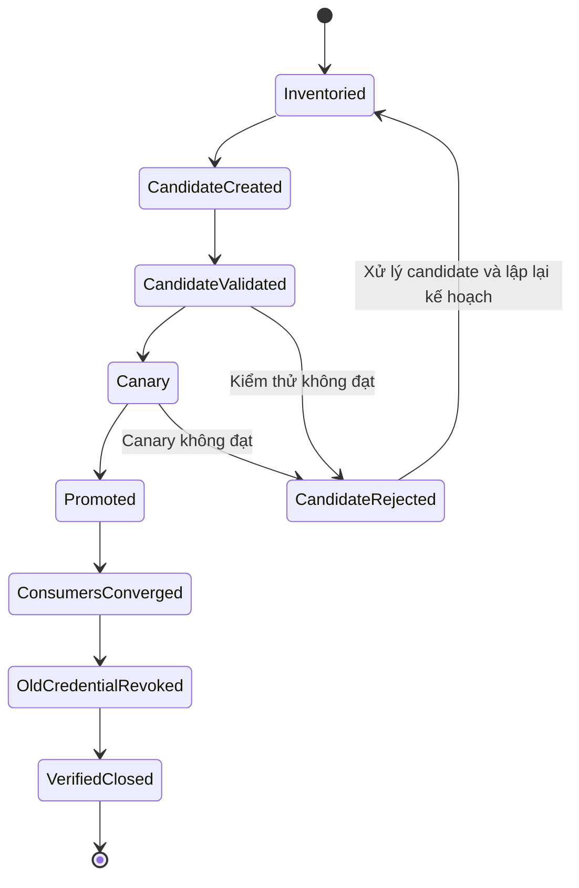

# Luân chuyển credential của nhà cung cấp trong hệ thống khôi phục tài khoản

## 1. Vì sao rotation là một phần của độ an toàn recovery?

Một luồng khôi phục tài khoản thường phụ thuộc vào các dịch vụ bên ngoài: gửi email đặt lại mật khẩu, gửi SMS hoặc mã xác minh, kiểm tra danh tính, lấy access token cho API hoặc nhận callback về kết quả gửi. Ứng dụng cần credential để sử dụng những dịch vụ này.

Trong module `SECURITY_AUTHENTICATION_ACCOUNT_RECOVERY`, provider credential rotation là quá trình thay credential của ứng dụng đối với nhà cung cấp, đưa credential mới vào sử dụng và loại bỏ quyền sử dụng credential cũ. Đây là một hoạt động vận hành có ảnh hưởng trực tiếp tới khả năng người dùng lấy lại quyền kiểm soát tài khoản khi mất mật khẩu, MFA, passkey hoặc thiết bị xác thực.

Nếu rotate sai, email recovery có thể ngừng gửi trong khi API vẫn trả thông báo chung như bình thường. Nếu credential cũ không được thu hồi, người có bản sao vẫn có thể sử dụng dịch vụ dù mọi replica của ứng dụng đã chuyển sang credential mới. Nếu vận hành xử lý sự cố bằng cách bỏ qua bước xác minh, một lỗi triển khai có thể trở thành lỗ hổng chiếm đoạt tài khoản.

Mục tiêu của một đợt rotation gồm ba kết quả riêng biệt:

- Credential mới có đúng phạm vi quyền và thực hiện được thao tác mà recovery cần.
- Mọi thành phần liên quan đã chuyển sang cấu hình phù hợp, kể cả worker, replica ít traffic và môi trường dự phòng.
- Credential cũ không còn được chấp nhận ở nhà cung cấp và không còn là lựa chọn hợp lệ cho rollback hoặc restart.

Bài học trình bày một thiết kế vận hành độc lập với nhà cung cấp, kèm những khác biệt cần kiểm tra ở AWS, Twilio và SendGrid. Các cấu hình và kiểu Java minh họa là hợp đồng của ứng dụng, không phải một API rotation chung có sẵn cho mọi dịch vụ.

## 2. Xác định chính xác thứ đang được rotate

### 2.1. Credential của ứng dụng khác với bằng chứng recovery của người dùng

Một API key dùng để gửi SMS cho phép ứng dụng gọi nhà cung cấp. Một recovery code cho phép người dùng chứng minh quyền tiếp tục một giao dịch recovery. Hai loại dữ liệu này có chủ thể, phạm vi và vòng đời khác nhau.

Thay API key gửi email không đương nhiên làm các link reset đã phát hành mất hiệu lực. Ngược lại, vô hiệu hóa reset token của một người dùng không thu hồi API key bị lộ của hệ thống. Nếu một sự cố ảnh hưởng cả hai, cần hai kế hoạch xử lý tương ứng.

| Loại dữ liệu | Ví dụ | Hệ quả cần đánh giá khi thay đổi |
|---|---|---|
| Credential gọi provider | API key gửi email, username/password SMTP | Khả năng gửi và phạm vi thao tác tại provider |
| Credential OAuth của client | Client secret hoặc khóa client authentication | Khả năng lấy token mới; token đã phát hành cần đánh giá riêng |
| Secret xác minh callback | Shared secret hoặc vật liệu xác minh chữ ký | Khả năng chấp nhận callback hợp lệ và từ chối callback giả |
| Bằng chứng recovery | Reset token, recovery code, challenge | Quyền của một người dùng đối với giao dịch recovery |
| Khóa mật mã nội bộ | Khóa ký token, khóa mã hóa, pepper | Hiệu lực và khả năng kiểm tra dữ liệu nội bộ theo thiết kế |
| Credential quản trị rotation | Quyền tạo, xóa hoặc thay key ở provider | Khả năng điều khiển credential khác và phạm vi thiệt hại |

Một tên cấu hình như `RECOVERY_SECRET` quá mơ hồ để vận hành an toàn. Inventory nên nêu rõ secret dùng cho chiều gửi request, chiều nhận callback hay quyết định quyền recovery nội bộ.

### 2.2. Một credential có thể phục vụ nhiều chiều giao tiếp

Không giả định secret dùng để gọi API chỉ ảnh hưởng outbound. Một provider có thể dùng cùng secret để ký webhook. Rotate credential đó có thể khiến gửi request thành công nhưng xác minh callback thất bại.

Ví dụ, tài liệu Twilio mô tả việc xác minh chữ ký request bằng primary Auth Token. Khi mới tạo secondary Auth Token, việc xác minh webhook vẫn phải theo primary hiện tại cho tới bước promote tương ứng. Xem [Twilio: Security](https://www.twilio.com/docs/usage/security).

Vì vậy, trước rotation phải có bản đồ phụ thuộc: thành phần nào gửi, thành phần nào nhận, SDK nào giữ secret trong bộ nhớ và thao tác nào ở provider làm thay đổi hiệu lực của từng secret.

### 2.3. Đổi nơi lưu không đồng nghĩa đổi quyền tại provider

Ghi một giá trị mới vào secret manager chỉ thay đổi dữ liệu tại kho đó. Giá trị mới phải được provider cấp hoặc được cập nhật vào cơ chế xác thực của provider. Tự sinh một chuỗi ngẫu nhiên rồi lưu thành API key không khiến provider chấp nhận chuỗi ấy.

Ngược lại, tạo key tại provider rồi quên lưu và phân phối cũng chưa hoàn tất rotation. Trạng thái ở provider, secret store và các process sử dụng phải cùng được theo dõi.

## 3. Chuẩn bị inventory và giới hạn phạm vi thiệt hại

### 3.1. Inventory theo provider, môi trường và mục đích

Với mỗi credential, cần biết chủ sở hữu, provider account hoặc subaccount, region, endpoint, môi trường, scope, sender hoặc service được phép dùng, ngày hết hạn nếu có và nơi lưu giá trị bí mật.

Danh sách consumer phải bao gồm API server, worker gửi thông báo, scheduled job, retry worker, công cụ hỗ trợ, canary, deployment dự phòng và những process có thể được autoscale sau này. Một replica không có traffic trong đợt quan sát vẫn có thể trở lại hoạt động ngay sau khi key cũ bị thu hồi.

Ví dụ inventory dưới đây chỉ chứa tham chiếu và metadata, không chứa credential:

```yaml
purpose: account-recovery-email
environment: production
providerAccountRef: mail-account-main
region: region-a
senderProfileRef: recovery-sender
activeGeneration: 42
activeSecretVersionRef: /production/recovery/email/versions/42
candidateSecretVersionRef: /production/recovery/email/versions/43
consumers:
  - recovery-api
  - notification-worker
  - notification-retry-worker
  - recovery-dr-worker
owner: identity-platform
```

Đây là schema minh họa. Đường dẫn secret không được dùng như một thông tin có thể công khai tùy ý, nhưng nó khác với chính giá trị có quyền xác thực.

### 3.2. Tách runtime khỏi quyền quản trị credential

Worker gửi recovery email thường chỉ cần đọc đúng credential được phép và thực hiện thao tác gửi. Nó không nên có quyền tạo key mới, đọc mọi secret trong tổ chức hoặc xóa credential của provider account khác.

Thành phần rotation có quyền cao hơn, nên cần giới hạn đích được quản lý và kiểm tra binding giữa secret, provider account, region và mục đích. Nếu nó nhận một secret reference tùy ý từ request rồi dùng quyền quản trị để thay credential, nó có thể trở thành một công cụ thay đổi tài nguyên ngoài phạm vi.

Tài liệu AWS Secrets Manager đề cập các biện pháp như giới hạn truy cập, bảo vệ secret và tránh lộ qua công cụ dòng lệnh. Chúng là nền tảng lưu trữ, còn quyền của ứng dụng đối với provider vẫn cần thiết kế riêng. Xem [AWS Secrets Manager best practices](https://docs.aws.amazon.com/secretsmanager/latest/userguide/best-practices.html).

### 3.3. Scope mới không được rộng hơn chỉ để kiểm thử dễ hơn

Credential mới nên có đủ quyền cho thao tác recovery đã xác định. Một key full-access có thể vượt qua canary gửi email nhưng đồng thời mở quyền quản trị không cần thiết.

Ví dụ, SendGrid cho phép chỉ định scopes khi tạo API key; tài liệu hiện nêu rằng bỏ trường scopes có thể tạo key Full Access theo mặc định của endpoint đó. Vì vậy, tạo credential mới cần kiểm tra scope tường minh thay vì dựa vào tên hiển thị như “recovery-mail”. Xem [SendGrid: Create API keys](https://www.twilio.com/docs/sendgrid/api-reference/api-keys/create-api-keys).

## 4. Chọn chiến lược rotation theo khả năng của provider

### 4.1. Hai credential có thời gian cùng hiệu lực

Nếu provider hỗ trợ hai credential hoạt động song song, có thể tạo K2 trong khi K1 còn hợp lệ, kiểm thử K2, chuyển consumer sang K2 rồi thu hồi K1. Khoảng cùng hiệu lực hỗ trợ chuyển đổi nhưng cũng là khoảng tồn tại hai đường truy cập, nên phải có giới hạn và điều kiện kết thúc.

AWS IAM là một ví dụ có giới hạn số access key trên mỗi user. AWS cũng khuyến nghị ưu tiên temporary credentials khi phù hợp thay vì tạo long-term access key. Xem [Manage access keys for IAM users](https://docs.aws.amazon.com/IAM/latest/UserGuide/id_credentials_access-keys.html).

Không áp dụng mô hình hai key cho provider chỉ cho một password hiện hành. Cũng không tự xóa một key đang tồn tại để lấy chỗ tạo candidate nếu chưa xác minh key đó thuộc consumer nào.

### 4.2. Chỉ một credential hiện hành

Nếu đổi secret làm secret cũ mất hiệu lực ngay, phải phối hợp thời điểm đổi ở provider với việc đưa cấu hình mới vào process. Khi không có cách phân phối nguyên tử tới mọi consumer, không thể hứa không gián đoạn chỉ bằng rolling deployment thông thường.

Có thể cần tạm dừng dispatch, giữ job trong queue theo deadline, đổi credential, cập nhật các consumer rồi tiếp tục. Khả năng chuyển sang một provider khác chỉ được dùng nếu provider đó đã được chuẩn bị và chính sách recovery cho phép.

Không giải quyết khoảng gián đoạn bằng cách chấp nhận một challenge chưa được xác minh. Khả năng gửi tạm thời giảm và điều kiện chứng minh danh tính là hai vấn đề khác nhau.

### 4.3. Credential ngắn hạn hoặc workload identity

Nếu provider và giao thức hỗ trợ, dùng danh tính workload hoặc credential ngắn hạn có thể giảm nhu cầu phân phối secret dài hạn. Tuy vậy, vẫn cần quản lý quyền, refresh, thời hạn, lỗi lấy credential và thu hồi nguồn danh tính.

Giao thức là một ràng buộc thực tế. Chẳng hạn, SES SMTP credential khác với AWS secret access key và phụ thuộc region; tài liệu SES không hỗ trợ việc suy ra SMTP credential từ temporary security credentials. Không lấy quy trình của AWS SDK rồi mặc định áp dụng cho SMTP. Xem [Obtaining Amazon SES SMTP credentials](https://docs.aws.amazon.com/ses/latest/dg/smtp-credentials.html).

### 4.4. Rotation định kỳ và rotation do nghi lộ

Rotation theo kế hoạch có thể dùng khoảng overlap và canary đủ dài. Khi nghi credential bị lộ, kéo dài hiệu lực K1 để chờ mọi consumer thuận tiện chuyển đổi có thể duy trì quyền của kẻ tấn công.

Luồng khẩn cấp cần xác định mức ưu tiên thu hồi, khả năng ngừng gửi có kiểm soát và cách duy trì các kênh recovery đã được cho phép. Credential đã được coi là không an toàn không còn là phương án rollback bình thường.

## 5. Mô hình trạng thái cho một đợt rotation có overlap



Các trạng thái trong sơ đồ là ví dụ orchestration của ứng dụng. Mỗi chuyển trạng thái phải gắn với bằng chứng quan sát được, không chỉ với việc một lệnh đã được gửi.

| Trạng thái | Bằng chứng tối thiểu | Sai lầm thường gặp |
|---|---|---|
| Đã kiểm kê | Đúng provider account, mục đích và consumer | Chỉ biết tên secret |
| Candidate đã tạo | Provider cấp K2 và giá trị được lưu đúng đích | Chỉ cập nhật secret store |
| Candidate đã kiểm tra | Đúng account, scope, endpoint và thao tác cần thiết | Chỉ gọi API đọc profile |
| Canary đạt | Consumer giới hạn dùng K2 với kết quả đã xác định | Tất cả request vẫn âm thầm dùng K1 |
| Đã promote | Cấu hình generation mới trở thành lựa chọn cho dispatch mới | Chỉ đổi nhãn trong dashboard |
| Consumer đã hội tụ | Consumer và đường restart đều dùng generation phù hợp | Chỉ nhìn các pod đang có traffic |
| K1 đã thu hồi | Provider xác nhận và phép kiểm tra thích hợp từ chối K1 | Chỉ xóa bản sao trong secret store |
| Đã đóng đợt | Restart, DR và retry không khôi phục K1 | Giữ cấu hình rollback trỏ tới K1 |

Nếu cần retry một bước, run phải nhận ra candidate hoặc version đã được tạo trước đó. Một timeout lúc tạo key có thể xảy ra sau khi provider đã tạo thành công. Tạo lại vô điều kiện có thể sinh nhiều key hoặc chạm giới hạn số key.

## 6. Tạo và xác minh candidate

### 6.1. Tạo K2 ở đúng nguồn thẩm quyền

Một rotation run nên có ID, provider account đích, credential ID cũ, tham chiếu version candidate, phạm vi quyền dự kiến và trạng thái từng bước. Run không lưu giá trị credential trong báo cáo, ticket hoặc log.

Nếu provider chỉ trả secret tại lúc tạo, công việc tạo và lưu cần được thiết kế để xử lý trường hợp lưu thất bại. Có thể phải xóa candidate chưa sử dụng rồi tạo lại theo quy trình đã xác minh; không để một credential có quyền nhưng không được quản lý tồn tại mãi vì bước lưu bị lỗi.

Một khóa tự động hóa cũng cần idempotency hoặc khả năng đối soát kết quả. Nếu API tạo key không có idempotency phù hợp, phải dùng inventory và trạng thái phía provider để xử lý kết quả chưa rõ, không tự suy ra rằng timeout nghĩa là chưa có key.

### 6.2. Kiểm thử quyền thực tế của K2

Candidate phải được kiểm tra theo thao tác recovery thật, với tài khoản và nơi nhận kiểm thử được kiểm soát. Kiểm tra thành công của một API quản trị không chứng minh key có quyền gửi từ sender cần dùng hoặc có quyền tạo challenge tại service xác minh.

Cần phân biệt các mốc:

```text
Đọc được secret
    -> Khởi tạo được client
    -> Provider xác thực request
    -> Provider chấp nhận thao tác
    -> Kết quả tới nơi nhận kiểm thử hoặc trạng thái cuối đã xác minh
```

Một response chấp nhận gửi chưa chứng minh email đã tới inbox hoặc SMS đã tới thiết bị. Tùy provider và yêu cầu của hệ thống, cần quan sát callback, delivery status hoặc phép kiểm tra đầu cuối được kiểm soát.

Canary không được gửi recovery link thật của người dùng bất kỳ tới một địa chỉ thử nghiệm. Dùng tài khoản tổng hợp, dữ liệu thử và cơ chế dọn challenge phù hợp. Giới hạn tần suất để chính canary không tạo chi phí hoặc tiêu thụ quota quá mức.

### 6.3. Giữ binding của toàn bộ cấu hình

Key đúng nhưng endpoint, account, region hoặc sender sai vẫn có thể làm luồng recovery thất bại. Nên coi chúng là một bộ cấu hình nhất quán, không cập nhật từng trường độc lập giữa các thread.

```text
Provider route generation 43
  providerAccountRef = mail-account-main
  region = region-a
  endpoint = endpoint đã được cho phép
  senderProfileRef = recovery-sender
  secretVersionRef = version của K2
```

Đích gọi provider phải đến từ cấu hình tin cậy và allowlist tương ứng. Không để một cấu hình candidate tùy ý đổi endpoint rồi khiến rotation worker gửi secret tới máy chủ khác.

## 7. Phân phối credential và cập nhật Java client

### 7.1. Secret store không tự thay client đã được tạo

Một bean Java có thể đã đọc secret tại startup rồi giữ một SDK client hoặc một HTTP header cố định. Secret manager đã có K2 không có nghĩa client đó tự chuyển khỏi K1.

Tương tự, cơ chế cache secret có chính sách refresh riêng. Ví dụ, thư viện Java caching của AWS Secrets Manager có thời gian refresh cấu hình được; việc lấy secret qua cache không nên được hiểu là mọi lần đọc đều nhận ngay version mới. Xem [Java client-side caching for Secrets Manager](https://docs.aws.amazon.com/secretsmanager/latest/userguide/retrieving-secrets_cache-java.html).

Cần mô tả riêng thời điểm secret cache đổi, thời điểm client được xây lại và thời điểm client mới được dùng cho dispatch. Nếu một trong các bước không có giới hạn thời gian, không thể tính một thời điểm thu hồi K1 đáng tin cậy chỉ từ TTL của cache.

### 7.2. Chọn nguyên bộ route cho mỗi lần gửi

Ví dụ sau chỉ lưu metadata trong route. Giá trị secret được client factory lấy qua kênh được kiểm soát khi cần tạo client. Record này không chứa API key để tránh việc `toString()` mặc định làm lộ secret.

```java
import java.net.URI;
import java.util.Objects;
import java.util.concurrent.atomic.AtomicReference;

record ProviderRoute(
        long generation,
        String providerAccountRef,
        URI endpoint,
        String region,
        String senderProfileRef,
        String secretVersionRef) {
}

final class ProviderRouteRegistry {

    private final AtomicReference<ProviderRoute> current;

    ProviderRouteRegistry(ProviderRoute initial) {
        this.current = new AtomicReference<>(
                Objects.requireNonNull(initial));
    }

    ProviderRoute select() {
        return current.get();
    }

    boolean promote(ProviderRoute expected, ProviderRoute candidate) {
        Objects.requireNonNull(candidate);
        if (candidate.generation() <= expected.generation()) {
            throw new IllegalArgumentException(
                    "Route generation must increase");
        }
        return current.compareAndSet(expected, candidate);
    }
}
```

Một lần gửi chọn route một lần rồi dùng client tương ứng:

```java
ProviderRoute selected = routeRegistry.select();
ProviderClient client = clientFactory.forRoute(selected);
ProviderSendResult result = client.send(deliveryCommand);
```

`ProviderClient`, factory, command và result là interface ứng dụng cần triển khai. Factory phải giữ binding theo toàn bộ route cần thiết; không cache client chỉ theo tên provider rồi bỏ qua account hoặc secret version.

`AtomicReference` chỉ tạo chuyển đổi nguyên tử trong một JVM. Nó không bảo đảm các replica đã hội tụ, candidate có scope đúng hoặc K1 đã bị thu hồi. Việc kiểm tra endpoint, version bị cấm và kết quả canary nằm ở ranh giới nạp cấu hình và orchestration.

### 7.3. Request đang chạy và vòng đời client cũ

Một request đã chọn route K1 trước promote có thể vẫn đang gửi. Không đóng connection pool hoặc xóa vật liệu mà client đang dùng chỉ vì reference hiện hành vừa chuyển sang K2.

Nếu SDK cần quản lý tài nguyên, cần cơ chế drain hoặc reference counting phù hợp để client cũ kết thúc các tác vụ được phép trong thời hạn đã định. Nếu không hỗ trợ thay client động an toàn, rolling restart có kiểm soát có thể dễ kiểm chứng hơn.

Trường hợp K1 bị nghi lộ có thể yêu cầu ngắt sử dụng ngay thay vì drain bình thường. Những tác vụ bị gián đoạn phải trở lại chính sách đối soát và retry, không được coi là gửi thành công.

### 7.4. Khả năng restart quan trọng ngang hot reload

Một process có thể đang dùng K2 trong bộ nhớ nhưng deployment manifest hoặc cấu hình startup vẫn trỏ K1. Khi autoscale hoặc restart, lỗi quay trở lại dù canary trước đó đã đạt.

Kiểm chứng hội tụ phải bao gồm nguồn cấu hình khi khởi động, một instance mới và đường khởi động của môi trường dự phòng. Không chỉ đọc version từ vài process hiện hành.

## 8. Container, Kubernetes và các bản sao ít được quan sát

Kubernetes cập nhật dữ liệu Secret trong volume theo mô hình eventual consistency; mount bằng `subPath` không nhận cập nhật Secret tự động. Việc ứng dụng có đọc lại file hay không vẫn là trách nhiệm tích hợp. Với secret được đưa thành environment variable, một process đang chạy không nhận giá trị mới chỉ vì đối tượng Secret đã được sửa. Xem [Kubernetes Secrets](https://kubernetes.io/docs/concepts/configuration/secret/).

Vì vậy, kế hoạch cần nêu rõ ứng dụng dùng environment variable, projected volume, CSI integration, agent hay gọi secret store trực tiếp. Mỗi cách có điều kiện refresh và restart khác nhau.

Các consumer thường bị bỏ sót gồm worker được scale về 0, job chạy hàng tuần, retry job bị trì hoãn, deployment ở region dự phòng và image hoặc manifest cũ dùng khi rollback. Chúng có thể không phát sinh lần dùng K1 nào trong cửa sổ quan sát ngắn.

Một lần cập nhật Secret thành công trong cluster không chứng minh mọi workload đọc nó đã thay đổi. Cần bằng chứng generation đang dùng ở từng nhóm consumer, kèm việc vô hiệu hóa cấu hình cũ tại đường restart.

Không dùng readiness probe gửi SMS thật hoặc gửi recovery email liên tục. Kiểm tra readiness cần có chi phí và tác động được kiểm soát. Nếu provider bị lỗi, restart process liên tục thường không giải quyết được vấn đề và có thể làm mất khả năng xử lý queue đang chờ.

## 9. Queue, retry và thời hạn của challenge

### 9.1. Không đóng gói API key trong mỗi job

Một job gửi recovery nên mang định danh công việc và tham chiếu trạng thái cần thiết, thay vì mang bản sao credential của provider:

```java
import java.time.Instant;
import java.util.UUID;

record RecoveryDeliveryJob(
        UUID dispatchId,
        UUID challengeId,
        String channel,
        Instant dispatchDeadline) {
}
```

Khi worker xử lý, nó xác minh challenge vẫn còn phù hợp để gửi, lấy nội dung theo chính sách bảo vệ dữ liệu và chọn route đang được phép. Việc giữ credential trong job sẽ kéo dài phụ thuộc vào K1 theo toàn bộ thời gian queue và làm secret xuất hiện trong backup, dead-letter queue hoặc công cụ hỗ trợ.

Một số hệ thống cần pin provider để liên kết trạng thái hoặc tuân thủ ràng buộc. Nếu vậy, pin tham chiếu route và quy tắc chuyển đổi, không sao chép raw secret. Credential version bị thu hồi không được tiếp tục dùng chỉ vì job được tạo từ trước.

### 9.2. Rotation không gia hạn proof

Nếu queue bị dừng trong lúc rotation, một challenge có thể hết hạn trước khi thông điệp được gửi. Worker cần kiểm tra thời hạn và trạng thái tại lúc dispatch. Không gửi một link đã hết hạn rồi âm thầm kéo dài TTL của nó để sửa trải nghiệm.

Việc phát hành challenge mới phải đi qua chính sách cấp challenge, rate limit và ràng buộc với người dùng. Rotation của provider không làm tăng số lần thử proof, không đổi mục đích token và không biến một proof đã tiêu thụ thành dùng lại được.

### 9.3. Lỗi xác thực khác với kết quả gửi chưa rõ

Một phản hồi được tài liệu provider xác định là từ chối xác thực có thể cho thấy credential đang dùng không hợp lệ. Một timeout sau khi gửi request có thể xảy ra sau khi provider đã chấp nhận thao tác. Hai tình huống không có cùng chiến lược retry.

```text
Xác định chưa được chấp nhận
    -> Có thể lập retry theo chính sách và deadline.

Chưa rõ đã được chấp nhận hay chưa
    -> Đối soát hoặc dùng idempotency được provider hỗ trợ.

Đã được chấp nhận
    -> Theo dõi delivery; không gửi lại chỉ vì callback đến chậm.
```

Một dispatch ID nội bộ giúp theo dõi nhưng không tự làm API của provider trở nên idempotent. Chỉ dựa vào một header như `Idempotency-Key` nếu đúng endpoint của provider có hợp đồng hỗ trợ nó.

### 9.4. Không thử mọi credential khi gặp bất kỳ lỗi nào

Fallback tự động K2 rồi K1 cho mọi lỗi có thể che giấu việc K2 sai scope, kéo dài sử dụng K1 hoặc gửi trùng khi kết quả request đầu chưa rõ. Nó còn làm khó chứng minh canary thực sự dùng key mới.

Nếu cho phép retry sau khi refresh credential, cần giới hạn số lần, kiểm tra version đang được phép, phân loại lỗi theo provider và tôn trọng trạng thái dispatch. K1 đã bị thu hồi hoặc bị nghi lộ phải nằm ngoài tập lựa chọn, kể cả khi nó còn trong cache.

## 10. Webhook và credential có nhiều vai trò

### 10.1. Outbound thành công chưa đủ để đóng rotation

Callback có thể báo trạng thái gửi, kết quả xác minh hoặc sự kiện nghi ngờ lạm dụng. Nếu validator vẫn dùng key sai sau rotation, hệ thống có thể mất khả năng nhận biết thông điệp đã đến hoặc từ chối kết quả hợp lệ của nhà cung cấp danh tính.

Ở những giao thức cho phép nhiều khóa xác minh trong thời gian chuyển tiếp, có thể triển khai tập khóa được phép gồm current và previous theo cửa sổ đã kiểm soát. Tập khóa phải giới hạn theo provider account, tenant hoặc endpoint phù hợp; không thử toàn bộ secret của mọi tenant cho một callback chưa xác thực.

Không tắt xác minh chữ ký để giải quyết callback thất bại trong thời gian rotation. Delivery callback cũng không được xem là bằng chứng người dùng đã sở hữu địa chỉ hoặc nhập đúng mã; nó chỉ có ý nghĩa theo loại sự kiện được provider mô tả.

### 10.2. Ví dụ khác biệt của Twilio Auth Token

Twilio có endpoint tạo secondary Auth Token và endpoint promote. Theo tài liệu, promote xóa primary token hiện tại và đưa secondary lên primary. Vì thế, thao tác promote không chỉ là đổi một nhãn nội bộ của ứng dụng. Xem [Twilio: Secondary Auth Token](https://www.twilio.com/docs/iam/api/secondary_authtoken) và [Twilio: Auth Token promotion](https://www.twilio.com/docs/iam/api/authtoken).

Kế hoạch cho trường hợp này cần xét cả client gọi API và validator webhook dùng primary token. Không suy ra rằng vì secondary đã gọi API được nên mọi validator phải lập tức ngừng dùng primary cũ trước promote.

Đây là ví dụ về Auth Token cụ thể, không phải tuyên bố rằng mọi API key hoặc mọi sản phẩm Twilio có cùng vòng đời. Phải kiểm tra đúng credential, account/subaccount và sản phẩm đang tích hợp.

### 10.3. Cửa sổ nhận khóa cũ phải có mục đích và giới hạn

Nếu cần chấp nhận một chữ ký được tạo trước thay đổi, phải hiểu provider ký lúc nào, có retry không, khóa nào được dùng khi retry và giao thức có timestamp hay ID chống replay hay không.

Không giả định mọi webhook đều có timestamp được ký. Nếu giao thức không cung cấp tính mới của thông điệp theo cách đó, dedup event ID và kiểm tra chuyển trạng thái vẫn cần thiết nhưng không được mô tả như thể đã có bằng chứng thời gian mật mã.

Khi key cũ bị nghi lộ, tiếp tục chấp nhận chữ ký bằng key đó cũng tiếp tục chấp nhận khả năng giả mạo tương ứng. Có thể cần từ chối, cách ly kết quả và đối soát qua API tin cậy thay vì kéo dài grace period thông thường.

## 11. Điều kiện để thu hồi credential cũ

### 11.1. Dựa vào hội tụ, không chỉ dựa vào đồng hồ

Một cửa sổ chuyển đổi cần tính tới thời gian phân phối cấu hình, refresh cache, thay client, request đang chạy, worker bị trì hoãn và truyền trạng thái ở provider.

Có thể dùng một mô hình bảo thủ để lập kế hoạch:

```text
Thời gian chờ dự kiến
    = giới hạn hội tụ của các consumer
    + giới hạn drain của tác vụ cũ
    + biên truyền trạng thái và quan sát
```

Đây là mô hình kế hoạch, không phải bằng chứng đầy đủ để revoke. Các giới hạn phải được định nghĩa và đo được. Nếu consumer có thể dùng cache cũ vô thời hạn khi lỗi refresh, giới hạn hội tụ không còn hữu hạn và chỉ chờ thêm vài phút không giải quyết được vấn đề.

Với hệ thống đã chọn route mới tại lúc dispatch, không cần giữ K1 cho mọi job nằm trong queue. Với hệ thống pin credential version trong job, phải giải quyết phụ thuộc đó hoặc chuyển job theo quy tắc an toàn trước khi đóng đợt rotation.

### 11.2. Bộ bằng chứng trước revoke

- K2 đã được kiểm tra đúng account, region, scope và thao tác cần thiết.
- Các nhóm consumer dự kiến đều xác nhận generation mới hoặc đã bị ngừng có kiểm soát.
- Đường tạo instance mới, autoscale, restart và DR không còn trỏ K1.
- Không còn công việc được phép yêu cầu K1 ngoài thời hạn đã thiết kế.
- Kết quả canary và chỉ số lỗi không bị che bởi fallback sang K1.
- Callback và nguồn kiểm tra trạng thái đã theo cấu hình xác minh phù hợp.
- Có phương án xử lý sau revoke không phụ thuộc vào việc lấy lại K1.

Log “last used” của provider có thể trễ hoặc chỉ bao phủ một số thao tác. Không thấy K1 được dùng trong vài phút là một tín hiệu, không chứng minh một job ít chạy đã được cập nhật.

### 11.3. Revoke ở provider và xác minh chiều từ chối

Nếu provider hỗ trợ deactivate trước khi delete, có thể dùng giai đoạn đó theo kế hoạch đã xác minh. Tài liệu AWS IAM mô tả quy trình tạo key thứ hai, chuyển ứng dụng, ngừng key cũ rồi mới xóa sau khi kiểm tra. Xem [AWS: Update access keys](https://docs.aws.amazon.com/IAM/latest/UserGuide/id-credentials-access-keys-update.html).

Sau thu hồi, cần xác nhận credential ID cũ đã ở trạng thái phù hợp tại provider và thực hiện phép kiểm tra từ chối an toàn khi hợp đồng provider cho phép. Không gửi một thông điệp recovery thật chỉ để chứng minh old key không dùng được.

Phép kiểm tra âm tính phải phân biệt lỗi xác thực với lỗi network, endpoint hoặc permission khác. Một request timeout bằng K1 không chứng minh K1 bị thu hồi. Đồng thời kiểm tra K2 vẫn thực hiện được thao tác cần thiết để phát hiện việc thu hồi nhầm account hoặc credential.

## 12. Rollback và xử lý sự cố

### 12.1. Rollback cấu hình khác với khôi phục credential

Trước khi K1 bị thu hồi và khi K1 vẫn được coi là an toàn, có thể chuyển consumer về route cũ theo chính sách. Nên thực hiện bằng một generation cấu hình mới trỏ tới version được phép, thay vì làm lùi generation và phá cơ chế ngăn cấu hình cũ ghi đè cấu hình mới.

Sau khi K1 bị xóa hoặc bị coi là lộ, rollback application image không làm K1 hợp lệ trở lại. Cần sửa tiến tới một credential hoặc cấu hình được phép. Việc đưa label của secret store về version trước cũng không tự thay đổi trạng thái tại provider.

| Tình huống | Hướng xử lý phù hợp |
|---|---|
| Candidate chưa được promote và kiểm thử thất bại | Giữ route đang hoạt động, xử lý candidate và điều tra |
| K2 lỗi, K1 còn hiệu lực và an toàn | Có thể promote một cấu hình mới về route K1 theo kế hoạch |
| K1 đã bị thu hồi | Sửa K2 hoặc cấp credential mới; không dựa vào rollback image |
| K1 nghi bị lộ | Thu hồi và loại K1 khỏi lựa chọn; xử lý gián đoạn có kiểm soát |
| Secret store lỗi nhưng cache hiện tại còn được phép | Áp dụng chính sách cache có giới hạn đã thiết kế |
| Không xác định credential còn được phép hay không | Dừng thao tác cần credential đó hoặc chuyển sang đường đã được cho phép |

### 12.2. Luồng khẩn cấp khi phát hiện lộ credential

Đầu tiên cần xác định credential và phạm vi quyền bị ảnh hưởng, sau đó ngăn việc sử dụng trái phép bằng cơ chế thu hồi phù hợp. Đồng thời kiểm tra nguồn lộ như log, CI artifact, support bundle, manifest hoặc máy vận hành.

Cấp K2 không đủ nếu cùng một đường rò vẫn làm lộ K2. Phải xử lý quyền truy cập, nơi xuất secret và những phiên hoặc credential quản trị có thể đã bị ảnh hưởng.

Nếu provider credential cho phép gửi thông điệp mang danh hệ thống, cần đánh giá khả năng đã có email hoặc SMS giả mạo. Nếu provider còn giữ challenge hoặc kết quả xác minh mà attacker có thể thay đổi, phạm vi sự cố có thể rộng hơn việc gửi spam. Đừng tự suy ra rằng phải reset mọi tài khoản, nhưng cũng không giới hạn điều tra vào uptime của dịch vụ gửi.

### 12.3. Giảm khả năng hoạt động theo cách giữ nguyên điều kiện xác minh

Khi một kênh không dùng được, có thể tạm dừng phát challenge mới, giữ hàng đợi trong deadline hoặc chuyển sang một kênh đã được người dùng đăng ký và được chính sách chấp nhận.

Không chuyển mã tới email hay số điện thoại vừa được khai báo mà chưa xác minh chỉ vì kênh chính bị lỗi. Không bỏ qua bước MFA hoặc xác minh danh tính để duy trì tỷ lệ recovery hoàn tất. Cần cho người dùng thông tin phù hợp mà không làm lộ tài khoản có tồn tại hay không.

## 13. Tự động hóa rotation với secret manager

Một nền tảng quản lý secret có thể điều phối tạo version, cập nhật nguồn đích, kiểm thử và promote. Ví dụ, AWS Secrets Manager mô tả lifecycle rotation qua các bước `createSecret`, `setSecret`, `testSecret` và `finishSecret`; khi dùng API key do provider cấp, logic gọi provider phải phù hợp với loại secret. Xem [Lambda rotation functions](https://docs.aws.amazon.com/secretsmanager/latest/userguide/rotate-secrets_lambda-functions.html).

Không dùng một script chỉ tạo giá trị ngẫu nhiên làm rotation function cho mọi provider. Nơi cấp credential có thể cần một API riêng, một account có quyền quản trị và một quy trình thu hồi riêng. Template cho database password không tự triển khai được vòng đời của API key gửi email.

Mỗi bước tự động hóa cần chịu được retry. Trước khi promote, phải xác minh candidate gắn đúng resource và đã qua kiểm thử. Trước khi revoke, phải kiểm tra đúng credential ID cũ và trạng thái hiện tại của run; một run cũ không được xóa credential mà run mới đang dùng.

Nếu dùng các nhãn như current, pending và previous, ứng dụng phải hiểu chúng là cơ chế chọn version tại secret store. Nhãn previous không chứng minh credential phía provider còn hoạt động, còn an toàn hoặc còn được phép dùng làm fallback.

Khóa hoặc compare-and-set cho rotation state giúp ngăn hai run thao tác đồng thời trên cùng credential. Với nhiều môi trường hoặc tenant, khóa phải theo đúng tài nguyên; không gom mọi rotation vào một vùng quyền quá rộng chỉ để đơn giản hóa triển khai.

## 14. Quan sát và tiêu chí hoàn thành

### 14.1. Quan sát theo version, không theo giá trị secret

Các tín hiệu có ích gồm generation được consumer sử dụng, credential ID đã được cho phép hiển thị, kết quả xác thực provider, lỗi permission, lỗi quota, độ trễ dispatch, tuổi công việc đang chờ, kết quả callback và delivery của canary.

Không ghi Authorization header, API key, SMTP password, request body chứa OTP hoặc URL reset. ID credential và secret reference cũng cần chính sách truy cập phù hợp; chỉ log metadata cần cho vận hành.

Không dùng giá trị secret hoặc một phần secret làm nhãn metric. Định danh version không bí mật do hệ thống tạo là lựa chọn rõ ràng hơn việc tự cắt chuỗi secret để nhận diện.

### 14.2. Phân biệt nhóm lỗi

Lỗi xác thực tăng sau promote có thể do credential chưa được nạp, sai account hoặc K2 chưa có hiệu lực. Lỗi permission có thể do scope thiếu. Rate limit, hết ngân sách, sender chưa được phép và độ trễ giao nhận có thể là các nguyên nhân khác.

Mã HTTP phải được diễn giải theo hợp đồng provider, không áp dụng một quy tắc chung “mọi 403 đều là key sai”. Theo dõi theo route và generation giúp xác định vấn đề, nhưng không được để thông tin đó trở thành lý do thử lại vô hạn với nhiều key.

### 14.3. Gate đóng rotation

Một run có thể được coi là hoàn tất khi K2 hoạt động trong phạm vi cần thiết, các consumer và đường restart đã hội tụ, K1 được thu hồi tại provider, đường gọi bằng K1 bị từ chối theo phép kiểm tra phù hợp và trạng thái rollback/DR không đưa K1 trở lại.

Tài liệu vận hành cần ghi trạng thái, thời điểm, người hoặc service thực hiện, credential ID, generation và bằng chứng kiểm chứng. Báo cáo không cần chứa secret để có thể kiểm toán được.

## 15. Kiểm thử trước khi áp dụng vào production

Các kịch bản dưới đây là tiêu chí kiểm thử cho một triển khai rotation. Chúng không có nghĩa các cơ chế đã tồn tại chỉ từ code minh họa trong bài.

| Kịch bản | Kết quả cần chứng minh |
|---|---|
| Candidate sai scope | Không được promote chỉ vì đọc secret thành công |
| Candidate đúng key nhưng sai region hoặc account | Kiểm tra binding phát hiện sai đích |
| Một replica không reload | Gate hội tụ phát hiện trước khi đóng run |
| Worker scale từ 0 sau revoke | Khởi động bằng version được phép, không lấy K1 từ manifest cũ |
| SDK giữ client cũ | Có cách chuyển hoặc restart trong thời hạn đã định |
| Request đang chạy lúc promote | Không bị coi là thành công nếu thực tế bị gián đoạn |
| Job retry được tạo trước rotation | Không mang raw credential và vẫn tuân thủ deadline |
| Timeout sau khi provider nhận request | Có đối soát hoặc idempotency phù hợp, không gửi trùng vô điều kiện |
| Secret store tạm không truy cập được | Cache và hành vi dừng hoạt động khớp chính sách giới hạn |
| Callback dùng khóa theo thời điểm chuyển đổi | Validator chấp nhận hoặc cách ly đúng chính sách, không tắt chữ ký |
| Credential cũ bị thu hồi | Phép kiểm tra âm tính cho kết quả đúng lý do |
| Rollback application sau revoke | Không khôi phục lựa chọn K1 |
| Hai rotation run trùng nhau | Không revoke nhầm credential đang được run khác dùng |
| Restore môi trường dự phòng | Cấu hình phục hồi tuân thủ version bị cấm và generation được phép |
| Credential bị đánh dấu compromised | Không có fallback hoặc grace period vô điều kiện về credential đó |

Phép thử đầu cuối cần quan sát cả outbound và inbound nếu hệ thống có callback. Một lần gọi API thành công bằng K2 chỉ chứng minh một bước trong chuỗi.

Đối với môi trường thử có mô phỏng provider, cần mô phỏng được việc hai key cùng hiệu lực, key bị revoke, kết quả gửi chưa rõ, callback trễ và kiểm tra permission. Sau đó dùng canary giới hạn với provider thật để kiểm chứng những phần hợp đồng mà mock không thể chứng minh.

## 16. Ví dụ xuyên suốt: chuyển credential gửi recovery email

Giả sử notification worker đang dùng K1 qua route generation 42. Provider cho phép tạo thêm K2 mà chưa thu hồi K1. Hệ thống chọn route tại lúc dispatch và job không chứa API key.

1. Kiểm kê các API, worker, retry worker và môi trường DR dùng route 42. Xác định credential có chỉ dùng outbound hay còn liên quan callback.
2. Tạo K2 với scope gửi cần thiết tại đúng provider account. Lưu giá trị vào secret version mới bằng kênh an toàn và lưu metadata của run.
3. Tạo route candidate generation 43 với account, endpoint, region và sender đúng. Dùng tài khoản tổng hợp để kiểm chứng request được chấp nhận và kết quả đầu cuối cần thiết.
4. Cho một nhóm worker sử dụng route 43. Theo dõi lỗi và bảo đảm nhóm này không fallback sang K1 che mất lỗi của K2.
5. Promote route 43 cho dispatch mới. Các request đã chọn route 42 được xử lý hoặc drain theo giới hạn của kế hoạch.
6. Xác nhận mọi nhóm consumer đã hội tụ. Khởi động một instance mới và kiểm tra cấu hình DR, autoscale, retry cùng đường rollback.
7. Thu hồi K1 tại provider. Kiểm chứng K1 bị từ chối theo phép thử phù hợp, đồng thời K2 vẫn gửi được qua canary được kiểm soát.
8. Loại route dùng K1 khỏi tập lựa chọn được phép. Giữ metadata kiểm toán cần thiết, dọn bản sao tạm của secret theo chính sách và đóng run sau khi readback trạng thái đạt yêu cầu.

Các link recovery đã phát hành vẫn chịu thời hạn, mục đích và trạng thái sử dụng của chính chúng. Việc đổi credential gửi không tự gia hạn link, không tiêu thụ link thay người dùng và không thay yêu cầu MFA của tài khoản.

Nếu ở bước 4 K2 không gửi được vì thiếu scope, run dừng promote và xử lý candidate. Nếu ở bước 7 phát hiện một worker ít chạy vẫn dùng K1, đó là thiếu sót hội tụ cần sửa bằng cấu hình được phép; không tự khôi phục một key đã được xác định bị lộ để làm dashboard trở lại xanh.

## 17. Những câu hỏi phải trả lời trong runbook

- Ai là nguồn cấp và nguồn thu hồi credential, và quyền quản trị đó nằm ở thành phần nào?
- Provider có hỗ trợ overlap không; giới hạn số key và tác động của thao tác promote là gì?
- Account, tenant, region, endpoint, sender và scope nào phải đi cùng credential?
- Consumer nạp secret lúc nào; cache, client và process được cập nhật bằng cơ chế nào?
- Worker ít chạy, autoscale, restart và DR có thể khôi phục cấu hình cũ từ đâu?
- Công việc đang chờ có pin credential không; request gửi chưa rõ kết quả được đối soát thế nào?
- Callback dùng secret nào và thời điểm đổi validator có phù hợp với provider không?
- Bằng chứng nào cho phép revoke và bằng chứng nào xác nhận credential cũ đã bị từ chối?
- Trước và sau revoke có những phương án rollback nào thực sự còn hợp lệ?
- Nếu credential bị lộ, làm thế nào thu hồi nhanh mà vẫn giữ điều kiện xác minh tài khoản?

Provider credential rotation hoàn tất khi cả quyền truy cập ở nhà cung cấp lẫn cấu hình sử dụng trong hệ thống đã chuyển sang trạng thái được kiểm chứng. Lưu secret mới là một bước; kiểm soát consumer, retry, callback, thu hồi và khả năng restart mới làm quá trình đó trở thành một phần đáng tin cậy của luồng khôi phục tài khoản.
