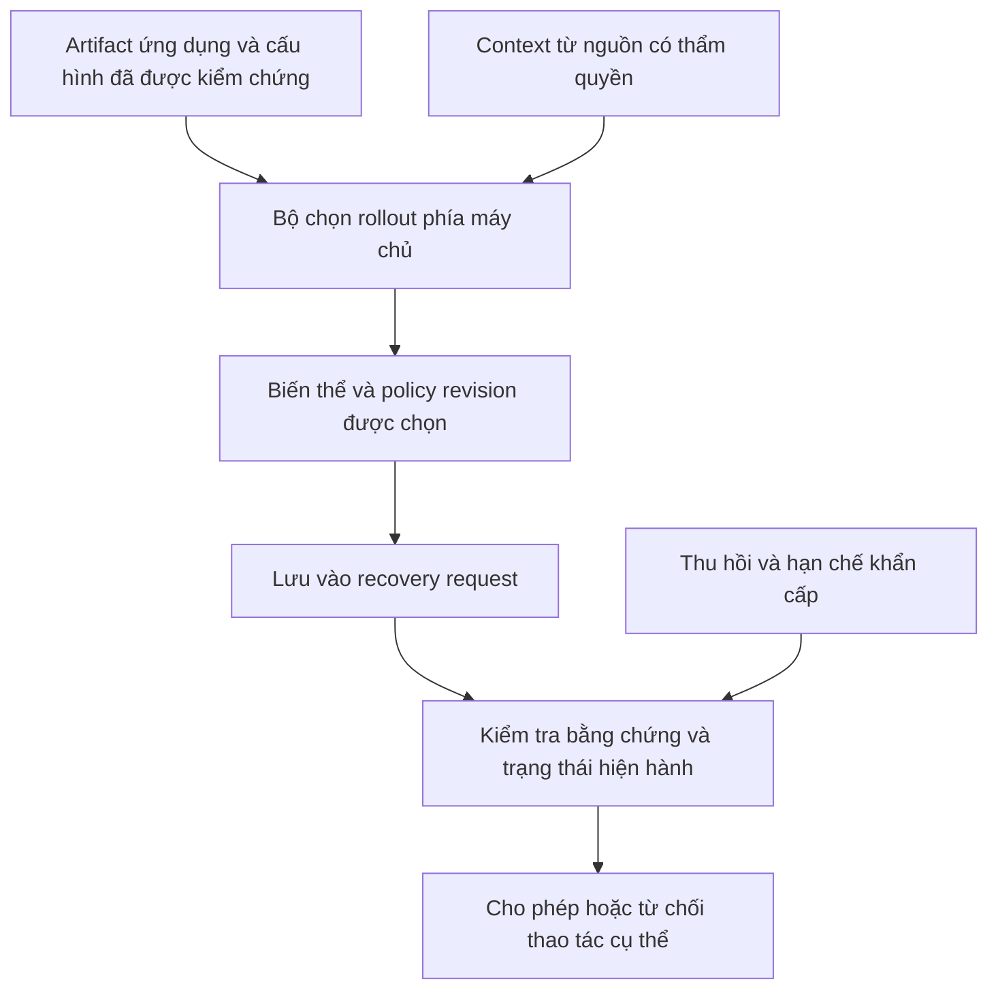

# Feature flag rollout — Triển khai có kiểm soát luồng khôi phục tài khoản

## 1. Feature flag rollout giải quyết vấn đề gì?

**Feature flag rollout** là việc điều khiển phạm vi sử dụng một hành vi mới bằng cấu hình trong khi mã nguồn hỗ trợ hành vi đó đã được triển khai. Đội vận hành có thể bắt đầu với một nhóm nhỏ, quan sát kết quả rồi mở rộng, tạm dừng hoặc kết thúc rollout theo điều kiện đã định.

Trong `SECURITY_AUTHENTICATION_ACCOUNT_RECOVERY`, hành vi được rollout có thể là màn hình khôi phục mới, cách chọn nhà cung cấp xác minh, định dạng token mới hoặc quy trình đăng ký lại authenticator khi người dùng mất MFA, passkey hay thiết bị xác thực.

Recovery khác một thay đổi giao diện thông thường ở chỗ một yêu cầu có thể kéo dài qua email, nhiều thiết bị, thời gian chờ và xét duyệt hỗ trợ. Một lỗi cấu hình có thể không chỉ gây lỗi trang mà còn làm thay đổi điều kiện được cấp lại quyền truy cập tài khoản.

Ví dụ, hệ thống bật luồng `candidate` cho 1% tài khoản. Người dùng nhận email theo luồng đó, nhưng khi mở liên kết, một node khác đánh giá flag lại và chuyển sang `baseline`. Nếu hai luồng dùng bằng chứng hoặc token khác nhau, người dùng có thể bị mắc kẹt; nếu hệ thống tự bỏ qua kiểm tra để cho đi tiếp, rủi ro còn lớn hơn lỗi trải nghiệm.

Vì vậy, rollout recovery phải kiểm soát đồng thời việc chọn nhóm, phiên bản chính sách, trạng thái đang chạy, khả năng tương thích và điều kiện thu hồi. Việc đổi một flag từ `false` sang `true` chưa đủ mô tả toàn bộ tác động.

Các schema, tên flag, revision, ngày giờ, tỷ lệ và mã Java trong bài là thiết kế minh họa. Chúng không phải giá trị mặc định của một nền tảng feature flag, không phải ngưỡng bảo mật dùng chung và không thể hiện một deployment thật.

## 2. Phân biệt deployment, activation và quyết định bảo mật

Một thay đổi recovery thường đi qua ba quyết định riêng:

1. **Deployment:** đưa mã nguồn và thành phần cần thiết vào môi trường chạy.
2. **Activation:** chọn phạm vi được dùng hành vi mới.
3. **Authorization:** xác định một yêu cầu cụ thể có đủ điều kiện thực hiện thao tác khôi phục hay không.

Feature flag chủ yếu tham gia activation. Nó không thay thế việc xác minh recovery token, quyền đối với tài khoản đích hoặc mức bằng chứng cần có để gỡ MFA.



Các điều kiện nền không được biến mất khi chọn nhánh khác. Ví dụ, token vẫn phải gắn với đúng tài khoản và mục đích; bằng chứng vẫn phải hợp lệ; việc tiêu thụ grant một lần vẫn cần cơ chế đồng thời phù hợp; token bị thu hồi không được dùng lại chỉ vì flag thay đổi.

Đối với khôi phục MFA, OWASP nhấn mạnh rằng cơ chế lấy lại quyền truy cập không được tạo đường cho kẻ tấn công bỏ qua MFA và chiếm tài khoản. Đây là lý do rollout phải đánh giá cả đường fallback, không chỉ luồng chính. Xem [OWASP — Resetting MFA](https://cheatsheetseries.owasp.org/cheatsheets/Multifactor_Authentication_Cheat_Sheet.html#resetting-mfa).

Một bản mới không nhất thiết mạnh hơn ở mọi chiều. Nó có thể rút ngắn thời gian chờ nhưng thay nhà cung cấp; hoặc tăng yêu cầu bằng chứng nhưng có lỗi tương thích. Không dùng số revision lớn hơn làm tiêu chí duy nhất để kết luận một policy phù hợp.

## 3. Tách mục đích của từng loại flag

Nên đặt tên và ngữ nghĩa theo hành vi cần điều khiển. Một flag chung như `recovery.enabled` dễ bị dùng cho quá nhiều tác vụ khác nhau.

| Loại điều khiển | Mục đích | Ví dụ minh họa | Điểm phải quy định rõ |
| --- | --- | --- | --- |
| Chọn biến thể | Phân phối yêu cầu mới sang luồng đã được chấp nhận | `recovery.password_reset.flow` | Biến thể nào tương ứng policy nào |
| Admission control | Cho phép tiếp nhận yêu cầu mới | `recovery.new_requests.mode` | Dừng tất cả hay chỉ một phương thức/phạm vi |
| Shadow evaluation | Tính thử quyết định mà không áp dụng side effect | `recovery.risk.shadow_mode` | Thành phần nào được chạy và không được ghi |
| Routing nhà cung cấp | Chọn dịch vụ bên ngoài được phép | `recovery.identity_provider.route` | Bằng chứng cũ có chuyển được sang provider mới không |
| Hạn chế khẩn cấp | Chặn một hành động hoặc thế hệ credential có rủi ro | `recovery.emergency.restriction` | Hiệu lực với yêu cầu mới, cũ và độ trễ phân phối |
| Giao diện | Điều khiển cách hiển thị | `recovery.ui.variant` | Không được thay quyền thực hiện ở backend |

Một thao tác “tắt candidate” có thể có ít nhất ba ý nghĩa: ngừng nhận yêu cầu candidate mới, dừng xử lý yêu cầu candidate đang chạy hoặc thu hồi credential đã phát hành bởi candidate. Ba ý nghĩa này cần ba hành vi được mô tả rõ; không mặc định chúng xảy ra đồng thời.

Hạn chế khẩn cấp có thẩm quyền có thể phủ quyết yêu cầu đang chạy. Ngược lại, việc thay đổi tỷ lệ canary thông thường không nên vô tình sửa lại hợp đồng của mọi yêu cầu đã được tạo.

Các flag làm thay đổi bằng chứng cần có hoặc đường fallback phải được quản lý như cấu hình bảo mật. Không tạo một flag kiểu `skip_identity_verification` rồi dùng nó như công cụ chữa lỗi nhà cung cấp mà không có quy trình quyết định tương ứng.

## 4. Mô hình cấu hình rollout có phiên bản

Thay vì đọc nhiều boolean độc lập có thể lệch phiên bản, có thể dùng một snapshot cấu hình chứa bộ giá trị tương thích. Mỗi snapshot cần được kiểm tra schema, phạm vi, policy tham chiếu và quyền phát hành trước khi dùng.

Ví dụ dưới đây minh họa rollout một thay đổi cho email đặt lại mật khẩu tại một khu vực:

```yaml
schema_version: 1
rollout_id: REC-ROLLOUT-0028
config_revision: recovery-rollout-r104
change_ref: REC-CHANGE-0028
owner_team: identity-platform

scope:
  environment: production
  regions:
    - region-a
  recovery_methods:
    - PASSWORD_RESET_EMAIL
  tenant_policy_set_ref: TENANT-POLICY-SET-0028

assignment:
  unit: TENANT_ACCOUNT
  cohort_key_scheme: HMAC_TENANT_ACCOUNT_ROLLOUT_V1
  cohort_key_version: cohort-key-v3
  bucket_count: 10000
  candidate_basis_points: 100

policies:
  baseline: password-recovery-policy-r21
  candidate: password-recovery-policy-r22

admission:
  new_requests: ALLOW
  existing_requests: USE_PERSISTED_ASSIGNMENT

compatibility:
  reader_capability_ref: RECOVERY-READERS-0028
  writer_capability_ref: RECOVERY-WRITERS-0028
  token_format_ref: RESET-TOKEN-FORMAT-3

failure_behavior:
  unknown_variant: DEFER_NEW_REQUEST
  missing_snapshot: DEFER_NEW_REQUEST
  expired_snapshot: DEFER_NEW_REQUEST
  pinned_policy_unavailable: DEFER_COMPLETION

rollout_plan_ref: ROLLOUT-PLAN-0028
rollback_procedure_ref: RUNBOOK-ROLLBACK-0028
approved_record_ref: APPROVAL-0028
not_before: '2030-05-12T08:00:00Z'
```

Trong ví dụ, 100 basis point trên 10.000 bucket tương ứng 1%. Đây là tỷ lệ đối tượng đủ điều kiện được chọn candidate theo quy tắc của sản phẩm; không tự có nghĩa 1% HTTP request, 1% máy chủ hoặc chính xác 1% lưu lượng thực tế.

Một tài khoản có thể tạo nhiều request, một tenant lớn có thể tạo phần lớn lưu lượng và nhiều đối tượng không bao giờ dùng recovery. Vì thế, tỷ lệ cấu hình và tỷ lệ quan sát cần được đo riêng.

`approved_record_ref` hoặc tên file cấu hình không tự chứng minh cấu hình đáng tin. Hệ thống cần kiểm chứng nguồn, quyền phát hành và artifact thực tế. Snapshot có chữ ký hợp lệ cũng chỉ chứng minh một số thuộc tính của nguồn/tính toàn vẹn theo thiết kế; nó không chứng minh policy bên trong không có lỗi.

Khi thay đổi, cần phân biệt deployment cấu hình tới các host với chọn cohort nghiệp vụ. Một nền tảng có thể phân phối config dần theo host, trong khi ứng dụng dùng config đó để chọn người dùng. Nếu không quản lý cả hai lớp, phạm vi thực tế có thể khác phạm vi dự kiến. Ví dụ cơ chế deployment theo application, environment, configuration version và strategy được mô tả trong [AWS AppConfig — Deploying a configuration](https://docs.aws.amazon.com/appconfig/latest/userguide/appconfig-deploying.html).

## 5. Chọn cohort ổn định và context đáng tin

### 5.1. Chọn đúng đơn vị rollout

Đơn vị rollout có thể là tenant, tài khoản, recovery request hoặc một nhóm triển khai. Lựa chọn phụ thuộc mục tiêu:

| Đơn vị | Ưu điểm | Giới hạn |
| --- | --- | --- |
| Tenant | Dễ phối hợp chính sách và hỗ trợ của một tổ chức | Tenant lớn có thể tạo phạm vi ảnh hưởng lớn dù số tenant ít |
| Tài khoản trong tenant | Giữ trải nghiệm tương đối ổn định giữa các lần dùng | Cần mapping ổn định và bảo vệ thông tin định danh |
| Recovery request | Dễ cố định một lần thực thi | Cùng tài khoản có thể gặp các biến thể khác nhau qua nhiều request |
| Host hoặc region | Thuận tiện triển khai hạ tầng | Người dùng đi qua nhiều host/region có thể nhận hành vi khác nhau nếu không lưu assignment |

Không chọn ngẫu nhiên lại ở mỗi bước. Người dùng mở email trên điện thoại, resend hoặc được chuyển node vẫn phải có cách tiếp tục đúng request đã được tạo.

### 5.2. Context phải được dựng ở phía máy chủ

OpenFeature định nghĩa evaluation context và targeting key để nhận diện đối tượng đánh giá. Tùy provider, thiếu targeting key có thể làm hành vi fractional targeting không như mong muốn. Xem [OpenFeature — Evaluation Context](https://openfeature.dev/specification/sections/evaluation-context/).

Trong recovery, tenant, account, phương thức và region có ý nghĩa bảo mật phải được lấy từ nguồn phía máy chủ có thẩm quyền. Không cho query parameter như `cohort=baseline`, header tự khai `risk=low` hoặc cookie frontend quyết định đường kiểm tra bằng chứng.

Một thuộc tính như locale có thể do người dùng lựa chọn cho giao diện, nhưng không vì vậy mà được dùng để bỏ qua một bước xác minh. Mỗi thuộc tính targeting cần có nguồn, mức tin cậy và mục đích rõ ràng.

### 5.3. Tính ổn định của bucket

Một thiết kế có thể ánh xạ bộ `(tenant_id, account_id, rollout_id)` vào bucket bằng thuật toán xác định. Nếu dùng HMAC để hạn chế tiết lộ định danh gốc, cần canonical encoding không mơ hồ, key version ổn định và cùng thuật toán ở mọi nơi tham gia quyết định.

Không dùng bucket do client gửi và không dùng bucket như bằng chứng được phép recovery. Khi tăng candidate từ 1% lên 5%, một cách chọn có tính lồng nhau là giữ nguyên bucket và tăng ngưỡng từ 100 lên 500 trên 10.000 bucket. Nếu thay key hoặc cách mã hóa cùng lúc, nhóm có thể bị phân lại và mất tính ổn định đó.

HMAC không làm dữ liệu trở thành vô danh tuyệt đối. Targeting key vẫn có thể liên kết các sự kiện và cần được bảo vệ, giới hạn mục đích và quản lý lưu giữ. Tránh gửi email, số điện thoại, hồ sơ xác minh hoặc token tới hệ thống flag nếu không cần cho quyết định.

### 5.4. Không để bắt đầu nhiều request thành cách chọn luồng yếu hơn

Nếu một tài khoản được bốc lại ngẫu nhiên cho mỗi lần thử, người dùng hoặc kẻ lạm dụng có thể tạo nhiều request đến khi gặp biến thể mong muốn. Cách chia nhóm và giới hạn lạm dụng phải được đánh giá cùng nhau.

Các biến thể đưa vào production đều phải đáp ứng điều kiện tối thiểu hiện hành. Nếu baseline đã có lỗ hổng không còn được chấp nhận, không giữ nó như nhóm đối chứng rồi cho rằng tỷ lệ nhỏ làm rủi ro trở nên hợp lệ.

## 6. Cố định quyết định cho request đang chạy

Khi tạo một recovery request, nên lưu những định danh đủ để tiếp tục và giải thích hành vi. Không chỉ lưu `candidate=true` vì ý nghĩa của candidate có thể đổi ở lần cấu hình sau.

Ví dụ metadata phía máy chủ:

```json
{
  "requestRef": "RECOVERY-REQUEST-0194",
  "subjectRef": "ACCOUNT-0194",
  "tenantScopeRef": "TENANT-SCOPE-A",
  "method": "PASSWORD_RESET_EMAIL",
  "rolloutId": "REC-ROLLOUT-0028",
  "rolloutConfigRevision": "recovery-rollout-r104",
  "variant": "candidate",
  "policyRevision": "password-recovery-policy-r22",
  "tokenFormatVersion": 3,
  "createdAt": "2030-05-12T08:05:00Z",
  "expiresAt": "2030-05-12T08:15:00Z"
}
```

Đây là metadata nội bộ, không phải token cho phép hành động. Việc client biết request reference không tự cấp quyền hoàn tất recovery.

Tại bước resend, xác minh mã hoặc hoàn tất, hệ thống nạp request và dùng assignment đã lưu. Nếu cần chuyển policy, phải có quy trình migration cụ thể: điều kiện chuyển, bằng chứng được giữ, bằng chứng phải xác minh lại và cách xử lý phần trạng thái không tương thích.

### Policy được cố định không loại bỏ kiểm tra hiện hành

Lưu revision không có nghĩa yêu cầu được phép bỏ qua token đã dùng, tài khoản bị khóa, lệnh thu hồi hoặc một ràng buộc khẩn cấp có thẩm quyền. Một quyết định hoàn tất vẫn cần kiểm tra cả hợp đồng của request và trạng thái bảo mật hiện tại.

```text
Tiếp tục request = policy revision đã lưu
                  + bằng chứng và trạng thái của request
                  + trạng thái tài khoản hiện tại
                  + ràng buộc thu hồi/hạn chế hiện hành
```

Dấu cộng là tập điều kiện phải thỏa. Không trộn tùy ý một số trường của policy cũ với một số trường của policy mới rồi coi kết quả là policy đã được phê duyệt.

Nếu policy được gắn không thể nạp hoặc không còn được phép sử dụng, hệ thống cần trì hoãn, yêu cầu xác minh bổ sung hoặc bắt đầu lại theo quyết định đã định. Không âm thầm chuyển một request mất MFA sang một luồng đặt lại password dễ hơn chỉ vì flag đang trả baseline.

## 7. Default, lỗi provider và snapshot cũ

Một giá trị mặc định phải được chọn theo ý nghĩa của hành động. “Luôn trả false khi lỗi” không phải quy tắc an toàn dùng cho mọi flag.

Ví dụ, với `use_new_screen`, false có thể chỉ là quay về màn hình cũ. Với `require_additional_verification`, false có thể bỏ một điều kiện bảo vệ. Với `allow_new_requests`, false có thể dừng admission. Cùng giá trị boolean nhưng hậu quả khác nhau.

OpenFeature quy định evaluation trả default khi có lỗi bất thường; khi không có provider, no-op provider cũng trả default. Detailed evaluation cung cấp thông tin như error code, reason hoặc variant, nhưng một số metadata là best effort. Vì vậy, không coi “có value” hoặc “không ném exception” là bằng chứng đã nhận cấu hình hợp lệ. Xem [OpenFeature — Flag Evaluation API](https://openfeature.dev/specification/sections/flag-evaluation/).

### 7.1. Dùng trạng thái rõ nghĩa ở tầng tích hợp

Một adapter của sản phẩm có thể chuẩn hóa kết quả thành các trạng thái như:

- `RESOLVED`: đã phân giải được một cấu hình trong phạm vi và điều kiện cho phép.
- `LAST_KNOWN_GOOD`: dùng snapshot đã kiểm chứng còn trong thời hạn được chấp nhận.
- `UNAVAILABLE`: chưa có hoặc không thể xác định snapshot có thể dùng.
- `INVALID`: sai schema, sai phạm vi, biến thể không được nhận diện hoặc tham chiếu policy không hợp lệ.

Các tên này là thiết kế của ứng dụng, không phải trạng thái mà mọi SDK tự trả về. Tầng tích hợp cần kiểm tra giá trị và metadata thực tế của provider, cùng các bằng chứng về revision/phạm vi mà sản phẩm yêu cầu.

Một biến thể không biết như `candidate-v-next` không được tự chuyển thành cho phép mặc định. Node không hỗ trợ biến thể cần hành vi lỗi rõ ràng và tín hiệu vận hành tương ứng.

### 7.2. Last-known-good cần có giới hạn

Snapshot đã dùng tốt trước đó chỉ được tiếp tục dùng khi còn phù hợp với chính sách hiện hành. Cần xác định nguồn, revision, thời hạn được phép dùng, phạm vi và điều kiện khiến nó không còn hợp lệ.

Không mỗi lần đọc cache lại kéo dài thời hạn của snapshot. Nếu nguồn không còn kết nối, cách gia hạn đó có thể giữ một cấu hình cũ vô hạn và khiến lệnh dừng không bao giờ tới điểm thực thi.

Tách việc được dùng snapshot rollout cũ với việc kiểm tra thu hồi hiện tại. Một snapshot chọn cohort còn trong hạn không đủ chứng minh một token chưa bị thu hồi hoặc tài khoản chưa bị chặn.

### 7.3. Chọn hành vi lỗi theo từng hoạt động

| Hoạt động | Một lựa chọn có thể được thiết kế | Điều không được suy ra |
| --- | --- | --- |
| Tạo request mới khi không có snapshot | Trì hoãn có kiểm soát hoặc dùng baseline còn được phép theo hợp đồng rõ ràng | Mọi baseline đều an toàn để fallback |
| Tiếp tục request đã lưu policy | Nạp policy đã gắn nếu còn được phép và đủ trạng thái hiện hành | Phải đánh giá lại tỷ lệ canary |
| Không nạp được policy đã gắn | Trì hoãn hoàn tất hoặc chuyển xử lý theo quy trình | Được tự bỏ kiểm tra để giảm lỗi |
| Không xác định được trạng thái thu hồi cần thiết | Chặn thao tác nhạy cảm đến khi có trạng thái đáng tin | Cache rollout có thể thay trạng thái thu hồi |
| Mất telemetry của canary | Tạm dừng tăng phạm vi và điều tra | Không thấy alarm là rollout khỏe |

Provider có thể cung cấp status và chi tiết lỗi riêng; những dữ liệu đó hỗ trợ quyết định vận hành nhưng không thay nghiệp vụ recovery. Vai trò và hợp đồng resolution của provider được mô tả trong [OpenFeature — Provider](https://openfeature.dev/specification/sections/providers/).

## 8. Triển khai theo giai đoạn và giới hạn ảnh hưởng

Canary là triển khai giới hạn phạm vi và thời gian để đánh giá có nên mở rộng thay đổi. Cách tiếp cận này được trình bày trong [Google SRE Workbook — Canarying Releases](https://sre.google/workbook/canarying-releases/). Với recovery, cần bổ sung tiêu chí về bằng chứng, token và hậu quả sau khôi phục, thay vì chỉ nhìn lỗi HTTP.

Một kế hoạch minh họa:

| Giai đoạn | Phạm vi | Mục tiêu trước khi chuyển tiếp |
| --- | --- | --- |
| Kiểm thử trước production | Dữ liệu tổng hợp, môi trường kiểm thử | Đúng luồng, tương thích và xử lý lỗi |
| Shadow giới hạn | Tính thử quyết định trên luồng cho phép | So sánh kết quả không tạo side effect recovery |
| Nhóm kiểm chứng có kiểm soát | Tài khoản thử nghiệm được quản lý | Kiểm tra hành trình đầu cuối và bằng chứng audit |
| Canary nhỏ | Nhóm production đủ điều kiện đã được xác định | Đủ quan sát về an toàn, khả dụng và hỗ trợ |
| Mở rộng theo đợt | Tăng tỷ lệ hoặc thêm region/tenant | Không vượt tiêu chí dừng và có khả năng vận hành |
| Hoàn tất | Toàn phạm vi được chấp thuận | Kiểm chứng yêu cầu cũ, rollback và kế hoạch bỏ flag |

Không mặc định tài khoản nhân viên đại diện được mọi hành vi của người dùng. Họ có thể dùng một loại thiết bị, ngôn ngữ hoặc phương thức xác minh khác. Phải xem xét độ bao phủ của phương thức recovery, client và nhóm người dùng chịu tác động.

### Shadow phải thực sự không tạo tác động

Shadow phù hợp cho việc tính thử quyết định thuần hoặc so sánh kết quả trên dữ liệu được phép. Không chạy song song hai luồng thật rồi gọi một luồng là shadow nếu cả hai đều gửi OTP, tiêu thụ grant, cập nhật MFA hoặc chuyển hồ sơ sang nhà cung cấp ngoài.

Nếu cần gọi dịch vụ ngoài để đánh giá, phải xác định riêng quyền gửi dữ liệu, chi phí, giới hạn và side effect. Cách đo rollout không tự cấp quyền mở rộng phạm vi xử lý dữ liệu.

### Tăng một chiều có kiểm soát

Nếu vừa đổi thuật toán rủi ro, provider, token format và session policy trong cùng đợt, khó xác định nguyên nhân khi kết quả xấu đi. Nên tách thay đổi khi có thể, hoặc quản lý chúng như một bundle tương thích đã được đánh giá và có quan sát đủ chi tiết.

## 9. Tương thích token, dữ liệu và nhiều phiên bản ứng dụng

Feature flag không sửa được việc một node cũ không đọc được token mới. Trước activation, phải kiểm tra năng lực của mọi thành phần có thể nhận request trong phạm vi rollout, kể cả worker, callback handler và dịch vụ hỗ trợ.

Một trình tự tương thích thường được thiết kế là:

1. Triển khai khả năng đọc cả dữ liệu cũ và dữ liệu mới trong phạm vi được phép.
2. Kiểm chứng reader, routing và schema trước khi writer mới phát hành dữ liệu.
3. Bật phát hành dữ liệu mới cho cohort giới hạn.
4. Theo dõi yêu cầu cũ đến khi hết vòng đời hoặc được xử lý theo policy.
5. Chỉ bỏ reader/schema cũ khi đã đạt điều kiện kết thúc tương thích.

Đây là thứ tự thiết kế, không phải yêu cầu phải chấp nhận mọi định dạng cũ vô hạn. Nếu định dạng cũ có rủi ro không chấp nhận được, có thể cần thu hồi và yêu cầu bắt đầu lại; quyết định đó phải được thể hiện rõ.

### Ví dụ đổi token format

Baseline phát hành format 2, candidate phát hành format 3. Trước khi bật candidate, các node có thể nhận liên kết format 3 phải biết cách phân giải và kiểm tra format đó. Khi tắt phát hành format 3, token format 3 đã phát hành vẫn cần một hành vi xác định: tiếp tục được xác minh đúng policy hoặc bị thu hồi có chủ đích.

Không thử parser format 2 rồi format 3 rồi một parser “dễ tính” mà bỏ qua mục đích, tenant hoặc các kiểm tra chữ ký cần thiết. Hỗ trợ nhiều định dạng phải có phân loại và kiểm tra rõ ràng, không phải thử mọi đường đến khi một đường chấp nhận.

### Schema migration và callback

Thay đổi schema nên tránh khiến bản ứng dụng còn phục vụ traffic không thể đọc/ghi dữ liệu. Nếu thêm field `policy_revision`, phải xác định ý nghĩa của record legacy không có field đó; không mặc định gán revision mới nhất cho mọi record cũ.

Callback từ provider cần liên kết với request và provider transaction đã lưu. Nếu flag routing đổi từ provider A sang B, callback cũ từ A không được tự chuyển thành bằng chứng của B hoặc bị xác nhận chỉ vì B đang là provider mặc định.

Rollback ứng dụng chỉ khả thi nếu bản đích còn hiểu dữ liệu và trạng thái đã được phát hành. “Có thể tắt flag” không đồng nghĩa “có thể quay về bất kỳ binary cũ nào”.

## 10. Đo rollout bằng chỉ số đúng mẫu số và thời gian

Recovery có nhiều độ trễ. Email có thể đến muộn, người dùng có thể mở liên kết sau vài phút, xác minh thủ công có thể kéo dài lâu hơn một cửa sổ theo dõi hạ tầng. Vì vậy, cần đo theo cohort và thời điểm tạo request, không chỉ đếm response trong phút hiện tại.

### 10.1. Nhóm chỉ số

| Nhóm | Ví dụ | Cách đọc đúng |
| --- | --- | --- |
| Khả dụng | Lỗi tạo request, timeout provider, lỗi nạp policy | Tách theo biến thể, phương thức, region và revision |
| Hành trình | Tỷ lệ đi tới bước xác minh, hoàn tất, hết hạn, bắt đầu lại | Dùng cohort đã có đủ thời gian quan sát |
| An toàn | Tái sử dụng grant, sai tenant, thiếu bằng chứng bắt buộc | Xác định sự kiện có độ tin cậy và ưu tiên điều tra |
| Session/credential | Thu hồi thất bại, token cũ tiếp tục được chấp nhận | Đối chiếu ranh giới thu hồi đã cam kết |
| Chống lạm dụng | Resend, số lần thử sai, số lần tạo request | Giữ kiểm soát chung, không cho đổi biến thể để reset hạn mức |
| Hỗ trợ và tiếp cận | Chuyển hỗ trợ, bỏ cuộc, lỗi theo client/ngôn ngữ | Không chỉ nhìn số ticket tổng |
| Cấu hình | Snapshot lỗi, stale, chênh lệch revision giữa node | Phân biệt mất quan sát với hoạt động bình thường |

Một tỷ lệ hoàn tất có thể được định nghĩa là:

```text
tỷ lệ hoàn tất của cohort
    = số request trong cohort đạt trạng thái hoàn tất theo định nghĩa
      / số request đủ điều kiện trong cùng cohort đã có đủ cửa sổ quan sát
```

Cần định nghĩa rõ request trùng, retry, synthetic account và traffic lạm dụng được tính thế nào. Không chuyển các trường hợp lỗi ra khỏi mẫu số để làm chỉ số đẹp hơn.

Nếu candidate mới được bật năm phút trong khi baseline đã được quan sát một giờ, so sánh trực tiếp tỷ lệ hoàn tất có thể sai do độ trễ. Cũng cần xem xét phân phối tenant, thiết bị và phương thức; hai cohort không tương đương có thể cho kết quả khác dù implementation không thay đổi chất lượng.

### 10.2. Tiêu chí dừng và tăng phạm vi

Nên xác định trước các sự kiện phải dừng ngay để điều tra và các chỉ số cần quan sát đủ lâu. Ví dụ, một lần chấp nhận grant sai tenant được xác nhận không phải vấn đề có thể bỏ qua chỉ vì tỷ lệ lỗi tổng còn thấp.

Các ngưỡng khả dụng cần căn cứ baseline, SLO, lượng request và độ tin cậy của phép đo. Không dùng một ngưỡng phần trăm sao chép từ hệ thống khác để kết luận canary an toàn. Không có sự kiện xấu trong một mẫu rất nhỏ không chứng minh không tồn tại lỗi.

Nếu tự động rollback dựa vào alarm, phải kiểm chứng alarm và quyền thực thi thực sự hoạt động. AWS AppConfig là một ví dụ có cơ chế theo dõi CloudWatch alarm để rollback cấu hình, với các điều kiện vận hành được mô tả trong [AWS AppConfig — Monitoring deployments](https://docs.aws.amazon.com/appconfig/latest/userguide/monitoring-deployments.html). Việc rollback config của nền tảng không tự đảo ngược thay đổi credential hoặc thông báo đã gửi của ứng dụng.

## 11. Ví dụ Java: chọn policy cho yêu cầu mới

Ví dụ Java 17 sau tách quyết định phân phối khỏi việc cho phép recovery. Nó không phụ thuộc một SDK flag cụ thể: một adapter phía trước chịu trách nhiệm tạo snapshot đã kiểm chứng và cohort assignment từ nguồn có thẩm quyền.

Selector chỉ xử lý **request mới**. Request đã tồn tại phải nạp assignment đã lưu, không gọi selector để bốc lại biến thể.

```java
import java.time.Instant;
import java.util.Objects;

public final class RecoveryRolloutSelector {
    public enum Outcome {
        ASSIGNED, DEFERRED
    }

    public enum PolicyAdmission {
        ALLOWED, FORBIDDEN, UNAVAILABLE
    }

    public record RequestContext(
            String tenantRef,
            String subjectRef,
            String method,
            String region) {
    }

    public record CohortAssignment(
            String rolloutId,
            String tenantRef,
            String subjectRef,
            int bucket) {
    }

    public record RolloutSnapshot(
            String rolloutId,
            String configRevision,
            String method,
            String region,
            Instant usableUntil,
            boolean pauseNewRequests,
            int candidateBasisPoints,
            String baselinePolicy,
            String candidatePolicy) {
    }

    public record Decision(
            Outcome outcome,
            String policyRevision,
            String configRevision,
            String reason) {
    }

    public interface CurrentPolicyAdmission {
        PolicyAdmission check(String policyRevision, RequestContext context);
    }

    private final CurrentPolicyAdmission admission;

    public RecoveryRolloutSelector(CurrentPolicyAdmission admission) {
        this.admission = Objects.requireNonNull(admission);
    }

    public Decision selectForNewRequest(
            RequestContext context,
            CohortAssignment cohort,
            RolloutSnapshot snapshot,
            Instant now) {

        Objects.requireNonNull(now, "now");
        if (context == null || cohort == null || snapshot == null) {
            return defer("MISSING_TRUSTED_INPUT");
        }
        if (!hasText(context.tenantRef()) || !hasText(context.subjectRef())
                || !hasText(context.method()) || !hasText(context.region())
                || !hasText(snapshot.rolloutId())
                || !hasText(snapshot.configRevision())
                || !hasText(snapshot.baselinePolicy())
                || !hasText(snapshot.candidatePolicy())) {
            return defer("INVALID_INPUT");
        }
        if (!Objects.equals(context.method(), snapshot.method())
                || !Objects.equals(context.region(), snapshot.region())
                || !Objects.equals(snapshot.rolloutId(), cohort.rolloutId())
                || !Objects.equals(context.tenantRef(), cohort.tenantRef())
                || !Objects.equals(context.subjectRef(), cohort.subjectRef())) {
            return defer("SCOPE_MISMATCH");
        }
        if (snapshot.usableUntil() == null
                || !now.isBefore(snapshot.usableUntil())) {
            return defer("SNAPSHOT_EXPIRED");
        }
        if (snapshot.candidateBasisPoints() < 0
                || snapshot.candidateBasisPoints() > 10000
                || cohort.bucket() < 0 || cohort.bucket() >= 10000) {
            return defer("INVALID_BUCKET_CONFIGURATION");
        }
        if (snapshot.pauseNewRequests()) {
            return defer("NEW_REQUESTS_PAUSED");
        }

        boolean candidate = cohort.bucket() < snapshot.candidateBasisPoints();
        String selectedPolicy = candidate
                ? snapshot.candidatePolicy() : snapshot.baselinePolicy();

        PolicyAdmission status = this.admission.check(selectedPolicy, context);
        if (status != PolicyAdmission.ALLOWED) {
            return defer("POLICY_NOT_CURRENTLY_ADMISSIBLE");
        }

        return new Decision(
                Outcome.ASSIGNED,
                selectedPolicy,
                snapshot.configRevision(),
                candidate ? "CANDIDATE_COHORT" : "BASELINE_COHORT");
    }

    private static boolean hasText(String value) {
        return value != null && !value.isBlank();
    }

    private static Decision defer(String reason) {
        return new Decision(Outcome.DEFERRED, "", "", reason);
    }
}
```

Một bộ ví dụ đầu vào có thể dùng thời điểm `2030-05-12T08:05:00Z`, snapshot còn hạn đến `08:15:00Z`, tỷ lệ 100 basis point và bucket 42. Nếu policy candidate được admission hiện hành cho phép, selector trả `ASSIGNED` với candidate policy. Bucket 420 trả baseline policy theo cùng điều kiện. Đây là kết quả lựa chọn luồng, chưa phải quyền đổi password hoặc MFA.

Những giới hạn cần hiểu khi tích hợp:

- Java record chỉ giữ dữ liệu; nó không chứng minh snapshot đã được phê duyệt hoặc assignment chưa bị giả mạo.
- Bucket phải được tạo phía máy chủ theo đúng thuật toán và key version; không bind trực tiếp record từ request body của client.
- `usableUntil` do cơ chế kiểm chứng freshness quản lý; không tự kéo dài khi đọc cache.
- `CurrentPolicyAdmission` phải dựa trên trạng thái có thẩm quyền và xử lý tình huống không xác định được trạng thái. Ví dụ quy ước trả `UNAVAILABLE`; lỗi hạ tầng không được đổi thành `ALLOWED`.
- Nếu admission ném exception, tầng ứng dụng phải xử lý thành lỗi/trì hoãn có kiểm soát; không cấp policy fallback trong catch để tiếp tục bằng mọi giá.
- Trước khi phát hành credential hoặc commit side effect, tầng nghiệp vụ cần bảo đảm trạng thái hiện hành và assignment còn hợp lệ theo cơ chế đồng thời của hệ thống.

Sau `ASSIGNED`, việc lưu policy revision cùng request, phát hành token và ghi outbox cần được phối hợp theo transaction của sản phẩm. Nếu có retry tạo request, cần idempotency phù hợp để không tạo hai request với hai quyết định khác nhau ngoài ý muốn.

## 12. Kill switch và rollback có phạm vi cụ thể

Một kill switch tốt phải nêu rõ đối tượng bị dừng. Hành vi minh họa:

| Lệnh vận hành | Yêu cầu mới | Yêu cầu đang chạy | Credential đã phát hành |
| --- | --- | --- | --- |
| Giảm candidate về 0% | Chọn baseline nếu baseline còn được phép | Giữ assignment đã lưu theo policy | Không tự thay hạn hoặc thu hồi |
| Dừng admission một phương thức | Tạm không tạo request mới cho phương thức đó | Tiếp tục hoặc dừng theo lệnh có ngữ nghĩa riêng | Không mặc định mất hiệu lực |
| Dừng completion theo phạm vi | Có thể vẫn cho nhận yêu cầu nếu policy cho phép | Chặn commit thao tác trong phạm vi đã định | Cần cơ chế kiểm tra hạn chế hiện hành |
| Thu hồi một thế hệ token | Phát hành mới theo quyết định riêng | Token thuộc thế hệ bị thu hồi không được dùng | Bị từ chối theo nguồn trạng thái thu hồi |
| Rollback binary | Phụ thuộc khả năng bản đích và routing | Chỉ tiếp tục nếu bản đích hiểu trạng thái | Không làm sống lại token đã dùng/thu hồi |

Không đặt lại security epoch, khôi phục cờ `consumed=false` hoặc nạp dữ liệu token cũ để “quay về như trước”. Những thao tác này có thể làm sống lại quyền khôi phục đã kết thúc.

Một rollout tạo password mới, gỡ MFA hoặc đăng ký authenticator không được hoàn tác bằng cách khôi phục toàn bộ database snapshot cũ. Các hậu quả bảo mật cần được xử lý bằng quy trình có chủ đích cho đúng tài khoản và bằng chứng.

### Khi baseline không còn được phép

Giả sử candidate thay một lỗ hổng nghiêm trọng của baseline nhưng candidate gặp lỗi gửi email. Tắt candidate và quay lại baseline có thể không phải phương án được chấp thuận. Có thể cần dừng một phương thức, sửa lỗi hoặc dùng tuyến xử lý khác đã được đánh giá.

Vì vậy, runbook nên có danh sách policy còn được phép dùng hiện tại và điều kiện rollback. Không chỉ lưu một ô “previous version” rồi tự động coi mọi phiên bản trước là an toàn.

### Độ trễ của lệnh dừng

Control plane cập nhật flag không bảo đảm mọi node nhận ngay. Cần đo độ trễ, xác nhận revision quan sát được và có hành vi khi node không thể nhận cấu hình mới.

Nếu một thao tác đòi hỏi hạn chế có hiệu lực chặt chẽ hơn độ trễ phân phối flag, cần cơ chế enforcement phù hợp tại điểm thực hiện. Không dùng dashboard hiển thị `OFF` làm bằng chứng duy nhất rằng mọi request ở mọi node đã bị chặn.

## 13. Bảo vệ control plane và dữ liệu targeting

Quyền sửa flag recovery có thể làm thay đổi trải nghiệm, nhà cung cấp hoặc đường đi xác minh của một lượng lớn tài khoản. Cần phân quyền theo môi trường, loại thay đổi và phạm vi tác động phù hợp.

Một quy trình có thể phân biệt người soạn cấu hình, người phê duyệt thay đổi nhạy cảm và người được thực hiện lệnh khẩn cấp. Thao tác khẩn cấp vẫn cần ghi nhận ai làm, lúc nào, phạm vi nào và revision nào được áp dụng; không ghi ngược thời điểm để làm lịch sử trông như triển khai theo kế hoạch.

Client phía trình duyệt chỉ nên nhận dữ liệu giao diện cần thiết. Không đưa key quản trị, điều kiện phát hiện lạm dụng hoặc khả năng override backend cho client. Một checkbox hoặc local storage có thể thay UI, nhưng không được trở thành quyền chọn policy recovery.

### Giới hạn context và log

Chỉ truyền thuộc tính cần cho việc đánh giá. Ưu tiên tham chiếu ổn định được bảo vệ phù hợp thay vì gửi đầy đủ email, số điện thoại, hồ sơ định danh, địa chỉ IP hoặc kết quả xác minh ra một dịch vụ bên ngoài theo mặc định.

Không ghi raw recovery token, OTP, recovery code, cookie session hoặc tài liệu xác minh trong evaluation context, tracing baggage hoặc log của flag. Metadata evaluation cũng có thể chứa dữ liệu nhạy cảm nên cần kiểm tra trước khi xuất telemetry.

### Ngăn thay đổi cấu hình bị xé lẻ

Nếu policy yêu cầu provider A và token format 3 đi cùng nhau, không đọc hai flag độc lập tại hai thời điểm rồi chấp nhận tổ hợp chưa được đánh giá. Có thể dùng snapshot/bundle có revision hoặc một cơ chế compatibility kiểm chứng tổ hợp.

Khi control plane hỗ trợ cập nhật có điều kiện theo revision, nên dùng để tránh hai người ghi đè kế hoạch của nhau. Nếu không có cơ chế đó, cần thiết kế tương đương ở pipeline, thay vì để bản cấu hình tải muộn ghi đè một lệnh dừng mới hơn.

## 14. Kiểm thử các ranh giới rollout

Bộ kiểm thử cần tập trung vào các tình huống có thể thay đổi quyền khôi phục hoặc làm request bị mắc kẹt. Kiểm tra một flag trả `true` chưa chứng minh rollout đúng.

| Tình huống | Điều cần chứng minh |
| --- | --- |
| Cùng tài khoản, cùng rollout qua nhiều node | Assignment ổn định theo hợp đồng đã chọn |
| Tăng tỷ lệ với cùng thuật toán/key | Nhóm cũ được giữ nếu thiết kế yêu cầu cohort lồng nhau |
| Resend hoặc mở liên kết trên thiết bị khác | Tiếp tục đúng request/policy đã lưu |
| Đổi region trong lúc request đang chạy | Không mất assignment hoặc được hạ mức xác minh |
| Flag đổi sau phát hành token | Hạn, mục đích và policy của token không bị tính lại ngầm |
| Biến thể hoặc schema không nhận diện | Không tự chuyển thành một nhánh cho phép |
| Provider chưa sẵn sàng hoặc không có provider | Hành vi default của adapter đúng chính sách sản phẩm |
| Snapshot hết thời hạn được dùng | Không tiếp tục gia hạn cục bộ vô hạn |
| Client giả tenant, cohort hoặc risk | Không điều khiển được quyết định backend |
| Policy đã lưu bị cấm hiện hành | Không tiếp tục chỉ vì đã pin revision |
| Callback provider cũ đến sau đổi routing | Được xử lý đúng request/provider transaction |
| Node cũ nhận token mới | Routing hoặc compatibility xử lý đúng, không có parser fallback yếu |
| Kill switch được phát khi request đang commit | Ranh giới dừng phù hợp cam kết và cơ chế đồng thời |
| Rollback sau tiêu thụ token | Token đã dùng vẫn bị từ chối |
| Đổi biến thể hoặc tạo request liên tục | Không reset kiểm soát lạm dụng ngoài ý muốn |
| Mất telemetry hoặc alarm bị vô hiệu | Không tự tăng rollout vì thiếu tín hiệu lỗi |

Nên có kiểm thử hồi quy cho các bất biến dùng chung của mọi biến thể: đúng subject/tenant, đúng mục đích, tiêu thụ một lần, giới hạn thử sai và hành vi session sau recovery.

Các kiểm thử đồng thời cần điều khiển được lịch thực thi. Ví dụ giữ một request trước bước hoàn tất, áp dụng hạn chế khẩn cấp rồi cho request tiếp tục để kiểm tra điểm enforcement. Chỉ chạy hai thread ngẫu nhiên không bảo đảm đã kiểm chứng được ranh giới quan trọng.

Kiểm thử fault injection cũng cần có phạm vi rõ ràng: mất kết nối provider, cache stale, config đến không theo thứ tự và callback trễ. Chạy trong môi trường hoặc nhóm được phép, không biến canary production thành một thử nghiệm gây lỗi ngoài kế hoạch.

## 15. Runbook minh họa cho một đợt rollout

Giả sử đội identity đưa luồng email reset từ policy r21 sang r22. Cả hai policy đều được chấp thuận cho nhóm mục tiêu trong thời điểm thử nghiệm. R22 thay đổi xử lý một bước của hành trình, còn các điều kiện xác minh nền vẫn được thực thi.

### Trước activation

Người phụ trách xác nhận artifact ứng dụng, schema và reader có khả năng xử lý trạng thái r22. Kế hoạch định nghĩa scope region A, bộ chọn cohort, revision config, tiêu chí dừng, người trực và cách xử lý request đang chạy.

Hệ thống hỗ trợ cần biết cách tra request theo policy revision. Email template và UI phải mô tả đúng hành vi; không để thông báo của r21 hướng dẫn một bước không còn tồn tại trong r22.

### Canary đầu tiên

Config r104 chọn 1% đối tượng đủ điều kiện. Các request mới được gắn r21 hoặc r22 và lưu assignment. Đội vận hành xác nhận cả số request được gán và revision thực tế ở các node, không chỉ nhìn tỷ lệ trên trang quản trị flag.

Sau đó, quan sát theo cửa sổ đủ dài cho vòng đời request và những độ trễ liên quan. Tỷ lệ hoàn tất, lỗi provider, bắt đầu lại và các tín hiệu an toàn được đối chiếu theo phương thức, region và cohort tương ứng.

### Khi phát hiện lỗi tương thích

Giả sử một nhóm client không thể hoàn tất màn hình r22. Nếu r21 vẫn được phép, đội có thể dừng nhận request r22 mới trong phạm vi liên quan. Các request r22 đang tồn tại được xử lý theo runbook: tiếp tục sau bản sửa, chuyển xử lý đã đánh giá hoặc yêu cầu bắt đầu lại có giải thích.

Không lấy token r22 đang chạy rồi xác minh theo r21 chỉ để làm tỷ lệ lỗi giảm. Nếu có migration hợp lệ, migration phải quy định bằng chứng được chấp nhận và những trạng thái cần kiểm tra lại.

### Khi mở rộng

Chỉ tăng phạm vi sau khi đạt điều kiện của đợt trước và vẫn còn khả năng quan sát, hỗ trợ, rollback phù hợp. Nếu tăng từ 1% lên 5%, giữ quy tắc cohort ổn định và ghi revision mới. Không đồng thời đổi key chia nhóm hoặc gộp thêm một thay đổi policy chưa được đánh giá.

### Bằng chứng cần lưu

Mỗi đợt có thể ghi Change ID, rollout/config revision, policy mapping, scope, thời điểm yêu cầu activation, thời điểm quan sát thực thi, kết quả kiểm thử và quyết định mở rộng hoặc dừng. Nếu các node nhận lệch thời điểm, báo cáo phải phản ánh khoảng chuyển tiếp đó.

Một ví dụ audit event nội bộ:

```json
{
  "eventId": "ROLLOUT-EVENT-0028-01",
  "eventType": "RECOVERY_ROLLOUT_SCOPE_OBSERVED",
  "rolloutId": "REC-ROLLOUT-0028",
  "configRevision": "recovery-rollout-r104",
  "scopeRef": "PASSWORD-RESET-REGION-A",
  "candidateBasisPoints": 100,
  "baselinePolicy": "password-recovery-policy-r21",
  "candidatePolicy": "password-recovery-policy-r22",
  "activationEvidenceRef": "ACTIVATION-EVIDENCE-0028-01",
  "observedAt": "2030-05-12T08:02:00Z"
}
```

Chỉ phát sự kiện với ngữ nghĩa quan sát như trên khi đã có bằng chứng tương ứng. Một request cập nhật config được API chấp nhận chưa đủ để tuyên bố toàn scope đã sử dụng revision mới.

## 16. Hoàn tất rollout và loại bỏ flag đúng lúc

Đạt 100% candidate chưa có nghĩa đã kết thúc mọi trách nhiệm của rollout. Có thể còn request baseline đang chạy, token cũ chưa hết hạn, callback provider cũ hoặc nhiệm vụ hỗ trợ còn tham chiếu policy trước.

Điều kiện hoàn tất cần bao gồm phạm vi đã quan sát, chất lượng hành trình, các bất biến bảo mật, khả năng xử lý trạng thái cũ và quyết định giữ hay bỏ đường rollback.

Một kế hoạch bỏ flag có thể theo thứ tự:

1. Xác nhận candidate đã trở thành hành vi chính thức trong phạm vi được duyệt.
2. Ngừng tạo request mới theo baseline khi baseline không còn thuộc kế hoạch.
3. Xử lý request/token legacy theo vòng đời và quyết định thu hồi đã định.
4. Cập nhật runbook, tài liệu hỗ trợ và bằng chứng thay đổi.
5. Gỡ mã nhánh cũ và cấu hình không còn cần sau khi compatibility cho phép.
6. Gỡ quyền override, allowlist và flag tạm; giữ lịch sử theo chính sách lưu giữ.

Không xóa flag trước rồi để default ngầm trở thành hành vi production. Khi loại bỏ một key, mã còn đọc key đó phải có kết quả đã được xác định hoặc được loại bỏ cùng kế hoạch tương thích.

Feature flag rollout giúp hạn chế phạm vi ảnh hưởng khi thay đổi recovery, nhưng hiệu quả của nó phụ thuộc vào những ranh giới cụ thể: biến thể chỉ chọn luồng đã được phép, assignment được lưu ổn định, trạng thái thu hồi vẫn có hiệu lực và rollback không làm sống lại credential cũ. Khi các ranh giới đó rõ ràng, đội vận hành mới có thể mở rộng luồng khôi phục bằng bằng chứng thay vì chỉ dựa vào trạng thái bật/tắt của một flag.
