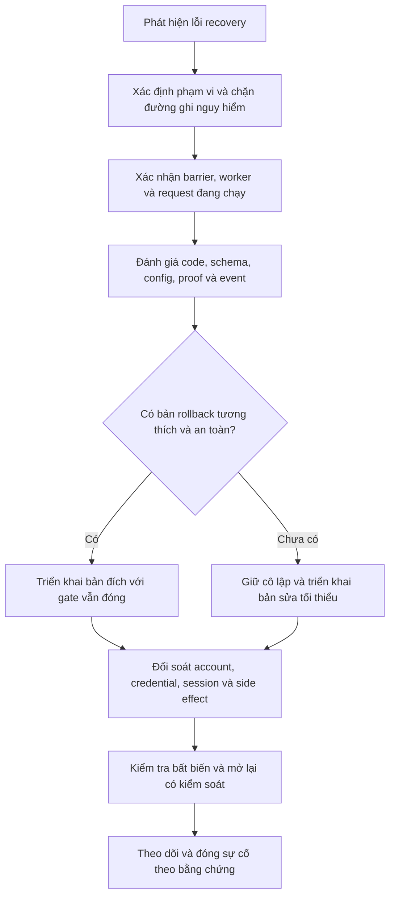

# Rollback after recovery defect: lùi phiên bản mà vẫn giữ an toàn tài khoản

## 1. Mục tiêu của rollback trong account recovery

Rollback sau lỗi khôi phục tài khoản là đưa hệ thống về một cách thực thi an toàn, đồng thời xử lý những thay đổi nhạy cảm mà phiên bản lỗi đã tạo ra. Việc thay container image chỉ giải quyết một phần của bài toán.

Trong module **SECURITY_AUTHENTICATION_ACCOUNT_RECOVERY**, lỗi có thể xuất hiện ở luồng mất mật khẩu, MFA, passkey hoặc thiết bị xác thực. Một bản phát hành có thể làm người dùng hợp lệ không nhận được liên kết; nghiêm trọng hơn, nó có thể cho phép dùng lại token, bỏ qua xác minh danh tính hoặc giữ session của người chiếm đoạt tài khoản.

Sau khi lùi code, dữ liệu vẫn có thể chứa mật khẩu vừa đổi, authenticator vừa gắn, proof đã tiêu thụ và session vừa được cấp. Một email đã gửi cũng không quay lại hàng đợi chỉ vì ứng dụng trở về phiên bản cũ. Vì vậy, cần xác định riêng:

- Lỗi còn có thể tiếp tục gây tác động hay không.
- Phiên bản đích có đọc và xử lý đúng trạng thái hiện tại hay không.
- Tài khoản, credential và session nào đã chịu tác động.
- Điều kiện nào cho phép mở lại từng phần của luồng recovery.

Mục tiêu học tập là lập được phương án rollback có giới hạn rõ ràng, có cơ chế chặn ghi khi cần, giữ nguyên hiệu lực của các quyết định bảo mật đã xảy ra và có bằng chứng xác minh sau khi thực hiện.

Các ví dụ bên dưới là thiết kế minh họa. Tên bảng, phiên bản, tham số, ngưỡng và lệnh triển khai không đại diện cho cấu hình của một hệ thống production cụ thể.

## 2. Tình huống mở đầu: bản cũ chạy lại nhưng tài khoản vẫn không an toàn

Giả sử bản `R18` thêm định dạng proof mới để phục vụ recovery khi mất MFA. Do một lỗi chuyển trạng thái, endpoint hoàn tất có thể chấp nhận cùng proof nhiều lần. Trước đó, `R17` hoạt động ổn định với định dạng cũ.

Trong cửa sổ triển khai `R18`, hệ thống đã:

1. Phát hành một số proof theo định dạng mới.
2. Cho một số người dùng đổi mật khẩu hoặc factor.
3. Cấp một số session mới sau khi recovery.
4. Đưa thông báo và yêu cầu thu hồi session vào outbox.

Đưa mọi Pod về `R17` đặt ra nhiều câu hỏi hơn việc kiểm tra Pod đã Ready:

- `R17` có hiểu định dạng proof mới không, hay rơi vào nhánh kiểm tra yếu hơn?
- Token đã dùng có còn bị đánh dấu đã dùng không?
- Session được tạo từ lần recovery đáng ngờ có bị từ chối không?
- Worker cũ có xử lý tiếp một command được tạo bởi `R18` không?
- Migration mới có làm `R17` ghi sai schema không?
- Các credential bị đánh dấu thu hồi có bị phục hồi nhầm từ snapshot không?

Phiên bản “từng ổn định” chỉ là một ứng viên. Phiên bản rollback phải an toàn với **dữ liệu, cấu hình và giao thức hiện tại**, không chỉ với trạng thái lịch sử trước khi triển khai.

## 3. Phân loại lỗi trước khi chọn cách xử lý

Không phải lỗi recovery nào cũng cần cùng một phạm vi dừng dịch vụ hoặc cùng một chiến lược vô hiệu hóa proof.

| Loại lỗi | Ví dụ | Mục tiêu trước mắt | Điểm cần kiểm tra khi chọn rollback |
| --- | --- | --- | --- |
| Khả dụng | Template email hỏng, timeout provider | Giảm thất bại và kiểm soát retry | Không gửi trùng hoặc tạo bão resend |
| Toàn vẹn proof | Token dùng lại được, sai purpose vẫn được chấp nhận | Chặn hoàn tất không an toàn | Hiệu lực consume, epoch và validator ở mọi writer |
| Xác minh danh tính | Bỏ qua bước xét duyệt mất MFA | Chặn cấp quyền hoặc gắn factor mới | Các account đã được cấp quyền trong cửa sổ lỗi |
| Session | Recovery xong nhưng session cũ vẫn có quyền | Thu hồi đúng loại credential | Session store, refresh token và bộ kiểm tra quyền thực tế |
| Rò rỉ bí mật | Proof hoặc recovery code xuất hiện trong log | Giảm phát tán, vô hiệu hóa giá trị đã lộ khi cần | Credential đã gửi đi không biến mất khi rollback code |
| Sai dữ liệu | Ghi nhầm tenant, account hoặc địa chỉ liên hệ | Dừng đường ghi liên quan và giữ bằng chứng | Sửa dữ liệu theo đối tượng; tránh ghi đè thay đổi hợp lệ |
| Tương thích | Bản mới ghi schema hoặc event mà bản cũ không đọc được | Ngăn writer không tương thích | Roll-forward tối thiểu có thể an toàn hơn rollback |

Một lỗi giao diện có thể đồng thời là lỗi bảo mật. Ví dụ thông báo lỗi tiết lộ account tồn tại cần được đánh giá theo contract phản hồi và khả năng lạm dụng, không chỉ theo tỷ lệ `5xx`.

Khi chưa xác định chắc phạm vi, ghi rõ phần đã biết và chưa biết. Không dùng kết luận “chưa thấy chiếm đoạt tài khoản” để thay thế việc xác minh proof, credential và session trong cửa sổ ảnh hưởng.

## 4. Những trạng thái không được tự động quay ngược

Rollback code không cho phép làm mất các quyết định bảo mật đã có hiệu lực. Trong thiết kế recovery, nên thể hiện các quyết định ấy bằng dữ liệu có phiên bản hoặc sự kiện đủ để đối soát.

| Trạng thái đã có hiệu lực | Cách rollback có thể làm sai | Yêu cầu cần giữ |
| --- | --- | --- |
| Proof đã consume | Khôi phục bản ghi trước consume | Proof không được dùng lại |
| Proof đã thu hồi | Khôi phục cache hoặc snapshot cũ | Quyết định thu hồi tiếp tục được thực thi |
| Authenticator bị xác định mất hoặc lộ | Phục hồi binding cũ hàng loạt | Không tự kích hoạt lại credential bị ảnh hưởng |
| Session hoặc refresh token đã thu hồi | Lùi version kiểm tra hoặc thay registry bằng bản cũ | Credential đã thu hồi vẫn bị từ chối |
| Account bị đặt vào trạng thái cần xác minh | Lùi workflow về đã xác minh | Chỉ cấp lại quyền qua quy trình có bằng chứng |
| Bộ đếm hoặc policy revision đã tăng | Lùi giá trị cùng với image/config | Không cho stale writer ghi theo policy cũ |
| Audit đã ghi nhận | Xóa theo database restore hoặc cleanup | Giữ chuỗi bằng chứng và đánh dấu hành động khắc phục |

OWASP khuyến nghị reset token có giới hạn thời gian và dùng một lần. Đó là lý do một rollback làm token đã consume trở lại hợp lệ sẽ phá vỡ thuộc tính cốt lõi của recovery, dù bản code đích từng vượt qua kiểm thử. Xem [Forgot Password Cheat Sheet](https://cheatsheetseries.owasp.org/cheatsheets/Forgot_Password_Cheat_Sheet.html).

NIST SP 800-63B-4 cũng có hướng dẫn xử lý authenticator bị compromise và việc invalidation. Khi dùng tài liệu này làm chuẩn tham chiếu, cần đối chiếu phạm vi áp dụng của tổ chức; không suy ra rằng lùi phiên bản ứng dụng là một căn cứ để khôi phục authenticator đã thu hồi. Xem [vòng đời authenticator trong SP 800-63B-4](https://pages.nist.gov/800-63-4/sp800-63b.html).

Các trạng thái bảo mật không nhất thiết chỉ có thể chuyển một chiều trong mọi nghiệp vụ. Ví dụ một suspension nhầm có thể được xem xét lại qua quy trình riêng. Điều cần tránh là đảo trạng thái **tự động và không có xác minh** chỉ để làm bản code cũ hoạt động.

## 5. Trình tự xử lý: chặn tác động rồi mới khôi phục khả dụng

Một trình tự ứng phó có thể tổ chức như sau:



### 5.1. Giữ bằng chứng đủ để xác định phạm vi

Ghi nhận image digest, thời gian bắt đầu rollout, mốc phát hiện, các cấu hình liên quan và phiên bản giao thức recovery. Với mỗi region hoặc nhóm worker, cần biết phiên bản nào đã thực thi trong cửa sổ ảnh hưởng.

Thu thập operation ID, challenge ID, account ID nội bộ, tenant ID, mã kết quả và phiên bản policy theo quyền truy cập phù hợp. Không sao chép raw proof, mật khẩu mới, TOTP seed hoặc private key vào ticket và báo cáo sự cố.

Giữ bằng chứng không có nghĩa là trì hoãn containment đến khi thu thập xong mọi log. Có thể đồng thời chặn đường nguy hiểm và bảo toàn dữ liệu điều tra, miễn ghi lại thứ tự và thời điểm của các hành động.

### 5.2. Chặn đúng hành động có rủi ro

Nếu validator proof bị lỗi, ưu tiên chặn hoàn tất recovery và các đường có thể đổi credential. Có thể cần dừng cả phát hành proof hoặc phân phối thông báo nếu những phần đó cũng sai. Với lỗi chỉ ở provider gửi thư, chưa có căn cứ để tự động vô hiệu hóa mọi credential của người dùng.

Đường hỗ trợ thủ công là một đường thực thi khác cần được đánh giá. Chặn API công khai nhưng để nhân viên hỗ trợ gọi cùng service lỗi sẽ không tạo containment đầy đủ.

### 5.3. Xác nhận đã chặn thực sự

Một flag có giá trị `false` trong control plane chưa chứng minh mọi writer đã áp dụng nó. Cần quan sát request kiểm tra, revision được worker nhận, command đang chạy và số lần thay đổi credential được commit sau mốc chặn.

Ghi riêng thời điểm **yêu cầu chặn** và thời điểm **xác nhận hàng rào có hiệu lực**. Trong khoảng giữa hai mốc, request đã qua kiểm tra ban đầu hoặc worker còn dùng cache cũ có thể vẫn hoàn tất.

## 6. Thiết kế gate và phiên bản để rollback không mở lại luồng lỗi

Không nên gộp mọi điều khiển vào một flag `recoveryEnabled` chỉ tồn tại trong cấu hình của container. Một policy minh họa có thể phân biệt:

```yaml
scope: tenant-fixture
policyRevision: 108
issueEnabled: false
completeEnabled: false
deliveryEnabled: false
proofEpoch: 23
minimumRecoveryProtocol: 4
incidentReference: recovery-incident-fixture
```

Đây là schema thiết kế, không phải tên field bắt buộc của một thư viện. Các ý nghĩa cần tách bạch:

- `policyRevision` nhận diện phiên bản quyết định điều hành và tăng khi policy đổi.
- `issueEnabled` kiểm soát việc tạo challenge/proof mới.
- `completeEnabled` kiểm soát thực thi thay đổi nhạy cảm.
- `deliveryEnabled` kiểm soát phân phối command gửi thông báo phù hợp với sự cố.
- `proofEpoch` xác định một thế hệ proof được chấp nhận trong scope.
- `minimumRecoveryProtocol` đặt yêu cầu tương thích tối thiểu cho bên thực thi.

Đóng một gate vì lỗi khả dụng không bắt buộc phải làm mọi proof cũ mất hiệu lực. Chỉ tăng `proofEpoch` khi phương án ứng phó cần vô hiệu hóa thế hệ proof đó. Ngược lại, chỉ tăng `policyRevision` không tự làm token cũ mất hiệu lực nếu validator không dùng trường này cho mục đích ấy.

Policy điều hành cần được giữ ngoài phạm vi rollback thông thường của image. Nếu lùi image cũng lùi ConfigMap về một giá trị cho phép hoàn tất recovery, containment có thể bị gỡ đúng lúc code cũ bắt đầu nhận traffic.

### 6.1. Bản cũ phải thực sự tuân thủ gate

Một field `minimumRecoveryProtocol: 4` không thể ngăn binary đời cũ nếu binary đó không đọc field này. Trước khi dùng version floor làm hàng rào, cần có điểm thực thi đáng tin cậy mà mọi đường ghi phải đi qua: chẳng hạn lớp dịch vụ đã hỗ trợ giao thức, gateway phù hợp kết hợp quyền truy cập, hoặc một thủ tục database được kiểm soát quyền.

Nếu stale worker vẫn có quyền ghi trực tiếp credential mà không kiểm tra policy, thêm field vào database chưa sửa được vấn đề. Phải cô lập hoặc loại bỏ quyền ghi của writer đó, hoặc đưa nó qua đường thực thi đã được kiểm chứng.

### 6.2. Khi không đọc được policy

Với thao tác đổi password, thay factor hoặc cấp quyền sau recovery, không nên mặc định cho qua khi không xác định được policy đang có hiệu lực. Thiết kế phản hồi tạm thời và retry phải giữ được trạng thái challenge; không tự consume proof rồi mới phát hiện không thể tiếp tục.

Phạm vi từ chối nên bám vào đường recovery bị ảnh hưởng. Một lỗi control plane recovery không tự tạo lý do để vô hiệu hóa toàn bộ các hoạt động không liên quan của hệ thống.

### 6.3. Cache và nhiều region

Cache có TTL chỉ đặt giới hạn độ cũ trong điều kiện thiết kế đã giả định; nó không chứng minh việc chặn tức thời. Khi cần hàng rào ghi chặt, phải kiểm tra tại điểm commit hoặc sử dụng cơ chế fencing có bảo đảm tương ứng.

Trong hệ thống nhiều region, ghi rõ policy do đâu quyết định, replica nào được phép đọc để cấp quyền và điều gì xảy ra khi mất kết nối. Không báo containment toàn cục khi mới quan sát một region đã nhận revision mới.

## 7. Request đang chạy dở: cần một điểm xác định thứ tự ghi

Giả sử request A đọc gate đang mở. Ngay sau đó, bộ phận vận hành đóng gate. Nếu A vẫn commit đổi mật khẩu mà không có ràng buộc nào với quyết định đóng gate, việc kiểm tra flag ở đầu request chưa tạo một ranh giới chặt.

Một mô hình minh họa trên PostgreSQL là cho transaction hoàn tất recovery và transaction đóng gate phối hợp qua cùng hàng policy. Transaction hoàn tất lấy khóa chia sẻ trên policy; transaction điều hành cập nhật hàng đó. Mục tiêu là xác định thứ tự giữa các lần hoàn tất đang được phép và mốc đóng gate đã commit.

### 7.1. Giao thức hoàn tất recovery

Mã Java sau thể hiện thứ tự thao tác, không phải implementation JDBC đầy đủ. Các repository minh họa phải dùng cùng database transaction; lời gọi remote không được xem như tự động nằm trong transaction này.

```java
@Transactional
public void completeRecovery(CompletionCommand command) {
    RecoveryPolicy policy = policies.lockForSharedUse(command.scope());

    if (policy == null || !policy.completeEnabled()) {
        throw new RecoveryTemporarilyUnavailable();
    }
    if (runtimeRecoveryProtocol < policy.minimumRecoveryProtocol()) {
        throw new RecoveryProtocolNotSupported();
    }

    ConsumedProof proof = proofs.consumeIfEligible(
        command.challengeId(),
        command.scope(),
        command.accountId(),
        command.purpose(),
        command.proofDigest(),
        policy.proofEpoch(),
        clock.instant());

    // Không đúng một proof hợp lệ thì abort transaction.
    if (proof == null) {
        throw new InvalidRecoveryProof();
    }

    credentials.applyApprovedChange(proof, command);
    outbox.appendRecoveryCommitted(proof.operationId());
}
```

`@Transactional` phải được gọi qua cơ chế transaction thực tế của ứng dụng. Các exception dùng để abort phải có rollback semantics phù hợp; không được catch rồi trả thành công trong khi transaction vẫn commit. Việc consume proof, thay credential và ghi outbox cần có contract nhất quán về số hàng và lỗi.

Trong mô hình này, thao tác `lockForSharedUse` tương ứng với một truy vấn kiểu:

```sql
SELECT policy_revision,
       complete_enabled,
       proof_epoch,
       minimum_recovery_protocol
FROM recovery_policy
WHERE scope_id = :scope_id
FOR SHARE;
```

Tham số `:scope_id` phải được bind theo cơ chế truy cập dữ liệu. Truy vấn phải chạy trong transaction đang bao quanh toàn bộ thao tác, không phải một transaction riêng kết thúc ngay sau câu `SELECT`.

PostgreSQL mô tả `FOR SHARE` là khóa hàng có xung đột với các cập nhật liên quan; khóa được giữ theo vòng đời transaction. Khi thiết kế giao thức cụ thể, cần xét isolation level, timeout và deadlock. Xem [Explicit Locking của PostgreSQL 18](https://www.postgresql.org/docs/18/explicit-locking.html).

### 7.2. Giao thức đóng gate

Một lần cập nhật có kiểm tra revision có thể có dạng sau:

```sql
UPDATE recovery_policy
SET complete_enabled = FALSE,
    policy_revision = policy_revision + 1
WHERE scope_id = :scope_id
  AND policy_revision = :expected_revision
RETURNING policy_revision, complete_enabled, proof_epoch;
```

Nếu không có hàng trả về, không được suy ra đã đóng gate; policy có thể đã đổi hoặc scope không tồn tại. Công cụ điều hành phải đọc lại nguồn chuẩn và giải quyết xung đột.

Với giao thức khóa nói trên, một transaction hoàn tất đã giữ khóa có thể commit trước transaction đóng gate. Khi đóng gate commit xong, các transaction tuân thủ cùng giao thức sẽ phải quan sát gate đóng hoặc gặp lỗi cạnh tranh cần xử lý. Vì vậy, mốc có ý nghĩa là **commit thành công và readback của thay đổi policy**, không phải thời điểm người vận hành nhấn nút.

Đây là bảo đảm trong phạm vi các writer, hàng policy và database tham gia giao thức. Nó không bao phủ một binary bỏ qua khóa, một region dùng nguồn khác, hay một provider bên ngoài đã nhận request trước đó.

### 7.3. Giới hạn và cách kiểm tra

Một hàng policy dùng cho toàn bộ tenant có thể trở thành điểm tranh chấp. Phải chọn scope, thời lượng transaction và thứ tự lấy khóa có chủ ý. Không giữ khóa trong lúc chờ email hoặc cuộc gọi provider kéo dài.

Nếu gate update phải chờ quá lâu, chưa thể báo đã containment. Có thể cần cô lập nguồn request, dừng nhận command mới hoặc xử lý transaction treo theo runbook riêng, rồi xác minh lại. Việc kill một process cũng không tự chứng minh mọi side effect bên ngoài đã được hủy.

Một test quan trọng là giữ request A tại ranh giới ghi, đồng thời thực hiện đóng gate và request B. Quan sát thứ tự commit thực tế, credential được cập nhật và policy mà từng request dùng. Test chỉ mock `gate.isEnabled()` không chứng minh được hàng rào này.

## 8. Kiểm tra tương thích của bản rollback

Trước khi thay phiên bản, lập một bảng tương thích đủ để quyết định. Không chỉ so sánh tên release hoặc số build.

| Thành phần | Câu hỏi cần trả lời | Điều kiện làm bản đích không phù hợp |
| --- | --- | --- |
| Schema | Bản đích đọc/ghi được schema hiện tại không? | Đã xóa cột mà bản đích cần; ghi đè trạng thái mới |
| Proof | Reader hiểu định dạng, purpose và epoch hiện tại không? | Không nhận biết định dạng rồi chấp nhận theo nhánh yếu |
| Gate | Bản đích tuân thủ policy revision và barrier không? | Bỏ qua gate hoặc mặc định cho phép khi thiếu dữ liệu |
| Session | Bản đích hiểu credential/session version không? | Phiên bản cũ bỏ qua quyết định thu hồi mới |
| Event | Consumer hiểu event và command đang tồn tại không? | Bỏ field bảo mật, xử lý lặp tác dụng phụ |
| Key/config | Key ID, thuật toán và policy có tương thích không? | Đòi khôi phục khóa đã bị đánh dấu compromise |
| Migration | Có tự chạy thay đổi nguy hiểm khi khởi động không? | Down-migration hoặc migration startup làm mất dữ liệu |
| Tích hợp | Provider và callback còn tương thích không? | Callback cũ đi qua đường xác minh đã bị loại bỏ |

### Expand–contract và cửa sổ rollback

Một cách chuẩn bị là tách thay đổi schema thành nhiều đợt. Đợt đầu thêm cấu trúc tương thích và triển khai reader cần thiết; đợt sau mới đổi writer; chỉ loại bỏ cấu trúc cũ khi đã hết cửa sổ rollback được công bố.

Với security field, “không lỗi deserialize” chưa phải tương thích. Bản cũ có thể bỏ qua một field `purpose` hoặc `assurance` rồi vẫn xử lý thành công. Vì vậy, định dạng mới cần có quy tắc versioning và từ chối rõ ràng khi reader không hiểu điều kiện bảo mật.

Dual-write cũng cần đối soát: nếu code mới ghi hai biểu diễn nhưng code cũ chỉ cập nhật một biểu diễn, rollback có thể khiến dữ liệu lệch. Phải xác định biểu diễn chuẩn và cách ngăn writer không tương thích trước khi cho hoạt động trở lại.

### Khi rollback không còn là lựa chọn an toàn

Nếu schema hiện tại hoặc security protocol không còn được bản cũ hỗ trợ, giữ recovery ở trạng thái hạn chế và triển khai một bản sửa tối thiểu tương thích có thể là phương án phù hợp. Không kéo lùi schema, token policy và revocation state đồng loạt chỉ để ứng dụng cũ khởi động.

Mục tiêu quyết định là giảm tác động và khôi phục ranh giới tin cậy. Tốc độ thay image chỉ là một yếu tố trong quyết định đó.

## 9. Thực hiện rollback code mà không nhầm với rollback toàn hệ thống

Một deployment có thể được mô tả bằng tập thông tin:

```text
image digest
application configuration revision
emergency policy revision
database schema version
proof format and accepted epoch
credential/session validation protocol
producer and consumer event versions
```

Rollback cần ghi rõ thành phần nào đổi và thành phần nào tiếp tục có hiệu lực. Ví dụ đưa image về digest đã kiểm chứng, giữ gate đóng ở revision hiện tại và giữ nguyên schema cùng revocation state.

### Ví dụ với Kubernetes

Các lệnh sau chỉ minh họa một phần kiểm tra và thay Deployment. Những tên viết hoa là giá trị phải thay bằng định danh đã xác minh; đây không phải một runbook có thể chạy nguyên văn cho mọi cụm.

```text
kubectl --context=CLUSTER_CONTEXT --namespace=IDENTITY_NAMESPACE rollout history deployment/RECOVERY_DEPLOYMENT

kubectl --context=CLUSTER_CONTEXT --namespace=IDENTITY_NAMESPACE rollout history deployment/RECOVERY_DEPLOYMENT --revision=TARGET_REVISION

kubectl --context=CLUSTER_CONTEXT --namespace=IDENTITY_NAMESPACE rollout undo deployment/RECOVERY_DEPLOYMENT --to-revision=TARGET_REVISION

kubectl --context=CLUSTER_CONTEXT --namespace=IDENTITY_NAMESPACE rollout status deployment/RECOVERY_DEPLOYMENT --timeout=180s
```

Kubernetes rollback Deployment khôi phục phần Pod template của revision. Nó không tự đưa database, các Secret/ConfigMap độc lập hoặc trạng thái nghiệp vụ về một mốc lịch sử chung. Vì vậy, `rollout status` thành công cần được bổ sung bằng kiểm tra bảo mật và tương thích. Xem [Deployment rollback trong Kubernetes](https://kubernetes.io/docs/concepts/workloads/controllers/deployment/#rolling-back-a-deployment).

Trước khi thực hiện, đối chiếu revision với image digest và manifest mong đợi. Tag có thể không đủ để chỉ ra chính xác artifact. Nếu hệ thống do GitOps hoặc pipeline khác quản lý, cập nhật desired state theo cơ chế đó để tránh controller đưa phiên bản lỗi trở lại sau thao tác thủ công.

Trong thời gian rollout, các phiên bản có thể cùng tồn tại. Kiểm tra cả HTTP server, worker, scheduled job và đường hỗ trợ; một Deployment hoàn tất không đồng nghĩa tất cả các bên thực thi recovery đã được thay.

Giữ gate đóng trong lúc xác minh bản đích. Việc Pod sống, kết nối database được hoặc trả health check thành công chỉ phản ánh một phần điều kiện vận hành.

## 10. Không dùng database restore như nút Undo cho recovery

Khôi phục database về trước thời điểm lỗi có thể phục hồi những thứ đã bị vô hiệu hóa hợp lệ trong khoảng thời gian đó. Ví dụ:

- Password cũ xuất hiện lại sau khi người dùng đã thay đổi.
- Proof đã tiêu thụ trở lại trạng thái chưa dùng.
- Passkey hoặc thiết bị đã thu hồi trở lại có binding hợp lệ.
- Session version bị lùi, làm refresh credential cũ vượt qua kiểm tra.
- Audit và quyết định hạn chế tài khoản sau sự cố bị mất.

Point-in-time recovery là một công cụ phục hồi dữ liệu, không phải cơ chế tự hiểu ý nghĩa của từng quyết định bảo mật. Với continuous archiving của PostgreSQL, phạm vi phục hồi cũng có thể là cả database cluster thay vì một tập bản ghi recovery tùy chọn. Xem [Continuous Archiving and PITR của PostgreSQL 18](https://www.postgresql.org/docs/18/continuous-archiving.html).

### 10.1. Phục hồi vào môi trường cô lập để đối soát

Khi cần điều tra sai dữ liệu, một phương án là phục hồi bản lịch sử vào môi trường cô lập rồi so sánh với dữ liệu hiện tại. Môi trường này không được gửi email, gọi provider production hay nhận traffic đăng nhập thật.

Từ kết quả so sánh, tạo danh sách sửa chữa có phạm vi theo account, tenant và operation. Bản sửa cần kiểm tra version hiện tại để không ghi đè thay đổi hợp lệ mới hơn. Giữ lịch sử quyết định và kết quả từng account thay vì chạy một câu cập nhật hàng loạt không có khả năng đối soát.

### 10.2. Nếu bắt buộc phục hồi production

Một kế hoạch phục hồi production cần xử lý cả security state sau mốc backup. Có thể phải tái áp dụng revocation từ nguồn bền vững độc lập, đặt thế hệ proof mới hoặc buộc những nhóm account xác minh lại theo đánh giá ảnh hưởng.

Nếu nguồn lưu revocation và audit cũng bị quay về cùng snapshot, không thể giả định đã có đủ dữ liệu để tái áp dụng. Phải ghi rõ khoảng mất dữ liệu, phạm vi chưa chắc chắn và giữ các đường nhạy cảm bị hạn chế cho đến khi có phương án xác minh tương ứng.

Không nên khôi phục mật khẩu cũ cho người dùng chỉ vì một lần recovery bị nghi ngờ. Mật khẩu cũ có thể đã lộ và cũng không còn là bằng chứng về chủ thể hợp lệ. Quy trình tái xác minh và thiết lập credential mới cần được thiết kế riêng.

## 11. Xử lý tài khoản, factor và session đã bị ảnh hưởng

Sau khi đã chặn tiếp tục gây lỗi, cần đối soát các hành động xảy ra trong cửa sổ ảnh hưởng. Dùng operation ID và dữ liệu tin cậy để phân biệt account chưa đổi gì, account recovery hợp lệ, account có thay đổi đáng ngờ và account chưa đủ bằng chứng kết luận.

| Nhóm dữ liệu | Cần đối soát | Hướng xử lý tùy kết quả xác minh |
| --- | --- | --- |
| Password | Thời điểm đổi, operation gây đổi, version credential | Yêu cầu thiết lập credential mới qua đường xác minh an toàn khi cần |
| MFA | Factor nào bị gỡ/thêm, mức đảm bảo dùng khi phê duyệt | Vô hiệu hóa binding đáng ngờ; xét lại quyền và enrollment |
| Passkey | Credential ID, account binding, sự kiện đăng ký/thu hồi | Không kích hoạt lại credential đã bị thu hồi chỉ vì lùi code |
| Recovery contact | Thay đổi email/số điện thoại và nguồn xác minh | Không dùng riêng contact vừa bị thay làm bằng chứng khôi phục |
| Session | Phiên cấp trước/sau operation, version và loại credential | Thu hồi theo policy, rồi thử lại trên đường xác thực thực tế |
| Quyền sau recovery | Authority hoặc mức step-up được cấp | Hạ quyền hoặc yêu cầu xác minh lại nếu căn cứ cấp quyền không hợp lệ |

OWASP xem việc thay MFA factor là hành động rủi ro cao, khuyến nghị xác minh phù hợp và thông báo ngoài băng. Vì vậy, một bản lỗi cho phép thay factor cần được xử lý như thay đổi danh tính nhạy cảm; lùi giao diện enrollment không tự khắc phục các binding đã tạo. Xem [Changing MFA Factors](https://cheatsheetseries.owasp.org/cheatsheets/Multifactor_Authentication_Cheat_Sheet.html#changing-mfa-factors).

### Thu hồi session cần được thực thi ở nơi cấp quyền

Tăng `credentialVersion` trong database không tự làm JWT đã cấp mất hiệu lực nếu resource server không kiểm tra version đó. Tương tự, xóa một session cục bộ chưa nói lên hiệu lực của refresh token, remember-me hoặc phiên ở một hệ thống liên kết.

Với từng loại credential, xác định điểm kiểm tra revocation và giới hạn thời gian hiệu lực. Nếu có thành phần dùng token hoàn toàn stateless, cần phương án phù hợp với thiết kế đó như denylist, kiểm tra trạng thái, giới hạn thời gian token hoặc containment ở tài nguyên được bảo vệ. Không tuyên bố thu hồi tức thời khi cơ chế thực thi chỉ có hiệu lực sau khi token hết hạn.

Nếu cần thông báo người dùng, chọn kênh và nội dung dựa trên dữ liệu đã xác minh. Một email vừa bị kẻ tấn công đổi không phải đương nhiên là kênh tin cậy để xác nhận thay đổi đó. Thông báo nên nêu hành động người dùng có thể thực hiện mà không đưa proof hoặc dữ liệu bí mật vào log hỗ trợ.

## 12. Hàng đợi, outbox và side effect bên ngoài

Một lỗi phổ biến là rollback web server nhưng worker vẫn tiếp tục xử lý command cũ. Recovery có thể có job phát hành proof, gửi thông báo, gắn factor, thu hồi session hoặc đồng bộ sang identity provider.

### 12.1. Phân biệt command và sự kiện đã commit

Command thể hiện việc cần thực thi; sự kiện thể hiện điều đã xảy ra. Ví dụ `SendRecoveryLink` khác `CredentialChanged`. Hai loại thông điệp không nên bị dừng hoặc xóa theo cùng một quy tắc mà không xét nội dung.

- Command gửi link thuộc thế hệ proof đã bị thu hồi có thể cần được hủy hoặc cách ly.
- Event audit về thay đổi đã xảy ra cần tiếp tục được bảo toàn.
- Yêu cầu thu hồi session do sự cố có thể vẫn cần xử lý ngay cả khi đường phát hành proof đang dừng.
- Command thay credential phải kiểm tra quyền thực thi và policy hiện tại ở điểm gây tác dụng phụ.

Gate cho delivery vì vậy nên có phạm vi rõ ràng. Một công tắc dừng mọi consumer có thể vô tình chặn cả tác vụ thu hồi quyền đang cần để containment.

### 12.2. Retry không được làm sống lại hành động cũ

Message cần operation ID, scope và version phù hợp để consumer kiểm tra. Các side effect có thể lặp phải có cơ chế idempotency bền vững. Nếu consumer nhận lại một command sau rollback, nó không được tự phát proof mới chỉ để “khắc phục” việc proof cũ không còn hợp lệ.

Khi áp dụng cập nhật có version, không để event cũ kéo giá trị credential/session version xuống. Việc so sánh phải dựa trên contract đã thiết kế; chỉ dùng timestamp từ nhiều máy không tự tạo ra thứ tự nhân quả đáng tin cậy.

### 12.3. Những gì không thể thu hồi bằng rollback

Email hoặc SMS đã được provider nhận có thể tiếp tục được gửi dù gate delivery vừa đóng. Một request remote đang chạy cũng có thể đã tạo side effect trước khi ứng dụng bị dừng.

Do đó, mục tiêu an toàn là để liên kết cũ không còn thực hiện được hành động nhạy cảm khi người nhận nhấp vào, thay vì hứa rằng mọi thông báo sẽ biến mất sau mốc chặn. Nếu provider hỗ trợ hủy tác vụ, vẫn cần kiểm tra kết quả hủy và có phương án cho trường hợp hủy không thành công.

Với tác vụ remote như thay factor ở identity provider, một transaction database cục bộ không tự rollback được thay đổi remote. Cần trạng thái đối soát, operation ID và thao tác khắc phục được nhà cung cấp hỗ trợ. Không áp dụng compensation mù nếu có thể đảo nhầm một thay đổi hợp lệ mới hơn.

## 13. Bộ kiểm tra sau rollback

Đánh giá sau rollback nên có cả trường hợp hợp lệ và trường hợp phải bị chặn. Chỉ kiểm tra một happy path có thể bỏ sót việc bản cũ đang chấp nhận quá nhiều dữ liệu.

| Kịch bản | Kết quả cần có | Bằng chứng cần quan sát |
| --- | --- | --- |
| Gate hoàn tất đang đóng | Không đổi credential hoặc cấp quyền | Trạng thái database, outbox và response theo contract |
| Proof đã consume trước rollback | Không dùng lại được | Consume state không bị mất và không có lần commit mới |
| Proof đã thu hồi trong sự cố | Bị từ chối sau khi lùi code | Validator và nguồn revocation thực tế |
| Proof sai purpose/account/tenant | Bị từ chối | Đúng đối tượng không bị thay đổi; đối tượng khác không bị chạm |
| Proof thuộc epoch bị loại bỏ | Không thực thi được | Kiểm tra epoch ở điểm ghi, không chỉ ở UI |
| Request đang chạy khi đóng gate | Có thứ tự xử lý đúng giao thức | Commit trước/sau barrier được giải thích rõ |
| Worker cũ nhận message tồn đọng | Không thực thi hành động đã cấm | Protocol, permission và kết quả xử lý message |
| Credential hoặc session bị thu hồi | Không tiếp tục truy cập trái policy | Request thật tới tài nguyên được bảo vệ |
| Proof mới sau khi mở lại | Hoàn tất đúng policy | Credential đổi đúng một lần và mức quyền đúng |
| Policy store không sẵn sàng | Không cho qua hành động nhạy cảm | Không consume hoặc cấp quyền ngoài contract |
| Lỗi giữa consume và cập nhật credential | Không có trạng thái nửa chừng sai policy | Kết quả transaction và khả năng retry có kiểm soát |

### Kiểm tra nhiều phiên bản và nhiều đường thực thi

Chạy kiểm tra trên đường API, worker và hỗ trợ có liên quan. Với canary, xác nhận traffic kiểm tra thực sự đi vào phiên bản cần kiểm chứng. Một request tình cờ trúng instance khỏe không chứng minh instance khác đã tuân thủ policy.

Các test liên quan transaction cần database và cơ chế cạnh tranh tương ứng. Các test thu hồi quyền cần đi qua nơi đang cấp quyền thực tế. Mock ghi nhận lời gọi `revoke()` chỉ chứng minh ứng dụng đã yêu cầu thu hồi, không chứng minh credential đã bị từ chối.

### Tiêu chí dừng lần mở lại

Đặt trước các dấu hiệu buộc đóng lại gate hoặc dừng mở rộng: proof cũ được chấp nhận, writer dùng policy revision không hợp lệ, operation đổi credential ngoài scope, hoặc một loại session đáng lẽ bị thu hồi vẫn có quyền. Các tiêu chí này có thể nghiêm ngặt hơn ngưỡng lỗi khả dụng thông thường.

Không tự động mở lại chỉ vì error rate giảm. Một validator vô tình chấp nhận mọi proof cũng có thể làm tỷ lệ lỗi giảm.

## 14. Mở lại từng phần và đo tiến độ đúng cách

Sau khi kiểm tra bản đích và khắc phục dữ liệu, mở lại theo phạm vi đã xác minh. Ví dụ bắt đầu từ một cohort kiểm thử, một tenant được lựa chọn hoặc một loại recovery có policy rõ ràng. Phạm vi này phải do hệ thống kiểm soát, không dựa vào header tùy ý do client tự khai.

Một thứ tự mở lại có thể là:

1. Xác minh toàn bộ writer được phép hoạt động đã tuân thủ giao thức hiện tại.
2. Xử lý hoặc cách ly command không còn hợp lệ; giữ tác vụ audit và thu hồi cần thiết.
3. Cho phép phát hành challenge mới cho cohort được kiểm soát.
4. Cho phép phân phối thông báo mới có quota phù hợp.
5. Cho phép hoàn tất ở phạm vi đã kiểm thử, trong khi proof bị thu hồi tiếp tục bị từ chối.
6. Theo dõi kết quả và mở rộng theo bằng chứng; giữ phương án đóng lại gate.

Thứ tự cụ thể phụ thuộc kiến trúc. Không nên mở phát hành hàng loạt quá lâu trước khi hoàn tất có thể hoạt động, vì có thể tạo hàng đợi người dùng và nhu cầu resend lớn. Với các loại recovery rủi ro khác nhau, có thể mở lại đặt lại mật khẩu trước khi mở lại thay MFA/passkey, nếu có căn cứ về sự độc lập và an toàn.

| Chỉ số hoặc mốc | Nó giúp trả lời điều gì? | Điều không thể suy ra chỉ từ nó |
| --- | --- | --- |
| Thời điểm barrier được xác nhận | Từ mốc nào writer tuân thủ giao thức đã bị chặn? | Mọi side effect ngoài hệ thống đều đã dừng |
| Policy revision theo writer/region | Thành phần nào đã áp dụng quyết định mới? | Binary thực sự tuân thủ mọi rule chỉ vì báo revision |
| Số operation nhạy cảm sau containment | Có đường ghi tiếp tục hoạt động không? | Mọi operation quan sát được đều là tấn công |
| Kết quả proof cũ/sai purpose | Hàng rào từ chối có còn hoạt động không? | Không còn lỗi ở các nhánh chưa kiểm tra |
| Backlog và tuổi command | Có áp lực retry hoặc xử lý dữ liệu cũ không? | Tất cả message trong backlog đều có thể phát lại |
| Account đã đối soát/chưa kết luận | Phạm vi ảnh hưởng còn bất định bao nhiêu? | Toàn bộ account chưa kết luận là an toàn |
| Phiên cũ bị từ chối qua test thực tế | Cơ chế thu hồi có hiệu lực ở đường đã thử không? | Tất cả loại credential khác cũng đã bị thu hồi |

Thiết kế nhãn metric có kiểm soát để tránh đưa account ID, raw proof hoặc identifier cá nhân vào hệ thống quan sát phổ biến. Dùng log/audit có quyền truy cập phù hợp cho dữ liệu điều tra chi tiết.

## 15. Runbook tối thiểu cho một lần rollback recovery

Một runbook có thể được tổ chức thành các mục ngắn, mỗi mục có điều kiện và bằng chứng hoàn tất:

```text
Sự cố và phạm vi:
  - Loại recovery và hành động bị ảnh hưởng
  - Release/config/protocol liên quan
  - Cửa sổ ảnh hưởng và phần chưa xác định

Containment:
  - Scope và policy revision cần áp dụng
  - Gate phải đóng; đường writer/worker phải cô lập
  - Barrier và cách xác nhận request đang chạy dở

Quyết định triển khai:
  - Artifact đích theo digest
  - Schema/proof/session/event tương thích
  - Cấu hình điều hành tiếp tục giữ hiệu lực
  - Phương án nếu bản đích không đủ điều kiện

Đối soát và khắc phục:
  - Account/operation/credential/session cần xử lý
  - Command tồn đọng và side effect remote
  - Version guard, idempotency và bằng chứng cho từng hành động

Xác minh và mở lại:
  - Các ca từ chối bắt buộc và positive control
  - Cohort, quota, điều kiện mở rộng hoặc đóng lại
  - Những điểm chưa xác minh và bên tiếp tục xử lý
```

Các giá trị thực tế cần được điền từ inventory, artifact và audit đã xác minh. Không chọn revision bằng cách đoán “lùi một bản là đủ”, không dùng thời điểm phát hiện như thời điểm bắt đầu ảnh hưởng, và không gộp “đã rollout” với “đã khắc phục tài khoản”.

Một lần xử lý có thể đạt trạng thái code đã an toàn nhưng vẫn còn account cần đối soát. Báo rõ cả hai trạng thái để tránh dừng phần khắc phục dữ liệu khi dashboard triển khai đã xanh.

## 16. Bài thực hành và câu hỏi tự kiểm tra

### Bài thực hành: rollback có proof mới và worker cũ

Giả sử release `R18` có lỗi chấp nhận proof dùng lại. Có hai region, một worker cũ chưa hiểu `proofEpoch`, và bản `R17` chưa đọc được định dạng proof mà `R18` đã phát hành. Một số email đã được provider nhận, một số account đã đổi MFA và một số session đã được cấp trong cửa sổ lỗi.

Hãy thiết kế phương án đáp ứng những điều kiện sau:

1. Xác định các hành động cần chặn ngay và phân biệt chúng với audit hoặc tác vụ thu hồi cần tiếp tục chạy.
2. Chỉ ra vì sao thêm một field epoch chưa đủ để chặn worker cũ.
3. Xác định mốc containment có thể kiểm chứng cho từng region.
4. Quyết định `R17` có đủ điều kiện rollback không; nếu chưa, mô tả phương án giữ recovery hạn chế và sửa tối thiểu.
5. Giữ hiệu lực consume/revocation trong khi xử lý proof mới không tương thích.
6. Đối soát những account đã thay MFA mà không tự khôi phục factor cũ hàng loạt.
7. Xử lý email đã gửi bằng cách bảo vệ điểm hoàn tất, thay vì giả định có thể thu hồi thông báo.
8. Kiểm tra các session đã cấp qua tài nguyên được bảo vệ thực tế.
9. Chọn cohort mở lại, kiểm thử proof cũ bị từ chối và proof mới chỉ được dùng một lần.

Một câu trả lời tốt cần phân biệt điều đã có bằng chứng với điều mới là giả định. Ví dụ “mọi Pod đã về R17” không giải quyết được worker không đọc epoch, còn “đã tăng session version” không chứng minh JWT stateless ở resource server đã bị từ chối.

### Câu hỏi tự kiểm tra

- Tại sao phục hồi token table từ backup có thể làm tăng nguy cơ chiếm đoạt tài khoản?
- Một transaction đã kiểm tra flag trước khi đóng gate có thể tiếp tục commit trong những điều kiện nào?
- Khi nào nên tăng proof epoch, và vì sao không nên đồng nhất nó với policy revision?
- Bản rollback bỏ qua field mới nhưng không báo lỗi có thực sự tương thích không?
- Vì sao dừng mọi consumer có thể cản trở containment?
- Cần bằng chứng gì để nói một session đã bị thu hồi có hiệu lực?
- Khi nào đã sửa xong code nhưng chưa thể tuyên bố xử lý xong sự cố?

Rollback recovery thành công cần đưa đường thực thi về trạng thái an toàn, giữ hiệu lực của những quyết định bảo mật đã xảy ra và xử lý các thay đổi account còn tồn tại. Mốc hoàn tất phải dựa trên khả năng từ chối proof/credential không còn hợp lệ và việc mở lại có kiểm chứng, bên cạnh trạng thái triển khai của ứng dụng.
