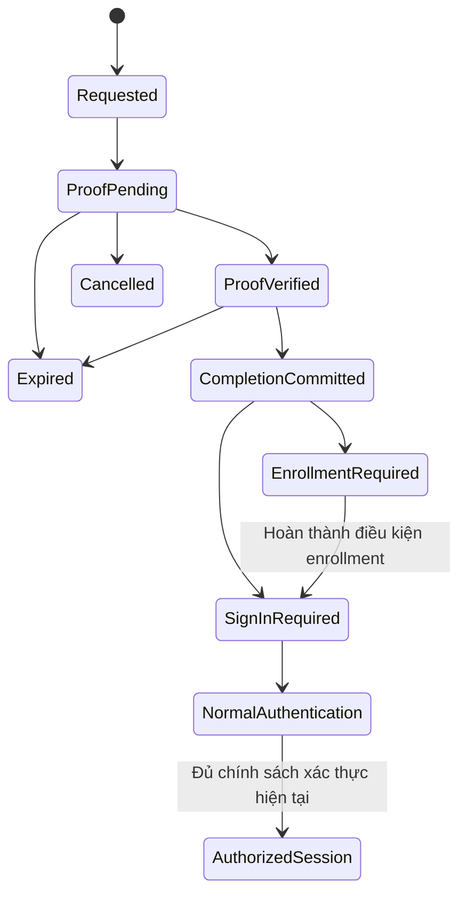

# Checklist khôi phục tài khoản trước khi vận hành production

## 1. Checklist này kiểm tra điều gì?

Một luồng khôi phục tài khoản chạy được trong môi trường phát triển chưa chứng minh rằng nó an toàn khi vận hành production. Một request đúng có thể đặt lại mật khẩu thành công, nhưng hai request đồng thời lại dùng được cùng token. Email kiểm thử có thể đến nơi, nhưng worker production vẫn dùng credential cũ. Một trình duyệt có thể bị đăng xuất, trong khi session của kẻ tấn công ở thiết bị khác vẫn hoạt động.

Trong module `SECURITY_AUTHENTICATION_ACCOUNT_RECOVERY`, production recovery checklist là tập hợp các điều kiện cần kiểm chứng trước và trong khi đưa những luồng khôi phục mật khẩu, MFA, passkey hoặc thiết bị xác thực vào sử dụng. Checklist đánh giá hành vi của hệ thống với bằng chứng thực tế, không chỉ sự hiện diện của một cấu hình hoặc một annotation.

Từ “recovery” trong bài trước hết chỉ việc người dùng lấy lại quyền kiểm soát tài khoản. Phục hồi dữ liệu sau sự cố hạ tầng được xét ở phần vận hành vì nó có thể vô tình làm token đã dùng hoặc credential đã thu hồi sống lại.

Một checklist tốt phải trả lời được:

- Ai được phép recovery tài khoản nào và bằng tổ hợp bằng chứng nào?
- Điều gì ngăn proof bị đoán, sử dụng lại hoặc dùng sang mục đích khác?
- Những thay đổi an ninh nào được commit cùng nhau?
- Session, token và authenticator cũ mất hiệu lực ở đâu?
- Khi provider, database hoặc cache lỗi, hệ thống tiếp tục theo điều kiện nào?
- Có bằng chứng nào cho phép phát hành, dừng rollout hoặc xử lý sự cố?

Các mã kiểm tra và mẫu báo cáo trong bài là một thiết kế tham khảo để nhóm phát triển cụ thể hóa theo sản phẩm. Chúng không tự chứng nhận việc tuân thủ một tiêu chuẩn và không thay thế kiểm thử của triển khai thực tế.

## 2. Cách ghi kết quả để checklist có thể kiểm toán

### 2.1. Mỗi mục cần có kết quả và bằng chứng

Một dòng “token là one-time” không có test hoặc vị trí thực thi chỉ là một khẳng định. Một dòng có test hai request song song, kết quả database và request sử dụng lại sau commit có thể kiểm chứng được.

Mỗi mục nên ghi ít nhất mã kiểm tra, phạm vi, người chịu trách nhiệm, kết quả, bằng chứng đã loại secret và bản release hoặc cấu hình được kiểm tra.

| Kết quả | Ý nghĩa | Cách sử dụng khi ra quyết định |
|---|---|---|
| `PASS` | Có bằng chứng phù hợp với điều kiện đã định | Chỉ áp dụng cho đúng phạm vi và phiên bản đã kiểm tra |
| `FAIL` | Hành vi không đáp ứng điều kiện | Chặn luồng có điều kiện an ninh bắt buộc bị vi phạm |
| `UNKNOWN` | Chưa có hoặc chưa đủ bằng chứng | Không được diễn giải thành PASS |
| `NOT_APPLICABLE` | Cơ chế hoặc luồng không nằm trong phạm vi phát hành | Phải có lý do và chứng minh đường đó không thể được sử dụng |

Ví dụ, không phát hành SMS recovery có thể là lý do hợp lệ để một mục riêng của SMS không áp dụng. Nhưng không thể đánh dấu kiểm tra account binding là không áp dụng chỉ vì “token đã đủ ngẫu nhiên”. Tính ngẫu nhiên và ràng buộc chủ thể giải quyết hai vấn đề khác nhau.

### 2.2. Mẫu một mục kiểm tra

```yaml
checkId: REC-CONS-02
scope:
  environment: staging-equivalent
  flow: password-reset
  releaseRef: candidate-release
  configurationRef: candidate-policy-generation
owner: identity-backend
result: UNKNOWN
acceptanceCriterion: >-
  Hai request đồng thời với cùng proof không thể cùng commit
  một thay đổi credential hợp lệ.
evidenceRefs: []
blocking: true
```

Mẫu này không chứa proof, password, session cookie hoặc địa chỉ nhận thật. Khi đính kèm request/response, cần loại dữ liệu nhạy cảm cả trong header, body, query string, ảnh chụp và trace.

### 2.3. Phân công theo trách nhiệm

| Nhóm trách nhiệm | Phần cần chứng minh |
|---|---|
| Backend danh tính | State machine, kiểm tra proof, transaction, cấp và thu hồi quyền |
| Security | Mô hình đe dọa, mức bảo đảm, các đường vượt kiểm tra và xử lý sự cố |
| Platform/SRE | Secret, cấu hình runtime, provider, quan sát, rollout và phục hồi |
| QA và người kiểm thử | Kịch bản đầu cuối, trường hợp âm tính, concurrency và bằng chứng |
| Support và product | Quy trình hỗ trợ, thông báo, khả năng sử dụng và đường tiếp tục hợp lệ |

Một mục có thể cần nhiều nhóm tham gia, nhưng vẫn phải có một nơi chịu trách nhiệm đóng kết quả. Không dùng việc “đã chuyển cho nhóm khác” thay cho bằng chứng mục đó đạt.

## 3. Chốt phạm vi và các bất biến an ninh

### 3.1. Liệt kê các luồng thực sự phát hành

- [ ] **REC-POL-01:** Có danh sách rõ ràng các luồng: quên mật khẩu, mất MFA, mất passkey, mất thiết bị, tài khoản nghi bị chiếm quyền và hỗ trợ thủ công nếu sản phẩm cung cấp.
- [ ] **REC-POL-02:** Với từng luồng, có tổ hợp bằng chứng được chấp nhận, điều kiện rủi ro, hành động được phép và trạng thái sau khi hoàn tất.
- [ ] **REC-POL-03:** Có chính sách riêng cho tài khoản đặc quyền hoặc đối tượng rủi ro cao nếu sản phẩm phân loại như vậy.
- [ ] **REC-POL-04:** Những luồng chưa hỗ trợ không thể gọi được qua endpoint cũ, mobile API, công cụ support hoặc feature flag bỏ sót.

Bằng chứng phù hợp gồm sơ đồ state machine, ma trận policy và phép thử gọi các đường ngoài phạm vi. Một nút trên giao diện bị ẩn chưa chứng minh backend đã ngừng cho phép thao tác.

Nếu sản phẩm áp dụng NIST SP 800-63B-4, cần đối chiếu đúng yêu cầu recovery theo IAL/AAL và phương thức sử dụng. Tài liệu phân biệt recovery với xác thực thường lệ và mô tả những tổ hợp bằng chứng khác nhau theo ngữ cảnh; không suy ra rằng một email đơn lẻ đủ cho mọi mức bảo đảm. Xem [NIST: Account Recovery](https://pages.nist.gov/800-63-4/sp800-63b.html#account-recovery).

### 3.2. Bất biến phải giữ trên mọi đường đi

Các điều kiện sau cần được thể hiện trong thiết kế và test của những luồng liên quan:

1. Bằng chứng chỉ có hiệu lực với đúng account, tenant, mục đích và trạng thái được phép.
2. Bằng chứng một lần không tạo được hai kết quả an ninh độc lập trái chính sách.
3. Credential không thay đổi khi điều kiện xác minh chưa đạt.
4. Quyền tiếp tục recovery không tự trở thành quyền truy cập nghiệp vụ đầy đủ.
5. Bằng chứng đã hết hạn, đã dùng hoặc đã thu hồi không được chấp nhận trở lại vì retry, rollback hay failover.
6. Lỗi vận hành không tự làm giảm điều kiện chứng minh danh tính.

Một state machine cơ sở có thể được mô tả như sau:



Đây là mô hình minh họa. Nếu hệ thống cấp phiên ngay sau recovery, phải có nhánh riêng chứng minh đủ điều kiện xác thực, thay vì bỏ qua bước đó chỉ vì đã commit thay đổi credential.

## 4. Checklist proof, token và recovery code

### 4.1. Phát hành và ràng buộc

- [ ] **REC-PROOF-01:** Nguồn sinh proof có độ ngẫu nhiên và độ dài phù hợp với kiểu proof; không dùng timestamp, account ID hoặc bộ sinh phục vụ mô phỏng làm secret.
- [ ] **REC-PROOF-02:** Bản ghi phía server ràng buộc proof với account, tenant khi có, mục đích, thời hạn, trạng thái và chính sách sử dụng.
- [ ] **REC-PROOF-03:** Token đặt lại mật khẩu không được dùng như token đăng nhập, token đổi email hoặc quyền tắt MFA.
- [ ] **REC-PROOF-04:** Cách lưu hoặc xác minh proof không làm lộ secret từ database, log hay công cụ support; với mã ngắn, mô hình đe dọa còn xét khả năng đoán offline và bảo vệ tương ứng.

Kiểm thử âm tính phải đổi từng binding riêng: proof của account A sang B, tenant T1 sang T2, mục đích password-reset sang MFA-reset, hoặc operation cũ sang operation mới. Test chỉ sửa một ký tự token chưa kiểm tra được các binding này.

OWASP khuyến nghị reset token khó đoán, có liên kết với người dùng, được lưu an toàn và bị vô hiệu sau khi dùng. Checklist cần biến những đặc tính đó thành test và điều kiện lưu trữ cụ thể. Xem [OWASP Forgot Password Cheat Sheet](https://cheatsheetseries.owasp.org/cheatsheets/Forgot_Password_Cheat_Sheet.html).

### 4.2. Thời gian và chính sách phát lại

- [ ] **REC-PROOF-05:** Quy tắc hết hạn được thực thi phía server tại bước sử dụng; không chỉ dựa vào đồng hồ trình duyệt hoặc lịch xóa dữ liệu.
- [ ] **REC-PROOF-06:** Có quyết định rõ khi gửi lại challenge: bằng chứng cũ còn hợp lệ hay bị thay thế, và quyết định đó được kiểm chứng.
- [ ] **REC-PROOF-07:** Có giới hạn số lần thử phù hợp cho mã ngắn và các bước xác minh liên quan; lỗi thử và giới hạn được xử lý nhất quán giữa các node.
- [ ] **REC-PROOF-08:** Proof đã dùng, bị hủy hoặc bị thay thế bị từ chối ở một request độc lập sau đó.

Đừng nhầm TTL của cache với điều kiện an ninh. Một entry còn nằm trong cache không có nghĩa nó còn hạn; một entry đã bị dọn cũng không chứng minh các bản sao khác đã bị thu hồi.

Kiểm thử thời gian cần bao gồm ngay trước và ngay tại ranh giới hết hạn, sai lệch đồng hồ trong mức hệ thống cho phép, worker gửi trễ và request retry. Quy tắc dùng thời điểm nào phải rõ ràng; không để mỗi node tự áp dụng một cách khác nhau.

## 5. Checklist transaction, concurrency và idempotency

### 5.1. Xác minh bằng kết quả commit

- [ ] **REC-CONS-01:** Ranh giới transaction bao phủ đúng những thay đổi cần giữ nhất quán, như tiêu thụ proof, cập nhật credential và trạng thái thu hồi hoặc version an ninh.
- [ ] **REC-CONS-02:** Hai request đồng thời dùng cùng proof không cùng commit các thay đổi trái bất biến.
- [ ] **REC-CONS-03:** Rollback ở giữa quá trình không để lại credential đã đổi nhưng proof vẫn có thể dùng lại, hoặc ngược lại, ngoài chính sách đã được thiết kế rõ.
- [ ] **REC-CONS-04:** Timeout sau commit có cách xử lý retry an toàn; retry không tự mở lại proof đã tiêu thụ.

Ví dụ sau chỉ minh họa một thao tác claim có điều kiện trong database:

```sql
UPDATE recovery_grant
SET state = 'CONSUMED',
    consumed_at = CURRENT_TIMESTAMP,
    version = version + 1
WHERE id = :grant_id
  AND account_id = :verified_account_id
  AND tenant_id = :verified_tenant_id
  AND purpose = :expected_purpose
  AND state = 'VERIFIED'
  AND expires_at > CURRENT_TIMESTAMP
  AND version = :expected_version;
```

Ứng dụng phải kiểm tra số hàng cập nhật đúng bằng một. Việc xác minh secret, kiểm tra policy và binding đã diễn ra theo hợp đồng trước đó; câu SQL này không tự xác minh token. Với tenant không tồn tại hoặc có thể null, điều kiện và schema cần được thiết kế tương ứng, không sao chép nguyên ví dụ rồi dựa vào phép so sánh null.

Cập nhật credential và các thay đổi cùng bất biến phải nằm trong transaction phù hợp. Nếu database hoặc kho trạng thái khác nhau, cần mô hình phối hợp rõ ràng; một chuỗi lời gọi API không tự có tính nguyên tử chỉ vì nằm trong cùng một phương thức Java.

### 5.2. Retry không đồng nghĩa làm lại mọi tác động

- [ ] **REC-CONS-05:** Operation ID và quyền xem kết quả được ràng buộc với giao dịch, không biến thành API tra cứu tài khoản công khai.
- [ ] **REC-CONS-06:** Tác động phụ quan trọng có ý định xử lý bền vững, retry và chống xử lý trùng theo yêu cầu của hệ thống.
- [ ] **REC-CONS-07:** Event hoặc job cũ không làm lùi trạng thái tài khoản mới hơn.

Nếu dùng outbox, cần kiểm tra bản ghi được commit cùng thay đổi nghiệp vụ, dispatcher tiếp tục sau restart và consumer chịu được giao lại. Ghi một dòng outbox chưa chứng minh email được giao hoặc session đã thu hồi.

Một test hữu ích là ngắt kết nối client sau thời điểm server commit, rồi gửi lại cùng yêu cầu. Kết quả cần giữ đúng trạng thái an ninh dù người dùng chưa nhìn thấy thông báo thành công lần đầu.

## 6. Checklist HTTP, trình duyệt và ranh giới tin cậy

### 6.1. URL và dữ liệu đi qua nhiều tầng

- [ ] **REC-WEB-01:** Link recovery được tạo từ public origin đã cấu hình hoặc allowlist tin cậy; không lấy Host hay forwarded header tùy ý làm nguồn tạo link.
- [ ] **REC-WEB-02:** Những nơi có thể thu thập URL, header và body đã được kiểm tra: load balancer, reverse proxy, ứng dụng, APM, analytics và công cụ support.
- [ ] **REC-WEB-03:** Trang có proof hạn chế rò qua referrer, cache và tài nguyên bên thứ ba theo thiết kế; response nhạy cảm có chính sách cache phù hợp.
- [ ] **REC-WEB-04:** Return URL hoặc redirect đích được kiểm soát, không dùng recovery để tạo open redirect hoặc chuyển secret sang origin ngoài ý muốn.

Bằng chứng cần chứa kiểm tra ở cả lớp ngoài ứng dụng. Việc code Java không log token không ngăn một access log phía proxy ghi nguyên query string.

Với link có token trên URL, cần xác định vòng đời của token trong lịch sử trình duyệt và quá trình chuyển sang một form hoặc trạng thái tiếp tục hạn chế. Không gọi một URL đã bị log là an toàn chỉ vì token có thời hạn ngắn.

### 6.2. Request thay đổi trạng thái

- [ ] **REC-WEB-05:** Không đổi credential hoặc tiêu thụ bằng chứng hoàn tất chỉ bằng một lượt GET do email scanner hoặc link preview có thể tự thực hiện.
- [ ] **REC-WEB-06:** Luồng dùng cookie trình duyệt có biện pháp CSRF phù hợp cho thao tác thay đổi trạng thái; không coi `permitAll` là lý do tắt CSRF.
- [ ] **REC-WEB-07:** CORS, cookie và session được kiểm tra theo đúng cách frontend production gọi API, bao gồm bước lấy lại CSRF token khi cần.
- [ ] **REC-WEB-08:** Endpoint hiển thị trạng thái operation không trả account, địa chỉ recovery hoặc dữ liệu riêng tư cho người chỉ biết một ID.

Spring Security có cơ chế CSRF cho request thay đổi trạng thái. Khi tùy biến chain, endpoint hoặc cách gửi token từ frontend, cần kiểm thử cấu hình thực tế thay vì chỉ nhìn thấy dependency security đã tồn tại. Xem [Spring Security: CSRF](https://docs.spring.io/spring-security/reference/6.5/servlet/exploits/csrf.html).

Request trình duyệt và bearer-token API có mô hình khác nhau. Checklist cần nêu cơ chế đang dùng và bảo vệ ranh giới tương ứng, không áp dụng một cấu hình tắt/bật toàn cục chỉ để vượt qua lỗi tích hợp.

## 7. Checklist chống dò tài khoản và lạm dụng

- [ ] **REC-ABUSE-01:** Response công khai của request bắt đầu recovery không tiết lộ account tồn tại qua nội dung, mã phản hồi, redirect hoặc khác biệt hiển thị ngoài ý muốn.
- [ ] **REC-ABUSE-02:** Đã đo đường xử lý giữa account tồn tại và không tồn tại; không chỉ thêm một khoảng sleep cố định rồi coi như loại bỏ được khác biệt thời gian.
- [ ] **REC-ABUSE-03:** Có giới hạn tần suất ở các bước phát challenge, gửi lại, xác minh proof và hỗ trợ thủ công theo phạm vi phù hợp.
- [ ] **REC-ABUSE-04:** Các giới hạn quan trọng có hiệu lực với nhiều node và request đồng thời; không chỉ dùng biến trong bộ nhớ của một replica.
- [ ] **REC-ABUSE-05:** Không để attacker dễ khóa tài khoản nạn nhân hoặc làm ngập thông báo bằng cách lặp lại identifier của nạn nhân.
- [ ] **REC-ABUSE-06:** Địa chỉ mạng và thông tin proxy chỉ được tin theo cấu hình proxy tin cậy; attacker không tự chọn khóa rate limit qua header.

Bằng chứng cần gồm thử tải theo nhiều identifier, nhiều nguồn và trường hợp người dùng hợp lệ bị dùng chung IP. Một CAPTCHA đơn lẻ không thay thế giới hạn proof và chính sách chống tự động hóa ở các bước còn lại.

Nếu risk engine là bất đồng bộ, cần ghi rõ nó phản hồi sau bao lâu và đâu là hàng rào bắt buộc ở request hiện tại. Không gọi một cảnh báo đến sau khi credential đã bị đổi là biện pháp ngăn chặn trước commit.

## 8. Checklist MFA, passkey và quyền tiếp tục hạn chế

### 8.1. Tách việc phục hồi yếu tố khỏi việc bỏ yêu cầu yếu tố

- [ ] **REC-FACTOR-01:** Reset mật khẩu không tự tắt MFA hoặc công nhận yếu tố bị mất là đã hoàn thành.
- [ ] **REC-FACTOR-02:** Luồng mất MFA có bằng chứng phục hồi được đánh giá theo rủi ro của sản phẩm; không chỉ dựa vào một session đang tồn tại hoặc thông tin dễ tìm công khai.
- [ ] **REC-FACTOR-03:** Quyền enrollment sau recovery chỉ cho phép đăng ký hoặc xác nhận yếu tố theo giao dịch đã cấp; không mở quyền nghiệp vụ không liên quan.
- [ ] **REC-FACTOR-04:** Authenticator đã xác định là bị chiếm quyền bị đình chỉ hoặc vô hiệu hóa tại nguồn xác thực tương ứng theo chính sách.

OWASP nhấn mạnh rằng cơ chế reset MFA phải giúp người dùng lấy lại quyền truy cập mà không trở thành đường vượt MFA. Cách triển khai cần được đánh giá theo đối tượng và mức rủi ro của ứng dụng. Xem [OWASP: Resetting MFA](https://cheatsheetseries.owasp.org/cheatsheets/Multifactor_Authentication_Cheat_Sheet.html#resetting-mfa).

### 8.2. Enrollment phải được xác minh phía server

- [ ] **REC-FACTOR-05:** TOTP hoặc yếu tố mới chỉ được kích hoạt sau bước chứng minh sở hữu theo giao thức và chính sách của hệ thống.
- [ ] **REC-FACTOR-06:** Với passkey, server xác minh challenge, origin, RP ID, thuộc tính authenticator và yêu cầu user verification phù hợp; không chấp nhận kết quả frontend chỉ vì nó có hình dạng JSON đúng.
- [ ] **REC-FACTOR-07:** Credential mới gắn đúng account và tenant; grant enrollment không thể bị dùng để thêm credential vào tài khoản khác.
- [ ] **REC-FACTOR-08:** Có hành vi rõ ràng khi người dùng bỏ dở enrollment, làm mất yếu tố mới hoặc thực hiện hai enrollment đồng thời.

WebAuthn định nghĩa quy trình phía Relying Party để kiểm tra kết quả tạo và sử dụng public-key credential. Nên dùng thư viện được duy trì và đối chiếu đúng giao thức thay vì tự diễn giải một trường “success” từ browser. Xem [W3C Web Authentication](https://www.w3.org/TR/webauthn-3/).

Checklist không yêu cầu server lấy private key của passkey; đó không phải dữ liệu mà quy trình public-key authentication này cần đưa về ứng dụng. Việc xóa một passkey trên server và việc thu hồi session đã đăng nhập bằng passkey đó vẫn là hai phạm vi cần kiểm tra riêng.

## 9. Checklist SecurityContext, session và token hậu recovery

### 9.1. Phân biệt phiên hiện tại và toàn bộ quyền truy cập cũ

- [ ] **REC-SESS-01:** Có quyết định rõ sau mỗi luồng: đăng nhập lại, tiếp tục enrollment hạn chế hay cấp phiên mới sau khi đủ chính sách.
- [ ] **REC-SESS-02:** Cleanup xử lý đúng holder, repository và session của request hiện tại; request sau không nạp lại authentication cũ trái chính sách.
- [ ] **REC-SESS-03:** Nếu có nhánh tạo phiên mới, authentication có nguồn tin cậy, session strategy được áp dụng và context được lưu theo cơ chế đang dùng.
- [ ] **REC-SESS-04:** Quyền và mức bảo đảm của phiên mới không được sao chép mù từ context trước recovery.

Khi dùng mô hình explicit save, việc đặt context vào `SecurityContextHolder` không tự bảo đảm nó được duy trì giữa các request. Ngược lại, chỉ xóa holder chưa chứng minh bản lưu không bị nạp lại. Xem [Spring Security: Persisting Authentication](https://docs.spring.io/spring-security/reference/6.5/servlet/authentication/persistence.html).

Với reset mật khẩu, một thiết kế cơ sở là kết thúc luồng recovery rồi yêu cầu đăng nhập qua cơ chế thông thường. Nếu sản phẩm có ngoại lệ tạo phiên ngay, bằng chứng kiểm thử phải bao gồm đầy đủ MFA, risk policy và thiết lập phiên của ngoại lệ đó.

### 9.2. Thu hồi theo từng nguồn thực thi

- [ ] **REC-SESS-05:** Session của thiết bị khác bị từ chối theo phạm vi và thời hạn đã cam kết, không chỉ session của trình duyệt recovery.
- [ ] **REC-SESS-06:** Remember-me, refresh token, access token và API credential liên quan có chính sách riêng phù hợp với phạm vi sự cố.
- [ ] **REC-SESS-07:** JWT còn hạn được xử lý đúng chính sách thu hồi thực tế ở resource server; không giả định xóa HTTP session làm JWT mất hiệu lực.
- [ ] **REC-SESS-08:** Session SSO tại identity provider không âm thầm tạo lại quyền trái mục tiêu recovery; nguồn credential và chính sách tái xác thực đã được xác định.
- [ ] **REC-SESS-09:** Request đã nạp authentication trước recovery không được vượt hàng rào của thao tác nhạy cảm sau thời điểm thu hồi mà thiết kế bảo đảm.

Bằng chứng mạnh là một request độc lập bằng session hoặc token cũ bị từ chối tại tài nguyên được bảo vệ. Không chỉ kiểm tra một phương thức logout đã được gọi. Các nguyên tắc về vô hiệu hóa và vòng đời session có thể đối chiếu tại [OWASP Session Management Cheat Sheet](https://cheatsheetseries.owasp.org/cheatsheets/Session_Management_Cheat_Sheet.html).

Nếu dùng `securityVersion` hoặc epoch, cần biết thành phần nào so sánh nó với trạng thái hiện tại, cache có thể cũ bao lâu và hành vi khi nguồn trạng thái không truy cập được. Có field trong principal mà không có nơi thực thi so sánh thì chưa tạo được thu hồi.

## 10. Checklist provider, thông báo và công việc nền

### 10.1. Khả năng gửi trong môi trường production

- [ ] **REC-PROV-01:** Provider account, region, endpoint, sender, scope và quota đúng với môi trường phát hành.
- [ ] **REC-PROV-02:** Credential được lấy từ nơi quản lý phù hợp; runtime không có quyền quản trị provider không cần thiết.
- [ ] **REC-PROV-03:** Đã thử credential mới, rotation, restart consumer và thu hồi credential cũ bằng quy trình có bằng chứng.
- [ ] **REC-PROV-04:** Lỗi xác thực, lỗi permission, quota, timeout và delivery failure được phân loại; không retry mọi lỗi bằng mọi key.

Canary cần sử dụng account tổng hợp và nơi nhận được kiểm soát. Không lấy một tài khoản thật ngẫu nhiên để gửi thử link có quyền thay credential. Một response provider chấp nhận request không đồng nghĩa người dùng đã nhận thông điệp.

### 10.2. Hàng đợi và callback

- [ ] **REC-PROV-05:** Job không đóng gói raw provider secret; worker chọn cấu hình được phép khi xử lý theo hợp đồng thiết kế.
- [ ] **REC-PROV-06:** Worker kiểm tra trạng thái và deadline của challenge trước khi gửi; queue trễ không tự gia hạn proof.
- [ ] **REC-PROV-07:** Timeout có kết quả gửi chưa rõ được đối soát hoặc xử lý bằng cơ chế idempotency đúng hợp đồng provider.
- [ ] **REC-PROV-08:** Callback được xác thực, ràng buộc đúng provider account và chịu được giao lại hoặc sai thứ tự.
- [ ] **REC-PROV-09:** Consumer không coi delivery callback là bằng chứng người dùng đã xác minh quyền sở hữu tài khoản.

Một callback báo SMS được giao không chứng minh người nhận đã nhập đúng OTP. Một callback từ dịch vụ xác minh danh tính cũng chỉ được dùng cho operation đã liên kết và điều kiện policy tương ứng, không cho một account tùy ý trong payload client.

### 10.3. Thông báo an ninh

- [ ] **REC-NOTIFY-01:** Có thông báo phù hợp khi credential hoặc yếu tố xác thực bị thay đổi theo chính sách sản phẩm và profile áp dụng.
- [ ] **REC-NOTIFY-02:** Thông báo đi tới các kênh đã được thiết lập và còn được tin cậy; không chỉ địa chỉ vừa được thay trong giao dịch có rủi ro.
- [ ] **REC-NOTIFY-03:** Nội dung không chứa mật khẩu hoặc secret có thể tái sử dụng; có hướng dẫn báo cáo recovery trái phép.
- [ ] **REC-NOTIFY-04:** Có cơ chế giới hạn và chống xử lý trùng để attacker không biến cảnh báo thành công cụ quấy rối.

## 11. Checklist cấu hình, triển khai và dữ liệu phục hồi

### 11.1. Cấu hình thực tế và phiên bản chạy đồng thời

- [ ] **REC-DEPLOY-01:** Giá trị production của TTL, giới hạn thử, public origin, provider route và policy generation đã được kiểm tra, không chỉ giá trị mặc định trong source.
- [ ] **REC-DEPLOY-02:** Endpoint thử nghiệm, mã bypass, tài khoản kiểm thử và công cụ reset nội bộ không tạo đường vượt policy ngoài phạm vi cho phép.
- [ ] **REC-DEPLOY-03:** Migration tương thích với các phiên bản ứng dụng cùng tồn tại trong rolling deployment.
- [ ] **REC-DEPLOY-04:** Instance mới, worker scale từ 0 và môi trường dự phòng nạp đúng cấu hình hiện hành.

Một migration thêm trạng thái `VERIFIED` hoặc `CONSUMED` cần xét cách phiên bản cũ xử lý nó. Nếu binary cũ bỏ qua điều kiện mới, rollback binary có thể mở lại đường lỗi dù database migration vẫn còn.

Feature flag cũng là một phần của cấu hình an ninh. Nếu tắt một flow trên web, cần kiểm tra mobile, API trực tiếp, retry worker và support tool có còn thực hiện cùng chuyển trạng thái hay không.

### 11.2. Backup không được làm hồi sinh quyền cũ

- [ ] **REC-RESTORE-01:** Đã diễn tập phục hồi có dữ liệu proof đã tiêu thụ, credential đã thu hồi và session cũ để kiểm tra chúng không được chấp nhận trở lại trái chính sách.
- [ ] **REC-RESTORE-02:** Có cách đối soát hoặc vô hiệu hóa bằng chứng cũ khi restore làm lùi trạng thái an ninh; không dựa vào một bảng version cũng vừa bị restore lùi.
- [ ] **REC-RESTORE-03:** Secret và cấu hình DR không khôi phục provider credential đã bị thu hồi hoặc bị xác định là lộ.
- [ ] **REC-RESTORE-04:** Sau restore, mở traffic chỉ khi điều kiện chặn quyền cũ đã được thực thi và kiểm chứng.

Ví dụ, backup được tạo trước lúc token T bị dùng. Restore nguyên snapshot có thể làm T trở lại trạng thái chưa dùng. Kế hoạch có thể cần đối soát với nguồn đáng tin cậy còn giữ lịch sử, hoặc vô hiệu hóa toàn bộ lớp bằng chứng liên quan bằng cơ chế phát hành mới phù hợp. Cơ chế cụ thể phải được thiết kế trước; tự tăng một counter từ dữ liệu cũ chưa chứng minh giá trị đó vượt mọi version đã phát hành.

Khả năng phục hồi an ninh khác với việc database khởi động được. RTO hoặc RPO của dữ liệu cần được đánh giá cùng hậu quả đối với credential, token và trạng thái thu hồi.

## 12. Checklist quan sát và phản ứng sự cố

### 12.1. Sự kiện và metric cần phản ánh đúng mốc

- [ ] **REC-OBS-01:** Phân biệt request được tiếp nhận, challenge được phát hành, proof được xác minh, thay đổi đã commit và quyền truy cập được cấp hoặc thu hồi.
- [ ] **REC-OBS-02:** Correlation ID, operation ID và event ID có vai trò rõ ràng; ID client cung cấp không tự trở thành quyền xem dữ liệu.
- [ ] **REC-OBS-03:** Audit quan trọng có cách lưu và bảo vệ phù hợp; application event trong bộ nhớ không bị coi là bảo đảm giao nhận sau restart.
- [ ] **REC-OBS-04:** Metric không dùng token, email, account ID hoặc raw URL làm nhãn có cardinality cao.
- [ ] **REC-OBS-05:** Có cảnh báo cho lỗi provider, tăng proof rejection, queue quá hạn, lỗi thu hồi và mất tín hiệu quan sát.

Không ghi mật khẩu, recovery code, session identifier nguyên vẹn hoặc bearer token vào log. Cần kiểm tra cả exception message và đối tượng được serialize, không chỉ câu lệnh log trực tiếp. Xem [OWASP Logging Cheat Sheet](https://cheatsheetseries.owasp.org/cheatsheets/Logging_Cheat_Sheet.html).

### 12.2. Định nghĩa chỉ số trước khi chọn ngưỡng

Một chỉ số “recovery success rate” cần định nghĩa tử số, mẫu số và cửa sổ quan sát. Nếu mẫu số gồm mọi request do bot gửi nhưng tử số chỉ gồm người dùng đủ điều kiện, tỷ lệ thấp chưa chắc là lỗi triển khai. Nếu chỉ đo các request đã thành công, tỷ lệ đẹp cũng có thể che việc hàng loạt người dùng bị chặn trước đó.

Nên theo dõi những mốc có nghĩa riêng, chẳng hạn độ trễ từ phát hành challenge tới dispatch, tỷ lệ provider chấp nhận theo route, tuổi job chưa xử lý và thời gian bằng chứng cũ bị từ chối sau recovery commit.

Ngưỡng dừng rollout phải gắn với baseline và yêu cầu của sản phẩm. Một canary không có traffic không cung cấp bằng chứng rằng tỷ lệ lỗi bằng không. Cần có số mẫu hoặc phép thử tổng hợp đủ cho điều kiện quyết định đã chọn.

### 12.3. Runbook phải dùng được khi dependency đang lỗi

- [ ] **REC-OPS-01:** Có người hoặc nhóm trực, kênh tiếp nhận và cách xác định flow, tenant hoặc provider đang bị ảnh hưởng.
- [ ] **REC-OPS-02:** Có biện pháp dừng phát challenge hoặc dừng completion theo phạm vi mà vẫn giữ được hàng rào xác minh.
- [ ] **REC-OPS-03:** Có hướng dẫn xử lý secret bị lộ, gửi nhầm thông báo, replay proof và thu hồi không đạt thời hạn.
- [ ] **REC-OPS-04:** Công cụ điều tra không yêu cầu sao chép secret vào ticket, chat hỗ trợ hoặc báo cáo sự cố.

Khả năng giảm hoạt động cần cụ thể. Tạm dừng gửi challenge qua SMS khác với bỏ yêu cầu mã SMS ở bước completion. Một fallback chỉ hợp lệ khi phương thức thay thế đã được chính sách chấp nhận và liên kết với người dùng.

## 13. Checklist support và khả năng sử dụng

- [ ] **REC-SUPPORT-01:** Support không thể hoàn tất recovery chỉ từ tên, email, thông tin công khai hoặc một yêu cầu khẩn cấp chưa được xác minh.
- [ ] **REC-SUPPORT-02:** Quyền thao tác của support bị giới hạn theo vai trò, đối tượng và quy trình; có audit cho thay đổi an ninh.
- [ ] **REC-SUPPORT-03:** Những thao tác yêu cầu kiểm tra bổ sung hoặc phê duyệt theo policy được thực thi bởi hệ thống, không chỉ ghi trong tài liệu hướng dẫn.
- [ ] **REC-SUPPORT-04:** Người dùng nhận được thông báo rõ về bước tiếp theo, thời hạn và đường báo cáo recovery trái phép mà không nhận thêm quyền ngoài policy.
- [ ] **REC-SUPPORT-05:** Luồng hoàn tất được kiểm tra trên thiết bị và phương thức hỗ trợ tiếp cận mà sản phẩm cam kết, bao gồm lỗi, timeout và quay lại sau khi gián đoạn.

Khả năng sử dụng ảnh hưởng trực tiếp tới an ninh. Nếu giao diện làm người dùng không thể nhập recovery code hoặc không hiểu enrollment chưa hoàn tất, họ có thể phải đi qua support thường xuyên. Quy trình hỗ trợ khi đó trở thành một đường recovery chính cần được bảo vệ tương xứng.

Một khoản thanh toán, thông tin liên hệ mới hoặc việc người gọi biết dữ liệu hồ sơ không tự tạo ra cùng loại bằng chứng với yếu tố xác thực đã được thiết lập. Nếu sản phẩm có phương thức recovery đặc thù, cần đánh giá và kiểm thử nó trong policy thay vì để nhân viên tự suy luận theo từng cuộc gọi.

## 14. Bộ kiểm thử đầu cuối tối thiểu

### 14.1. Một kịch bản chuẩn có kiểm tra quyền cũ

Chạy bằng tài khoản tổng hợp và phạm vi kiểm thử được kiểm soát:

1. Tạo trạng thái trước recovery: credential hợp lệ, session ở trình duyệt A và một nguồn truy cập khác nếu hệ thống hỗ trợ.
2. Chứng minh các nguồn đó thực hiện được thao tác được bảo vệ trước thay đổi.
3. Bắt đầu recovery và nhận proof qua kênh kiểm thử đã chuẩn bị.
4. Hoàn tất xác minh rồi thực hiện thay đổi theo đúng flow.
5. Kiểm tra trạng thái đã commit và thử lại proof trong request mới.
6. Gửi request độc lập bằng session, token hoặc credential cũ theo phạm vi cần thu hồi.
7. Hoàn thành enrollment hoặc đăng nhập lại theo policy, rồi kiểm tra quyền của phiên mới.
8. Kiểm tra thông báo, audit và tác vụ nền bằng metadata đã loại secret.

Nếu dùng Spring Security test support, không tiêm một authentication mới vào request dùng để kiểm tra phiên cũ. Một tiện ích test tạo sẵn user có thể che lỗi nạp lại context hoặc làm test thất bại vì lý do không liên quan tới session đang kiểm tra.

### 14.2. Ma trận kịch bản âm tính và lỗi vận hành

| Kịch bản | Điều cần quan sát |
|---|---|
| Proof sai | Không đổi credential, không lộ thêm thông tin tài khoản |
| Proof hết hạn | Bị từ chối tại nơi sử dụng dù entry chưa được cleanup |
| Proof đã dùng | Không tạo thêm thay đổi hoặc quyền ngoài chính sách retry |
| Account/tenant sai | Binding bị từ chối, không truy cập được dữ liệu của chủ thể khác |
| Hai completion song song | Bảo toàn bất biến và kết quả commit được xác định |
| Resend rồi dùng proof cũ | Hành vi khớp chính sách thay thế hoặc cùng hiệu lực đã chọn |
| Email scanner mở link | Không tự hoàn tất thay credential |
| CSRF không hợp lệ ở flow dùng cookie | Bị chặn theo cấu hình bảo vệ phù hợp |
| MFA chưa hoàn thành | Quyền recovery không truy cập được vùng yêu cầu xác thực đầy đủ |
| Provider timeout | Không coi kết quả chưa rõ là gửi chắc chắn thất bại rồi gửi trùng vô hạn |
| Database rollback | Không có trạng thái credential/proof mâu thuẫn với bất biến |
| Cache hoặc kho thu hồi lỗi | Hành vi giữ đúng mức bảo đảm đã cam kết |
| Node khác dùng session cũ | Nguồn thực thi từ chối đúng phạm vi và thời hạn |
| Event giao lại hoặc sai thứ tự | Không làm lùi trạng thái hoặc lặp tác động trái chính sách |
| Restart và autoscale | Không quay về cấu hình hoặc credential provider đã bị cấm |
| Restore snapshot cũ | Bằng chứng và credential đã vô hiệu không sống lại trái policy |

Không yêu cầu một mã HTTP duy nhất cho mọi trường hợp. Browser có thể được chuyển tới login, API có thể trả lỗi theo hợp đồng riêng. Bằng chứng quan trọng là hành động bị bảo vệ không thể được thực hiện bằng quyền cũ hoặc proof không hợp lệ.

## 15. Go/no-go, canary và rollback

### 15.1. Điều kiện chặn trước khi mở traffic

Một flow không nên được phát hành khi còn `FAIL` hoặc `UNKNOWN` ở các điều kiện bắt buộc về binding, xác minh proof, one-time semantics, chuyển trạng thái, quyền sau recovery hoặc thu hồi đã cam kết.

Một lỗi vận hành như canary chưa tới nơi cũng cần quyết định theo phạm vi và điều kiện phát hành đã định, thay vì đánh dấu PASS vì code không ném exception. Nếu chưa đủ bằng chứng cho một luồng, có thể giữ luồng đó ngoài phạm vi bằng biện pháp thực thi và test tương ứng.

Mẫu quyết định sau chỉ minh họa một candidate chưa đủ điều kiện phát hành:

```yaml
releaseDecision: BLOCKED
scope:
  flow: mfa-recovery
blockingChecks:
  - checkId: REC-CONS-02
    result: PASS
    evidenceRef: parallel-proof-test
  - checkId: REC-SESS-05
    result: FAIL
    evidenceRef: old-session-on-second-node-still-accepted
  - checkId: REC-PROV-08
    result: UNKNOWN
    evidenceRef: null
```

Không cộng số mục PASS để làm trung bình cho lỗi cho phép chiếm quyền. Một lỗi nghiêm trọng ở ranh giới xác minh không được bù bằng nhiều mục vận hành khác đã đạt.

### 15.2. Canary phải kiểm tra được cả kết quả an ninh

Triển khai canary có phạm vi, số mẫu, cửa sổ quan sát và ngưỡng dừng đã xác định. Ngoài tỷ lệ lỗi, cần chạy phép thử tổng hợp cho replay proof, quyền hạn chế và quyền cũ sau recovery nếu những hành vi này thuộc thay đổi.

Giữ policy an ninh nhất quán giữa canary và phần còn lại. Không cho canary dùng mã bypass hoặc tắt MFA để dễ tạo lưu lượng, rồi lấy kết quả đó làm bằng chứng cho production flow đầy đủ.

Tính lặp lại của quy trình build, deployment và kiểm chứng giúp kết quả canary gắn được với artifact cụ thể. Các nguyên tắc về release có thể tham khảo tại [Google SRE: Release Engineering](https://sre.google/sre-book/release-engineering/).

### 15.3. Rollback không được làm lùi trạng thái an ninh

Trước rollout cần biết binary cũ đọc schema mới thế nào, feature flag nào còn hiệu lực và token format nào được chấp nhận. Rollback code không phải lý do khôi phục password hash cũ, mở lại proof đã dùng hoặc chấp nhận provider credential đã thu hồi.

Nếu sự cố liên quan tới bỏ qua xác minh hoặc thu hồi không hoạt động, dừng phần flow gây ảnh hưởng theo runbook và điều tra phạm vi thay đổi đã commit. Không chỉ rollback rồi tuyên bố mọi tài khoản đã an toàn: những session hoặc credential được cấp trong cửa sổ lỗi có thể vẫn cần xử lý.

Sau khi mở rộng rollout, tiếp tục đối chiếu trạng thái vận hành với những cam kết đã dùng để phát hành. Mốc “deployment hoàn tất” và mốc “đã quan sát đủ điều kiện production” có thể khác nhau.

## 16. Ví dụ đọc checklist để đưa ra quyết định

Một nhóm chuẩn bị phát hành luồng mất MFA. Password reset đã chạy từ trước; luồng mới cho phép dùng recovery code để đăng ký yếu tố mới và sau đó đăng nhập lại.

Kết quả kiểm tra như sau: proof hết hạn và replay đều bị từ chối; hai completion song song chỉ có một commit; enrollment đúng account. Tuy nhiên, session cũ ở node thứ hai vẫn truy cập dữ liệu vì node đó chưa thực thi kiểm tra version an ninh. Ngoài ra, callback của provider mới chưa được kiểm thử xác thực.

Quyết định phù hợp là giữ luồng mới chưa mở cho người dùng. Sửa và kiểm tra lại nguồn thực thi session ở mọi node; hoàn tất bằng chứng callback hoặc giữ phần tích hợp đó ngoài phạm vi bằng một cấu hình được kiểm chứng. Không đánh dấu các mục này là không áp dụng chỉ vì phép thử trên node đầu tiên đã thành công.

Nếu cần tiếp tục phát hành các thay đổi khác, phạm vi phải được thu hẹp thực sự: endpoint, worker, công cụ support và flag của luồng mất MFA đều không cho phép người dùng đi qua. Sau đó kiểm tra candidate còn lại theo chính phạm vi mới.

Khi sửa xong, nhóm cần chạy lại những phép thử bị ảnh hưởng và lưu bằng chứng gắn với artifact/configuration mới. Không tái sử dụng kết quả của một candidate trước khi sửa lỗi như thể nó đã kiểm tra binary hiện tại.

## 17. Điều kiện kết thúc đợt kiểm tra production

- [ ] Phạm vi phát hành và policy recovery đã được xác định, bao gồm các đường không được hỗ trợ.
- [ ] Các bất biến về proof, transaction và quyền truy cập có bằng chứng trong đúng candidate.
- [ ] Password, MFA, passkey và support flow liên quan đều giữ ranh giới xác minh đã cam kết.
- [ ] Session, token và authenticator cũ bị xử lý tại đúng nguồn thực thi, với thời hạn rõ ràng.
- [ ] Provider, queue, callback, secret rotation và restart đã được kiểm chứng theo phạm vi sử dụng.
- [ ] Audit, metric, cảnh báo và runbook giúp nhận biết và xử lý sự cố mà không cần làm lộ secret.
- [ ] Rollback và restore không được dùng để khôi phục bằng chứng hoặc quyền đã mất hiệu lực.
- [ ] Những mục bắt buộc không còn FAIL/UNKNOWN; mọi mục không áp dụng có lý do và bằng chứng giới hạn phạm vi.
- [ ] Quyết định phát hành ghi rõ artifact, policy generation, người chịu trách nhiệm và các bằng chứng cần thiết.

Production recovery checklist có giá trị khi mỗi dấu kiểm tương ứng với một hành vi đã được quan sát và một ranh giới an ninh được thực thi. Một luồng recovery đáng tin cậy phải giúp người dùng lấy lại quyền kiểm soát tài khoản, đồng thời ngăn proof cũ, phiên cũ, lỗi triển khai hoặc đường hỗ trợ trở thành lối quay lại của kẻ tấn công.
