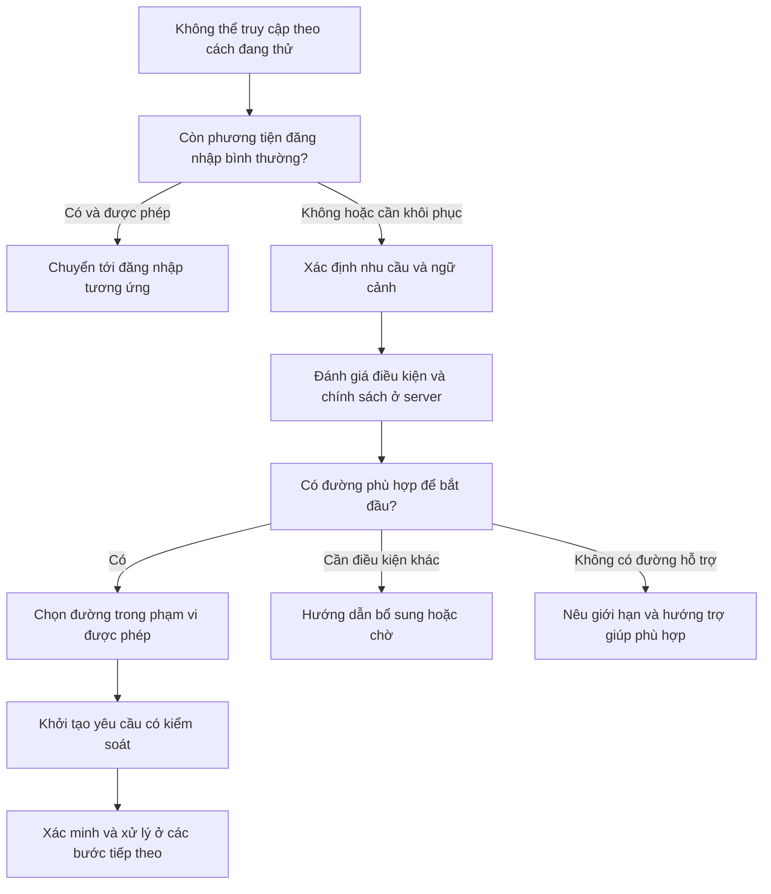

# Tìm đường khôi phục tài khoản phù hợp

## 1. Recovery discovery giải quyết câu hỏi nào?

**Tìm đường khôi phục — finding a recovery route — là quá trình xác định quy trình được phép giúp người dùng lấy lại quyền kiểm soát tài khoản, dựa trên điều họ đã mất, bằng chứng còn sử dụng được và chính sách hiện hành.** Kết quả của bước này là một hướng xử lý có thể tiếp tục, không phải kết luận người yêu cầu đã là chủ tài khoản.

Trong module `SECURITY_AUTHENTICATION_ACCOUNT_RECOVERY`, sự cố có thể là mất mật khẩu, MFA, passkey hoặc thiết bị xác thực. Các sự cố này không nên bị đưa vào cùng một biểu mẫu “quên mật khẩu” rồi xử lý giống nhau.

Ví dụ, người quên mật khẩu nhưng vẫn đăng nhập được bằng passkey có thể sử dụng một cách đăng nhập bình thường. Người mất điện thoại chứa cả MFA lẫn email cần một đường khác; gửi mã tới chính điện thoại đã mất không giải quyết được vấn đề.

Bước khám phá cần làm rõ ba câu hỏi:

1. Người dùng đang cố lấy lại khả năng nào?
2. Họ còn có thể cung cấp loại bằng chứng nào được chấp nhận?
3. Tài khoản và thao tác có được phép sử dụng đường đó hay không?

Một hệ thống có thể trả kết quả: tiếp tục bằng một phương tiện khác, bắt đầu luồng khôi phục cụ thể, chuyển tới đơn vị quản lý danh tính, yêu cầu thêm điều kiện hoặc chưa có đường phù hợp. Không được hứa rằng mọi tài khoản đều luôn có một cách lấy lại quyền truy cập.

## 2. Phân biệt đường khôi phục với kênh nhận mã

### 2.1. Một đường gồm nhiều quyết định

“Gửi SMS” chỉ mô tả một kênh chuyển thông tin. Một đường khôi phục đầy đủ còn cần:

| Thành phần | Câu hỏi phải trả lời |
| --- | --- |
| Mục đích | Đặt lại mật khẩu, thay MFA, đăng ký passkey mới hay xử lý thiết bị bị mất? |
| Chủ thể | Đúng tài khoản, tenant và loại tài khoản nào? |
| Điều kiện sử dụng | Trạng thái tài khoản và chính sách có cho phép đường này không? |
| Bằng chứng | Cần chứng minh điều gì và bằng phương tiện nào? |
| Kênh | Thông tin được trao đổi qua kênh đã được tin cậy nào? |
| Các bước bắt buộc | Có cần bằng chứng bổ sung, chờ hoặc phê duyệt không? |
| Quyền sau xác minh | Chỉ thiết lập một phương tiện hay có thể nhận session? |
| Kết quả không thành công | Tiếp tục thế nào nếu không còn dùng được hoặc không đủ bằng chứng? |

Nếu chỉ thiết kế một danh sách “email, SMS, hỗ trợ”, người dùng có thể hiểu chúng là các lựa chọn tương đương. Thực tế, mỗi lựa chọn có thể cho mức bằng chứng khác nhau và chỉ phù hợp với một số mục đích.

### 2.2. Chọn được một đường chưa chứng minh quyền sở hữu

Các hành động sau không phải bằng chứng xác minh:

- Nhập một email trông hợp lệ.
- Bấm “Tôi mất điện thoại”.
- Chọn “Tôi có mã dự phòng”.
- Biết tài khoản dùng một loại MFA.
- Nhận được một mã định danh phiên khám phá.
- Tìm thấy đường dẫn tới trang khôi phục.

Những thông tin này có thể giúp phân loại nhu cầu. Backend vẫn phải xác nhận điều kiện và kiểm tra bằng chứng ở các bước sau.

Một route ID không nên đồng thời là quyền thay phương tiện. Tác nhân có thể biết hoặc đoán tên đường; việc biết tên không được làm giảm yêu cầu xác minh.

## 3. Kiểm kê điều đã mất và điều còn dùng được

### 3.1. Hỏi theo khả năng thực hiện

Người dùng thường mô tả sự cố bằng thiết bị: “Tôi đổi điện thoại” hoặc “Máy tính của tôi hỏng”. Hệ thống cần chuyển mô tả đó thành khả năng còn lại, mà không vội giả định mọi phương tiện đã mất.

Các câu hỏi định hướng có thể là:

- Bạn còn đăng nhập được trên thiết bị nào không?
- Bạn có thể dùng một phương tiện đăng nhập khác đã đăng ký không?
- Bạn còn mã dự phòng đã lưu trước đây không?
- Bạn còn truy cập được kênh liên hệ khôi phục đã đăng ký không?
- Tài khoản do bạn tự quản lý hay do một tổ chức quản lý?

Không nên yêu cầu nhập mã dự phòng, seed MFA, khóa riêng hoặc mật khẩu ngay trong một bảng khảo sát chỉ để liệt kê các đường có thể có. Khi cần nộp bí mật làm bằng chứng, phải chuyển sang bước chuyên dụng có giới hạn thử, bảo vệ dữ liệu và ràng buộc đúng yêu cầu.

### 3.2. Mất thiết bị không luôn bằng mất phương tiện

| Sự cố người dùng mô tả | Điều cần làm rõ | Hướng có thể phù hợp |
| --- | --- | --- |
| Quên mật khẩu | Còn passkey hoặc cách đăng nhập khác không? | Đăng nhập bằng phương tiện còn hoạt động nếu được phép |
| Mất điện thoại có MFA | Còn phương tiện khác, mã dự phòng hay session phù hợp không? | Chọn đường được chính sách cho phép cho mất MFA |
| Mất thiết bị có passkey | Có thể sử dụng passkey trên thiết bị khác hoặc một đăng ký khác không? | Thử phương tiện còn dùng được trước khi thay thế |
| Không vào được email khôi phục | Còn kênh hoặc bằng chứng nào đã đăng ký và được phép không? | Đường thay thế có kiểm soát, nếu sản phẩm hỗ trợ |
| Mất toàn bộ phương tiện đã biết | Có quy trình chứng minh khác phù hợp không? | Xử lý chuyên biệt hoặc thông báo chưa có đường hỗ trợ |

Không mặc định passkey luôn được đồng bộ hoặc luôn gắn với một thiết bị duy nhất. Cần hỏi khả năng sử dụng thực tế và dựa vào phương tiện mà dịch vụ chấp nhận, thay vì suy đoán cách người dùng quản lý khóa.

Một session còn mở cũng không mặc nhiên đủ quyền thay phương tiện nhạy cảm. Có thể nó chỉ cho xem hướng dẫn, hoặc vẫn phải xác thực bổ sung trước khi thay đổi.

### 3.3. Xét sự phụ thuộc giữa các bằng chứng

Email trên điện thoại và ứng dụng MFA trên cùng điện thoại có thể mất cùng lúc. Hai nút “email” và “MFA” không bảo đảm người dùng còn hai đường độc lập.

Tương tự, một thiết bị đang bị nghi chiếm quyền có thể ảnh hưởng cả session, email và phương tiện xác thực được lưu trên thiết bị đó. Khi chọn đường cần đánh giá mối liên hệ, độ tin cậy và điều kiện hiện hành; không chỉ đếm số checkbox người dùng đánh dấu.

Lời khai của người dùng giúp điều hướng nhưng không tự xác nhận các kênh ấy đã đăng ký, còn hiệu lực hoặc đang được kiểm soát an toàn.

## 4. Xác định tài khoản mà không biến discovery thành công cụ dò tìm

### 4.1. Phân biệt tìm đúng tài khoản và tiết lộ tài khoản tồn tại

Hệ thống có thể cần email, tên đăng nhập hoặc ngữ cảnh tổ chức để tra cứu nội bộ. Nhưng người nhập những thông tin đó chưa có quyền biết toàn bộ kết quả.

Các phản hồi sau có thể làm lộ dữ liệu nếu trả cho bất kỳ ai:

- “Email này đã có tài khoản.”
- “Tài khoản này có passkey và một số điện thoại kết thúc bằng 27.”
- “Người này thuộc tổ chức X.”
- “Tài khoản đang bị đình chỉ.”
- “Không có tài khoản, bạn có thể đăng ký ngay bằng email này.”

Cần chọn thông tin được công khai và mức bằng chứng cần có trước khi tiết lộ thông tin riêng của tài khoản. Độ hữu ích của gợi ý không tự làm mất rủi ro dò tìm.

### 4.2. Danh sách khả năng chung và lựa chọn của tài khoản là hai lớp

Trước khi có ngữ cảnh xác minh, giao diện có thể trình bày những đường sản phẩm hỗ trợ nói chung:

```text
Bạn có thể thử:
- Một phương tiện đăng nhập khác.
- Mã dự phòng, nếu bạn đã thiết lập và còn giữ.
- Kênh khôi phục đã đăng ký.
- Quy trình của tổ chức, nếu tài khoản do tổ chức quản lý.
```

Danh sách này không khẳng định một tài khoản cụ thể đã thiết lập tất cả lựa chọn.

Sau khi có ngữ cảnh phù hợp, hệ thống có thể hiển thị các lựa chọn cá nhân hóa trong phạm vi được phép. Ngay cả địa chỉ hoặc số điện thoại đã che một phần vẫn là thông tin về tài khoản; không coi việc che bớt là đủ để trả cho người chưa được xác minh.

### 4.3. Chuẩn hóa và ánh xạ định danh ở server

Thông tin nhập có thể có lỗi chính tả, khác cách viết hoặc liên quan nhiều tenant. Quy tắc chuẩn hóa và tra cứu phải theo mô hình định danh của dịch vụ. Không tự gộp những địa chỉ hay tài khoản khác nhau chỉ để “giúp tìm đúng”.

Sau khi xác định chủ thể, request nên gắn với ID nội bộ thích hợp. Không tiếp tục dùng chuỗi email như một khóa duy nhất cho mọi bước nếu email có thể đổi hoặc được tái sử dụng.

Nếu người dùng không nhớ định danh, cần một luồng hỗ trợ riêng phù hợp. Không cung cấp API tìm người bằng một phần tên hoặc vài chữ số điện thoại rồi trả toàn bộ các tài khoản khớp cho người ẩn danh.

## 5. Chọn đường ở backend theo chính sách

### 5.1. Lọc theo điều kiện trước khi khởi tạo

Một đường chỉ nên được khởi tạo khi thỏa những điều kiện liên quan:

1. Mục đích được sản phẩm hỗ trợ.
2. Tài khoản thuộc phạm vi của đường đó.
3. Vòng đời và hạn chế hiện tại không cấm thao tác.
4. Phương tiện hoặc kênh cần thiết đã được đăng ký và còn được chấp nhận.
5. Bằng chứng có thể đạt mức yêu cầu của mục đích.
6. Các giới hạn chống lạm dụng cho phép tiếp tục.
7. Backend có dữ liệu có thẩm quyền đủ để đưa ra quyết định.

Danh sách này không yêu cầu xác minh đầy đủ ngay tại discovery. Nó phân biệt “đường có thể bắt đầu” với “đường đã hoàn tất xác minh”.

Nếu tài khoản đã xóa hoặc bị một quyết định ngăn khôi phục, discovery không nên tự chọn một đường khác để né điều kiện đó. Nếu chưa đọc được trạng thái có thẩm quyền, không coi đó là lý do mở một đường yếu hơn.

### 5.2. Đường nhanh nhất chưa chắc phù hợp nhất

Có thể ưu tiên một phương tiện còn dùng được hoặc một đường ít gây gián đoạn khi nó vẫn đáp ứng chính sách. Tuy nhiên, không nên xếp đường chỉ theo số màn hình hay thời gian hoàn tất.

Ví dụ, email có thể thuận tiện nhưng không đủ bằng chứng để thay MFA cho một nhóm tài khoản đặc quyền. Tăng ưu tiên email vì dễ dùng không sửa được thiếu hụt này.

Hệ thống nên giải thích bước tiếp theo bằng ngôn ngữ người dùng hiểu được, trong phạm vi được phép. Không cần hiển thị toàn bộ điểm số rủi ro hay các ngưỡng chống gian lận để đưa ra một hướng dẫn hữu ích.

### 5.3. Tài khoản tổ chức và danh tính liên kết

Một tài khoản đăng nhập qua nhà cung cấp danh tính do tổ chức quản lý có thể cần khôi phục ở nhà cung cấp hoặc qua quản trị tổ chức. Ứng dụng không nên tự tạo mật khẩu cục bộ chỉ để có một đường dễ hơn.

Đích chuyển tiếp cần lấy từ cấu hình đáng tin cậy cho đúng tenant hoặc phạm vi đã xác định. Không cho client đưa một URL tùy ý để biến nút “Khôi phục qua tổ chức” thành đường dẫn phishing.

Một tài khoản có liên kết ngoài vẫn có thể có đường cục bộ được phép nếu sản phẩm đã thiết kế như vậy. Cần dựa vào cấu hình thực, không suy một quy tắc chung từ việc tài khoản có liên kết.

## 6. Biểu diễn kết quả khám phá và ranh giới cấp quyền

### 6.1. Luồng khái niệm



Các chi tiết trong sơ đồ không nhất thiết đều được tiết lộ cho client. Server có thể đánh giá nội bộ rồi trả thông điệp trung tính nếu người gọi chưa có quyền biết trạng thái tài khoản.

### 6.2. Ngữ cảnh khám phá không phải token khôi phục

Một ngữ cảnh phía server có thể chứa:

```text
discovery_context_id
account_id_noi_bo_neu_da_xac_dinh
recovery_purpose
policy_reference
permitted_route_references
disclosure_level
created_at
expires_at
abuse_budget_reference
```

Các trường là minh họa khái niệm. Không bắt buộc gửi chúng cho client hoặc triển khai thành đúng một bản ghi.

Nếu trả một handle ra ngoài, cần xác định nó có quyền gì. Handle có thể chỉ cho tiếp tục phiên khám phá, không cho đọc hồ sơ hay thay phương tiện. Nếu nó cho xem thông tin nhạy cảm, phải coi nó là một khả năng truy cập có phạm vi và bảo vệ tương ứng.

Backend phải kiểm tra lại route được yêu cầu có thuộc ngữ cảnh, đúng mục đích và còn được phép hay không. Không tin một `route_id` chỉ vì nó từng xuất hiện trên giao diện.

### 6.3. Khám phá, khởi tạo và xác minh là các hành động riêng

Xem hướng dẫn không nên tự phát hành hàng loạt OTP. Một lần tải trang hoặc công cụ xem trước liên kết không nên làm thay đổi phương tiện, tiêu thụ mã dự phòng hay hủy request đang chạy.

Khi người dùng chủ động khởi tạo một đường, hành động có hiệu ứng như gửi mã cần được kiểm soát riêng: giới hạn phát hành, ràng buộc với ngữ cảnh, phản hồi phù hợp và xử lý lặp. Bước xác minh sau đó mới kiểm tra bằng chứng theo chính sách.

## 7. Thiết kế giao diện giúp người dùng chọn đúng đường

### 7.1. Bắt đầu bằng mục tiêu dễ hiểu

Các lựa chọn có thể được diễn đạt theo vấn đề:

- “Tôi quên mật khẩu.”
- “Tôi không dùng được phương tiện MFA.”
- “Tôi mất thiết bị có passkey.”
- “Tôi không còn truy cập được kênh khôi phục.”
- “Tài khoản của tôi do tổ chức quản lý.”

Đây là cách mô tả nhu cầu, không phải xác nhận sự thật bảo mật. Nếu người dùng chọn nhầm, nên có cách quay lại hoặc đổi lựa chọn mà không tạo hàng loạt request mới.

Không yêu cầu người dùng biết thuật ngữ như “assurance level” hay loại token đang dùng để tìm được trợ giúp. Có thể dùng giải thích ngắn và ví dụ, nhưng không thu thập thêm dữ liệu cá nhân chỉ vì một câu hỏi định hướng chưa rõ.

### 7.2. Nêu điều cần có trước khi bắt đầu

Trong ngữ cảnh được phép, một đường nên cho người dùng biết:

- Loại phương tiện hoặc bằng chứng cần sử dụng.
- Các bước chính và việc có thể phải chờ.
- Kết quả được phép đạt, chẳng hạn thiết lập lại MFA.
- Cách quay lại nếu không thực hiện được.
- Những điều hệ thống không yêu cầu cung cấp cho người hỗ trợ.

Không nên bắt người dùng đi qua nhiều màn hình rồi mới tiết lộ rằng đường đó cần đúng thiết bị họ vừa báo đã mất.

Một lời hướng dẫn chung có thể là:

> Nếu bạn còn một phương tiện đăng nhập đã đăng ký, hãy thử phương tiện đó trước. Nếu không, chọn một cách khôi phục mà bạn còn có thể sử dụng. Việc chọn cách khôi phục chưa xác nhận quyền truy cập tài khoản.

Câu cuối phù hợp trong bài học hoặc giải thích chi tiết; giao diện thực có thể dùng cách diễn đạt ngắn hơn miễn không tạo hiểu lầm về quyền.

### 7.3. “Không dùng được cách này” phải có ý nghĩa cụ thể

Nút này có thể đưa về danh sách hướng dẫn chung, yêu cầu một bằng chứng khác được phép hoặc chuyển sang quy trình hỗ trợ. Nó không nên tự:

- Bỏ qua một bằng chứng bắt buộc.
- Gửi OTP tới email mới do người yêu cầu nhập.
- Đánh dấu một kênh cũ đã bị mất hoặc thu hồi chỉ từ lời khai.
- Tạo quyền thay MFA vì người dùng đã thử hết lựa chọn.
- Chuyển mọi tài khoản sang hỗ trợ có quyền bỏ qua chính sách.

Cần phân biệt không dùng được với không muốn dùng. Một tác nhân có thể cố bấm qua mọi lựa chọn mạnh để tìm đường yếu nhất.

### 7.4. Giữ khả năng tiếp cận

Các bước cần có nhãn rõ, thứ tự đọc hợp lý và thao tác bằng bàn phím. Không dùng màu hoặc biểu tượng làm cách duy nhất giải thích một đường đang chờ hoặc không thể dùng.

Nếu người dùng phải chuyển sang thiết bị khác, cần giải thích điều kiện tiếp tục và thời hạn. Không tự bỏ ràng buộc phiên vì họ chuyển thiết bị. Nếu sản phẩm có cơ chế chuyển tiếp, cơ chế đó phải duy trì tài khoản, mục đích và mức quyền tương ứng.

## 8. Chống lạm dụng ngay từ bước khám phá

### 8.1. Discovery có thể trở thành nguồn gửi mã hàng loạt

Một bot có thể nhập nhiều địa chỉ, chọn lại đường và yêu cầu gửi liên tục. Hậu quả có thể là quấy rối, tốn chi phí, làm cạn tài nguyên hoặc tạo dữ liệu để suy ra tài khoản tồn tại.

Cần kiểm soát cả việc tạo ngữ cảnh, chọn đường và phát hành bằng chứng:

| Điểm kiểm soát | Điều cần ngăn |
| --- | --- |
| Tiếp nhận yêu cầu công khai | Dò hàng loạt, gây tải và thu thập trạng thái |
| Tạo hoặc làm mới ngữ cảnh | Nhận lại ngân sách bằng cách xóa cookie hoặc tạo request mới |
| Khởi tạo một đường | Gửi mã nhiều lần, giữ nhiều challenge còn hiệu lực ngoài chủ đích |
| Đổi đường | Cộng dồn quá nhiều lượt thử qua các kênh và endpoint |
| Truy vấn trạng thái | Biến handle hoặc mã lý do thành công cụ dò tài khoản |
| Chuyển hỗ trợ | Tạo lượng lớn hồ sơ hoặc gây áp lực bỏ qua xác minh |

Có thể kết hợp giới hạn theo nguồn gửi, tài khoản nội bộ khi đã xác định, đích nhận, mục đích và toàn dịch vụ. Chỉ đếm theo IP không đủ nếu tác nhân có nhiều nguồn; chỉ đếm theo tài khoản có thể bị dùng để làm gián đoạn nạn nhân.

### 8.2. Đích gửi phải do server xác định

Người yêu cầu có thể nhập email để tìm tài khoản, nhưng không có nghĩa mọi địa chỉ họ nhập đều là đích nhận bằng chứng hợp lệ.

Khi đường yêu cầu gửi tới kênh đã đăng ký, backend phải lấy đúng kênh còn được phép từ nguồn có thẩm quyền. Không nhận `destination` mới từ client rồi gửi một token có thể khôi phục tài khoản cũ tới đó.

Nếu mục tiêu là thay kênh liên hệ, đó là một thao tác riêng với bằng chứng và quyền tương ứng. Không ngụy trang nó thành một bước tiện ích của discovery.

### 8.3. Phản hồi và hiệu ứng ngoài cũng có thể tiết lộ

Một câu trả lời chung trên màn hình chưa đủ nếu:

- Tài khoản thật nhận HTTP khác tài khoản không có.
- Danh sách route chỉ xuất hiện cho email tồn tại.
- Hạn chế thử có hành vi khác biệt ổn định.
- Endpoint trạng thái trả chi tiết dù endpoint tiếp nhận đã che.
- Hệ thống cho người gọi chọn một đích nhận mới rồi phản hồi khác theo kết quả tra cứu.

Cần xem toàn bộ luồng và các kênh quan sát, không chỉ câu chữ ở trang đầu. Có thể dùng xử lý bất đồng bộ và các thiết kế khác để giảm khác biệt không cần thiết, nhưng không dựa vào việc thêm một độ trễ cố định như bảo đảm duy nhất.

Không phát hành token thật cho tài khoản không tồn tại chỉ để làm phản hồi giống nhau. Phản hồi công khai có thể thống nhất trong khi xử lý nội bộ khác nhau và vẫn giữ đúng điều kiện cấp quyền.

### 8.4. Tín hiệu chống bot không thay thế bằng chứng

CAPTCHA, cookie hoặc tín hiệu thiết bị có thể hỗ trợ quản lý rủi ro và chi phí. Chúng không chứng minh quyền sở hữu tài khoản.

Ngược lại, một thiết bị mới không tự đủ để kết luận người dùng không hợp lệ, vì họ có thể đang khôi phục sau khi mất thiết bị cũ. Chính sách cần xác định cách bổ sung bằng chứng, trì hoãn hay chuyển quy trình mà không mở một đường bỏ qua xác minh.

## 9. Đổi đường mà không làm giảm yêu cầu bảo mật

### 9.1. Đường mới phải được đánh giá lại

Nếu một đường thất bại, có thể xem xét đường khác đã được phép. Trước khi khởi tạo, cần xác nhận lại:

1. Tài khoản và mục đích vẫn là những đối tượng đã xác định.
2. Đường thay thế còn được phép theo chính sách và trạng thái hiện hành.
3. Bằng chứng cần thiết không bị thay bằng một lời khai thuận tiện hơn.
4. Các token và request trước được xử lý theo quy tắc rõ ràng.
5. Lịch sử chống lạm dụng có liên quan vẫn được giữ.
6. Thông tin hiển thị vẫn nằm trong quyền được biết.

Không tự cộng các mảnh bằng chứng yếu thành mức xác minh đủ chỉ vì người dùng đã đi qua nhiều màn hình.

### 9.2. Tránh vòng lặp và phát hành trùng

Ví dụ một vòng lặp kém hữu ích:

```text
Mất điện thoại
    -> gửi SMS tới điện thoại đã mất
    -> không nhận được mã
    -> quay lại bước đầu
    -> gửi SMS lần nữa
```

Giao diện cần nhận biết nhu cầu đã khai báo để không lặp cùng hướng dẫn vô ích. Tuy nhiên, thông tin đó chỉ phục vụ điều hướng; không tự thu hồi số điện thoại hoặc thay kênh trên tài khoản.

Nếu một đường đã có request còn hiệu lực, việc quay lại trang lựa chọn không nên vô tình phát hành thêm một request độc lập. Có thể tiếp tục request phù hợp hoặc tạo mới theo quy tắc, nhưng phải rõ ảnh hưởng tới mã cũ, thời hạn và ngân sách.

### 9.3. Trạng thái có thể thay đổi sau discovery

Một đường đã được liệt kê trước đó không phải cam kết sẽ luôn dùng được. Trong lúc người dùng đọc hướng dẫn, tài khoản có thể bị hạn chế, kênh bị thu hồi hoặc chính sách thay đổi.

Vì vậy, khởi tạo và các điểm cấp quyền sau cần kiểm tra điều kiện hiện hành. Nếu không còn được phép, hướng dẫn tiếp theo phải phản ánh quyết định mới trong phạm vi được tiết lộ; không tiếp tục chỉ để giữ nguyên trải nghiệm.

## 10. Các tình huống tìm đường khôi phục

### 10.1. Quên mật khẩu nhưng còn passkey

Lan quên mật khẩu nhưng vẫn dùng được một passkey đã đăng ký. Nếu tài khoản và ứng dụng cho phép đăng nhập bằng passkey đó, hướng phù hợp có thể là đi qua đăng nhập bình thường.

Sau khi đăng nhập, việc đổi hoặc thêm mật khẩu vẫn phải theo chính sách của thao tác nhạy cảm. Thành công ở bước tìm đường không đồng nghĩa được bỏ xác thực bổ sung.

Điểm học ở đây là không phải mọi sự cố được gọi là “mất mật khẩu” đều cần một luồng khôi phục ngoài đăng nhập. Dùng phương tiện còn hiệu lực có thể giải quyết việc truy cập mà không tạo thêm quyền khôi phục.

### 10.2. Mất điện thoại nhưng còn mã dự phòng độc lập

Minh mất điện thoại có ứng dụng MFA. Minh còn mã dự phòng đã lưu riêng trước đó. Nếu chính sách chấp nhận mã này cho mục đích tương ứng, discovery có thể đưa Minh tới bước kiểm tra mã dự phòng chuyên dụng.

Minh chưa được xác minh chỉ vì chọn “Tôi còn mã”. Bước tiếp theo phải kiểm tra mã đúng tài khoản, còn hiệu lực, chưa dùng, nằm trong ngân sách thử và đủ cho quyền đang yêu cầu.

Nếu mã được chấp nhận, phạm vi tiếp tục phụ thuộc chính sách: có thể là một bước đăng nhập hoặc một quyền hẹp để thiết lập phương tiện mới. Không mặc định mọi mã dự phòng đều cho cùng quyền trong mọi sản phẩm.

### 10.3. Tài khoản do tổ chức quản lý

Phương dùng tài khoản công việc với danh tính do tổ chức quản lý. Ứng dụng không cung cấp một đường đặt mật khẩu cục bộ cho loại tài khoản này.

Discovery hướng Phương tới quy trình của tổ chức trong ngữ cảnh phù hợp, thay vì tạo một cách đăng nhập mới. Nếu tổ chức đã vô hiệu hóa tài khoản, việc còn kiểm soát email không tự cho phép bỏ quyết định đó.

Một đích chuyển tiếp hợp lệ và một hướng dẫn rõ ràng giúp người dùng tìm đúng nơi chịu trách nhiệm, nhưng không tự chứng minh họ đủ điều kiện được tổ chức khôi phục.

### 10.4. Không còn mọi phương tiện thông thường

Huy không còn mật khẩu, thiết bị MFA, passkey hay kênh khôi phục sử dụng được. Sản phẩm cần xem có một quy trình chứng minh khác được thiết kế cho loại tài khoản đó hay không.

Một quy trình thủ công, nếu có, phải xác lập liên hệ đáng tin cậy giữa người yêu cầu và đúng tài khoản. Biết tên, ảnh đại diện hoặc thông tin công khai không tự đủ. Việc gửi một giấy tờ bất kỳ cũng không tự chứng minh quyền với một tài khoản, nhất là khi dịch vụ chưa từng gắn tài khoản với danh tính đó.

Nếu không có bằng chứng được chấp nhận hoặc không có quy trình hỗ trợ, cần nói rõ giới hạn trong ngữ cảnh được phép. Không tự đổi sang câu hỏi dễ đoán hay yêu cầu người dùng nhập một email mới để nhận quyền.

## 11. Khi chưa tìm được đường phù hợp

Cần phân loại nội bộ trước khi chọn thông điệp:

| Nguyên nhân | Ý nghĩa | Hướng xử lý có thể phù hợp |
| --- | --- | --- |
| Chưa đủ ngữ cảnh | Chưa biết mục đích hoặc chưa xác định chủ thể phù hợp | Hỏi thông tin định hướng tối thiểu |
| Không còn phương tiện đã chọn | Đường hiện tại không thực hiện được | Xem đường thay thế được phép |
| Có hạn chế tạm thời | Chưa được khởi tạo lúc này | Nêu điều kiện chờ trong phạm vi được phép |
| Tài khoản hoặc thao tác không đủ điều kiện | Chính sách ngăn đường đang yêu cầu | Không né bằng đường khác ngoài thẩm quyền |
| Dữ liệu có thẩm quyền chưa đọc được | Chưa xác định được đường hợp lệ | Xử lý lỗi, đánh giá lại, không hạ yêu cầu |
| Không có đường được hỗ trợ | Sản phẩm chưa có quy trình phù hợp | Nêu giới hạn và hướng trợ giúp thực sự tồn tại |

Không gộp lỗi dịch vụ thành “Bạn không có quyền khôi phục” hoặc nói “Không có tài khoản” khi chỉ chưa xác định được. Đồng thời, không hứa hỗ trợ chắc chắn lấy lại tài khoản nếu quy trình không có khả năng chứng minh quyền.

Nếu tạo tài khoản mới là một lựa chọn được phép, cần tách quan hệ tài khoản mới với tài khoản cũ. Đăng ký lại không được tự kế thừa dữ liệu, vai trò hay token của tài khoản cũ chỉ vì dùng cùng thông tin liên hệ.

## 12. Quan sát kết quả khám phá và điều kiện bàn giao

### 12.1. Theo dõi việc tìm đường riêng với việc khôi phục thành công

Những sự kiện khác nhau có thể gồm:

- Mở hướng dẫn.
- Chọn vấn đề đang gặp.
- Chọn hoặc đổi đường.
- Khởi tạo đường được phép.
- Không tìm được đường phù hợp.
- Bắt đầu và hoàn tất xác minh.
- Hoàn tất thay phương tiện hoặc đăng nhập.

Tỷ lệ chọn được một đường không phải tỷ lệ khôi phục thành công. Một đường có thể được chọn nhiều nhưng thường dừng vì yêu cầu đúng phương tiện đã mất; đó là dấu hiệu cần xem lại điều hướng hoặc khả năng hỗ trợ.

Theo dõi thêm vòng lặp, số lần đổi đường, thời gian tới bước có ích, lý do không tiếp tục và lưu lượng phát hành mã. Phân tích cần bảo vệ dữ liệu tài khoản, không ghi OTP, token, mã dự phòng hay các định danh không cần thiết.

### 12.2. Bàn giao sang bước tiếp theo với ràng buộc rõ

Khi discovery kết thúc bằng việc khởi tạo một đường, bước tiếp theo cần nhận được ngữ cảnh có thẩm quyền về tài khoản, mục đích, đường đã chọn, chính sách, thời hạn và ngân sách liên quan. Không nhận một cờ `discovery_passed=true` như bằng chứng cho phép khôi phục.

Các thuộc tính cần giữ trong đặc tả gồm:

| Tình huống | Thuộc tính cần bảo đảm |
| --- | --- |
| Còn phương tiện đăng nhập hợp lệ | Có thể được hướng tới đăng nhập mà không mở quyền khôi phục không cần thiết |
| Người chỉ biết email chọn một đường | Chưa được cấp quyền hoặc tiết lộ phương tiện riêng ngoài phạm vi được biết |
| Client sửa route ID hoặc mục đích | Backend kiểm tra phạm vi và điều kiện hiện hành |
| Người yêu cầu nhập email mới để nhận mã | Không dùng làm đích khôi phục cho tài khoản cũ khi chưa có thẩm quyền |
| Đổi đường hoặc tạo lại ngữ cảnh | Không đặt lại vô hạn ngân sách hoặc hạ yêu cầu bằng chứng |
| Tải trang hay mở liên kết xem trước | Không tự thay phương tiện, tiêu thụ bí mật hoặc gửi mã ngoài ý định được kiểm soát |
| Cấu hình tổ chức chi phối tài khoản | Định tuyến đúng nguồn có thẩm quyền, không tạo đường cục bộ ngoài chính sách |
| Chính sách hoặc trạng thái đổi sau khi liệt kê đường | Đánh giá lại trước khi phát hành và cấp quyền |
| Không có dữ liệu đủ để chọn đường | Không coi lỗi là bằng chứng cho phép dùng một đường yếu hơn |
| Không còn đường phù hợp | Nêu giới hạn thật và không hứa khôi phục vô điều kiện |

Tìm được đường khôi phục có nghĩa người dùng đã được dẫn tới một quy trình phù hợp để tiếp tục chứng minh quyền. Việc xác minh danh tính, cấp quyền hẹp, thay phương tiện và kiểm soát session vẫn phải được thực hiện theo các điều kiện của chính quy trình đó.
