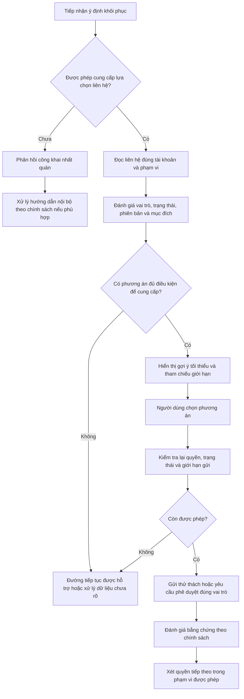

# Khám phá các liên hệ khôi phục tài khoản

## 1. “Khám phá liên hệ khôi phục” có nghĩa gì?

**Khám phá liên hệ khôi phục — discovering recovery contacts — là bước hệ thống xác định những kênh hoặc chủ thể liên hệ đã được thiết lập cho một tài khoản, đánh giá phương án nào còn đủ điều kiện sử dụng và quyết định thông tin nào được phép cung cấp trong ngữ cảnh khôi phục hiện tại.**

Trong chương Recovery Discovery của module `SECURITY_AUTHENTICATION_ACCOUNT_RECOVERY`, bước này hỗ trợ người dùng khi mất mật khẩu, MFA, passkey hoặc thiết bị xác thực. Nó giúp trả lời câu hỏi “còn phương án liên hệ nào có thể dùng?” trước khi thực hiện các bước xác minh hoặc phê duyệt tiếp theo.

Khám phá không có nghĩa được phép dùng ngay. Một địa chỉ đã lưu có thể chưa xác minh, vừa bị thay đổi, đã thu hồi hoặc không được phép hỗ trợ loại khôi phục đang yêu cầu.

Cũng cần phân biệt với việc tìm kiếm thông tin liên hệ ngoài hệ thống. Địa chỉ lấy từ mạng xã hội, danh bạ thiết bị hoặc một lời khai mới không tự trở thành liên hệ khôi phục đáng tin cậy. Việc khám phá phải dựa trên nguồn dữ liệu và quan hệ đã được chính sách công nhận.

Ví dụ, người dùng mất điện thoại MFA nhưng còn một email dự phòng đã đăng ký. Hệ thống có thể xác định email đó là một ứng viên. Từ đây vẫn cần xét email có đủ điều kiện cho mục đích hiện tại, ai được phép biết gợi ý địa chỉ và bằng chứng nhận qua email cho phép làm đến bước nào.

**Biết một liên hệ tồn tại, thấy gợi ý liên hệ và chứng minh quyền khôi phục là ba việc khác nhau.**

## 2. Phân biệt các vai trò của liên hệ

Thuật ngữ “recovery contact” có thể chỉ một địa chỉ nhận thông điệp hoặc một người được chỉ định hỗ trợ. Tài liệu thiết kế cần nói rõ nghĩa đang dùng.

| Vai trò | Có thể làm gì theo chính sách? | Không được mặc định có quyền gì? |
| --- | --- | --- |
| Kênh nhận bằng chứng khôi phục | Nhận mã, liên kết hoặc thử thách dành cho mục đích cụ thể | Cho phép mọi thay đổi bảo mật chỉ vì nhận được thông điệp |
| Người liên hệ được ủy quyền | Xác nhận hoặc phê duyệt một phần yêu cầu trong phạm vi đã được thiết lập | Đọc mật khẩu, bí mật MFA hoặc tự chọn passkey mới thay chủ tài khoản |
| Người hoặc kênh nhận thông báo an ninh | Nhận biết một thay đổi để hỗ trợ phát hiện gian lận | Cấp quyền khôi phục chỉ bằng việc không phản đối |
| Đầu mối hỗ trợ | Tiếp nhận hồ sơ và hướng dẫn theo quy trình | Bỏ qua xác minh vì đã liên hệ được nhân viên |
| Địa chỉ liên lạc do người yêu cầu mới khai báo | Dùng để trao đổi nếu quy trình cho phép | Tự trở thành kênh đã xác minh của tài khoản cần khôi phục |

Một email có thể giữ nhiều vai trò nếu chính sách cho phép, nhưng các vai trò vẫn cần được ghi nhận riêng. Không nên coi mọi địa chỉ nhận thông báo giao dịch đều có quyền nhận token đặt lại mật khẩu.

Một người quản trị tổ chức cũng không tự là người khôi phục cho mọi tài khoản có liên quan. Cần xét quan hệ quản lý, phạm vi tổ chức, loại tài khoản và quyền được ủy quyền.

Nếu dùng người liên hệ được chỉ định, quan hệ đó phải được thiết lập và quản lý vòng đời theo chính sách. Tuyên bố “đây là bạn của tôi, hãy gửi quyền khôi phục cho họ” sau khi đã mất mọi phương tiện không tạo ra một quan hệ ủy quyền đáng tin cậy.

## 3. Ba câu hỏi độc lập: đã lưu, còn dùng được, được phép tiết lộ

### 3.1. Một liên hệ có được lưu cho đúng tài khoản không?

Hệ thống cần tra cứu bằng định danh tài khoản và phạm vi có thẩm quyền. Không tìm theo một chuỗi email rồi tự gom mọi tài khoản có vẻ liên quan.

Trong hệ thống nhiều tổ chức, cùng một người có thể có nhiều vai trò hoặc tài khoản. Một liên hệ thuộc tổ chức A không tự được dùng để khôi phục quyền quản trị ở tổ chức B.

Dữ liệu tra cứu cần phân biệt loại liên hệ, vai trò, trạng thái và nguồn thiết lập. Một trường chuỗi như `backup_contact` không đủ mô tả toàn bộ ý nghĩa bảo mật.

### 3.2. Liên hệ có đủ điều kiện cho yêu cầu hiện tại không?

Những thuộc tính có thể cần xét gồm:

| Thuộc tính | Câu hỏi cần trả lời |
| --- | --- |
| Nguồn thiết lập | Liên hệ được thêm trong một ngữ cảnh có thẩm quyền nào? |
| Trạng thái xác minh | Việc xác minh cần thiết đã hoàn tất chưa? |
| Vai trò | Được nhận bằng chứng, phê duyệt hay chỉ nhận thông báo? |
| Mục đích cho phép | Có được dùng cho loại khôi phục đang yêu cầu không? |
| Thời điểm thêm hoặc thay đổi | Có đang chịu giới hạn sau thay đổi không? |
| Thu hồi hoặc vô hiệu hóa | Quyền sử dụng liên hệ đã bị chấm dứt chưa? |
| Dấu hiệu rủi ro | Có thông tin bị chiếm, tái sử dụng hoặc thay đổi trái phép không? |
| Phạm vi | Liên hệ có thuộc đúng tài khoản, tổ chức và quan hệ ủy quyền không? |

`verified_at` ghi nhận một sự kiện trong quá khứ. Nó không chứng minh người nhận hiện tại vẫn là cùng một người hoặc kênh đó chưa bị chiếm.

Một liên hệ vừa được thêm nhưng chưa hoàn tất xác minh không nên được dùng để xác minh chính quyền thêm nó. Đây là một vòng tin cậy: người yêu cầu tự khai địa chỉ, nhận mã ở địa chỉ đó, rồi được coi là có quyền với tài khoản cũ.

### 3.3. Người truy cập có quyền biết thông tin nào?

Một liên hệ đủ điều kiện sử dụng chưa chắc được phép hiển thị công khai. Hệ thống có thể gửi hướng dẫn theo một quy tắc nội bộ mà không công bố danh sách kênh cho người nhập định danh.

Quyết định tiết lộ cần xét ngữ cảnh: người đang xem có phiên hợp lệ, có bằng chứng giới hạn hay chỉ biết email tài khoản? Quyền xem một gợi ý cũng không tự cho quyền xem địa chỉ đầy đủ.

Cần tách hai quyết định:

```text
contact_is_eligible_for_purpose
    khác với
contact_may_be_disclosed_to_current_viewer
```

Nếu gộp hai điều kiện, một phương án đủ điều kiện có thể bị lộ cho người ngoài, hoặc một phương án không được công khai có thể bị hiểu nhầm là không tồn tại.

## 4. Nguồn dữ liệu và vòng đời của liên hệ

### 4.1. Nguồn có thẩm quyền

Nguồn tra cứu có thể là kho phương án khôi phục, dữ liệu phương tiện của dịch vụ định danh hoặc quan hệ ủy quyền được quản lý riêng. Dù kiến trúc nào, cần có chủ thể chịu trách nhiệm về trạng thái và vòng đời.

Các thông tin tham khảo:

```text
contact_reference
target_account_reference
organization_scope
contact_kind
contact_role
allowed_purposes
establishment_reference
verification_status
verified_at
changed_at
revoked_at
contact_revision
```

Các trường chỉ minh họa. Địa chỉ đầy đủ có thể cần cho thành phần gửi, nhưng không cần xuất hiện trong mọi phản hồi API hoặc nhật ký của bước khám phá.

Việc chuẩn hóa địa chỉ giúp tra cứu và gửi đúng đích, nhưng không chứng minh quyền kiểm soát. Cần tuân theo quy tắc của hệ thống cho từng loại kênh; không tự biến đổi địa chỉ một cách có thể làm gộp hai đích khác nhau.

### 4.2. Các trạng thái cần phân biệt

| Trạng thái khái niệm | Cách sử dụng khi khám phá |
| --- | --- |
| Đã khai báo, chưa xác minh | Không tự đưa vào nhóm kênh tin cậy |
| Đang chờ hoàn tất thiết lập | Hướng dẫn theo quy trình thiết lập nếu người xem có quyền |
| Đã xác minh và đủ điều kiện | Là ứng viên cho mục đích được phép |
| Đang chịu giới hạn sau thay đổi | Chưa được coi như một kênh ổn định nếu chính sách yêu cầu chờ |
| Đã thu hồi | Không phát hành quyền mới thông qua liên hệ |
| Có dấu hiệu bị chiếm hoặc lỗi thời | Cần xử lý theo chính sách rủi ro, không chỉ dựa vào trạng thái xác minh cũ |
| Chưa xác định được dữ liệu | Không kết luận chắc chắn là không có phương án |

Khi một dịch vụ dữ liệu không phản hồi, không nên trả “tài khoản không có liên hệ khôi phục” rồi chuyển sang một nhánh bỏ qua xác minh. Không đọc được dữ liệu và không có dữ liệu hợp lệ là hai kết quả khác nhau.

### 4.3. Tính ổn định của kênh và chủ thể nhận

Số điện thoại có thể được chuyển cho người khác; hộp thư có thể bị chiếm hoặc không còn được chủ tài khoản sử dụng. Người liên hệ được ủy quyền có thể rời tổ chức, bị thu hồi quyền hoặc mất khả năng hỗ trợ.

Vì vậy, việc duy trì và cập nhật phương án khôi phục là một phần của vòng đời an toàn. Bước khám phá cần sử dụng trạng thái hiện tại được chính sách chấp nhận, không chỉ sao chép danh sách từ một bản cache cũ.

Tài khoản lâu năm cũng có thể có liên hệ mới thêm. Tuổi tài khoản không thay thế kiểm tra thời điểm và nguồn thay đổi của liên hệ.

## 5. Khám phá mà không tạo công cụ dò tài khoản

### 5.1. Mô hình khởi tạo công khai với phản hồi chung

Một thiết kế có thể tiếp nhận định danh, quyết định nội bộ có kênh phù hợp để gửi hướng dẫn hay không và trả phản hồi nhất quán:

> Nếu thông tin phù hợp với điều kiện khôi phục, hướng dẫn sẽ được gửi qua kênh được hỗ trợ.

Ở mô hình này, người nhập không nhận một danh sách địa chỉ. Được tiếp nhận không có nghĩa tài khoản tồn tại, thông báo đã đến hoặc người yêu cầu được phép thay đổi tài khoản.

Cần xét cả mã phản hồi, cấu trúc dữ liệu, thời gian và hành vi giới hạn tần suất. Một câu chung không che được trường `recovery_contacts_count` hoặc `has_backup_phone` mà API vẫn trả về.

### 5.2. Mô hình lựa chọn sau một ngữ cảnh giới hạn

Một thiết kế khác cho phép chọn trong các gợi ý sau khi người dùng đã thiết lập một ngữ cảnh được chính sách cho phép. Ngữ cảnh này có thể đến từ một phiên phù hợp hoặc một bước bằng chứng ban đầu được chấp nhận.

Không nhất thiết phải khôi phục xong mới được xem gợi ý. Tuy nhiên, ngưỡng để được xem gợi ý và ngưỡng để được thay phương tiện cần được định nghĩa riêng.

Chỉ biết định danh tài khoản hoặc một `flow_id` không tự tạo quyền xem. Nếu dùng một giá trị mang tính bí mật để chứng minh quyền giới hạn, phải thiết kế và quản lý nó như một quyền truy cập có phạm vi, thời hạn và điều kiện rõ ràng.

### 5.3. Che một phần không đồng nghĩa không còn rò rỉ

Gợi ý như `n***@h***.invalid` hoặc số điện thoại có vài chữ số cuối vẫn có thể giúp suy ra thông tin. Số lượng liên hệ, loại kênh và tên người được ủy quyền cũng có thể làm lộ quan hệ của người dùng.

Cần xác định mức hiển thị theo mục đích và ngữ cảnh. Không mặc định mọi danh sách đã che một phần đều an toàn để đưa ra trước xác minh.

Đặc biệt, không gửi địa chỉ đầy đủ xuống trình duyệt rồi chỉ dùng CSS hoặc JavaScript để che. Mức dữ liệu API cung cấp phải tương ứng với quyền của người xem.

### 5.4. Không thay đổi trạng thái tài khoản khi khám phá

Bước đọc hoặc chọn phương án không nên tự xóa MFA, thay email, thu hồi mọi session hoặc đăng ký passkey.

Một người ngoài có thể kích hoạt yêu cầu khám phá. Nếu việc đó tự làm phương tiện của chủ tài khoản ngừng hoạt động, chức năng đã trở thành đường gây gián đoạn.

Việc gửi một thử thách cũng là tác động cần kiểm soát riêng. Tải lại danh sách không nên tự động gửi thêm mã vào mọi liên hệ.

## 6. Chuyển một phương án hiển thị thành yêu cầu sử dụng

### 6.1. Trả về tham chiếu thay vì địa chỉ có thể sửa

Trong một ngữ cảnh được phép, phản hồi minh họa có thể là:

```json
{
  "view": "RECOVERY_CONTACT_OPTIONS",
  "options": [
    {
      "option_id": "opt-opaque-1",
      "kind": "REGISTERED_EMAIL",
      "display_hint": "n***@h***.invalid",
      "purpose": "RECOVERY_CHALLENGE"
    },
    {
      "option_id": "opt-opaque-2",
      "kind": "DELEGATED_APPROVER",
      "display_hint": "Người liên hệ đã được chỉ định",
      "purpose": "RECOVERY_REVIEW"
    }
  ]
}
```

Các giá trị chỉ minh họa, không phải dữ liệu thật. Hai loại phương án không mang cùng quyền: một kênh nhận thử thách khác với một người tham gia xét duyệt.

`option_id` cần được liên kết phía máy chủ với đúng tài khoản, ngữ cảnh, liên hệ, phiên bản, mục đích và thời hạn. Độ khó đoán của tham chiếu không thay thế kiểm tra quyền truy cập.

Khi chọn, client chỉ cần gửi tham chiếu trong ngữ cảnh được cấp:

```json
{
  "option_id": "opt-opaque-1"
}
```

Không dùng một trường như `destination_email` do client gửi để ghi đè địa chỉ mà phương án đại diện. Nếu cần cập nhật liên hệ, đó là một thao tác riêng với yêu cầu thẩm quyền riêng.

### 6.2. Kiểm tra lại trước khi phát hành thử thách

Thành phần thực hiện cần xác nhận:

1. Ngữ cảnh hiện tại còn hợp lệ và có đúng mục đích.
2. Phương án thuộc đúng tài khoản, tổ chức và hồ sơ.
3. Liên hệ vẫn có vai trò được phép và chưa bị thu hồi.
4. Phiên bản liên hệ phù hợp với phương án đã cấp.
5. Chính sách và giới hạn gửi hiện tại cho phép hành động.
6. Đích gửi được lấy từ nguồn có thẩm quyền, không từ dữ liệu client tự thay.

Màn hình đã hiển thị một phương án không có nghĩa phương án đó còn hợp lệ mãi. Khi điều kiện thay đổi, hệ thống cần xử lý an toàn và giải thích bước tiếp theo trong phạm vi được phép.

### 6.3. Gắn bằng chứng với đúng liên hệ và mục đích

Token hoặc thử thách được phát hành cần gắn với tài khoản, liên hệ và mục đích thích hợp. Không dùng một mã gửi để xác nhận kênh mới làm bằng chứng tự động cho quyền xóa MFA của tài khoản cũ.

Quyền dùng một lần cần được tiêu thụ nhất quán và có thời hạn. Cùng một bằng chứng không được tạo nhiều thay đổi độc lập chỉ vì người dùng gửi lại hoặc mở hai tab.

Phương án nhận bằng chứng không tự quyết định mức bảo đảm của lần xác thực sau khôi phục. Việc nhận được email không chứng minh người đó đã xác thực bằng passkey, cũng không tự cấp một session có đầy đủ quyền.

## 7. Khi dữ liệu liên hệ thay đổi giữa các bước

### 7.1. Danh sách khám phá là một ảnh chụp có giới hạn

Người dùng mở danh sách ở thời điểm T1, nhưng một email có thể bị thay hoặc một người được ủy quyền bị thu hồi trước thời điểm T2 khi họ bấm chọn.

Hệ thống cần biết phương án đang đại diện cho phiên bản nào. Nếu tham chiếu cũ từng đại diện cho email A, không nên âm thầm chuyển nó sang email B mới nhất rồi tiếp tục gửi. Điều đó làm ý định người dùng và quyết định trước đó không còn khớp với tác động thực tế.

Một cách xử lý là từ chối phương án không còn phù hợp, kiểm tra lại trạng thái và cho khám phá lại trong ngữ cảnh hợp lệ. Không cần công bố đầy đủ địa chỉ cũ và mới để giải thích sự thay đổi.

### 7.2. Kiểm tra cả lúc gửi và lúc nhận bằng chứng

Liên hệ có thể bị thu hồi sau khi thử thách đã phát hành. Chính sách cần xác định những sự kiện nào làm quyền đã phát hành mất hiệu lực và thực thi việc đó ở bước sử dụng.

Nếu một kênh bị xác định là không còn được tin cậy, không nên để token còn hạn tiếp tục cấp quyền chỉ vì nó được phát hành trước lúc thu hồi. Việc ràng buộc token với phiên bản và trạng thái liên quan giúp hệ thống kiểm tra đúng điều kiện.

Nếu sử dụng hàng đợi, cần lưu rõ đích và tham chiếu được cấp phép, đồng thời kiểm tra điều kiện phù hợp trước khi gửi. Không tự đọc một địa chỉ khác rồi thay đích chỉ vì bản ghi tài khoản đã đổi.

Một thông điệp đã giao cho nhà cung cấp có thể không thu hồi được khỏi hộp thư. Vì vậy, bảo đảm quan trọng còn nằm ở việc backend từ chối quyền không còn hợp lệ, không chỉ ở việc cố hủy tác vụ gửi.

### 7.3. Thông báo đã gửi không chứng minh người nhận đúng

Các mốc sau cần phân biệt:

| Mốc | Điều đã biết |
| --- | --- |
| Đã ghi yêu cầu gửi | Có công việc cần thực hiện |
| Nhà cung cấp đã chấp nhận | Thành phần gửi đã nhận yêu cầu theo hợp đồng của nó |
| Có xác nhận giao nếu kênh hỗ trợ | Thông điệp đã được giao theo tín hiệu của kênh |
| Thử thách được đáp ứng hợp lệ | Có bằng chứng theo quy tắc của thử thách |
| Yêu cầu khôi phục được phê duyệt | Các điều kiện cấp quyền tương ứng đã đạt |

Ngay cả việc đáp ứng một thử thách cũng cần được hiểu đúng: nó có thể chứng minh khả năng sử dụng một kênh tại thời điểm đó, không tự chứng minh toàn bộ danh tính hoặc quyền thực hiện mọi thao tác.

Nếu hộp thư đã bị đối thủ chiếm, một liên kết hợp lệ có thể được mở bởi người không được phép kiểm soát tài khoản. Chính sách cần xét rủi ro và mức bằng chứng cần thiết cho thay đổi đang yêu cầu.

## 8. Khám phá người liên hệ được ủy quyền

### 8.1. Quan hệ phải được thiết lập trước theo quy trình hợp lệ

Với mô hình người liên hệ hỗ trợ khôi phục, hệ thống cần biết người đó được chỉ định bởi ai, cho tài khoản nào, với vai trò gì và quan hệ còn hiệu lực không.

Lời mời đã gửi chưa chắc là quan hệ đã được chấp nhận. Việc chấp nhận làm người nhận thông báo cũng không tự đồng nghĩa đồng ý giữ vai trò phê duyệt khôi phục.

Cần quản lý các sự kiện thay đổi, thu hồi, mất quyền hoặc mất khả năng sử dụng tài khoản của người được chỉ định. Một danh sách tên lưu từ nhiều năm trước không tự là tập người đủ điều kiện hiện tại.

### 8.2. Người liên hệ không thay chủ tài khoản chọn bí mật mới

Nếu được chính sách cho phép, người liên hệ có thể cung cấp một xác nhận có phạm vi. Quyết định đó cần gắn với đúng yêu cầu, mục đích và thời hạn.

Họ không cần biết mật khẩu mới, bí mật thiết lập MFA, khóa riêng hoặc mã dự phòng của chủ tài khoản. Không nên gửi các bí mật đó qua người liên hệ rồi coi họ là người chuyển tiếp đáng tin cậy.

Sau khi đủ điều kiện khôi phục, người dùng vẫn cần thực hiện bước thiết lập phương tiện mới trong một ngữ cảnh phù hợp. Với passkey, backend phải kiểm tra đăng ký đúng tài khoản; một phê duyệt của người liên hệ không tự làm mọi khóa công khai được gửi tới trở nên hợp lệ.

### 8.3. Nhiều liên hệ không tự là nhiều nguồn độc lập

Nếu sản phẩm yêu cầu nhiều phê duyệt, phải định nghĩa số lượng, vai trò và điều kiện độc lập. Hai địa chỉ cùng được một người kiểm soát không nhất thiết tạo ra hai nguồn bằng chứng độc lập.

Hệ thống cũng cần xử lý việc một người tham gia nhiều vai trò, hai tài khoản cùng thuộc một chủ thể hoặc một người được ủy quyền đã bị chiếm. Chỉ đếm số thông điệp chấp nhận có thể không phản ánh đúng chính sách.

Không tự giảm yêu cầu phê duyệt khi một người không phản hồi. Việc chuyển sang nhánh khác cần có chính sách, bằng chứng và thẩm quyền phù hợp.

### 8.4. Giảm tiết lộ quan hệ và chống gây phiền nhiễu

Danh tính người được ủy quyền có thể tiết lộ quan hệ cá nhân hoặc cấu trúc tổ chức. Chỉ hiển thị thông tin cần thiết cho người có quyền và tránh cung cấp một danh bạ người hỗ trợ qua biểu mẫu công khai.

Thông điệp gửi cho người liên hệ nên giúp họ hiểu việc được yêu cầu mà không đưa ra dữ liệu dư thừa. Họ cần có đường xử lý khi không nhận ra yêu cầu hoặc nghi ngờ bị lợi dụng.

Giới hạn tần suất và cơ chế quản lý yêu cầu chờ cần ngăn việc gửi thông báo lặp. Một người ngoài không nên có khả năng làm hàng loạt người liên hệ liên tục nhận yêu cầu chỉ bằng cách nhập định danh tài khoản.

## 9. Luồng khám phá và sử dụng phương án

Một kiến trúc khái niệm có thể chia trách nhiệm như sau:

| Thành phần | Trách nhiệm |
| --- | --- |
| Điểm tiếp nhận | Nhận ý định, hạn chế lạm dụng và trả thông điệp phù hợp |
| Bộ quản lý ngữ cảnh | Xác định tài khoản, phạm vi và quyền xem hoặc sử dụng |
| Kho liên hệ | Cung cấp dữ liệu, vai trò, trạng thái và phiên bản có thẩm quyền |
| Bộ đánh giá chính sách | Quyết định ứng viên đủ điều kiện và mức tiết lộ |
| Bộ cấp phương án | Tạo tham chiếu giới hạn cho lựa chọn được phép |
| Bộ gửi hoặc điều phối phê duyệt | Kiểm tra lại và liên hệ đúng đích |
| Bộ kiểm tra bằng chứng | Đánh giá kết quả và cấp quyền tiếp theo nếu đủ điều kiện |

Các trách nhiệm có thể nằm trong một dịch vụ hoặc nhiều dịch vụ. Điều quan trọng là không để client tự quyết định tài khoản đích, địa chỉ gửi và mức quyền.



Nhánh phản hồi công khai không phải một lối đi để gửi quyền đến bất kỳ địa chỉ nào người yêu cầu chọn. Nếu chính sách cho phép tự động gửi hướng dẫn, đích vẫn phải do hệ thống xác định từ nguồn phù hợp.

Mô hình cũng không yêu cầu phải hiện tất cả phương án đã lưu. Những phương án không được phép tiết lộ hoặc chưa đủ điều kiện có thể được xử lý khác, nhưng không được biến thành một thông tin công khai làm lộ hồ sơ.

## 10. Khi không có phương án có thể sử dụng

### 10.1. “Không hiển thị phương án” chưa chắc là “không có liên hệ”

Một danh sách có thể trống vì:

- Không có liên hệ được thiết lập.
- Có liên hệ nhưng không đủ điều kiện cho mục đích hiện tại.
- Người xem chưa có quyền biết các lựa chọn.
- Các liên hệ đang chịu giới hạn hoặc đã bị thu hồi.
- Dữ liệu chưa tải được hoặc chưa xác định được.
- Quan hệ ủy quyền cần được kiểm tra thêm.

Hệ thống nội bộ cần phân biệt nguyên nhân để xử lý đúng. Thông điệp cho người dùng chỉ nên nói mức chi tiết mà họ có quyền biết.

Không dùng một lỗi truy vấn làm lý do mở một nhánh “khôi phục không cần liên hệ” yếu hơn. Không hiển thị “không có số điện thoại dự phòng” cho bất kỳ ai chỉ cần nhập email.

### 10.2. Người dùng mất cả kênh cũ

Nếu người dùng không truy cập được email hoặc số điện thoại đã đăng ký, có thể xét phương tiện khác còn hợp lệ, mã dự phòng, session phù hợp, người liên hệ được ủy quyền hoặc nhánh hỗ trợ đã được thiết kế.

Những lựa chọn đó chỉ áp dụng nếu sản phẩm hỗ trợ và người dùng đáp ứng điều kiện. Không nên hứa rằng nhập một địa chỉ mới là luôn có thể nhận quyền khôi phục.

Địa chỉ mới có thể phục vụ trao đổi trong một hồ sơ nếu quy trình cho phép, nhưng không tự được dùng làm bằng chứng độc lập cho tài khoản cũ. Thay đổi kênh khôi phục là một thao tác có rủi ro riêng.

Nếu không còn đường xác minh đáng tin cậy, hệ thống có thể chưa cho phép khôi phục. Mục tiêu bảo vệ quyền kiểm soát tài khoản không được thay bằng mục tiêu luôn tạo ra một kết quả thành công.

### 10.3. Thông điệp và hướng tiếp tục

| Ngữ cảnh | Thông điệp có thể phù hợp |
| --- | --- |
| Khởi tạo công khai | Hướng dẫn sẽ được gửi nếu thông tin phù hợp với điều kiện |
| Không được phép cung cấp lựa chọn | Chưa thể tiếp tục theo cách này; cung cấp đường trợ giúp chính thức |
| Có quyền xem nhưng chưa có phương án phù hợp | Hiện chưa có phương án có thể sử dụng cho bước này |
| Liên hệ đã thay đổi khi người dùng chọn | Phương án này không còn dùng được; hãy cập nhật các lựa chọn |
| Người dùng không truy cập được kênh đã chọn | Cung cấp lựa chọn khác được hỗ trợ, không tự thay bằng địa chỉ mới |
| Dữ liệu hoặc dịch vụ tạm thời chưa xác định | Chưa xác nhận được các lựa chọn; hướng dẫn thử lại hoặc theo dõi phù hợp |

Thông điệp không nên tự khẳng định đã gửi thành công nếu mới ghi nhận yêu cầu gửi. Cũng không nên dẫn người dùng tới một tài khoản mạng xã hội hoặc một đầu mối không được xác thực để trao đổi bí mật.

## 11. Ví dụ: mất điện thoại MFA nhưng còn email dự phòng

Ngọc nhớ mật khẩu nhưng mất điện thoại MFA. Trong sản phẩm minh họa, sau khi kiểm tra một ngữ cảnh ban đầu phù hợp, chính sách cho phép hiển thị một số gợi ý phương án khôi phục. Bước này chưa cấp quyền xóa MFA.

1. Ngọc chọn “Không dùng được phương thức này” tại bước MFA.
2. Backend xác định đúng tài khoản và ngữ cảnh được phép; không tin vào định danh tài khoản do client tự sửa.
3. Hệ thống tìm thấy email dự phòng đã được thiết lập hợp lệ, một số điện thoại đang bị thu hồi và một kênh chỉ nhận thông báo.
4. Bộ chính sách chỉ đưa ra các phương án được phép cho mục đích hiện tại. Số điện thoại thu hồi không được phát hành thử thách; kênh thông báo không tự biến thành kênh khôi phục.
5. Ngọc thấy gợi ý email cùng một tham chiếu giới hạn và chọn nó.
6. Backend kiểm tra lại phiên bản, trạng thái và giới hạn trước khi gửi đến địa chỉ đã lưu.
7. Bằng chứng nhận được qua kênh được đánh giá cùng những điều kiện khác. Nếu đủ, hệ thống mới cấp quyền thay yếu tố trong phạm vi thích hợp.
8. Ngọc thiết lập và xác nhận yếu tố mới. Hệ thống xử lý yếu tố cũ, session và quyền khôi phục tạm thời theo chính sách.

Nếu email bị thay giữa bước 4 và bước 6, phương án cũ không được âm thầm gửi tới email mới. Hệ thống cần đọc lại và đánh giá trong ngữ cảnh có quyền.

Nếu Ngọc không còn truy cập email, việc nhập một địa chỉ khác chỉ giúp nêu nhu cầu, không chứng minh quyền nhận token của tài khoản. Một nhánh khác phải cung cấp căn cứ riêng nếu được hỗ trợ.

Nếu mục tiêu là khôi phục để đăng ký passkey mới, logic khám phá liên hệ vẫn giữ nguyên ranh giới. Email hoặc phê duyệt chỉ đóng góp bằng chứng theo chính sách; backend còn phải kiểm tra việc đăng ký passkey đúng tài khoản và kết thúc quyền tạm thời đúng cách.

Ví dụ cho thấy danh sách khám phá không chỉ là dữ liệu hiển thị. Nó là kết quả tạm thời của việc đối chiếu nguồn liên hệ, quyền xem, mục đích, trạng thái và chính sách.

## 12. Ghi nhận, chống lạm dụng và tiêu chí đặc tả

### 12.1. Quan sát kết quả mà không sao chép danh bạ

Có thể ghi nhận mã hồ sơ, mục đích, nhóm liên hệ, quyết định đủ điều kiện, phiên bản liên hệ, phiên bản chính sách và kết quả sử dụng phương án. Những dữ liệu này cần được phân quyền theo mức nhạy cảm.

Không đưa token, OTP, địa chỉ đầy đủ hoặc toàn bộ quan hệ người được ủy quyền vào nhật ký thông thường chỉ để chẩn đoán. Các lỗi từ thành phần gửi và request body cũng cần được xử lý để tránh sao chép dữ liệu nhạy cảm.

Nếu cần đối chiếu một đích để phát hiện gửi hàng loạt, nên dùng cơ chế tham chiếu hoặc biến đổi phù hợp với mô hình truy cập. Dữ liệu đã biến đổi vẫn có thể mang rủi ro liên kết và không tự trở thành dữ liệu vô hại.

Một số chỉ số có ích gồm tỷ lệ có phương án đủ điều kiện, số phương án cũ bị từ chối, số yêu cầu gửi bị hạn chế và số lần chuyển sang nhánh khác. Cần tách dữ liệu chưa rõ khỏi không có phương án.

Số phương án tìm thấy không phải số lần khôi phục thành công. Thông báo được gửi cũng không chứng minh quyền kiểm soát tài khoản đã được khôi phục.

### 12.2. Ngăn dò tìm, gửi hàng loạt và lạm dụng nội bộ

Kiểm soát có thể xét nguồn truy cập, tài khoản đích, phương án liên hệ và hành vi tổng thể. Chỉ giới hạn theo một địa chỉ IP có thể không đủ, nhưng cũng cần tránh làm người dùng chung mạng bị chặn quá mức.

Màn hình chỉ đọc, chọn phương án và gửi lại cần có tác động tách biệt. Không để một thao tác làm mới trang gửi thông điệp đến mọi liên hệ hoặc liên tục mở yêu cầu phê duyệt.

Nhân viên hỗ trợ không nên có khả năng tự thêm địa chỉ của mình, đánh dấu đã xác minh và dùng nó để khôi phục trong cùng một chuỗi không có kiểm soát. Quyền sửa liên hệ, phê duyệt và phát hành quyền cần được phân định theo rủi ro.

Dấu vết thay đổi liên hệ và quyết định sử dụng cần giúp truy vết hành vi này. Hướng dẫn người dùng cũng phải nhất quán: nhân viên không cần nhận OTP, token hoặc mật khẩu mới qua trao đổi hỗ trợ.

### 12.3. Những tình huống cần mô tả rõ

| Tình huống | Hành vi cần giữ |
| --- | --- |
| Người ngoài nhập một định danh tài khoản | Không tự nhận được danh sách liên hệ hoặc quan hệ ủy quyền |
| API trả gợi ý đã che | Không chứa địa chỉ đầy đủ bị ẩn ở giao diện |
| Chọn phương án thuộc hồ sơ khác | Từ chối theo ràng buộc tài khoản, ngữ cảnh và phạm vi |
| Client gửi một đích liên hệ khác | Không ghi đè đích của phương án đã cấp |
| Liên hệ chưa xác minh | Không tự coi là kênh tin cậy |
| Liên hệ chỉ nhận thông báo | Không tự phát hành quyền khôi phục qua vai trò đó |
| Kênh vừa bị thay hoặc thu hồi | Kiểm tra lại trạng thái và vô hiệu hóa quyền liên quan theo chính sách |
| Phương án đổi phiên bản trong hàng đợi | Không âm thầm đổi đích; kiểm tra điều kiện trước tác động |
| Thông điệp cũ vẫn được giao sau khi thu hồi | Backend không chấp nhận quyền không còn hợp lệ |
| Không truy cập được kho dữ liệu | Không kết luận là không có liên hệ và hạ yêu cầu xác minh |
| Mất mọi kênh cũ, cung cấp địa chỉ mới | Không dùng việc nhận mã ở địa chỉ mới làm bằng chứng tự đủ cho tài khoản cũ |
| Nhiều người được chỉ định cùng phản hồi | Đếm theo chủ thể và điều kiện chính sách, không chỉ theo số thông điệp |
| Người dùng tải lại hoặc gửi lại | Không phát sinh gửi hàng loạt hoặc cấp thêm quyền ngoài phạm vi |
| Còn email nhưng cần thay MFA hoặc passkey | Giữ các điều kiện cấp quyền và kiểm tra phương tiện mới tương ứng |

Khi đặc tả bước khám phá, cần ghi rõ nguồn liên hệ, vai trò, tiêu chí đủ điều kiện, mức dữ liệu được tiết lộ và ràng buộc khi phương án được sử dụng. Những yếu tố đó giúp người dùng tìm đường tiếp tục mà vẫn bảo vệ thông tin liên hệ và quyền kiểm soát tài khoản.
