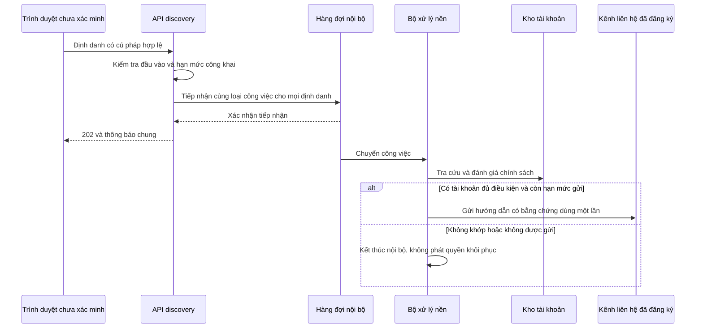

# Generic discovery responses — Phản hồi chung trong bước tìm tài khoản

## 1. Bước discovery cần trả lời điều gì?

Trong luồng khôi phục tài khoản, **recovery discovery** là giai đoạn tiếp nhận thông tin như email, số điện thoại hoặc tên đăng nhập để hệ thống xác định nội bộ có thể tiếp tục bằng cách nào. Người dùng có thể quên mật khẩu, mất điện thoại chứa MFA, mất passkey hoặc không còn thiết bị xác thực. Tuy nhiên, việc nhập đúng một định danh chưa chứng minh người nhập sở hữu tài khoản đó.

Nếu màn hình trả lời “Email không tồn tại”, “Tài khoản này có MFA” hoặc “Bạn đã đăng ký hai passkey”, người ngoài có thể dùng chức năng khôi phục để thu thập thông tin. Rủi ro này gọi là **account enumeration**: suy ra sự tồn tại hoặc thuộc tính của tài khoản bằng cách quan sát phản hồi.

**Generic discovery response** là phản hồi chung được thiết kế để các trường hợp nhạy cảm có cùng biểu hiện công khai khi người yêu cầu chưa cung cấp bằng chứng phù hợp. Mục đích là hướng dẫn người dùng bước tiếp theo mà không xác nhận tài khoản có tồn tại, có đủ điều kiện khôi phục hay đã cấu hình phương thức nào.

Một thông điệp phù hợp có thể là:

> Nếu thông tin bạn cung cấp khớp với tài khoản đủ điều kiện, hướng dẫn khôi phục sẽ được gửi qua kênh đã đăng ký. Hãy kiểm tra thư rác hoặc xem hướng dẫn hỗ trợ nếu bạn không còn truy cập được kênh đó.

Thông điệp này mô tả hành vi có điều kiện. Nó không khẳng định thư đã được gửi, không hứa tài khoản chắc chắn khôi phục được và không cấp bất kỳ quyền truy cập nào.

Sau bài học, người học có thể xác định dữ liệu nào cần giữ kín ở discovery, thiết kế hợp đồng HTTP nhất quán, giải thích các kênh rò rỉ ngoài nội dung thông báo và xây dựng tình huống kiểm tra chống enumeration.

## 2. Mô hình đe dọa và giới hạn bảo vệ

Giả sử kẻ tấn công chưa đăng nhập, có danh sách email và có thể gửi nhiều yêu cầu. Họ quan sát không chỉ dòng chữ trên giao diện mà cả mã HTTP, JSON, cookie, chuyển hướng, kích thước phản hồi và thời gian xử lý. Họ cũng có thể gọi thẳng API, bỏ qua giao diện web.

Các thông tin cần bảo vệ trước thời điểm xác minh gồm:

| Thông tin | Ví dụ rò rỉ | Hậu quả có thể xảy ra |
| --- | --- | --- |
| Sự tồn tại của tài khoản | “Không tìm thấy email này” | Lập danh sách người dùng để lừa đảo hoặc dò thông tin đăng nhập |
| Phương thức xác thực | `hasMfa: true`, `passkeyCount: 2` | Chọn kịch bản giả mạo hỗ trợ phù hợp với nạn nhân |
| Kênh liên hệ đã đăng ký | `recoveryEmail: n***@example.net` | Bổ sung dữ liệu cá nhân hoặc suy ra quan hệ giữa các địa chỉ |
| Trạng thái tài khoản | “Tài khoản bị khóa” hoặc “Chỉ đăng nhập qua công ty” | Suy ra trạng thái sử dụng hoặc loại tổ chức |
| Khả năng khôi phục | “Không có mã dự phòng” | Xác định tài khoản dễ bị dẫn sang quy trình hỗ trợ thủ công |

Phản hồi chung làm giảm khả năng suy luận từ giao diện công khai. Nó không thay thế giới hạn tần suất, bảo vệ kênh liên hệ, token dùng một lần hay xác minh danh tính. Nếu email của nạn nhân đã bị chiếm quyền, việc ẩn thông báo discovery không thể tự khắc phục sự xâm nhập đó.

Cũng không nên tuyên bố rằng mọi thời gian phản hồi trên Internet sẽ giống hệt nhau. Mục tiêu kỹ thuật là loại bỏ khác biệt có hệ thống do trạng thái tài khoản và kiểm tra xem quan sát lặp lại còn phân biệt được các nhóm hay không.

## 3. Xác định các trường hợp phải có cùng phản hồi

Trước khi viết thông báo, cần liệt kê những nhánh nội bộ mà người ngoài không được phân biệt. Với cùng một định danh có cú pháp hợp lệ và cùng điều kiện giới hạn tần suất công khai, các trường hợp sau thường cần cùng một hợp đồng discovery:

| Trường hợp nội bộ | Phản hồi công khai ở discovery | Xử lý riêng trong hệ thống |
| --- | --- | --- |
| Không có tài khoản khớp | Phản hồi chung | Không tạo quyền khôi phục cho tài khoản nào |
| Tài khoản có email khôi phục hợp lệ | Phản hồi chung | Có thể gửi hướng dẫn theo chính sách |
| Tài khoản đang dùng MFA hoặc passkey | Phản hồi chung | Giữ nguyên yêu cầu bằng chứng phù hợp |
| Tài khoản không đủ điều kiện tự khôi phục | Phản hồi chung | Không mở đường tắt; áp dụng quy trình được phép |
| Đã đạt hạn mức gửi cho tài khoản | Phản hồi chung | Không gửi thêm, ghi nhận quyết định nội bộ |
| Tài khoản cần đăng nhập qua nhà cung cấp danh tính | Phản hồi chung | Thực hiện chính sách liên kết danh tính nếu được phép |

“Cùng phản hồi” bao gồm cấu trúc và hành vi quan sát được, không chỉ một câu chữ giống nhau. Chẳng hạn, nếu cùng hiện thông báo nhưng tài khoản có thật nhận HTTP `202`, còn tài khoản không có nhận `404`, API vẫn làm lộ kết quả tra cứu.

### Khi nào có thể trả lỗi cụ thể?

Lỗi độc lập với trạng thái tài khoản có thể được mô tả rõ để người dùng tự sửa:

- JSON không hợp lệ, thiếu trường bắt buộc hoặc định danh vượt giới hạn độ dài.
- Email sai cú pháp mà bộ kiểm tra có thể xác định trước khi tra cứu tài khoản.
- Yêu cầu vượt hạn mức công khai tính theo nguồn truy cập, với quy tắc áp dụng như nhau cho mọi định danh.
- Dịch vụ tiếp nhận đang không khả dụng đối với mọi yêu cầu cùng loại.

Ví dụ, `400 INVALID_INPUT` cho cả email tồn tại lẫn không tồn tại có cùng lỗi cú pháp không phải là tiết lộ kết quả tra cứu. Ngược lại, `422 NO_RECOVERY_CHANNEL` chỉ xuất hiện sau khi tìm được tài khoản là một tín hiệu nhạy cảm.

Nếu sản phẩm chủ động công khai miền tổ chức để tìm nhà cung cấp SSO, cần xác định đây là quyết định công khai thông tin về miền. Không được dùng quyết định đó để ngầm tiết lộ sự tồn tại của từng người dùng trong miền.

## 4. Thiết kế hợp đồng HTTP và trải nghiệm nhất quán

### 4.1. Yêu cầu đầu vào

Ví dụ minh họa:

```http
POST /account-recovery/discovery HTTP/1.1
Content-Type: application/json

{
  "identifier": "lan@example.com",
  "locale": "vi"
}
```

Các giới hạn về độ dài, cú pháp, kích thước body và ngôn ngữ được kiểm tra theo cùng một quy tắc cho mọi yêu cầu. Định danh phải được chuẩn hóa bằng quy tắc của hệ thống tài khoản; không tự ý xóa dấu chấm hoặc phần sau dấu `+` trong mọi địa chỉ email vì các nhà cung cấp có thể hiểu chúng khác nhau.

Ngôn ngữ phản hồi nên lấy từ lựa chọn công khai của yêu cầu hoặc giao diện. Nếu địa chỉ có thật trả tiếng Việt do hồ sơ người dùng còn địa chỉ không có trả tiếng Anh, ngôn ngữ đã trở thành tín hiệu tra cứu.

### 4.2. Phản hồi khi tiếp nhận yêu cầu hợp lệ

```http
HTTP/1.1 202 Accepted
Content-Type: application/json; charset=utf-8
Cache-Control: no-store

{
  "code": "RECOVERY_REQUEST_ACCEPTED",
  "message": "Nếu thông tin khớp với tài khoản đủ điều kiện, hướng dẫn khôi phục sẽ được gửi qua kênh đã đăng ký.",
  "requestId": "random-opaque-value"
}
```

Trong ví dụ này, `202` có nghĩa là hệ thống đã tiếp nhận công việc để xử lý, không có nghĩa đã tìm thấy tài khoản hoặc giao thư thành công. Mã này phù hợp khi hệ thống thực sự tiếp nhận xử lý bất đồng bộ. Nếu thiết kế dùng một mã thành công khác, vẫn phải áp dụng nhất quán và diễn đạt đúng ý nghĩa của mã đó.

`requestId` là giá trị ngẫu nhiên không mang nghĩa, được sinh cho mọi yêu cầu đã tiếp nhận. Giá trị minh họa trên không phải token thật. Định danh này không được chứa user ID, email mã hóa có thể giải đọc, dấu hiệu tồn tại hay loại phương thức xác thực.

Nếu không cần giao diện tiếp tục theo dõi, có thể bỏ `requestId`. Không nên thêm một định danh chỉ để tạo cảm giác có giao dịch trong khi nó không phục vụ nhu cầu cụ thể.

### 4.3. Các thành phần phải đồng nhất

| Thành phần | Quy tắc thiết kế |
| --- | --- |
| Mã HTTP và mã lỗi nghiệp vụ | Không phụ thuộc kết quả tra cứu tài khoản ở nhánh tiếp nhận công khai |
| Trường JSON | Không xuất hiện `accountExists`, `hasMfa`, `availableMethods`, địa chỉ đã che hoặc trạng thái gửi thực tế |
| Độ dài và hình dạng dữ liệu | Cùng tập trường; định danh ngẫu nhiên có cùng kiểu và độ dài |
| Header và cookie | Không thêm cookie, header gỡ lỗi hay hạn mức riêng chỉ cho tài khoản có thật |
| Chuyển hướng | Không chuyển một nhánh sang nhập OTP, nhánh khác sang đăng ký tài khoản |
| Giao diện | Cùng trang kết quả, nút, trạng thái tải và hướng dẫn gửi lại |
| Cache | Không cache kết quả nhạy cảm hoặc để `ETag`, cache hit/miss phản ánh kết quả tra cứu |
| API theo dõi | Không cho `requestId` trở thành công cụ kiểm tra thư đã gửi hoặc tài khoản tồn tại |

Không cần ép mọi byte của mọi phản hồi đều giống nhau: mã truy vết ngẫu nhiên có thể khác. Điều cần giữ là không có khác biệt mang thông tin về tài khoản. Nén, proxy, CDN và middleware cũng cần được xem xét vì chúng có thể bổ sung hành vi ngoài mã ứng dụng.

Giao diện gửi lại nên giải thích thời gian chờ theo chính sách chung, ví dụ “Bạn có thể thử lại sau một lúc”, thay vì “Email của bạn đã nhận ba thư”. Nút hỗ trợ khi mất kênh liên hệ có thể xuất hiện cho mọi người; việc bấm nút không được tự động bỏ qua xác minh.

## 5. Tách tiếp nhận công khai khỏi tra cứu và gửi thông báo

Một thiết kế dễ kiểm soát là tiếp nhận yêu cầu hợp lệ qua cùng một đường xử lý, rồi mới tra cứu tài khoản trong worker nội bộ. Worker ở đây là thành phần xử lý nền của hệ thống được mô tả trong bài học.



Mã giả của phần tiếp nhận:

```text
receiveDiscovery(request):
    input = validatePublicInput(request)
    enforcePublicAdmissionLimits(request.source, input)

    requestId = generateOpaqueRandomId()
    job = buildJob(requestId, protect(input.identifier), input.locale)

    if not acceptIntoDurableProcessing(job):
        return genericServiceUnavailable()

    return acceptedWithGenericMessage(requestId, input.locale)
```

Mã giả cố ý chưa gọi `findAccount` trước phản hồi công khai. Đường tiếp nhận không chờ nhà cung cấp email, SMS hoặc hệ thống xác thực bên ngoài. Hàng đợi chứa định danh cần được bảo vệ bằng mã hóa phù hợp, kiểm soát quyền truy cập và thời hạn lưu; không đẩy dữ liệu cá nhân thô vào log.

Phần xử lý nội bộ có thể được mô tả như sau:

```text
processDiscovery(job):
    account = resolveAccount(recoverProtectedIdentifier(job))

    if account is absent:
        recordInternalOutcome(job.requestId, NO_MATCH)
        return

    decision = evaluateRecoveryPolicyAndDeliveryBudget(account)
    if decision does not allow notification:
        recordInternalOutcome(job.requestId, NOT_SENT)
        return

    challenge = createScopedSingleUseChallenge(account, decision)
    sendViaPreviouslyRegisteredChannel(account, challenge)
    recordInternalOutcome(job.requestId, NOTIFICATION_REQUESTED)
```

Đây là mô hình luồng xử lý, không phải mã triển khai hoàn chỉnh. Việc tạo challenge cần lưu trạng thái và xử lý gửi lại, lỗi giao nhận, retry, hết hạn và tiêu thụ một lần theo thiết kế riêng. Không tạo challenge có quyền đổi mật khẩu cho tài khoản giả chỉ để hai nhánh có vẻ giống nhau.

Nếu hàng đợi không tiếp nhận được, API không nên khẳng định đã nhận xử lý bền vững. Có thể trả lỗi chung như `503` cho tất cả yêu cầu chịu cùng sự cố. Tránh thiết kế trong đó chỉ tài khoản có thật mới thử vào hàng đợi và mới gặp lỗi công khai.

### Vì sao không chỉ thêm một khoảng sleep?

Nếu tài khoản có thật mất thêm thời gian gọi nhà cung cấp email, thêm cùng một khoảng chờ cho cả hai nhánh vẫn giữ nguyên chênh lệch. Thêm nhiễu ngẫu nhiên cũng không loại bỏ khác biệt trung bình khi người tấn công lấy nhiều mẫu.

Đưa tác vụ phụ thuộc tài khoản ra khỏi đường phản hồi giúp giảm nguyên nhân gây chênh lệch. Tuy nhiên, vẫn phải kiểm tra khác biệt ở chuẩn hóa dữ liệu, cache, quota, truy cập kho dữ liệu và tải hệ thống. Tác vụ bất đồng bộ là một công cụ thiết kế, không phải bằng chứng tự động rằng timing side channel đã biến mất.

## 6. Một mã discovery không phải bằng chứng sở hữu

Có hai đối tượng dễ bị nhầm lẫn:

| Đối tượng | Vai trò | Quyền được phép |
| --- | --- | --- |
| Mã yêu cầu hoặc phiên discovery | Liên kết các thao tác trước xác minh, hỗ trợ truy vết | Tối đa tiếp tục giao diện công khai theo phạm vi hẹp |
| Bằng chứng khôi phục đã kiểm tra | Chứng minh một điều kiện của chính sách, như quyền truy cập kênh đăng ký | Chỉ thực hiện bước kế tiếp mà chính sách cho phép |

Một `requestId` do người gọi nhận trực tiếp không thể chứng minh họ sở hữu email đã nhập. Bất kỳ ai cũng có thể tự tạo yêu cầu cho email của người khác.

Nếu API có `/account-recovery/requests/{requestId}`, không trả các trạng thái như `ACCOUNT_FOUND`, `SMS_SENT`, `MFA_REQUIRED` hoặc `NO_ACCOUNT` cho người chỉ giữ mã discovery. Có thể chỉ trả hướng dẫn chung, hoặc bỏ hẳn API theo dõi khi không cần.

Nếu tạo cookie cho luồng trước xác minh, cookie đó cũng không phải session đăng nhập. Khi sử dụng cookie, cần thuộc tính bảo vệ phù hợp như `Secure`, `HttpOnly`, `SameSite`, thời hạn ngắn và biện pháp chống yêu cầu giả mạo theo kiến trúc ứng dụng. Không tạo cookie riêng chỉ khi tài khoản tồn tại.

Sau khi người dùng đưa ra một bằng chứng hợp lệ, hệ thống có thể tiết lộ thông tin hoặc mở bước tiếp theo trong phạm vi chính sách cho phép. Cần gắn bằng chứng với đúng tài khoản, giao dịch và mục đích. Quyền đọc email không mặc nhiên cho phép xóa MFA, thêm passkey mới hoặc thay toàn bộ thông tin liên hệ.

Discovery không được tự đổi mật khẩu, vô hiệu hóa MFA, xóa passkey, thu hồi mọi session hay tự đăng nhập. Những hành động này chỉ xảy ra ở giai đoạn được cấp quyền tương ứng. Gắn hành động phá hủy session vào một yêu cầu công khai sẽ tạo cơ hội từ chối dịch vụ đối với nạn nhân.

## 7. Phản hồi chung phải đi cùng kiểm soát lạm dụng

Ẩn kết quả tra cứu không ngăn người tấn công yêu cầu gửi hàng nghìn email. Cần tách **hạn mức tiếp nhận công khai** khỏi **hạn mức tác động lên tài khoản**.

### 7.1. Hạn mức tiếp nhận công khai

Có thể phối hợp giới hạn theo nguồn mạng, phiên trình duyệt, tín hiệu thiết bị, định danh được nhập và mức tải chung. Các khóa theo định danh phải được tính cho mọi đầu vào hợp lệ, không chỉ sau khi tìm thấy tài khoản.

Nếu muốn tránh lưu email thô trong kho hạn mức, có thể dùng khóa dạng:

```text
identifierKey = HMAC(serverSecret, canonicalIdentifier)
```

HMAC phải dùng khóa bí mật phía máy chủ và chịu kiểm soát truy cập; đây không phải cách biến dữ liệu thành vô danh tuyệt đối. Băm không khóa một email có miền giá trị dễ đoán vẫn có thể bị dò ngược bằng danh sách ứng viên. Quy tắc chuẩn hóa của khóa hạn mức cần thống nhất với quy tắc tra cứu tài khoản.

HTTP `429` có thể được dùng khi chính sách công khai áp dụng như nhau cho định danh tồn tại và không tồn tại. Không trả `Retry-After` tính từ hạn mức gửi email nội bộ của riêng tài khoản. Nếu dùng thử thách chống bot, điều kiện xuất hiện nên dựa vào hành vi công khai, không dựa vào việc tài khoản có MFA hay có tồn tại.

### 7.2. Hạn mức gửi và quyết định theo tài khoản

Một tài khoản có thể cần ngân sách gửi riêng, gộp yêu cầu trùng, kiểm soát nhiều biến thể định danh và phát hiện tấn công phân tán. Khi ngân sách này hết, worker dừng gửi nhưng phản hồi discovery vẫn giữ hợp đồng chung.

Không khóa chức năng đăng nhập chỉ vì có nhiều yêu cầu quên mật khẩu. Nếu không, kẻ tấn công có thể liên tục làm gián đoạn tài khoản của người khác. Việc có vô hiệu hóa challenge trước khi phát hành challenge mới hay không cũng cần được thiết kế để một yêu cầu discovery đơn thuần không dễ phá giao dịch đang dùng của chủ tài khoản.

Hướng dẫn hỗ trợ thủ công phải giữ yêu cầu xác minh danh tính. Phản hồi chung không có nghĩa rằng mọi yêu cầu không xác định được đều được chuyển sang một nhân viên có quyền bỏ qua các điều kiện bảo mật.

## 8. Ví dụ xuyên suốt: Lan mất điện thoại chứa MFA

Lan nhập `lan@example.com` vào trang khôi phục. Tài khoản của Lan có mật khẩu và MFA, nhưng Lan đã mất điện thoại. Một người ngoài cũng có thể nhập cùng địa chỉ đó.

Luồng phù hợp:

1. API kiểm tra cú pháp và điều kiện tiếp nhận, rồi trả thông báo chung.
2. Nội bộ hệ thống tìm tài khoản, xét chính sách và gửi hướng dẫn qua kênh đã đăng ký nếu được phép.
3. Màn hình trước xác minh vẫn không cho biết Lan có MFA, có mã dự phòng hay có thiết bị khác.
4. Khi Lan cung cấp bằng chứng hợp lệ từ kênh đó, hệ thống xác định bằng chứng đủ cho hành động nào. Nếu đặt lại MFA cần thêm điều kiện, luồng vẫn phải yêu cầu điều kiện ấy.
5. Các bước đổi thông tin xác thực và kiểm soát session được thực hiện theo quyền đã xác minh ở giai đoạn sau.

Bây giờ người ngoài nhập `not-a-user@example.com`, một địa chỉ có cú pháp hợp lệ nhưng không có tài khoản. API vẫn dùng cùng mã HTTP, cấu trúc JSON và hướng dẫn. Bộ xử lý nền không tìm thấy tài khoản nên kết thúc mà không tạo quyền khôi phục.

Sự khác nhau “Lan có thể nhận thư, địa chỉ không khớp không nhận thư” là hành vi có điều kiện của kênh đã đăng ký. API công khai không được cung cấp API phụ để hỏi thư có thực sự được gửi không. Người vốn kiểm soát hộp thư hoặc hạ tầng giao nhận có vị trí quan sát khác; generic response không hứa che giấu thông tin trước mọi bên có quyền truy cập đó.

Một cách viết sai thường gặp là: “Chúng tôi đã gửi mã đến số điện thoại kết thúc bằng 42.” Nếu màn hình đó xuất hiện ngay sau khi nhập email, nó đồng thời xác nhận tài khoản, tiết lộ một phần số điện thoại và cho biết có kênh SMS. Đổi câu này thành thông điệp có điều kiện vẫn chưa đủ nếu JSON còn chứa số điện thoại đã che.

## 9. Kiểm chứng hợp đồng mà không tự tạo kênh rò rỉ

Dùng các tài khoản thử nghiệm và định danh không tồn tại trong môi trường được phép. Không dùng dữ liệu khách hàng thật để dựng bộ kiểm tra. Chọn các cặp có cùng dạng, độ dài tương tự và cùng điều kiện nguồn để giảm yếu tố gây nhiễu.

| Tình huống | Điều cần quan sát |
| --- | --- |
| Tài khoản thường so với định danh không tồn tại | Cùng mã, schema, hướng dẫn, cookie và quy tắc chuyển hướng |
| Có MFA, chỉ có passkey hoặc không có phương thức dự phòng | Không lộ thuộc tính ở discovery |
| Tài khoản bị giới hạn gửi hoặc không đủ điều kiện tự khôi phục | Không xuất hiện mã lỗi hoặc bộ đếm riêng |
| Cùng định danh được gửi lặp lại | Hạn mức công khai nhất quán; hạn mức gửi không lộ qua status |
| Dữ liệu sai cú pháp ở các nhóm | Cùng quy tắc validation trước tra cứu |
| Nhà cung cấp email chậm hoặc bị lỗi | Thời gian tiếp nhận công khai không chờ kết quả giao nhận |
| Hàng đợi tiếp nhận lỗi | Lỗi công khai theo sự cố dịch vụ, không theo tồn tại tài khoản |
| Tra cứu bằng mã yêu cầu, bấm gửi lại hoặc đi sang hỗ trợ | Không tạo đường vòng tiết lộ phương thức hoặc trạng thái tài khoản |

Đối với thời gian xử lý, đo nhiều mẫu, xen kẽ thứ tự các nhóm và ghi nhận trạng thái tải, cache, kết nối. So sánh phân bố, trung vị và các phân vị thay vì kết luận từ một lần đo. Nếu có khác biệt ổn định, tìm nguyên nhân trên đường phản hồi. Không chọn một ngưỡng mili giây tùy ý rồi gọi đó là bảo đảm chống enumeration.

Cần kiểm tra cả API thô và giao diện: giao diện có thể che lỗi trong khi API lộ `404`, hoặc API đã chung nhưng giao diện tạo nhánh dựa vào một trường ẩn. Công cụ analytics phía trình duyệt, sự kiện debug và trang theo dõi tiến độ cũng có thể làm lộ kết quả nội bộ.

Nhật ký nội bộ có thể giữ kết quả như `NO_MATCH`, `POLICY_DENIED`, `DELIVERY_SUPPRESSED` để điều tra và vận hành. Chúng phải nằm sau kiểm soát truy cập, có thời hạn lưu phù hợp và không được phản chiếu ra API. Không log token khôi phục, mã OTP, liên kết chứa bí mật hoặc toàn bộ payload nhạy cảm. Dashboard công khai cũng không được cho truy vấn kết quả theo email hoặc mã discovery.

## 10. Những lỗi thiết kế cần nhận ra

- **Chỉ sửa câu chữ:** body chung nhưng HTTP, header, cookie hoặc redirect vẫn khác.
- **Hiện phương thức đã đăng ký quá sớm:** danh sách “email, SMS, passkey” được sinh từ hồ sơ tài khoản trước khi xác minh.
- **Dùng mã discovery để cấp quyền:** người gọi tự tạo yêu cầu rồi dùng mã đó để đổi mật khẩu hoặc tắt MFA.
- **Trả thành công dựa trên gửi thư đồng bộ:** đường có tài khoản chờ nhà cung cấp, đường không có trả ngay.
- **Lộ quota nội bộ:** bộ đếm gửi, thời gian chờ hoặc lỗi chỉ xuất hiện với tài khoản có thật.
- **Chặn việc đăng nhập theo yêu cầu khôi phục công khai:** tạo khả năng làm gián đoạn tài khoản nạn nhân.
- **Mở đường vòng qua hỗ trợ:** nút “không nhận được mã” tiết lộ thông tin hoặc bỏ qua chính sách xác minh.

Một thiết kế đạt mục tiêu khi người chưa xác minh nhận hướng dẫn rõ ràng và có điều kiện, trong khi quyết định có tài khoản hay không vẫn thuộc nội bộ. Cùng hợp đồng phản hồi cần được giữ xuyên suốt discovery, gửi lại và các đường tiếp tục trước xác minh. Mọi quyền khôi phục phải đến từ bằng chứng được kiểm tra theo chính sách, không đến từ việc hệ thống đã nhận một định danh.