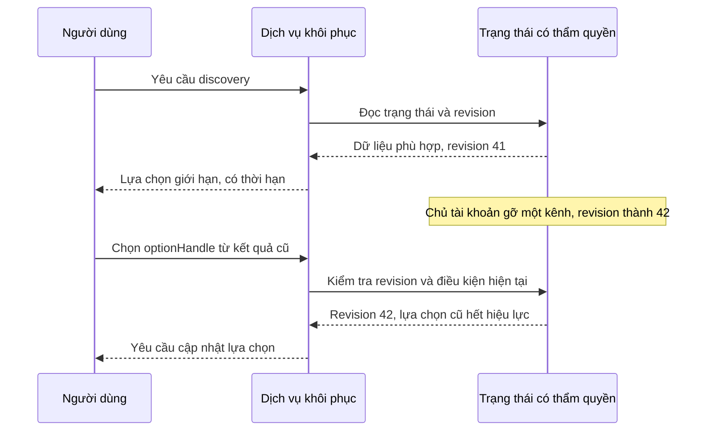

# Discovery result consistency — Tính nhất quán của kết quả khám phá phương thức khôi phục

Trong chương **Recovery Discovery** của module `SECURITY_AUTHENTICATION_ACCOUNT_RECOVERY`, discovery là bước xác định người dùng có thể đi tiếp bằng những phương thức khôi phục nào. Người dùng có thể mất mật khẩu, điện thoại chứa MFA, passkey hoặc thiết bị xác thực. Hệ thống cần hướng dẫn đúng đường, đồng thời hạn chế việc dò tài khoản và ngăn kẻ tấn công lợi dụng dữ liệu cũ để chọn một đường khôi phục yếu hơn.

**Discovery result consistency** là tính nhất quán giữa kết quả discovery, mức bằng chứng người dùng đã cung cấp, trạng thái bảo mật của tài khoản và quyết định thực thi ở bước tiếp theo. Một lựa chọn xuất hiện trên màn hình chỉ mô tả khả năng tại thời điểm đánh giá; nó không tự cấp quyền đặt lại mật khẩu, gỡ MFA hay tạo phiên đăng nhập.

Ví dụ: lúc 09:00 hệ thống cho phép gửi mã đến một số điện thoại đã xác minh. Lúc 09:01 chủ tài khoản gỡ số đó bằng một phiên hợp lệ. Lúc 09:02 màn hình discovery cũ vẫn còn mở. Tính nhất quán yêu cầu máy chủ phát hiện lựa chọn đã hết hiệu lực trước khi phát hành thử thách mới. Việc giao diện vẫn giữ một nút bấm không được làm sống lại số điện thoại đã bị thu hồi.

## 1. Ba câu hỏi mà một kết quả discovery phải trả lời

Một kết quả có thể đúng về dữ liệu nhưng vẫn sai về bảo mật. Cần phân biệt ba câu hỏi:

1. **Tài khoản đã đăng ký gì?** Đây là trạng thái của mật khẩu, MFA, passkey, mã dự phòng, kênh liên hệ và quy trình hỗ trợ.
2. **Phương thức nào đủ điều kiện trong ngữ cảnh hiện tại?** Chính sách, mức rủi ro, thời gian chờ và bằng chứng hiện có có thể loại bớt những yếu tố đã đăng ký.
3. **Được phép tiết lộ điều gì cho người đang yêu cầu?** Trước khi có đủ bằng chứng, danh sách yếu tố hoặc địa chỉ liên hệ có thể làm lộ sự tồn tại của tài khoản.

Chỉ bước giao của cả ba câu hỏi mới tạo thành kết quả được hiển thị. “Đã đăng ký”, “được phép sử dụng”, “được phép tiết lộ” và “người dùng còn truy cập được” là những thuộc tính khác nhau.

Một passkey còn đăng ký không chứng minh người dùng còn thiết bị chứa nó. Email đã xác minh không chứng minh hộp thư còn truy cập được. Người dùng bấm “Tôi không còn điện thoại” chỉ cung cấp thông tin để điều hướng; thao tác đó không làm tăng mức tin cậy hay tự mở đường gỡ MFA.

## 2. Các chiều nhất quán cần bảo đảm

| Chiều nhất quán | Yêu cầu | Ví dụ sai |
| --- | --- | --- |
| Giữa các lần yêu cầu | Cùng trạng thái và cùng ngữ cảnh cho kết quả tương đương về ý nghĩa | Bấm tải lại làm xuất hiện một phương thức vốn bị cấm |
| Giữa các màn hình | Giao diện, API chọn phương thức và API phát hành thử thách cùng thực thi một chính sách | Màn hình ẩn SMS nhưng gọi API trực tiếp vẫn gửi được |
| Theo thời gian | Thay đổi có ảnh hưởng bảo mật phải được xét trước hành động nhạy cảm | Kênh đã gỡ vẫn nhận mã từ lựa chọn cũ |
| Theo mức bằng chứng | Chi tiết và quyền sử dụng tăng theo bằng chứng được chấp nhận | Chỉ nhập email đã xem được số điện thoại che một phần |
| Theo giao dịch | Kiểm tra điều kiện và tạo tác động phải có ranh giới nhất quán | Kiểm tra kênh hợp lệ rồi kênh bị thu hồi trước khi ghi thử thách |
| Giữa các nút dịch vụ | Replica hoặc cache chậm không được mở lại quyền đã bị thu hồi | Nút A từ chối, nút B vẫn cấp mã |
| Theo tác động bên ngoài | Retry không được vô tình tạo nhiều thử thách hoặc nhiều lần gửi | Nhấp đúp gửi hai mã và vô hiệu hóa mã đầu mà không giải thích |

Nhất quán không có nghĩa mọi người dùng luôn nhận cùng danh sách hoặc mọi lần gọi trả cùng byte. Mức rủi ro có thể tăng, thời hạn có thể hết, chính sách có thể thay đổi. Khi đó kết quả thay đổi là đúng nếu có nguyên nhân hợp lệ và được xử lý an toàn.

Cũng không nên buộc toàn bộ dữ liệu hiển thị đạt một mô hình đồng bộ tuyệt đối. Thông tin mô tả có thể chậm trong giới hạn chấp nhận được. Quyết định cấp thử thách hoặc chấp nhận bằng chứng phải thỏa điều kiện an toàn tại điểm thực thi mà thiết kế đã xác định.

## 3. Nhất quán công khai và chống dò tài khoản

Trước khi người yêu cầu chứng minh đủ quyền tiếp cận, discovery thường bắt đầu bằng email hoặc tên đăng nhập. Nếu hệ thống trả những kết quả sau, kẻ tấn công có thể dựng danh sách tài khoản và yếu tố xác thực:

```text
Email chưa đăng ký  -> 404, "Không tìm thấy tài khoản"
Email đã đăng ký    -> 200, "Chọn SMS hoặc email"
Tài khoản có MFA    -> 200, "Cần mã xác thực bổ sung"
```

Một thiết kế thận trọng dùng hợp đồng phản hồi công khai tương đương:

```http
HTTP/1.1 202 Accepted
Cache-Control: no-store
Content-Type: application/json

{
  "message": "Nếu thông tin phù hợp, hướng dẫn khôi phục sẽ được gửi qua kênh đã đăng ký.",
  "flowId": "opaque-flow-handle"
}
```

`flowId` phải khó đoán, có thời hạn và không mang ý nghĩa xác nhận tài khoản tồn tại. Nếu API luôn trả một flow handle, thiết kế cũng cần có ngữ cảnh trung tính cho định danh không khớp tài khoản; không để lần gọi kế tiếp phân biệt ngay bằng việc handle có tồn tại hay không. Handle công khai này chỉ dùng theo dõi luồng, không phải bằng chứng sở hữu tài khoản.

Tính tương đương cần xét cả mã HTTP, cấu trúc JSON, trường tùy chọn, thông báo, chuyển hướng, cookie và hành vi của các bước công khai tiếp theo. Một trường `hasRecoveryOptions: true`, số lượng phương thức, địa chỉ email che một phần hoặc thời gian chờ riêng cho tài khoản tồn tại cũng có thể phá vỡ mục tiêu này.

Độ trễ cũng là một tín hiệu. Có thể tách gửi thông báo sang xử lý nền, giảm nhánh xử lý khác biệt và đánh giá phân bố độ trễ của các nhóm đầu vào. Thêm một khoảng ngủ cố định hoặc độ trễ ngẫu nhiên không tự loại bỏ mọi kênh suy luận. Các tác động như email gửi đến hộp thư đã đăng ký cần được quản lý bằng kiểm soát lạm dụng, nhưng không nên được phản chiếu thành dấu hiệu xác nhận trên API công khai.

Sau khi có bằng chứng phù hợp, hệ thống có thể hiển thị thêm chi tiết theo chính sách. Quyền xem gợi ý kênh liên hệ và quyền dùng kênh đó để hoàn tất khôi phục vẫn phải được xét riêng. Một liên kết chứng minh quyền truy cập email không mặc nhiên đủ để gỡ MFA hay thay passkey.

## 4. Mô hình kết quả: ảnh chụp có phạm vi và thời hạn

Một mô hình phía máy chủ có thể gồm:

| Thuộc tính | Ý nghĩa |
| --- | --- |
| `flowId` | Handle ngẫu nhiên gắn với một luồng khôi phục |
| `subjectRef` | Tham chiếu tài khoản nội bộ, không đưa vào phản hồi công khai |
| `purpose` | Mục đích cụ thể như đặt lại mật khẩu hoặc phục hồi khi mất MFA |
| `proofContext` | Các bằng chứng đã được chấp nhận, phạm vi và thời điểm xác minh |
| `recoveryRevision` | Phiên bản trạng thái có ảnh hưởng đến khôi phục của tài khoản |
| `policyVersion` | Phiên bản chính sách đã dùng để lập kết quả |
| `evaluatedAt`, `expiresAt` | Thời điểm đánh giá và giới hạn tồn tại của ảnh chụp |
| `options` | Các lựa chọn đã lọc theo chính sách và quyền tiết lộ |
| `state` | Trạng thái như `DISCOVERED`, `CHALLENGE_PENDING`, `EXPIRED` |

Đây là gợi ý mô hình thiết kế, không phải hợp đồng API bắt buộc. Không cần trả toàn bộ các thuộc tính này cho trình duyệt.

Mỗi lựa chọn có một `optionHandle` không đoán được, được phân giải trong đúng flow. Handle không chứa số điện thoại thật, không cho phép chọn tùy ý một `factorId` và không dùng được cho tài khoản hay mục đích khác. Ngay cả khi handle được ký và không thể sửa, nó vẫn có thể cũ; chữ ký không thay thế kiểm tra trạng thái hiện tại.

Sau khi đạt mức bằng chứng cho phép, phản hồi có thể là:

```json
{
  "flowId": "flow-f83...",
  "expiresAt": "2026-11-23T09:05:00Z",
  "options": [
    {
      "optionHandle": "option-a91...",
      "label": "Dùng mã dự phòng",
      "nextAction": "SUBMIT_RECOVERY_CODE"
    }
  ]
}
```

Không đưa mã dự phòng, token khôi phục, bí mật TOTP hay dữ liệu định danh nội bộ vào kết quả discovery. Nội dung trong `label` phải tuân theo quyền tiết lộ ở thời điểm trả kết quả.

Việc tách mục đích cũng rất quan trọng. Khôi phục mật khẩu cho một tài khoản vẫn còn MFA khác với khôi phục khi mất cả MFA. Một lựa chọn hợp lệ cho mục đích thứ nhất không được tự tái sử dụng để bỏ qua yêu cầu của mục đích thứ hai.

## 5. Điều gì làm kết quả cũ mất hiệu lực?

Thiết kế cần liệt kê các sự kiện ảnh hưởng đến điều kiện khôi phục. Không chỉ thời hạn hết mới làm một kết quả mất hiệu lực.

- Chủ tài khoản gỡ hoặc thay kênh email, số điện thoại hay thiết bị xác thực.
- Mã dự phòng đã được sử dụng, bị thu hồi hoặc được tái tạo thành bộ mới.
- Passkey bị thu hồi, tài khoản bị khóa bảo mật hoặc bắt đầu quy trình ứng phó chiếm đoạt.
- Một luồng khác đã hoàn tất khôi phục, thay đổi thông tin xác thực hoặc làm tăng phiên bản bảo mật.
- Chính sách cho mục đích khôi phục thay đổi hoặc bằng chứng hiện tại hết thời hạn chấp nhận.
- Kênh vừa thêm đang trong thời gian chờ nên chưa đủ điều kiện khôi phục, dù đã có mặt trong hồ sơ.
- Đánh giá rủi ro mới yêu cầu thêm bằng chứng hoặc tạm dừng thao tác.

Có thể duy trì `recoveryRevision` tăng đơn điệu theo từng tài khoản khi trạng thái liên quan thay đổi. Phiên bản này cần thay đổi cùng giao dịch với dữ liệu bảo mật mà nó đại diện. Không dùng một timestamp có độ phân giải thấp để giả định rằng mọi thay đổi đồng thời đều phân biệt được.

`policyVersion` giải quyết một loại thay đổi khác: nhiều tài khoản cùng chịu chính sách mới. Tín hiệu rủi ro động có thể cần đánh giá lại thay vì chỉ so sánh một phiên bản. Nếu một quyết định phụ thuộc nhiều nguồn dữ liệu, phải xác định nguồn có thẩm quyền và cơ chế phát hiện quyết định đã lỗi thời.

Không phải mọi thay đổi hồ sơ đều cần vô hiệu hóa discovery. Đổi ảnh đại diện thường không ảnh hưởng đến quyền khôi phục. Phạm vi phiên bản quá rộng khiến người dùng liên tục bắt đầu lại; phạm vi quá hẹp khiến thay đổi bảo mật bị bỏ sót.

## 6. Từ hiển thị đến thực thi: kiểm tra lại ở đâu?

Có ít nhất ba điểm quyết định:

1. **Lập kết quả discovery:** lấy trạng thái, lọc lựa chọn và áp dụng quy tắc tiết lộ.
2. **Chọn phương thức hoặc phát hành thử thách:** kiểm tra lại flow, bằng chứng, kênh, chính sách, phiên bản và giới hạn lạm dụng.
3. **Chấp nhận bằng chứng và hoàn tất khôi phục:** xác minh thử thách còn hiệu lực, tiêu thụ một lần và kiểm tra quyền thực hiện thay đổi cụ thể.

Không thể coi một lần kiểm tra ở bước đầu là đủ cho cả chuỗi. Đây là bài toán thời điểm kiểm tra và thời điểm sử dụng, thường gọi là TOCTOU.



Phản hồi “lựa chọn cần được cập nhật” chỉ nên xuất hiện ở ngữ cảnh mà người yêu cầu được phép biết trạng thái của flow đó. Với yêu cầu công khai chưa đủ bằng chứng, lỗi chi tiết vẫn cần được ánh xạ về hợp đồng phản hồi trung tính.

Khi kết quả cũ, không tự chuyển sang email, SMS hay hỗ trợ chỉ vì đó là phương thức còn lại. Cần đánh giá lại và yêu cầu người dùng chọn trong phạm vi mới. Việc mất một lựa chọn không phải lý do giảm yêu cầu xác minh danh tính.

## 7. Ranh giới giao dịch và xử lý đồng thời

Giả sử máy chủ thực hiện:

```text
1. Đọc rằng SMS còn hợp lệ.
2. Nhả kết nối hoặc chuyển sang tác vụ khác.
3. Tạo thử thách SMS.
```

Một lần thu hồi số điện thoại có thể xảy ra giữa bước 1 và bước 3. Kiểm tra lại chỉ có ý nghĩa nếu kết quả kiểm tra được ràng buộc với thao tác tạo thử thách.

Với dữ liệu cùng nằm trong một kho giao dịch, có thể dùng khóa theo tài khoản hoặc cập nhật có điều kiện theo phiên bản. Mã giả dưới đây minh họa ranh giới, không phải mã thư viện để triển khai nguyên trạng:

```text
selectOption(flowId, optionHandle, idempotencyKey, clientContext):
    kiểm tra định dạng, ngữ cảnh flow và kiểm soát lạm dụng
    đánh giá rủi ro theo chính sách hiện hành

    trong giao dịch có tuần tự hóa các thay đổi bảo mật của tài khoản:
        nạp flow và trạng thái có thẩm quyền
        kiểm tra tài khoản không bị cấm thực hiện hành động
        kiểm tra flow chưa hết hạn, chưa kết thúc, đúng mục đích
        kiểm tra bằng chứng còn được chấp nhận cho mục đích đó

        nếu đã có cùng idempotencyKey trong cùng flow và cùng thao tác:
            kiểm tra tác động đã tạo còn được phép sử dụng
            trả kết quả của thao tác đó, không tạo thử thách mới

        nếu flow không còn ở trạng thái cho phép chọn phương thức:
            trả kết quả cần xử lý trạng thái, không tạo thử thách mới

        nếu revision hoặc chính sách không còn khớp:
            trả kết quả yêu cầu discovery lại, không phát hành thử thách

        phân giải optionHandle trong đúng flow
        kiểm tra lại yếu tố và mức bằng chứng yêu cầu
        kiểm tra quyết định rủi ro còn giá trị tại điểm thực thi
        tạo thử thách có thời hạn, gắn flow, tài khoản, yếu tố và mục đích
        chuyển flow sang CHALLENGE_PENDING
        lưu kết quả idempotency và sự kiện gửi vào outbox
    kết thúc giao dịch

    bộ xử lý nền gửi thông báo từ outbox
```

Mã giả giả định chính sách và quyết định rủi ro có cơ chế xác định còn hiệu lực khi ghi. Nếu tín hiệu rủi ro đến từ một dịch vụ bên ngoài, việc gọi dịch vụ đó trước giao dịch không tự tạo tính nguyên tử. Cần quy định thời hạn quyết định, phiên bản hoặc cơ chế kiểm tra bổ sung phù hợp; không giữ khóa cơ sở dữ liệu trong khi chờ những cuộc gọi mạng không giới hạn.

Nếu các yếu tố nằm ở dịch vụ khác, phải thiết kế giao thức xác nhận trạng thái hoặc kiểm tra phiên bản ở đúng dịch vụ có thẩm quyền. Đọc từ hai replica bất kỳ rồi mở một giao dịch cục bộ không tạo ra một ảnh chụp nhất quán cho toàn hệ thống.

Outbox giúp gắn việc tạo thử thách với ý định gửi. Nó không bảo đảm nhà cung cấp chỉ gửi đúng một thông báo; bộ gửi cần xử lý retry và khả năng chống trùng. Nếu thu hồi xảy ra sau khi thử thách đã được tạo hợp lệ, thông báo đang trên đường vẫn có thể đến. Bước xác minh phải từ chối thử thách đã bị vô hiệu hóa theo chính sách, thay vì xem việc nhận được mã là đủ.

## 8. Phân biệt ba loại dữ liệu dễ bị nhầm

| Loại | Vai trò | Không được suy ra |
| --- | --- | --- |
| Kết quả discovery | Mô tả các đường có thể tiếp tục trong một phạm vi | Quyền thay thông tin xác thực |
| Thử thách hoặc token xác minh | Thu nhận bằng chứng cho một mục đích cụ thể | Quyền bỏ qua toàn bộ yếu tố còn lại |
| Quyền khôi phục giới hạn sau xác minh | Cho phép một hành động đã được chính sách chấp nhận | Phiên đăng nhập đầy đủ hoặc quyền quản trị |

Discovery có thể được tải lại nhiều lần trong thời hạn, còn bí mật xác minh dùng một lần phải được tiêu thụ theo cơ chế nguyên tử. Không đánh dấu token đã dùng chỉ vì trình quét email hoặc trình duyệt mở trang GET; nên tách mở trang với hành động xác nhận có tác động theo thiết kế của luồng.

Bản ghi bằng chứng trong flow là kết quả đã được xác minh, không phải bản sao để sử dụng lại token gốc. Hệ thống cần quy định bằng chứng đó còn dùng được đến khi nào và những thay đổi bảo mật nào làm nó mất hiệu lực.

Khi hoàn tất khôi phục, quyết định thu hồi session, refresh token, thiết bị tin cậy hoặc quyền khôi phục đang tồn tại phải theo chính sách của thao tác. Discovery không được tự tạo session đăng nhập. Hai yêu cầu đồng thời dùng cùng mã dự phòng phải dẫn đến nhiều nhất một lần tiêu thụ thành công, kể cả khi cả hai cùng bắt đầu từ kết quả discovery hợp lệ.

## 9. Retry, nhiều tab và nhiều luồng

Người dùng có thể nhấp đúp, tải lại trang hoặc mở hai tab. Những hành vi bình thường này cần có kết quả dễ hiểu và không tạo thêm quyền.

- **Cùng một yêu cầu bị gửi lại:** khóa idempotency phải có phạm vi flow và thao tác, gắn với nội dung yêu cầu. Cùng khóa nhưng khác phương thức không được âm thầm tái sử dụng kết quả cũ.
- **Hai lựa chọn đồng thời:** nếu thiết kế chỉ cho một thử thách hoạt động trong flow, việc chuyển trạng thái phải nguyên tử. Một yêu cầu thắng; yêu cầu còn lại nhận trạng thái hiện tại hoặc phải cập nhật lựa chọn.
- **Hai flow cho cùng tài khoản:** quy định rõ có thể cùng tồn tại đến giai đoạn nào. Hoàn tất một lần khôi phục có thể tăng phiên bản bảo mật và vô hiệu hóa những flow hoặc quyền khôi phục còn lại.
- **Tải lại discovery:** không kéo dài vô hạn thời gian sống của bằng chứng. TTL của ảnh chụp mới không được tự gia hạn token hoặc bằng chứng đã xác minh.
- **Phản hồi đến sai thứ tự:** giao diện chỉ áp dụng phản hồi của yêu cầu hiện hành; phản hồi cũ đến muộn không được ghi đè danh sách mới. Việc này hỗ trợ trải nghiệm, còn máy chủ vẫn phải tự kiểm tra mọi lựa chọn.

Idempotency không được làm sống lại một thử thách bị thu hồi. Một bản ghi retry có thể mô tả tác động đã xảy ra, nhưng việc tiếp tục sử dụng tác động đó luôn chịu kiểm tra hết hạn và thu hồi hiện tại.

## 10. Cache, replica và suy giảm dịch vụ

Kết quả discovery thường chứa dữ liệu riêng tư và phụ thuộc ngữ cảnh. Tránh cache dùng chung cho phản hồi cá nhân hóa; chỉ thị `Cache-Control: no-store` là một phần của kiểm soát trình duyệt và proxy, không thay thế phân quyền phía máy chủ. Nếu ứng dụng có service worker hoặc kho trạng thái riêng, cũng cần quản lý dữ liệu tại đó.

Cache nội bộ, nếu có, cần khóa theo tài khoản hoặc tham chiếu nội bộ, mục đích, mức bằng chứng và các phiên bản quyết định. Không dùng một cache key chỉ gồm địa chỉ email rồi trả cùng kết quả cho mọi người yêu cầu.

Thông báo vô hiệu hóa cache có thể bị chậm hoặc thất lạc. Do đó TTL ngắn và cơ chế xóa cache chỉ hỗ trợ; bước tạo thử thách và hoàn tất khôi phục vẫn cần kiểm tra trạng thái có thẩm quyền hoặc một cơ chế nhất quán đủ mạnh đã được xác định.

Đặc biệt chú ý trải nghiệm sau khi người dùng vừa sửa yếu tố bảo mật. Một replica chậm có thể hiển thị lại kênh vừa gỡ. Có thể dùng đọc từ nguồn chính, yêu cầu phiên bản tối thiểu hoặc định tuyến phù hợp để tránh đọc lùi. Nếu chưa có trạng thái đủ mới, không suy đoán rằng yếu tố cũ vẫn hợp lệ.

Khi không đọc được chính sách, yếu tố hoặc quyết định rủi ro cần thiết, kết quả phải biểu đạt trạng thái chưa xác định trong nội bộ. Không biến timeout thành “tài khoản không có MFA” hay “không còn passkey”, vì điều đó có thể mở đường khôi phục yếu hơn. Giao diện có thể đề nghị thử lại; một quy trình hỗ trợ thay thế vẫn phải giữ các điều kiện xác minh riêng.

## 11. Tình huống thực tế: đổi kênh trong lúc đang khôi phục

Lan mất điện thoại có ứng dụng MFA nhưng còn truy cập được email đã đăng ký. Hệ thống xác minh quyền truy cập email và chỉ hiển thị những đường được phép cho mục đích khôi phục MFA, ví dụ nhập mã dự phòng hoặc bắt đầu quy trình hỗ trợ có xác minh bổ sung. Quyền xem các lựa chọn này không tự cho phép Lan gỡ MFA.

Diễn tiến minh họa:

| Thời điểm | Sự kiện | Cách xử lý nhất quán |
| --- | --- | --- |
| 09:00 | Flow A tạo discovery tại revision 80 | Lưu mục đích, bằng chứng và thời hạn |
| 09:01 | Lan mở tab thứ hai với flow B | Hai flow có trạng thái riêng, cùng chịu trạng thái tài khoản |
| 09:02 | Một phiên hợp lệ tái tạo bộ mã dự phòng | Thu hồi bộ cũ và tăng revision trong cùng giao dịch |
| 09:03 | Flow A chọn nhập mã từ ảnh chụp cũ | Yêu cầu cập nhật discovery; không coi bộ mã cũ còn giá trị |
| 09:04 | Flow B gửi mã dự phòng của bộ cũ | Từ chối mã vì đã thu hồi, dù discovery trước đó có lựa chọn này |
| 09:05 | Người dùng không còn bằng chứng đủ mạnh | Chỉ dẫn quy trình hỗ trợ theo chính sách, giữ nguyên yêu cầu xác minh |

Tình huống này cho thấy một lựa chọn như “Dùng mã dự phòng” có thể vẫn tồn tại sau khi cập nhật discovery, trong khi các mã cụ thể của bộ cũ đã mất hiệu lực. Tính nhất quán không chỉ là so sánh danh sách phương thức trước và sau; nó còn bao gồm đối tượng và phiên bản mà thử thách hoặc bằng chứng tham chiếu đến.

Nếu một luồng hợp lệ hoàn tất khôi phục, máy chủ xử lý token một lần, thay đổi bảo mật và kiểm soát session trong ranh giới được thiết kế. Các flow còn lại không được tiếp tục dựa trên việc chúng đã từng thấy kết quả hợp lệ.

## 12. Những cách làm gây mất nhất quán

| Cách làm | Hậu quả | Hướng thiết kế |
| --- | --- | --- |
| Tin danh sách `allowedMethods` do trình duyệt gửi | Người dùng sửa request để chọn phương thức bị cấm | Phân giải lựa chọn và kiểm tra chính sách phía máy chủ |
| Dùng token discovery có chữ ký nhưng không kiểm tra thu hồi | Quyền cũ tiếp tục tồn tại sau thay đổi bảo mật | Kết hợp thời hạn với phiên bản và trạng thái hiện tại |
| Chỉ ẩn nút ở giao diện | Endpoint gọi trực tiếp vẫn tạo thử thách | Dùng cùng quy tắc quyết định ở mọi điểm thực thi |
| Tự động chọn phương thức yếu hơn khi phương thức cũ lỗi | Kẻ tấn công có thể lợi dụng lỗi để hạ yêu cầu | Đánh giá lại, giữ mức bằng chứng tối thiểu và xin lựa chọn hợp lệ mới |
| Trả lỗi chi tiết trước xác minh | Tiết lộ sự tồn tại hoặc cấu hình tài khoản | Ánh xạ lỗi theo mức quyền tiết lộ |
| Dùng kho cache chậm làm nguồn quyết định cuối | Yếu tố đã thu hồi vẫn được chấp nhận | Kiểm tra tại nguồn có thẩm quyền ở ranh giới hành động |
| Retry luôn tạo token mới | Gửi dồn, tăng lạm dụng và khó hiểu mã nào còn hiệu lực | Idempotency có phạm vi, trạng thái thử thách rõ ràng |
| Đồng nhất lỗi phụ thuộc với không có yếu tố | Mất MFA trong mô hình dù yếu tố vẫn tồn tại | Giữ trạng thái chưa xác định và hoãn hành động cần quyết định |

## 13. Quan sát và các tình huống cần kiểm chứng khi triển khai

Log nội bộ có thể ghi mã tương quan flow, mục đích, phiên bản chính sách, revision đã đánh giá và mã lý do như `STALE_DISCOVERY`, `PROOF_EXPIRED`, `FACTOR_REVOKED` hoặc `DEPENDENCY_UNAVAILABLE`. Mã log minh họa này không phải thông báo bắt buộc trả cho người dùng.

Không ghi token thô, OTP, mã dự phòng, bí mật MFA hoặc toàn bộ địa chỉ liên hệ vào log. Flow identifier cũng cần được xử lý phù hợp với vai trò bảo mật của nó; không mặc định rằng mọi handle đều an toàn để đưa vào URL hoặc hệ thống phân tích bên thứ ba.

Các tình huống quan trọng để kiểm chứng thiết kế gồm:

1. Cùng ngữ cảnh, không đổi trạng thái: tải lại cho các lựa chọn tương đương về ý nghĩa; handle có thể khác nếu được cấp lại.
2. Gỡ một yếu tố giữa discovery và lựa chọn: không có thử thách mới gửi đến yếu tố đã gỡ sau khi kiểm tra có thẩm quyền phát hiện thay đổi.
3. Thu hồi xảy ra sau khi tạo thử thách: bằng chứng tương ứng không vượt qua bước xác minh nếu chính sách đã vô hiệu hóa nó.
4. Hai yêu cầu chọn đồng thời và retry sau mất phản hồi: số tác động đúng với quy tắc của flow và idempotency.
5. Hai yêu cầu tiêu thụ cùng token: nhiều nhất một lần thành công, không phát sinh hai quyền khôi phục.
6. Replica chậm, cache chưa xóa hoặc thông báo vô hiệu hóa bị mất: quyết định cuối vẫn không chấp nhận quyền đã thu hồi.
7. Thay đổi chính sách hoặc tăng rủi ro: ảnh chụp cũ không tiếp tục mở đường dưới mức bằng chứng mới.
8. Tài khoản tồn tại và không tồn tại: các phản hồi công khai và bước tiếp theo không tạo dấu hiệu phân biệt ngoài mục tiêu tiết lộ đã xác định.
9. Hết hạn bằng chứng trong khi tab còn mở: discovery mới không tự gia hạn bằng chứng cũ.
10. Dịch vụ phụ thuộc timeout: không xuất hiện một phương thức yếu hơn chỉ vì thiếu dữ liệu.

Các chỉ số như tỷ lệ kết quả cũ, số xung đột chọn phương thức, độ trễ đọc revision mới và lượng retry trùng giúp tìm sai lệch khi vận hành. Không dùng tài khoản hoặc địa chỉ email làm nhãn metric có số lượng giá trị không giới hạn. Nếu tỷ lệ stale tăng cao, cần xác định do TTL, replica, phạm vi phiên bản hay thay đổi chính sách trước khi nới điều kiện bảo mật.

## 14. Nguyên tắc thiết kế cần giữ

Một kết quả discovery đáng tin cậy phải gắn với **đúng tài khoản trong nội bộ, đúng flow, đúng mục đích, đúng mức bằng chứng, đúng trạng thái bảo mật và một thời hạn rõ ràng**. Phần công khai của kết quả chỉ chứa thông tin mà người đang yêu cầu được phép biết.

Giao diện có thể cũ hoặc gửi lại yêu cầu; trách nhiệm của máy chủ là kiểm tra điều kiện tại từng hành động có tác động, tiêu thụ bí mật một lần và không tự hạ yêu cầu xác minh khi trạng thái thay đổi. Nhờ đó, người dùng nhận được chỉ dẫn có thể hiểu được, còn các thay đổi về MFA, passkey, kênh liên hệ và session thực sự có hiệu lực trong quá trình khôi phục tài khoản.
