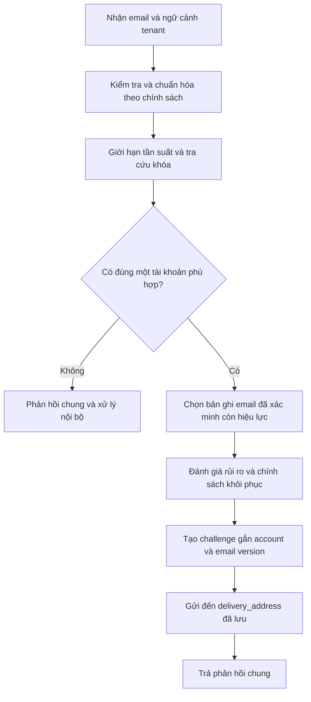

# Chuẩn hóa định danh email trong khôi phục tài khoản

Trong chương **Identifier Handling**, chuẩn hóa định danh email là bước biến chuỗi người dùng nhập thành một khóa tra cứu theo chính sách đã xác định. Với hệ thống **SECURITY_AUTHENTICATION_ACCOUNT_RECOVERY**, sai sót ở bước này có thể khiến yêu cầu khôi phục không tìm thấy chủ tài khoản, gộp nhầm hai tài khoản hoặc gửi liên kết khôi phục đến sai người.

Khôi phục tài khoản có thể bắt đầu khi người dùng mất mật khẩu, MFA, passkey hoặc thiết bị xác thực. Email giúp định vị tài khoản và có thể là một kênh nhận thử thách, nhưng việc biết địa chỉ email không chứng minh quyền sở hữu tài khoản. Bài học này xây dựng chính sách chuẩn hóa, mô hình lưu trữ và cách dùng kết quả tra cứu an toàn trong luồng khôi phục.

## 1. Vì sao một thao tác xử lý chuỗi lại là quyết định bảo mật?

Giả sử hệ thống lưu `Minh.Nguyen+work@example.com`. Một lập trình viên muốn hỗ trợ người dùng nên chuyển toàn bộ email thành chữ thường, bỏ dấu chấm và xóa phần sau dấu `+`. Kết quả là `minhnguyen@example.com`.

Biến đổi này chỉ an toàn nếu hệ thống có đủ căn cứ để coi các dạng đó tương đương trong phạm vi áp dụng. Không thể lấy hành vi của một dịch vụ email rồi suy rộng cho mọi tên miền. Trên một hệ thống thư khác, hai địa chỉ sau có thể là hai hộp thư khác nhau:

```text
minh.nguyen@example.com
minhnguyen@example.com
```

Nếu người dùng A đăng ký địa chỉ thứ nhất và người dùng B đăng ký địa chỉ thứ hai, việc bỏ dấu chấm trong riêng luồng quên mật khẩu có thể làm khóa tra cứu của B trỏ sang A. Nếu hệ thống còn gửi thư đến địa chỉ lấy trực tiếp từ yêu cầu của B, sự sai lệch định danh có thể trở thành đường chiếm đoạt tài khoản.

Có hai loại sai lệch cần phân biệt:

| Sai lệch | Ví dụ | Hệ quả trong khôi phục |
|---|---|---|
| Gộp nhầm hai địa chỉ khác nhau | Tự xóa dấu chấm hoặc `+tag` trên mọi tên miền | Chọn sai tài khoản hoặc gây xung đột khóa |
| Tách hai dạng mà sản phẩm muốn xem là một | Đăng ký hạ chữ thường domain nhưng khôi phục giữ nguyên domain | Chủ tài khoản không tìm thấy tài khoản của mình |

Một chính sách tốt phải mô tả rõ cả những biến đổi được phép và những khác biệt phải giữ lại.

## 2. Tách bốn công việc thường bị trộn lẫn

**Kiểm tra cú pháp** trả lời: ứng dụng có chấp nhận định dạng này không? Một sản phẩm có thể chỉ hỗ trợ một tập con đơn giản của cú pháp email, miễn là quy tắc rõ ràng và nhất quán.

**Chuẩn hóa** trả lời: với đầu vào được chấp nhận, ứng dụng dùng khóa so sánh nào? Đây là hàm có tính xác định, không phải thao tác đoán địa chỉ mà người dùng định nhập.

**Kiểm chứng kênh email** trả lời: có ai nhận và hoàn thành được thử thách gửi đến địa chỉ này không? Thử thách phải gắn với địa chỉ, mục đích và thời hạn cụ thể. Chỉ kiểm tra cú pháp hoặc DNS không chứng minh điều đó.

**Cho phép khôi phục** trả lời: các bằng chứng hiện có có đủ để thực hiện hành động được yêu cầu không? Khôi phục mật khẩu, tháo MFA và đăng ký passkey mới có thể cần mức bảo đảm khác nhau.

Chuẩn hóa đúng không tự tạo quyền tháo MFA, không thay thế đánh giá rủi ro và không tự cho phép tạo một session đăng nhập đầy đủ.

## 3. Local-part và domain có quy tắc khác nhau

Với địa chỉ đơn giản trong phạm vi ứng dụng:

```text
Minh.Nguyen+work@EXAMPLE.COM
└──── local-part ────┘ └ domain ┘
```

### 3.1. Domain

Đối với domain ASCII thông thường, chữ hoa và chữ thường được xem là tương đương khi so sánh tên miền. Vì vậy, chuyển `EXAMPLE.COM` thành `example.com` là một phép chuẩn hóa phù hợp.

Tên miền quốc tế cần một chính sách IDNA được chọn rõ ràng và một thư viện thực hiện chính sách đó. IDNA xử lý tên miền; nó không tự giải quyết local-part quốc tế. Nếu hỗ trợ domain Unicode, hệ thống phải thống nhất dạng dùng làm khóa, dạng hiển thị và phiên bản xử lý giữa các dịch vụ.

Không tự viết phép chuyển đổi Unicode sang Punycode bằng vài thao tác thay thế chuỗi. Cũng không coi mọi API có chữ `IDN` là có cùng hành vi đối với mọi ký tự và mọi cấu hình.

### 3.2. Local-part

Không có một phép hạ chữ thường, bỏ dấu chấm hoặc bỏ `+tag` an toàn cho tất cả local-part. Nhà vận hành hệ thống thư có thể quyết định nhiều địa chỉ là bí danh của cùng hộp thư; ứng dụng bên ngoài không nên tự suy ra quy tắc đó.

Chính sách thận trọng là giữ nguyên local-part được chấp nhận. Nếu sản phẩm muốn so sánh local-part không phân biệt hoa thường, đó phải là một quyết định định danh công khai, áp dụng ngay từ đăng ký và được kiểm tra xung đột trên dữ liệu hiện có. Không được lén thêm quyết định đó vào endpoint khôi phục.

Giữ nguyên local-part cũng không chứng minh hai địa chỉ thuộc hai con người khác nhau. Một người có thể kiểm soát nhiều bí danh. Chuẩn hóa email không phải cơ chế phát hiện một người đăng ký nhiều tài khoản.

### 3.3. Unicode và ký tự giống nhau

Hai chuỗi nhìn gần giống nhau chưa chắc tương đương về định danh. Một domain chứa ký tự Cyrillic giống chữ Latin không được tự động ánh xạ sang domain Latin. Các dạng chuẩn hóa Unicode như NFC, NFKC và các phép case folding cũng không được áp dụng tùy tiện lên toàn bộ địa chỉ.

Khi hỗ trợ local-part quốc tế, cần có chính sách riêng và khả năng gửi thư phù hợp trong toàn tuyến. Nếu chưa hỗ trợ, từ chối đầu vào đó bằng thông báo về định dạng; không bỏ dấu tiếng Việt hoặc đổi sang một địa chỉ ASCII đoán được.

## 4. Một chính sách ứng dụng cụ thể

Để có một ví dụ triển khai rõ ràng, bài học dùng chính sách **`email-ascii-v1`**. Đây là tập con do ứng dụng lựa chọn, không phải bộ phân tích mọi cú pháp email hợp lệ.

| Thành phần | Chính sách `email-ascii-v1` |
|---|---|
| Khoảng trắng ngoài cùng | Bỏ riêng ký tự dấu cách ASCII `U+0020` ở hai đầu |
| Khoảng trắng bên trong, tab, xuống dòng, ký tự điều khiển | Từ chối; không xóa để nối thành địa chỉ khác |
| Ký tự ngoài ASCII hiển thị | Từ chối trong chính sách này |
| Cấu trúc | Đúng một `@`, local-part và domain đều không rỗng |
| Local-part | Chấp nhận chữ ASCII, chữ số, `.`, `_`, `+`, `-`; giữ nguyên hoa thường |
| Dấu chấm trong local-part | Không ở đầu/cuối, không có hai dấu chấm liên tiếp |
| Domain | Các nhãn ASCII gồm chữ, số, dấu `-`; hạ chữ thường bằng quy tắc độc lập locale |
| Dấu `-` trong nhãn domain | Không ở đầu/cuối nhãn |
| Domain dùng cho ví dụ sản phẩm công khai | Có ít nhất hai nhãn; không có dấu chấm cuối |
| Giới hạn ứng dụng | Local-part tối đa 64 byte; mỗi nhãn domain tối đa 63 byte; toàn địa chỉ tối đa 254 byte |
| Bí danh | Giữ nguyên dấu chấm, `+tag`; không quy đổi các tên miền sang nhau |

Vì chỉ chấp nhận ASCII, số ký tự và số byte UTF-8 của đầu vào đã chuẩn hóa bằng nhau. Không được giữ cách tính này nếu sau đó bổ sung Unicode.

Yêu cầu domain có ít nhất hai nhãn là lựa chọn của ví dụ sản phẩm công khai. Hệ thống nội bộ có thể có chính sách khác. Tương tự, quoted local-part và các ký tự hợp lệ khác của email không thuộc tập con này; cần báo không hỗ trợ thay vì tuyên bố mọi địa chỉ bị từ chối đều sai theo giao thức email.

Các ví dụ chỉ mô tả kết quả xử lý chuỗi. Domain `example.com` được dùng để minh họa, không hàm ý địa chỉ có hộp thư thật.

| Đầu vào | Kết quả theo chính sách |
|---|---|
| ` Minh.Nguyen+work@EXAMPLE.COM ` | `Minh.Nguyen+work@example.com` |
| `Minh.Nguyen@example.com` | Giữ nguyên |
| `minh.nguyen@example.com` | Giữ nguyên; khóa khác ví dụ ngay trên |
| `minhnguyen@example.com` | Giữ nguyên; không gộp với địa chỉ có dấu chấm |
| `minh+work@example.com` | Giữ nguyên phần `+work` |
| `minh @example.com` | Từ chối vì có dấu cách bên trong |
| `minh..nguyen@example.com` | Từ chối theo chính sách local-part |
| `minh@example.com.` | Từ chối; không âm thầm bỏ dấu chấm cuối |
| `Minh <minh@example.com>` | Từ chối vì đây không phải dạng địa chỉ ứng dụng hỗ trợ |
| `minh@exаmple.com` với chữ `а` Cyrillic | Từ chối vì có ký tự ngoài ASCII |

Khi gặp lỗi gõ như `minh@exampel.com`, có thể gợi ý trên giao diện để người dùng tự sửa. Không âm thầm đổi địa chỉ rồi tra cứu hoặc gửi thư.

## 5. Hàm chuẩn hóa minh họa bằng Java

Ví dụ sau dùng Java có hỗ trợ `record`. Hàm chỉ tạo khóa theo chính sách ASCII vừa mô tả; nó không kiểm tra hộp thư tồn tại và không thực hiện khôi phục tài khoản.

```java
import java.util.Locale;

public final class EmailNormalizer {
    private static final String POLICY = "email-ascii-v1";

    public record NormalizedEmail(String key, String policyVersion) {}

    public static NormalizedEmail normalize(String input) {
        if (input == null) {
            throw invalid();
        }

        // Chỉ bỏ U+0020 ngoài cùng; không dùng cách xóa mọi whitespace.
        int start = 0;
        int end = input.length();
        while (start < end && input.charAt(start) == ' ') start++;
        while (end > start && input.charAt(end - 1) == ' ') end--;
        String email = input.substring(start, end);

        if (email.isEmpty() || email.length() > 254) {
            throw invalid();
        }
        for (int i = 0; i < email.length(); i++) {
            char c = email.charAt(i);
            if (c < 0x21 || c > 0x7E) {
                throw invalid();
            }
        }

        int at = email.indexOf('@');
        if (at <= 0 || at != email.lastIndexOf('@')
                || at == email.length() - 1) {
            throw invalid();
        }

        String local = email.substring(0, at);
        String domain = email.substring(at + 1).toLowerCase(Locale.ROOT);

        if (local.length() > 64
                || !local.matches("[A-Za-z0-9._+-]+")
                || local.startsWith(".")
                || local.endsWith(".")
                || local.contains("..")) {
            throw invalid();
        }

        String[] labels = domain.split("\\.", -1);
        if (labels.length < 2) {
            throw invalid();
        }
        for (String label : labels) {
            if (label.isEmpty() || label.length() > 63
                    || !label.matches("[a-z0-9-]+")
                    || label.startsWith("-") || label.endsWith("-")) {
                throw invalid();
            }
        }

        return new NormalizedEmail(local + "@" + domain, POLICY);
    }

    private static IllegalArgumentException invalid() {
        // Không đưa email thô vào exception hoặc log mặc định.
        return new IllegalArgumentException("Unsupported email format");
    }
}
```

`split("\\.", -1)` giữ lại nhãn rỗng cuối chuỗi để địa chỉ có domain kết thúc bằng dấu chấm bị từ chối. `Locale.ROOT` tránh để quy tắc hạ chữ phụ thuộc locale của máy chủ.

Một nhãn bắt đầu bằng `xn--` vẫn chỉ được ví dụ trên kiểm tra như chuỗi ASCII. Đoạn code không phải bộ kiểm tra IDNA hay công cụ đánh giá domain giả mạo. Nếu sản phẩm nhận domain Unicode và chuẩn hóa tương đương với A-label, phải bổ sung bộ xử lý IDNA có cùng chính sách trong mọi luồng liên quan.

API cần giới hạn kích thước request trước khi gọi hàm. Không để một đầu vào khổng lồ tiêu tốn tài nguyên chỉ để tìm ra rằng nó không phải email được chấp nhận.

Những thuộc tính mong muốn của hàm là:

- **Có tính xác định:** cùng đầu vào và phiên bản chính sách cho cùng kết quả.
- **Lũy đẳng:** nếu `N(x)` thành công thì `N(N(x).key).key` bằng `N(x).key`.
- **Có ranh giới rõ:** chỉ những khác biệt được chính sách công nhận mới bị loại bỏ.
- **Dùng chung:** đăng ký, đăng nhập, thêm/đổi email và yêu cầu khôi phục gọi cùng chính sách phía server.

JavaScript phía trình duyệt có thể giúp phản hồi sớm, nhưng không được là nơi duy nhất quyết định khóa định danh.

## 6. Lưu địa chỉ, khóa tra cứu và trạng thái xác minh riêng biệt

Không dùng một cột `email` để đồng thời chứa mọi ý nghĩa. Một mô hình minh họa:

```text
AccountEmail
  id                       định danh bất biến của bản ghi email
  account_id               tài khoản sở hữu bản ghi
  lookup_key               khóa chuẩn hóa dùng để tìm kiếm
  normalization_version    ví dụ email-ascii-v1
  delivery_address         địa chỉ cụ thể dùng để gửi thư
  verified_at              thời điểm hoàn thành xác minh, có thể rỗng
  verification_version     tăng khi địa chỉ hoặc trạng thái tin cậy thay đổi
  state                    PENDING / VERIFIED / RETIRED
```

Trong chính sách ASCII trên, `delivery_address` có thể là khóa đã chuẩn hóa vì local-part được giữ nguyên và chỉ domain được hạ chữ thường. Nếu ứng dụng dùng một chính sách so sánh khác, cần giữ riêng địa chỉ gửi thư được xác minh; không suy ra lại nó từ khóa tra cứu đã mất thông tin.

Có thể lưu dạng người dùng nhập để hiển thị nếu có nhu cầu rõ ràng, nhưng phải giới hạn thời gian lưu và tránh thu thập không cần thiết. Dữ liệu hiển thị không tự trở thành địa chỉ nhận thư đáng tin cậy.

Ràng buộc duy nhất phải phản ánh phạm vi tài khoản của sản phẩm. Nếu địa chỉ chỉ duy nhất trong một tenant, mọi truy vấn và unique constraint phải bao gồm tenant lấy từ ngữ cảnh đáng tin cậy. Nếu endpoint không xác định được tenant mà có nhiều kết quả, không chọn ngẫu nhiên một tài khoản.

Cần kiểm soát collation của cơ sở dữ liệu. Hàm Java giữ nguyên `Minh` và `minh` nhưng cột database so sánh không phân biệt hoa thường sẽ tạo ra hai định nghĩa tương đương khác nhau. Khóa cần được so sánh chính xác theo chính sách, không vô tình theo quy tắc bỏ dấu hoặc case folding của database.

Unique constraint phải được database thực thi khi tạo hoặc cập nhật, thay vì chỉ kiểm tra rồi chèn ở tầng ứng dụng. Hai request đồng thời có thể cùng vượt qua bước kiểm tra trước khi ghi.

Một địa chỉ `PENDING` không được trở thành kênh khôi phục chỉ vì nó có cú pháp đúng. Nếu có cơ chế giữ chỗ địa chỉ chưa xác minh, cần giới hạn thời gian và chống việc giữ chỗ hàng loạt gây cản trở người dùng khác.

## 7. Dùng khóa chuẩn hóa trong luồng khôi phục

Luồng khôi phục nên tách rõ **tìm tài khoản** và **chọn kênh nhận thử thách**:



### 7.1. Tra cứu không đồng nghĩa được phép gửi

Sau khi tìm được tài khoản, chỉ chọn một địa chỉ khôi phục đã được xác minh và đủ điều kiện theo chính sách. Nếu tài khoản không còn kênh đó, hướng người dùng đến phương thức khôi phục khác theo quy trình sản phẩm; không thay thế bằng một email mới do request cung cấp.

Không dùng truy vấn gần đúng, so khớp tiền tố, sửa lỗi chính tả hoặc khoảng cách chỉnh sửa để tự chọn tài khoản. Tìm kiếm hỗ trợ có thể đưa gợi ý trong ngữ cảnh được bảo vệ, nhưng không được cấp quyền khôi phục dựa trên một kết quả gần giống.

Đặc biệt tránh cách làm sau:

```text
account = findByNormalizedEmail(request.email)
sendRecoveryLink(to = request.email, tokenFor = account.id)
```

Địa chỉ gửi thư phải lấy từ bản ghi đã xác minh gắn với tài khoản đã chọn. Request chỉ cung cấp đầu vào tra cứu, không có quyền thay đổi đích giao token.

### 7.2. Gắn thử thách với định danh bất biến

Một bản ghi challenge nên chứa tối thiểu các liên kết phù hợp với thiết kế:

```text
RecoveryChallenge
  account_id
  email_record_id
  email_verification_version
  purpose
  token_digest
  expires_at
  consumed_at
```

Token ngẫu nhiên phải đủ mạnh, có thời hạn, được lưu dạng digest thích hợp và được tiêu thụ một lần bằng thao tác nguyên tử. Không cần đưa email vào URL; dùng token mờ và liên kết phía server để giảm lộ dữ liệu.

Khi token được dùng, kiểm tra lại bản ghi email còn thuộc tài khoản, còn ở trạng thái được phép và `verification_version` chưa thay đổi. Nếu người dùng đổi hoặc loại bỏ email sau khi phát hành token, token cũ phải bị vô hiệu theo chính sách. Việc kiểm tra trạng thái và chuyển bước khôi phục cần được bảo vệ khỏi cập nhật đồng thời.

Nếu hệ thống gửi qua hàng đợi, tác vụ gửi cũng phải mang tham chiếu email và phiên bản cần thiết. Không để worker gửi thư lấy đích từ trường email tùy ý trong request, hoặc gửi theo một snapshot đã bị thu hồi mà không có kiểm soát.

### 7.3. Bằng chứng email có giới hạn

Hoàn thành thử thách email chứng minh quyền truy cập kênh tại thời điểm đó trong phạm vi giả định của hệ thống. Nó không chứng minh người nhận là chủ thể hợp pháp trong mọi tình huống: hộp thư có thể bị chiếm, bị chia sẻ hoặc được cấp lại.

Với yêu cầu thay MFA hay đăng ký thiết bị xác thực mới, đánh giá thêm rủi ro và các bằng chứng được chính sách yêu cầu. Sau khôi phục, việc thu hồi session, refresh token hoặc hạn chế session mới cần dựa trên loại hành động và mức bảo đảm đạt được. Không dùng kết quả chuẩn hóa email để tự bỏ qua các bước này.

## 8. Chống lạm dụng mà không làm lộ tài khoản

Endpoint khôi phục thường trả một thông báo chung như:

> Nếu thông tin phù hợp với một tài khoản đủ điều kiện, hướng dẫn sẽ được gửi qua kênh đã đăng ký.

Đối với yêu cầu có cú pháp hợp lệ, không trả thông báo khác nhau để phân biệt tài khoản tồn tại, chưa xác minh, bị khóa hay không có phương thức khôi phục qua email. Lỗi định dạng có thể được giải thích theo chính sách công khai vì nó không phụ thuộc việc email có trong database.

Cần kiểm soát cả mã HTTP, cấu trúc phản hồi và khác biệt thời gian xử lý. Xử lý bất đồng bộ và đường phản hồi tương tự giúp giảm tín hiệu phân biệt, nhưng không tự bảo đảm mọi quan sát đều giống nhau. Không dùng một khoảng ngủ cố định làm biện pháp duy nhất.

Giới hạn tần suất nên kết hợp nhiều chiều:

| Chiều kiểm soát | Mục đích |
|---|---|
| Khóa email chuẩn hóa trong đúng phạm vi tenant | Không cho đổi hoa thường domain hoặc thêm dấu cách ngoài cùng để né giới hạn |
| `account_id` khi đã có kết quả hợp lệ | Gộp hạn mức trên các email hoặc định danh khác cùng trỏ đến tài khoản |
| IP, mạng và tín hiệu thiết bị phù hợp | Giảm tự động hóa và yêu cầu phân tán theo nhiều email |
| Hạn mức toàn hệ thống và lượng thư gửi | Bảo vệ hạ tầng và tránh dội thư vào hộp thư nạn nhân |

Nếu cần tạo khóa hạn mức mà không lưu email thô, có thể dùng HMAC với khóa bí mật phía server trên một biểu diễn có cấu trúc gồm phạm vi, phiên bản và khóa email. Hash không có khóa của email vẫn dễ bị dò bằng danh sách địa chỉ phổ biến. HMAC giúp hạn chế một dạng rò rỉ, không biến dữ liệu thành vô danh tuyệt đối.

Không ghi token, liên kết khôi phục đầy đủ hoặc email thô vào log mặc định. Sự kiện điều tra có thể dùng mã yêu cầu, kết quả chuẩn hóa, phiên bản chính sách và tham chiếu nội bộ được kiểm soát truy cập. Với đầu vào không hợp lệ, chỉ ghi mã lý do phù hợp, tránh phản chiếu ký tự điều khiển vào log.

## 9. Thay đổi chính sách trên hệ thống đang có dữ liệu

Thay `email-ascii-v1` bằng một phiên bản mới là thay đổi quy tắc định danh. Không thể chỉ triển khai hàm mới ở endpoint khôi phục rồi chờ dữ liệu tự đồng bộ.

Giả sử database đang có:

```text
Account A: Mai@example.com
Account B: mai@example.com
```

Nếu chính sách mới hạ chữ thường toàn bộ địa chỉ, cả hai trở thành `mai@example.com`. Một unique index chỉ phát hiện xung đột kỹ thuật; nó không quyết định được ai là chủ tài khoản hợp lệ. Không gộp A và B, chọn bản ghi đầu tiên hay gửi token của một tài khoản đến hộp thư suy ra từ khóa mới.

Một kế hoạch chuyển đổi cần giải quyết tuần tự:

1. Xác định rõ khác biệt giữa chính sách cũ và mới, kể cả hành vi collation và IDNA nếu có.
2. Tính khóa dự kiến trên dữ liệu hiện có trong quy trình chuyển đổi được kiểm soát; phân loại bản ghi không còn hợp lệ và các nhóm va chạm.
3. Giữ các trường hợp va chạm ngoài luồng khôi phục tự động bằng chính sách mới; dùng quy trình xác minh thích hợp để xử lý.
4. Đồng bộ đăng ký, đăng nhập, đổi email, recovery, công cụ hỗ trợ và tác vụ nền theo kế hoạch phiên bản.
5. Thực thi unique constraint phù hợp, chuyển lưu lượng có kiểm soát và theo dõi tỷ lệ không tìm thấy hoặc bị chặn do mơ hồ.

Trong giai đoạn hỗ trợ hai phiên bản, một đầu vào có thể tạo nhiều khóa ứng viên. Chỉ tiếp tục khi mọi kết quả hợp lệ quy về duy nhất một tài khoản trong phạm vi đã xác định. Nếu các phiên bản trỏ đến các tài khoản khác nhau, phải coi là mơ hồ và không phát hành thử thách tự động.

Không dùng fallback tùy tiện kiểu “không tìm thấy thì thử bỏ dấu chấm, bỏ tag, bỏ dấu tiếng Việt”. Mỗi fallback như vậy tự tạo thêm một quy tắc định danh chưa được kiểm soát.

## 10. Các tình huống cần có trong đặc tả kiểm chứng

Bảng dưới mô tả hành vi cần kiểm chứng khi triển khai thực tế; đây không phải một bộ kiểm thử đã chạy cùng tài liệu.

| Tình huống | Kết quả cần đạt |
|---|---|
| Đổi hoa thường domain, thêm dấu cách ASCII ở hai đầu | Cùng khóa theo `email-ascii-v1`; dùng chung hạn mức theo khóa |
| Đổi hoa thường local-part | Giữ khác biệt theo chính sách minh họa, không phụ thuộc locale hoặc database collation |
| Bỏ dấu chấm hoặc `+tag` | Không tự quy về cùng khóa |
| Đầu vào có CR, LF, tab hoặc khoảng trắng bên trong | Từ chối; không nối các phần lại thành địa chỉ mới |
| Domain Unicode khi chưa hỗ trợ | Từ chối có chủ đích; không bỏ ký tự hoặc chuyển gần đúng |
| Chuẩn hóa hai lần | Khóa không đổi |
| Hai request đăng ký cùng khóa chạy đồng thời | Database ngăn tạo hai bản ghi xung đột theo phạm vi duy nhất |
| Request dùng một dạng tương đương được cho phép | Gửi đến địa chỉ đã xác minh trong database |
| Email đã được thay hoặc thu hồi sau khi tạo challenge | Challenge cũ không còn đủ điều kiện sử dụng |
| Token được gửi hai lần đồng thời | Chỉ một lần được tiêu thụ thành công |
| Khóa chuyển đổi khớp nhiều tài khoản | Không tự chọn một tài khoản để khôi phục |
| Tài khoản tồn tại và không tồn tại với đầu vào hợp lệ | Không khác nhau rõ ràng ở thông báo hoặc trạng thái phản hồi vì kết quả tra cứu |

Cần quan sát thêm chỉ số vận hành như tỷ lệ đầu vào bị từ chối theo lý do, tỷ lệ tra cứu mơ hồ, số thư bị chặn do hạn mức và tỷ lệ challenge bị vô hiệu vì email thay đổi. Những chỉ số này giúp phát hiện sai chính sách mà không cần đổ email và token vào log.

## 11. Nguyên tắc áp dụng

Chuẩn hóa email là một phần của hợp đồng định danh của sản phẩm. Domain ASCII có thể hạ chữ thường; local-part cần được giữ hoặc biến đổi đúng chính sách đã lựa chọn. Dấu chấm, `+tag`, Unicode và bí danh không được xử lý bằng suy đoán.

Trong khôi phục tài khoản, khóa chuẩn hóa chỉ dùng để tìm ứng viên. Tài khoản phải được xác định không mơ hồ; đích gửi phải là kênh đã xác minh còn hiệu lực; challenge phải gắn với tài khoản, bản ghi email, phiên bản và mục đích. Quyết định đặt lại mật khẩu, thay MFA hoặc cấp session tiếp tục dựa trên bằng chứng và đánh giá rủi ro của chính hành động đó.
