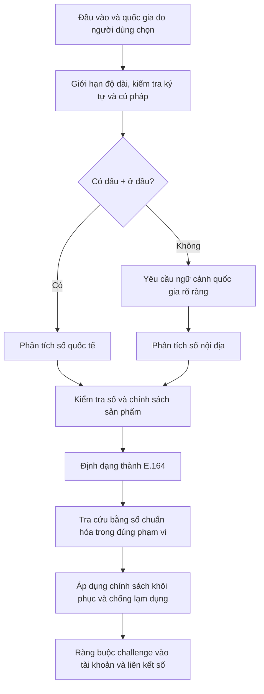

# Chuẩn hóa định danh số điện thoại trong khôi phục tài khoản

## 1. Mục tiêu và phạm vi

Trong chương **Identifier Handling** của module **SECURITY_AUTHENTICATION_ACCOUNT_RECOVERY**, chuẩn hóa số điện thoại là bước chuyển cách nhập của người dùng thành một định danh nhất quán để tra cứu và xử lý. Người dùng có thể nhập cùng một số bằng nhiều cách: dạng nội địa, dạng quốc tế, có khoảng trắng hoặc dấu phân cách. Nếu mỗi bước hiểu số theo một cách khác nhau, hệ thống có thể tìm sai tài khoản, tạo nhiều hạn mức gửi mã cho cùng một đích hoặc xác minh một số nhưng cập nhật số khác.

Bài học này giải thích cách thiết kế một đường chuẩn hóa dùng chung cho đăng ký, cập nhật thông tin liên hệ và khôi phục tài khoản khi mất mật khẩu, MFA, passkey hoặc thiết bị xác thực. Sau bài học, bạn có thể:

- Phân biệt đầu vào, số chuẩn hóa, cách hiển thị và bản ghi liên kết số với tài khoản.
- Chọn ngữ cảnh quốc gia rõ ràng và xử lý đầu vào mơ hồ mà không tự đoán.
- Đưa số chuẩn hóa vào tra cứu, chống lạm dụng và ràng buộc challenge khôi phục.
- Nhận biết giới hạn của số điện thoại khi dùng làm bằng chứng khôi phục tài khoản.

**Bất biến quan trọng:** cùng một đầu vào và cùng ngữ cảnh quốc gia phải tạo ra cùng kết quả chuẩn hóa theo cùng chính sách. Tuy nhiên, hai chuỗi chuẩn hóa bằng nhau chỉ cho biết chúng biểu diễn cùng một số; điều đó không chứng minh cùng một người đang kiểm soát số ấy.

## 2. Bốn khái niệm cần tách biệt

| Khái niệm | Ví dụ minh họa | Vai trò |
|---|---|---|
| Đầu vào gốc | `090 123 4567` | Dữ liệu chưa đáng tin cậy do người dùng nhập |
| Ngữ cảnh phân tích | `VN` do người dùng chọn | Giải thích số nội địa theo kế hoạch đánh số tương ứng |
| Giá trị chuẩn hóa | `+84901234567` | Khóa so sánh, tra cứu và đích gửi được kiểm soát |
| Liên kết tài khoản với số | `binding_id`, `account_id`, phiên bản, trạng thái xác minh | Ghi nhận số đã được xác minh cho tài khoản nào và ở thời điểm nào |

Các số trong bài chỉ là chuỗi minh họa cho xử lý định dạng, không phải đích để thử gửi SMS.

### 2.1. Dạng E.164 trong ứng dụng

Một cách lưu số quốc tế thường dùng là chuỗi có dấu `+`, tiếp theo là mã gọi quốc gia và phần số quốc gia, chỉ gồm chữ số ASCII. Số E.164 có tối đa **15 chữ số**, không tính dấu `+`. Quy tắc hình dạng sơ bộ có thể viết:

```text
^\+[1-9][0-9]{1,14}$
```

Biểu thức này chỉ kiểm tra hình dạng. Nó không xác định được độ dài hợp lệ của từng kế hoạch đánh số, số đã được cấp phát hay khả năng nhận SMS. Một chuỗi khớp biểu thức vẫn có thể không phải số hợp lệ.

Lưu số dưới kiểu chuỗi, không dùng số nguyên: số điện thoại không phải đại lượng để tính toán; dấu `+` và các chữ số mang ý nghĩa định danh.

### 2.2. Số chuẩn hóa và số hiển thị

Giao diện có thể hiển thị `+84 90 123 4567` hoặc một dạng che bớt ký tự. Các dạng này phục vụ người dùng, không dùng làm khóa dữ liệu. Nếu giao diện gửi lại một chuỗi đã che như `+84•••••4567`, máy chủ không được cố khôi phục các chữ số bị che để tìm tài khoản.

Tương tự, không so khớp bằng bốn số cuối, hậu tố dài tùy ý hoặc khoảng cách chuỗi gần đúng. Hai số ở hai quốc gia có thể có cùng hậu tố nhưng là hai đích hoàn toàn khác nhau.

## 3. Quyết định ngữ cảnh quốc gia trước khi phân tích

Mã vùng giao diện như `VN` là ngữ cảnh của thư viện phân tích; mã gọi quốc gia như `+84` là một phần của số quốc tế. Hai khái niệm này không thể thay thế cho nhau. Một mã gọi quốc gia cũng có thể được dùng chung bởi nhiều vùng đánh số.

### 3.1. Đầu vào đã có dấu `+`

Phân tích như số quốc tế, không chèn thêm mã gọi quốc gia đang chọn trên giao diện. Nếu người dùng chọn Việt Nam nhưng nhập một số có mã gọi quốc gia khác, hệ thống cần áp dụng chính sách hỗ trợ quốc gia của sản phẩm. Có thể yêu cầu người dùng xác nhận lựa chọn, nhưng không tự biến số quốc tế ấy thành số Việt Nam.

### 3.2. Đầu vào là số nội địa

Yêu cầu một lựa chọn quốc gia rõ ràng. Ngôn ngữ trình duyệt, địa chỉ IP, múi giờ hoặc vị trí thiết bị chỉ nên hỗ trợ điền gợi ý; chúng không đủ để quyết định số thuộc kế hoạch đánh số nào. Người dùng có thể đi du lịch, dùng VPN hoặc giữ số nước ngoài.

Không tự thử lần lượt nhiều quốc gia rồi chọn kết quả đầu tiên tìm thấy tài khoản. Cách làm này vừa có thể dẫn đến nhầm tài khoản, vừa biến dữ liệu tài khoản thành công cụ giải quyết đầu vào mơ hồ.

### 3.3. Tiền tố `0`, `00` và số có số máy lẻ

Không viết quy tắc toàn cục kiểu “bỏ số `0` đầu tiên rồi thêm mã quốc gia”. Ý nghĩa của chữ số đầu phụ thuộc kế hoạch đánh số; có trường hợp chữ số `0` là thành phần cần giữ lại của số quốc tế.

`00` không phải tiền tố quay số quốc tế của mọi nơi. Sản phẩm có thể hỗ trợ tiền tố quay số theo ngữ cảnh xuất phát rõ ràng, hoặc chọn chính sách đơn giản hơn: yêu cầu dạng `+` cho số quốc tế. Ví dụ trong bài sử dụng chính sách thứ hai và từ chối đầu vào bắt đầu bằng `00`.

Số máy lẻ, chuỗi `ext`, ký hiệu chờ quay số và cú pháp URI `tel:` không thuộc định danh nhận SMS ở đây. Không xóa phần máy lẻ rồi âm thầm chấp nhận phần số còn lại. Nếu sản phẩm có khôi phục qua cuộc gọi hoặc số doanh nghiệp, cần một kiểu dữ liệu và chính sách riêng.

## 4. Pipeline chuẩn hóa có ranh giới rõ ràng



### Bước 1: Kiểm tra biên đầu vào

Giới hạn độ dài trước khi xử lý sâu. Chỉ chấp nhận tập ký tự được sản phẩm công bố, chẳng hạn chữ số ASCII, một dấu `+` ở đầu và một số dấu phân cách trình bày. Từ chối ký tự điều khiển, xuống dòng và ký tự vô hình để tránh việc log, giao diện và parser hiểu khác nhau.

Với chữ số Unicode, cần chọn chính sách cụ thể. Có thể từ chối và hướng dẫn nhập lại, hoặc ánh xạ một tập chữ số được xác định rõ sang ASCII trước khi phân tích. Không gom mọi ký tự trông giống chữ số bằng một bước biến đổi Unicode quá rộng mà chưa đánh giá các trường hợp nhập nhằng.

Đoạn mã ở phần sau chọn chính sách chỉ nhận chữ số ASCII. Đây là lựa chọn của ví dụ, không phải thuộc tính bắt buộc của mọi giao diện đa ngôn ngữ.

### Bước 2: Chỉ bỏ dấu phân cách đã cho phép

Không dùng một thao tác xóa toàn bộ ký tự không phải chữ số:

```java
// Không dùng để chuẩn hóa định danh số điện thoại.
String digits = raw.replaceAll("[^0-9]", "");
```

Cách này làm mất dấu `+`, che giấu đầu vào chứa chữ hoặc máy lẻ và không giải thích được số nội địa thuộc quốc gia nào. Ví dụ một chuỗi có hậu tố `ext 123` có thể bị biến thành số dài hơn mà không còn dấu hiệu rằng đầu vào ban đầu không được hỗ trợ.

### Bước 3: Phân tích bằng thư viện có dữ liệu kế hoạch đánh số

Thư viện như libphonenumber giúp phân tích tiền tố, độ dài và mẫu số theo vùng. Cần phân biệt:

- **Có thể có về cấu trúc:** thường dựa nhiều vào độ dài và cấu trúc tổng quát.
- **Hợp lệ theo metadata:** phù hợp các quy tắc mà phiên bản thư viện đang biết.
- **Đang được cấp phát và định tuyến:** không thể khẳng định chỉ bằng parser.
- **Nhận được SMS và đang do người yêu cầu kiểm soát:** cần bằng chứng ở bước gửi và xác minh challenge.

Một parser có thể linh hoạt hơn chính sách sản phẩm, chẳng hạn nhận cả ký tự hoặc cách viết mà giao diện không muốn hỗ trợ. Vì vậy, kiểm tra biên phải diễn ra trước khi gọi thư viện; kết quả thư viện cũng phải qua chính sách của ứng dụng.

### Bước 4: Tạo một giá trị chuẩn duy nhất

Định dạng số đã phân tích thành E.164. Từ thời điểm này, các thành phần tra cứu, giới hạn gửi và chọn đích gửi phải dùng cùng giá trị hoặc cùng bản ghi liên kết đã được chốt. Không cho từng thành phần tự chuẩn hóa lại từ chuỗi gốc bằng những quy tắc khác nhau.

Nếu không thể giải thích đầu vào chắc chắn, yêu cầu nhập lại hoặc chọn quốc gia. Không tự sửa số dựa vào tài khoản mà hệ thống muốn tìm.

## 5. Ví dụ hành vi đầu vào

Bảng dưới mô tả chính sách minh họa: số nội địa cần quốc gia; chỉ nhận chữ số ASCII; hỗ trợ khoảng trắng, dấu gạch ngang và dấu chấm; số quốc tế dùng dấu `+`.

| Đầu vào | Quốc gia đã chọn | Kết quả mong muốn |
|---|---|---|
| `090 123 4567` | `VN` | Chuẩn hóa thành `+84901234567` nếu vượt qua kiểm tra metadata |
| `090-123-4567` | `VN` | Cùng giá trị chuẩn như hàng trên |
| `+84 90 123 4567` | Không cần | Phân tích như số quốc tế, cùng giá trị chuẩn |
| `0901234567` | Không có | Yêu cầu chọn quốc gia, không thử nhiều vùng |
| `0084 90 123 4567` | `VN` | Yêu cầu nhập dạng `+84...` theo chính sách ví dụ |
| `+84 090 123 4567` | Bất kỳ | Từ chối nếu parser phải bỏ thêm một chữ số để tạo số chuẩn |
| `0901234567 ext 123` | `VN` | Từ chối vì không hỗ trợ máy lẻ |
| `+84•••••4567` | Bất kỳ | Từ chối vì đây là số đã che |
| Chuỗi chứa ký tự xuống dòng hoặc ký tự vô hình | Bất kỳ | Từ chối ở biên đầu vào |
| Chuỗi chỉ có chữ số nhưng dài quá giới hạn | Bất kỳ | Từ chối trước khi tra cứu tài khoản |

Kết quả phân tích phụ thuộc metadata của thư viện. Không dùng các ví dụ này làm bằng chứng số thật đang tồn tại hoặc nhận được SMS.

## 6. Ví dụ Java: tạo giá trị chuẩn hóa ở biên hệ thống

Đoạn mã sau minh họa ranh giới chuẩn hóa với API libphonenumber. Dự án cần khai báo thư viện tương ứng; đoạn mã không bao gồm cấu hình phụ thuộc, tra cứu cơ sở dữ liệu hoặc logic phát hành OTP.

Các giới hạn `64` ký tự đầu vào và tập vùng `VN`, `US`, `GB` là chính sách minh họa. Khi triển khai, danh sách vùng phải được cấu hình theo phạm vi sản phẩm. Ví dụ dùng `String.strip()`, có từ Java 11.

```java
import com.google.i18n.phonenumbers.NumberParseException;
import com.google.i18n.phonenumbers.PhoneNumberUtil;
import com.google.i18n.phonenumbers.Phonenumber.PhoneNumber;

import java.util.Locale;
import java.util.Set;
import java.util.regex.Pattern;

public final class RecoveryPhoneNormalizer {
    private static final PhoneNumberUtil PHONES =
            PhoneNumberUtil.getInstance();

    private static final Set<String> SUPPORTED_REGIONS =
            Set.of("VN", "US", "GB");

    // Dấu + chỉ được xuất hiện một lần và ở đầu.
    // Không nhận ngoặc, chữ, máy lẻ, tab hoặc chữ số Unicode.
    private static final Pattern INPUT =
            Pattern.compile("\\+?[0-9][0-9 .-]*");

    private static final Pattern E164 =
            Pattern.compile("\\+[1-9][0-9]{1,14}");

    public record NormalizedPhone(String e164) {}

    public NormalizedPhone normalize(String raw, String selectedRegion) {
        if (raw == null || raw.length() > 64) {
            throw invalidInput();
        }

        // Chỉ cho phép U+0020 là khoảng trắng trình bày trong raw.
        // Kiểm tra trước strip để không che giấu tab hoặc xuống dòng.
        for (int i = 0; i < raw.length(); i++) {
            char c = raw.charAt(i);
            boolean allowed = (c >= '0' && c <= '9')
                    || c == '+' || c == ' ' || c == '.' || c == '-';
            if (!allowed) {
                throw invalidInput();
            }
        }

        String input = raw.strip();
        if (!INPUT.matcher(input).matches()) {
            throw invalidInput();
        }

        // Chỉ xóa ba dấu phân cách đã cho phép, giữ nguyên dấu +.
        String compact = input.replace(" ", "")
                .replace(".", "")
                .replace("-", "");

        if (compact.startsWith("00")) {
            throw new IllegalArgumentException(
                    "Hãy nhập số quốc tế bắt đầu bằng dấu +");
        }

        boolean international = compact.startsWith("+");
        String parseRegion = "ZZ";
        if (!international) {
            parseRegion = requireSupportedRegion(selectedRegion);
        }

        try {
            PhoneNumber number = PHONES.parse(compact, parseRegion);
            if (number.hasExtension() || !PHONES.isValidNumber(number)) {
                throw invalidInput();
            }

            String numberRegion = PHONES.getRegionCodeForNumber(number);
            if (!SUPPORTED_REGIONS.contains(numberRegion)) {
                throw new IllegalArgumentException(
                        "Vùng đánh số chưa được hỗ trợ");
            }

            String e164 = PHONES.format(
                    number, PhoneNumberUtil.PhoneNumberFormat.E164);
            if (!E164.matcher(e164).matches()) {
                throw invalidInput();
            }

            // Với đầu vào quốc tế, không cho parser âm thầm thêm/bớt
            // chữ số. Ví dụ +84 090... không được tự sửa thành +84 90...
            if (international && !compact.equals(e164)) {
                throw invalidInput();
            }

            return new NormalizedPhone(e164);
        } catch (NumberParseException exception) {
            // Không đưa raw vào thông báo lỗi hoặc log tại đây.
            throw invalidInput();
        }
    }

    private static String requireSupportedRegion(String selectedRegion) {
        if (selectedRegion == null) {
            throw new IllegalArgumentException("Cần chọn quốc gia");
        }
        String region = selectedRegion.strip().toUpperCase(Locale.ROOT);
        if (!SUPPORTED_REGIONS.contains(region)) {
            throw new IllegalArgumentException("Quốc gia không được hỗ trợ");
        }
        return region;
    }

    private static IllegalArgumentException invalidInput() {
        return new IllegalArgumentException("Số điện thoại không hợp lệ");
    }
}
```

`record` trong ví dụ cần Java 16 trở lên; nếu dùng Java 11, có thể thay bằng lớp bất biến thông thường. Các hàm báo lỗi chỉ mô tả vấn đề cú pháp hoặc phạm vi hỗ trợ, không chứa thông tin tài khoản có tồn tại hay không.

Việc kiểm tra `compact.equals(e164)` chỉ áp dụng cho đầu vào quốc tế đã có dấu `+`. Số nội địa cần chuyển đổi tiền tố theo kế hoạch đánh số, nên không thể yêu cầu chuỗi nội địa giống hệt số quốc tế.

Danh sách vùng được hỗ trợ không chứng minh số nhận được SMS. Phân loại số di động, cố định hoặc VoIP, nếu có sử dụng, thuộc một lớp chính sách riêng. Không suy ra độ tin cậy của người yêu cầu chỉ từ loại số hoặc kết quả phân tích.

## 7. Mô hình dữ liệu: số điện thoại là liên kết có vòng đời

Không dùng số điện thoại làm khóa chính của người dùng. Tài khoản nên có định danh nội bộ ổn định, còn số điện thoại là phương thức liên hệ có thể thêm, xác minh, thay thế hoặc thu hồi.

Một mô hình khái niệm cho liên kết khôi phục:

```text
account_phone_binding
  binding_id
  account_id
  tenant_id
  phone_e164_encrypted
  phone_lookup_hmac
  lookup_key_version
  binding_version
  state                 # PENDING, VERIFIED, REVOKED
  verified_at
  changed_at
  normalization_policy_version
```

Đây là mô hình minh họa, không phải yêu cầu mọi hệ thống phải có nguyên bộ trường này.

- `binding_id` định danh một lần liên kết số với tài khoản.
- `binding_version` thay đổi khi thông tin hoặc trạng thái liên quan đến khôi phục thay đổi.
- `verified_at` ghi nhận lần chứng minh kiểm soát số, không có nghĩa quyền kiểm soát tồn tại mãi mãi.
- Phiên bản chính sách chuẩn hóa giúp giải thích dữ liệu được tạo theo quy tắc nào khi điều tra hoặc chuyển đổi.

### 7.1. Một số có thể gắn với bao nhiêu tài khoản?

Đây là quyết định nghiệp vụ, không phải kết quả tự động của E.164. Nếu một số chỉ được làm định danh khôi phục cho một tài khoản trong một tenant, cần ràng buộc duy nhất trong cơ sở dữ liệu cho phạm vi và trạng thái phù hợp. Không chỉ kiểm tra bằng truy vấn trước khi ghi, vì hai yêu cầu đồng thời vẫn có thể tạo trùng.

Nếu sản phẩm cho phép một số dùng chung cho nhiều tài khoản, số ấy không đủ để chọn duy nhất tài khoản cần khôi phục. Cần định danh bổ sung hoặc một luồng chọn tài khoản sau mức xác minh phù hợp. Không chọn bản ghi đầu tiên và không công khai danh sách tài khoản ngay khi người dùng nhập số.

Một số trùng với số đã có không cho phép tự gộp tài khoản. Số dùng chung, số tái cấp và sai sót nhập liệu đều có thể làm kết luận đó nguy hiểm.

### 7.2. Dữ liệu cá nhân và khóa tra cứu

Nếu không cần giữ đầu vào gốc thì không lưu nó. Số chuẩn hóa vẫn là dữ liệu cá nhân; cần kiểm soát truy cập, thời gian lưu và việc xuất ra log. Che bớt số để hiển thị không biến bản ghi gốc thành dữ liệu vô danh.

Nếu cần tra cứu mà muốn hạn chế lưu số dạng rõ trong chỉ mục, có thể dùng khóa HMAC xác định:

```text
lookup_key = HMAC(
    secret_key,
    encode("recovery-phone", tenant_id, phone_e164)
)
```

`encode` phải có ranh giới trường rõ ràng, chẳng hạn mã hóa theo độ dài; không nối chuỗi mơ hồ. Tenant trong công thức chỉ phù hợp khi miền duy nhất và tra cứu của sản phẩm là theo tenant.

Không dùng hash không khóa của số như một biện pháp bảo mật đủ mạnh: không gian số điện thoại có thể bị dò theo vùng và mẫu số. HMAC cần khóa bí mật được quản lý tách khỏi dữ liệu. HMAC cũng không che được quan hệ trùng lặp trong chỉ mục.

Để gửi SMS, hệ thống vẫn cần số đích được phép sử dụng, ví dụ thông qua trường mã hóa. Luân chuyển khóa HMAC cần chiến lược phiên bản và chuyển đổi dữ liệu để không làm mất tra cứu hoặc tạo trùng liên kết.

## 8. Ràng buộc chuẩn hóa với challenge khôi phục

Một lỗi nghiêm trọng là kiểm tra OTP cho một đích rồi lấy lại trường `phone` trong request cuối cùng để quyết định cập nhật tài khoản nào. Người dùng có thể sửa trường đó, hoặc tài khoản đã đổi số trong thời gian challenge còn hiệu lực.

Luồng an toàn cần chốt đối tượng ở phía máy chủ:

1. Chuẩn hóa số đầu vào một lần tại biên API bằng chính sách chung.
2. Tra cứu trong đúng tenant và áp dụng quy tắc chọn tài khoản của sản phẩm.
3. Chỉ chọn liên kết đủ điều kiện khôi phục; bản ghi `PENDING` không tự trở thành kênh đáng tin cậy.
4. Tạo challenge gắn với `account_id`, `binding_id`, `binding_version`, mục đích và hạn dùng. Chốt đích gửi từ bản ghi liên kết của máy chủ.
5. Áp dụng hạn mức trước khi gửi. Đối chiếu đích gửi thực tế với đích đã chốt; không chuyển lại qua một chuỗi chuẩn hóa riêng ở nhà cung cấp theo mặc định vùng khác.
6. Khi nhận mã, tra challenge bằng định danh khó đoán. Không nhận số hoặc tài khoản mới từ client làm đối tượng thay thế.
7. Kiểm tra mã, hạn dùng, số lần thử, trạng thái liên kết và phiên bản. Nếu liên kết thay đổi hoặc bị thu hồi, challenge không còn hợp lệ.
8. Tiêu thụ challenge một lần bằng cập nhật nguyên tử, đồng thời bảo đảm thay đổi liên kết không thể chen vào giữa bước kiểm tra và bước cấp quyền khôi phục.
9. Cấp một quyền khôi phục giới hạn, chỉ cho mục đích đã xác định. Sau các bước đánh giá rủi ro cần thiết mới thực hiện đổi mật khẩu, thay MFA hoặc khôi phục khả năng đăng nhập.

Ví dụ đối tượng challenge phía máy chủ:

```text
challenge_id: giá trị ngẫu nhiên, khó đoán
account_id: tài khoản đã chọn
binding_id: liên kết số đã chọn
binding_version: phiên bản khi tạo challenge
purpose: RECOVER_PASSWORD
expires_at: thời điểm hết hạn
attempts_remaining: số lần thử còn lại
consumed_at: chưa sử dụng hoặc thời điểm đã dùng
```

Nếu dùng OTP ngắn, ngoài hạn mức thử cần thiết kế cách lưu bộ kiểm tra mã phù hợp, chẳng hạn HMAC có khóa bí mật. Hash không khóa của một mã ngắn không bảo vệ tốt khi dữ liệu bị lộ vì có thể thử hết không gian mã. Thời hạn, số lần thử và hạn mức gửi là các tham số của chính sách rủi ro, không được thay thế bởi chuẩn hóa số.

Khôi phục xong có thể cần thu hồi session cũ, refresh token hoặc quyền khôi phục đang mở, tùy loại thay đổi và mô hình đe dọa. Mã SMS không tự động cấp quyền bỏ qua mọi bước bảo vệ cho tài khoản đã bật MFA hoặc passkey.

## 9. Chống lạm dụng và tránh tiết lộ tài khoản

### 9.1. Chuẩn hóa trước khi tính hạn mức theo đích

Nếu hạn mức dùng chuỗi thô, các đầu vào `0901234567`, `090 123 4567` và `+84 90 123 4567` có thể tạo ba bộ đếm dù cùng một đích. Sau khi chuẩn hóa, chúng phải hội tụ về cùng khóa đích trong phạm vi chính sách.

Cần kết hợp nhiều chiều: đích chuẩn hóa, tài khoản nếu đã xác định, nguồn yêu cầu, thiết bị hoặc session phù hợp và ngân sách gửi tổng. Chỉ giới hạn theo số có thể bị lợi dụng để ngăn người dùng thật nhận mã; chỉ giới hạn theo IP có thể gây ảnh hưởng mạng dùng chung hoặc bị vượt qua bằng nhiều nguồn.

Đầu vào sai hoặc quá dài vẫn cần hạn mức ở biên, trước khi có một số chuẩn hóa. Không đợi parser và tra cứu thành công mới bắt đầu chống lạm dụng.

### 9.2. Phân biệt lỗi cú pháp với thông tin tồn tại tài khoản

Có thể thông báo “hãy chọn quốc gia” hoặc “số điện thoại sai định dạng” trước tra cứu. Những lỗi này nói về đầu vào, không nói về sự tồn tại của tài khoản.

Sau khi đầu vào có hình dạng được hỗ trợ, phản hồi khởi tạo khôi phục cần tránh phân biệt công khai “không có tài khoản”, “số chưa xác minh” hoặc “đã gửi mã cho tài khoản này”. Một thông điệp có thể là:

> Nếu thông tin phù hợp với một tài khoản đủ điều kiện, hệ thống sẽ hướng dẫn bước tiếp theo.

Cần xem cả mã HTTP, trường JSON, thời gian phản hồi, việc hiển thị số đã che và phản hồi từ nhà cung cấp SMS. Không để lỗi nội bộ hoặc chi tiết giao hàng làm lộ tài khoản qua một nhánh khác. Thiết kế này không có nghĩa phải gửi SMS cho mọi đầu vào hợp lệ.

### 9.3. Log và hỗ trợ khách hàng

Ưu tiên ghi request ID, loại lỗi chuẩn hóa, phiên bản chính sách và định danh nội bộ được phép sử dụng. Tránh ghi nguyên số trong exception, URL hoặc tên metric. Nếu cần một khóa đối chiếu xác định để điều tra, có thể dùng HMAC theo mục đích và kiểm soát quyền truy cập tương ứng.

Nhân viên hỗ trợ không được bỏ qua chuẩn hóa bằng cách tìm “số gần giống” rồi đổi kênh khôi phục. Quyền truy cập công cụ hỗ trợ và việc thay liên kết phải có dấu vết kiểm toán.

## 10. Tình huống: thay cách viết và thay người kiểm soát số

### 10.1. Nhiều cách viết của cùng một số

Một tài khoản đã xác minh số `+84901234567`. Người dùng nhập `090-123-4567` và chọn `VN` khi quên mật khẩu.

Hệ thống chuẩn hóa thành `+84901234567`, tìm liên kết đủ điều kiện trong đúng tenant, tính hạn mức theo cùng số chuẩn rồi tạo challenge cho liên kết đó. Một yêu cầu khác dùng dạng `+84 90 123 4567` phải chịu cùng hạn mức đích. Khi người dùng nhập mã, tài khoản được chọn từ challenge, không được tra lại bằng trường số do client gửi.

Nếu tài khoản đổi số trước khi mã được xác nhận, phiên bản liên kết không còn khớp. Challenge cũ phải bị từ chối dù mã nhập đúng. Việc so sánh phiên bản cần được bảo đảm cùng giao dịch hoặc cơ chế đồng thời tương đương với bước sử dụng challenge.

### 10.2. Số được tái cấp hoặc bị chiếm quyền kiểm soát

Sau một thời gian, chủ cũ không còn sử dụng số. Người mới có thể nhận SMS gửi đến đúng cùng chuỗi E.164. Chuẩn hóa vẫn hoàn toàn chính xác, nhưng kết luận “người này là chủ cũ của tài khoản” có thể sai.

Vì vậy, khả năng nhận mã hiện tại chỉ là một bằng chứng. Với thao tác nhạy cảm như thay MFA, thay passkey hoặc lấy lại tài khoản lâu không hoạt động, hệ thống cần chính sách xét thêm yếu tố đã đăng ký, thiết bị tin cậy, tín hiệu rủi ro, thời gian chờ hoặc quy trình xác minh bổ sung. Các tín hiệu như thay SIM hoặc chuyển mạng, nếu sản phẩm có nguồn hợp lệ để dùng, hỗ trợ đánh giá rủi ro; chúng không tự tạo ra bằng chứng danh tính chắc chắn.

Một số mới nhập trong chính yêu cầu khôi phục không được thay thế kênh đã đăng ký chỉ vì người yêu cầu nhận được OTP ở số mới. Xác minh số mới và chứng minh quyền với tài khoản cũ là hai việc khác nhau.

## 11. Kiểm chứng hành vi và thay đổi chính sách

Những tình huống dưới đây dùng để thiết kế kiểm thử cho phần chuẩn hóa và tích hợp. Chúng không thay thế kiểm tra khả năng nhận SMS ở môi trường được phép.

| Nhóm tình huống | Điều cần chứng minh |
|---|---|
| Nhiều dấu phân cách được hỗ trợ | Cùng số và vùng cho cùng E.164 |
| Chuẩn hóa lại giá trị chuẩn | `normalize(e164)` vẫn trả về chính E.164 đó |
| Số nội địa thiếu vùng | Không tự chọn quốc gia hoặc thử nhiều tài khoản |
| Hai số có cùng hậu tố | Không coi là cùng định danh |
| Đầu vào có chữ, máy lẻ, ký tự vô hình | Không bị biến thành một số có vẻ hợp lệ |
| Số quốc tế có thêm tiền tố nội địa sai | Không được parser âm thầm sửa qua chính sách nghiêm ngặt |
| Cùng số ở nhiều tenant | Tuân thủ đúng miền tra cứu và quy tắc duy nhất của sản phẩm |
| Hai yêu cầu liên kết đồng thời | Ràng buộc dữ liệu ngăn trạng thái trùng không được phép |
| Cùng đích nhưng nhiều cách viết | Không nhân số lượt gửi SMS được phép |
| Đổi số sau khi phát hành mã | Challenge cũ không xác minh được liên kết mới |
| Hai lần xác nhận đồng thời | Chỉ một lần tiêu thụ challenge thành công |
| Số hợp lệ nhưng không có tài khoản | Phản hồi công khai không tiết lộ sự khác biệt |

Metadata kế hoạch đánh số và chính sách sản phẩm có thể thay đổi. Khi nâng thư viện hoặc điều chỉnh chuẩn hóa, cần đánh giá tác động lên dữ liệu đã lưu; không tự chuẩn hóa lại toàn bộ rồi ghi đè các liên kết đã xác minh.

Một đợt chuyển đổi có kiểm soát cần xác định các giá trị đổi kết quả, phát hiện xung đột, bảo toàn định danh tài khoản và quyết định trường hợp nào cần xác minh lại. Không gộp tài khoản để giải quyết xung đột. Với challenge còn hiệu lực, cần giữ nguyên đích đã chốt hoặc chủ động hủy theo chính sách, tránh thay đích giữa chừng.

Lưu phiên bản chính sách và quản lý thống nhất cách chuẩn hóa giữa các dịch vụ giúp truy vết khác biệt. Nếu API, tác vụ nền và công cụ hỗ trợ dùng các quy tắc khác nhau, giá trị chuẩn không còn là một giao ước đáng tin cậy.

## 12. Ghi nhớ khi thiết kế

Chuẩn hóa số điện thoại tạo ra một định danh kỹ thuật nhất quán. Nó giúp tìm đúng liên kết, áp dụng hạn mức cho đúng đích và ràng buộc bằng chứng xác minh với đúng yêu cầu khôi phục.

Thiết kế tốt giữ rõ ba ranh giới: **số có cấu trúc hợp lệ**, **số đã được xác minh cho tài khoản**, và **người yêu cầu hiện có đủ bằng chứng để khôi phục tài khoản**. Chỉ khi các lớp này được kiểm soát cùng với token dùng một lần, chống lạm dụng và quản lý session, số điện thoại mới đóng góp an toàn vào luồng khôi phục.
