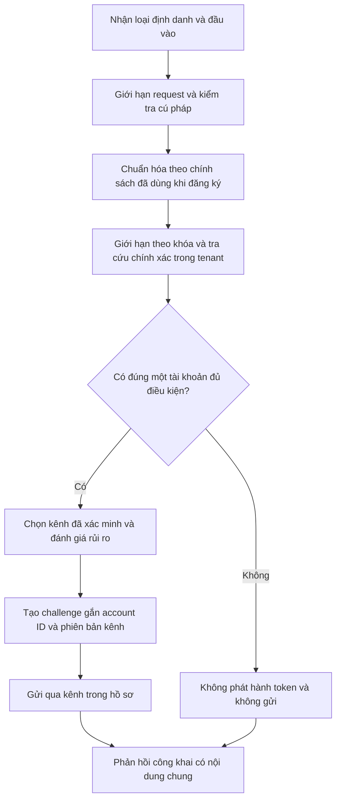

# Unicode identifier handling

Trong luồng khôi phục tài khoản, một chuỗi người dùng nhập phải dẫn đến đúng tài khoản và đúng kênh liên hệ đã xác minh. Unicode làm việc này khó hơn: hai chuỗi trông giống nhau có thể khác mã ký tự; cùng một chữ có thể có nhiều cách biểu diễn; quy tắc đổi hoa thường lại phụ thuộc chính sách và ngôn ngữ.

Bài học thuộc chương **Identifier Handling** của module `SECURITY_AUTHENTICATION_ACCOUNT_RECOVERY`. Phạm vi là xử lý username, email và định danh Unicode khi người dùng mất mật khẩu, MFA, passkey hoặc thiết bị xác thực. Mục tiêu là tránh tra cứu nhầm tài khoản, gửi nhầm thông điệp khôi phục và biến những biến thể Unicode thành cách vượt giới hạn chống lạm dụng.

Sau bài học, bạn có thể:

- Phân biệt dạng hiển thị, khóa tra cứu và ID tài khoản ổn định.
- Chọn quy tắc chuẩn hóa theo từng loại định danh, nhất quán với lúc đăng ký.
- Xử lý email quốc tế hóa mà không tự nhận hai hộp thư khác nhau là một.
- Thiết kế lookup, rate limit, token và giao diện hỗ trợ để giữ nguyên ranh giới danh tính.

## 1. Một định danh có nhiều vai trò khác nhau

Không nên dùng một trường chuỗi cho mọi mục đích. Hãy tách ít nhất các vai trò sau:

| Thành phần | Ví dụ | Vai trò |
|---|---|---|
| Dữ liệu người dùng gửi | Username được dán vào biểu mẫu | Đầu vào chưa đáng tin cậy; chưa chứng minh quyền sở hữu |
| Dạng hiển thị | Tên đăng nhập có dấu | Giúp người dùng nhận biết tài khoản |
| Khóa tra cứu | Username sau chính sách chuẩn hóa đã công bố | Tìm duy nhất tài khoản trong một namespace |
| ID tài khoản nội bộ | `account_id` ngẫu nhiên, ổn định | Ràng buộc quyền, phiên và yêu cầu khôi phục |
| Kênh khôi phục | Email đã xác minh trong hồ sơ | Địa chỉ nhận thông điệp theo chính sách hiện hành |

Tên hiển thị có thể trùng. Khóa tra cứu phải có ràng buộc duy nhất trong phạm vi thích hợp, chẳng hạn tenant và loại định danh. ID nội bộ không được thay đổi chỉ vì người dùng sửa username hoặc email.

Một username hay email chỉ giúp **tìm** tài khoản. Biết chuỗi đó không đủ để được đặt lại mật khẩu, bỏ MFA hay thay passkey. Những hành động này cần bằng chứng và mức bảo đảm phù hợp với rủi ro.

## 2. Vì sao chuỗi nhìn giống nhau chưa chắc bằng nhau?

### 2.1. Ký tự dựng sẵn và dấu kết hợp

Chữ `é` có thể được biểu diễn bằng:

```text
Dạng A: U+00E9                 LATIN SMALL LETTER E WITH ACUTE
Dạng B: U+0065 U+0301          LATIN SMALL LETTER E + COMBINING ACUTE ACCENT
```

Hai dạng thường hiển thị giống nhau nhưng khác chuỗi mã ký tự và khác byte UTF-8. Với chính sách username dùng NFC, chúng có cùng khóa sau chuẩn hóa. Nếu đăng ký lưu dạng A còn recovery so sánh trực tiếp dạng B, người dùng hợp lệ có thể không tìm lại được tài khoản.

NFC xử lý tương đương chuẩn tắc; nó không xóa dấu. `café` và `cafe` vẫn khác nhau trong chính sách này.

### 2.2. Dạng tương thích và ký tự gần giống

NFKC có phạm vi biến đổi rộng hơn NFC. Ví dụ, chữ Latin toàn chiều rộng có thể được đưa về chữ Latin thông thường bằng chuẩn hóa tương thích. Đây là quyết định về quan hệ bằng nhau, không chỉ là sửa hình thức.

Ngược lại, `a` Latin, mã `U+0061`, và `а` Cyrillic, mã `U+0430`, có thể trông gần như giống nhau nhưng không trở thành một chữ nhờ NFC. Không được tự thay chữ Cyrillic bằng Latin để tra cứu tài khoản.

| Trường hợp | Rủi ro trong recovery | Hướng xử lý |
|---|---|---|
| Hai cách mã hóa dấu | Không tìm được tài khoản đã đăng ký | Dùng đúng chuẩn hóa của loại định danh |
| Ký tự trông giống nhau | Người dùng hoặc nhân viên hỗ trợ chọn nhầm tài khoản | Cảnh báo và hiển thị rõ; giữ tách biệt danh tính |
| Chữ toàn chiều rộng | Hai dịch vụ tạo khóa khác nhau | Thống nhất chính sách, không tự dùng NFKC ở recovery |
| Ký tự vô hình | Người dùng không thấy sự khác biệt | Áp dụng profile ký tự đã định nghĩa; không âm thầm xóa |
| Điều khiển hai chiều | Giao diện hoặc log hiển thị gây hiểu nhầm | Hạn chế theo chính sách và escape khi kiểm tra |
| Đổi hoa thường khác locale | Cùng chuỗi được ánh xạ khác nhau giữa máy chủ | Không phụ thuộc locale mặc định |

Phát hiện confusable hoặc tạo “skeleton” có thể phục vụ cảnh báo và đánh giá rủi ro. Skeleton không phải khóa chứng minh hai tài khoản là một, cũng không phải cơ sở tự gộp tài khoản.

## 3. Hợp đồng chuẩn hóa phải tồn tại trước recovery

Mỗi loại định danh cần một hợp đồng rõ ràng: chấp nhận đầu vào nào, quan hệ bằng nhau là gì, giới hạn ra sao và dùng phiên bản chính sách nào.

Ví dụ, một sản phẩm có thể chọn hợp đồng username sau:

```text
Loại: USERNAME
Phạm vi duy nhất: tenant_id + loại định danh + lookup_key
Chuẩn hóa: NFC
Hoa thường: có phân biệt
Dấu tiếng Việt: giữ nguyên
Khoảng trắng đầu/cuối: không hợp lệ, không tự cắt
Ký tự được phép: theo profile Unicode do sản phẩm quy định
Tra cứu gần đúng: không dùng trong recovery
Phiên bản chính sách: username-v1
```

Đây là một ví dụ thiết kế, không phải quy tắc bắt buộc cho mọi hệ thống. Sản phẩm không phân biệt hoa thường phải định nghĩa phép ánh xạ tương ứng từ lúc đăng ký, bảo đảm tính nhất quán và kiểm soát collision.

Trong Java, bước NFC đơn lẻ có thể minh họa bằng:

```java
import java.text.Normalizer;

String precomposed = "caf\u00E9";
String decomposed = "cafe\u0301";

String keyA = Normalizer.normalize(precomposed, Normalizer.Form.NFC);
String keyB = Normalizer.normalize(decomposed, Normalizer.Form.NFC);

boolean sameUnderNfc = keyA.equals(keyB); // true
```

Đoạn mã chỉ minh họa tương đương NFC, chưa phải bộ xử lý username hoàn chỉnh. Nó chưa kiểm tra độ dài, ký tự được phép, tenant, tính duy nhất hay quyền khôi phục.

### 3.1. Không ghép các phép biến đổi “tiện lợi”

Tránh một hàm dùng chung cho mọi loại định danh như:

```text
lowercase(removeAccents(removeInvisible(NFKC(trim(input)))))
```

Hàm như vậy có thể làm hai tài khoản trước đây tách biệt trở thành cùng một khóa. Nó cũng khiến recovery có quan hệ bằng nhau khác đăng ký và đăng nhập.

Các trường hợp cần quyết định riêng:

- `An` và `an`: phụ thuộc hợp đồng hoa thường của username.
- `café` và `cafe`: không bằng nhau chỉ vì NFC.
- `I`, `i`, `İ`, `ı`: không suy ra bằng nhau bằng quy tắc viết hoa thường của locale máy chủ.
- Chuỗi chứa ký tự nối hoặc dấu kết hợp: có thể hợp lệ trong một số hệ chữ; không xóa hàng loạt bằng biểu thức chính quy đơn giản.

`toLowerCase()` theo locale mặc định không phải hợp đồng định danh ổn định. Ngay cả phép đổi thường độc lập locale cũng không đồng nghĩa với Unicode case folding đầy đủ. Nếu chọn cơ chế không phân biệt hoa thường, phải xác định thuật toán, thứ tự chuẩn hóa và thư viện dùng chung; không vá riêng endpoint recovery.

### 3.2. Thứ tự xử lý và giới hạn

Một pipeline điển hình là:

1. Giới hạn kích thước request và trường đầu vào trước khi xử lý tốn tài nguyên.
2. Giải mã nghiêm ngặt; từ chối dữ liệu mã hóa lỗi thay vì thay bằng ký tự khác.
3. Phân tích đúng loại định danh theo cú pháp đã hỗ trợ.
4. Áp dụng các bước ánh xạ, chuẩn hóa theo hợp đồng của loại đó.
5. Kiểm tra đầu ra: profile ký tự, độ dài và các giới hạn của nơi lưu trữ hoặc nơi gửi.
6. Tạo khóa tra cứu và truy vấn chính xác trong namespace.

Một ký tự người dùng nhìn thấy có thể gồm nhiều code point. `String.length()` của Java đếm đơn vị UTF-16, không đếm trực tiếp ký tự hiển thị. Giới hạn theo byte, code point và grapheme phục vụ những mục đích khác nhau; phải ghi rõ mỗi giới hạn đang bảo vệ điều gì.

Giới hạn đầu vào giúp chống chuỗi dấu kết hợp quá dài và tiêu hao tài nguyên chuẩn hóa. Giới hạn sau chuẩn hóa bảo vệ database và dịch vụ downstream. Nếu một lớp có thể nhận surrogate không ghép cặp, cần từ chối trước khi chuyển thành byte hoặc so sánh khóa.

## 4. Username Unicode và email Unicode cần chính sách khác nhau

Email gồm local-part và domain. Không được chuẩn hóa toàn bộ email bằng chính sách username rồi coi kết quả là cùng hộp thư.

### 4.1. Phần domain

Tên miền quốc tế hóa có thể có dạng Unicode và dạng ASCII dùng trong xử lý IDNA. Nếu hỗ trợ, hệ thống phải dùng bộ xử lý IDNA đã chọn, cấu hình rõ cách ánh xạ, xác thực nhãn và giới hạn độ dài.

Quy tắc so sánh domain phải nhất quán giữa đăng ký, xác minh email, đăng nhập và recovery. Không chỉ gọi một hàm “Punycode encode” rồi cho rằng mọi domain đầu vào đều hợp lệ. Punycode biểu diễn nhãn; việc chấp nhận tên miền còn cần các bước kiểm tra của chính sách IDNA.

Hai domain trông giống nhau vẫn có thể là hai domain khác nhau. Nhận diện confusable có thể cảnh báo người dùng khi thêm kênh khôi phục mới; nó không cho phép gửi mail sang domain “trông đúng hơn”.

### 4.2. Phần local-part

Không tự giả định local-part luôn không phân biệt hoa thường hoặc mọi cách biểu diễn Unicode đều tương đương. Việc hộp thư nào được nhà cung cấp nhận là chuyện khác với chính sách khóa định danh của ứng dụng.

Ứng dụng cần giữ địa chỉ đã xác minh và quy tắc so sánh đã áp dụng khi đăng ký. Không tự thêm các quy tắc của một nhà cung cấp vào mọi email, chẳng hạn:

- Bỏ dấu chấm trong local-part.
- Bỏ phần sau dấu cộng.
- Xóa dấu tiếng Việt.
- Chuyển ký tự trông giống nhau sang Latin.
- Áp dụng NFC hoặc NFKC cho local-part chỉ tại endpoint recovery.

Nếu hỗ trợ địa chỉ có local-part Unicode, toàn bộ đường gửi phải hỗ trợ email quốc tế hóa tương ứng, gồm yêu cầu SMTPUTF8 khi cần. Không hạ xuống ASCII bằng cách bỏ dấu để cố gửi được mail.

Nếu sản phẩm chưa hỗ trợ loại địa chỉ đó, hãy xác định giới hạn từ lúc thêm và xác minh email. Recovery không được tuyên bố đã thiết lập một kênh mới chỉ vì người dùng vừa nhập một địa chỉ hợp cú pháp.

### 4.3. Tra cứu và gửi là hai thao tác riêng

Giả sử người dùng nhập một biến thể hợp lệ có cùng khóa theo hợp đồng email đã công bố:

```text
Đầu vào → khóa tra cứu → account_id
account_id → bản ghi kênh đã xác minh → gửi thông điệp
```

Đích gửi lấy từ bản ghi đã xác minh, không lấy trực tiếp từ request, từ tên hiển thị, hay từ kết quả “sửa gần đúng” của địa chỉ nhập vào.

Một hệ thống có thể lưu cả dạng phục vụ hiển thị, dạng gửi đã xác minh và khóa so sánh. Chúng có quan hệ theo chính sách nhưng không nên bị nhập làm một trường rồi tùy tiện thay thế lẫn nhau.

## 5. Tổ chức dữ liệu để tránh tra cứu nhầm

Một mô hình khái niệm có thể gồm:

```text
AccountIdentifier
  tenant_id
  identifier_type
  display_value
  lookup_key
  policy_version
  account_id

RecoveryChannel
  channel_id
  account_id
  verified_destination
  verified_at
  version
  state
```

Ràng buộc duy nhất áp dụng lên `(tenant_id, identifier_type, lookup_key)` cho các định danh đang hoạt động. Nếu chính sách cho phép tái sử dụng tên sau khi xóa, vòng đời và thời gian giữ tên phải được xử lý rõ; không dựa vào một truy vấn thiếu điều kiện trạng thái.

Collation của database phải tương thích với hợp đồng khóa. Một collation tự bỏ dấu hoặc không phân biệt hoa thường có thể làm database coi hai khóa khác nhau là bằng nhau. Có thể dùng so sánh chính xác trên khóa đã chuẩn hóa với kiểu dữ liệu và index phù hợp; phải kiểm tra cả hành vi khoảng trắng và những quy tắc so sánh riêng của database.

Nếu đổi `policy_version`, không mặc định thêm phiên bản vào unique constraint là đã an toàn. Hai tài khoản dùng hai phiên bản khác nhau vẫn có thể trở nên trùng trong namespace logic mà sản phẩm đang phục vụ.

Không chạy `LIMIT 1` để che một kết quả lookup nhiều tài khoản. Trạng thái mơ hồ phải dừng phát hành token, ghi nhận sự kiện nội bộ và đi qua quy trình giải quyết collision. Phản hồi bên ngoài vẫn tránh tiết lộ danh sách tài khoản.

Trong hệ thống nhiều tenant, lấy tenant từ ngữ cảnh đã được xác định và kiểm tra. Không cho phép một username Unicode trong tenant A tự dẫn sang tài khoản cùng tên trong tenant B.

## 6. Luồng recovery giữ nguyên ranh giới danh tính



Sơ đồ mô tả quyết định nghiệp vụ, không yêu cầu thực hiện gửi mail đồng bộ trước khi trả HTTP. Có thể đưa công việc vào hàng đợi để kiểm soát tải và giảm khác biệt quan sát được giữa các trường hợp.

Một phản hồi công khai phù hợp là:

> Nếu thông tin phù hợp với một tài khoản đủ điều kiện, hướng dẫn khôi phục sẽ được gửi qua kênh đã đăng ký.

Không trả lại `account_id`, địa chỉ đầy đủ, dạng chuẩn hóa nội bộ hoặc danh sách tài khoản gần giống cho người chưa được xác thực. Ngoài nội dung, cần xem xét mã HTTP, kích thước phản hồi, thời gian và hành vi giới hạn để không tạo tín hiệu dò tài khoản. Độ trễ ngẫu nhiên đơn lẻ không giải quyết toàn bộ khác biệt này.

### 6.1. Mã giả cho các ranh giới xử lý

```text
requestRecovery(tenantContext, identifierType, rawInput):
    enforceRequestSizeAndPreLookupLimits(tenantContext, requestContext)

    result = identifierPolicy.parseAndCanonicalize(identifierType, rawInput)
    if result.invalid:
        recordBoundedValidationEvent()
        return genericRecoveryResponse()

    lookupKey = result.key
    enforceIdentifierLimits(tenantContext, identifierType, lookupKey)

    account = lookupExactlyOneActiveAccount(
        tenantContext.tenantId, identifierType, lookupKey
    )
    if account.absentOrAmbiguous:
        return genericRecoveryResponse()

    enforceAccountLimits(account.id)
    channel = selectEligibleVerifiedChannel(account.id)
    decision = evaluateRecoveryRisk(account, channel, requestContext)
    if decision.requiresDifferentRecoveryPath:
        routeAccordingToPolicyWithoutDisclosingAccount()
        return genericRecoveryResponse()

    issueAndQueueChallenge(
        accountId = account.id,
        channelId = channel.id,
        channelVersion = channel.version,
        accountRecoveryVersion = account.recoveryVersion,
        purpose = requestedRecoveryPurpose
    )
    return genericRecoveryResponse()
```

Các tên hàm mô tả trách nhiệm, không đại diện cho thư viện cụ thể. Nhánh lỗi, tài khoản không tồn tại và tài khoản có tồn tại đều phải được thiết kế về hành vi quan sát được; mã giả không tự bảo đảm chống enumeration.

### 6.2. Token không dùng Unicode identifier làm căn cứ cuối cùng

Challenge nên dùng token ngẫu nhiên khó đoán, có hạn dùng, dùng một lần và ràng buộc tối thiểu với:

- ID tài khoản ổn định.
- Mục đích được cấp, chẳng hạn đặt lại mật khẩu hoặc quy trình lấy lại MFA.
- Kênh và phiên bản kênh đã xác minh.
- Phiên bản trạng thái recovery hoặc bảo mật cần kiểm tra.

Có thể lưu digest của token thay vì token thô. Khi redeem, kiểm tra các ràng buộc và tiêu thụ token nguyên tử để hai request song song không cùng thành công. Không cho client thay tài khoản đích bằng một email hoặc username mới ở bước này.

Token ngẫu nhiên là dữ liệu opaque: không NFC, NFKC, đổi hoa thường hay sửa ký tự trông giống nhau trên token. Chỉ chấp nhận bảng chữ cái và cách giải mã đã quy định cho định dạng token.

Nếu email khôi phục thay đổi sau khi challenge được phát hành, chính sách phải vô hiệu hóa hoặc yêu cầu xác minh lại challenge cũ theo phiên bản kênh. Không gửi lại token cũ đến địa chỉ mới chỉ vì hai chuỗi có cùng skeleton.

Xác minh email đủ cho một số luồng đặt lại mật khẩu nhưng không mặc nhiên đủ để bỏ mọi yếu tố MFA hoặc khôi phục toàn bộ quyền của passkey. Sau hành động nhạy cảm, áp dụng chính sách session và refresh token tương ứng, gửi thông báo đến kênh phù hợp và yêu cầu đăng nhập với mức bảo đảm cần thiết.

## 7. Chống lạm dụng trên cả dạng thô và danh tính đã phân giải

Nếu rate limit chỉ lấy chuỗi request làm khóa, kẻ tấn công có thể gửi nhiều biểu diễn Unicode cùng ánh xạ đến một tài khoản. Nếu chỉ giới hạn theo IP, lưu lượng phân tán vẫn gây ngập hộp thư.

Nên kết hợp các lớp:

| Lớp giới hạn | Mục đích |
|---|---|
| Toàn hệ thống, tenant, IP và thiết bị | Giảm tải trước khi phân tích hoặc lookup |
| Loại định danh và khóa đã chuẩn hóa | Gộp các biểu diễn tương đương theo hợp đồng |
| ID tài khoản sau lookup | Gộp username, email hoặc alias cùng chỉ một tài khoản |
| ID kênh gửi và khoảng nghỉ | Giảm gửi mail hoặc SMS lặp lại |
| Challenge và số lần thử | Giảm đoán mã hoặc replay |

Không dùng skeleton để gộp quota tài khoản một cách máy móc: hai người khác nhau có thể có định danh trông giống nhau. Quota trên một tài khoản cũng không nên trở thành cách khóa đăng nhập của nạn nhân chỉ bằng các request recovery chưa xác thực.

Khóa rate limit không nhất thiết chứa định danh thô. Có thể tạo HMAC trên dữ liệu được mã hóa không nhập nhằng gồm tenant, loại, phiên bản chính sách và khóa chuẩn hóa. HMAC giúp giảm lộ định danh trong kho bộ đếm, nhưng vẫn cần quản lý khóa bí mật, thời hạn giữ dữ liệu và quyền truy cập.

Không nối các trường tùy ý bằng một dấu phân cách mà không escape hoặc mã hóa có cấu trúc. Hai bộ trường khác nhau không được tạo cùng thông điệp HMAC vì cách ghép chuỗi mơ hồ.

## 8. Giao diện và hỗ trợ khách hàng

Một nhân viên hỗ trợ có thể nhìn hai username giống nhau trên màn hình và chọn nhầm tài khoản. Vì vậy, màn hình nội bộ cần đủ ngữ cảnh để phân biệt, chẳng hạn ID tài khoản, tenant và kênh đã xác minh được che phù hợp.

Khi cần điều tra, cung cấp chế độ hiển thị code point hoặc escape ký tự điều khiển. Với chuỗi trái sang phải và phải sang trái, dùng cơ chế cô lập hướng hiển thị thích hợp; không ghép định danh chưa xử lý trực tiếp vào câu chứa nút hoặc đường dẫn nhạy cảm.

Không chèn đầu vào thô vào HTML, header mail hoặc log có cấu trúc. Escape và encode theo từng ngữ cảnh; Unicode normalization không thay thế HTML escaping, truy vấn tham số hóa hoặc kiểm tra header.

Log điều tra nên ưu tiên request ID, ID nội bộ, loại định danh, phiên bản chính sách và mã lý do. Nếu thật sự cần lưu đầu vào để phân tích lỗi Unicode, phải có giới hạn kích thước, cách escape an toàn, quyền truy cập và thời hạn lưu. Không ghi token khôi phục hay địa chỉ nhạy cảm đầy đủ vào log thông thường.

Hỗ trợ khách hàng không được gộp tài khoản hoặc thay kênh khôi phục chỉ vì tên giống nhau. Khi không còn kênh đủ tin cậy, chuyển sang quy trình xác minh danh tính và xét duyệt đã thiết kế, thay vì “sửa username” để bỏ qua bằng chứng.

## 9. Thay chính sách mà không làm mất quyền truy cập

Bật NFKC, thay thuật toán hoa thường hoặc nâng cấu hình IDNA có thể làm thay đổi tập các chuỗi được coi là bằng nhau. Đây là thay đổi dữ liệu danh tính, không chỉ là cập nhật tiện ích xử lý chuỗi.

Quy trình chuyển đổi cần:

1. Xác định chính sách cũ, chính sách mới và các điểm đang tạo hoặc dùng khóa.
2. Tính thử khóa mới trên dữ liệu hiện có và lập danh sách collision trước khi áp dụng.
3. Giải quyết các trường hợp mơ hồ bằng bằng chứng sở hữu; không chọn tài khoản đầu tiên.
4. Cập nhật đồng bộ đăng ký, đăng nhập, recovery, thay email và công cụ hỗ trợ.
5. Quản lý alias chuyển tiếp bằng bản ghi tường minh gắn với một tài khoản, có ràng buộc duy nhất và vòng đời rõ ràng.
6. Theo dõi lỗi lookup, số lần bị chặn vì mơ hồ, tỷ lệ gửi thất bại và kết quả recovery.

Nếu cho phép đọc khóa cũ trong giai đoạn chuyển đổi, các đường cũ và mới phải có quy tắc giải quyết duy nhất. Không thử lần lượt NFC, NFKC, bỏ dấu rồi chấp nhận bất kỳ tài khoản nào tìm thấy đầu tiên.

Thay khóa tra cứu không được làm challenge đã phát hành chuyển sang tài khoản khác. Ràng buộc challenge với `account_id` và phiên bản trạng thái giúp tránh phụ thuộc lại vào username có thể thay đổi hoặc được tái cấp.

## 10. Tình huống thực tế và tiêu chí kiểm tra

Lan đăng ký username `café` bằng ký tự dựng sẵn. Sau khi mất thiết bị MFA, Lan dán vào biểu mẫu một username có `e` và dấu sắc kết hợp. Hệ thống dùng cùng chính sách NFC nên phân giải về cùng ID tài khoản.

Một người khác nhập `cafe` không dấu hoặc thay chữ Latin bằng chữ Cyrillic gần giống. Những chuỗi này không trở thành username của Lan dưới hợp đồng đã chọn. Hệ thống không gợi ý tài khoản của Lan và không gửi token đến địa chỉ do người nhập cung cấp.

Nếu định danh hợp lệ dẫn đến tài khoản của Lan, yêu cầu lấy lại MFA vẫn đi qua chính sách xác minh tương ứng. Chuẩn hóa đúng chỉ giải quyết bài toán tìm đúng tài khoản; nó không tự tạo bằng chứng cho phép gỡ MFA.

Bảng dưới là tiêu chí kiểm tra thiết kế, không yêu cầu chạy công cụ cụ thể:

| Ca kiểm tra | Kết quả mong đợi |
|---|---|
| `é` dựng sẵn và `e` + dấu sắc trong username dùng NFC | Cùng khóa và cùng quota định danh |
| `café` và `cafe` | Khác khóa với chính sách giữ dấu |
| `a` Latin và `а` Cyrillic | Không tự gộp tài khoản |
| Chữ toàn chiều rộng | Theo hợp đồng lúc đăng ký; recovery không tự thêm NFKC |
| Đổi locale máy chủ | Không đổi kết quả canonicalization |
| Chuỗi có điều khiển hai chiều hoặc ký tự vô hình ngoài profile | Từ chối có kiểm soát; log và giao diện không bị đánh lừa |
| Chuỗi dấu kết hợp quá dài hoặc mã hóa lỗi | Bị chặn trước xử lý tốn tài nguyên; không sửa thành tên khác |
| Email có local-part Unicode | Tuân thủ chính sách email và khả năng gửi đã xác định |
| Email có dấu cộng hoặc dấu chấm | Không tự loại bỏ theo quy tắc của nhà cung cấp khác |
| Nhiều định danh cùng một account ID | Chịu giới hạn theo tài khoản và kênh chung |
| Hai bản ghi xung đột sau đổi chính sách | Không phát hành token bằng cách chọn bản ghi đầu tiên |
| Kênh thay đổi trước khi token được dùng | Kiểm tra phiên bản và xử lý theo chính sách vô hiệu hóa |
| Token bị đổi hoa thường hoặc chứa ký tự gần giống | Không được sửa để khớp token gốc |
| Redeem token đồng thời | Chỉ một lần tiêu thụ thành công |
| Tài khoản không tồn tại hoặc chưa đủ điều kiện | Phản hồi công khai không tiết lộ trạng thái riêng |

Thiết kế đạt yêu cầu khi đăng ký, đăng nhập và recovery chia sẻ cùng một quan hệ bằng nhau; lookup phân giải duy nhất về ID ổn định; đích gửi đến từ kênh đã xác minh; token và session tiếp tục tuân thủ mức bảo đảm của hành động khôi phục. Các cơ chế cảnh báo Unicode hỗ trợ quyết định rủi ro, còn quyền khôi phục phải dựa trên bằng chứng sở hữu thích hợp.