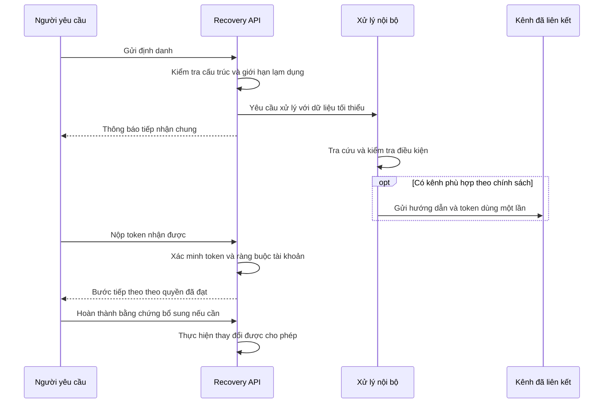

# Identifier privacy protection — Bảo vệ quyền riêng tư của định danh

## 1. Định danh trong luồng khôi phục tiết lộ điều gì?

Trong khôi phục tài khoản, **định danh** là dữ liệu giúp hệ thống tìm đúng tài khoản: email, số điện thoại, tên đăng nhập hoặc mã khách hàng. Định danh thường không phải bí mật xác thực. Biết email của một người không chứng minh được quyền sở hữu tài khoản của người đó.

Tuy nhiên, mối liên hệ giữa định danh và một dịch vụ lại có thể rất nhạy cảm. Một màn hình “Quên mật khẩu” trả lời rằng email đã đăng ký có thể xác nhận người đó sử dụng dịch vụ. Nếu màn hình tiếp theo hiển thị số điện thoại dự phòng hoặc loại MFA, kẻ quan sát còn thu được dữ liệu phục vụ lừa đảo và chiếm đoạt tài khoản.

Ví dụ, người lạ nhập `mai.nguyen@example.test` và nhận được:

> Chúng tôi đã gửi mã tới số điện thoại kết thúc bằng 4821. Tài khoản đang bật ứng dụng xác thực.

Câu trả lời này tiết lộ đồng thời sự tồn tại của tài khoản, một phần thông tin liên hệ và phương thức xác thực. Việc che vài ký tự không làm cho các thông tin ấy trở nên vô hại.

Trong module `SECURITY_AUTHENTICATION_ACCOUNT_RECOVERY`, bảo vệ định danh phải xuyên suốt quá trình tìm tài khoản, gửi token dùng một lần, xác minh quyền kiểm soát kênh, thay thế yếu tố xác thực và quản lý phiên sau khôi phục. Mục tiêu là hỗ trợ người mất mật khẩu, MFA, passkey hoặc thiết bị xác thực mà không biến luồng khôi phục thành công cụ thu thập dữ liệu cá nhân.

Sau bài này, người học cần có thể:

- Phân biệt tìm thấy tài khoản, kiểm soát kênh liên hệ và có đủ quyền thực hiện khôi phục.
- Nhận diện rò rỉ định danh qua giao diện, API, thời gian phản hồi, nhật ký và dịch vụ gửi thông báo.
- Chọn dữ liệu cần che, mã hóa, thay bằng mã tham chiếu hoặc loại khỏi quá trình xử lý.
- Thiết kế phản hồi công khai và ranh giới truy cập phù hợp với mức xác minh đã đạt được.

## 2. Ba ranh giới cần giữ riêng

Một yêu cầu khôi phục đi qua ba câu hỏi khác nhau:

1. **Định danh có ánh xạ tới tài khoản nào không?** Đây là thao tác tra cứu nội bộ.
2. **Người đang thao tác có kiểm soát một kênh hoặc yếu tố đã liên kết không?** Đây là một phần bằng chứng xác minh.
3. **Bằng chứng hiện tại có đủ cho hành động cụ thể không?** Đây là quyết định cấp quyền dựa trên chính sách và rủi ro.

Không được dùng kết quả câu hỏi thứ nhất làm câu trả lời cho hai câu còn lại. Mã tài khoản, email đúng định dạng, bốn số cuối điện thoại hoặc ảnh chụp màn hình hồ sơ đều không tự tạo quyền đổi mật khẩu hay gỡ MFA.

| Giai đoạn | Dữ liệu có thể cung cấp | Dữ liệu cần bảo vệ |
|---|---|---|
| Chưa có bằng chứng xác minh | Hướng dẫn chung và xác nhận đã tiếp nhận yêu cầu | Tài khoản có tồn tại không, tên thật, ảnh đại diện, kênh dự phòng, loại và số lượng yếu tố xác thực |
| Đã chứng minh quyền kiểm soát một kênh | Chỉ dữ liệu cần cho bước được chính sách cho phép | Danh sách toàn bộ định danh và quyền thay yếu tố mạnh hơn khi chưa đủ bằng chứng |
| Đạt yêu cầu cho hành động khôi phục | Thông tin tối thiểu để xác nhận và hoàn tất hành động đó | Dữ liệu không liên quan, token, recovery code và bí mật của yếu tố xác thực |
| Hỗ trợ hoặc điều tra nội bộ | Dữ liệu phù hợp vai trò và mục đích xử lý | Tra cứu hàng loạt, xuất dữ liệu tùy ý, truy cập không có dấu vết |

Mức hiển thị phải do máy chủ quyết định. Một biến `verified=true` trong trình duyệt hoặc một màn hình bị ẩn bằng CSS không tạo thành ranh giới truy cập.

## 3. Chống dò tài khoản ở toàn bộ bề mặt công khai

### 3.1. Dùng một kết quả tiếp nhận chung

Với yêu cầu hợp lệ về cấu trúc, endpoint bắt đầu khôi phục có thể trả cùng mã trạng thái và cùng nội dung cho các trường hợp: không tìm thấy tài khoản, tài khoản chưa có kênh phù hợp, tài khoản bị hạn chế và yêu cầu được chấp nhận để xử lý.

```http
POST /recovery/requests
Content-Type: application/json

{"identifierType":"EMAIL","identifier":"mai.nguyen@example.test"}
```

```http
HTTP/1.1 202 Accepted
Cache-Control: no-store
Content-Type: application/json

{"message":"Nếu thông tin phù hợp, bạn sẽ nhận được hướng dẫn khôi phục qua kênh đã liên kết."}
```

Thông báo này xác nhận việc tiếp nhận, không khẳng định thư đã được gửi hoặc tài khoản tồn tại. Không bổ sung các trường như `accountFound`, `mfaEnabled`, `destination`, `deliveryStatus` hoặc `availableFactors` vào phản hồi chưa xác minh.

Lỗi định dạng có thể được giải thích, chẳng hạn email thiếu phần tên miền hoặc dữ liệu vượt giới hạn độ dài. Quyết định đó phải chỉ phụ thuộc đầu vào công khai, không phụ thuộc việc có bản ghi tương ứng trong cơ sở dữ liệu.

Không gửi thư hoặc SMS tới mọi định danh được nhập chỉ để tạo cùng một tác dụng phụ. Cách đó có thể tạo spam và làm người nhận hiểu nhầm rằng họ có tài khoản. Hệ thống chỉ gửi hướng dẫn khi tìm thấy quan hệ tài khoản và kênh đủ điều kiện theo chính sách.

### 3.2. Đồng nhất cả hành vi quan sát được

Đổi câu chữ là chưa đủ. Kẻ dò tài khoản có thể so sánh:

- Mã HTTP, cấu trúc JSON, độ dài phản hồi và chuỗi chuyển hướng.
- Việc xuất hiện cookie, CAPTCHA, nút gửi lại hoặc màn hình chọn phương thức.
- Trạng thái ở endpoint kiểm tra tiến trình, gửi lại mã và xác nhận token.
- Thời gian trả lời khi có tài khoản so với khi không có tài khoản.
- Phản hồi giới hạn tốc độ chỉ xuất hiện khi định danh khớp bản ghi.

Có thể tách gửi thông báo sang hàng đợi để phản hồi công khai không chờ nhà cung cấp email hoặc SMS. Tuy nhiên, tra cứu và ghi hàng đợi vẫn có thể gây khác biệt thời gian. Cần thiết kế đường xử lý, chỉ mục và giới hạn tài nguyên phù hợp, rồi đo phân bố độ trễ trong điều kiện tải tương đương.

Không coi một lệnh ngủ cố định hay độ trễ ngẫu nhiên là bảo đảm chống dò: nhiều lần đo vẫn có thể bộc lộ khác biệt, còn thời gian chờ dài làm tăng áp lực tài nguyên. Mục tiêu là giảm khả năng phân biệt trong điều kiện vận hành thực tế, kết hợp giới hạn tốc độ và phát hiện lạm dụng.

Nếu API trả mã tham chiếu yêu cầu, mã đó phải khó đoán và không mã hóa sự tồn tại của tài khoản. Endpoint đọc trạng thái theo mã tham chiếu cũng phải giữ ranh giới bảo mật tương ứng; không dùng nó để công khai `UNKNOWN_ACCOUNT` hoặc `EMAIL_SENT`.

## 4. Chuẩn hóa định danh mà không nối nhầm người

Chuẩn hóa giúp một đầu vào được xử lý nhất quán, nhưng quy tắc sai có thể nối hai người vào cùng tài khoản. Luồng khôi phục phải dùng cùng chính sách định danh với đăng ký, đăng nhập và thay đổi thông tin liên hệ.

| Loại định danh | Nguyên tắc | Lỗi cần tránh |
|---|---|---|
| Email | Áp dụng chính sách hệ thống đã xác định; xử lý tên miền nhất quán và giữ quy tắc phần trước `@` đã cam kết | Tự bỏ dấu chấm, bỏ phần `+tag` hoặc chuyển mọi phần của mọi địa chỉ thành chữ thường khi hệ thống chưa có chính sách tương ứng |
| Số điện thoại | Phân tích cùng ngữ cảnh quốc gia rõ ràng và lưu dạng chuẩn đã chọn, thường là dạng quốc tế | Đoán quốc gia từ IP rồi âm thầm tra một số khác; gộp số nội địa thuộc các quốc gia khác nhau |
| Tên đăng nhập | Dùng cùng quy tắc phân biệt hoa thường, khoảng trắng và Unicode trên các luồng | Chỉ chuẩn hóa ở recovery khiến đầu vào ánh xạ khác với đăng nhập |
| Mã tài khoản nội bộ | Dùng như tham chiếu, kiểm tra quyền độc lập | Xem mã khó đoán hoặc UUID là bằng chứng được phép xem hồ sơ |

Các ký tự nhìn giống nhau không đồng nghĩa là cùng một định danh. Không tự đổi các chữ cái Unicode gần giống để tìm “tài khoản có vẻ đúng”. Nếu không thể xác định đầu vào theo quy tắc đã có, yêu cầu người dùng sửa thông tin mà không gợi ý bản ghi gần khớp.

Điện thoại có thể được cấp lại, email công ty có thể đổi chủ và địa chỉ liên hệ có thể đã hết hiệu lực. Thuộc tính `verified_at` ghi nhận một lần xác minh trước đây, không chứng minh người nhập hiện tại là chủ tài khoản. Kết quả tra cứu vẫn phải đi qua chính sách khôi phục phù hợp với rủi ro, nhất là khi thay MFA hoặc passkey.

## 5. Che định danh theo ngữ cảnh và mức xác minh

### 5.1. Masking chỉ giảm lượng dữ liệu hiển thị

Các chuỗi như `m***@example.test` hoặc `***4821` có thể giúp người dùng nhận ra kênh của mình sau một bước xác minh phù hợp. Chúng vẫn là dữ liệu có thể liên kết với cá nhân, đặc biệt khi kết hợp tên, tổ chức hoặc thông tin đã bị lộ từ nguồn khác.

Trước xác minh, kể cả một đuôi số điện thoại cũng có thể xác nhận định danh chính đã khớp tài khoản và tiết lộ một kênh liên hệ khác. Vì vậy, không mặc định hiển thị kênh dự phòng bị che ngay sau khi người dùng nhập email.

Khi chính sách cho phép gợi ý, cần giới hạn theo mục đích:

- Chỉ cung cấp kênh đủ điều kiện cho bước hiện tại.
- Che nhiều hơn với định danh ngắn, vì giữ một vài ký tự có thể gần như lộ toàn bộ.
- Không cho thay đổi tham số để yêu cầu bản gốc hoặc mức che ít hơn.
- Không gửi bản gốc trong JSON rồi che ở trình duyệt.
- Không coi việc đọc đúng phần bị che là bằng chứng xác minh.

Máy chủ nên trả một DTO dành riêng cho từng bước, thay vì tuần tự hóa toàn bộ đối tượng người dùng rồi yêu cầu giao diện bỏ các trường nhạy cảm.

### 5.2. Mất MFA hoặc passkey không mở quyền xem mọi kênh

Một người đã nhấp liên kết email có thể kiểm soát hộp thư, nhưng hộp thư đó cũng có thể đã bị xâm nhập. Chính sách phải xác định bằng chứng này cho phép đặt lại mật khẩu, khởi tạo đánh giá bổ sung hay thay yếu tố xác thực nào. Không tự động coi nó là quyền liệt kê điện thoại dự phòng, xóa tất cả passkey và mở phiên đầy đủ.

Nếu quy trình cần phiên khôi phục, phiên nên bị giới hạn mục đích, thời hạn và tài khoản đã ràng buộc. Quyền của phiên này khác với phiên đăng nhập thông thường. Sau khi khôi phục thành công, thực hiện thay đổi và thu hồi các phiên hoặc yếu tố liên quan theo chính sách; không để phiên khôi phục tiếp tục trở thành đường đọc hồ sơ.

Đối với passkey, mã credential và user handle cần được xử lý như các tham chiếu có khả năng liên kết dữ liệu. Việc chúng không phải mật khẩu không có nghĩa có thể công khai chúng trong trang recovery hoặc dùng chúng làm bằng chứng sở hữu.

## 6. Bảo vệ dữ liệu khi lưu và khi tra cứu

### 6.1. Chọn biện pháp theo thao tác cần thực hiện

| Nhu cầu | Cách tiếp cận | Giới hạn cần hiểu |
|---|---|---|
| Hiển thị gợi ý sau xác minh | Che một phần ở máy chủ | Vẫn có thể nhận diện người dùng; không dùng thay kiểm tra quyền |
| Gửi email hoặc SMS | Lưu địa chỉ dưới dạng mã hóa có xác thực; giải mã trong thành phần được cấp quyền | Ứng dụng gửi thông báo và nhà cung cấp vẫn phải tiếp xúc với địa chỉ đích |
| Tra cứu chính xác mà giảm dữ liệu bản rõ trong chỉ mục | Chỉ mục HMAC có khóa riêng trên giá trị chuẩn hóa | Lộ quan hệ bằng nhau trong cùng phạm vi; khi lộ khóa, việc thử từ điển lại trở nên khả thi |
| Theo dõi yêu cầu trong hệ thống | Mã yêu cầu ngẫu nhiên hoặc tham chiếu nội bộ được kiểm soát | Mã vẫn cần kiểm tra quyền khi dùng để đọc dữ liệu |
| Thống kê vận hành | Số liệu tổng hợp với nhãn ít chiều | Nhóm quá nhỏ hoặc bộ lọc quá chi tiết vẫn có thể tiết lộ hành vi cá nhân |

Mã hóa ở nơi lưu trữ không ngăn được việc ứng dụng có quyền giải mã gửi dữ liệu nhầm ra API hoặc nhật ký. Cần đồng thời kiểm soát truy cập, giảm dữ liệu trong từng thành phần và kiểm soát đầu ra.

### 6.2. Vì sao không dùng hash email đơn thuần?

Email và số điện thoại thường có không gian dự đoán được. Nếu lưu `SHA-256(email)` rồi công khai giá trị này trong log hoặc API, người có danh sách email ứng viên có thể băm từng email để đối chiếu. Hash không biến định danh thành dữ liệu vô danh.

Chỉ mục có khóa có thể được mô tả như sau:

```text
canonical = canonicalize(identifierType, input)
lookupKey = HMAC-SHA-256(
    secretKeyForLookup,
    encodeLengthPrefixed(
        "recovery-identifier-lookup-v1",
        tenantId,
        identifierType,
        canonical
    )
)
```

Đây là mã giả cho ý tưởng lập chỉ mục, không phải cơ chế xác thực. Mã hóa có độ dài từng trường giúp tránh nhập nhằng khi ghép dữ liệu. Phân tách mục đích, loại định danh và tenant giúp tránh gộp nhầm các không gian định danh khác nhau.

Khóa HMAC phải nằm ngoài bảng dữ liệu chứa chỉ mục và có cơ chế quản lý quyền, phiên bản, thay khóa phù hợp. Chỉ mục dùng cho tra cứu, khóa dùng cho giới hạn tốc độ và dấu liên kết trong audit nên tách mục đích, tránh tạo một nhãn chung để nối mọi hoạt động của người dùng.

HMAC có tính xác định nên vẫn bộc lộ hai bản ghi có cùng đầu vào trong cùng phạm vi. Nó là biện pháp giảm rò rỉ, không phải bảo đảm ẩn danh. Không đưa `lookupKey` ra trình duyệt hoặc gửi cho analytics chỉ vì nó không phải email bản rõ.

Nếu phải giải mã email để gửi thư, một mô hình dữ liệu có thể tách:

```text
RecoveryContact
  accountId             // tham chiếu nội bộ
  tenantId
  identifierType
  lookupKeyVersion
  lookupKey             // chỉ mục có khóa
  encryptedDestination  // địa chỉ đã mã hóa có xác thực
  encryptionKeyVersion
  verificationState
  verifiedAt
  lifecycleState        // đang dùng, bị thu hồi, đang chờ thay đổi...
```

Tách quyền tra cứu khỏi quyền giải mã khi kiến trúc cho phép. Khi thay khóa hoặc thay quy tắc chuẩn hóa, cần có kế hoạch chuyển đổi nhất quán để người dùng vẫn tìm đúng tài khoản. Không âm thầm thử nhiều quy tắc làm khôi phục trỏ sang chủ thể khác.

## 7. Giảm dữ liệu đi qua hàng đợi, URL, log và công cụ quan sát

### 7.1. Chỉ đưa dữ liệu cần thiết tới thành phần cần nó

Worker gửi thư thường cần địa chỉ đích, nhưng bộ phận analytics chỉ cần số yêu cầu và kết quả tổng hợp. Một job nên ưu tiên mã yêu cầu và tham chiếu kênh thay vì sao chép toàn bộ hồ sơ tài khoản. Với đầu vào chưa khớp tài khoản, nếu phải lưu tạm để xử lý bất đồng bộ thì cần giảm dữ liệu, bảo vệ bản lưu và đặt thời hạn xóa rõ ràng.

Trước khi gửi, kiểm tra kênh vẫn thuộc tài khoản, còn đủ điều kiện và chưa bị thu hồi. Không chỉ tin rằng quan hệ này vẫn đúng vì lúc tạo yêu cầu nó từng đúng.

Đích gửi phải lấy từ quan hệ đã lưu và đã xác minh phù hợp. Một tham số `sendTo` do người yêu cầu tự nhập không được ghi đè đích gửi sau khi tra cứu tài khoản. Nếu người dùng mất cả kênh cũ, đưa họ vào quy trình xác minh thay thế riêng, không sửa địa chỉ ngay trong yêu cầu khôi phục ban đầu.

### 7.2. Không đặt định danh vào nơi dễ bị sao chép

Ưu tiên gửi định danh trong body qua TLS thay vì URL, đồng thời cấu hình không thu thập body nhạy cảm. Dùng POST không tự ngăn reverse proxy, APM, middleware hoặc công cụ hỗ trợ ghi lại nội dung.

Tránh đặt email, số điện thoại hoặc tên đăng nhập trong:

- Query string, đường dẫn trang và URL chuyển hướng.
- Tên span, nhãn metric hoặc khóa cache được xuất ra công cụ giám sát.
- Thông điệp exception và bản chụp request khi báo lỗi.
- Event analytics, session replay, console trình duyệt và ticket hỗ trợ.

Liên kết khôi phục có thể phải mang token bí mật, nhưng không cần kèm thêm email. Trang nhận token nên hạn chế tài nguyên bên thứ ba, áp dụng chính sách referrer phù hợp và tránh đưa token vào log. Sau khi đổi token hợp lệ lấy trạng thái khôi phục giới hạn, chuyển sang URL sạch theo thiết kế; cần tính đến lịch sử trình duyệt và log của các tầng trung gian.

JWT chỉ ký số không che được payload. Nếu dùng định dạng này, không nhét email hoặc điện thoại vào token với giả định rằng người nhận không đọc được. Việc chọn token phải xét cả mục đích, thời hạn, khả năng thu hồi và sử dụng một lần.

### 7.3. Nhật ký đủ điều tra nhưng có giới hạn

```text
Không nên:
recovery_requested email=mai.nguyen@example.test token=<secret>

Có thể dùng trong audit được kiểm soát:
event=recovery_requested request_id=<opaque-reference>
channel=email decision=accepted policy_version=<version>
```

Phân biệt audit nội bộ với phản hồi công khai. Audit có thể cần lý do xử lý chi tiết cho điều tra, nhưng phải hạn chế người đọc, truy vấn hàng loạt và thời hạn lưu. Nếu thực sự cần liên kết về tài khoản, dùng tham chiếu nội bộ trong kho audit phù hợp; không mặc định đẩy nó sang mọi log vận hành.

Cơ chế che dữ liệu khi ghi log cần bao phủ gateway, ứng dụng, hàng đợi, lỗi nhà cung cấp và công cụ theo dõi. Lỗi gửi email có thể chứa lại địa chỉ người nhận trong chuỗi exception dù ứng dụng không chủ động ghi trường `email`.

## 8. Giới hạn lạm dụng mà vẫn bảo vệ định danh

Không cần tài khoản tồn tại mới giới hạn yêu cầu. Có thể tính một khóa có HMAC trên định danh chuẩn hóa do người dùng gửi, rồi áp dụng ngân sách yêu cầu ngay cả khi tra cứu không khớp. Điều này giảm nguy cơ endpoint chỉ trả `429` cho tài khoản thật.

Cần phối hợp nhiều chiều: nguồn mạng, thiết bị hoặc phiên, định danh được gửi, tài khoản nội bộ khi đã xác định, kênh gửi và ngân sách toàn dịch vụ. Giới hạn riêng theo IP không đủ vì người tấn công có thể phân tán nguồn; khóa cứng theo tài khoản lại có thể bị dùng để cản người thật khôi phục.

Phản hồi giới hạn tốc độ, CAPTCHA và thời gian chờ công khai cần được thiết kế sao cho không trở thành tín hiệu tồn tại tài khoản. Ví dụ, ngân sách nguồn yêu cầu có thể tạo phản hồi `429` không phụ thuộc kết quả tra cứu, còn hạn chế gửi tới kênh cụ thể có thể được xử lý nội bộ với cùng thông báo tiếp nhận chung. Đây là quyết định thiết kế cần kiểm tra trên toàn luồng.

Gửi lại token cũng cần giới hạn và không công khai đích gửi. Không cho phép một người nhập hàng loạt email rồi dùng endpoint gửi lại để tìm những email thực sự được xử lý.

## 9. Luồng mẫu có ranh giới dữ liệu rõ ràng

Tình huống: Mai mất mật khẩu và điện thoại chứa ứng dụng xác thực, nhưng còn truy cập được email. Hệ thống không được coi việc tìm thấy email là đủ để gỡ MFA.



Các quyết định quan trọng trong luồng này:

1. **Khởi tạo:** Không trả tên Mai, số điện thoại, trạng thái MFA hay danh sách passkey từ email được nhập.
2. **Gửi hướng dẫn:** Lấy đích gửi từ kênh đủ điều kiện trong dữ liệu tài khoản; job không tự nhận địa chỉ thay thế từ người yêu cầu.
3. **Kiểm tra token:** Token có mục đích, thời hạn, khả năng dùng một lần và ràng buộc tới tài khoản/yêu cầu ở máy chủ. Không tin một `accountId` mới do trình duyệt gửi kèm.
4. **Cấp quyền bước tiếp theo:** Xác minh email chỉ mở những hành động mà chính sách cho phép. Việc gỡ MFA hoặc thay passkey có thể cần bằng chứng bổ sung, đánh giá rủi ro hoặc quy trình hỗ trợ.
5. **Hoàn tất:** Ghi audit tối thiểu, gửi thông báo phù hợp tới kênh còn tin cậy và quản lý các phiên liên quan theo chính sách. Không công khai thông tin liên hệ khác trong thông báo hoặc trang xác nhận.

Nếu Mai không còn truy cập email, hệ thống có thể đưa hướng dẫn chung tới quy trình hỗ trợ. Nhân viên hỗ trợ không được đọc số điện thoại đầy đủ hoặc xác nhận sự tồn tại tài khoản chỉ vì người gọi biết tên và email. Quyền tra cứu, điều kiện tiết lộ và dấu vết xử lý phải được xác định riêng.

## 10. Các tình huống cần kiểm tra khi thiết kế

Bảng dưới đây là tiêu chí kiểm tra hành vi của luồng, không yêu cầu tạo thêm tệp hay chạy chương trình trong bài học này.

| Tình huống | Điều cần quan sát | Kết quả mong muốn |
|---|---|---|
| Cùng đầu vào đúng định dạng, một địa chỉ tồn tại và một địa chỉ không tồn tại | HTTP, body, cookie, chuyển hướng, cấu trúc trang | Không tiết lộ kết quả tra cứu qua các thành phần này |
| Gửi nhiều yêu cầu với hai nhóm định danh ở tải tương đương | Phân bố độ trễ, lỗi và trạng thái hàng đợi có thể quan sát | Không có khác biệt rõ ràng dùng để phân loại tài khoản |
| Tài khoản có MFA và tài khoản chưa có MFA | Màn hình trước xác minh, API phụ trợ | Không tiết lộ cấu hình yếu tố từ bước nhập định danh |
| Gọi API xem kênh trực tiếp, bỏ qua giao diện | Kiểm tra quyền máy chủ và dữ liệu JSON | Không đọc được dữ liệu vượt mức xác minh |
| Sửa mã tham chiếu yêu cầu hoặc tài khoản | Ràng buộc request, token, phiên khôi phục | Không đọc hoặc thay đổi tài khoản khác |
| Thay `sendTo` trong request | Nguồn địa chỉ đích | Không chuyển hướng dẫn tới kênh tùy ý |
| Email có biến thể và số điện thoại có ngữ cảnh quốc gia khác | Quy tắc chuẩn hóa, kết quả tra cứu | Nhất quán với đăng ký; không gộp nhầm chủ thể |
| Kênh bị thu hồi trong lúc job còn chờ | Kiểm tra trước gửi và trước hành động nhạy cảm | Không tiếp tục dùng quan hệ đã mất hiệu lực |
| Nhà cung cấp thông báo báo lỗi | Log, trace, cảnh báo và ticket phát sinh | Không phát tán địa chỉ hoặc token từ exception |
| Người dùng chỉ chứng minh được quyền kiểm soát email | Quyền của phiên khôi phục | Không tự động được gỡ mọi yếu tố và xem toàn bộ hồ sơ |

Khi kiểm tra cần quan sát cả ứng dụng và hạ tầng trung gian. Một endpoint an toàn ở mức code vẫn có thể rò rỉ body qua reverse proxy hoặc lộ token qua công cụ ghi lại phiên người dùng.

## 11. Lỗi thiết kế thường gặp

**“Email không phải mật khẩu nên có thể ghi vào mọi log.”** Email vẫn có thể xác định cá nhân và nối các sự kiện giữa hệ thống. Chỉ thu thập khi cần, xác định người được đọc và thời hạn lưu.

**“Đã che số điện thoại nên ai cũng được xem.”** Phần bị che vẫn có thể xác nhận tài khoản và tiết lộ kênh dự phòng. Quyền xem phải phụ thuộc bước xác minh và mục đích.

**“Dùng SHA-256 là dữ liệu đã vô danh.”** Hash định danh dễ đoán có thể bị đối chiếu bằng từ điển; HMAC giảm một số rủi ro nhưng vẫn cần quản lý khóa và kiểm soát truy cập.

**“API trả cùng câu thì không thể dò tài khoản.”** Thời gian, mã trạng thái, cookie, trang tiếp theo và endpoint gửi lại đều có thể là kênh phân biệt.

**“Nhấp được liên kết email thì có thể đổi mọi yếu tố.”** Quyền kiểm soát một kênh chỉ là một loại bằng chứng. Mức quyền khôi phục phải phù hợp hành động và rủi ro chiếm đoạt tài khoản.

**“Xóa log ứng dụng là đã xóa hết dữ liệu.”** Bản sao có thể còn trong hàng đợi, APM, hệ thống hỗ trợ, dữ liệu xuất và bản sao lưu. Thiết kế vòng đời cần xét từng nơi; bản sao lưu phải có giới hạn truy cập và lịch hết hạn, cùng cơ chế tránh khôi phục lại dữ liệu đã được đánh dấu loại bỏ.

## 12. Bài tập áp dụng

Một hệ thống có API sau:

```json
{
  "exists": true,
  "displayName": "Mai Nguyễn",
  "maskedPhone": "***4821",
  "mfaType": "TOTP",
  "resetUrl": "/reset?email=mai.nguyen@example.test&token=..."
}
```

Hãy thiết kế lại phản hồi khởi tạo, dữ liệu job gửi thư và quyền của phiên khôi phục sau khi xác minh email.

Một phương án hợp lý cần giải thích được vì sao phản hồi công khai chỉ xác nhận tiếp nhận, dữ liệu định danh không xuất hiện trong URL hoặc log thông thường, đích gửi lấy từ kênh đã liên kết và việc thay MFA có điều kiện riêng. Đồng thời, phương án phải nêu cách kiểm tra các kênh rò rỉ ngoài nội dung JSON và cách hỗ trợ người mất cả kênh liên hệ mà không cho họ tự thay đích nhận token.

Nguyên tắc xuyên suốt là chỉ tiết lộ lượng dữ liệu cần cho bước hiện tại, dựa trên bằng chứng đã xác minh và quyền do máy chủ kiểm soát. Định danh giúp tìm tài khoản; quyết định ai được khôi phục tài khoản cần một ranh giới xác minh riêng.
