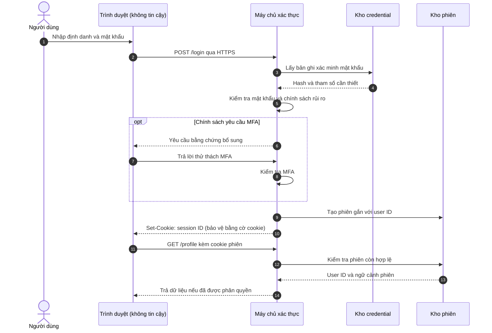
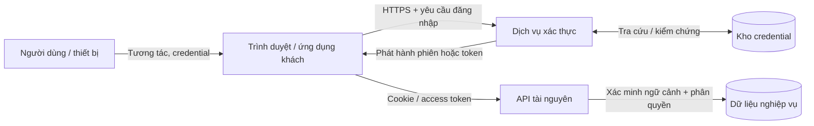

# Authentication là gì?

> **Chương:** Bức tranh tổng thể  
> **Phạm vi:** Nền tảng xác thực danh tính (Security Authentication Fundamentals)

## Mục tiêu học tập

Sau bài này, bạn có thể:

1. Giải thích **authentication (xác thực)** là gì, khác **identification (nhận diện)**, **identity proofing (xác minh danh tính ban đầu)** và **authorization (phân quyền)** ra sao.
2. Mô tả cách hệ thống kiểm tra một credential và duy trì trạng thái đăng nhập bằng phiên hoặc token.
3. Nhận biết vai trò của mật khẩu, MFA, passkey, chứng chỉ số, đăng nhập liên kết và khôi phục tài khoản.
4. Chỉ ra các ranh giới tin cậy trong một luồng xác thực, cùng những rủi ro như phishing, replay, dò mật khẩu và đánh cắp phiên.
5. Đặt câu hỏi thiết kế phù hợp khi xây dựng hoặc đánh giá cơ chế đăng nhập của một ứng dụng.

## 1. Xác thực trả lời câu hỏi nào?

**Authentication (AuthN)** là quá trình một hệ thống kiểm tra bằng chứng để đánh giá rằng chủ thể đang yêu cầu truy cập thực sự kiểm soát phương tiện xác thực gắn với **danh tính đã khai báo**. Chủ thể có thể là một người, một dịch vụ hoặc một thiết bị.

Ví dụ: Khi An nhập mật khẩu vào trang đăng nhập của cửa hàng trực tuyến, An khai báo mình là tài khoản `an@example.com`. Máy chủ so sánh bằng chứng đăng nhập với thông tin đã đăng ký cho tài khoản đó. Nếu kiểm tra thành công, máy chủ có cơ sở để xử lý những yêu cầu tiếp theo dưới danh tính của tài khoản An.

Điểm tinh tế: đăng nhập thành công **không tự động chứng minh người thao tác chính là An ngoài đời thực**. Nó chứng minh người thao tác đáp ứng phương thức xác thực đã thiết lập cho tài khoản, với một mức độ tin cậy nhất định. Nếu mật khẩu bị lộ, kẻ khác cũng có thể vượt qua bước kiểm tra. Việc kiểm tra giấy tờ hoặc đối chiếu người thật khi mở tài khoản là một hoạt động khác, thường được gọi là *identity proofing*.

| Khái niệm | Câu hỏi chính | Ví dụ |
| --- | --- | --- |
| **Identification** — nhận diện/khai báo định danh | “Bạn đang nói mình là ai?” | Nhập tên đăng nhập hoặc email |
| **Identity proofing** — xác minh danh tính ban đầu | “Tài khoản này có gắn với người/tổ chức được khai báo không?” | Xác minh giấy tờ khi mở tài khoản ngân hàng |
| **Authentication (AuthN)** — xác thực | “Bạn có bằng chứng hợp lệ để sử dụng danh tính đó không?” | Kiểm tra mật khẩu, chữ ký passkey hoặc MFA |
| **Authorization (AuthZ)** — phân quyền | “Danh tính này được phép làm gì?” | Nhân viên chỉ được xem đơn hàng thuộc chi nhánh của mình |
| **Accounting/Auditing** — ghi nhận hoạt động | “Ai đã thực hiện hành động nào, khi nào?” | Ghi log lần đăng nhập và thao tác quan trọng |

Một người có thể **đăng nhập hợp lệ nhưng không có quyền** xóa dữ liệu. Khi API trả `401 Unauthorized`, thông thường yêu cầu chưa có bằng chứng xác thực hợp lệ; `403 Forbidden` thường có nghĩa máy chủ đã hiểu danh tính/ngữ cảnh nhưng từ chối quyền truy cập. Tên mã `401` dễ gây nhầm, song xác thực và phân quyền vẫn là hai quyết định riêng.

## 2. Những thành phần tạo nên một lần xác thực

Để hiểu hệ thống đăng nhập, hãy tách các thành phần sau:

| Thành phần | Ý nghĩa | Ví dụ |
| --- | --- | --- |
| **Subject / claimant** | Chủ thể đang yêu cầu được xác thực | Người dùng, tiến trình backend, thiết bị IoT |
| **Identity / identifier** | Bản ghi danh tính và cách tham chiếu đến bản ghi đó | User ID nội bộ, username, email đã liên kết |
| **Authenticator** | Thứ chủ thể sở hữu, biết hoặc mang trên người để tạo bằng chứng | Mật khẩu, ứng dụng tạo OTP, khóa riêng trong passkey |
| **Credential** | Dữ liệu/thông tin ràng buộc danh tính với phương tiện hoặc bằng chứng xác thực | Bản ghi xác minh mật khẩu, khóa công khai đã đăng ký, chứng chỉ số |
| **Verifier** | Thành phần kiểm tra bằng chứng | Dịch vụ đăng nhập, dịch vụ WebAuthn, máy chủ xác minh chứng chỉ |
| **Session / token** | Cơ chế giúp các yêu cầu tiếp theo mang ngữ cảnh xác thực | Cookie phiên, access token |

Các thuật ngữ *credential* và *authenticator* đôi lúc được dùng gần nhau trong tài liệu sản phẩm. Điều quan trọng khi thiết kế là biết **bí mật hoặc khóa nào được sử dụng, ai giữ nó, bằng chứng được kiểm tra ở đâu và hệ thống liên kết kết quả với tài khoản nào**.

Ba nhóm yếu tố xác thực thường gặp:

- **Thứ bạn biết (knowledge):** mật khẩu, PIN. Câu hỏi bảo mật thường yếu vì câu trả lời có thể đoán hoặc tìm thấy công khai.
- **Thứ bạn sở hữu (possession):** thiết bị giữ khóa riêng, khóa bảo mật phần cứng, ứng dụng nhận/tạo mã xác thực.
- **Đặc điểm của bạn (inherence):** vân tay, khuôn mặt hoặc đặc điểm sinh trắc khác.

**MFA (multi-factor authentication)** yêu cầu bằng chứng từ **ít nhất hai nhóm yếu tố độc lập**. Hai mật khẩu không thành hai yếu tố. Mật khẩu kết hợp mã TOTP từ ứng dụng xác thực là một ví dụ phổ biến. Với passkey, sinh trắc học thường **mở khóa khóa riêng ở thiết bị**; máy chủ nhận chữ ký mật mã, không cần nhận ảnh vân tay hay khuôn mặt. Cách phân loại mức bảo đảm của passkey còn phụ thuộc thiết bị, chính sách kiểm tra người dùng và cách lưu/sao lưu khóa.

## 3. Một lần đăng nhập diễn ra thế nào?

Xét ứng dụng web dùng mật khẩu và phiên máy chủ. Mô hình đơn giản sau cho thấy **ranh giới tin cậy** cần quan sát:



Các bước có ý nghĩa bảo mật khác nhau:

1. **Đăng ký/thiết lập (enrollment):** tài khoản được tạo, phương tiện xác thực được đăng ký và liên kết với định danh. Đây là lúc cần xác định ai được quyền gắn thêm một passkey hoặc thiết bị MFA.
2. **Khai báo và kiểm tra (authentication):** chủ thể khai báo tài khoản, sau đó chứng minh mình kiểm soát authenticator tương ứng. Máy chủ phải kiểm tra bằng chứng trên phía tin cậy của hệ thống, không chỉ tin kết quả kiểm tra do trình duyệt gửi lên.
3. **Thiết lập ngữ cảnh đăng nhập:** máy chủ tạo phiên hoặc phát token phù hợp; yêu cầu sau đó sử dụng ngữ cảnh này trong thời gian giới hạn.
4. **Kiểm tra quyền ở từng hành động:** kể cả khi phiên hợp lệ, API vẫn phải quyết định tài khoản có được xem hoặc sửa tài nguyên cụ thể hay không.
5. **Kết thúc và xử lý thay đổi rủi ro:** logout, hết hạn, thay mật khẩu, mất thiết bị, khóa tài khoản hoặc phát hiện bất thường có thể yêu cầu hủy phiên/token hay xác thực lại.

### Ví dụ mã giả phía máy chủ

```text
POST /login(identifier, password):
    if request_is_rate_limited(identifier, request_context):
        return generic_login_failure()

    account = find_account(identifier)
    # Với tài khoản không tồn tại, vẫn cần đường kiểm tra giả
    # để hạn chế rò rỉ sự tồn tại tài khoản qua thời gian phản hồi.
    password_ok = verify_password_hash_or_dummy(account, password)

    if not password_ok or account_is_blocked(account):
        record_failed_attempt_safely()
        return generic_login_failure()

    if additional_factor_required(account, request_context):
        complete_and_verify_mfa_challenge()

    session_id = create_random_server_side_session(account.id)
    set_cookie("session", session_id,
               HttpOnly=true, Secure=true, SameSite="Lax")
    record_success_without_logging_secrets()
    return success()

GET /orders/{order_id}:
    user = require_valid_session()
    order = load_order(order_id)
    require_permission(user, "read", order)
    return order
```

Đây là **mã giả để minh họa**, chưa phải bản triển khai hoàn chỉnh. Một hệ thống thật còn phải xử lý CSRF, vòng đời phiên, tính nhất quán khi có nhiều máy chủ, kiểm soát truy cập kho dữ liệu, thay đổi thông tin xác thực, giám sát tấn công và trường hợp ngoại lệ. Cookie `SameSite=Lax` giúp giảm một số rủi ro CSRF nhưng không thay thế mọi biện pháp chống CSRF; chính sách cookie cần điều chỉnh theo luồng ứng dụng.

## 4. Những cách xác thực thường gặp

| Phương thức | Cách chứng minh | Ưu điểm | Giới hạn/rủi ro cần biết |
| --- | --- | --- | --- |
| **Mật khẩu** | Chứng minh biết bí mật dùng chung | Phổ biến, hỗ trợ nhiều thiết bị | Dễ bị tái sử dụng, phishing, credential stuffing, đoán mật khẩu |
| **TOTP / mã một lần** | Cung cấp mã từ authenticator đã đăng ký | Thêm một lớp so với mật khẩu | Mã vẫn có thể bị dụ nhập ở trang giả; có cửa sổ thời gian và nguy cơ replay |
| **Push MFA** | Phê duyệt yêu cầu trên thiết bị | Dễ thao tác | Dễ bị *MFA fatigue* nếu cứ cho phép bấm chấp thuận; nên dùng number matching/chữ ký theo ngữ cảnh |
| **SMS OTP** | Chứng minh kiểm soát kênh nhận tin nhắn | Có sẵn rộng rãi | Rủi ro chuyển SIM, chiếm số điện thoại, lộ tin nhắn và phishing |
| **Passkey / WebAuthn** | Khóa riêng ký thử thách gắn với nguồn gốc website; máy chủ kiểm bằng khóa công khai | Chống phishing tốt nhờ ràng buộc với tên miền hợp lệ; không cần bí mật dùng chung trên máy chủ | Phải thiết kế đăng ký, đồng bộ hoặc thiết bị dự phòng, thu hồi và khôi phục |
| **Chứng chỉ số / mTLS** | Chứng minh giữ khóa riêng tương ứng với chứng chỉ và chuỗi tin cậy | Phù hợp máy móc, dịch vụ nội bộ, thiết bị quản lý | Cần quản lý phát hành, khóa riêng, hạn dùng và thu hồi chứng chỉ |

**Mật khẩu nên được lưu dưới dạng hash chuyên dụng để lưu mật khẩu**, có salt riêng cho mỗi bản ghi và tham số chi phí phù hợp (ví dụ Argon2id; trong những môi trường cụ thể có thể dùng scrypt hoặc PBKDF2 theo yêu cầu tương thích). Không lưu mật khẩu dạng rõ, không mã hóa hai chiều chỉ để đối chiếu, không dùng hash nhanh như SHA-256 đơn lẻ cho mật khẩu. Hash giúp giảm thiệt hại khi cơ sở dữ liệu bị lộ, nhưng không cứu được mật khẩu đã bị nhập vào trang phishing.

**Passkey** thuộc họ FIDO2/WebAuthn. Khi đăng ký, ứng dụng lưu khóa công khai liên kết với tài khoản. Khi đăng nhập, trình xác thực ký một thử thách mới bằng khóa riêng. Máy chủ kiểm tra chữ ký, thử thách, thông tin nguồn gốc (*origin*/RP ID) và các chính sách liên quan. Khóa riêng không phải gửi đến máy chủ. Vì thử thách gắn với website hợp lệ nên trang đăng nhập giả khó lấy được bằng chứng có thể dùng lại cho website thật.

**Chứng chỉ và khóa máy** thường xác thực *workload* hoặc thiết bị, không chỉ người dùng. Ví dụ hai dịch vụ gọi nhau qua mTLS để xác minh đầu kết nối. Điều đó chưa thay cho **phân quyền**: dịch vụ đã được nhận diện vẫn chỉ nên được cấp các thao tác tối thiểu cần thiết.

## 5. Phiên đăng nhập và token: điều gì xảy ra sau AuthN?

Xác thực lúc đăng nhập không có nghĩa mỗi yêu cầu HTTP sau đó lại gửi mật khẩu. Ứng dụng cần một cách mang theo ngữ cảnh đã xác thực.

### Phiên máy chủ với cookie

Máy chủ tạo một **session ID ngẫu nhiên, khó đoán**, lưu ánh xạ tới tài khoản và trạng thái phiên. Trình duyệt tự gửi cookie phiên trong các yêu cầu phù hợp. Máy chủ tra cứu, kiểm tra còn hạn hay đã bị thu hồi rồi mới xử lý yêu cầu.

Các thuộc tính cookie thường có ích là `Secure` (chỉ gửi qua HTTPS), `HttpOnly` (hạn chế JavaScript đọc giá trị cookie), `SameSite` (giảm một số trường hợp gửi cookie qua ngữ cảnh cross-site); đồng thời nên đặt phạm vi `Domain`/`Path` hẹp thích hợp, gia hạn/đổi session ID khi nâng mức đặc quyền và đặt thời gian hết hạn hợp lý. **XSS vẫn nguy hiểm ngay cả khi có `HttpOnly`**, vì mã độc chạy trên trang có thể thực hiện yêu cầu dưới phiên hiện tại.

### Access token và refresh token

API và ứng dụng phân tán có thể dùng **access token** ngắn hạn để gọi tài nguyên. **Refresh token** (nếu dùng) phục vụ lấy access token mới và cần bảo vệ chặt, có cơ chế xoay vòng/thu hồi phù hợp. Token có thể là chuỗi mờ (*opaque*) được tra cứu tại máy chủ hoặc token tự chứa như **JWT** có chữ ký.

- JWT có chữ ký giúp kiểm tra tính toàn vẹn và bên phát hành, **không mặc nhiên mã hóa nội dung**. Không đặt bí mật vào payload chỉ vì đã ký.
- Bên nhận token phải kiểm tra chữ ký bằng khóa đáng tin, thuật toán được phép, `iss` (issuer), `aud` (audience), `exp` (hạn dùng), các điều kiện như `nbf`/scope nếu áp dụng. Không quyết định quyền chỉ từ payload đã decode mà chưa xác minh.
- **Bearer token** được chấp nhận dựa trên việc ai đang cầm token: nếu bị lộ, người khác có thể dùng trong thời gian hiệu lực. Những cơ chế ràng buộc token với bên giữ khóa có thể giảm rủi ro này.
- Logout hay thay đổi quyền cần chiến lược xử lý hiệu lực còn lại của token: thời hạn ngắn, thu hồi, kiểm tra phiên hoặc cơ chế tương ứng. JWT không tự mang khả năng thu hồi tức thời.

| Khi nào cân nhắc? | Phiên máy chủ | Access token |
| --- | --- | --- |
| Ứng dụng web truyền thống | Thường đơn giản và dễ thu hồi | Có thể không cần |
| API gọi qua nhiều dịch vụ | Cần cơ chế chia sẻ/tra cứu phiên | Thuận tiện nếu xác minh và giới hạn audience đúng |
| Khi credential bị lộ | Thu hồi session ID phía máy chủ | Cần xét hạn dùng, nơi lưu và cơ chế thu hồi token |

**Token không thay thế bước xác thực ban đầu.** Nó là kết quả hoặc bằng chứng truy cập được phát hành dựa trên một ngữ cảnh xác thực đã xảy ra. Đồng thời, một access token dành cho API A không nên được API B chấp nhận chỉ vì chữ ký hợp lệ: phải kiểm tra **đúng người nhận (`aud`) và quyền được cấp**.

## 6. Đăng nhập liên kết và quản lý danh tính

Không phải ứng dụng nào cũng tự giữ mật khẩu. Với **federated login / single sign-on (SSO)**, ứng dụng (*relying party/client*) chuyển người dùng tới **Identity Provider (IdP)** để xác thực. Sau khi hoàn tất, ứng dụng nhận kết quả theo giao thức, xác minh kết quả và tạo phiên của chính mình.

Một cách phổ biến trong ứng dụng web là **OpenID Connect (OIDC)** xây trên OAuth 2.0. Trong đó, *ID token* chứa các claim về sự kiện/danh tính xác thực cho client đã định; *access token* nhằm truy cập tài nguyên có quyền được cấp. **OAuth 2.0 chủ yếu là khung cấp quyền truy cập, không tự nó là giao thức xác thực người dùng**. Không lấy một access token bất kỳ để suy ra rằng người dùng đã đăng nhập vào ứng dụng của mình.

Ví dụ: Bạn nhấn “Đăng nhập bằng nhà cung cấp X”. Ứng dụng chuyển hướng tới X, nhận phản hồi ở callback, kiểm tra `state`, `nonce` khi được yêu cầu, đối chiếu issuer/audience và hoàn thành trao đổi mã ủy quyền an toàn (thường dùng Authorization Code + PKCE). Sau đó ứng dụng liên kết định danh bên X, chẳng hạn cặp `(issuer, subject)`, với user ID nội bộ.

**Liên kết danh tính (account linking)** là chỗ dễ sai: hai tài khoản trùng email hiển thị chưa chắc cùng một chủ thể. Email có thể đổi, chưa được xác minh hoặc được tái sử dụng. Khi gắn nhà cung cấp đăng nhập mới vào tài khoản đang có, nên yêu cầu xác thực hợp lệ của tài khoản hiện hữu và, tùy rủi ro, **step-up authentication**. Ưu tiên định danh ổn định do IdP phát hành thay cho chỉ ghép theo email.

## 7. Ranh giới tin cậy và mô hình đe dọa

Hãy nhìn một luồng xác thực qua câu hỏi **“thành phần nào được phép tin bằng chứng nào?”**:



- **Ứng dụng khách là vùng không tin cậy.** Người dùng hoặc mã độc có thể sửa JavaScript, payload, header, đồng hồ, mã HTTP và giá trị gửi lên. Quyết định xác thực/phân quyền phải được kiểm tra tại bên đáng tin.
- **Mạng là ranh giới cần bảo vệ.** HTTPS/TLS bảo vệ dữ liệu trên đường truyền khi thiết lập, dùng và kiểm tra đúng. Không đưa mật khẩu hay token vào URL, log truy cập hoặc công cụ phân tích.
- **Kho credential và khóa là tài sản nhạy cảm.** Giới hạn quyền truy cập, mã hóa dữ liệu nhạy cảm phù hợp, lưu secret trong hệ thống quản lý bí mật và ghi log mà không chứa mật khẩu/token.
- **Hệ thống bên thứ ba cũng là ranh giới tin cậy.** Khi chấp nhận kết quả từ IdP, phải kiểm tra đúng nhà phát hành, chữ ký, đối tượng nhận và trạng thái của luồng xác thực.
- **Mỗi lần khôi phục hoặc thêm authenticator tạo một đường vào tài khoản.** Bảo mật của hệ thống cuối cùng còn phụ thuộc đường yếu nhất cho phép người khác lấy lại quyền điều khiển tài khoản.

### Một số mối đe dọa điển hình

| Đe dọa | Kẻ tấn công làm gì? | Hướng phòng vệ chính |
| --- | --- | --- |
| **Phishing / AiTM** | Dụ người dùng nhập mật khẩu/MFA ở trang giả hoặc chuyển tiếp đăng nhập để lấy phiên | Passkey/WebAuthn ràng buộc origin; giáo dục người dùng; bảo vệ phiên; phát hiện rủi ro |
| **Credential stuffing** | Thử hàng loạt cặp username/mật khẩu rò rỉ từ nơi khác | Mật khẩu duy nhất, MFA, rate limit nhiều chiều, giám sát bất thường |
| **Password spraying / brute force** | Thử một vài mật khẩu phổ biến trên nhiều tài khoản hoặc nhiều lần trên một tài khoản | Chặn/giãn tốc độ hợp lý, kiểm tra mật khẩu yếu khi đặt, giám sát theo tài khoản và nguồn |
| **MFA fatigue** | Bắn liên tục yêu cầu push để người dùng vô tình chấp thuận | Number matching, xác nhận chi tiết yêu cầu, hạn chế push, cơ chế báo gian lận |
| **Replay** | Thu được mã/chữ ký/thông điệp hợp lệ rồi dùng lại | Thử thách ngẫu nhiên và dùng một lần, hạn dùng ngắn, ràng buộc ngữ cảnh, chống dùng lại OTP |
| **Session hijacking / token theft** | Lấy cookie, token hoặc lợi dụng XSS để chiếm ngữ cảnh đăng nhập | Cookie an toàn, TLS, chống XSS/CSRF, hạn dùng/thu hồi phiên, xác thực lại khi rủi ro cao |
| **Account recovery abuse** | Chiếm kênh email/SMS hỗ trợ hoặc thao túng quy trình hỗ trợ để đặt lại authenticator | Kiểm tra nhiều tín hiệu phù hợp, chống enumeration, giới hạn thử, thông báo và thu hồi phiên |

**Replay khác brute force.** Brute force cố *đoán* bằng chứng; replay *tái sử dụng* bằng chứng đã có. Một thử thách WebAuthn mới, ngẫu nhiên và chỉ dùng một lần có thể ngăn chữ ký cũ được phát lại. Với TOTP, máy chủ cần giới hạn số lần thử và có chính sách chấp nhận một mã trong cửa sổ thời gian, tránh chấp nhận lặp vô hạn trong cùng cửa sổ.

**Mức độ tin cậy phụ thuộc ngữ cảnh.** Đọc tin tức công khai, đăng nhập tài khoản cá nhân và phê duyệt giao dịch chuyển tiền không có cùng rủi ro. Với thao tác nhạy cảm, hệ thống có thể yêu cầu **reauthentication/step-up** gần thời điểm thực hiện, dùng authenticator có khả năng chống phishing, xác nhận giao dịch và kiểm soát bổ sung. Việc chỉ dựa vào một “đã đăng nhập” từ nhiều ngày trước có thể không đủ.

## 8. Khôi phục tài khoản là một phần của Authentication

Người dùng có thể quên mật khẩu, mất điện thoại chứa passkey hoặc không còn dùng được thiết bị MFA. Nếu quy trình khôi phục cho phép người lạ dễ dàng thay thế phương thức xác thực thì các lớp bảo vệ mạnh ở bước đăng nhập mất tác dụng.

Một luồng đặt lại mật khẩu điển hình cần:

1. Nhận yêu cầu mà **không tiết lộ tài khoản có tồn tại hay không** qua thông báo hiển thị; áp dụng giới hạn tốc độ và phát hiện lạm dụng.
2. Gửi liên kết hoặc mã đặt lại qua kênh đã đăng ký, dùng token ngẫu nhiên đủ mạnh, **ngắn hạn, một lần**, không ghi lộ token vào log/URL của trang thứ ba.
3. Kiểm tra token phía máy chủ; cho phép đặt lại bí mật và áp dụng kiểm tra mật khẩu mới thích hợp.
4. Thu hồi hoặc xem xét thu hồi phiên, refresh token và authenticator chịu ảnh hưởng; thông báo thay đổi qua kênh đáng tin cậy và hỗ trợ người dùng phản hồi nếu không phải họ thực hiện.
5. Với tài khoản quan trọng, thêm cơ chế phục hồi dự phòng an toàn, kiểm tra rủi ro và quy trình hỗ trợ có khả năng chống mạo danh.

Với passkey, cần quyết định trước liệu có hỗ trợ **nhiều passkey, khóa phần cứng dự phòng, passkey đồng bộ, recovery code** hoặc xác minh qua quy trình hỗ trợ. Mỗi lựa chọn mang đánh đổi giữa trải nghiệm, khả năng phục hồi và nguy cơ bị chiếm tài khoản.

## 9. Bài tập tình huống: thiết kế đăng nhập cho cổng quản trị

Một công ty có cổng quản trị đơn hàng. Nhân viên đăng nhập để xem đơn; quản lý có thể duyệt hoàn tiền; dịch vụ hậu trường tự động đồng bộ đơn từ hệ thống kho.

Hãy đặt quyết định vào đúng lớp:

| Nhu cầu | Quyết định nên cân nhắc | Vì sao? |
| --- | --- | --- |
| Nhân viên chứng minh mình thuộc tài khoản đã cấp | SSO doanh nghiệp hoặc passkey/MFA theo chính sách | Cung cấp bằng chứng AuthN; giảm phụ thuộc mật khẩu dùng lại |
| Quản lý duyệt hoàn tiền giá trị lớn | Kiểm tra quyền đối với từng giao dịch và xác thực tăng cường khi cần | AuthN ban đầu chưa chứng minh quyền hoặc ý định cho mọi giao dịch |
| Trình duyệt giữ trạng thái đăng nhập | Phiên có thời hạn, cookie được bảo vệ, logout/thu hồi rõ ràng | Giảm phải nhập credential liên tục mà vẫn quản trị được rủi ro |
| Dịch vụ kho gọi API | Danh tính dịch vụ bằng mTLS hoặc token cấp riêng với quyền tối thiểu | Máy không nên đăng nhập bằng mật khẩu dùng chung của nhân viên |
| Nhân viên mất điện thoại | Luồng recovery an toàn, có xác minh và thông báo | Tránh việc “hỗ trợ lấy lại tài khoản” trở thành cửa hậu |
| Nhân viên nghỉ việc | Ngừng quyền truy cập, thu hồi phiên/token và authenticator liên quan | Danh tính từng hợp lệ không có nghĩa quyền còn hiệu lực mãi |

**Phân tích một lỗi thường gặp:** Frontend ẩn nút “Hoàn tiền” nếu người dùng không phải quản lý, nhưng API `/refund` chỉ kiểm tra session có tồn tại. Nhân viên thường vẫn gọi trực tiếp API được. Đó là **lỗi authorization**, dù authentication đã đúng. API phải kiểm tra quyền của chủ thể đối với thao tác và đối tượng cụ thể ở phía máy chủ.

## 10. Checklist thiết kế và tự kiểm tra

Khi xây dựng luồng xác thực, hãy tự trả lời:

- **Danh tính:** Chủ thể là người, dịch vụ hay thiết bị? Identifier nào là ổn định? Danh tính được đăng ký/xác minh ban đầu ra sao?
- **Authenticator:** Ai giữ bí mật/khóa? Có chống phishing không? Làm thế nào đăng ký, thay thế và thu hồi từng authenticator?
- **Verifier:** Hệ thống kiểm tra bằng chứng ở đâu? Có dùng thử thách ngẫu nhiên, chống replay, hạn chế thử sai và phản hồi tránh lộ thông tin tài khoản không?
- **Phiên/token:** Ai được phát hành, dùng ở đâu, sống bao lâu, thu hồi thế nào? Token có được kiểm tra issuer/audience/chữ ký/quyền đúng không?
- **Ranh giới tin cậy:** Thành phần nào không thể tin trực tiếp? TLS, cookie, khóa ký, kho credential và callback IdP được bảo vệ thế nào?
- **Quyền và rủi ro:** API có kiểm tra quyền **cho từng tài nguyên và thao tác** không? Khi nào phải xác thực lại hoặc thêm yếu tố?
- **Vòng đời tài khoản:** Quên mật khẩu, mất thiết bị, liên kết SSO, nghỉ việc và phát hiện bị chiếm tài khoản được xử lý ra sao?
- **Quan sát vận hành:** Có log sự kiện an toàn, cảnh báo bất thường và hỗ trợ điều tra mà không lưu lộ credential/token không?

### Câu hỏi ôn tập nhanh

1. Vì sao nhập đúng mật khẩu chưa đủ để chứng minh danh tính đời thực của một người?
2. Khác biệt giữa xác thực thành công và có quyền truy cập tài nguyên là gì? Cho một ví dụ về lỗi khi trộn hai việc này.
3. Vì sao passkey chống phishing tốt hơn mật khẩu kèm mã TOTP thông thường?
4. Nếu một JWT có chữ ký hợp lệ nhưng `aud` dành cho dịch vụ khác, API hiện tại có nên chấp nhận không? Vì sao?
5. Nếu quy trình khôi phục chỉ cần gọi tổng đài và đọc ngày sinh, điều gì xảy ra với lợi ích của MFA mạnh?

## Kết luận

Authentication là **quá trình kiểm tra bằng chứng để gắn một yêu cầu truy cập với danh tính ở mức tin cậy thích hợp**. Nó bắt đầu từ đăng ký authenticator, diễn ra khi đăng nhập, tiếp tục qua phiên/token, và vẫn cần được bảo vệ khi liên kết danh tính, nâng quyền hay khôi phục tài khoản. Một hệ thống xác thực an toàn phải hiểu **ai đang đưa ra bằng chứng, ai kiểm tra, bằng chứng có thể bị đánh cắp hoặc phát lại không, ranh giới tin cậy nằm ở đâu và ngữ cảnh đó còn hợp lệ đến khi nào**. Sau khi xác thực, mọi tài nguyên quan trọng vẫn cần được phân quyền riêng.
