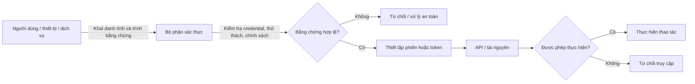

# Vì sao cần xác thực

> **Chương:** Bức tranh tổng thể  
> **Phạm vi:** SECURITY_AUTHENTICATION_FUNDAMENTALS — tìm hiểu cách xác minh danh tính bằng credential, mật khẩu, MFA, passkey, chứng chỉ; cách duy trì kết quả xác thực bằng token và phiên; cách liên kết danh tính, khôi phục tài khoản và bảo vệ luồng đăng nhập trước phishing, replay, lạm dụng.

## Mục tiêu học tập

Sau bài này, người học có thể:

1. Giải thích vì sao một hệ thống cần xác thực ngay cả khi đã có tên tài khoản, địa chỉ email hoặc giao diện đăng nhập.
2. Phân biệt **định danh**, **xác thực**, **phân quyền** và **thiết lập danh tính ban đầu**; nhận ra mỗi bước giải quyết một câu hỏi khác nhau.
3. Mô tả ranh giới tin cậy từ thiết bị người dùng đến máy chủ, nhà cung cấp danh tính và API.
4. Nêu những rủi ro như mạo danh, credential stuffing, phishing, replay, chiếm phiên và lạm dụng quy trình khôi phục.
5. Giải thích vì sao phải lựa chọn mức bảo đảm xác thực phù hợp với độ nhạy của hành động, đồng thời bảo vệ phiên sau khi đăng nhập.

## 1. Vấn đề gốc: lời tự nhận không phải bằng chứng

Giả sử một ứng dụng ngân hàng nhận yêu cầu: “Tôi là chủ tài khoản A; hãy cho tôi xem số dư”. Nếu hệ thống chỉ dựa vào tên đăng nhập hoặc mã khách hàng do bên gửi cung cấp thì bất kỳ ai biết các thông tin đó đều có thể tự nhận mình là A.

Trên Internet, nhiều thông tin nhận diện rất dễ biết hoặc sao chép: email có thể xuất hiện công khai; tên tài khoản có thể đoán được; mã người dùng có thể nằm trong đường dẫn hoặc dữ liệu trả về; địa chỉ IP có thể đổi hoặc được chia sẻ. **Biết một định danh không đồng nghĩa có quyền đại diện cho định danh đó.**

**Xác thực (authentication)** là quá trình kiểm tra bằng chứng rằng chủ thể đang giao tiếp có quyền sử dụng danh tính mà họ khai báo, với mức độ tin cậy phù hợp. Chủ thể có thể là người dùng, thiết bị, ứng dụng, dịch vụ hoặc máy chủ. Bằng chứng có thể là quyền kiểm soát một mật khẩu, khóa mật mã, thiết bị đã đăng ký hoặc các yếu tố xác thực khác.

Nếu bỏ xác thực, hệ thống khó trả lời các câu hỏi thiết yếu:

- Ai đang yêu cầu truy cập thông tin cá nhân, tài sản hoặc tài nguyên nội bộ?
- Người gửi có thực sự kiểm soát yếu tố đã đăng ký với tài khoản đó không?
- Hành động nhạy cảm này có cần kiểm tra bổ sung trước khi thực hiện không?
- Yêu cầu tiếp theo có còn thuộc cùng một phiên đã được xác thực không?
- Khi mất credential, làm sao khôi phục quyền truy cập mà không trao tài khoản cho kẻ mạo danh?

Xác thực tạo một điểm bắt đầu có căn cứ cho các quyết định bảo mật phía sau. Nó không tự chứng minh người dùng trung thực, không bảo đảm thiết bị sạch mã độc và không thay thế kiểm tra quyền ở từng tài nguyên.

## 2. Bốn khái niệm dễ nhầm lẫn

| Khái niệm | Câu hỏi cần trả lời | Ví dụ |
| --- | --- | --- |
| **Định danh (identification)** | Chủ thể **khai mình là ai**? | Nhập tên tài khoản hoặc chọn tài khoản tổ chức. |
| **Thiết lập/kiểm chứng danh tính ban đầu (identity proofing)** | Có căn cứ nào để gắn một con người/tổ chức thật với hồ sơ được cấp không? | Đối chiếu giấy tờ và thông tin phù hợp khi mở tài khoản theo yêu cầu nghiệp vụ. |
| **Xác thực (authentication)** | Người đang tương tác **có kiểm soát bằng chứng đã gắn với danh tính đó** không? | Xác minh mật khẩu, phản hồi thử thách bằng passkey, chứng minh sở hữu khóa trong chứng chỉ. |
| **Phân quyền (authorization)** | Chủ thể đã được xác thực **được phép làm gì**? | Nhân viên chỉ xem hồ sơ thuộc nhóm mình; người dùng không thể chuyển tiền từ tài khoản người khác. |

Ví dụ, đăng nhập thành công vào hệ thống công ty chứng tỏ yêu cầu đã thỏa phương thức xác thực của tài khoản; điều đó không mặc nhiên cho phép đọc bảng lương hoặc quản trị máy chủ. Phân quyền vẫn phải được thực hiện ở phía hệ thống đáng tin cậy, trên từng thao tác.

Cũng cần phân biệt **xác thực tài khoản** với **nhận diện con người ngoài đời**. Một tài khoản tự đăng ký bằng email chưa chắc đại diện cho một danh tính pháp lý đã được kiểm chứng. Ngược lại, một dịch vụ máy tính có thể được xác thực rất mạnh bằng chứng chỉ mà không gắn với một con người cụ thể nào.

## 3. Điều gì xảy ra nếu thiếu hoặc làm xác thực yếu?

Hãy theo dõi ba tình huống:

**Tình huống A — Xem dữ liệu riêng tư.** Một ứng dụng hồ sơ học tập cho phép truy cập đường dẫn chứa mã học viên. Nếu máy chủ tin mã trong URL và không xác minh người đang yêu cầu, ai biết hoặc đoán được mã cũng có thể xem hồ sơ. Ngay cả khi người dùng đã đăng nhập, máy chủ còn phải kiểm tra họ có quyền xem **hồ sơ cụ thể** đó hay không.

**Tình huống B — Chuyển tiền.** Người dùng đã đăng nhập nhưng kẻ tấn công chiếm được cookie phiên. Nếu máy chủ xem cookie như bằng chứng duy nhất cho mọi hành động, kẻ tấn công có thể tiếp tục phiên. Đối với việc thêm người thụ hưởng hoặc chuyển khoản rủi ro cao, hệ thống có thể yêu cầu **xác thực lại hoặc xác thực tăng cường (step-up authentication)**, cùng kiểm tra giao dịch và dấu hiệu bất thường.

**Tình huống C — Dịch vụ gọi dịch vụ.** Một API xử lý thanh toán nhận dữ liệu từ “dịch vụ đơn hàng”. Nếu chỉ tin tên dịch vụ trong HTTP header do bên gửi tự đặt, bất kỳ client nào tới được API đều có thể mạo danh. API cần kiểm chứng danh tính dịch vụ bằng cơ chế như token có phạm vi phù hợp hoặc mTLS, sau đó áp chính sách quyền của chính dịch vụ đó.

Trong cả ba tình huống, mục đích là xác lập một quan hệ tin cậy **dựa trên bằng chứng có thể kiểm chứng**, thay vì trên dữ liệu bên gọi tự khai.

### Những hậu quả thường gặp

| Điểm yếu | Hậu quả có thể xảy ra | Bài học thiết kế |
| --- | --- | --- |
| Chỉ dựa vào email, mã tài khoản hoặc user ID | Mạo danh, lộ dữ liệu | Định danh không phải bằng chứng xác thực. |
| Mật khẩu yếu hoặc tái sử dụng | Đoán mật khẩu, credential stuffing từ dữ liệu rò rỉ | Bảo vệ mật khẩu, giới hạn thử sai, phát hiện hành vi bất thường và bổ sung yếu tố mạnh. |
| Người dùng nhập bí mật vào trang giả | Phishing và chiếm tài khoản | Ưu tiên phương thức chống phishing như passkey/FIDO2 cho trường hợp phù hợp. |
| Chấp nhận lại bằng chứng cũ | Replay, sử dụng trái phép yêu cầu đã ghi lại | Dùng thử thách mới, hạn sử dụng, ràng buộc ngữ cảnh và cơ chế chống lặp phù hợp. |
| Token hoặc cookie phiên bị lộ | Kẻ khác sử dụng phiên hợp lệ | Bảo vệ, giới hạn thời gian/phạm vi, giám sát và thu hồi phiên khi cần. |
| Khôi phục tài khoản dễ hơn đăng nhập | Vượt qua MFA bằng kênh khôi phục | Thiết kế khôi phục như một luồng bảo mật riêng có kiểm soát. |

**Lưu ý:** thêm màn hình đăng nhập chưa đủ để chặn các lỗi trên. Độ an toàn phụ thuộc vào cách tạo, xác minh, lưu trữ, truyền và thu hồi bằng chứng xác thực xuyên suốt vòng đời tài khoản.

## 4. Hệ thống thực sự xác minh điều gì?

Một mô hình đơn giản gồm năm bước:

1. **Khai danh tính:** client yêu cầu đăng nhập một tài khoản hoặc chuyển đến nhà cung cấp danh tính.
2. **Trình bằng chứng:** client cung cấp mật khẩu, phản hồi một thử thách mật mã, mã xác thực hoặc bằng chứng thích hợp.
3. **Kiểm chứng ở thành phần tin cậy:** máy chủ xác minh bằng chứng, chính sách, trạng thái tài khoản và các điều kiện liên quan.
4. **Thiết lập ngữ cảnh đã xác thực:** máy chủ tạo phiên hoặc phát hành token với thông tin chủ thể, thời điểm, mức xác thực và phạm vi sử dụng thích hợp.
5. **Kiểm soát truy cập tiếp theo:** mỗi yêu cầu phải có phiên/token hợp lệ; hệ thống tiếp tục kiểm tra quyền và có thể yêu cầu xác thực tăng cường.



**Ranh giới tin cậy** là nơi dữ liệu đi từ thành phần ít tin cậy sang thành phần có quyền đưa ra quyết định. Trình duyệt, ứng dụng di động và các request đi qua mạng có thể bị sửa hoặc giả mạo; máy chủ không nên tin chỉ vì client gửi cờ **isAuthenticated = true** hoặc một **userId**. API phải tự kiểm tra bằng chứng được chấp nhận theo thiết kế, dù giao diện đã ẩn nút truy cập.

Ví dụ logic ở phía server, ở dạng mô tả:

```text
request -> đọc bằng chứng phiên/token
        -> xác minh tính hợp lệ, thời hạn, nguồn cấp và ngữ cảnh dùng
        -> xác định chủ thể đã xác thực
        -> kiểm tra quyền trên đối tượng và hành động cụ thể
        -> cho phép hoặc từ chối; ghi nhận sự kiện cần thiết
```

Điểm mấu chốt: **xác thực trả lời “ai/đối tượng nào đang hiện diện theo bằng chứng đã kiểm tra”; phân quyền trả lời “được làm gì”**. Cả hai phải được thực thi tại ranh giới tin cậy phù hợp.

## 5. Vì sao cần nhiều loại credential?

Một loại bằng chứng không phù hợp với mọi chủ thể và mọi mức rủi ro.

| Phương thức | Cơ sở xác thực | Lợi ích | Giới hạn cần nhớ |
| --- | --- | --- | --- |
| **Mật khẩu** | Bí mật mà người dùng biết | Phổ biến, dễ triển khai | Có thể bị lộ, tái sử dụng, đoán hoặc nhập vào trang phishing. |
| **OTP qua ứng dụng / TOTP** | Quyền truy cập thiết bị hoặc bí mật tạo mã | Thêm một yếu tố ngoài mật khẩu | Mã vẫn có thể bị đánh cắp theo thời gian thực qua phishing; cần hạn chế thử sai. |
| **OTP qua SMS** | Quyền nhận tin nhắn qua số điện thoại | Tiện trong một số tình huống | Có nguy cơ SIM swap, chiếm số, chuyển tiếp hoặc phishing; không phải lựa chọn chống phishing mạnh. |
| **Thông báo phê duyệt MFA** | Thiết bị/app đã đăng ký | Thuận tiện với người dùng | Có thể bị lạm dụng bằng nhiều yêu cầu liên tiếp; nên có xác nhận ngữ cảnh hoặc đối chiếu số. |
| **Passkey / FIDO2** | Khóa riêng được bảo vệ, ký thử thách gắn với dịch vụ hợp lệ | Chống phishing tốt nhờ ràng buộc với tên miền/nguồn gọi và mật mã khóa công khai | Cần tính đến đăng ký, đồng bộ hoặc mất thiết bị, khôi phục và bảo vệ tài khoản nền tảng. |
| **Chứng chỉ số / mTLS** | Chứng minh sở hữu khóa riêng tương ứng chứng chỉ | Hữu ích cho thiết bị, máy chủ và giao tiếp dịch vụ với dịch vụ | Phải quản lý cấp phát, tin cậy CA, thời hạn, khóa riêng và thu hồi/xoay vòng. |

Các nhóm yếu tố thường được gọi là **thứ biết** (mật khẩu), **thứ sở hữu** (thiết bị/khóa) và **đặc điểm vốn có** (sinh trắc học). **MFA** yêu cầu ít nhất hai yếu tố xác thực độc lập theo thiết kế; nhập mật khẩu rồi nhập thêm PIN cùng thuộc nhóm “thứ biết” không tự động trở thành MFA. Với passkey, sinh trắc học hoặc PIN thường được dùng **cục bộ để mở khóa credential**; máy chủ nhận bằng chứng mật mã thay vì ảnh vân tay hay khuôn mặt.

Phương thức mạnh hơn về xác thực không tự bảo đảm tất cả hành động an toàn. Ví dụ, một phiên được lập bằng passkey vẫn có thể bị lợi dụng nếu ứng dụng có lỗ hổng XSS hoặc máy của người dùng bị kiểm soát. Kiểm tra quyền, bảo vệ phiên và theo dõi rủi ro vẫn cần thiết.

### Mật khẩu cần được xử lý như một bí mật

Khi hỗ trợ đăng nhập bằng mật khẩu, hệ thống cần truyền qua kết nối an toàn, không ghi mật khẩu rõ vào log, và lưu **giá trị băm chuyên dụng cho mật khẩu kèm salt riêng** bằng thuật toán phù hợp như Argon2id. Không nên lưu mật khẩu rõ hoặc dùng hàm băm nhanh thông thường như SHA-256 đơn lẻ để thay cho thuật toán băm mật khẩu. Khi xác minh, máy chủ so khớp một cách an toàn và kiểm soát số lần thử.

### Vì sao thử thách mới giúp chống replay?

Với cơ chế thử thách–phản hồi, máy chủ tạo giá trị ngẫu nhiên mới và yêu cầu client chứng minh quyền sở hữu khóa bằng phản hồi có ràng buộc với thử thách và ngữ cảnh. Kẻ nghe lén một phản hồi cũ không thể mặc nhiên sử dụng nó cho thử thách mới. Hệ thống vẫn phải xác minh tính mới, nguồn nhận, thời hạn và các ràng buộc cần thiết; chỉ “có chữ ký” chưa đủ nếu chữ ký có thể phát lại trong ngữ cảnh không đúng.

## 6. Vì sao đăng nhập xong vẫn phải quan tâm token và phiên?

Người dùng không thể nhập mật khẩu hoặc thực hiện passkey cho từng lần tải ảnh, xem đơn hàng hay gọi API. Sau một lần xác thực thành công, hệ thống thường duy trì trạng thái bằng **phiên (session)** hoặc **token**.

- **Phiên phía máy chủ:** client giữ một session ID khó đoán; máy chủ ánh xạ ID đó tới ngữ cảnh phiên và có thể chấm dứt phiên ở phía server.
- **Access token:** client trình một bằng chứng cho API; API kiểm tra cách xác minh được quy định, đối tượng nhận (**audience**), bên phát hành (**issuer**), hạn sử dụng, phạm vi/quyền và các ràng buộc áp dụng. Token dạng JWT không tự an toàn chỉ vì đọc được các claim; chữ ký và toàn bộ điều kiện chấp nhận phải được kiểm tra.
- **Refresh token:** khi được dùng, nó có thể xin access token mới mà không buộc đăng nhập lại liên tục. Vì có giá trị lâu hơn, phải được lưu và xoay vòng/thu hồi theo chính sách phù hợp.

Token và cookie phiên cần được coi như **thông tin có thể trao quyền truy cập**. Nếu một kẻ khác lấy được bearer token còn hiệu lực, họ có thể dùng nó như chủ thể hợp lệ trong phạm vi token cho phép. MFA ở thời điểm đăng nhập không tự ngăn việc sử dụng một phiên đã bị đánh cắp.

Với ứng dụng web, cookie phiên nên được cấu hình theo nhu cầu bảo mật như **Secure**, **HttpOnly**, **SameSite**, phạm vi domain/path thích hợp; đồng thời xử lý CSRF nếu ứng dụng dựa vào cookie và bảo vệ chống XSS. Cờ HttpOnly giúp JavaScript không đọc trực tiếp cookie nhưng không làm XSS trở nên vô hại. Hệ thống cũng cần thời hạn hết phiên, đăng xuất, xoay session ID sau các mốc phù hợp, vô hiệu hóa sau sự kiện nhạy cảm và khả năng kiểm tra phiên đang hoạt động khi cần.

Một phiên hợp lệ chứng minh rằng **một quá trình xác thực đã diễn ra và phiên chưa bị từ chối theo chính sách hiện tại**; nó không bảo đảm người đang sử dụng thiết bị lúc này vẫn là người ban đầu. Bởi vậy, các hành động như đổi mật khẩu, thay thiết bị MFA, xuất dữ liệu nhạy cảm hoặc chuyển tiền có thể cần xác thực lại.

## 7. Vì sao liên kết danh tính và đăng nhập một lần vẫn phải được kiểm chứng?

Nhiều tổ chức sử dụng một **nhà cung cấp danh tính (Identity Provider, IdP)** để cho phép đăng nhập một lần (SSO) vào nhiều ứng dụng. Ứng dụng dựa vào kết quả xác thực được IdP cung cấp, thay vì tự quản lý mật khẩu cho mọi người dùng.

Lợi ích là quản trị danh tính tập trung, giảm số mật khẩu phải nhớ và có thể thống nhất chính sách MFA. Đổi lại, việc tin tưởng IdP là một ranh giới quan trọng: ứng dụng cần kiểm chứng đúng nguồn phát hành, đối tượng nhận, thời hạn, nonce/state hoặc các ràng buộc tương ứng với luồng được dùng, rồi ánh xạ danh tính ngoài vào tài khoản nội bộ theo quy tắc rõ ràng.

Với **OpenID Connect (OIDC)**, ID token dùng để truyền thông tin về sự kiện xác thực tới ứng dụng nhận đúng đối tượng; **OAuth 2.0 access token** chủ yếu dùng để cấp quyền truy cập API. Không nên dùng một access token được phát cho API khác làm bằng chứng đăng nhập tùy tiện. Việc thấy cùng một địa chỉ email trong hai hệ thống cũng chưa đủ để tự động gộp hai tài khoản: email có thể đổi, bị tái cấp hoặc chưa được xác minh theo cách mà ứng dụng yêu cầu.

Điều này giải thích vì sao xác thực không chỉ nằm ở màn hình login. Mỗi lần liên kết tài khoản, cấp token mới hoặc trao quyền giữa dịch vụ đều là một quyết định về **nguồn bằng chứng và phạm vi được tin cậy**.

## 8. Vì sao khôi phục tài khoản là một phần của xác thực?

Người dùng có thể quên mật khẩu, mất điện thoại, thay thiết bị hoặc mất khóa dùng cho passkey. Nếu không có khôi phục, tài khoản hợp lệ có thể bị khóa vĩnh viễn. Nhưng nếu khôi phục quá dễ, kẻ tấn công sẽ chọn “quên mật khẩu” để bỏ qua mọi bảo vệ của luồng đăng nhập chính.

Một quy trình khôi phục an toàn cần cân bằng khả năng lấy lại quyền truy cập với việc chống mạo danh. Tùy mức rủi ro, hệ thống có thể sử dụng mã hoặc liên kết **dùng một lần, thời hạn ngắn**, kênh liên lạc đã xác minh, nhiều tín hiệu độc lập, độ trễ hoặc quy trình xét duyệt cho tài khoản đặc quyền. Thông báo cho chủ tài khoản khi credential hoặc MFA thay đổi, giới hạn thử sai và vô hiệu hóa các phiên/credential không còn tin cậy đều giúp giảm hậu quả.

Không nên mặc định câu hỏi bảo mật như “tên thú cưng đầu tiên” là yếu tố mạnh vì nhiều câu trả lời có thể đoán, tìm thấy hoặc bị lộ. Cũng không nên coi việc kiểm soát một email khôi phục là bằng chứng đủ cho mọi cấp tài khoản trong mọi hoàn cảnh. **Mức bảo vệ của quy trình khôi phục cần tương xứng với hậu quả khi tài khoản bị chiếm.**

## 9. Thiết kế xác thực từ mức rủi ro và ranh giới tin cậy

Không phải mọi trang hoặc API đều cần người dùng đăng nhập. Chẳng hạn trang giới thiệu sản phẩm được công khai có thể cho phép xem vô danh. Nhưng API chứa hồ sơ cá nhân, quản trị hạ tầng hoặc điều khiển thanh toán cần nhận diện chủ thể và kiểm soát quyền thích hợp. Các endpoint công khai vẫn có thể cần kiểm soát lạm dụng; CAPTCHA, giới hạn tốc độ hay chống bot **không phải là bằng chứng danh tính của một người dùng cụ thể**.

Khi lựa chọn cách xác thực, cần trả lời:

1. **Tài sản nào cần bảo vệ?** Hồ sơ cá nhân, tiền, quyền quản trị, bí mật API hay dữ liệu công khai?
2. **Chủ thể là ai?** Người dùng, máy chủ, ứng dụng, thiết bị hay tác vụ tự động?
3. **Ai có thể giả mạo và bằng cách nào?** Lộ mật khẩu, phishing, giả request, chiếm thiết bị, đánh cắp token, lạm dụng khôi phục?
4. **Bằng chứng được kiểm tra ở đâu?** Máy chủ, IdP hay API nào là điểm đưa ra quyết định? Dữ liệu từ browser/mobile nào phải xem là không đáng tin?
5. **Mức bảo đảm nào cần tại từng thao tác?** Đọc tin tức khác với đổi mật khẩu, thêm người thụ hưởng hoặc cấp quyền quản trị.
6. **Sau khi xác thực thì sao?** Phiên được bảo vệ, giới hạn, giám sát, thu hồi và xác thực lại như thế nào?

Bảng tham khảo cho quyết định ban đầu:

| Trường hợp | Nhu cầu điển hình | Điểm cần chú ý |
| --- | --- | --- |
| Đọc nội dung công khai | Có thể không yêu cầu đăng nhập | Vẫn chống lạm dụng tài nguyên khi cần. |
| Xem hồ sơ cá nhân | Xác thực người dùng và kiểm tra quyền trên hồ sơ | Chống lộ dữ liệu do IDOR, bảo vệ cookie/token phiên. |
| Đổi email, mật khẩu, MFA | Xác thực lại hoặc step-up tùy rủi ro | Bảo vệ kênh khôi phục, thông báo thay đổi, xử lý phiên cũ. |
| Chuyển tiền hoặc phê duyệt nhạy cảm | Bảo đảm cao hơn, kiểm tra ngữ cảnh và rủi ro giao dịch | Chống phishing, chiếm phiên, gian lận giao dịch. |
| API nội bộ giữa dịch vụ | Xác thực dịch vụ bằng credential phù hợp | Quản lý khóa/chứng chỉ/token, đúng audience và quyền tối thiểu. |

**Xác thực liên tục theo ngữ cảnh** không nhất thiết có nghĩa là liên tục hỏi mật khẩu. Hệ thống có thể đánh giá tuổi phiên, thiết bị, độ nhạy thao tác và dấu hiệu bất thường để quyết định khi nào cần thử thách thêm. Cần tránh chặn nhầm người dùng hợp lệ và bảo đảm có đường khôi phục an toàn.

## 10. Ví dụ xuyên suốt: từ đăng nhập đến giao dịch

Xét một ứng dụng quản lý tài khoản có chức năng xem thông tin, đổi thiết bị MFA và thực hiện một giao dịch nhạy cảm:

1. **Đăng ký:** hệ thống tạo tài khoản, thiết lập phương thức xác thực và xác minh kênh liên hệ cần thiết. Việc đăng ký bằng email không tự chứng minh danh tính pháp lý.
2. **Đăng nhập:** người dùng trình passkey hoặc mật khẩu kèm yếu tố thứ hai theo chính sách. Máy chủ/IdP xác minh bằng chứng và chính sách trước khi tạo phiên.
3. **Đọc hồ sơ:** mỗi request dùng phiên/token hợp lệ; API vẫn kiểm tra chủ thể có quyền xem đúng hồ sơ được yêu cầu.
4. **Đổi phương thức MFA:** hệ thống yêu cầu kiểm tra bổ sung theo độ nhạy, thông báo thay đổi, áp dụng giới hạn thích hợp và ghi nhận sự kiện bảo mật.
5. **Thực hiện giao dịch nhạy cảm:** hệ thống có thể step-up, kiểm tra dấu hiệu bất thường và xác nhận các chi tiết giao dịch khi cần; đăng nhập thành công từ vài giờ trước không mặc nhiên đủ.
6. **Mất thiết bị:** người dùng đi qua quy trình khôi phục được kiểm soát. Credential và phiên không còn tin cậy được thu hồi/điều chỉnh theo chính sách.

Qua ví dụ này, có thể thấy xác thực không phải một nút “Đăng nhập”. Đó là **chuỗi quyết định tin cậy** trong suốt vòng đời danh tính: đăng ký, đăng nhập, duy trì phiên, nâng mức bảo đảm, liên kết dịch vụ, thay credential và khôi phục.

## 11. Tự kiểm tra hiểu biết

**Câu 1.** Một request gửi **userId = 42** và ứng dụng cho phép xem hồ sơ của người dùng 42. Có thể kết luận request đã xác thực không?

**Đáp án:** Không. userId là lời khai hoặc dữ liệu định danh. API cần xác minh bằng chứng phiên/token hoặc cơ chế được chấp nhận, sau đó kiểm tra quyền xem hồ sơ 42.

**Câu 2.** Sau khi đăng nhập bằng mật khẩu và MFA, người dùng bị lộ bearer access token còn hiệu lực. MFA đã bảo đảm API an toàn chưa?

**Đáp án:** Chưa. Ai nắm bearer token có thể trình token trong phạm vi được phép nếu hệ thống không có ràng buộc bổ sung. Cần bảo vệ token, giới hạn hiệu lực/phạm vi và có cơ chế phát hiện, thu hồi phù hợp.

**Câu 3.** Tại sao yêu cầu nhập mật khẩu và thêm một PIN không tự động là MFA?

**Đáp án:** Cả hai đều thuộc loại thông tin người dùng biết. MFA đòi hỏi các yếu tố thuộc nhóm độc lập theo thiết kế.

**Câu 4.** Passkey chống phishing nhờ đặc tính gì?

**Đáp án:** Cơ chế khóa công khai và phản hồi thử thách có ràng buộc với dịch vụ/nguồn gọi hợp lệ giúp khóa không hoạt động như một mật khẩu có thể nhập lại trên website giả. Vẫn cần bảo vệ thiết bị, phiên và khôi phục.

**Câu 5.** Nếu ứng dụng dùng SSO, có thể bỏ kiểm tra quyền trong API không?

**Đáp án:** Không. SSO cung cấp thông tin xác thực theo quan hệ tin cậy với IdP; mỗi API vẫn phải kiểm tra bằng chứng dành cho mình và quyền đối với hành động/tài nguyên.

**Câu 6.** Tại sao luồng “quên mật khẩu” có thể làm suy yếu cả hệ thống MFA?

**Đáp án:** Nếu kẻ tấn công có thể thay credential hoặc gỡ yếu tố MFA thông qua một kênh khôi phục yếu, họ có thể chiếm tài khoản mà không cần vượt qua luồng đăng nhập được bảo vệ tốt.

## Ghi nhớ

Xác thực cần thiết vì **mạng và client không thể tự chứng minh người gửi là người họ khai báo**. Một hệ thống an toàn phải kiểm tra bằng chứng phù hợp, xác lập ranh giới tin cậy, duy trì và bảo vệ kết quả xác thực qua phiên/token, kiểm tra quyền trên từng tài nguyên, đồng thời bảo vệ luồng đăng nhập, liên kết danh tính và khôi phục tài khoản. Phương thức cụ thể cần dựa trên chủ thể, tài sản, mối đe dọa và hậu quả của việc mạo danh.
