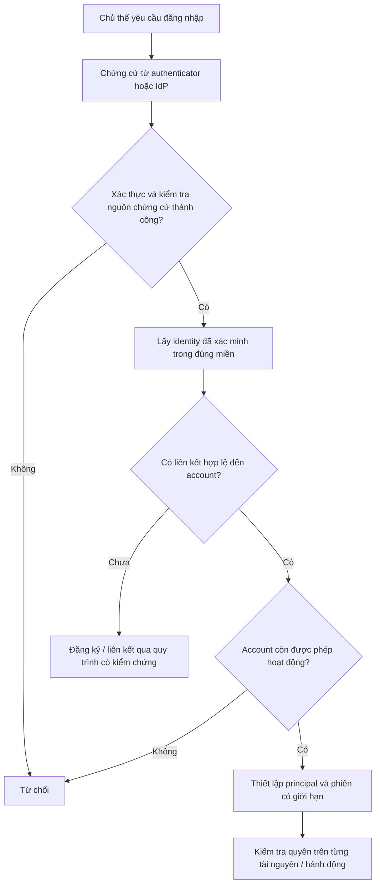

# Identity và account

Trong hệ thống xác thực, hai từ *identity* (danh tính) và *account* (tài khoản) thường xuất hiện cùng nhau nhưng giải quyết hai câu hỏi khác nhau:

- **Identity:** Chủ thể mà hệ thống đang nói đến hoặc cố gắng nhận diện là ai, trong một phạm vi và theo một tập thông tin nhất định?
- **Account:** Hệ thống quản lý quyền truy cập, trạng thái sử dụng và các tài nguyên của chủ thể đó qua bản ghi nào?

Phân biệt hai khái niệm này là nền tảng để thiết kế đăng nhập bằng mật khẩu, MFA, passkey, chứng chỉ, đăng nhập liên kết (federation), phiên, token và khôi phục tài khoản. Một lần đăng nhập thành công chỉ có ý nghĩa khi chứng cứ xác thực được gắn với **đúng tài khoản**, trong **đúng phạm vi tin cậy**, và tài khoản đó còn được phép hoạt động.

## 1. Các khái niệm cốt lõi

| Khái niệm | Vai trò | Ví dụ |
| --- | --- | --- |
| **Subject / chủ thể** | Người, dịch vụ hoặc thiết bị mà hệ thống đưa ra quyết định bảo mật đối với họ. | Một nhân viên; một tác vụ đồng bộ chạy tự động. |
| **Digital identity / danh tính số** | Cách một miền quản lý biểu diễn một chủ thể bằng định danh và các thuộc tính (claims). Không tự động là bằng chứng về danh tính pháp lý. | Chủ thể `sub=8f42` do nhà cung cấp danh tính phát hành. |
| **Identifier / định danh** | Giá trị dùng để phân biệt một thực thể trong một phạm vi xác định. | `account_id`, cặp `(issuer, subject)`. |
| **Account / tài khoản** | Bản ghi nội bộ giữ trạng thái, thiết lập, liên kết danh tính và căn cứ áp dụng quyền truy cập. | Account `a-123` thuộc tenant `t-01`, trạng thái `active`. |
| **Credential / thông tin xác thực** | Dữ liệu hoặc chứng cứ dùng trong quá trình chứng minh quyền kiểm soát một authenticator. | Mật khẩu; khóa bí mật trong thiết bị; chứng chỉ gắn với khóa. |
| **Authenticator / phương tiện xác thực** | Bí mật, thiết bị hoặc cơ chế người dùng kiểm soát để chứng minh một tuyên bố danh tính. | Passkey, ứng dụng TOTP, khóa bảo mật. |
| **Principal** | Danh tính bảo mật mà ứng dụng dùng khi đánh giá quyền của một hành động. | `principal.account_id=a-123` trong ngữ cảnh một yêu cầu API. |
| **Session / phiên** | Trạng thái được duy trì sau bước xác thực, gắn với một principal và có giới hạn thời gian/phạm vi. | Phiên web có cookie an toàn, gắn với account `a-123`. |

**Tài khoản không phải là mật khẩu.** Một account có thể có nhiều authenticator, chuyển từ mật khẩu sang passkey hoặc đăng nhập qua nhiều nhà cung cấp danh tính mà vẫn giữ nguyên `account_id`. Ngược lại, biết địa chỉ email của một account không có nghĩa là người đó đã được xác thực.

**Danh tính số không đồng nhất với con người ngoài đời.** Xác minh quyền truy cập hộp thư chỉ chứng minh một bên đã kiểm soát hộp thư ở thời điểm kiểm tra; nó không mặc nhiên xác minh họ tên pháp lý, hợp đồng lao động hay quyền sở hữu tài khoản doanh nghiệp. Việc kiểm tra danh tính thực (*identity proofing*) cần quy trình và mức bảo đảm riêng, tùy nghiệp vụ.

## 2. Quan hệ giữa con người, identity và account

Không tồn tại quy tắc phổ quát “một người = một identity = một account”. Quan hệ thay đổi theo miền ứng dụng.

| Tình huống | Cách hiểu phù hợp |
| --- | --- |
| Một nhân viên dùng hệ thống nhân sự và hệ thống học tập | Cùng một người có thể có **hai account nội bộ**, mỗi account thuộc một dịch vụ. |
| Một người đăng nhập một ứng dụng bằng tài khoản công ty hoặc passkey | **Một account nội bộ** có thể liên kết với nhiều cách xác thực hoặc nhiều identity bên ngoài, theo chính sách rõ ràng. |
| Hai người dùng chung tên đăng nhập và mật khẩu | Hệ thống khó truy vết ai thực hiện hành động. Account dùng chung nên được tránh; nếu bắt buộc phải có thì cần cơ chế quy trách nhiệm riêng. |
| Một tác vụ nền gọi API | **Service account / workload identity** đại diện cho phần mềm, không nhất thiết có email, tên người hoặc luồng đăng nhập tương tác. |
| Một người có account ở hai tổ chức trong cùng nền tảng | Hai account có thể thuộc **hai tenant khác nhau** với quyền và trạng thái tách biệt, dù cùng đăng nhập bằng một IdP. |

Điều cần thiết là xác định *phạm vi duy nhất* của từng loại định danh: toàn hệ thống, riêng tenant, riêng ứng dụng, hay riêng nhà cung cấp danh tính. Nếu hệ thống đa tenant, cùng một email hoặc identity ngoài có thể được gắn với những account khác nhau tùy mô hình; chính sách này phải được thiết kế, không suy ra từ chuỗi email.

### Ví dụ xuyên suốt

Giả sử Lan có account `account_id=9c81` trong ứng dụng học tập của Công ty A. Lan đăng nhập qua nhà cung cấp danh tính doanh nghiệp có `issuer=https://login.example.org/tenant-a` và `sub=user-457`. Email làm việc ban đầu là `lan@old.example`, sau đổi thành `lan@new.example`.

- `account_id=9c81` là khóa nội bộ ổn định dùng để tham chiếu dữ liệu học tập và chính sách phân quyền.
- Cặp `(issuer, sub)` định danh Lan **trong miền của IdP**, sau khi ứng dụng xác minh thông điệp xác thực.
- Email là thuộc tính liên lạc hoặc tên đăng nhập có thể thay đổi. Không nên dùng email làm khóa chính của dữ liệu học tập.
- Nếu Lan bị vô hiệu hóa account, một token xác thực danh tính hợp lệ từ IdP không được tự động mở lại quyền sử dụng ứng dụng.

Ví dụ cho thấy hệ thống cần cả **xác thực bên ngoài** lẫn **quản lý account và phân quyền bên trong**.

## 3. Từ lời khai danh tính đến principal được tin cậy

Một biểu mẫu có trường `email`, một HTTP header `X-User-Id` do client gửi hoặc một ID tự khai trong JSON chỉ là **lời khai**, không đủ để xác định principal. Hệ thống phải chứng thực nguồn của thông tin, kiểm tra quan hệ liên kết và tình trạng account.



Luồng này có những ranh giới tin cậy quan trọng:

1. **Client → hệ thống xác thực:** Dữ liệu từ trình duyệt hoặc ứng dụng khách chưa đáng tin. Cần kiểm tra chứng cứ xác thực, bảo vệ chống giả mạo, phishing hoặc phát lại (replay) theo cơ chế đang dùng.
2. **IdP → ứng dụng sử dụng danh tính (relying party):** Ứng dụng chỉ tin token hoặc phản hồi từ IdP đã cấu hình và xác minh đầy đủ. Với OpenID Connect, cần kiểm tra các điều kiện thích hợp như chữ ký, `iss`, `aud`, hạn dùng và `nonce` trong luồng có sử dụng nonce.
3. **Identity bên ngoài → account nội bộ:** Chỉ ánh xạ bằng liên kết được tạo hợp lệ; không tự nhập hai account chỉ vì email trùng.
4. **Account → tài nguyên:** Xác thực thành công chưa có nghĩa là được xem hoặc sửa mọi dữ liệu. Authorization phải kiểm tra vai trò, phạm vi tenant, đối tượng và chính sách của mỗi thao tác.

Vì vậy, câu “token hợp lệ” chưa đủ để trả lời “người này được dùng tài khoản nào và làm việc gì”. Token còn phải dành cho đúng dịch vụ, đúng mục đích, và không được thay thế bước kiểm tra trạng thái account hoặc quyền truy cập.

## 4. Thiết kế các loại identifier

Một hệ thống có thể cần ít nhất ba lớp định danh khác nhau.

### 4.1. Khóa account nội bộ

`account_id` nên là giá trị sinh bởi hệ thống, duy nhất trong phạm vi đã chọn, ổn định và không mang ý nghĩa cá nhân. UUID là một lựa chọn phổ biến. Tất cả dữ liệu nghiệp vụ, audit log và tham chiếu nội bộ nên sử dụng khóa này hoặc một khóa nội bộ tương đương.

Trong ứng dụng đa tenant, cần buộc mọi thao tác tra cứu và phân quyền vào `tenant_id`, kể cả khi ID account có độ duy nhất toàn cục. Một ID khó đoán không thay thế kiểm soát quyền truy cập.

### 4.2. Định danh do IdP cung cấp

Với OpenID Connect, `sub` định danh subject theo phạm vi của `iss`; vì vậy, **cặp `(iss, sub)`** mới là khóa tham chiếu identity phù hợp. Không được lấy một `sub` đơn lẻ rồi coi nó là duy nhất giữa các IdP. Một số IdP có thể cấp các `sub` khác nhau cho cùng người dùng ở các ứng dụng khác nhau; không nên suy luận rằng chúng tương đương.

Khi đọc các claims, phải dựa trên token đã được xác minh từ IdP đáng tin cậy. Không để client tự truyền `iss`, `sub` như tham số tùy ý rồi tạo phiên cho account tương ứng.

### 4.3. Tên đăng nhập và thông tin liên hệ

Email, số điện thoại và tên hiển thị phục vụ tìm kiếm, liên lạc hoặc đăng nhập thuận tiện, nhưng có thể bị thay đổi, thu hồi, tái cấp hoặc nhập sai. Với email, còn có sự khác biệt về quy tắc chữ hoa/chữ thường, Unicode và chuẩn hóa theo nhà cung cấp. Hãy định nghĩa chính sách xử lý và tính duy nhất rõ ràng, tránh tự áp dụng các phép biến đổi tùy tiện lên mọi địa chỉ.

Các nguyên tắc thực dụng:

- Phân biệt **`login_identifier`**, **`contact_address`** và **`account_id`** ngay trong mô hình dữ liệu.
- Lưu trạng thái và thời điểm xác minh địa chỉ liên hệ nếu quy trình cần dựa vào nó; việc từng xác minh không bảo đảm quyền sở hữu vĩnh viễn.
- Không dùng email hoặc số điện thoại làm foreign key cho dữ liệu nghiệp vụ và không tự động chuyển quyền khi địa chỉ được người khác sử dụng lại.
- Khai báo ràng buộc duy nhất trong cơ sở dữ liệu ở **đúng phạm vi tenant/nhà cung cấp**; xử lý xung đột trong giao dịch thay vì chỉ kiểm tra trước ở phía ứng dụng.
- Không gắn quyền truy cập cho subject chỉ dựa trên tên hiển thị, domain email hoặc thuộc tính mà client tự khai.

## 5. Mô hình dữ liệu tham khảo

Thiết kế tối thiểu sau tách account nội bộ khỏi liên kết identity ngoài. Đây là ví dụ khái niệm theo cú pháp PostgreSQL, không phải toàn bộ mô hình sản xuất.

```sql
CREATE TABLE accounts (
    tenant_id    UUID NOT NULL,
    account_id   UUID NOT NULL,
    status       TEXT NOT NULL
                 CHECK (status IN ('pending', 'active', 'suspended', 'closed')),
    created_at   TIMESTAMPTZ NOT NULL DEFAULT CURRENT_TIMESTAMP,
    PRIMARY KEY (tenant_id, account_id)
);

CREATE TABLE identity_links (
    tenant_id    UUID NOT NULL,
    issuer       TEXT NOT NULL,
    subject      TEXT NOT NULL,
    account_id   UUID NOT NULL,
    linked_at    TIMESTAMPTZ NOT NULL DEFAULT CURRENT_TIMESTAMP,
    PRIMARY KEY (tenant_id, issuer, subject),
    FOREIGN KEY (tenant_id, account_id)
        REFERENCES accounts (tenant_id, account_id)
);
```

Trong ví dụ này, một subject của một IdP chỉ ánh xạ đến **một account trong một tenant**, nhưng một account có thể chứa nhiều liên kết identity. Nếu sản phẩm yêu cầu quy tắc khác, phải thay đổi ràng buộc có chủ đích và đánh giá nguy cơ trùng hoặc chiếm account. Danh sách authenticator, hồ sơ cá nhân, quyền và lịch sử xác thực cần được quản lý riêng theo nhu cầu.

Giả mã cho bước nhận dạng qua IdP:

```text
login(tenantId, idToken):
    claims = verifyIdTokenFromTrustedIssuer(idToken)
    # Kiểm chữ ký/issuer/audience/thời hạn/nonce theo luồng OIDC.

    link = findIdentityLink(tenantId, claims.iss, claims.sub)
    if link is absent:
        return requireExplicitOnboardingOrAccountLinking()

    account = loadAccount(tenantId, link.accountId)
    if account.status != "active":
        return denyAccess()

    return issueBoundedSession(account.tenantId, account.accountId)
```

Hàm `requireExplicitOnboardingOrAccountLinking()` không được âm thầm tìm account bằng `email` rồi gắn identity. Liên kết thêm phương thức đăng nhập cần quy trình chứng minh người yêu cầu được kiểm soát account đích, chẳng hạn phiên đăng nhập hiện tại kèm xác thực lại khi hành động có rủi ro cao, và chứng minh quyền kiểm soát identity mới. Thao tác liên kết cần chống yêu cầu giả mạo, có nhật ký và xử lý nguyên tử khi nhiều yêu cầu chạy đồng thời.

## 6. Vòng đời account và liên kết danh tính

Account có vòng đời riêng với credential, identity bên ngoài và phiên đăng nhập.

| Giai đoạn | Câu hỏi cần trả lời | Biện pháp liên quan |
| --- | --- | --- |
| **Provision / tạo account** | Ai được tạo, tạo trong tenant nào và căn cứ nào xác định chủ sở hữu? | Kiểm tra lời mời, nguồn cấp phát, chính sách đăng ký và chống lạm dụng. |
| **Pending / chờ kích hoạt** | Thông tin liên hệ đã được kiểm tra chưa? Có cần identity proofing bổ sung không? | Không cấp quyền nhạy cảm trước khi hoàn tất các bước cần thiết. |
| **Active / hoạt động** | Account nào được ánh xạ từ chứng cứ đăng nhập? Quyền nào đang có hiệu lực? | Kiểm tra liên kết, trạng thái, quyền; giám sát đăng nhập bất thường. |
| **Suspended / tạm khóa** | Đăng nhập mới và các phiên cũ xử lý thế nào? | Chặn cấp phiên mới, vô hiệu hóa hoặc thu hồi phiên/token theo mức rủi ro và khả năng của hệ thống. |
| **Recovery / khôi phục** | Người yêu cầu có thực sự được nhận lại account không? | Xác minh độc lập phù hợp mức rủi ro; thông báo thay đổi; tránh phụ thuộc duy nhất vào yếu tố đã mất hoặc có thể tái cấp. |
| **Closed / đóng và lưu trữ** | Dữ liệu, audit log, liên kết IdP, phiên và khóa được xử lý ra sao? | Thu hồi truy cập, gỡ liên kết phù hợp, áp dụng chính sách lưu giữ/xóa dữ liệu. |

Đổi email, đổi mật khẩu hoặc thêm passkey thường **không** tạo account mới. Xóa liên kết IdP cũng không tự động xóa dữ liệu học tập hay xóa account. Ngược lại, khi một nhân viên nghỉ việc, ứng dụng phải có cơ chế ngừng truy cập phù hợp; không thể giả định rằng IdP sẽ luôn thu hồi mọi phiên hoặc token đã phát hành cho ứng dụng ngay lập tức.

Đối với account dịch vụ, vòng đời thường bao gồm chủ sở hữu chịu trách nhiệm, quyền tối thiểu, thay đổi/thu hồi credential, theo dõi và thu hồi khi tác vụ bị gỡ bỏ. Không dùng account cá nhân của nhân viên làm danh tính lâu dài cho tiến trình tự động.

## 7. Các sai lầm bảo mật thường gặp

| Sai lầm | Rủi ro | Thiết kế an toàn hơn |
| --- | --- | --- |
| Tự liên kết account khi email từ hai IdP giống nhau | Kẻ tấn công kiểm soát một email được tái cấp hoặc một IdP yếu có thể chiếm account cũ. | Ánh xạ theo `(issuer, subject)` đã xác minh; liên kết mới bằng thủ tục có kiểm chứng và sự chấp thuận phù hợp. |
| Lấy `email` làm khóa chính và foreign key | Đổi email làm hỏng tham chiếu, tăng nguy cơ nhập nhầm dữ liệu giữa người dùng. | Dùng khóa account ổn định, tách email thành thuộc tính có lịch sử hoặc trạng thái xác minh. |
| Dùng `sub` mà không ràng buộc `iss` | Định danh trùng giữa các nhà cung cấp, ánh xạ sang sai tài khoản. | Kiểm tra issuer được phép và tra cứu bằng cặp issuer–subject trong tenant phù hợp. |
| Tin `user_id` hoặc vai trò gửi từ client | Giả mạo danh tính hoặc vượt quyền (IDOR). | Xây principal từ chứng cứ xác thực, kiểm tra quyền phía server trên từng đối tượng. |
| Chỉ dựa vào xác thực IdP, bỏ qua trạng thái account cục bộ | Người đã bị khóa vẫn truy cập được tài nguyên nội bộ. | Kiểm tra trạng thái account khi tạo phiên và khi thực hiện thao tác quan trọng; có chiến lược thu hồi phiên. |
| Dựa duy nhất vào mã gửi email/số điện thoại để khôi phục account đặc quyền | Hộp thư bị chiếm hoặc số điện thoại tái cấp có thể dẫn tới chiếm quyền. | Dùng quy trình khôi phục tương xứng rủi ro, xác minh bổ sung và thông báo các thay đổi nhạy cảm. |
| Trả lời chi tiết “email có tồn tại” ở endpoint công khai | Lộ danh sách account, hỗ trợ dò quét và tấn công đăng nhập. | Giới hạn tốc độ, giám sát, thông báo phù hợp để hạn chế account enumeration mà vẫn hỗ trợ người dùng. |
| Không kiểm tra tenant khi đọc account hoặc dữ liệu | Lộ hoặc sửa dữ liệu của tổ chức khác dù người dùng đã đăng nhập hợp lệ. | Ràng buộc tenant xuyên suốt từ principal, truy vấn dữ liệu và phân quyền. |

Các biện pháp trên cần kết hợp với các kiểm soát xác thực tương ứng: chống phishing (ưu tiên cơ chế chống phishing khi cần mức bảo đảm cao), hạn chế đoán mật khẩu, phòng replay, bảo vệ cookie/token và phát hiện đăng nhập bất thường. Mô hình identity/account chính xác giúp các kiểm soát này áp dụng lên **đúng chủ thể và đúng tài khoản**.

## 8. Bài tập phân tích tình huống

**Bối cảnh:** Minh có account `A1` trong ứng dụng nội bộ; email công việc `minh@company.example`. Sau khi Minh rời công ty, địa chỉ email ấy được cấp lại cho nhân viên khác. Ứng dụng có tính năng “đăng nhập bằng nhà cung cấp mới” và tự liên kết nếu email trong token trùng với email lưu ở account.

1. **Điểm yếu nằm ở đâu?** Ứng dụng dùng thuộc tính email có thể tái cấp để quyết định quyền sở hữu account. Email không đủ làm bằng chứng rằng chủ thể mới được phép tiếp quản dữ liệu của `A1`.
2. **Hậu quả có thể xảy ra?** Người nhận email mới được liên kết vào `A1`, xem dữ liệu, lịch sử hoặc quyền mà Minh từng có. Đây là lỗi *account takeover* do liên kết identity không an toàn.
3. **Cách sửa?** Khi xác thực qua IdP, kiểm tra issuer và subject, tra cứu liên kết có sẵn, kiểm tra trạng thái account. Identity chưa liên kết phải đi qua quy trình đăng ký hoặc liên kết chủ động có kiểm chứng; không gộp tự động theo email.
4. **Quy trình nghỉ việc cần làm gì?** Vô hiệu hóa account/thu hồi truy cập theo chính sách, xử lý các phiên đang tồn tại, giữ dữ liệu theo quy định và không phụ thuộc vào tính duy nhất vĩnh viễn của email.

**Bài tập tự thiết kế:** Nền tảng học tập có hai tenant `T1` và `T2`. Một người có cùng identity từ IdP `I` nhưng được tạo account `A1` ở `T1` và `A2` ở `T2`. Hãy xác định khóa tra cứu liên kết identity, dữ liệu nào cần gắn với tenant và cách ngăn phiên của `A1` đọc dữ liệu của `A2`. Với mô hình SQL ở trên, một lời giải là dùng `(tenant_id, issuer, subject)` để tìm liên kết; mọi truy vấn nghiệp vụ phải kiểm tra `(tenant_id, account_id)` và chính sách quyền của tài nguyên.

## 9. Checklist khi thiết kế tính năng đăng nhập

- [ ] Định nghĩa rõ subject, account, principal và phạm vi duy nhất của từng identifier.
- [ ] Có khóa account ổn định, độc lập với email, số điện thoại và tên hiển thị.
- [ ] Chứng cứ xác thực từ bên ngoài được xác minh đầy đủ trước khi ánh xạ identity.
- [ ] Liên kết hoặc gỡ liên kết identity yêu cầu chứng cứ về quyền kiểm soát account phù hợp mức rủi ro.
- [ ] Tạo phiên bằng account nội bộ sau khi kiểm tra trạng thái và tenant; authorization vẫn diễn ra tại điểm dùng tài nguyên.
- [ ] Có xử lý cho account bị khóa, nghỉ việc, mất authenticator, thay đổi email và các phiên đã phát hành.
- [ ] Ghi log các sự kiện quan trọng như đăng nhập, liên kết identity, đổi yếu tố xác thực, khôi phục và thu hồi quyền; hạn chế ghi bí mật/token vào log.
- [ ] Kiểm thử trường hợp email tái cấp, subject trùng giữa hai issuer, cùng identity trên hai tenant và hai yêu cầu liên kết chạy đồng thời.

## 10. Tự kiểm tra kiến thức

1. **Một người vừa đổi địa chỉ email. Có cần đổi `account_id` không?** Thông thường không. Email là thuộc tính có thể thay đổi; account ID là định danh nội bộ ổn định.
2. **IdP trả về `email_verified=true`. Ứng dụng có được tự gộp với account có cùng email không?** Không. Claim này không chứng minh quyền kiểm soát account nội bộ; cần cơ chế liên kết có kiểm chứng.
3. **Tại sao không tra cứu identity OIDC bằng `sub` riêng lẻ?** Vì `sub` có phạm vi theo issuer; cặp `(iss, sub)` mới xác định đúng identity trong ngữ cảnh liên kết.
4. **Xác thực thành công có đồng nghĩa được truy cập tài nguyên không?** Không. Account phải được phép hoạt động và từng hành động phải vượt qua kiểm tra quyền phù hợp tenant và tài nguyên.
5. **Một service account có phải gắn với một nhân viên không?** Không nhất thiết. Nó cần một chủ sở hữu chịu trách nhiệm và chính sách quản trị, nhưng principal có thể là workload hoặc dịch vụ.

**Điểm cần nhớ:** Identity giúp hệ thống xác định một chủ thể trong miền tin cậy; account là thực thể nội bộ mà ứng dụng dùng để quản lý trạng thái, liên kết và quyền truy cập. Khóa liên kết đúng, ranh giới tenant rõ ràng và quy trình quản lý vòng đời nhất quán là điều kiện để mọi cơ chế xác thực phía trên hoạt động an toàn.
