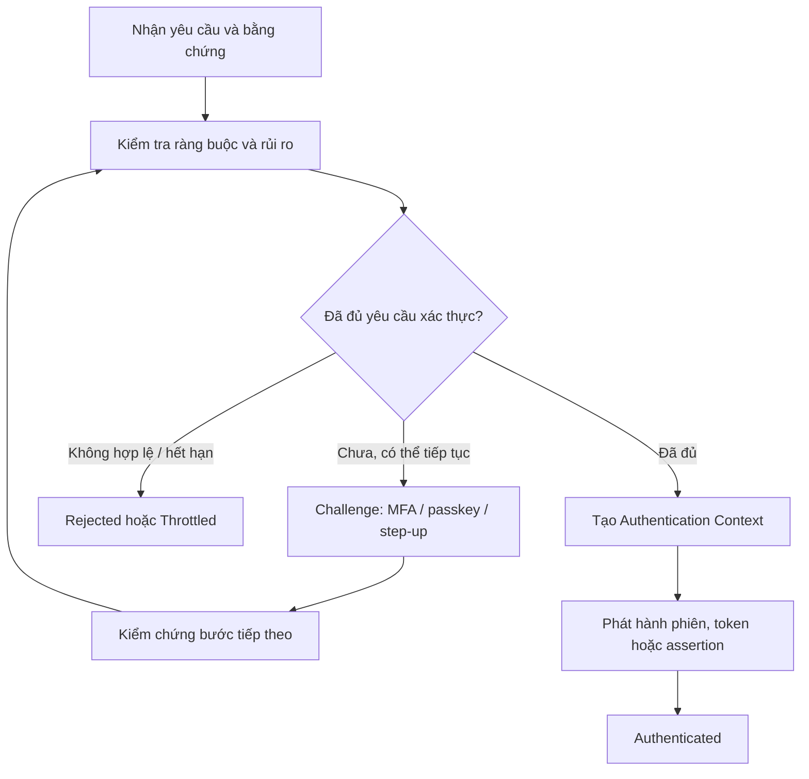
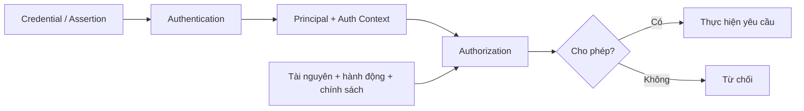

# Đầu ra của một flow xác thực

## 1. Vì sao cần xác định đầu ra của xác thực?

Trong một hệ thống bảo mật, *xác thực* (authentication) là quá trình kiểm chứng một chủ thể có thực sự kiểm soát những yếu tố nhận dạng mà họ khai báo hay không. Chủ thể có thể là người dùng, thiết bị hoặc dịch vụ. Đầu vào có thể là mật khẩu, mã OTP, passkey, chứng chỉ, hoặc bằng chứng do một nhà cung cấp danh tính (Identity Provider - IdP) gửi đến. Tuy nhiên, ứng dụng **không nên coi bản thân credential là kết quả đăng nhập**.

Ví dụ, sau khi người dùng nhập đúng mật khẩu, hệ thống vẫn có thể yêu cầu MFA. Sau khi xác minh đủ yếu tố, hệ thống có thể tạo phiên (session) cho trình duyệt, phát hành token cho API, hoặc gửi một assertion tới ứng dụng liên kết. Mỗi phương án tạo ra đầu ra khác nhau, nhưng đều phải trả lời được ba câu hỏi:

1. **Ai** đã được xác thực? Chủ thể phải được biểu diễn bằng một định danh ổn định trong phạm vi đáng tin cậy.
2. **Đã xác thực như thế nào, khi nào, với mức tin cậy nào?** Kết quả cần đủ ngữ cảnh để áp dụng chính sách MFA, tái xác thực và kiểm soát rủi ro.
3. **Bên nhận sẽ dựa vào kết quả này ra sao?** Kết quả cần được truyền hoặc duy trì bằng phiên, token hay assertion có thể xác minh được.

Trong phạm vi các nguyên lý xác thực danh tính, đây là cầu nối giữa credential, mật khẩu, MFA, passkey, chứng chỉ và các cơ chế token, phiên, liên kết danh tính, khôi phục tài khoản. Thiết kế rõ đầu ra giúp tránh những lỗi phổ biến như coi email là bằng chứng định danh, dùng access token sai đối tượng nhận, hoặc cấp phiên khi người dùng mới vượt qua một bước của flow.

## 2. Mô hình hóa kết quả: thành công, tiếp tục, từ chối

Không phải mọi yêu cầu xác thực đều kết thúc ngay bằng "đăng nhập thành công" hoặc "sai mật khẩu". Một flow thường có ba nhóm kết quả chính:

| Trạng thái | Ý nghĩa | Dữ liệu có thể trả về | Điều không được làm |
| --- | --- | --- | --- |
| **Authenticated** | Đã thỏa tất cả yêu cầu xác thực áp dụng tại thời điểm đó | Định danh chủ thể, ngữ cảnh xác thực, tham chiếu phiên hoặc token/assertion phù hợp | Không mặc nhiên cấp mọi quyền truy cập |
| **Continue / Challenge** | Đã qua một số kiểm tra nhưng cần bước tiếp, như TOTP, passkey hay step-up | `flowId`, loại thử thách, thời hạn, thông tin hiển thị tối thiểu | Không phát hành phiên đăng nhập đầy đủ khi còn thiếu yếu tố bắt buộc |
| **Rejected / Expired / Throttled** | Bằng chứng không hợp lệ, flow hết hạn, hoặc bị giới hạn do rủi ro | Mã lỗi an toàn để xử lý UX, `retryAfter` nếu thích hợp, mã tương quan sự kiện | Không tiết lộ tài khoản có tồn tại, mật khẩu nào đúng, hay chi tiết phát hiện gian lận |

Một hợp đồng nội bộ có thể được biểu diễn như sau (đây là **mô hình khái niệm**, không phải API tiêu chuẩn):

```ts
type AuthenticationOutcome =
  | {
      kind: "authenticated";
      principal: { issuer: string; subject: string; tenantId?: string };
      authContext: {
        authenticatedAt: string;
        methods: string[];       // Ví dụ: ["pwd", "otp"]
        assuranceContext?: string;
      };
      continuation: { kind: "session" | "token" | "assertion"; ref: string };
    }
  | {
      kind: "challenge";
      flowId: string;
      nextStep: "totp" | "passkey" | "reauthenticate";
      expiresAt: string;
    }
  | {
      kind: "rejected";
      code: "INVALID_CREDENTIALS" | "EXPIRED" | "RATE_LIMITED";
      retryAfterSeconds?: number;
    };
```

`continuation.ref` biểu diễn một tham chiếu nội bộ trong ví dụ; với ứng dụng thực tế, session cookie hoặc token thường được chuyển qua header/cookie/redirect thích hợp, thay vì đính kèm tùy tiện trong JSON. `flowId` là mã tham chiếu tới trạng thái flow được máy chủ kiểm soát, **không phải bằng chứng đã xác thực**. Mật khẩu, OTP, private key và mã khôi phục không được xuất hiện trong kết quả.



Điểm kiểm soát quan trọng nằm **trước bước phát hành**: tất cả yếu tố bắt buộc phải được kiểm chứng, thử thách phải còn hạn và gắn với đúng flow, đúng chủ thể, đúng bên yêu cầu. Một flow đã xác thực ở mức thấp có thể vẫn cần *step-up authentication* khi thực hiện thao tác nhạy cảm.

## 3. Thành phần của một kết quả xác thực thành công

### 3.1. Principal: chủ thể đã được xác thực

*Principal* là đại diện mà hệ thống tin rằng đã được xác thực. Các trường thường cần là:

- **`subject` (`sub`)**: định danh ổn định trong phạm vi bên phát hành; không nên dùng tên hiển thị hoặc email làm khóa duy nhất.
- **`issuer` (`iss`)**: bên chịu trách nhiệm xác thực hoặc phát hành assertion/token. Cặp `(issuer, subject)` thường cần thiết khi liên kết nhiều IdP.
- **Ngữ cảnh tenant hoặc realm**: cần có nếu hệ thống đa khách hàng hoặc nhiều vùng danh tính; phải xác minh thuộc đúng ngữ cảnh dự kiến.
- **Loại chủ thể**: người dùng, service account, workload hoặc thiết bị, tùy hệ thống.

`user@example.test` có thể đổi email hoặc xuất hiện ở hai IdP khác nhau. Bởi vậy, chỉ dựa vào địa chỉ email để tự động gộp hai tài khoản có thể dẫn tới chiếm đoạt danh tính. Việc *account linking* cần một quy trình xác minh và đồng ý phù hợp, không tự coi hai email trùng nhau là cùng chủ thể.

### 3.2. Authentication context: bằng chứng đạt mức nào?

Đầu ra của flow nên giữ được thông tin phục vụ các quyết định bảo mật tiếp theo, chẳng hạn:

| Thuộc tính | Câu hỏi nó trả lời | Ví dụ |
| --- | --- | --- |
| `authenticatedAt` / `auth_time` | Người dùng đã xác thực gần đây hay từ lâu? | `2026-11-22T04:00:00Z` |
| Authentication methods / `amr` | Các phương thức nào đã thực sự được dùng? | `pwd`, `otp`, `hwk` tùy IdP và chuẩn áp dụng |
| Assurance context / `acr` | Chính sách hoặc lớp đảm bảo nào đã được đáp ứng? | Giá trị do IdP và bên sử dụng thống nhất |
| Phiên / thiết bị / ngữ cảnh rủi ro | Có cần kiểm tra bổ sung trước thao tác nhạy cảm? | Phiên mới, thiết bị khác, thay đổi đáng kể |
| `issuer`, `audience`, thời hạn | Bên nào được phép tin vào bằng chứng này, trong bao lâu? | Client hoặc API được chỉ định |

Trong OpenID Connect (OIDC), `amr` và `acr` là các claim có ý nghĩa khác nhau: `amr` nói về **phương thức đã thực hiện**, còn `acr` nói về **lớp/ngữ cảnh đảm bảo**. Không tự suy diễn rằng một giá trị `amr` bất kỳ luôn tương đương một mức đảm bảo cố định. MFA bằng SMS hoặc OTP cũng không có khả năng chống phishing ngang với xác thực có ràng buộc origin như WebAuthn/passkey.

Một chi tiết thường bị bỏ qua: **xác thực gần đây** và **xác thực mạnh** là hai chiều khác nhau. Phiên vừa tạo bằng một yếu tố yếu có thể chưa đủ để đổi tài khoản ngân hàng; một phiên đã dùng MFA mạnh nhưng từ rất lâu có thể cần xác thực lại.

### 3.3. Phương tiện tiếp tục dùng kết quả

Sau khi xác thực, ứng dụng cần cách để các yêu cầu kế tiếp nhận biết trạng thái đã xác thực. Cách đó có thể là một session ID ngẫu nhiên, token được ký hoặc một assertion gửi đến bên tin cậy. Phương tiện này có phạm vi và thời hạn riêng; nó **không phải mật khẩu**, cũng không phải bảo chứng rằng mọi yêu cầu sau này đều có quyền thực hiện.

## 4. Các dạng đầu ra thường gặp

| Phương tiện / artefact | Bên nhận chính | Mục đích và điều kiện sử dụng |
| --- | --- | --- |
| **Session ID + cookie** | Backend quản lý phiên cho trình duyệt | Cookie chứa mã phiên khó đoán; server tra cứu trạng thái, vòng đời và ngữ cảnh xác thực |
| **Access token** | Resource server / API | Cho API đánh giá quyền truy cập trong phạm vi `aud`, `scope`, thời hạn và chính sách; có thể không mô tả người dùng cuối |
| **ID token (OIDC)** | OIDC client / relying party | Truyền xác nhận danh tính và thông tin sự kiện xác thực cho đúng client (`aud`); không dùng thay access token cho API |
| **Refresh token** | Client được cấp quyền và token endpoint | Xin access token mới theo chính sách; không phải bằng chứng thích hợp để gửi trực tiếp cho resource server |
| **SAML assertion** | Service Provider được chỉ định | Chuyển tuyên bố danh tính và điều kiện sử dụng trong SSO; phải xác minh chữ ký, issuer, recipient/audience và thời hạn |
| **Danh tính từ mTLS/chứng chỉ** | Bên xác thực kết nối, gateway hoặc backend | Xác minh chứng chỉ, quyền kiểm soát private key và ánh xạ danh tính vào principal đáng tin cậy |

**Phân biệt bằng chứng đầu vào và đầu ra:** WebAuthn/passkey tạo một *assertion xác thực* có chữ ký để relying party kiểm tra challenge và origin. Assertion ấy là **bằng chứng trong quá trình xác thực**; sau khi kiểm chứng, ứng dụng thường vẫn tạo session hoặc token của mình. Tương tự, OTP và mật khẩu là dữ liệu kiểm chứng, không nên sao chép vào token hay session.

### 4.1. Ví dụ: phiên đăng nhập qua cookie

Giả sử người dùng hoàn tất mật khẩu và TOTP trên ứng dụng web. Máy chủ tạo session ID mới bằng bộ sinh số ngẫu nhiên mật mã, lưu ánh xạ session → principal + authentication context, rồi trả về:

```http
HTTP/1.1 302 Found
Set-Cookie: __Host-session=<opaque-session-id>; Path=/; Secure; HttpOnly; SameSite=Lax
Location: /app
Cache-Control: no-store
```

Các thuộc tính mang ý nghĩa cụ thể:

- `Secure`: chỉ gửi cookie qua kết nối HTTPS.
- `HttpOnly`: JavaScript phía trang không đọc trực tiếp được cookie, giúp hạn chế một số hậu quả của XSS.
- `SameSite`: hỗ trợ giảm một số nguy cơ CSRF; chọn `Lax` hoặc `Strict` theo luồng thực tế, và áp dụng thêm bảo vệ CSRF khi cần.
- Tiền tố `__Host-`: trình duyệt hỗ trợ tiền tố sẽ yêu cầu `Secure`, `Path=/`, không có `Domain`; giúp hạn chế phạm vi cookie.

Server phải **đổi session ID khi đăng nhập hoặc nâng quyền xác thực** để chống session fixation; giới hạn thời gian nhàn rỗi và thời gian tối đa, hỗ trợ thu hồi khi đăng xuất hoặc phát hiện bất thường. Cookie chỉ mang tham chiếu bí mật; dữ liệu chứng minh MFA đã hoàn tất được xác thực và lưu ở nơi server kiểm soát. `SameSite` và `HttpOnly` không thay thế việc phòng XSS/CSRF hoặc kiểm tra quyền ở backend.

### 4.2. Ví dụ: OIDC và các loại token

Trong OIDC Authorization Code Flow với PKCE:

1. Ứng dụng chuyển người dùng tới Authorization Server/IdP với các tham số ràng buộc giao dịch cần thiết như `state`, `nonce` (khi dùng OIDC phù hợp) và `code_challenge`.
2. IdP xác thực người dùng bằng mật khẩu, MFA hoặc passkey tùy chính sách.
3. IdP chuyển **authorization code** ngắn hạn về redirect URI đã đăng ký. Code này **chưa phải** access token hay bằng chứng đăng nhập cuối cùng mà ứng dụng nên tin ngay.
4. Client đổi code tại token endpoint, chứng minh PKCE bằng `code_verifier`, rồi nhận `id_token`, `access_token` và có thể có `refresh_token` tùy grant/chính sách.
5. Client xác minh ID token theo quy tắc OIDC (chữ ký, `iss`, `aud`, `exp`, `nonce` khi áp dụng, v.v.); API xác minh access token theo hợp đồng giữa Authorization Server và Resource Server.

Payload minh họa của một **ID token đã được giải mã** (chưa thể tin cậy nếu chưa xác minh token):

```json
{
  "iss": "https://id.example.test",
  "sub": "usr_7f31c",
  "aud": "client-web-123",
  "iat": 1795320000,
  "exp": 1795320300,
  "auth_time": 1795319900,
  "amr": ["pwd", "otp"],
  "acr": "urn:example:assurance:mfa",
  "nonce": "random-request-bound-value"
}
```

Đây là **dữ liệu ví dụ**, không phải token có chữ ký hay giá trị `acr` được chuẩn hóa toàn cầu. Không tin một chuỗi JSON, JWT đã decode hoặc header `alg` do bên gửi tự khai nếu chưa kiểm chứng chữ ký, thuật toán được cho phép, khóa đúng issuer và tất cả ràng buộc ngữ cảnh. **JWT chỉ là một định dạng**: access token có thể là JWT hoặc token opaque; việc API có chấp nhận nó hay không còn phụ thuộc cách xác minh và chính sách của API.

Lưu ý hai ranh giới tin cậy: **ID token dành cho client** để xác nhận sự kiện đăng nhập, còn **access token dành cho API** có audience được chỉ định. Client không nên suy ra danh tính người dùng chỉ từ một access token bất kỳ; API không nên chấp nhận ID token để thay access token. `scope` và các quyền được cấp giúp bên nhận **ủy quyền truy cập**, không thay thế xác thực.

### 4.3. Ví dụ: dịch vụ xác thực với chứng chỉ

Trong kết nối service-to-service dùng mTLS, endpoint có thể kiểm chứng chuỗi chứng chỉ, hiệu lực, mục đích sử dụng, tên định danh được cho phép và bằng chứng bên kia giữ private key trong TLS handshake. Kết quả có thể được ánh xạ thành `service:payments-worker` trong ngữ cảnh tin cậy của gateway. Sau đó backend có thể phát hành một token ngắn hạn ràng buộc với danh tính dịch vụ hoặc dùng danh tính đã được xác minh trực tiếp trong kết nối.

Điều quan trọng là **chứng chỉ hợp lệ chưa đồng nghĩa với được phép gọi mọi API**. Ánh xạ danh tính và chính sách quyền phải được kiểm tra riêng. Nếu có proxy/gateway chuyển tiếp danh tính, backend cần một cơ chế bảo đảm header danh tính không thể bị client bên ngoài tự giả mạo.

## 5. Một flow hoàn chỉnh tạo ra những gì?

Xét ứng dụng quản lý tài khoản có chính sách: mật khẩu + TOTP để đăng nhập, và yêu cầu xác thực gần đây để thay đổi email khôi phục.

| Mốc trong flow | Điều đã được xác minh | Kết quả đúng | Vì sao? |
| --- | --- | --- | --- |
| Nhập email | Chưa có bằng chứng kiểm soát tài khoản | Tiếp tục flow; giao diện trung tính | Email là định danh khai báo, chưa phải xác thực |
| Mật khẩu đúng | Một yếu tố đã đạt | `challenge` yêu cầu TOTP | Chính sách cần đủ MFA trước khi đăng nhập |
| TOTP đúng và còn hạn | Đủ hai yếu tố theo chính sách | `authenticated` + session mới + `auth_time`/methods | Có thể bắt đầu phiên đã xác thực |
| Gọi API đọc hồ sơ | Session/token hợp lệ tại API | Principal và quyết định ủy quyền tương ứng | API phải kiểm tra cả xác thực và quyền |
| Yêu cầu đổi email khôi phục sau nhiều giờ | Có phiên, nhưng xác thực có thể quá cũ | `challenge` tái xác thực / step-up | Bảo vệ thao tác nhạy cảm bằng tính *freshness* |
| Cung cấp sai OTP nhiều lần | Chưa hoàn thành thử thách bổ sung | `rejected` hoặc `throttled`, có audit event | Ngăn đoán mã và lạm dụng flow |

Điều này giúp phân biệt rõ **kết quả xác thực tại thời điểm đăng nhập** với **điều kiện cần để cho phép từng thao tác**. Một chủ thể đã đăng nhập vẫn có thể không có quyền quản trị hoặc chưa thỏa yêu cầu xác thực lại.

### Khi dùng passkey thì thay đổi điều gì?

Với WebAuthn/passkey, server tạo challenge ngẫu nhiên và gắn nó với flow, relying party và thời hạn. Authenticator ký dữ liệu liên quan bằng private key không rời thiết bị/giải pháp quản lý khóa. Server kiểm tra challenge, `origin`, RP ID và chữ ký theo khóa công khai đã đăng ký, cùng các cờ/chính sách WebAuthn liên quan. Sau đó server mới phát hành session/token.

Passkey ràng buộc với origin và có khả năng chống phishing tốt hơn mã OTP dễ bị chuyển tiếp tới trang giả. Nhưng **passkey cũng không tự động quyết định quyền truy cập**, và hệ thống vẫn cần quản lý phiên, thiết bị bị mất, đăng ký phương thức mới và khôi phục tài khoản an toàn.

### Khi dùng liên kết danh tính hoặc khôi phục tài khoản?

Khi một người dùng đăng nhập bằng IdP khác, kết quả xác thực từ IdP phải được ánh xạ sang tài khoản nội bộ qua **liên kết đã được xác minh**. Chỉ trùng email là chưa đủ để tự gắn tài khoản. Cần xác minh issuer, subject, điều kiện liên kết và sự kiểm soát phù hợp đối với tài khoản hiện có.

Khi khôi phục tài khoản, email reset hoặc recovery code chỉ mở **flow phục hồi giới hạn**. Không nên coi việc truy cập đường dẫn reset là tương đương một phiên đầy đủ có mọi quyền. Sau khôi phục hay thay đổi yếu tố xác thực, hệ thống nên đánh giá việc thu hồi/luân chuyển phiên và token hiện tại, thông báo bảo mật và yêu cầu đăng nhập lại theo mức rủi ro. Mã phục hồi phải là bí mật sử dụng một lần hoặc theo chính sách được xác minh, có giới hạn thử và thời hạn phù hợp.

## 6. Xác thực và ủy quyền: hai kết quả khác nhau

**Authentication** khẳng định một principal đã vượt qua quy trình xác thực được chấp nhận. **Authorization** quyết định principal đó có được phép thực hiện hành động trên tài nguyên cụ thể hay không. Đầu ra của xác thực là đầu vào quan trọng cho ủy quyền, nhưng không thể thay thế kết quả ủy quyền.



Ví dụ, `sub=usr_7f31c` với phiên hợp lệ có thể xem dữ liệu của chính họ, nhưng không vì thế được phép xóa người dùng khác. Với HTTP API, phản hồi `401 Unauthorized` thường dùng khi thiếu/xác thực không hợp lệ (tên mã hơi dễ gây hiểu lầm), còn `403 Forbidden` thường dùng khi đã nhận biết chủ thể nhưng không được phép. Một số hệ thống có chính sách cố ý che giấu tài nguyên, nên mã phản hồi cụ thể vẫn phụ thuộc yêu cầu an toàn và API contract.

Hệ thống cũng cần tránh xem claim `role=admin` trong một token bất kỳ là sự thật nếu chưa xác minh issuer, chữ ký, audience, thời hạn và tính phù hợp của claim với chính sách tại resource server. Dữ liệu quyền có thể thay đổi trong khi token chưa hết hạn; vì vậy cần thiết kế thời hạn, cơ chế thu hồi và kiểm tra quyền phù hợp.

## 7. Ranh giới tin cậy và các lỗi cần phòng tránh

Đầu ra xác thực có giá trị bởi **bên nhận có cơ sở để tin kết quả đó**. Khi đi qua trình duyệt, IdP, reverse proxy hoặc API, mỗi điểm giao tiếp tạo ra ranh giới tin cậy mới.

| Ranh giới | Điều cần xác minh trước khi tin | Rủi ro nếu bỏ qua |
| --- | --- | --- |
| Trình duyệt → Authentication Server | Credential/challenge, CSRF, rate limit, trạng thái flow, `origin` khi dùng WebAuthn | Phishing, replay, brute force, login CSRF |
| IdP → OIDC client | `state`, PKCE, ID token `iss`/`aud`/`exp`/`nonce` theo ngữ cảnh, redirect URI | Code/token injection, nhầm issuer, replay |
| Client → Resource Server | Audience, chữ ký/introspection, thời hạn, scope, binding khi có, chính sách quyền | Dùng nhầm token, truy cập trái phép |
| Gateway → Backend | Nguồn của header danh tính, chứng thực kênh và chính sách proxy | Giả mạo principal bằng header |
| Session store → Ứng dụng | Session đang hiệu lực, session rotation, thiết bị/step-up theo chính sách | Session fixation, hijacking, dùng phiên sau thu hồi |

Những nguyên tắc then chốt:

1. **Chống replay:** challenge/nonce phải ngẫu nhiên, có hạn và gắn với giao dịch; authorization code, OTP, recovery code hoặc assertion cần được xử lý đúng quy tắc sử dụng một lần khi giao thức yêu cầu. Token bearer bị đánh cắp có thể bị tái sử dụng cho tới khi hết hạn hoặc bị thu hồi; khi phù hợp, dùng token ràng buộc người giữ khóa (như DPoP hoặc mTLS) để giảm rủi ro.
2. **Chống phishing:** ưu tiên phương thức ràng buộc origin như passkey/WebAuthn khi có thể; không xem SMS OTP hoặc TOTP là chống phishing chỉ vì chúng thêm yếu tố xác thực.
3. **Bảo vệ bí mật:** không đưa mật khẩu, OTP, private key, recovery code, session ID hoặc token vào log, URL, thông báo lỗi hay công cụ phân tích; có thể log mã tham chiếu sự kiện và metadata tối thiểu.
4. **Giới hạn lạm dụng đăng nhập:** rate limiting theo nhiều tín hiệu, giới hạn thử MFA/reset, giám sát credential stuffing; tránh khóa tài khoản vĩnh viễn chỉ do đối thủ gửi nhiều lần đăng nhập sai.
5. **Kiểm soát vòng đời:** giới hạn TTL, xoay session sau khi thay đổi mức xác thực, thu hồi khi cần, tái xác thực trước thao tác nhạy cảm, và đồng bộ trạng thái đăng xuất theo đặc điểm kiến trúc.
6. **Không tiết lộ tài khoản:** phản hồi đăng nhập và khôi phục nên hạn chế khả năng suy ra email/tài khoản có tồn tại. Thông tin chi tiết phục vụ điều tra nằm trong kênh audit an toàn.

`Authenticated` là kết luận có **giới hạn thời gian và phạm vi**. Một session hoặc token hợp lệ về mặt cấu trúc có thể vẫn phải bị từ chối do đã thu hồi, sai audience, thiếu quyền, nguy cơ thiết bị hoặc chính sách step-up.

## 8. Đầu ra quan sát được và đầu ra vận hành

Nhà phát triển cần phân biệt hai lớp:

- **Đầu ra cho bên sử dụng:** trạng thái thành công/tiếp tục/thất bại; cookie, token hoặc assertion và thông tin UI tối thiểu cần thiết.
- **Hiệu ứng nội bộ:** ghi nhận session, cập nhật thời điểm xác thực, counter chống lạm dụng, audit event, chính sách thông báo hoặc thu hồi token. Những dữ liệu này không nhất thiết được trả về cho browser hay client.

Một sự kiện audit an toàn có thể ghi: `eventType=authentication.succeeded`, principal ID nội bộ, phương thức đã hoàn thành, thời gian, mức đảm bảo, IP đã xử lý theo chính sách lưu trữ, và correlation ID. Không cần lưu mật khẩu, chữ ký WebAuthn, OTP hoặc toàn bộ token. Audit giúp phát hiện lạm dụng và điều tra sự cố, nhưng **audit event không phải bằng chứng xác thực dùng thay session**.

Nếu flow thất bại, có thể trả thông báo người dùng kiểu “Không thể đăng nhập bằng thông tin đã cung cấp” cùng mã tương quan, trong khi hệ thống nội bộ phân biệt nguyên nhân để vận hành. Client không nên tự suy đoán trạng thái xác thực từ dòng chữ thông báo; nó phải dựa vào hợp đồng API và kết quả server có thẩm quyền.

## 9. Tiêu chí kiểm tra một thiết kế đầu ra xác thực

Khi review một flow mới, hãy kiểm tra từ **định danh** đến **cách sử dụng kết quả**:

| Câu hỏi kiểm tra | Dấu hiệu thiết kế đúng |
| --- | --- |
| Chủ thể là ai và do bên nào xác thực? | Principal có định danh ổn định, issuer/tenant rõ ràng; không dựa riêng vào email |
| Đã đủ yếu tố bắt buộc chưa? | Trạng thái `challenge` không cấp phiên đầy đủ; xác thực hoàn tất mới phát hành kết quả |
| Bằng chứng có bị dùng lại hay thay thế được không? | Challenge/code/nonce gắn với flow, có hạn, được tiêu thụ/kiểm chứng theo giao thức |
| Bên nhận có đúng là đối tượng của token/assertion? | Kiểm tra issuer, audience, thời hạn, chữ ký và các ràng buộc theo giao thức |
| Có phân biệt đăng nhập và quyền truy cập? | API kiểm tra authorization với tài nguyên/hành động thực tế |
| MFA có thể bị vượt qua bằng đường phụ? | Luồng reset, linking, enrollment và recovery có chính sách đủ mạnh |
| Nếu session/token bị lộ thì sao? | TTL phù hợp, bảo vệ lưu trữ, thu hồi/rotation, phát hiện lạm dụng và step-up |
| Thông tin nào bị ghi log hay trả về trình duyệt? | Không có bí mật nhạy cảm; lỗi an toàn; audit đủ để điều tra |

Các tình huống cần kiểm thử đặc biệt gồm: mật khẩu đúng nhưng TOTP sai; gửi lại cùng WebAuthn challenge đã tiêu thụ; đổi `aud` hoặc `iss` của token; code OIDC hết hạn hoặc sai PKCE; session trước đăng nhập bị dùng lại sau đăng nhập; liên kết hai tài khoản chỉ vì email trùng; và yêu cầu thao tác nhạy cảm từ phiên xác thực quá cũ. Mỗi thử nghiệm phải có **kết quả mong đợi** rõ ràng ở cả trạng thái xác thực và quyền truy cập.

## 10. Ghi nhớ

Một flow xác thực chỉ hoàn tất khi hệ thống có đủ bằng chứng, kết luận được **principal** và **authentication context** đáng tin cậy, rồi cung cấp một cơ chế tiếp tục phù hợp như session, token hoặc assertion. Nếu chưa đủ điều kiện, đầu ra đúng là **challenge** hoặc **rejection**, không phải một phiên “đăng nhập tạm” có quyền đầy đủ.

Khi triển khai, luôn hỏi: *ai xác thực, bằng phương thức nào, lúc nào, cho ai tin, còn hiệu lực bao lâu và bên nhận sẽ kiểm tra gì?* Trả lời đầy đủ các câu hỏi đó giúp thiết kế flow an toàn trước phishing, replay, lạm dụng đăng nhập, lỗi liên kết danh tính và đường vòng khôi phục tài khoản.
