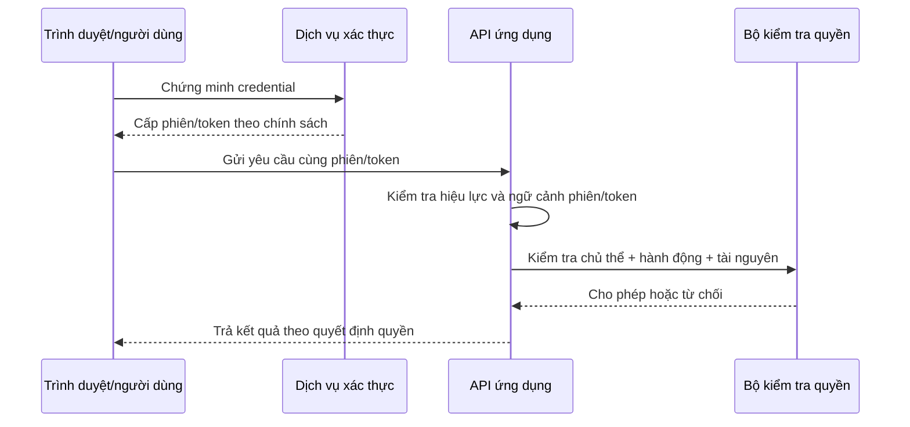
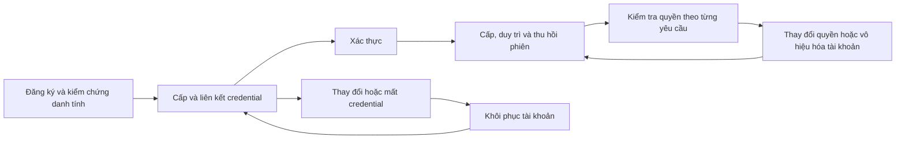

# Giới hạn của authentication

## 1. Xác thực thực sự chứng minh điều gì?

**Authentication (xác thực)** là quá trình một hệ thống kiểm tra bằng chứng để quyết định một chủ thể đang tương tác có thể được xem là **đại diện cho một danh tính đã biết** hay không. Chủ thể có thể là người dùng, dịch vụ, thiết bị hoặc ứng dụng; danh tính thường là một tài khoản hay định danh kỹ thuật trong phạm vi hệ thống.

Ví dụ, khi người dùng đăng nhập bằng passkey, máy chủ có thể xác minh chữ ký được tạo bởi khóa riêng tương ứng với khóa công khai đã đăng ký cho tài khoản. Kết luận hợp lý là: *bên đang đăng nhập đã chứng minh khả năng sử dụng credential gắn với tài khoản đó trong lần xác thực này*. Kết luận ấy **không tự động** chứng minh họ là một cá nhân pháp lý cụ thể, có quyền đọc mọi dữ liệu trong tài khoản, hay đang tự nguyện thực hiện mọi giao dịch sau đăng nhập.

Để tránh suy diễn quá mức, cần phân biệt bốn câu hỏi:

| Câu hỏi | Lớp kiểm soát chủ yếu | Ví dụ |
| --- | --- | --- |
| **Bạn đang chứng minh mình là chủ thể nào?** | Authentication | Kiểm tra mật khẩu, passkey, mã OTP hoặc chứng minh sở hữu khóa riêng của chứng chỉ. |
| **Danh tính đó ban đầu được gắn với ai?** | Identity proofing và enrollment | Kiểm tra thông tin khi mở tài khoản, xác minh quan hệ với tổ chức, cấp credential đúng người. |
| **Chủ thể này được làm gì với tài nguyên này?** | Authorization | Kiểm tra người dùng có được xem hóa đơn số 123 hoặc phê duyệt thanh toán không. |
| **Yêu cầu hiện tại có an toàn và đúng ý định không?** | Quản lý phiên, đánh giá rủi ro, xác nhận giao dịch, giám sát | Phát hiện phiên bị chiếm, yêu cầu xác thực lại khi đổi tài khoản nhận tiền, đối chiếu nội dung giao dịch. |

Authentication là một mắt xích quan trọng của mô hình bảo mật, nhưng chất lượng của mắt xích này phụ thuộc cả vào lúc tạo tài khoản, cách cấp và phục hồi credential, cách truyền bằng chứng, cách duy trì phiên, và cách hệ thống quyết định quyền tại từng thao tác.

## 2. Ranh giới thứ nhất: credential không đồng nghĩa với danh tính ngoài đời

Hệ thống thường xác thực **quyền kiểm soát một credential**, chứ không trực tiếp quan sát con người đứng sau credential đó.

- **Mật khẩu đúng** chứng tỏ người gửi biết một bí mật. Bí mật có thể bị lộ, được chia sẻ hoặc bị lừa cung cấp.
- **OTP đúng** chứng tỏ người gửi có thể truy cập một nguồn tạo hoặc nhận mã trong khoảng thời gian tương ứng. Mã vẫn có thể bị đánh cắp và chuyển tiếp ngay khi còn hiệu lực.
- **Passkey hoặc khóa bảo mật đúng** chứng tỏ một khóa riêng hợp lệ đã tham gia giao thức, thường kèm kiểm tra hiện diện hoặc xác minh người dùng trên thiết bị. Việc dùng sinh trắc học để mở khóa cục bộ không có nghĩa máy chủ đã xác minh tên hay căn cước của người dùng.
- **Chứng chỉ số hợp lệ** giúp xác minh việc sử dụng khóa riêng và các ràng buộc danh tính được bên cấp chứng chỉ xác nhận, trong phạm vi chính sách tin cậy áp dụng. Chứng chỉ máy chủ hoặc mTLS có thể xác thực một máy hay dịch vụ nhưng không xác định người đang thao tác trên máy đó.

Giả sử một ứng dụng cho phép bất kỳ ai đăng ký tài khoản với tên hiển thị “Giám đốc tài chính”. Người đó có thể đăng nhập bằng passkey rất an toàn, nhưng hệ thống vẫn chưa có bằng chứng rằng họ giữ chức vụ ấy. Nếu tính năng yêu cầu tư cách nhân viên, doanh nghiệp phải có quy trình **gắn danh tính với tổ chức** và kiểm tra quyền hiện tại. Nếu yêu cầu tư cách pháp lý, có thể cần thêm quy trình identity proofing phù hợp mức rủi ro.

**Hệ quả thiết kế:** ghi rõ đối tượng được xác thực là `accountId`, `serviceId` hay định danh đã qua một mức kiểm chứng cụ thể. Không dùng tên hiển thị, địa chỉ email tự khai hoặc việc đăng nhập thành công làm bằng chứng tự động cho chức danh, quyền sở hữu hay danh tính pháp lý.

## 3. Ranh giới thứ hai: authentication không thay authorization

Một người đã xác thực vẫn có thể yêu cầu tài nguyên không thuộc quyền của mình. **Authentication xác định chủ thể; authorization quyết định chủ thể đó có được thực hiện hành động cụ thể trên tài nguyên cụ thể, trong ngữ cảnh hiện tại, hay không.**

Ví dụ: cả An và Bình đều đăng nhập hợp lệ. An thay tham số `/invoices/101` thành `/invoices/102`, trong khi hóa đơn 102 thuộc Bình. Nếu API chỉ kiểm tra “đã đăng nhập” thì xuất hiện lỗi kiểm soát truy cập, thường được gọi là *broken object-level authorization* (BOLA/IDOR). Thêm MFA cho bước đăng nhập **không sửa** được lỗi này.

Một đoạn mã minh họa nguyên tắc kiểm tra ở máy chủ:

```ts
// Pseudocode TypeScript: middleware đã xác minh phiên/token và gắn accountId.
async function getInvoice(request, response) {
  const accountId = request.auth.accountId;
  const invoice = await invoiceRepository.findById(request.params.invoiceId);

  if (!invoice) return response.sendStatus(404);

  // Quyền phải được tính từ dữ liệu tin cậy ở máy chủ, trên từng tài nguyên.
  const allowed = await authorization.canReadInvoice(accountId, invoice);
  if (!allowed) return response.sendStatus(403);

  return response.json(invoice);
}
```

Trong hệ thống thực tế, hàm `canReadInvoice` có thể dựa vào quan hệ sở hữu, vai trò, tenant, trạng thái hợp đồng, mức độ nhạy cảm hoặc chính sách theo ngữ cảnh (RBAC/ABAC). Nếu cần che giấu sự tồn tại của tài nguyên, API có thể thống nhất trả `404` cho trường hợp không có quyền. Điều cốt lõi là **kiểm soát quyền ở phía máy chủ tại nơi dữ liệu hoặc hành động được truy cập**, không dựa vào việc ẩn nút trên giao diện.

Một số ranh giới khác dễ nhầm lẫn:

| Tình huống | Authentication đã giải quyết được gì? | Vẫn cần gì? |
| --- | --- | --- |
| Nhân viên đăng nhập SSO | Gắn yêu cầu với tài khoản nhân viên theo thông tin nhà cung cấp danh tính. | Kiểm tra người đó còn thuộc bộ phận, tenant và vai trò được cấp quyền hay không. |
| Dịch vụ A gọi dịch vụ B qua mTLS | B có thể kiểm tra khóa và chứng chỉ của A. | Kiểm tra A có quyền gọi thao tác này với dữ liệu của khách hàng cụ thể hay không. |
| Quản trị viên đăng nhập bằng MFA | Có thêm bằng chứng ở thời điểm đăng nhập. | Quyền tối thiểu, phân tách nhiệm vụ, phê duyệt thao tác nhạy cảm và nhật ký kiểm toán. |
| Người dùng xác thực thành công | Xác lập danh tính tài khoản cho phiên. | Chống truy cập chéo dữ liệu, kiểm tra quyền ở từng yêu cầu và khi quyền thay đổi. |

## 4. Ranh giới thứ ba: đăng nhập một lần không chứng minh mọi yêu cầu về sau

Sau khi đăng nhập, ứng dụng thường cấp **phiên (session)** hoặc **token** để tránh bắt người dùng nhập credential ở mỗi yêu cầu. Lúc này, ứng dụng chủ yếu kiểm tra bằng chứng đại diện cho phiên, không lặp lại toàn bộ nghi thức xác thực ban đầu.



Điểm nguy hiểm là **người nắm được bằng chứng phiên hợp lệ có thể bị hệ thống xem như chủ tài khoản**, nếu không có ràng buộc hay cơ chế phát hiện bổ sung. Các trường hợp thường gặp:

1. **Lộ session cookie hoặc bearer token:** kẻ tấn công có thể phát lại credential phiên trong thời gian nó còn hiệu lực. Kênh TLS bảo vệ dữ liệu khi truyền nhưng không xử lý được việc token đã bị lấy từ đầu cuối.
2. **XSS:** mã độc chạy trong ngữ cảnh trang có thể gửi yêu cầu nhân danh người dùng ngay cả khi cookie có `HttpOnly`; `HttpOnly` chủ yếu ngăn JavaScript đọc giá trị cookie. Cần phòng chống XSS và hạn chế tác hại theo kiến trúc ứng dụng.
3. **CSRF với cookie tự động gửi:** trình duyệt có thể đính cookie vào yêu cầu gây ra từ trang khác. Các yêu cầu thay đổi trạng thái cần cơ chế chống CSRF thích hợp, như CSRF token, kiểm tra `Origin` và cấu hình `SameSite` phù hợp.
4. **Quyền thay đổi giữa phiên:** nhân viên bị thu hồi vai trò vẫn có thể còn token cũ chứa claim về quyền. Ứng dụng phải quyết định cách cập nhật hoặc kiểm tra lại quyền, thay vì xem claim tại thời điểm cấp là bất biến.

Các loại token có giới hạn khác nhau. **Access token** cần được kiểm tra chữ ký hoặc tính hợp lệ, `issuer`, `audience`, thời hạn và phạm vi sử dụng phù hợp với API. **ID token trong OpenID Connect** chủ yếu truyền thông tin về sự kiện xác thực cho client; không nên dùng nó như access token để cho phép gọi API. **Refresh token** có vòng đời và mục đích riêng, cần bảo vệ chặt chẽ; xoay vòng refresh token có thể giúp phát hiện hoặc hạn chế một số trường hợp phát lại nhưng không làm access token đã lộ tự hết hiệu lực ngay.

Với JWT tự chứa, chữ ký hợp lệ và `exp` chưa hết **không đồng nghĩa token chưa bị thu hồi**. Đăng xuất hoặc khóa tài khoản sẽ không lập tức vô hiệu hóa mọi JWT nếu bên kiểm tra chỉ xác minh chữ ký và thời gian. Cần chính sách phù hợp như thời hạn access token ngắn, session store/denylist khi cần thu hồi ngay, kiểm tra trạng thái tài khoản và các biện pháp chống phát lại theo mô hình rủi ro. Với session lưu ở máy chủ, có thể thu hồi bản ghi phiên nhưng phải bảo đảm các điểm kiểm tra thực sự tra cứu trạng thái ấy.

**Hệ quả thiết kế:** đăng nhập thành công chỉ là điểm khởi đầu của một chuỗi quyết định tin cậy. Hãy quản lý thời hạn và thu hồi phiên, kiểm tra quyền ở yêu cầu hiện tại, bảo vệ cookie (`Secure`, `HttpOnly`, `SameSite` theo ngữ cảnh), chống XSS/CSRF và yêu cầu xác thực lại khi hành động có rủi ro cao.

## 5. Ranh giới thứ tư: nhiều yếu tố xác thực không đồng nghĩa chống mọi kiểu tấn công

Độ mạnh của phương thức xác thực nên đánh giá dựa trên **kiểu tấn công mà nó chống được**, thay vì chỉ đếm số bước đăng nhập.

| Phương thức | Điểm mạnh | Giới hạn quan trọng |
| --- | --- | --- |
| Mật khẩu | Dễ triển khai, người dùng quen thuộc. | Có thể đoán, tái sử dụng, rò rỉ, credential stuffing và phishing. |
| OTP qua SMS/email | Bổ sung kênh kiểm tra hoặc phục hồi trong một số ngữ cảnh. | Có thể bị phishing, chuyển tiếp, chiếm kênh; SMS có rủi ro SIM swap, email phụ thuộc bảo mật hộp thư. |
| TOTP từ ứng dụng | Không phụ thuộc SMS; mã có thời gian hiệu lực ngắn. | Mã vẫn có thể bị kẻ tấn công lừa nhập và sử dụng ngay trong cửa sổ hiệu lực. |
| Phê duyệt push | Tiện khi dùng ứng dụng xác thực. | Có nguy cơ *push fatigue*, xác nhận nhầm hoặc bị lừa; đối chiếu số giúp giảm một phần nhưng không giải quyết mọi kiểu phishing. |
| Passkey/FIDO2/WebAuthn | Dùng mật mã khóa công khai và ràng buộc với origin/RP ID, chống phishing theo thiết kế khi triển khai đúng. | Không khắc phục lỗ hổng phân quyền, phiên bị chiếm, mã độc trên thiết bị hoặc quy trình khôi phục yếu. |
| Chứng chỉ, khóa riêng, mTLS | Xác minh quyền sử dụng khóa cho máy, dịch vụ hoặc chủ thể được cấp chứng chỉ. | An toàn phụ thuộc cấp phát, lưu khóa, vòng đời, tin cậy CA, trạng thái thu hồi và cấu hình phía kiểm tra. |

**MFA** kết hợp các yếu tố thuộc nhóm kiến thức (*something you know*), sở hữu (*something you have*) và thuộc tính cá nhân (*something you are*). Hai mã thuộc cùng nguồn kiểm soát không nhất thiết tạo thành hai yếu tố độc lập. Với passkey, việc xác minh sinh trắc học hoặc PIN thường diễn ra **cục bộ trên thiết bị để cho phép dùng khóa**; máy chủ nhận bằng chứng mật mã, không cần nhận dữ liệu dấu vân tay hay khuôn mặt.

Một ví dụ về giới hạn MFA: kẻ tấn công tạo trang đăng nhập giả, chuyển tiếp mật khẩu và TOTP theo thời gian thực đến dịch vụ thật rồi lấy phiên. Nạn nhân đã dùng “hai yếu tố”, nhưng kẻ tấn công vẫn có thể chiếm phiên. WebAuthn với kiểm tra origin đúng giảm đáng kể kiểu phishing chuyển tiếp credential này; tuy vậy, bảo vệ phiên và hệ thống phía sau vẫn phải được duy trì.

**Hệ quả thiết kế:** dùng phương thức chống phishing cho tài khoản có rủi ro cao; giám sát thử đăng nhập bất thường; giới hạn tốc độ theo nhiều chiều (tài khoản, nguồn, thiết bị) và tránh cơ chế khóa gây từ chối dịch vụ cho người dùng hợp lệ. Đừng biến một chỉ số “có MFA” thành tuyên bố toàn bộ hệ thống đã an toàn.

## 6. Ranh giới thứ năm: xác thực được một danh tính không chứng minh ý định giao dịch

Ngay cả chủ tài khoản thật có thể bị lừa thực hiện hành động gây hại. Hãy xét tình huống một nhân viên đã đăng nhập hợp lệ, sau đó nhận hướng dẫn giả mạo yêu cầu chuyển tiền sang tài khoản mới. Xác thực chứng minh danh tính của nhân viên, **không xác minh tính hợp pháp của chỉ dẫn** hoặc tính đúng đắn của người thụ hưởng.

Các hành động như đổi email khôi phục, thêm thiết bị xác thực, cấp quyền quản trị, rút tiền hoặc thay đổi tài khoản nhận tiền thường cần một lớp kiểm soát riêng:

- **Step-up authentication:** yêu cầu bằng chứng xác thực mới hoặc mạnh hơn, đủ gần thời điểm hành động; đánh giá thiết bị, phiên và rủi ro của yêu cầu.
- **Xác nhận gắn với nội dung giao dịch:** hiển thị rõ người nhận, số tiền, quyền mới hoặc dữ liệu bị thay đổi để người dùng kiểm tra; với kịch bản rủi ro cao, cơ chế xác nhận cần gắn được sự chấp thuận với đúng nội dung giao dịch.
- **Phê duyệt theo chính sách:** giới hạn số tiền, phân tách người tạo và người duyệt, kiểm tra người nhận mới, cảnh báo hoặc trì hoãn thay đổi nguy hiểm.
- **Giám sát và phản ứng:** ghi sự kiện bảo mật thích hợp, phát hiện bất thường, gửi thông báo qua kênh đáng tin cậy và có quy trình thu hồi.

Step-up cũng không bảo đảm người dùng không bị lừa: nếu thông tin họ xác nhận không phản ánh đúng hành động máy chủ thực hiện, hoặc nếu giao diện bị thao túng, một bước nhập mã nữa có thể không mang lại sự bảo vệ mong muốn. Độ tin cậy phải bao phủ **nội dung hành động**, chứ không chỉ danh tính người bấm xác nhận.

## 7. Ranh giới thứ sáu: liên kết danh tính và SSO là chuỗi tin cậy có điều kiện

Trong SSO hoặc đăng nhập liên kết, ứng dụng thường tin một nhà cung cấp danh tính (Identity Provider, IdP). Điều này làm thay đổi **nơi** thực hiện authentication, nhưng không loại bỏ trách nhiệm kiểm tra bằng chứng và quyền ở ứng dụng nhận.

Ví dụ với OpenID Connect, ứng dụng cần kiểm tra token và luồng xác thực bằng thư viện chuẩn: chữ ký/khóa tin cậy, `iss` (nhà phát hành), `aud` (đối tượng nhận), thời hạn, và các ràng buộc liên quan đến luồng như `state`, `nonce`, PKCE khi thích hợp. Trường `sub` thường là định danh chủ thể ổn định **trong phạm vi issuer**; vì vậy khóa ánh xạ tài khoản an toàn thường dựa trên cặp `(iss, sub)`, thay vì chỉ dựa vào một địa chỉ email.

Đặc biệt, **email không mặc nhiên là định danh ổn định hoặc bằng chứng về quyền**. Email có thể được đổi, tái cấp, chưa xác minh hoặc xuất hiện trong nhiều tài khoản. Ngay cả khi claim `email_verified` là đúng, nó chủ yếu cho biết IdP đã kiểm tra quyền kiểm soát địa chỉ theo quy trình của IdP tại một thời điểm; không chứng tỏ người đó đang là thành viên hợp lệ của tổ chức hay được giữ vai trò quản trị.

Khi nhiều tổ chức sử dụng cùng ứng dụng (multi-tenant), cần kiểm tra tenant được phép, ánh xạ danh tính đúng tổ chức, vòng đời nhân sự và chính sách cấp quyền nội bộ. Lỗi nối nhầm tài khoản dựa trên email hoặc tin nhầm claim ngoài phạm vi issuer/audience có thể dẫn tới chiếm tài khoản hoặc truy cập chéo tenant dù bước đăng nhập ở IdP là hợp lệ.

**Hệ quả thiết kế:** mô hình hóa rõ ranh giới giữa IdP và ứng dụng. Ứng dụng chịu trách nhiệm xác minh token theo đúng giao thức, liên kết tài khoản an toàn và cấp quyền theo chính sách của chính mình; IdP không tự quyết định mọi quyền nghiệp vụ.

## 8. Ranh giới thứ bảy: khôi phục tài khoản có thể làm yếu toàn bộ đăng nhập

Một hệ thống có passkey chống phishing vẫn có thể bị chiếm tài khoản nếu người lạ chỉ cần gọi hỗ trợ, trả lời câu hỏi bảo mật dễ đoán hoặc kiểm soát một hộp thư yếu để đặt lại mọi credential. **Độ bảo đảm của luồng đăng nhập không thể cao hơn độ bảo đảm thực tế của đường cấp lại quyền truy cập**, nếu đường khôi phục ấy dễ bị lợi dụng.

Vòng đời danh tính có nhiều điểm phải bảo vệ:



Luồng khôi phục nên được thiết kế theo mức rủi ro: xác minh qua kênh đủ tin cậy, dùng mã hoặc đường dẫn đặt lại ngắn hạn và một lần, hạn chế lạm dụng, thông báo thay đổi bảo mật, ghi nhận sự kiện và cân nhắc thu hồi những phiên/credential cũ sau khi khôi phục. Thay đổi email, thêm passkey, tắt MFA hoặc chuyển quyền sở hữu tài khoản cũng cần cơ chế kiểm tra riêng; không nên xem chúng là chỉnh sửa hồ sơ thông thường.

Đối với tài khoản đặc quyền, phương án khôi phục cần tính cả tình huống mất thiết bị, thay người quản trị và tấn công vào bộ phận hỗ trợ. Cơ chế khôi phục phải đủ dùng cho người dùng hợp lệ nhưng không trở thành đường vòng dễ hơn bước đăng nhập chính.

## 9. Mô hình hóa giới hạn trong một yêu cầu thực tế

Xét API `POST /payments` của hệ thống tài chính. Client gửi yêu cầu có session cookie hoặc access token. Thiết kế an toàn cần phân biệt các quyết định sau:

| Bước | Câu hỏi hệ thống phải trả lời | Khi sai hoặc thiếu |
| --- | --- | --- |
| Xác minh phiên/token | Bằng chứng có đúng nơi cấp, đúng nơi nhận, còn hiệu lực và chưa bị vô hiệu hóa theo chính sách không? | Token bị giả mạo, dùng sai API, hết hạn hoặc bị phát lại có thể được chấp nhận. |
| Ánh xạ danh tính | Chủ thể và tenant hiện tại là ai? Có phải tài khoản đã bị khóa không? | Người dùng bị nối nhầm tổ chức hoặc vẫn thao tác sau khi bị vô hiệu hóa. |
| Kiểm tra quyền | Chủ thể được tạo thanh toán từ nguồn tiền này, với số tiền này không? | Người dùng hợp lệ truy cập hoặc sử dụng tài sản không thuộc quyền. |
| Đánh giá rủi ro | Có dấu hiệu thiết bị lạ, phiên bất thường, người nhận mới hoặc hành vi có nguy cơ không? | Tài khoản bị chiếm hoặc giao dịch bất thường đi qua như yêu cầu bình thường. |
| Xác nhận hành động | Có cần step-up, phê duyệt thứ hai hoặc kiểm tra thông tin người nhận không? | Hành động nguy hiểm được thực hiện dù người dùng bị lừa hoặc quyền quá rộng. |
| Ghi nhận và phản ứng | Sự kiện có đủ thông tin để phát hiện, điều tra, thu hồi hoặc khắc phục không? | Khó truy nguyên nguyên nhân và xử lý khi xảy ra sự cố. |

Một mẫu luồng xử lý ở mức khái niệm:

```text
request + session/token
    -> validateAuthenticationEvidence()
    -> resolveCurrentSubjectAndTenant()
    -> authorize(subject, resource, action, context)
    -> assessRiskAndRequireStepUpIfNeeded()
    -> validateBusinessRulesAndTransactionDetails()
    -> commitActionAndRecordSecurityEvent()
```

Thứ tự và cách triển khai cụ thể phụ thuộc ứng dụng; ví dụ phải chống tạo giao dịch trùng và thay đổi dữ liệu giữa lúc kiểm tra với lúc thực hiện (race condition). Mục tiêu của mô hình là đặt authentication đúng vị trí: **nó cung cấp một đầu vào đáng tin cậy cho các quyết định tiếp theo, không thay các quyết định ấy**.

## 10. Những ngộ nhận cần loại bỏ khi thiết kế

| Nhận định sai | Cách hiểu đúng |
| --- | --- |
| “Đăng nhập thành công thì là người thật đúng tên hồ sơ.” | Thành công chỉ chứng minh bằng chứng xác thực đạt chính sách đã đặt ra; identity proofing là vấn đề riêng. |
| “Mọi API phía sau middleware đăng nhập đều an toàn.” | Mỗi hành động và tài nguyên vẫn phải có kiểm tra quyền phù hợp. |
| “MFA chặn được phishing.” | Khả năng chống phishing phụ thuộc phương thức; OTP có thể bị chuyển tiếp, WebAuthn được thiết kế để ràng buộc origin. |
| “JWT có chữ ký hợp lệ thì chắc chắn còn được tin cậy.” | Cần kiểm tra issuer, audience, thời hạn, chính sách thu hồi và trạng thái/quyền hiện tại khi phù hợp. |
| “Có `HttpOnly` thì XSS không còn nguy hiểm.” | `HttpOnly` hạn chế đọc cookie; XSS vẫn có thể thao tác trong phiên người dùng. |
| “Đã xác thực bằng SSO thì ứng dụng không cần quản lý quyền.” | Ứng dụng vẫn phải xác định tenant, ánh xạ tài khoản và kiểm soát quyền nghiệp vụ. |
| “Passkey mạnh nên có thể khôi phục tài khoản bằng cách nào cũng được.” | Khôi phục yếu có thể trở thành đường tấn công thay thế. |
| “Chỉ cần xác thực lại là giao dịch đã được chủ tài khoản đồng ý.” | Cần bảo vệ nội dung và ý định giao dịch cùng các kiểm soát nghiệp vụ. |

## 11. Nguyên tắc áp dụng khi thiết kế hệ thống

Khi phân tích một luồng xác thực, hãy xác định rõ **chủ thể**, **credential**, **nơi kiểm tra**, **mức tin cậy của kết quả** và **giới hạn thời gian/phạm vi của kết quả**. Sau đó lần theo đường đi của kết quả xác thực vào phiên, token, service downstream, cơ chế phân quyền và các hành động nhạy cảm.

Một thiết kế có thể tự rà soát bằng các câu hỏi sau:

1. Kết quả xác thực đại diện cho tài khoản, thiết bị, dịch vụ hay danh tính đã được kiểm chứng? Ai chịu trách nhiệm gắn credential vào chủ thể ấy?
2. Credential và quy trình khôi phục có chống được các kiểu tấn công phù hợp với mức rủi ro, nhất là phishing, replay và lạm dụng đăng nhập không?
3. Mỗi API có xác thực đúng token/phiên và **ủy quyền trên đối tượng cụ thể**, kể cả khi quyền hay tenant thay đổi không?
4. Phiên có thời hạn, khả năng thu hồi, chống CSRF/XSS và cách xử lý khi lộ token rõ ràng không?
5. Với thao tác rủi ro cao, hệ thống có xác minh lại gần thời điểm thực hiện, hiển thị đúng nội dung cần phê duyệt và phát hiện hành vi bất thường không?
6. Khi IdP, email, thiết bị hoặc credential thay đổi, hệ thống có nối đúng danh tính, tránh chiếm tài khoản và kiểm soát đường khôi phục không?

**Kết luận:** Authentication trả lời một câu hỏi có giới hạn: *bằng chứng hiện tại có đủ để hệ thống chấp nhận chủ thể này là danh tính được khai báo trong phạm vi và thời điểm cụ thể hay không?* Một hệ thống an toàn dùng kết luận đó như **đầu vào** cho quản lý phiên, authorization, đánh giá rủi ro, xác nhận hành động và quản trị vòng đời tài khoản. Phân biệt được các ranh giới này giúp tránh nhầm một bước đăng nhập mạnh với sự bảo đảm an toàn cho toàn bộ ứng dụng.
