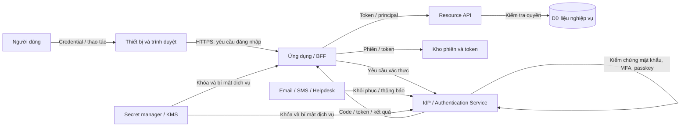
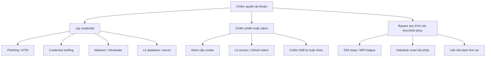

# Credential theft — Mô hình hóa và phòng chống đánh cắp thông tin xác thực

Kẻ tấn công không nhất thiết phải phá mật mã hay khai thác lỗ hổng máy chủ để chiếm tài khoản. Chỉ cần lấy được mật khẩu, mã khôi phục, khóa riêng, cookie phiên hoặc token còn hiệu lực, chúng có thể hành động như một người dùng hợp lệ trong phạm vi credential đó cho phép. Vì vậy, bảo vệ xác thực phải bắt đầu bằng câu hỏi: **đâu là bằng chứng chứng minh quyền kiểm soát tài khoản, nó đi qua những ranh giới tin cậy nào, và điều gì xảy ra nếu bằng chứng bị sao chép hoặc sử dụng trái phép?**

Bài học thuộc chương **Threat model** của học phần **SECURITY_AUTHENTICATION_FUNDAMENTALS**. Nội dung áp dụng mô hình hóa mối đe dọa cho credential từ mật khẩu, MFA, passkey, chứng chỉ đến token, phiên, liên kết danh tính và khôi phục tài khoản. Người học sẽ xác định tài sản, tác nhân, đường tấn công, điểm kiểm soát và cách kiểm chứng hiệu quả phòng chống phishing, replay và lạm dụng đăng nhập.

## 1. Kết quả học tập

Sau bài này, người học có thể:

- Xác định credential nào cần bảo vệ, giá trị của chúng đối với kẻ tấn công và tác động khi bị đánh cắp.
- Vẽ luồng dữ liệu và ranh giới tin cậy của quá trình đăng ký, đăng nhập, phát hành token, duy trì phiên và khôi phục tài khoản.
- Phân tích các đường tấn công như phishing, adversary-in-the-middle, credential stuffing, malware/infostealer, chiếm phiên, lạm dụng OAuth và đánh cắp khóa.
- Dùng phương pháp mô hình hóa có cấu trúc để tìm điểm yếu trong con người, thiết bị, ứng dụng, IdP, API và quy trình hỗ trợ.
- Chọn biện pháp phòng ngừa, phát hiện, ứng phó và khôi phục phù hợp với loại credential cùng mức rủi ro.
- Viết kịch bản kiểm thử và chỉ số đo để xác minh hệ thống không tiếp tục tin credential đã lộ hoặc bị thu hồi.

## 2. Credential theft là gì?

**Credential theft** là việc một bên không được phép thu thập, sao chép, chiếm quyền sử dụng hoặc lợi dụng bằng chứng xác thực của một chủ thể. Credential có thể là một bí mật người dùng biết, vật/thiết bị người dùng sở hữu, đặc điểm sinh trắc được hệ thống xác minh, khóa mật mã, hoặc một vật mang quyền truy cập được phát hành sau xác thực.

Không phải mọi credential đều có hình thức là mật khẩu:

| Tài sản xác thực | Ví dụ | Hậu quả khi bị lộ hoặc chiếm quyền |
| --- | --- | --- |
| Bí mật người dùng biết | Mật khẩu, PIN, mã khôi phục | Đăng nhập trái phép, đổi credential hoặc khôi phục tài khoản |
| Mã dùng một lần | TOTP, mã SMS, recovery code | Hoàn tất thử thách MFA hoặc khôi phục trong thời hạn/điều kiện còn hiệu lực |
| Credential khóa công khai | Passkey, khóa bảo mật FIDO, khóa riêng chứng chỉ | Kẻ tấn công có thể giả mạo chữ ký nếu kiểm soát được khóa riêng hoặc thiết bị tạo chữ ký |
| Bí mật client/workload | API key, client secret, private key của service | Gọi API hoặc mạo danh workload trong phạm vi quyền được cấp |
| Token | Access token, refresh token, reset token, magic-link token | Truy cập tài nguyên, làm mới quyền hoặc thực hiện hành động nhạy cảm |
| Định danh phiên | Session cookie, session ID, cookie đăng nhập | Tiếp quản phiên mà không cần lặp lại bước nhập credential |
| Dữ liệu khôi phục | Email/điện thoại khôi phục, câu hỏi bảo mật, mã dự phòng | Chiếm luồng đặt lại mật khẩu hoặc thêm phương thức đăng nhập mới |
| Vật liệu quản lý credential | Seed TOTP, bản sao lưu khóa, secret store, dữ liệu đồng bộ passkey | Tạo hoặc khôi phục credential có thể dùng để truy cập tài khoản |

Một credential bị lộ không nhất thiết dẫn ngay tới chiếm tài khoản. Kết quả còn phụ thuộc thời hạn, phạm vi quyền, ràng buộc thiết bị/khóa, yêu cầu MFA, khả năng thu hồi và cơ chế phát hiện. Tuy nhiên, mô hình hóa phải xem credential là **tài sản có thể bị lạm dụng**, không chỉ là chuỗi dữ liệu cần mã hóa.

### Phân biệt lộ dữ liệu và chiếm quyền sử dụng

- **Lộ mật khẩu dạng rõ:** kẻ tấn công biết bí mật và có thể thử đăng nhập ở dịch vụ đó hoặc dịch vụ khác nếu người dùng tái sử dụng.
- **Lộ password hash:** chưa đồng nghĩa có thể đăng nhập ngay, nhưng hash yếu hoặc mật khẩu phổ biến có thể bị dò ngoại tuyến. Salt riêng và hàm băm mật khẩu chậm làm tăng chi phí tấn công.
- **Lộ access token bearer:** người lấy token có thể sử dụng token tới khi hết hạn/thu hồi, kể cả không biết mật khẩu ban đầu.
- **Lộ khóa công khai:** thường không đủ để giả mạo chủ thể; khóa công khai được thiết kế để chia sẻ. Rủi ro nghiêm trọng là lộ **khóa riêng** hoặc bị chiếm quyền thiết bị giữ khóa.
- **Lộ session cookie:** có thể cho phép tiếp quản phiên đã xác thực; đổi mật khẩu không nhất thiết tự vô hiệu hóa mọi phiên cũ nếu hệ thống không có cơ chế thu hồi.

## 3. Phạm vi mô hình hóa và tài sản cần bảo vệ

Trước khi liệt kê mối đe dọa, hãy xác định hệ thống nào nằm trong phạm vi. Một mô hình credential theft thường bao gồm:

1. Ứng dụng web, ứng dụng di động và API.
2. Dịch vụ đăng ký, đăng nhập, MFA, passkey và quản lý thiết bị.
3. Identity Provider/Authorization Server (IdP/AS), hệ thống SSO và liên kết tài khoản.
4. Kho mật khẩu, kho phiên, token store, secret manager, hệ thống quản lý khóa/chứng chỉ.
5. Kênh email/SMS/push, helpdesk, quy trình khôi phục và thông báo bảo mật.
6. Hạ tầng triển khai, CI/CD, log, analytics, thiết bị quản trị và tài khoản dịch vụ.

Không giới hạn mô hình ở trang đăng nhập. Một đường tấn công có thể bắt đầu bằng email phishing, đi qua trình duyệt, lấy cookie, rồi gọi API bằng token; hoặc bắt đầu từ secret trong pipeline, mạo danh workload để đọc dữ liệu.

### Danh mục tài sản và mục tiêu bảo vệ

| Tài sản | Mục tiêu bảo vệ | Câu hỏi mô hình hóa |
| --- | --- | --- |
| Mật khẩu và password hash | Bí mật, chống dò ngoại tuyến, chống tái sử dụng | Hash dùng thuật toán và tham số nào? Ai có quyền đọc kho hash và bản sao lưu? |
| Passkey/khóa riêng | Tính bí mật và tính toàn vẹn của thao tác ký | Khóa nằm ở đâu, có đồng bộ không, ai có thể yêu cầu thiết bị ký? |
| Seed MFA và recovery code | Bí mật, dùng đúng một lần/đúng mục đích | Có thể xuất hoặc sao chép ở đâu? Có thể thu hồi và cấp lại không? |
| Access/refresh token | Bí mật, đúng audience/scope, thời hạn và khả năng thu hồi | Token đi qua log, browser storage, proxy hay thiết bị nào? |
| Session cookie | Tính bí mật, toàn vẹn, ràng buộc với phiên | Cookie có bị lộ qua XSS, thiết bị dùng chung hoặc kênh hỗ trợ không? |
| Chứng chỉ và private key | Tính bí mật, danh tính workload, vòng đời khóa | Ai cấp, lưu, xoay vòng và thu hồi chứng chỉ? |
| Dữ liệu định danh và liên kết | Tính toàn vẹn, đúng chủ thể/tenant | Có thể liên kết nhầm theo email hoặc thay đổi issuer không? |
| Luồng khôi phục | Chỉ chủ tài khoản hợp lệ được khôi phục | Helpdesk có thể bypass MFA? Kênh khôi phục có độc lập với credential bị mất không? |
| Nhật ký và cảnh báo | Tính toàn vẹn, khả năng điều tra, hạn chế lộ dữ liệu | Log có chứa token, mã khôi phục, dữ liệu sinh trắc hay bí mật không? |

Nên xếp hạng tài sản theo tác động nếu bị chiếm: tài khoản quản trị, tài khoản có quyền thanh toán, dữ liệu nhạy cảm, tài khoản nhân viên hỗ trợ, danh tính workload và tài khoản người dùng phổ thông có thể có hậu quả rất khác nhau.

## 4. Ranh giới tin cậy và luồng dữ liệu

Mô hình hóa cần chỉ ra dữ liệu/credential đi từ đâu tới đâu, ai có quyền đọc hoặc sử dụng, và ở đâu quyết định xác thực được đưa ra.

Sơ đồ này chỉ là bản đồ khái niệm. Khi làm threat model cho một hệ thống cụ thể, cần vẽ rõ luồng hai chiều, giao thức, loại credential, thành phần lưu trữ, kênh ngoài hệ thống và các ranh giới tin cậy. Ví dụ:

- Thiết bị người dùng không mặc nhiên đáng tin: có thể bị malware, extension độc hại, XSS hoặc người khác sử dụng.
- Trình duyệt và ứng dụng khách không phải nơi quyết định cuối cùng về danh tính hoặc quyền.
- IdP có thể đáng tin đối với kết quả xác thực theo cấu hình, nhưng ứng dụng vẫn phải kiểm tra đúng issuer, audience, nonce/state và tài khoản nội bộ được ánh xạ.
- Resource API phải kiểm tra token và quyền tại từng tài nguyên; không tin `user_id`, `role` hoặc `tenant_id` do client tự gửi.
- Email/SMS/helpdesk là các kênh có quy trình và mức bảo đảm riêng; không được mặc định chúng mạnh ngang passkey.
- Log, bản sao lưu, pipeline và secret store thường bị bỏ quên nhưng có thể tập trung nhiều credential giá trị cao.

### Một luồng cụ thể cần ghi nhận

Với mỗi luồng, ghi tối thiểu:

| Trường | Ví dụ |
| --- | --- |
| Nguồn và đích | Trình duyệt → BFF → IdP → BFF → API |
| Dữ liệu nhạy cảm | Mật khẩu, authorization code, PKCE verifier, access token, session cookie |
| Giao thức/kênh | HTTPS, OIDC Authorization Code + PKCE, cookie phiên |
| Quyền truy cập | Người dùng, workload, helpdesk, service account, admin |
| Kiểm soát hiện có | TLS, state, nonce, MFA, token audience, HttpOnly cookie |
| Trạng thái thất bại | Sai credential, callback sai, token hết hạn, IdP gián đoạn |
| Thu hồi và ứng phó | Vô hiệu hóa credential, revoke token, đóng phiên, reset khóa |

## 5. Xác định tác nhân và động cơ tấn công

Không phải mọi kẻ tấn công đều có năng lực như nhau. Phân nhóm giúp xác định đường tấn công khả thi và biện pháp phù hợp:

| Tác nhân | Năng lực thường gặp | Mục tiêu có thể có |
| --- | --- | --- |
| Bot tự động | Thử mật khẩu, kiểm tra credential rò rỉ, tạo lưu lượng lớn | Chiếm tài khoản hàng loạt, gian lận, gây quá tải |
| Phisher có chủ đích | Dựng trang giả, gửi thông điệp lừa đảo, thao túng quy trình đăng nhập | Lấy mật khẩu, OTP, recovery code hoặc dụ phê duyệt |
| Nhóm dùng adversary-in-the-middle | Dàn dựng proxy/trang trung gian để chuyển tiếp phiên đăng nhập | Lấy credential hoặc token/phiên sau xác thực |
| Kẻ cài infostealer/malware | Đọc dữ liệu trình duyệt, cookie, clipboard, file hoặc thông tin đăng nhập | Chiếm phiên và tài khoản đã đăng nhập |
| Nội gián hoặc tài khoản hỗ trợ bị chiếm | Truy cập công cụ quản trị, dữ liệu hỗ trợ, quy trình reset | Bypass MFA, thay kênh khôi phục, lấy bí mật |
| Kẻ xâm nhập hạ tầng | Truy cập log, database, CI/CD, backup, secret manager | Đánh cắp hash, token, API key, private key |
| Kẻ tấn công chuỗi cung ứng | Lợi dụng package, dependency, extension hoặc pipeline | Thu thập secret ở nhiều môi trường |

Xác định **động cơ và tác động**: chiếm tài khoản để lấy tiền, lấy dữ liệu, giả mạo nhân viên, truy cập tenant khác, phát tán spam, duy trì truy cập hoặc làm gián đoạn dịch vụ. Cùng một kỹ thuật đánh cắp credential có thể có mức ưu tiên khác nhau tùy quyền của tài khoản bị ảnh hưởng.

## 6. Các đường tấn công đánh cắp credential thường gặp

### 6.1. Phishing và phishing thời gian thực

Kẻ tấn công giả mạo trang đăng nhập, thông điệp hỗ trợ hoặc yêu cầu xác minh để người dùng tự nhập credential. Với phương thức MFA nhập mã, kẻ tấn công có thể chuyển tiếp mật khẩu và OTP tới dịch vụ thật trong thời gian mã còn hiệu lực. Đây là lý do **MFA không đồng nghĩa với chống phishing**.

Các điểm yếu thường bị khai thác:

- Người dùng không nhận biết đúng origin/domain của trang đăng nhập.
- Ứng dụng cho phép redirect URI hoặc return URL tùy ý.
- OTP/SMS/push được xem là bằng chứng đủ cho mọi thao tác.
- Người dùng bị thúc ép phê duyệt push liên tục hoặc nhập mã theo yêu cầu giả.
- Luồng hỗ trợ yêu cầu gửi mã, mật khẩu hoặc mã khôi phục qua chat/email.

Kiểm soát ưu tiên: passkey/WebAuthn hoặc khóa bảo mật ràng buộc theo origin, quy trình phê duyệt có hiển thị ngữ cảnh, bảo vệ redirect/callback, hướng dẫn người dùng và kênh báo cáo phishing. Cần thiết kế chính sách thay thế cho người dùng không thể dùng phương thức chống phishing, tránh tạo bypass yếu hơn không kiểm soát.

### 6.2. Adversary-in-the-middle (AiTM) và đánh cắp phiên

Một trang trung gian có thể chuyển tiếp tương tác giữa người dùng và dịch vụ thật, sau đó lấy cookie hoặc token được phát hành nếu luồng xác thực và môi trường cho phép. Khi đó, mật khẩu có thể không còn là mục tiêu chính; **phiên đã xác thực** mới là tài sản có giá trị.

Kiểm soát:

- Ưu tiên phương thức chống phishing có ràng buộc origin; bảo vệ thiết bị và trình duyệt.
- Cookie phiên có `Secure`, `HttpOnly`, `SameSite` phù hợp; giảm XSS và bảo vệ CSRF.
- Xoay session ID sau đăng nhập và thay đổi mức đặc quyền.
- Access token có audience/scope hẹp, thời hạn phù hợp; dùng sender-constrained token nếu môi trường hỗ trợ.
- Có cơ chế thu hồi phiên/token và phát hiện phiên bất thường.

### 6.3. Credential stuffing và password spraying

**Credential stuffing** sử dụng cặp tên đăng nhập/mật khẩu đã rò rỉ từ nơi khác để thử trên dịch vụ mục tiêu. **Password spraying** thử một số mật khẩu phổ biến trên nhiều tài khoản, nhằm tránh giới hạn theo từng tài khoản.

Kiểm soát nên kết hợp:

- Ngăn mật khẩu phổ biến hoặc đã xuất hiện trong các bộ dữ liệu rò rỉ khi đặt/đổi mật khẩu.
- Dùng password hash chuyên dụng, salt riêng và tham số phù hợp; bảo vệ database và backup.
- Giới hạn tốc độ theo nhiều chiều (tài khoản, IP, thiết bị, ASN/tín hiệu rủi ro), phát hiện tự động hóa và có cơ chế tăng cường thích ứng.
- MFA/passkey, cảnh báo đăng nhập bất thường và quy trình xử lý tài khoản có dấu hiệu bị chiếm.
- Tránh khóa tài khoản cứng chỉ theo một số lần sai thấp, vì có thể bị lạm dụng để gây từ chối dịch vụ.

### 6.4. Infostealer và malware trên thiết bị

Malware có thể lấy cookie, token, mật khẩu lưu trong trình duyệt, dữ liệu clipboard hoặc file cấu hình. Mã độc chạy với quyền người dùng có thể hành động như người dùng trên thiết bị; một số dạng còn tìm dữ liệu từ ứng dụng chat, công cụ phát triển hoặc secret file.

Kiểm soát gồm cập nhật hệ điều hành/trình duyệt, bảo vệ endpoint, giảm quyền local admin, tách môi trường phát triển và cá nhân, bảo vệ kho bí mật, hạn chế token có thời hạn dài, phát hiện thiết bị rủi ro và thu hồi phiên sau sự cố. Passkey không tự bảo vệ được mọi hành động nếu thiết bị đang bị kiểm soát và kẻ tấn công có thể yêu cầu người dùng/thiết bị ký.

### 6.5. Đánh cắp token, API key và bí mật workload

Token/API key có thể rò qua source code, file cấu hình, log, crash report, CI output, container image, ticket hỗ trợ hoặc kho lưu trữ không đúng quyền. Credential workload thường có quyền rộng và ít được theo dõi như tài khoản người dùng.

Kiểm soát:

- Dùng secret manager/KMS, quyền tối thiểu, tách secret theo môi trường và workload.
- Không hardcode bí mật trong mã nguồn, image hoặc biến cấu hình có thể bị dump.
- Dùng workload identity hoặc credential ngắn hạn thay cho khóa tĩnh khi khả thi.
- Xoay vòng và thu hồi key/token; kiểm tra lịch sử truy cập secret.
- Giới hạn audience, scope, thời hạn và sender constraint; xác minh token ở API.
- Quét secret trong repo/pipeline và quy trình xử lý ngay khi phát hiện rò rỉ.

### 6.6. Chiếm đoạt MFA và quy trình khôi phục

Các đường tấn công có thể nhắm vào số điện thoại (SIM swap), email khôi phục, recovery code, thiết bị MFA, helpdesk hoặc quy trình đổi yếu tố. Nếu khôi phục yếu hơn đăng nhập, kẻ tấn công có thể bỏ qua mọi đầu tư vào MFA.

Kiểm soát:

- Recovery code ngẫu nhiên đủ mạnh, hiển thị một lần, lưu an toàn, dùng một lần và có thể thu hồi/cấp lại.
- Thay đổi yếu tố khôi phục cần xác thực đủ mới, thông báo và có thể có thời gian chờ theo rủi ro.
- Helpdesk không được reset MFA chỉ dựa trên thông tin công khai hoặc câu trả lời dễ đoán.
- Quy trình khôi phục cần bằng chứng độc lập với yếu tố đang bị mất/chiếm.
- Theo dõi thay đổi số điện thoại/email, thêm passkey, đổi mật khẩu và các phiên mới.

### 6.7. Lạm dụng liên kết danh tính và OAuth consent

Kẻ tấn công có thể dụ người dùng cấp quyền cho ứng dụng OAuth độc hại, hoặc lợi dụng liên kết tài khoản tự động theo email. Hậu quả có thể là ứng dụng bên ngoài nhận quyền truy cập dữ liệu, hoặc danh tính của kẻ tấn công được gắn vào tài khoản nạn nhân.

Kiểm soát: kiểm tra issuer/client/audience, giới hạn scope, hiển thị rõ quyền consent, kiểm soát danh sách ứng dụng, yêu cầu xác thực tài khoản nội bộ trước khi liên kết, không tự ghép chỉ vì email trùng và cho phép thu hồi grant/token.

## 7. Mô hình hóa bằng STRIDE và attack tree

STRIDE giúp rà soát nhóm mối đe dọa trên từng thành phần/luồng. Không nên dùng bảng như checklist máy móc; cần gắn từng mục với tài sản, ranh giới và tác động thực tế.

| Nhóm STRIDE | Ví dụ trong credential theft | Câu hỏi/kiểm soát |
| --- | --- | --- |
| **Spoofing** (giả mạo) | Kẻ tấn công dùng mật khẩu/token/khóa bị lấy để mạo danh người dùng hoặc workload | Bằng chứng được kiểm tra ở đâu? Có chống phishing, replay và mạo danh issuer không? |
| **Tampering** (sửa đổi) | Sửa callback, claim, scope, redirect URI hoặc thông tin liên kết | Chữ ký, state, nonce, PKCE, ràng buộc CSDL và kiểm tra đầu vào có bảo vệ toàn vẹn không? |
| **Repudiation** (chối bỏ) | Không thể xác định ai đã thêm credential, đổi MFA hoặc dùng recovery code | Có audit event bất biến, timestamp, actor, session và correlation ID phù hợp không? |
| **Information disclosure** (lộ thông tin) | Token/mật khẩu/OTP/secret xuất hiện trong log, backup hoặc telemetry | Bí mật có bị ghi, chia sẻ, sao lưu hoặc truy cập vượt quyền không? |
| **Denial of service** (từ chối dịch vụ) | Password spraying khóa tài khoản; thử MFA làm quá tải helpdesk | Giới hạn tốc độ có cân bằng bảo mật và khả dụng không? |
| **Elevation of privilege** (nâng quyền) | Token có scope rộng, liên kết nhầm admin, bypass MFA qua khôi phục | Quyền có tối thiểu và được kiểm tra theo từng hành động/tài nguyên không? |

### Attack tree: chiếm quyền một tài khoản

Attack tree trên mô tả mục tiêu và các nhánh khả dĩ ở mức khái niệm. Với từng nhánh, nhóm phát triển cần thêm điều kiện tiên quyết, tài sản bị tác động, khả năng phát hiện, kiểm soát hiện có và biện pháp giảm thiểu. Các nhánh có thể kết hợp: ví dụ phishing lấy mật khẩu, rồi lạm dụng khôi phục để thay yếu tố, sau đó tạo phiên/token lâu dài.

## 8. Đánh giá rủi ro và ưu tiên xử lý

Không nên xếp ưu tiên chỉ theo số lượng mối đe dọa. Hãy đánh giá:

- **Tác động:** tiền, dữ liệu, quyền quản trị, uy tín, tính liên tục và nghĩa vụ hợp đồng.
- **Khả năng xảy ra:** mức phổ biến của kỹ thuật, mức độ phơi lộ, độ khó khai thác, sự hiện diện của bot hoặc chiến dịch nhắm mục tiêu.
- **Khả năng phát hiện:** có log/cảnh báo đủ sớm không, có phân biệt hành vi hợp lệ với tấn công không.
- **Thời gian tồn tại của truy cập:** token/phiên sống bao lâu, thu hồi nhanh đến đâu, quyền có thể mở rộng tiếp không.
- **Phạm vi ảnh hưởng:** một tài khoản, nhiều tài khoản, tenant khác hay toàn bộ workload.

Ma trận ví dụ:

| Tình huống | Tác động tiềm năng | Ưu tiên mô hình hóa |
| --- | --- | --- |
| Lộ mật khẩu tài khoản phổ thông, có MFA chống phishing và phát hiện bất thường | Trung bình, phụ thuộc quyền dữ liệu | Kiểm tra reuse, recovery, phiên và các hành động có thể làm sau đăng nhập |
| Lộ bearer refresh token có quyền rộng | Cao, có thể duy trì truy cập và cấp token mới | Thời hạn, rotation, reuse detection, revoke family và bảo vệ kho lưu |
| Chiếm tài khoản quản trị/helpdesk | Rất cao, có thể reset credential người khác | Step-up chống phishing, phân quyền, dual control, audit và cảnh báo |
| Lộ private key của workload production | Rất cao, có thể mạo danh dịch vụ | Cấp phát, HSM/KMS, scope, rotation, revoke và phân tách môi trường |
| Chiếm email khôi phục của người dùng | Cao nếu email là kênh duy nhất | Bằng chứng độc lập, thay đổi kênh, thông báo và xử lý phiên hiện tại |

Ghi rõ giả định và độ không chắc chắn. Ví dụ, nếu chưa biết access token có được thu hồi tức thời hay không, không được mặc định có; hãy đánh dấu cần xác minh và thử nghiệm.

## 9. Biện pháp phòng ngừa theo vòng đời credential

Phòng thủ hiệu quả cần trải từ lúc cấp credential đến lúc thu hồi.

### 9.1. Đăng ký và cấp phát

- Xác minh đúng người/đúng tổ chức theo mức rủi ro và yêu cầu nghiệp vụ; không thu thập thêm dữ liệu định danh không cần thiết.
- Ngăn bot đăng ký, credential yếu và việc tái sử dụng mật khẩu phổ biến.
- Khi đăng ký passkey/chứng chỉ/MFA, xác thực đủ mới tài khoản đích, ghi nhận thiết bị/credential và thông báo thay đổi.
- Bảo vệ seed, private key, recovery code và bí mật workload trong nơi lưu phù hợp.
- Đối với chứng chỉ, kiểm soát quy trình cấp (issuance), danh tính subject/SAN, thời hạn, gia hạn, thu hồi và quyền sử dụng khóa.

### 9.2. Lưu trữ

- Mật khẩu không lưu dạng rõ hoặc mã hóa có thể giải ngược; lưu password hash chuyên dụng với salt ngẫu nhiên riêng cho từng mật khẩu. Chọn thuật toán và tham số theo khuyến nghị hiện hành, năng lực hạ tầng và đo benchmark. Argon2id thường là lựa chọn phù hợp; nếu dùng bcrypt/scrypt/PBKDF2 cần cấu hình đúng và có kế hoạch nâng cấp.
- Không dùng SHA-256 đơn lẻ hoặc hàm hash nhanh tổng quát để lưu mật khẩu.
- Private key cần nằm trong secure hardware, OS keystore, HSM/KMS hoặc secret manager phù hợp với mô hình triển khai; hạn chế export và phân quyền sử dụng.
- Token ngẫu nhiên có thể lưu dạng hash/handle khi cần so khớp, thu hồi hoặc dùng một lần; không ghi token thô vào log.
- Bản sao lưu, staging, dữ liệu debug và analytics phải được bảo vệ tương đương kho chính nếu chứa credential.

### 9.3. Xác thực và phát hành phiên

- Ưu tiên passkey/WebAuthn hoặc phương thức chống phishing cho tài khoản và thao tác rủi ro cao.
- Với mật khẩu, chống credential stuffing, password spraying và đoán tự động; không để thông báo lỗi tiết lộ tài khoản.
- Ràng buộc OIDC authorization request/response bằng redirect URI đăng ký, state, PKCE, nonce khi áp dụng; kiểm tra issuer/audience/chữ ký/claim.
- Tạo ID phiên mới sau đăng nhập và thay đổi đặc quyền; cookie phiên có `Secure`, `HttpOnly`, `SameSite` phù hợp.
- Token có audience và scope hẹp, thời hạn hợp lý; cân nhắc sender-constrained token và cơ chế thu hồi.

### 9.4. Duy trì và thay đổi

- Yêu cầu xác thực lại/step-up trước thay đổi credential, kênh khôi phục, liên kết danh tính hoặc thao tác tài chính.
- Cho người dùng xem thiết bị/phiên đang hoạt động và thu hồi phiên đáng ngờ.
- Thông báo qua kênh đã xác minh khi thêm passkey, đổi mật khẩu, thay MFA, liên kết IdP hoặc reset tài khoản.
- Theo dõi token refresh bất thường, đăng nhập từ thiết bị mới, thay đổi tenant, thay đổi quyền và hành vi API không phù hợp.
- Xoay khóa/secret theo vòng đời và sự kiện rủi ro; tránh dùng chung credential giữa môi trường dev/test/prod.

### 9.5. Khôi phục và thu hồi

- Quy trình khôi phục không được yếu hơn đáng kể so với đăng nhập thông thường.
- Khi credential bị nghi lộ: vô hiệu hóa credential, thu hồi refresh token/phiên, xem xét access token còn hiệu lực, khóa/chứng chỉ liên quan và quyền của workload.
- Đổi mật khẩu không tự động đảm bảo mọi token/cookie cũ mất hiệu lực; phải kiểm tra cơ chế revoke và trạng thái phiên.
- Với chứng chỉ, thu hồi theo PKI/OCSP/CRL hoặc cơ chế quản lý tương ứng; kiểm chứng các dịch vụ thực sự tôn trọng trạng thái thu hồi.
- Cấp lại credential sau khi xác minh chủ tài khoản và xử lý thiết bị/kênh đã bị xâm nhập.

## 10. Phòng chống theo từng loại credential

| Loại | Rủi ro nổi bật | Kiểm soát trọng tâm |
| --- | --- | --- |
| Mật khẩu | Phishing, reuse, stuffing, dò ngoại tuyến từ hash | Password hash chậm có salt, kiểm tra mật khẩu phổ biến/rò rỉ, MFA/passkey, rate limit và phát hiện |
| SMS OTP | SIM swap, chuyển tiếp mã, phishing thời gian thực | Chỉ dùng khi phù hợp rủi ro, phương thức thay thế mạnh hơn, giám sát thay đổi SIM/kênh |
| TOTP | Phishing mã đang hiệu lực, lộ seed | Bảo vệ seed, xác thực theo giao dịch, giới hạn thử, thu hồi/cấp lại seed an toàn |
| Push MFA | MFA fatigue, phê duyệt nhầm | Number matching/ngữ cảnh, giới hạn push, thông báo và hủy yêu cầu bất thường |
| Passkey/WebAuthn | Chiếm thiết bị/tài khoản đồng bộ, lạm dụng khi thiết bị bị kiểm soát | Origin/RP ID validation, user verification theo chính sách, bảo vệ thiết bị và tài khoản đồng bộ, thu hồi credential |
| Chứng chỉ | Lộ private key, cấp sai danh tính, không thu hồi kịp | HSM/KMS, issuance policy, key rotation, thời hạn, thu hồi và giám sát |
| Access token bearer | Token theft và replay | TTL, audience/scope, kho lưu an toàn, không log, revoke; sender constraint nếu phù hợp |
| Refresh token | Duy trì truy cập, token reuse | Rotation, reuse detection, revoke family, bảo vệ client |
| Session cookie | XSS, malware, thiết bị dùng chung, session fixation | HttpOnly/Secure/SameSite, xoay session ID, CSP/XSS defense, timeout/revoke |
| API key/client secret | Lộ trong source, CI/CD, log, image | Secret manager, workload identity, scope hẹp, rotation, secret scanning |
| Recovery code/reset token | Bị lộ, dùng lại, bị social engineering | Ngẫu nhiên mạnh, TTL, một lần, lưu an toàn, thông báo và kiểm soát helpdesk |

### Passkey có loại bỏ credential theft không?

Passkey giúp chống phishing truyền thống vì việc ký xác thực gắn với origin/RP ID đã đăng ký; trang giả mạo không thể đơn giản yêu cầu passkey cho origin khác rồi nhận chữ ký dùng được ở trang thật. Tuy nhiên, mô hình vẫn cần xét:

- Tài khoản cloud hoặc thiết bị đồng bộ passkey có bị chiếm không?
- Thiết bị người dùng có malware hoặc người khác có quyền mở khóa không?
- Người dùng có bị dụ phê duyệt thao tác trên thiết bị đã đăng nhập không?
- Recovery và quy trình thêm passkey mới có đủ mạnh không?
- Phiên/token sau khi passkey thành công có bị đánh cắp không?

Vì vậy, passkey giảm đáng kể một nhóm đường tấn công, nhưng không thay thế quản lý phiên, endpoint security, khôi phục an toàn và phân quyền.

## 11. Phát hiện credential theft

Phòng ngừa có thể thất bại. Hệ thống cần phát hiện sớm dấu hiệu credential bị lấy hoặc bị sử dụng ngoài ngữ cảnh.

### Tín hiệu có thể quan sát

- Nhiều lần đăng nhập thất bại trên một tài khoản hoặc một nhóm tài khoản từ nhiều nguồn.
- Một mật khẩu/credential được thử trên nhiều tài khoản; đăng nhập thành công sau một chuỗi thử bất thường.
- Đăng nhập thành công từ thiết bị mới, vị trí/ASN bất thường hoặc sau thay đổi kênh khôi phục.
- Một phiên thực hiện hành động nhạy cảm ngay sau khi thêm credential, đổi MFA hoặc liên kết IdP.
- Refresh token bị dùng lại sau rotation; access token xuất hiện ở client/audience không phù hợp.
- Một tài khoản có nhiều phiên đồng thời với hành vi khác nhau hoặc truy cập dữ liệu không giống lịch sử.
- Nhiều yêu cầu push MFA bị từ chối rồi một yêu cầu được chấp nhận.
- Thay đổi email/số điện thoại, thêm passkey, reset mật khẩu và đăng nhập từ thiết bị lạ diễn ra sát nhau.
- API key hoặc secret xuất hiện trong repo/log/public artifact; workload gọi API từ môi trường không mong đợi.

Không nên dựa vào một tín hiệu như địa chỉ IP thay đổi để kết luận bị chiếm tài khoản. Người dùng di chuyển, dùng VPN hoặc mạng di động có thể tạo tín hiệu tương tự. Kết hợp nhiều tín hiệu, mức độ nhạy cảm của tài khoản và hành vi thực hiện để giảm false positive.

### Log an ninh nên ghi gì?

Ghi sự kiện, thời gian, actor/account ID nội bộ, phương thức, kết quả, lý do từ chối ở mức phân loại, session/device ID không nhạy cảm, IP/thiết bị theo chính sách riêng tư, IdP/issuer, audience/scope, thao tác thay đổi credential và correlation ID. Bảo vệ log khỏi sửa/xóa trái phép và giới hạn người truy cập.

**Không ghi** mật khẩu, OTP, seed MFA, recovery code, authorization code, access/refresh/ID token đầy đủ, session cookie, private key hoặc dữ liệu sinh trắc thô. Nếu cần điều tra token cụ thể, dùng định danh an toàn như `jti` hoặc fingerprint được thiết kế để không cho phép khôi phục bí mật.

## 12. Ứng phó khi phát hiện credential bị đánh cắp

Một playbook thực dụng cần phân loại sự cố và có thứ tự xử lý rõ ràng:

1. **Xác minh và khoanh vùng:** xác định tài khoản, credential, thiết bị, tenant, API và tài sản có thể bị ảnh hưởng; phân biệt credential lộ với phiên đã bị sử dụng.
2. **Chặn truy cập đang diễn ra:** khóa hoặc hạn chế tài khoản theo chính sách, thu hồi phiên và refresh token, vô hiệu hóa API key/chứng chỉ/khóa bị lộ; đánh giá access token còn hiệu lực.
3. **Bảo vệ kênh khôi phục:** kiểm tra email/số điện thoại, thiết bị MFA, helpdesk và liên kết IdP; không gửi mã mới tới kênh có thể đã bị chiếm.
4. **Đặt lại credential có kiểm chứng:** xác minh chủ tài khoản qua bằng chứng độc lập; cấp lại mật khẩu/passkey/seed/chứng chỉ; không chỉ yêu cầu đổi mật khẩu nếu token/thiết bị vẫn bị kiểm soát.
5. **Điều tra phạm vi:** rà soát đăng nhập, refresh, API, thay đổi dữ liệu, thêm credential, liên kết danh tính và hoạt động của workload.
6. **Khôi phục và thông báo:** khôi phục quyền theo thứ tự, thông báo qua kênh tin cậy, hỗ trợ xử lý tác động nghiệp vụ và tuân thủ nghĩa vụ áp dụng.
7. **Loại bỏ nguyên nhân:** làm sạch thiết bị hoặc pipeline, vá điểm yếu, xoay secret liên quan, tăng giám sát và kiểm tra đường tấn công tương tự.
8. **Đánh giá sau sự cố:** ghi lại thời gian phát hiện, thời gian thu hồi, phạm vi ảnh hưởng, nguyên nhân gốc và biện pháp ngăn tái diễn.

### Vì sao chỉ đổi mật khẩu là chưa đủ?

Nếu kẻ tấn công đã lấy cookie phiên hoặc refresh token, đổi mật khẩu có thể không thu hồi chúng. Nếu email khôi phục đã bị chiếm, kẻ tấn công có thể đặt lại mật khẩu mới. Nếu malware vẫn còn trên thiết bị, credential mới có thể tiếp tục bị lấy. Ứng phó cần xử lý **tất cả credential, phiên, thiết bị và kênh khôi phục liên quan**, không chỉ mật khẩu.

## 13. Tình huống thực tế: tài khoản quản trị bị chiếm

Một nhân viên vận hành sử dụng mật khẩu và TOTP để đăng nhập bảng điều khiển quản trị. Nhân viên nhận được email giả mạo thông báo phiên sắp hết hạn, mở trang đăng nhập tương tự dịch vụ thật và nhập mật khẩu cùng mã TOTP. Kẻ tấn công chuyển tiếp thông tin đó tới IdP thật, nhận phiên hợp lệ rồi truy cập bảng điều khiển. Sau đó, kẻ tấn công thêm một phương thức đăng nhập khác và tạo API key để duy trì quyền truy cập.

### Mô hình đường tấn công

| Giai đoạn | Sự kiện | Tài sản bị đe dọa |
| --- | --- | --- |
| 1 | Email giả mạo dẫn tới trang trung gian | Mật khẩu |
| 2 | Người dùng nhập TOTP; mã được chuyển tiếp trong thời gian hiệu lực | Yếu tố MFA |
| 3 | Kẻ tấn công hoàn tất đăng nhập với IdP thật | Phiên xác thực |
| 4 | Cookie/token phiên bị sử dụng từ môi trường khác | Session credential |
| 5 | Thêm phương thức đăng nhập/API key | Credential duy trì truy cập |
| 6 | Dùng quyền quản trị truy cập dữ liệu và cấu hình | Tài sản nghiệp vụ, tenant, bí mật hệ thống |

### Những kiểm soát có thể ngăn hoặc giảm thiệt hại

- Dùng passkey/khóa bảo mật chống phishing cho tài khoản quản trị.
- Tách quyền quản trị, yêu cầu step-up cho thêm credential và tạo API key; có thể yêu cầu phê duyệt thứ hai cho thao tác đặc biệt.
- Thông báo tức thời khi thêm phương thức đăng nhập, thay MFA hoặc tạo key.
- Token/session có thời hạn và scope phù hợp; theo dõi phiên mới và thu hồi nhanh.
- Giới hạn API key theo workload, audience, IP/network khi phù hợp, quyền và thời hạn; không cho key kế thừa toàn quyền admin.
- Có audit log cho thao tác credential và cảnh báo khi thay đổi xảy ra ngay sau đăng nhập bất thường.

### Ứng phó

Đóng phiên, thu hồi token/API key mới tạo, xác minh và reset credential, kiểm tra thiết bị nhân viên, rà soát hành động quản trị, đánh giá dữ liệu đã bị truy cập và xác nhận không còn phương thức đăng nhập trái phép. Nếu chỉ đổi mật khẩu mà giữ phiên và API key, kẻ tấn công có thể tiếp tục truy cập.

## 14. Tiêu chí chấp nhận và kiểm thử

Threat model chỉ có giá trị khi chuyển thành kiểm soát và kiểm thử có thể xác nhận. Ví dụ:

| Mối đe dọa / tình huống | Kiểm thử | Kết quả mong đợi |
| --- | --- | --- |
| Credential stuffing | Gửi chuỗi đăng nhập bất thường có kiểm soát trên tài khoản thử nghiệm | Giới hạn/phát hiện hoạt động, không làm lộ tài khoản hoặc khóa hàng loạt người dùng vô tội |
| Phishing/redirect abuse | Thử callback hoặc return URL không nằm trong danh sách tin cậy | Bị từ chối; không chuyển tới miền ngoài |
| Login CSRF | Gửi callback với state thiếu, sai, hết hạn hoặc đã dùng | Không tạo phiên; ghi nhận sự kiện an ninh |
| OIDC mix-up | Dùng phản hồi từ issuer/client khác giao dịch | RP từ chối do sai issuer/audience/giao dịch |
| Replay OTP/recovery code | Dùng lại mã đã tiêu thụ hoặc hết hạn | Từ chối và không thay đổi credential/phiên |
| Session theft | Dùng cookie phiên đã thu hồi hoặc hết hạn | Backend từ chối; các phiên liên quan được xử lý theo chính sách |
| Refresh token theft | Dùng refresh token cũ sau rotation | Phát hiện reuse và thu hồi họ token/phiên liên quan theo thiết kế |
| Lộ secret trong CI/log | Quét artifact và log thử nghiệm bằng secret scanning | Không phát hiện bí mật hoạt động; nếu phát hiện, quy trình revoke được kích hoạt |
| Recovery bypass | Helpdesk nhận yêu cầu reset không đủ bằng chứng | Không thể bỏ qua MFA/đổi kênh khôi phục trái phép |
| Liên kết tài khoản sai | IdP trả email trùng nhưng issuer/subject chưa liên kết | Không tự động gắn vào tài khoản nội bộ |
| Lộ khóa/chứng chỉ | Thu hồi chứng chỉ/khóa thử và gọi dịch vụ bằng credential cũ | Dịch vụ từ chối trong thời gian thu hồi đã cam kết |
| Quyền token quá rộng | Dùng token có scope/audience không phù hợp với API | API từ chối; không truy cập tenant/tài nguyên khác |

Các bài kiểm thử phải chạy trong môi trường được phép, với tài khoản và dữ liệu thử nghiệm; không sử dụng credential thật của người dùng hoặc thử trên hệ thống bên ngoài không được ủy quyền.

## 15. Chỉ số để đánh giá hiệu quả phòng thủ

| Nhóm | Chỉ số gợi ý | Cách diễn giải |
| --- | --- | --- |
| Đăng nhập | Tỷ lệ đăng nhập thành công/thất bại theo phương thức, tỷ lệ bị từ chối nhầm | Đo cả an ninh và trải nghiệm; phân đoạn theo thiết bị/nhóm người dùng |
| Tấn công | Số đợt credential stuffing, password spraying, phishing được báo cáo hoặc xác nhận | Phân biệt lưu lượng đáng ngờ với sự cố chiếm tài khoản đã xác nhận |
| Phiên/token | Số lần refresh reuse, token bị thu hồi, thời gian thu hồi hiệu lực | Đo khả năng chặn truy cập sau sự cố |
| MFA/passkey | Tỷ lệ dùng phương thức chống phishing, tỷ lệ step-up hoàn tất, số lần MFA fatigue | Xem cả mức bảo vệ và khả năng người dùng hoàn thành |
| Khôi phục | Ticket khôi phục, thời gian xử lý, tỷ lệ reset thủ công, trường hợp helpdesk bypass | Tìm điểm yếu và ma sát của quy trình |
| Ứng phó | Mean time to detect (MTTD), mean time to revoke/contain, phạm vi tài khoản/tenant | Đánh giá tốc độ phát hiện và hạn chế thiệt hại |
| Credential workload | Số secret tĩnh, thời hạn trung bình, số lần xoay vòng, secret scanning findings | Đánh giá mức độ phơi lộ của bí mật máy với máy |

Không tối ưu một chỉ số đơn lẻ. Ví dụ, tăng số lần khóa tài khoản có thể làm giảm đăng nhập thành công của bot nhưng cũng chặn người dùng hợp lệ và tạo cơ hội DoS. Mục tiêu nên gắn với mức giảm sự cố, thời gian thu hồi, tỷ lệ false positive và chi phí hỗ trợ.

## 16. Bài tập tự kiểm tra

Một nền tảng SaaS có ba nhóm tài khoản: người dùng phổ thông, quản trị viên tenant và service account dùng để đồng bộ dữ liệu. Người dùng đăng nhập bằng mật khẩu + TOTP; quản trị viên có thể dùng passkey; service account dùng API key dài hạn. Khi nhân viên quên mật khẩu, helpdesk có thể gửi liên kết khôi phục qua email.

Hãy thực hiện:

1. Liệt kê ít nhất sáu tài sản credential/phiên khác nhau và xếp hạng theo tác động nếu bị lộ.
2. Vẽ luồng từ đăng nhập tới API, chỉ rõ ranh giới tin cậy và nơi lưu token/secret.
3. Nêu ba đường tấn công có thể dẫn tới chiếm tài khoản quản trị, trong đó có một đường qua khôi phục và một đường qua phiên.
4. Chọn biện pháp phòng ngừa, phát hiện và ứng phó cho từng đường tấn công.
5. Đề xuất cách thay API key dài hạn bằng danh tính workload hoặc credential ngắn hạn; mô tả cơ chế thu hồi.
6. Viết ít nhất năm tiêu chí chấp nhận có thể kiểm thử, bao gồm replay, token bị thu hồi và helpdesk reset.

**Gợi ý đánh giá:** câu trả lời tốt không chỉ liệt kê “bật MFA” hoặc “dùng mã hóa”. Cần chỉ rõ credential nào, kẻ tấn công lấy bằng cách nào, thành phần nào có thể bị kiểm soát, quyền có được sau khi chiếm, kiểm soát nào ngăn/phát hiện/giảm thiệt hại và cách chứng minh kiểm soát hoạt động.

---

**Ghi nhớ:** đánh cắp credential là bài toán xuyên suốt vòng đời xác thực. Hãy bảo vệ **bí mật và khóa**, nhưng cũng phải bảo vệ **token, phiên, thiết bị, quy trình liên kết và khôi phục**. Một threat model tốt mô tả rõ tài sản, tác nhân, luồng dữ liệu, ranh giới tin cậy, đường tấn công, kiểm soát, tín hiệu phát hiện và cách kiểm thử; nhờ đó đội phát triển có thể giảm khả năng bị chiếm tài khoản và giới hạn thiệt hại khi một credential vẫn bị lộ.
