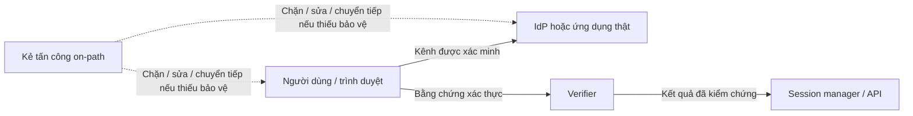
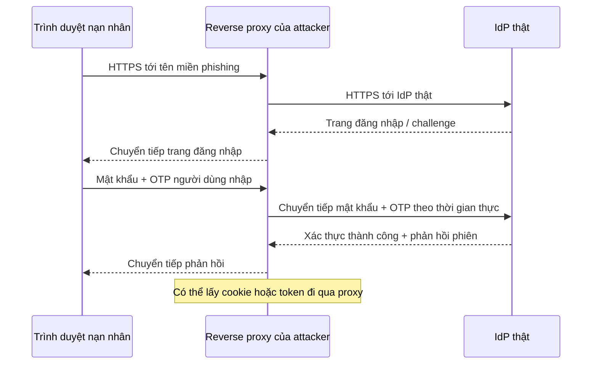

# Man-in-the-middle — Tấn công trung gian trong xác thực

Trong một luồng đăng nhập, người dùng gửi bằng chứng xác thực tới máy chủ và nhận lại kết quả để tiếp tục sử dụng dịch vụ. Nếu có một bên thứ ba đứng giữa hai đầu, quan sát, chuyển tiếp hoặc sửa thông điệp, bên đó có thể đánh cắp mật khẩu, OTP, mã đăng nhập, token hoặc session cookie; thậm chí làm người dùng tin rằng họ đang giao tiếp với đúng máy chủ. Đây là nhóm tấn công **Man-in-the-middle (MITM)**, còn gọi là tấn công trung gian hoặc tấn công on-path trong một số ngữ cảnh.

Ví dụ, An kết nối Wi-Fi công cộng và đăng nhập ứng dụng. Kẻ tấn công kiểm soát điểm truy cập có thể quan sát hoặc thay đổi lưu lượng nếu ứng dụng dùng HTTP hoặc cấu hình TLS sai. Ngay cả khi ứng dụng dùng HTTPS đúng, một chiến dịch phishing dạng **adversary-in-the-middle (AiTM)** vẫn có thể đặt một reverse proxy tại tên miền giả mạo: trình duyệt tạo kết nối TLS tới proxy, proxy tạo một kết nối TLS khác tới dịch vụ thật, rồi chuyển tiếp nội dung đăng nhập. Khi người dùng nhập mật khẩu và mã OTP, proxy có thể nhìn thấy chúng và lấy cookie phiên từ luồng chuyển tiếp.

Trong module `SECURITY_AUTHENTICATION_FUNDAMENTALS`, cần xem MITM như một vấn đề xuyên suốt ranh giới tin cậy: bảo vệ kênh truyền, xác minh đúng máy chủ, ràng buộc bằng chứng với đúng origin/issuer/audience, chống relay và replay, bảo vệ token/phiên, và phát hiện khi credential hoặc session đã bị lộ. Mã hóa đường truyền là nền tảng quan trọng, nhưng không thay thế việc xác minh danh tính hai đầu và thiết kế xác thực chống phishing.

## 1. MITM là gì và khác gì nghe lén thông thường?

**Man-in-the-middle** xảy ra khi kẻ tấn công có khả năng chen vào đường giao tiếp giữa hai bên, khiến một hoặc cả hai bên không nhận biết rằng thông điệp đang đi qua một trung gian không được tin cậy. Kẻ tấn công có thể chỉ quan sát, hoặc chủ động chuyển tiếp, trì hoãn, chặn, phát lại và sửa thông điệp.

| Hành vi | Mục tiêu | Ví dụ trong xác thực |
| --- | --- | --- |
| **Eavesdropping** (nghe lén) | Đọc dữ liệu truyền qua kênh không được bảo vệ | Thu thập mật khẩu gửi qua HTTP hoặc mạng Wi-Fi không mã hóa |
| **On-path interception** | Chặn và chuyển tiếp thông điệp qua thiết bị trung gian | Proxy độc hại đọc request/response khi TLS bị vô hiệu hóa hoặc bị kết thúc tại proxy không đáng tin |
| **Message modification** | Sửa nội dung trước khi chuyển tiếp | Thay URL chuyển hướng, thay nội dung trang đăng nhập hoặc cài script đánh cắp dữ liệu |
| **Replay** | Gửi lại thông điệp hợp lệ đã thu được | Phát lại mã xác nhận, authorization code hoặc token chưa bị ràng buộc một lần |
| **Relay** | Chuyển tiếp bằng chứng theo thời gian thực tới máy chủ thật | Lấy OTP người dùng vừa nhập rồi gửi ngay tới IdP |
| **Impersonation** | Giả làm một đầu giao tiếp | Dùng chứng chỉ giả, DNS/ARP giả mạo hoặc tên miền phishing để giả làm dịch vụ |
| **Downgrade** | Ép hai bên dùng chế độ bảo vệ yếu hơn | Hạ kết nối từ HTTPS xuống HTTP hoặc vô hiệu hóa cơ chế xác thực kênh |

Nghe lén thụ động chỉ đọc dữ liệu; MITM chủ động còn có thể thay đổi giao thức hoặc nội dung. **Relay** cũng không nhất thiết giải mã được kênh: kẻ tấn công có thể chuyển tiếp một thử thách và phản hồi hợp lệ trong thời gian thực. Vì vậy, chỉ chống replay bằng timestamp hoặc chỉ mã hóa dữ liệu chưa chắc ngăn được relay.

### Các biến thể thường gặp

- **ARP spoofing / rogue Wi-Fi:** chiếm vị trí trung gian trong mạng cục bộ hoặc điểm truy cập giả.
- **DNS poisoning / sai lệch định tuyến:** hướng client tới endpoint không mong đợi. TLS với xác minh chứng chỉ và hostname đúng vẫn là lớp bảo vệ quan trọng; DNSSEC không thay thế xác minh TLS.
- **TLS stripping / downgrade:** tìm cách khiến client và server không dùng được mức bảo vệ dự kiến, thường khi ứng dụng cho phép HTTP hoặc không áp dụng HSTS.
- **Rogue proxy / TLS inspection:** thiết bị trung gian chấm dứt TLS. Nếu máy khách đã cài và tin CA của proxy, proxy có thể giải mã nội dung; điều này cần được xem là một ranh giới tin cậy riêng.
- **AiTM phishing proxy:** trang giả mạo chuyển tiếp phiên đăng nhập tới IdP thật và lấy thông tin hoặc cookie phiên sau khi người dùng hoàn tất xác thực.

## 2. Tài sản, tác nhân và ranh giới tin cậy

MITM nhắm tới nhiều tài sản hơn mật khẩu. Một phiên đăng nhập có thể tạo ra token và quyền truy cập kéo dài sau khi credential gốc không còn được sử dụng.

| Tài sản cần bảo vệ | Giá trị đối với kẻ tấn công | Hậu quả khi bị lộ hoặc sửa |
| --- | --- | --- |
| Mật khẩu và password reset token | Đăng nhập hoặc chiếm lại tài khoản | Credential stuffing, takeover, thay phương thức recovery |
| OTP, MFA challenge, recovery code | Vượt qua hoặc hoàn tất bước xác thực | Relay MFA, chiếm quyền tài khoản |
| Passkey/private key hoặc chứng chỉ client | Giả mạo chủ thể ở các lần xác thực sau | Đăng nhập trái phép, giả mạo workload |
| Authorization code, access/refresh token | Nhận quyền API hoặc tạo phiên mới | Token theft, replay, truy cập dữ liệu trái phép |
| Session cookie/session ID | Sử dụng phiên đã được xác thực | Session hijacking, thao tác như nạn nhân |
| Thông tin issuer, audience, redirect URI, origin | Định hướng và ràng buộc danh tính | Account mix-up, token substitution, callback giả |
| Khóa ký, CA và trust store | Nền tảng tin cậy của nhiều kết nối | Giả mạo máy chủ hoặc client trên diện rộng |

### Xác định tác nhân và năng lực

Khi lập threat model, không nên chỉ ghi chung “attacker ở giữa mạng”. Hãy chỉ rõ họ kiểm soát được gì:

1. **Kẻ tấn công trên cùng mạng:** có thể thao túng Wi-Fi, ARP, DNS cục bộ hoặc proxy nhưng không kiểm soát endpoint và trust store của nạn nhân.
2. **Kẻ kiểm soát tên miền phishing:** có thể có chứng chỉ TLS hợp lệ cho tên miền của mình và vận hành reverse proxy tới dịch vụ thật.
3. **Kẻ kiểm soát proxy/TLS inspection được tin cậy:** có thể chấm dứt TLS nếu thiết bị client tin CA của proxy; phạm vi quyền của proxy cần được quản trị.
4. **Kẻ xâm nhập endpoint:** có thể đọc dữ liệu trước khi mã hóa hoặc sau khi giải mã, lấy cookie từ bộ nhớ/trình duyệt hoặc điều khiển authenticator. TLS không bảo vệ khỏi endpoint đã bị chiếm quyền.
5. **Kẻ có khả năng lạm dụng CA/issuer hoặc khóa ký:** có thể tạo chứng chỉ/token trông hợp lệ trong phạm vi trust bị ảnh hưởng.

### Sơ đồ đường giao tiếp



Sơ đồ khái niệm này biểu diễn vị trí trung gian có thể can thiệp vào kênh. Một thiết kế thực tế phải liệt kê riêng các đoạn kết nối: trình duyệt tới CDN/WAF, CDN tới load balancer, load balancer tới gateway, gateway tới service và service tới IdP. Nếu một đoạn bị bỏ qua kiểm tra chứng chỉ hoặc truyền principal qua header không được xác thực, ranh giới đó có thể trở thành điểm yếu.

## 3. Cách MITM đánh cắp một lần đăng nhập

### 3.1. Kênh HTTP hoặc TLS được cấu hình sai

Nếu ứng dụng gửi mật khẩu, OTP hoặc session cookie qua HTTP, người ở giữa có thể đọc hoặc sửa dữ liệu. Nếu client bỏ qua lỗi chứng chỉ, tin mọi chứng chỉ tự ký, hoặc dùng một trust store không được kiểm soát, kẻ tấn công có thể dựng endpoint giả mà client vẫn kết nối.

Một số lỗi cấu hình điển hình:

- Ứng dụng có trang đăng nhập HTTPS nhưng gửi một request xác thực hoặc tài nguyên chứa thông tin nhạy cảm qua HTTP.
- Client code sử dụng `TrustAll`, `NoopHostnameVerifier` hoặc callback luôn trả về “certificate accepted”.
- Thiết bị di động chấp nhận mọi chứng chỉ vì môi trường test, rồi mang cấu hình đó sang production.
- Backend nhận kết nối từ proxy nhưng không xác thực proxy hoặc không mã hóa đoạn proxy → backend trong môi trường cần bảo vệ.
- Redirect HTTP → HTTPS có tồn tại, nhưng người dùng lần đầu truy cập bằng HTTP và attacker can thiệp trước khi redirect; HSTS chưa được thiết lập hoặc chưa có hiệu lực.

### 3.2. AiTM reverse proxy và relay MFA

Một kịch bản nguy hiểm hơn là kẻ tấn công tạo trang phishing có giao diện giống dịch vụ thật. Người dùng truy cập tên miền của attacker; proxy chuyển request sang IdP thật và chuyển response về trình duyệt. Trình duyệt có thể hiển thị kết nối HTTPS hợp lệ vì nó đang kết nối tới tên miền phishing có chứng chỉ hợp lệ của chính tên miền đó.



Trong mô hình này, TLS được mã hóa trên **cả hai đoạn**: trình duyệt ↔ proxy và proxy ↔ IdP. Nhưng proxy là endpoint của đoạn thứ nhất, nên nó nhìn thấy dữ liệu mà trình duyệt gửi cho tên miền phishing. Nó cũng nhìn thấy dữ liệu trên đoạn thứ hai vì nó là client của IdP. Mã hóa không cứu được người dùng nếu họ được dẫn tới đúng một endpoint giả mạo và tự nhập credential vào đó.

**TOTP/SMS OTP không chống được relay theo thời gian thực.** Attacker có thể chuyển tiếp mã vừa nhập tới dịch vụ thật trong cửa sổ hiệu lực. Push MFA cũng có thể bị lạm dụng qua prompt fatigue hoặc phê duyệt nhầm. Phương thức MFA có khả năng chống phishing tốt hơn là xác thực dựa trên khóa gắn với origin, chẳng hạn WebAuthn/passkey triển khai đúng.

### 3.3. Đánh cắp token và phiên sau xác thực

Ngay cả khi người dùng đã hoàn tất MFA, attacker có thể nhắm vào **kết quả của đăng nhập**:

- Lấy session cookie hoặc bearer token từ reverse proxy, malware, log, extension độc hại hoặc endpoint bị xâm nhập.
- Chặn authorization code trong redirect nếu luồng OAuth/OIDC thiếu PKCE hoặc ràng buộc giao dịch.
- Phát lại refresh token hoặc token chưa bị thu hồi.
- Thay audience, issuer, redirect URI hoặc subject trong một luồng xác minh yếu.

Một phiên bị đánh cắp có thể tồn tại sau khi mật khẩu đã được đổi. Vì vậy, ứng phó phải xét cả session, refresh token, access token và thiết bị/credential liên quan, không chỉ reset password.

## 4. TLS: lớp bảo vệ cơ bản của kênh truyền

**TLS** cung cấp mã hóa, toàn vẹn dữ liệu và xác thực endpoint theo cơ chế chứng chỉ trong các cấu hình thông thường. Để chống MITM, client phải kiểm tra chứng chỉ đúng cách và kết nối phải được thiết lập tới đúng hostname.

### 4.1. Client cần xác minh điều gì?

Khi kết nối HTTPS, client cần kiểm tra tối thiểu:

1. **Chuỗi tin cậy:** chứng chỉ máy chủ dẫn tới trust anchor/CA mà client tin cậy theo chính sách.
2. **Hostname:** tên máy chủ đang truy cập khớp với danh tính trong Subject Alternative Name (SAN) theo quy tắc xác minh hostname.
3. **Thời hạn:** thời điểm hiện tại nằm trong khoảng `notBefore` và `notAfter`.
4. **Mục đích sử dụng:** chứng chỉ và khóa được phép dùng cho server authentication theo chính sách/Key Usage/Extended Key Usage thích hợp.
5. **Chữ ký và thuật toán:** chuỗi chứng chỉ và thuật toán đáp ứng cấu hình an toàn; không chấp nhận thuật toán yếu hoặc cấu hình không được phép.
6. **Chính sách thu hồi:** áp dụng cơ chế kiểm tra trạng thái chứng chỉ phù hợp với môi trường, hiểu rõ hành vi soft-fail/cache của client thay vì giả định mọi client đều kiểm tra thu hồi giống nhau.

Nếu một bước xác minh thất bại, ứng dụng không nên cho người dùng bấm “tiếp tục dù không an toàn” đối với luồng đăng nhập nhạy cảm. **Không tắt xác minh hostname hoặc trust chain để sửa lỗi kết nối.** Hãy sửa trust store, chứng chỉ, hostname hoặc cấu hình môi trường.

### 4.2. Cấu hình TLS và chống downgrade

- Dùng HTTPS cho toàn bộ trang và endpoint xác thực; không gửi credential/token qua HTTP.
- Ưu tiên TLS 1.3; nếu cần tương thích TLS 1.2, dùng cấu hình cipher suite và nhóm khóa được khuyến nghị, tắt các phiên bản/cấu hình lỗi thời theo chính sách vận hành.
- Bật **HTTP Strict Transport Security (HSTS)** sau khi xác nhận toàn bộ host/subdomain liên quan hoạt động đúng trên HTTPS. `includeSubDomains` và preload cần đánh giá phạm vi kỹ trước khi áp dụng.
- Không cho nội dung đăng nhập hoặc script nhạy cảm tải qua mixed content; dùng redirect HTTPS và kiểm tra mọi callback/redirect URL.
- Quản lý chứng chỉ, private key, CA và tự động gia hạn; cảnh báo chứng chỉ sắp hết hạn, bị thay bất thường hoặc có dấu hiệu bị cấp trái phép.
- Nếu TLS kết thúc ở CDN/load balancer, bảo vệ cả đoạn từ điểm kết thúc TLS tới backend; xác thực nguồn kết nối và loại bỏ header định danh do client tự gửi.

**HSTS không thay thế xác minh chứng chỉ.** Nó yêu cầu trình duyệt dùng HTTPS cho host đã biết, giúp giảm khả năng bị hạ cấp xuống HTTP. Nó không ngăn người dùng tự nhập credential vào một tên miền phishing khác có HTTPS hợp lệ.

### 4.3. TLS inspection và certificate pinning

Một số tổ chức triển khai proxy kiểm tra TLS bằng CA nội bộ được cài trên thiết bị quản lý. Đây là một **trusted intermediary** có khả năng nhìn thấy lưu lượng sau khi TLS kết thúc. Chính sách phải công khai phạm vi, quản lý khóa CA chặt chẽ, giới hạn quyền truy cập log và có cơ chế ứng cứu nếu CA/proxy bị xâm nhập. Không nên cài CA không rõ nguồn gốc vào thiết bị người dùng.

**Certificate/public-key pinning** có thể giới hạn các khóa/chứng chỉ được chấp nhận trong một số ứng dụng kiểm soát được client, nhưng không phải giải pháp mặc định cho mọi ứng dụng web. Pin sai hoặc không có kế hoạch cập nhật/backup có thể làm toàn bộ client mất kết nối khi chứng chỉ xoay vòng. Nếu dùng, cần pin phù hợp (thường cân nhắc public key/SPKI), có pin dự phòng, quy trình rotation và threat model rõ; pinning không bảo vệ endpoint đã bị chiếm quyền.

## 5. Ràng buộc xác thực với đúng origin, issuer và audience

TLS bảo vệ một kết nối tới một hostname; các giao thức xác thực cần thêm ràng buộc để bằng chứng không bị chuyển sang một dịch vụ hoặc giao dịch khác.

### 5.1. Passkey/WebAuthn: chống phishing bằng ràng buộc origin

Trong WebAuthn, authenticator tạo assertion dựa trên challenge của RP. Server xác minh chữ ký bằng public key đã đăng ký, kiểm tra challenge, `origin`, RP ID hash và các cờ cần thiết theo chính sách. Private key được sử dụng trong ngữ cảnh RP phù hợp, giúp ngăn một trang phishing ở origin khác lấy assertion có thể dùng cho RP thật.

Ví dụ, passkey đã đăng ký cho `login.example.com` không tự động tạo assertion hợp lệ cho `login-example.attacker.invalid`. Tên miền nhìn giống nhau không thay đổi origin. Vì thế:

- Hiển thị và kiểm tra đúng domain trong quy trình đăng ký/đăng nhập; không dùng wildcard RP ID rộng hơn nhu cầu.
- Server tự cấu hình expected origin/RP ID; không lấy chúng từ dữ liệu client gửi.
- Kiểm tra challenge mới, có thời hạn và được tiêu thụ một lần.
- Bảo vệ quy trình đăng ký passkey để attacker không thêm authenticator của mình vào tài khoản nạn nhân.

Passkey giảm đáng kể nguy cơ phishing credential và relay OTP, nhưng không ngăn mọi loại chiếm quyền. Malware có thể điều khiển phiên đã mở khóa, attacker có thể lừa người dùng vào một luồng cấp quyền khác, hoặc recovery yếu có thể vượt qua cơ chế passkey. Cần bảo vệ toàn bộ vòng đời credential và session.

### 5.2. OAuth 2.0 / OpenID Connect

Đối với ứng dụng đăng nhập qua IdP, nên sử dụng **Authorization Code Flow với PKCE** theo hướng dẫn triển khai hiện hành. Các ràng buộc quan trọng gồm:

| Thành phần | Mục đích | Lỗi cần tránh |
| --- | --- | --- |
| `state` | Gắn callback với giao dịch client đã khởi tạo, giảm CSRF/login injection | Chấp nhận state rỗng, không kiểm tra hoặc tái sử dụng |
| PKCE (`code_challenge`/`code_verifier`) | Bảo vệ authorization code nếu bị chặn/intercept | Không kiểm tra verifier khi đổi code |
| `nonce` trong OIDC | Ràng buộc ID token với yêu cầu xác thực của client, chống replay/mix-up theo luồng | Không kiểm tra nonce hoặc chấp nhận token của giao dịch khác |
| `iss` | Xác định authorization server/issuer | Tin issuer do client khai hoặc không phân biệt nhiều IdP |
| `aud` | Xác định client/API mà token được cấp cho | Dùng token hợp lệ chữ ký nhưng cấp cho client khác |
| Redirect URI chính xác | Hạn chế code/token bị chuyển tới endpoint không mong đợi | Wildcard hoặc redirect mở cho attacker kiểm soát |
| TLS ở front/back channel | Bảo vệ request/response và thông tin code/token | Bỏ qua kiểm tra chứng chỉ hoặc đưa token vào URL/log |

Client cần kiểm tra đúng issuer dự kiến, chữ ký, audience, thời hạn và nonce theo OIDC. Dùng `(iss, sub)` làm khóa định danh từ IdP; không liên kết tài khoản chỉ vì email giống nhau. Authorization code nên được trao đổi qua back-channel bảo vệ; không lưu code, ID token hay access token trong log hoặc URL không cần thiết.

PKCE giúp bảo vệ code interception nhưng không thay thế `state`, kiểm tra issuer, redirect URI và xác minh token. Các biện pháp này bảo vệ những ranh giới khác nhau.

### 5.3. Channel binding và proof of possession

Một số giao thức hỗ trợ **channel binding**: gắn bằng chứng xác thực với kênh bảo mật đang sử dụng, chẳng hạn cơ chế `tls-exporter` trong những giao thức được thiết kế để dùng nó. Khi client và server xác minh cùng một giá trị binding, bằng chứng bị chuyển sang một kết nối khác có thể không còn hợp lệ. Chỉ dùng cơ chế đã được chuẩn hóa và thư viện hỗ trợ đúng; không tự tạo giá trị binding bằng cách hash tùy tiện thông tin TLS.

Với token, **proof-of-possession** giúp giảm rủi ro bearer token bị lấy rồi sử dụng ở nơi khác. Các cơ chế như mTLS-bound access token hoặc DPoP ràng buộc token với khóa mà client phải chứng minh đang nắm giữ. Chúng tăng độ phức tạp triển khai và không tự bảo vệ khỏi endpoint bị chiếm quyền hoặc attacker điều khiển được chính client.

## 6. Bảo vệ session và token sau khi xác thực

Một kết nối TLS an toàn không đảm bảo session an toàn nếu ứng dụng để lộ cookie hoặc chấp nhận token không đúng ngữ cảnh.

### 6.1. Session cookie

- Dùng cookie `Secure`, `HttpOnly`, `SameSite` phù hợp, `Path`/`Domain` tối thiểu; cân nhắc prefix `__Host-` cho cookie host-only với `Secure`, `Path=/` và không có `Domain`.
- Không đặt session ID trong URL, query string, fragment, log, referrer hoặc dữ liệu analytics.
- Cấp session ID mới sau đăng nhập, step-up hoặc thay đổi đặc quyền; thu hồi ID cũ để chống session fixation.
- Áp dụng idle timeout và absolute timeout; có khả năng xem/thu hồi phiên thiết bị; thu hồi phiên khi phát hiện chiếm quyền hoặc đóng tài khoản.
- Vì cookie được trình duyệt gửi tự động, dùng CSRF token/kiểm tra `Origin` và thiết kế method phù hợp; `SameSite` chỉ là một lớp bảo vệ.

### 6.2. Access token và refresh token

Verifier phải kiểm tra chữ ký/issuer, audience, thời hạn (`exp`, `nbf` nếu có), subject, scope/claim và thuật toán/khóa được phép. Một JWT có chữ ký đúng nhưng sai `aud` không được API chấp nhận. Bearer token bị đánh cắp có thể được dùng lại cho tới khi hết hạn hoặc bị thu hồi, nên cân nhắc thời hạn ngắn, refresh token rotation/reuse detection, introspection hoặc sender-constrained token theo nhu cầu.

Không đưa token vào URL hoặc log. Với ứng dụng web, cân nhắc BFF để giữ access/refresh token ở server và chỉ phát cookie phiên an toàn cho trình duyệt. Với mobile/native, dùng secure storage của hệ điều hành và bảo vệ luồng redirect/deep link. Không coi một token có chữ ký hợp lệ là đủ nếu không kiểm tra issuer, audience và quyền.

### 6.3. Service-to-service

Với workload, dùng mTLS hoặc workload identity để xác minh peer; mỗi service có danh tính riêng, chứng chỉ/token có thời hạn và audience phù hợp. Nếu TLS kết thúc ở gateway, cần bảo vệ đoạn gateway → service, xác thực gateway, loại bỏ header principal do client gửi và chỉ tin metadata được proxy đáng tin ký/xác minh. Danh tính service không thay thế việc kiểm tra quyền của người dùng cuối nếu request đang đại diện cho người dùng.

## 7. Phòng vệ theo từng lớp

Không có một biện pháp đơn lẻ nào ngăn được tất cả MITM. Cần nhiều lớp, mỗi lớp xử lý một ranh giới cụ thể.

| Lớp | Biện pháp | Mục tiêu |
| --- | --- | --- |
| **Network / transport** | HTTPS/TLS cấu hình an toàn, xác minh hostname/chain, HSTS, bảo vệ backend hop, mTLS khi phù hợp | Ngăn nghe lén/sửa đổi và giả mạo endpoint trên kênh |
| **DNS / routing** | Quản lý DNS, bảo vệ resolver, giám sát thay đổi bất thường; DNSSEC khi mô hình cần | Giảm khả năng hướng client tới endpoint sai; vẫn xác minh TLS |
| **Browser / client** | Không bỏ qua certificate error, chống mixed content, bảo vệ extension/device, cập nhật trình duyệt | Không để client tự chấp nhận endpoint không tin cậy |
| **Authentication protocol** | WebAuthn/passkey; OIDC state/nonce/PKCE; challenge ngẫu nhiên, một lần, đúng origin/issuer | Ngăn phishing, relay, replay và account mix-up |
| **Credential** | Không tái sử dụng mật khẩu, MFA chống phishing, secret/key protection, rotation và revocation | Giảm khả năng credential bị lấy và dùng lại |
| **Session/token** | Cookie bảo vệ, session rotation, token audience/TTL, introspection hoặc proof-of-possession | Giảm chiếm phiên và replay sau đăng nhập |
| **Authorization** | Quyền tối thiểu, kiểm tra tenant/resource ở server, step-up cho hành động rủi ro | Hạn chế thiệt hại nếu danh tính hoặc phiên bị chiếm |
| **Monitoring/response** | Phát hiện đăng nhập bất thường, token reuse, certificate changes, thu hồi phiên/credential | Phát hiện và giảm thời gian attacker duy trì quyền |

### 7.1. Chính sách đối với certificate error

Người dùng và ứng dụng không nên được hướng dẫn bỏ qua cảnh báo chứng chỉ để tiếp tục đăng nhập. Đối với hệ thống doanh nghiệp, hãy cung cấp quy trình khắc phục có kiểm soát: kiểm tra hostname, đồng hồ thiết bị, trust store, chứng chỉ trung gian và cấu hình proxy. Nếu môi trường test cần CA riêng, cài trust anchor cụ thể trong môi trường test và tách hoàn toàn khỏi production; không triển khai `TrustAll`.

### 7.2. Chọn MFA chống phishing

MFA làm tăng khó khăn cho attacker, nhưng **không phải mọi MFA đều chống phishing**. SMS và TOTP có thể bị relay; push có thể bị fatigue; passkey/WebAuthn ràng buộc origin và là lựa chọn chống phishing mạnh hơn khi triển khai đúng. Với tài khoản đặc quyền, nên ưu tiên authenticator phishing-resistant và có recovery được bảo vệ tương đương.

## 8. Giám sát, phát hiện và ứng phó sự cố

MITM có thể không để lại dấu hiệu trực tiếp trong ứng dụng nếu attacker chỉ chuyển tiếp một phiên hợp lệ. Do đó, giám sát nên kết hợp sự kiện xác thực, thiết bị, token, hạ tầng TLS và hành vi truy cập.

### Tín hiệu có thể theo dõi

- Đăng nhập từ ASN, vị trí hoặc thiết bị mới ngay sau khi có dấu hiệu phishing hoặc nhập OTP bất thường.
- Nhiều lần thử xác thực, MFA push bị từ chối liên tục, đăng ký passkey/MFA mới không giải thích được.
- Một session/token xuất hiện đồng thời ở nhiều thiết bị hoặc vị trí không hợp lý; refresh token reuse sau rotation.
- Chứng chỉ máy chủ thay đổi ngoài lịch, issuer/CA lạ, lỗi hostname/certificate tăng đột biến hoặc thay đổi DNS bất thường.
- Proxy/gateway nhận header định danh không đúng nguồn, TLS hop nội bộ không đúng cấu hình hoặc service gọi API với audience sai.
- Lưu lượng tới endpoint đăng nhập có bất thường, redirect URI hoặc IdP issuer thay đổi không theo quy trình.

Không một tín hiệu riêng lẻ chứng minh chắc chắn có MITM. Cần kết hợp context, giảm false positive và bảo vệ quyền riêng tư. Log phải tránh chứa password, OTP, private key, session cookie hoặc token nguyên vẹn; dùng correlation ID, credential/session ID đã che hoặc định danh audit thích hợp.

### Quy trình ứng phó khi nghi token/session bị lấy

1. **Chặn đường tấn công:** cô lập endpoint/proxy độc hại, chặn domain/IP theo điều tra, xử lý DNS/route hoặc cấu hình CA bị ảnh hưởng.
2. **Cắt quyền đang tồn tại:** thu hồi session, refresh token, access token có thể thu hồi và các phiên liên quan; vô hiệu credential bị lộ. Đối với token tự chứa, thực hiện chính sách thu hồi hoặc chờ hết hạn có kiểm soát theo mức độ rủi ro.
3. **Khôi phục phương thức xác thực:** đổi mật khẩu nếu có khả năng bị lộ, thay TOTP seed/recovery codes nếu cần, gỡ passkey/chứng chỉ không nhận diện và đăng ký lại bằng phiên đã được xác minh.
4. **Kiểm tra persistence và thay đổi tài khoản:** xem lại email/số điện thoại recovery, thiết bị tin cậy, OAuth grants, forwarding rules, API keys và thay đổi quyền.
5. **Điều tra phạm vi:** xác định dữ liệu đã truy cập, thời gian phiên bị lạm dụng, các service đã tin token và log hạ tầng liên quan.
6. **Thông báo và cải thiện:** thông báo theo quy trình sự cố, hỗ trợ người dùng và cập nhật threat model, chính sách token/session, certificate và MFA.

Reset mật khẩu mà không thu hồi phiên/token có thể để attacker tiếp tục dùng quyền đã có. Ngược lại, thu hồi phiên mà không xử lý endpoint hoặc proxy bị kiểm soát có thể khiến credential mới lại bị đánh cắp.

## 9. Ví dụ cấu hình và kiểm tra an toàn

### 9.1. Java HTTPS client: giữ xác minh TLS mặc định

Với Java `HttpClient`, không cài `TrustManager` chấp nhận mọi chứng chỉ và không vô hiệu hóa hostname verification. Ví dụ tối giản sau dùng SSL context mặc định của runtime; trust store cần được quản lý đúng theo môi trường:

```java
import java.net.URI;
import java.net.http.HttpClient;
import java.net.http.HttpRequest;
import java.net.http.HttpResponse;
import javax.net.ssl.SSLContext;

HttpClient client = HttpClient.newBuilder()
    .sslContext(SSLContext.getDefault()) // Giữ kiểm tra chứng chỉ mặc định.
    .followRedirects(HttpClient.Redirect.NEVER) // Xử lý redirect có chủ đích.
    .build();

HttpRequest request = HttpRequest.newBuilder()
    .uri(URI.create("https://login.example.com/health"))
    .GET()
    .build();

HttpResponse<String> response = client.send(
    request, HttpResponse.BodyHandlers.ofString()
);
```

Đoạn mã chỉ minh họa việc không tắt xác minh TLS; nó không tự triển khai đăng nhập, OIDC hay kiểm tra authorization. Trong production, cần quản lý trust store, redirect policy, timeout, log và nội dung response. Không tự động chuyển credential sang một hostname mới khi redirect.

### 9.2. Pseudocode kiểm tra OIDC trước khi tạo phiên

```text
callback = receiveAuthorizationResponse()

transaction = consumePendingLogin(callback.state)  // một lần, đúng client
if transaction missing or expired: DENY
if callback issuer != transaction.expectedIssuer: DENY

tokens = exchangeCodeOverVerifiedTLS(
    code = callback.code,
    redirectUri = transaction.exactRedirectUri,
    codeVerifier = transaction.pkceVerifier
)

claims = verifyIdToken(
    signature = trustedIssuerKeys,
    issuer = transaction.expectedIssuer,
    audience = transaction.clientId,
    nonce = transaction.nonce,
    timeClaims = true
)

subject = identityMap.lookup(issuer = claims.iss, subject = claims.sub)
if subject missing or account inactive: DENY

session = createNewOpaqueSession(subject, tenant, verifiedAuthContext)
invalidatePreAuthSession()
issueSecureCookie(session)
```

Pseudocode nhấn mạnh các ràng buộc trước khi phát phiên. Thực tế phải dùng thư viện OIDC được duy trì, xử lý chính xác issuer discovery/JWKS rotation, lỗi token exchange, PKCE, state/nonce và chính sách liên kết tài khoản; không tự viết parser hoặc bộ xác minh chữ ký cho production.

### 9.3. Kiểm thử trong môi trường được phép

Có thể dùng proxy kiểm thử bảo mật trong lab để xác nhận ứng dụng **từ chối** chứng chỉ không tin cậy, hostname sai, HTTP downgrade, token sai audience và callback sai state. Không thực hiện interception trên thiết bị hoặc tài khoản của người khác nếu chưa có quyền. Mục tiêu kiểm thử là chứng minh lớp phòng vệ hoạt động, không thu thập credential thật.

## 10. Ma trận kiểm thử chống MITM

| Kịch bản | Kết quả mong đợi |
| --- | --- |
| HTTPS trả chứng chỉ tự ký không nằm trong trust store | Client từ chối kết nối; không có tùy chọn bỏ qua trong luồng nhạy cảm |
| Chứng chỉ hợp lệ nhưng hostname không khớp | Client từ chối hostname mismatch |
| Chứng chỉ hết hạn hoặc sai mục đích server authentication | Kết nối bị từ chối theo chính sách |
| Client bị chuyển hướng sang HTTP | HSTS/HTTPS policy ngăn downgrade; credential không được gửi qua HTTP |
| Reverse proxy phishing chuyển tiếp mật khẩu + TOTP | Kiểm thử cho thấy OTP có thể bị relay; hệ thống ưu tiên phương thức phishing-resistant và cảnh báo domain sai |
| Passkey được gọi từ origin khác RP đã đăng ký | Assertion không hợp lệ cho RP thật; server từ chối |
| WebAuthn challenge đã dùng hoặc hết hạn | Từ chối replay |
| OIDC callback có `state` sai hoặc bị phát lại | Không tạo phiên |
| ID token có `iss`, `aud`, `nonce` sai | Không tạo phiên; không ánh xạ tài khoản |
| Authorization code bị chặn nhưng không có PKCE verifier | Không đổi được code thành token |
| JWT đúng chữ ký nhưng sai audience hoặc issuer | API từ chối |
| Session cookie bị đưa vào URL hoặc log | Kiểm thử log/telemetry không tìm thấy session secret; ứng dụng không phát ID trong URL |
| Session ID tiền xác thực được giữ sau login | Bị vô hiệu; ID mới được cấp cho phiên đã xác thực |
| Gateway kết thúc TLS nhưng backend nhận header principal do client tự gửi | Header giả bị loại bỏ; backend chỉ tin gateway đã xác thực |
| Một session/token bị sử dụng đồng thời ở ngữ cảnh bất thường | Phát hiện theo policy và có khả năng thu hồi/step-up |
| Credential bị lộ và reset password nhưng phiên cũ còn sống | Kiểm thử phát hiện phiên cũ vẫn hoạt động; quy trình ứng cứu phải thu hồi token/session |

## 11. Tình huống thực hành

Một công ty nhận báo cáo rằng nhân viên bị lừa đăng nhập vào trang `company-login.example.attacker.invalid`. Trang này có HTTPS hợp lệ. Nhân viên nhập mật khẩu và mã TOTP; sau đó kẻ tấn công dùng cookie phiên để mở dashboard nội bộ. Ứng dụng công ty cũng có HTTPS và chứng chỉ hợp lệ. Đội vận hành ban đầu cho rằng “TLS đang bật nên không thể là MITM”.

**Yêu cầu:** mô tả luồng tấn công, xác định ranh giới tin cậy bị hiểu sai và đề xuất biện pháp theo thứ tự ưu tiên.

**Hướng phân tích:**

1. Trình duyệt kết nối TLS tới tên miền phishing; chứng chỉ hợp lệ cho **tên miền của attacker**, không chứng minh đó là domain của công ty.
2. Reverse proxy tạo một kết nối TLS riêng tới IdP thật, chuyển tiếp form đăng nhập và OTP; proxy là endpoint ở cả hai đoạn và có thể nhìn thấy dữ liệu.
3. IdP xác thực thành công và trả cookie/token qua proxy; attacker lấy kết quả phiên. TLS từng đoạn không ràng buộc bằng chứng người dùng với origin công ty trong phương thức password/TOTP.
4. Thu hồi session và refresh token, xử lý token/access có liên quan; đổi password, đánh giá MFA/recovery, kiểm tra hoạt động dashboard và các thay đổi tài khoản.
5. Ưu tiên WebAuthn/passkey hoặc phương thức phishing-resistant, kiểm tra domain và đào tạo người dùng; bảo vệ session, token, step-up và phát hiện đăng nhập bất thường.
6. Kiểm thử lại với AiTM mô phỏng trong lab được phép; xác minh passkey không phát assertion cho origin giả và các token/session bị thu hồi không thể dùng tiếp.

**Kết luận của tình huống:** HTTPS bảo vệ kênh tới endpoint mà client đã chọn. Nếu người dùng bị dẫn tới endpoint phishing, TLS hợp lệ cho domain giả không làm endpoint đó trở thành dịch vụ thật. Chống MITM trong xác thực phải kết hợp xác minh máy chủ, ràng buộc origin/issuer/audience, MFA chống phishing và bảo vệ phiên/token sau xác thực.

## 12. Câu hỏi tự kiểm tra

1. **MITM khác nghe lén thụ động ở điểm nào?** MITM có thể chủ động chặn, chuyển tiếp, sửa, phát lại hoặc giả mạo thông điệp giữa hai bên.
2. **Vì sao HTTPS có chứng chỉ hợp lệ vẫn có thể xuất hiện trong AiTM phishing?** Vì chứng chỉ hợp lệ có thể thuộc tên miền phishing; trình duyệt đang bảo vệ kết nối tới chính endpoint giả đó.
3. **Tại sao TOTP có thể bị relay trong thời gian thực?** Vì attacker chuyển mã người dùng vừa nhập tới IdP thật trong cửa sổ hiệu lực; mã không gắn mật mã với origin của trang người dùng đang nhìn.
4. **WebAuthn/passkey chống phishing dựa trên điều gì?** Bằng chứng được ràng buộc với RP ID/origin và challenge, nên assertion cho origin giả không hợp lệ với RP thật.
5. **PKCE, state và nonce có cùng mục đích không?** Không. Chúng bảo vệ các ràng buộc khác nhau trong OAuth/OIDC: code interception, giao dịch callback và việc gắn ID token với yêu cầu xác thực.
6. **Vì sao đổi mật khẩu chưa đủ sau khi session cookie bị đánh cắp?** Vì cookie là bearer credential độc lập; phải thu hồi session/token đang tồn tại và kiểm tra persistence.
7. **TLS inspection proxy có ý nghĩa gì trong threat model?** Nó là một trusted intermediary có khả năng giải mã ở điểm kết thúc TLS; CA và proxy cần được bảo vệ như thành phần nhạy cảm.

**Ghi nhớ:** Chống Man-in-the-middle trong xác thực cần bảo vệ **cả kênh lẫn ý nghĩa của bằng chứng**. Xác minh TLS đúng hostname, ràng buộc passkey/OIDC với origin và issuer, chống downgrade/replay/relay, bảo vệ cookie/token và thu hồi phiên khi có sự cố. Một kênh mã hóa tới sai endpoint vẫn có thể đưa credential vào tay attacker.
