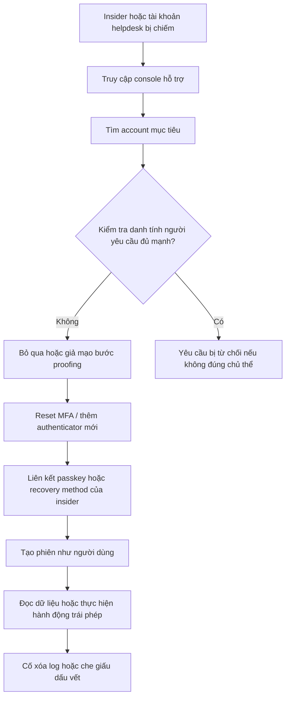
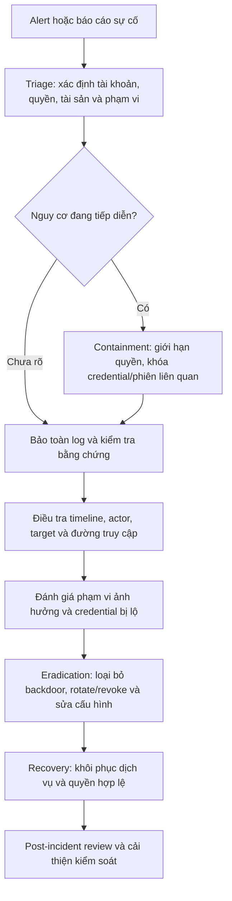

# Insider abuse

**Insider abuse** là việc một người hoặc tài khoản có quyền truy cập hợp lệ vào hệ thống sử dụng quyền đó sai mục đích, vượt phạm vi được giao, hỗ trợ người khác tấn công hoặc làm lộ dữ liệu và bí mật. Trong hệ thống xác thực, rủi ro này đặc biệt đáng chú ý vì nhân sự vận hành, hỗ trợ, quản trị danh tính và phát triển phần mềm có thể tiếp cận credential, phiên, hồ sơ người dùng, cấu hình IdP hoặc quy trình khôi phục tài khoản.

Bài học thuộc chương **Threat model** của module **SECURITY_AUTHENTICATION_FUNDAMENTALS**. Mục tiêu là nhận diện cách lạm dụng nội bộ có thể tác động đến mật khẩu, MFA, passkey, chứng chỉ, token, phiên, liên kết danh tính và khôi phục tài khoản; mô hình hóa tác nhân, tài sản, đường tấn công và ranh giới tin cậy; rồi thiết kế kiểm soát phòng ngừa, phát hiện, ứng phó và kiểm toán phù hợp.

Một insider không nhất thiết là nhân viên cố ý gây hại. Rủi ro có thể đến từ người có ác ý, người bị lừa hoặc bị ép buộc, người mắc lỗi, tài khoản đặc quyền bị chiếm, nhà thầu, nhân sự hỗ trợ hoặc một workload dùng credential của con người. Vì vậy, mô hình cần xem xét **hành vi, quyền thực tế và đường truy cập**, thay vì chỉ phân loại con người theo chức danh.

## 1. Hiểu đúng insider abuse trong hệ thống xác thực

Một nhân viên hỗ trợ có quyền xử lý yêu cầu “mất MFA”. Nếu người này bỏ qua quy trình kiểm tra và thêm passkey của chính mình vào account của khách hàng, họ có thể chiếm quyền truy cập dù hệ thống đăng nhập phía trước dùng MFA mạnh. Một quản trị viên có thể xuất khóa ký token để giả mạo danh tính. Một kỹ sư có thể vô tình đưa client secret vào log hoặc kho mã nguồn. Cả ba tình huống đều có thể làm suy yếu ranh giới tin cậy.

### 1.1. Các dạng insider

| Dạng tác nhân | Đặc điểm | Ví dụ trong xác thực |
| --- | --- | --- |
| **Malicious insider** | Cố ý dùng quyền được cấp để trục lợi, phá hoại hoặc hỗ trợ người khác. | Quản trị viên đọc dữ liệu xác thực hoặc đổi email khôi phục để chiếm account. |
| **Negligent insider** | Không có ý định gây hại nhưng thao tác thiếu an toàn hoặc bỏ qua quy trình. | Kỹ sư gửi token qua kênh chat công khai, hỗ trợ viên xác minh người yêu cầu quá sơ sài. |
| **Compromised insider account** | Kẻ bên ngoài chiếm tài khoản của người nội bộ và dùng quyền của họ. | Phishing tài khoản helpdesk rồi reset MFA cho nhiều người. |
| **Coerced / manipulated insider** | Người có quyền bị dụ dỗ, đe dọa hoặc thao túng để thực hiện thao tác. | Nhân viên bị thuyết phục xuất dữ liệu hoặc phê duyệt yêu cầu khẩn cấp giả. |
| **Third-party insider** | Nhà thầu, nhà cung cấp, đối tác có quyền truy cập theo hợp đồng. | Kỹ thuật viên IdP có quyền xem cấu hình hoặc thay đổi liên kết tenant. |
| **Over-privileged automation** | Tài khoản dịch vụ hoặc pipeline được cấp quyền rộng, khó xác định người chịu trách nhiệm. | CI/CD dùng một secret quản trị chung để cập nhật mọi cấu hình xác thực. |

**Insider là mô tả vị trí trong ranh giới tin cậy, không phải bằng chứng về động cơ.** Một tài khoản bị chiếm có thể tạo ra cùng hành vi kỹ thuật như một insider ác ý. Điều tra cần phân biệt sự kiện, danh tính được xác minh, thiết bị, phiên và bằng chứng kiểm toán trước khi kết luận.

### 1.2. Tại sao hệ thống xác thực có rủi ro đặc biệt?

Hệ thống xác thực kiểm soát điểm vào của nhiều dịch vụ. Một số quyền nội bộ có thể tác động trên diện rộng:

- Đọc hoặc thay đổi thông tin xác thực, secret TOTP, khóa ký, chứng chỉ và cấu hình trust.
- Thêm, xóa hoặc thay thế authenticator của người dùng; reset mật khẩu hoặc MFA.
- Phát hành, đổi audience/scope, thu hồi hoặc xem token và session.
- Liên kết một identity bên ngoài với account nội bộ; thay đổi email, số điện thoại, tenant hoặc thuộc tính dùng để cấp quyền.
- Bỏ qua quy trình proofing, khóa tài khoản hoặc thu hồi quyền.
- Sửa log, quy tắc phát hiện, cấu hình gateway, IdP hoặc hệ thống hỗ trợ.

Một thao tác có vẻ nhỏ như đổi địa chỉ email khôi phục hoặc thêm một passkey mới có thể tạo quyền truy cập lâu dài. Vì thế, các thao tác quản trị identity cần được coi là **sự kiện bảo mật nhạy cảm**.

## 2. Xác định tài sản và tác động cần bảo vệ

Threat model bắt đầu bằng việc xác định điều gì có giá trị và hậu quả nếu bị lạm dụng.

| Tài sản | Giá trị bảo mật | Tác động khi insider abuse |
| --- | --- | --- |
| **User identity và account** | Gắn dữ liệu và quyền với đúng chủ thể. | Chiếm account, giả mạo người dùng, liên kết nhầm identity. |
| **Password verifier / credential store** | Hỗ trợ xác thực mà không lộ bí mật gốc. | Đọc verifier, thay hash, tạo đường đăng nhập trái phép hoặc làm suy yếu chính sách. |
| **MFA seed và recovery code** | Bằng chứng kiểm soát authenticator và khả năng khôi phục. | Sao chép TOTP seed, dùng recovery code hoặc vô hiệu hóa MFA. |
| **Passkey / khóa công khai và metadata** | Liên kết credential WebAuthn với account. | Thêm credential của insider, xóa credential của nạn nhân, thay đổi metadata. |
| **Private key / chứng chỉ / CA** | Xác thực workload, client hoặc ký assertion/token. | Giả mạo service, ký token trái phép, phá vỡ trust domain. |
| **Access token / refresh token / session** | Duy trì quyền truy cập sau xác thực. | Đọc token, phát lại, chiếm phiên hoặc kéo dài truy cập. |
| **IdP / authorization server** | Phát hành identity và quyết định cấp token. | Thay issuer, audience, signing key, scope hoặc policy. |
| **Recovery và helpdesk workflow** | Khôi phục quyền truy cập khi người dùng mất phương tiện. | Chiếm account bằng quy trình hỗ trợ yếu. |
| **Audit log và bằng chứng điều tra** | Phát hiện, quy trách nhiệm và tái dựng sự kiện. | Xóa dấu vết, làm sai lệch timeline, che giấu hành vi. |
| **Cấu hình và pipeline triển khai** | Quyết định cách hệ thống vận hành và tin cậy. | Cài backdoor, phát tán secret, mở rộng quyền trên nhiều môi trường. |

Ngoài tính bí mật, toàn vẹn và sẵn sàng, cần bảo vệ **tính đúng đắn của mối liên kết identity ↔ account ↔ authenticator**. Hệ thống có thể không lộ mật khẩu nhưng vẫn bị chiếm account nếu insider gắn một phương thức đăng nhập mới.

### 2.1. Tác động theo phạm vi

- **Một người dùng:** đọc hồ sơ, thay credential, chiếm phiên hoặc sửa dữ liệu.
- **Một tenant:** thêm người dùng trái phép, thay đổi chính sách đăng nhập, truy cập dữ liệu tổ chức.
- **Toàn hệ thống:** lộ khóa ký, thay trust anchor, phát hành token giả hoặc vô hiệu hóa MFA trên diện rộng.
- **Bằng chứng và khả năng điều tra:** log bị sửa/xóa khiến tổ chức không biết ai đã thao tác hoặc khó chứng minh phạm vi ảnh hưởng.

Đừng đánh giá rủi ro chỉ bằng số lượng thao tác. Một lần xuất private key có thể có hậu quả lớn hơn hàng nghìn lần truy cập hồ sơ thông thường.

## 3. Mô hình hóa đường tấn công nội bộ

Sơ đồ dưới đây mô tả một kịch bản điển hình: insider lạm dụng quyền helpdesk để thay đổi phương tiện xác thực, sau đó đăng nhập như người dùng.



### 3.1. Các bước phân tích

Với mỗi đường tấn công, ghi lại:

1. **Entry point:** insider bắt đầu từ console, API, cơ sở dữ liệu, pipeline, kho secret hay quyền cloud nào?
2. **Prerequisite:** cần quyền gì, phiên nào, phê duyệt nào hoặc dữ liệu nào?
3. **Trust boundary crossed:** có thể vượt từ helpdesk sang account người dùng, từ dev sang production hoặc từ một tenant sang tenant khác không?
4. **Action:** thao tác kỹ thuật cụ thể là gì, ví dụ reset MFA, sửa mapping OIDC, xuất khóa ký?
5. **Impact:** quyền hoặc dữ liệu nào bị ảnh hưởng, có thể lan rộng đến đâu?
6. **Evidence:** log, approval, event ID, audit trail hoặc dấu vết hệ thống nào có thể xác nhận hành động?
7. **Control:** kiểm soát nào ngăn, giới hạn, phát hiện hoặc hỗ trợ khôi phục?

### 3.2. Phân biệt quyền được cấp và quyền thực tế

RBAC có thể nói một người có vai trò `support_agent`, nhưng quyền thực tế có thể lớn hơn do:

- Tài khoản được thêm vào nhiều nhóm hoặc role chồng lấn.
- API nội bộ cho phép thao tác mà giao diện không hiển thị.
- Quyền tạm thời không hết hạn hoặc không được thu hồi.
- Một service account dùng chung credential của đội vận hành.
- Một proxy hoặc pipeline có thể thực hiện thao tác với quyền của service khác.
- Người dùng có thể sửa dữ liệu đầu vào khiến service đặc quyền trở thành *confused deputy*.

Do đó, cần phân tích **effective permissions** trên API, database, cloud, CI/CD, IdP và hệ thống hỗ trợ, không chỉ đọc bảng vai trò trên giao diện.

## 4. Các kịch bản insider abuse thường gặp

### 4.1. Lạm dụng quy trình reset mật khẩu và MFA

Helpdesk có thể được phép reset mật khẩu, tạo recovery code hoặc tạm bỏ MFA. Nếu họ chỉ cần biết email, số điện thoại hoặc vài thông tin cá nhân công khai để xử lý, kẻ xấu có thể mạo danh người dùng.

**Kiểm soát phù hợp:**

- Xác minh người yêu cầu theo quy trình recovery đã định nghĩa và mức rủi ro của account.
- Tách người tiếp nhận, người phê duyệt và người thực thi cho các account đặc quyền hoặc thao tác nhạy cảm.
- Giới hạn số lần reset, số account có thể xử lý trong một khoảng thời gian và phạm vi tenant.
- Thông báo qua kênh độc lập đã biết khi thay đổi authenticator hoặc thông tin khôi phục.
- Thu hồi hoặc đánh giá các phiên hiện có sau recovery; yêu cầu người dùng đăng nhập lại khi phù hợp.
- Ghi lại ai yêu cầu, ai phê duyệt, ai thực hiện, lý do, ticket và kết quả.

### 4.2. Thêm passkey hoặc liên kết IdP trái phép

Người có quyền quản trị account có thể thêm một passkey mới, liên kết một IdP khác hoặc thay đổi `(issuer, subject)` của identity. Nếu không yêu cầu xác thực lại và chứng minh quyền kiểm soát account đích, thao tác này có thể biến credential của insider thành phương tiện đăng nhập hợp lệ.

**Kiểm soát phù hợp:**

- Yêu cầu xác thực lại bằng phương tiện hiện có hoặc quy trình recovery có kiểm chứng.
- Hiển thị rõ hành động, account, tenant và danh tính mới sắp được liên kết.
- Có phê duyệt độc lập cho thay đổi account đặc quyền hoặc thay đổi ảnh hưởng nhiều người.
- Thông báo ngoài băng; cung cấp cách báo cáo thao tác không phải do người dùng thực hiện.
- Có khả năng thu hồi liên kết/credential mới, xử lý session phát sinh và điều tra các hành động sau đó.
- Không tự liên kết theo email trùng hoặc tên hiển thị.

### 4.3. Lạm dụng khóa ký, chứng chỉ và CA

Quản trị viên PKI hoặc IdP có thể có quyền sử dụng hoặc thay đổi khóa ký. Nếu private key bị xuất, hoặc insider có thể yêu cầu hệ thống ký token tùy ý, họ có thể tạo assertion giả hoặc mạo danh workload.

**Kiểm soát phù hợp:**

- Lưu khóa trong HSM/KMS hoặc hệ thống bảo vệ khóa phù hợp; giới hạn quyền sử dụng và quyền quản trị tách biệt.
- Phân tách người thay đổi policy, người phê duyệt và người thực hiện thao tác nhạy cảm.
- Dùng key rotation, key versioning, thời hạn credential ngắn và quy trình xử lý khi nghi lộ khóa.
- Log việc ký, tạo khóa, đổi trust anchor và thay JWKS/metadata; gửi log tới hệ thống độc lập.
- Hạn chế khả năng xuất private key; ưu tiên thao tác ký trong môi trường kiểm soát.
- Có kế hoạch thu hồi trust và xử lý token/chứng chỉ đã phát hành.

### 4.4. Lạm dụng token và session

Người vận hành có thể xem token trong log, dashboard, trace, crash dump hoặc kho lưu trữ. Bearer token bị lấy có thể được dùng trong thời hạn còn hiệu lực.

**Kiểm soát phù hợp:**

- Không log Authorization header, refresh token, cookie session, private key hay recovery code.
- Redact dữ liệu nhạy cảm trong APM, proxy, error tracking và support tooling.
- Dùng access token ngắn hạn, audience/scope tối thiểu và token sender-constrained khi phù hợp.
- Bảo vệ refresh token, rotation/reuse detection và session revocation theo kiến trúc.
- Giới hạn truy cập log và dữ liệu production; ghi audit việc truy cập log.
- Coi thao tác impersonation hoặc “view as user” là hành động đặc quyền cần lý do, giới hạn và dấu vết.

### 4.5. Thay đổi chính sách đăng nhập hoặc trust configuration

Một admin có thể hạ yêu cầu MFA, thêm IdP không được phê duyệt, đổi audience, nới thời hạn token, tắt kiểm tra chứng chỉ hoặc thêm redirect URI nguy hiểm.

**Kiểm soát phù hợp:**

- Policy as code, review thay đổi và phê duyệt độc lập cho cấu hình production.
- Versioning, diff và lưu lịch sử cấu hình; phát hiện thay đổi ngoài quy trình.
- Cấm thay đổi khẩn cấp không có thời hạn; emergency override cần ticket, người chịu trách nhiệm và hậu kiểm.
- Canary/rollout có giám sát, kiểm tra cấu hình trước khi áp dụng toàn hệ thống.
- Alert khi thay đổi MFA policy, issuer, signing key, trusted CA, redirect URI, token lifetime hoặc scope mặc định.

### 4.6. Lạm dụng truy vấn dữ liệu và quyền tenant

Nhân viên hỗ trợ hoặc DBA có thể tra cứu dữ liệu của tenant khác, sửa email, chuyển membership hoặc truy cập thông tin xác thực không thuộc phạm vi xử lý.

**Kiểm soát phù hợp:**

- Ràng buộc tenant trong mọi truy vấn và kiểm tra quyền ở server/database.
- Quyền đọc dữ liệu nhạy cảm cần giới hạn theo mục đích, ticket và thời gian.
- Dùng masking/tokenization khi support chỉ cần xác định một phần thông tin.
- Cấm tài khoản dùng chung; mỗi người có định danh riêng và audit theo actor.
- Giám sát truy vấn hàng loạt, truy cập ngoài giờ hoặc hành vi lệch với công việc thông thường.

## 5. Phân tích quyền và thiết kế kiểm soát

### 5.1. Least privilege và phân tách nhiệm vụ

**Least privilege** cấp đúng quyền tối thiểu cần thiết cho công việc, trong phạm vi và thời gian phù hợp. **Separation of duties (SoD)** tách các bước quan trọng để một người không thể tự thực hiện trọn vẹn hành vi có rủi ro cao.

Ví dụ, một thao tác reset MFA cho account quản trị có thể cần:

| Vai trò | Trách nhiệm | Quyền cần giới hạn |
| --- | --- | --- |
| Người yêu cầu | Tiếp nhận yêu cầu và mở ticket. | Không tự phê duyệt yêu cầu của mình. |
| Người xác minh | Kiểm tra danh tính người yêu cầu theo quy trình. | Không trực tiếp thay đổi credential nếu chính sách yêu cầu tách vai trò. |
| Người phê duyệt | Đánh giá lý do, mức rủi ro và chứng cứ. | Không tự sửa audit log hoặc bỏ qua điều kiện. |
| Người thực hiện | Thực hiện reset/thu hồi/gắn lại phương tiện. | Chỉ được thực hiện hành động đã phê duyệt, đúng account/tenant. |
| Auditor | Kiểm tra bằng chứng và tính tuân thủ. | Quyền đọc độc lập, không sửa sự kiện gốc. |

Không phải mọi thao tác đều cần bốn người. Với hành động rủi ro thấp có thể dùng tự động hóa và giám sát; với khóa ký hoặc account đặc quyền, cần mức kiểm soát cao hơn. Quan trọng là **một người không thể tự tạo yêu cầu, tự chứng minh, tự phê duyệt, tự thực thi và tự xóa dấu vết**.

### 5.2. Just-in-time và quyền tạm thời

Thay vì giữ quyền admin liên tục, cấp quyền **just-in-time (JIT)** khi có nhiệm vụ:

- Yêu cầu quyền qua workflow có ticket, mục tiêu và thời hạn.
- Kiểm tra người yêu cầu, thiết bị/phiên và trạng thái tài khoản.
- Cấp quyền giới hạn theo hệ thống, tenant và hành động.
- Tự động hết hạn, thu hồi khi nhiệm vụ kết thúc hoặc phát hiện bất thường.
- Ghi log cấp quyền, sử dụng quyền và thu hồi.

JIT làm giảm thời gian một credential có đặc quyền có thể bị lạm dụng, nhưng không thay thế phê duyệt, kiểm soát endpoint và audit.

### 5.3. Break-glass / emergency access

Có lúc cần xử lý sự cố khi hệ thống phê duyệt thông thường không hoạt động. Tài khoản break-glass phải:

- Có mục đích và phạm vi rõ, credential được bảo vệ mạnh.
- Không dùng cho công việc thường ngày; việc kích hoạt cần lý do và thời hạn.
- Phát cảnh báo ngay khi được sử dụng.
- Ghi log độc lập, tránh để người sử dụng có thể xóa dấu vết.
- Được kiểm tra và thay credential sau sự kiện.
- Có hậu kiểm độc lập và thu hồi quyền khi hết tình huống khẩn cấp.

“Khẩn cấp” không phải lý do để bỏ audit. Nếu cần giảm bước phê duyệt trước để khôi phục dịch vụ, cần tăng giám sát và hậu kiểm.

## 6. Kiểm soát vòng đời identity và credential

### 6.1. Joiner–Mover–Leaver

Quy trình nhân sự thường thay đổi quyền khi một người vào tổ chức, chuyển vai trò hoặc rời tổ chức:

| Sự kiện | Việc cần làm | Rủi ro nếu bỏ sót |
| --- | --- | --- |
| **Joiner** (vào tổ chức) | Tạo identity/account từ nguồn có thẩm quyền, cấp quyền theo vai trò, đăng ký authenticator có kiểm chứng. | Tạo account giả hoặc cấp quyền quá rộng. |
| **Mover** (chuyển vị trí) | Rà soát role, tenant, group, dữ liệu và quyền cũ; thu hồi những gì không còn cần. | Quyền tích lũy qua nhiều vị trí. |
| **Leaver** (rời tổ chức) | Vô hiệu hóa account, thu hồi session/token/credential, xóa quyền truy cập và chuyển giao tài sản. | Insider cũ tiếp tục truy cập qua phiên hoặc khóa còn hiệu lực. |

Việc xóa tài khoản IdP không đảm bảo tất cả token, API key, chứng chỉ và session ở mọi service mất hiệu lực tức thì. Cần inventory credential và chiến lược thu hồi thực tế.

### 6.2. Credential inventory

Mỗi service nên có danh mục:

- Owner chịu trách nhiệm và mục đích sử dụng.
- Loại credential: password, API key, certificate, signing key, refresh token, service account.
- Nơi lưu trữ, quyền đọc/sử dụng, phạm vi và môi trường.
- Thời hạn, ngày rotation gần nhất và quy trình thu hồi.
- Service/API phụ thuộc và hậu quả khi credential bị lộ.
- Người phê duyệt thay đổi và nơi lưu audit.

Không nên có secret production không rõ owner, key dùng chung giữa nhiều service hoặc credential tồn tại vô thời hạn mà không có lý do.

## 7. Phát hiện insider abuse

Phòng ngừa không thể loại bỏ mọi rủi ro. Hệ thống cần ghi nhận **sự kiện có ý nghĩa bảo mật** và phát hiện hành vi lệch khỏi công việc bình thường.

### 7.1. Các event cần audit

| Nhóm | Sự kiện nên ghi nhận |
| --- | --- |
| Account lifecycle | Tạo, đình chỉ, đóng, đổi tenant, thay đổi role hoặc membership. |
| Credential | Thêm/xóa passkey, reset password, đổi TOTP, cấp recovery code, đổi số điện thoại/email khôi phục. |
| IdP/federation | Liên kết/gỡ liên kết IdP, thay issuer, subject mapping, redirect URI, signing key hoặc metadata. |
| Privilege | Cấp/tạm cấp/thu hồi admin, break-glass, thay policy và phê duyệt ngoại lệ. |
| Secret/key | Tạo, xuất, sử dụng, rotation, thu hồi private key, certificate, API key và client secret. |
| Session/token | Impersonation, revoke session, token introspection bất thường, thay đổi thời hạn hoặc scope. |
| Data access | Đọc/xuất dữ liệu nhạy cảm, truy vấn hàng loạt, truy cập khác tenant hoặc truy cập ngoài mục đích. |
| Audit administration | Đổi retention, export, cấu hình, quyền đọc hoặc hành vi tác động tới pipeline log. |

### 7.2. Nội dung một audit event hữu ích

Một event có thể gồm:

```json
{
  "event_id": "evt-91f3",
  "timestamp": "2026-11-22T04:15:00Z",
  "actor_id": "staff-27",
  "actor_type": "human_admin",
  "action": "authenticator.reset",
  "target_identity_id": "usr-184",
  "tenant_id": "tenant-8",
  "request_id": "req-a7c2",
  "ticket_id": "SEC-481",
  "approval_id": "APR-109",
  "source": "support-console",
  "result": "success",
  "reason_code": "verified_account_recovery"
}
```

Ví dụ không chứa secret, token hoặc dữ liệu xác thực gốc. Một audit event cần cho biết **ai**, **làm gì**, **với ai/tài nguyên nào**, **khi nào**, **từ đâu**, **theo ticket/approval nào** và **kết quả gì**.

### 7.3. Tín hiệu bất thường

Các tín hiệu nên được đánh giá trong ngữ cảnh, không coi một dấu hiệu đơn lẻ là bằng chứng kết luận:

- Một nhân viên reset MFA cho nhiều account trong thời gian ngắn.
- Admin truy cập account hoặc tenant ngoài phạm vi công việc.
- Một người phê duyệt yêu cầu mà họ cũng tạo hoặc thực thi.
- Thay đổi MFA policy, issuer, redirect URI, signing key hoặc trusted CA ngoài lịch triển khai.
- Xuất secret hoặc đọc dữ liệu nhạy cảm từ thiết bị/địa điểm không thường dùng.
- Sử dụng break-glass không có ticket, hoặc tiếp tục sử dụng quyền sau thời hạn.
- Tăng bất thường các thao tác impersonation, recovery, revoke session hoặc truy vấn hàng loạt.
- Audit pipeline ngừng gửi log, thay đổi retention hoặc có khoảng trống không giải thích được.

Cảnh báo nên có owner, mức độ ưu tiên, hành động triage và thời hạn xử lý. Nếu mọi thao tác đều phát cảnh báo mức khẩn cấp, đội vận hành dễ bỏ qua cảnh báo thật.

## 8. Bảo vệ tính toàn vẹn của audit

Nếu insider có quyền thay đổi cả hệ thống và log của nó, audit tại cùng một nơi không đủ độc lập. Hãy cân nhắc:

- Gửi event tới hệ thống log tập trung hoặc kho lưu trữ có quyền ghi riêng và retention được bảo vệ.
- Tách quyền quản trị ứng dụng khỏi quyền xóa/sửa log.
- Sử dụng append-only hoặc cơ chế phát hiện thay đổi/tamper-evident khi phù hợp.
- Đồng bộ thời gian và lưu correlation/request ID để tái dựng luồng qua nhiều service.
- Theo dõi trạng thái pipeline; phát hiện mất event, backlog hoặc nguồn log đột ngột biến mất.
- Giới hạn quyền xem log vì log vẫn có thể chứa dữ liệu cá nhân hoặc metadata nhạy cảm.
- Kiểm thử khả năng điều tra: có thể trả lời ai đã reset MFA, ai phê duyệt và phiên nào được tạo sau đó không?

**Không log bí mật để tăng khả năng điều tra.** Access token, refresh token, password, TOTP seed, recovery code, cookie session và private key phải được loại khỏi log hoặc redacted. Ghi metadata sự kiện là đủ trong nhiều trường hợp.

## 9. Ứng phó khi nghi ngờ insider abuse

Khi phát hiện hành vi đáng ngờ, mục tiêu đầu tiên là **giảm tác động và bảo toàn bằng chứng**. Không vội kết luận động cơ hoặc xóa dữ liệu có thể cần cho điều tra.

Một quy trình tham khảo:



### 9.1. Containment

Tùy mức độ và bằng chứng, biện pháp có thể gồm:

- Tạm ngưng tài khoản/phiên/credential có nguy cơ; thu hồi token hoặc chứng chỉ theo khả năng hệ thống.
- Gỡ quyền JIT, quyền quản trị hoặc quyền truy cập console liên quan.
- Tạm dừng thao tác reset MFA, liên kết IdP hoặc cấp credential nhạy cảm nếu workflow đang bị lạm dụng.
- Chặn đường truy cập bị xâm nhập và bảo vệ các tenant/account có thể bị ảnh hưởng.
- Nếu nghi lộ khóa ký hoặc CA, thực hiện kế hoạch thay trust/rotation và đánh giá token/chứng chỉ đã phát hành.

Containment phải cân nhắc ảnh hưởng tới dịch vụ. Không thu hồi bừa mọi credential có thể làm ngừng hệ thống; cần ưu tiên theo phạm vi và mức độ rủi ro.

### 9.2. Bảo toàn và điều tra

- Lưu bản sao log liên quan từ nguồn độc lập; ghi nhận thời gian, timezone, người thu thập và tính toàn vẹn.
- Tái dựng chuỗi: đăng nhập admin → mở ticket → phê duyệt → reset MFA → đăng ký credential → tạo session → truy cập dữ liệu.
- Kiểm tra các thay đổi role, tenant, IdP mapping, token, key, session và dữ liệu bị truy cập.
- Xác định hành vi do người dùng thật, tài khoản bị chiếm hay automation thực hiện; không kết luận dựa trên username duy nhất.
- Phối hợp nhóm bảo mật, vận hành, nhân sự/pháp chế theo chính sách nội bộ và nghĩa vụ thông báo phù hợp.

### 9.3. Eradication và recovery

- Gỡ credential, key, account hoặc cấu hình trái phép; rotate secret có nguy cơ bị lộ.
- Kiểm tra và thu hồi session/token/chứng chỉ có thể đã bị phát hành hoặc đánh cắp.
- Khôi phục quyền đúng theo nguồn có thẩm quyền, tái xác minh các identity/account bị ảnh hưởng khi cần.
- Kiểm tra pipeline, quyền hỗ trợ, API và logging để loại bỏ đường lạm dụng.
- Theo dõi sau khôi phục và kiểm tra việc lạm dụng có tiếp tục qua một tài khoản hoặc service khác không.

### 9.4. Học từ sự cố

Sau sự cố, ghi lại nguyên nhân gốc, điểm kiểm soát thất bại, phạm vi ảnh hưởng, thời gian phát hiện/containment, dữ liệu bị tác động và hành động sửa chữa. Tập trung cải thiện quy trình và quyền; không chỉ thêm một cảnh báo nếu vấn đề là quyền quá rộng hoặc không có phân tách nhiệm vụ.

## 10. Tình huống thực hành: helpdesk chiếm account bằng recovery

**Bối cảnh:** Một nền tảng học tập yêu cầu passkey cho nhân viên. Nhóm helpdesk được phép reset MFA sau khi nhận yêu cầu từ email công ty. Một nhân viên hỗ trợ nhận được email giả mạo, mở ticket và tự phê duyệt yêu cầu “mất điện thoại” của một quản trị viên. Người này reset MFA, thêm authenticator mới và đăng nhập vào account quản trị.

**Phân tích đường tấn công:**

1. **Entry point:** Helpdesk console và ticket workflow.
2. **Quyền bị lạm dụng:** Reset MFA, thêm authenticator, có thể tạo session mới.
3. **Ranh giới bị vượt:** Từ quyền hỗ trợ sang quyền điều khiển identity/account quản trị.
4. **Nguyên nhân:** Email là bằng chứng yếu; người yêu cầu và người phê duyệt không độc lập; không có thông báo ngoài băng; thao tác không có giới hạn/phát hiện.
5. **Tác động:** Quản trị viên thật có thể mất quyền; insider hoặc kẻ chiếm tài khoản helpdesk có thể thay đổi policy, truy cập dữ liệu hoặc cấp quyền tiếp theo.

**Thiết kế lại:**

- Recovery của account đặc quyền cần xác minh qua kênh độc lập và quy trình có thẩm quyền.
- Người tạo ticket không thể tự phê duyệt hoặc thực thi yêu cầu của mình.
- Reset MFA và thêm authenticator cần event audit, thông báo tới kênh đã biết và cảnh báo cho account đặc quyền.
- Credential cũ và session hiện có được đánh giá/thu hồi; account chỉ hoạt động lại khi quy trình recovery hoàn tất.
- Giới hạn số lượng recovery và yêu cầu kiểm tra tăng cường khi một agent thực hiện nhiều thao tác.
- Auditor có thể đối chiếu ticket, approval, event ID và session phát sinh từ hệ thống log độc lập.

**Bài tập:** Nếu helpdesk account bị phishing thay vì nhân viên cố ý lạm dụng, những kiểm soát nào vẫn có tác dụng? Câu trả lời gồm phân tách nhiệm vụ, xác minh độc lập, quyền JIT, giới hạn số thao tác, cảnh báo, log không thể tự xóa và quy trình thu hồi credential/session. Kiểm soát phải giả định cả insider thật lẫn tài khoản insider bị chiếm.

## 11. Checklist threat model cho insider abuse

- [ ] Liệt kê các nhóm có quyền truy cập: helpdesk, IAM, DBA, SRE, developer, security admin, vendor và automation.
- [ ] Lập inventory tài sản: account, identity, credential, MFA, key, token, session, policy, log và pipeline.
- [ ] Vẽ các đường từ quyền nội bộ tới reset MFA, thêm passkey, đổi IdP, phát hành token, truy cập dữ liệu và xóa audit.
- [ ] Đánh giá effective permissions, quyền chồng lấn, shared account, service account và đường truy cập trực tiếp API.
- [ ] Áp dụng least privilege, JIT, SoD và phê duyệt phù hợp cho hành động có tác động lớn.
- [ ] Bảo vệ private key, signing key, CA, client secret, TOTP seed, recovery code và session token.
- [ ] Kiểm soát recovery, impersonation, thay đổi email/phone, liên kết identity và tenant membership.
- [ ] Audit các thay đổi đặc quyền và truy cập dữ liệu; gửi log tới hệ thống độc lập, kiểm tra pipeline.
- [ ] Có cảnh báo theo hành vi và phạm vi, với owner và quy trình triage rõ.
- [ ] Có kế hoạch containment, rotation/revocation, bảo toàn bằng chứng, recovery và hậu kiểm.
- [ ] Kiểm thử cả malicious insider, negligent insider và compromised insider account.
- [ ] Định kỳ rà soát quyền khi nhân viên vào, chuyển vai trò, nghỉ việc và khi nhà cung cấp thay đổi.

## 12. Câu hỏi tự kiểm tra

**1. Insider abuse có nhất thiết là nhân viên cố ý tấn công không?**  
Không. Rủi ro có thể do bất cẩn, bị thao túng, tài khoản nội bộ bị chiếm hoặc nhà cung cấp có quyền truy cập.

**2. Vì sao MFA mạnh vẫn không ngăn được helpdesk chiếm account?**  
Vì helpdesk có thể thay đổi hoặc gắn lại authenticator qua quy trình recovery. Kẻ lạm dụng tác động vào bước quản trị danh tính, vượt qua hàng rào đăng nhập thông thường.

**3. Tại sao người tạo ticket không nên tự phê duyệt reset MFA đặc quyền?**  
Vì một người có thể tự tạo lý do, tự xác minh và tự thực hiện thao tác. Phân tách nhiệm vụ giảm khả năng lạm dụng đơn lẻ và tăng khả năng kiểm tra độc lập.

**4. Audit log ở cùng database mà admin có quyền sửa có đủ độc lập không?**  
Không. Cần gửi log tới hệ thống hoặc kho lưu trữ có quyền quản trị tách biệt và cơ chế phát hiện sửa/xóa phù hợp.

**5. Break-glass có phải là ngoại lệ miễn audit?**  
Không. Nó cần được giới hạn, cảnh báo ngay, ghi nhận độc lập và hậu kiểm.

**6. Khi nhân viên nghỉ việc, chỉ xóa account IdP đã đủ không?**  
Không nhất thiết. Cần xử lý token, session, API key, chứng chỉ, quyền cloud, quyền console và credential còn hiệu lực tại các service.

**7. Nếu một tài khoản admin thực hiện thao tác đáng ngờ, có thể kết luận người sở hữu tài khoản là thủ phạm không?**  
Không. Cần xác minh phiên, thiết bị, nguồn đăng nhập, bằng chứng và khả năng tài khoản bị chiếm; username chỉ xác định account được dùng.

**8. Kiểm soát nào giảm thiểu hậu quả khi một insider có quyền hợp lệ nhưng bị lạm dụng?**  
Kết hợp least privilege, SoD, JIT, xác minh thao tác nhạy cảm, audit độc lập, phát hiện hành vi và khả năng thu hồi credential/session.

**Ghi nhớ:** Insider abuse xảy ra khi quyền nội bộ, quy trình hỗ trợ hoặc credential hợp lệ bị dùng sai mục đích. Threat model tốt phải nhìn xuyên suốt từ identity, authenticator, token và session tới helpdesk, IdP, khóa ký, dữ liệu và audit. Giảm quyền, tách nhiệm vụ, xác minh độc lập, ghi dấu vết không thể dễ dàng sửa và chuẩn bị thu hồi/ứng phó giúp giới hạn tác động khi con người hoặc tài khoản nội bộ bị lạm dụng.
