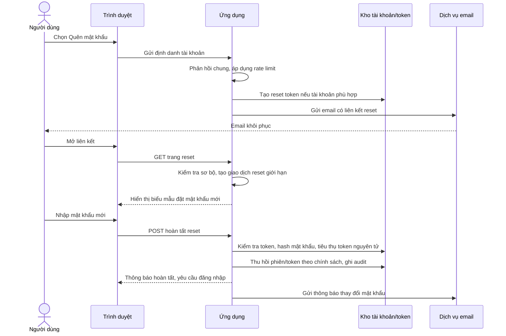
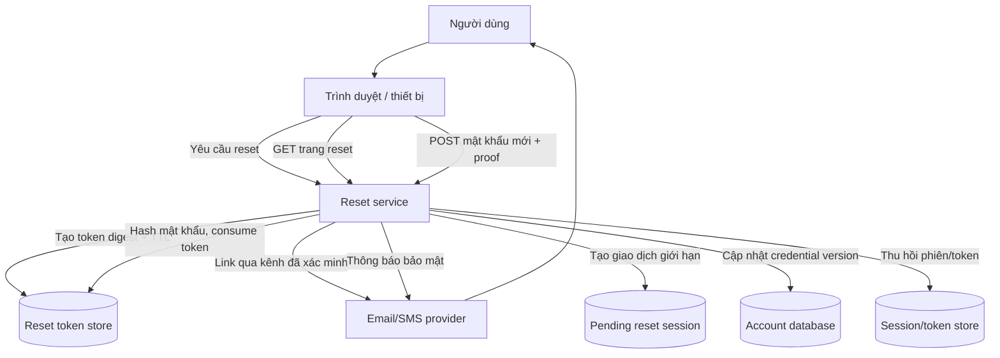

# Password reset — Thiết kế quy trình đặt lại mật khẩu an toàn

Người dùng quên mật khẩu là tình huống vận hành bình thường, nhưng quy trình đặt lại mật khẩu có thể trở thành đường tắt để chiếm tài khoản. Kẻ tấn công không cần biết mật khẩu cũ nếu có thể kiểm soát email khôi phục, đoán token, lừa helpdesk, phát lại liên kết hoặc khai thác phiên được tạo sau khi reset. Vì vậy, **password reset là một luồng xác thực và khôi phục tài khoản có rủi ro cao**, cần được thiết kế với bằng chứng sở hữu, giới hạn thời gian, chống sử dụng lại và khả năng thu hồi.

Bài học thuộc chương **Password authentication** của học phần **SECURITY_AUTHENTICATION_FUNDAMENTALS**. Nội dung kết nối mật khẩu với credential, MFA, passkey, token, phiên, liên kết danh tính và khôi phục tài khoản; đồng thời chỉ ra ranh giới tin cậy và cách phòng chống phishing, replay, dò đoán và lạm dụng đăng nhập.

## 1. Kết quả học tập

Sau bài này, người học có thể:

- Phân biệt **password reset**, **password change**, **account recovery** và **unlock account**.
- Mô hình hóa các bên tham gia, tài sản, bằng chứng khôi phục và ranh giới tin cậy của luồng reset.
- Thiết kế reset token ngẫu nhiên, đủ mạnh, có thời hạn, giới hạn mục đích và chỉ sử dụng một lần.
- Bảo vệ email reset link, endpoint, trình duyệt và callback khỏi rò rỉ token, CSRF, replay, open redirect và account enumeration.
- Lưu mật khẩu mới bằng password hashing chuyên dụng và áp dụng chính sách mật khẩu hợp lý.
- Quy định việc thu hồi phiên/token, thông báo bảo mật, bảo toàn MFA và xử lý hỗ trợ sau khi mật khẩu được đặt lại.
- Viết tiêu chí chấp nhận và kiểm thử cho luồng thành công, thất bại, cạnh tranh và lạm dụng.

## 2. Phân biệt reset, change và recovery

Các chức năng này có liên quan nhưng không cùng điều kiện bảo đảm:

| Khái niệm | Tình huống | Bằng chứng thường cần |
| --- | --- | --- |
| **Password change** | Người dùng đang đăng nhập và muốn đổi mật khẩu | Phiên hợp lệ, thường yêu cầu nhập mật khẩu hiện tại hoặc xác thực lại/step-up theo rủi ro |
| **Password reset** | Người dùng không biết hoặc không thể dùng mật khẩu hiện tại | Token/liên kết khôi phục hoặc bằng chứng thay thế đã được xác minh |
| **Account recovery** | Người dùng mất khả năng dùng các phương thức đăng nhập, có thể gồm cả MFA/passkey | Quy trình chứng minh quyền kiểm soát tài khoản theo rủi ro, có thể cần nhiều nguồn bằng chứng hoặc hỗ trợ có kiểm soát |
| **Account unlock** | Tài khoản bị khóa do chính sách hoặc nghi ngờ lạm dụng | Kiểm tra nguyên nhân khóa, xác minh người yêu cầu và loại bỏ điều kiện gây khóa |

Một reset thành công chỉ chứng minh người dùng đã đáp ứng điều kiện của **quy trình reset**. Nó không tự chứng minh danh tính pháp lý, không tự xác minh lại MFA, không chứng minh quyền quản trị và không nên tự động liên kết tài khoản bên ngoài. Nếu người dùng mất cả mật khẩu và phương thức MFA, cần luồng recovery có độ bảo đảm phù hợp thay vì chỉ gửi một email rồi tắt MFA.

## 3. Mục tiêu bảo mật và mô hình đe dọa

Reset flow phải cân bằng ba mục tiêu:

1. **Khôi phục được:** chủ tài khoản hợp lệ có thể lấy lại quyền truy cập khi quên mật khẩu.
2. **Không bị chiếm đoạt:** người không có bằng chứng phù hợp không thể đổi mật khẩu của người khác.
3. **Không bị lạm dụng để gây gián đoạn:** kẻ tấn công không thể dễ dàng khóa tài khoản, vô hiệu hóa liên kết hợp lệ hoặc làm quá tải helpdesk bằng các yêu cầu reset.

### Tài sản cần bảo vệ

- Mật khẩu mới và bản ghi password hash.
- Reset token, reset URL, mã xác minh và giao dịch reset đang chờ.
- Email/số điện thoại khôi phục cùng trạng thái xác minh.
- Phiên đăng nhập, refresh token, access token và thiết bị đã đăng ký.
- Credential khác như passkey, TOTP seed, recovery code, chứng chỉ hoặc khóa.
- Nhật ký bảo mật và dữ liệu dùng để điều tra.

### Tác nhân và đường tấn công

| Tác nhân | Đường tấn công có thể thử |
| --- | --- |
| Bot tự động | Dò tài khoản, spam reset, đoán token hoặc gây quá tải endpoint |
| Phisher | Lừa người dùng bấm link giả, nhập token/mật khẩu mới vào trang giả |
| Kẻ đã chiếm email | Nhận reset link và đổi mật khẩu tài khoản |
| Kẻ chiếm phiên | Dùng cookie hiện tại để thay email khôi phục hoặc yêu cầu reset |
| Nội gián/helpdesk bị chiếm | Bỏ qua xác minh, reset MFA hoặc thay kênh khôi phục |
| Kẻ có quyền truy cập log/database | Lấy reset token, password hash hoặc dữ liệu xác minh |

### Những điều cần ngăn chặn

- Người không sở hữu kênh khôi phục đặt lại mật khẩu.
- Reset token bị đoán, đánh cắp, phát lại hoặc dùng cho tài khoản khác.
- Một token reset bị dùng để đăng nhập, gọi API hoặc thay đổi MFA ngoài mục đích reset.
- Request reset làm lộ tài khoản có tồn tại hay không.
- Link reset chuyển tới domain độc hại hoặc rò token qua log/referrer/analytics.
- Reset thành công nhưng phiên cũ hoặc refresh token bị đánh cắp vẫn hoạt động.
- Reset password vô tình xóa MFA, passkey hoặc thay đổi email/số điện thoại khôi phục.

## 4. Luồng password reset tổng quan

Một luồng email reset điển hình:



Sơ đồ thể hiện luồng khái niệm. Cách giữ token trong URL, trao đổi token thành reset transaction, cookie và bảo vệ CSRF cần điều chỉnh theo kiến trúc web/BFF/mobile. Bất biến quan trọng là **chỉ bước hoàn tất được ủy quyền mới thay đổi mật khẩu**, token phải được kiểm tra đúng mục đích và tiêu thụ một lần.

### Các bước chính

1. Người dùng gửi email/tên đăng nhập hoặc định danh được hỗ trợ.
2. Dịch vụ phản hồi theo cách không tiết lộ tài khoản có tồn tại hay không.
3. Nếu tài khoản có kênh khôi phục hợp lệ, hệ thống tạo token ngẫu nhiên và gửi link qua kênh đã xác minh.
4. Người dùng mở link và thấy trang reset an toàn; việc tải trang không được tự đổi mật khẩu.
5. Người dùng nhập mật khẩu mới; máy chủ kiểm tra token, chính sách mật khẩu, trạng thái tài khoản và tính hợp lệ của giao dịch.
6. Máy chủ lưu password hash mới, đánh dấu token đã dùng trong cùng giao dịch nguyên tử và thu hồi phiên/token liên quan theo chính sách.
7. Hệ thống thông báo thay đổi qua kênh phù hợp và yêu cầu đăng nhập lại.

Nếu người dùng không hoàn tất, token hết hạn hoặc giao dịch lỗi, mật khẩu hiện tại vẫn giữ nguyên và hệ thống không tạo phiên có quyền truy cập.

## 5. Thiết kế reset token

Reset token là một **bearer capability**: ai sở hữu token hợp lệ có thể thực hiện hành động reset trong phạm vi được cấp. Vì vậy, token cần được thiết kế như một bí mật xác thực có giá trị cao.

### 5.1. Sinh token ngẫu nhiên đủ mạnh

- Dùng bộ tạo số ngẫu nhiên mật mã (CSPRNG), không dùng timestamp, số tăng dần, UUID không phù hợp hoặc giá trị suy ra từ email/user ID.
- Token nên có entropy cao; một lựa chọn triển khai phổ biến là 32 byte ngẫu nhiên (256 bit), mã hóa Base64url để đưa vào link.
- Mỗi yêu cầu tạo token độc lập; không tái sử dụng token giữa người dùng hoặc giữa reset và mục đích khác.
- Không nhúng email, mật khẩu, user ID hay dữ liệu cá nhân trực tiếp vào token.

Ví dụ minh họa:

```ts
const rawToken = secureRandomBytes(32);
const tokenForLink = base64urlEncode(rawToken);
const tokenDigest = sha256(rawToken);
```

Đây là pseudocode: `secureRandomBytes`, `base64urlEncode` và `sha256` biểu thị trách nhiệm cần thực hiện bằng thư viện đáng tin. Với token có entropy cao và được sinh đúng, lưu digest bằng hash mật mã phù hợp thường đủ để tránh lưu token thô; có thể dùng HMAC với khóa quản lý riêng nếu mô hình đe dọa yêu cầu bảo vệ thêm khi database bị lộ.

### 5.2. Lưu token phía máy chủ

Một bản ghi reset token có thể gồm:

| Trường | Mục đích |
| --- | --- |
| `token_digest` | Giá trị hash/HMAC dùng để tra cứu và xác minh token |
| `user_id` | Tài khoản đích đã xác định ở máy chủ |
| `purpose` | Giá trị cố định như `PASSWORD_RESET` |
| `created_at`, `expires_at` | Thời điểm tạo và hết hạn |
| `consumed_at` | Thời điểm đã dùng; null nếu chưa tiêu thụ |
| `revoked_at` | Thu hồi trước hạn nếu có |
| `request_context` | Thông tin tối thiểu để điều tra/rate limit, không lưu bí mật |

Không cần lưu token thô trong database hoặc log. Không tin `user_id` gửi từ trình duyệt khi hoàn tất; tài khoản đích phải được suy ra từ bản ghi token đã xác minh. Token reset phải có **mục đích rõ ràng** và không thể được dùng như access token, session token hay recovery token khác.

### 5.3. Thời hạn và sử dụng một lần

- Chọn TTL ngắn phù hợp với rủi ro, độ trễ email và trải nghiệm người dùng. Một khoảng như 15–60 phút có thể là điểm bắt đầu để đánh giá, nhưng không phải chuẩn chung cho mọi sản phẩm.
- Token hết hạn, đã tiêu thụ hoặc bị thu hồi phải bị từ chối.
- Việc kiểm tra token và đánh dấu tiêu thụ cần nguyên tử để hai request đồng thời không cùng reset thành công.
- Sau khi reset thành công, vô hiệu hóa các token reset khác còn hiệu lực cho cùng tài khoản theo chính sách.
- Giới hạn số token đang chờ và số lần yêu cầu; tránh để người ngoài liên tục tạo yêu cầu làm mất hiệu lực link hợp lệ của chủ tài khoản.

Không nên khóa tài khoản hoặc vô hiệu hóa mọi link đang chờ chỉ vì có một request reset mới chưa được xác minh. Nếu chiến lược chỉ giữ link mới nhất, cần cân nhắc việc kẻ tấn công spam yêu cầu để làm người dùng thật không thể sử dụng link đã nhận.

### 5.4. Opaque token hay JWT?

Với password reset, token opaque ngẫu nhiên thường dễ quản lý hơn: máy chủ tra cứu bản ghi, biết token thuộc tài khoản nào, mục đích gì, còn hạn hay đã dùng. JWT tự chứa claim có thể xác minh chữ ký nhưng **khó bảo đảm one-time use và thu hồi tức thời nếu không có trạng thái phía máy chủ**. Nếu dùng JWT, vẫn cần kho trạng thái hoặc cơ chế tương đương để chống replay và kiểm soát vòng đời.

## 6. Bảo vệ email reset link và trình duyệt

Email thường là kênh khôi phục phổ biến, nhưng không phải bằng chứng tuyệt đối về danh tính. Link reset chứng minh người đang sử dụng link kiểm soát được hộp thư/kênh nhận tại thời điểm đó theo mô hình của hệ thống. Nếu email đã bị chiếm, reset flow có thể bị lợi dụng.

### 6.1. Tạo URL từ origin tin cậy

- Dùng domain chuẩn được cấu hình trong ứng dụng, ví dụ `https://accounts.example.test/reset`.
- Không tạo link bằng cách ghép trực tiếp header `Host` hoặc `X-Forwarded-Host` do request gửi tới; cấu hình proxy/trusted host rõ ràng.
- Không cho tham số `returnUrl` hoặc redirect sau reset trỏ tùy ý tới domain ngoài.
- Bảo đảm HTTPS và chứng chỉ hợp lệ; không gửi link reset qua HTTP.

Host header poisoning có thể khiến email chứa link tới domain do kẻ tấn công kiểm soát. Người dùng bấm link và gửi token tới domain giả, làm lộ quyền reset. Domain reset cần được cố định trong cấu hình và kiểm thử khi có reverse proxy/load balancer.

### 6.2. Hạn chế rò rỉ token

Token trong URL có thể xuất hiện trong browser history, proxy/access log, hệ thống analytics, ảnh chụp màn hình, referrer hoặc báo cáo lỗi. Một số biện pháp:

- Không đưa token vào log, telemetry, tracing, analytics hoặc thông báo lỗi.
- Đặt `Referrer-Policy: no-referrer` trên trang reset; không tải script, ảnh hoặc tài nguyên bên thứ ba không cần thiết.
- Dùng `Cache-Control: no-store`, CSP chặt và HTTPS.
- Không đưa token vào URL điều hướng tiếp theo; sau khi tạo giao dịch reset giới hạn, có thể chuyển hướng tới URL sạch không chứa token.
- Giới hạn quyền truy cập log và cấu hình hạ tầng để không ghi query string nhạy cảm.
- Tránh copy token vào clipboard hoặc hiển thị toàn bộ token trong UI.

Token trong query string không tự động mất an toàn nếu có kiểm soát phù hợp, nhưng là một nguồn rò rỉ cần được xử lý. Dùng fragment hay cơ chế trao đổi token phía client cũng có đánh đổi riêng; lựa chọn cần phù hợp kiến trúc và tránh chuyển bí mật sang JavaScript không đáng tin.

### 6.3. Link scanner và HTTP GET

Email gateway, antivirus hoặc tính năng preview có thể tự động mở link để kiểm tra. Do đó:

- **GET không được thực hiện hành động cuối cùng** như đổi mật khẩu, đăng nhập, tiêu thụ token không thể phục hồi hoặc vô hiệu hóa phiên.
- GET có thể kiểm tra sơ bộ và hiển thị trang xác nhận; nếu cần, tạo reset transaction ngắn hạn gắn với trình duyệt.
- Chỉ POST hoàn tất sau thao tác rõ ràng của người dùng mới thực hiện reset; xác minh lại token/giao dịch và chống CSRF.
- Nếu scanner mở link trước, token vẫn phải có khả năng được chủ tài khoản dùng sau đó, trừ khi scanner thực sự hoàn tất một hành động được ủy quyền (điều này không nên xảy ra chỉ bằng GET).

### 6.4. Xác nhận tài khoản và tránh reset nhầm

Trước khi người dùng nhập mật khẩu mới, giao diện nên cho họ biết link đang áp dụng cho tài khoản nào bằng thông tin được che một phần, ví dụ `a***@example.test`. Điều này giúp giảm nhầm lẫn khi người dùng mở nhiều email hoặc nhiều tab. Không hiển thị dữ liệu cá nhân dư thừa, và không tự đăng nhập người dùng sau reset.

## 7. Ngăn account enumeration và lạm dụng yêu cầu reset

Khi người dùng nhập email, phản hồi không nên cho biết tài khoản có tồn tại hay không. Ví dụ:

> Nếu địa chỉ này có tài khoản và đủ điều kiện nhận hướng dẫn, chúng tôi sẽ gửi email với các bước tiếp theo.

Áp dụng cùng thông báo, mã phản hồi và hành vi thời gian gần tương đương cho trường hợp tài khoản tồn tại/không tồn tại. Có thể xử lý gửi email qua hàng đợi để tránh khác biệt thời gian rõ rệt.

### Rate limiting

Giới hạn theo nhiều chiều:

- Địa chỉ/tài khoản được yêu cầu reset.
- IP, dải mạng hoặc tín hiệu thiết bị.
- Số request trong khoảng thời gian và số email gửi đi.
- Hành vi bất thường như thử nhiều địa chỉ, lặp nội dung hoặc tự động hóa.

Không chỉ giới hạn theo IP vì bot có thể phân tán nguồn; cũng không khóa tài khoản vĩnh viễn chỉ vì người ngoài yêu cầu reset nhiều lần. Cân nhắc CAPTCHA hoặc thử thách bổ sung theo rủi ro, tránh tạo ma sát cho mọi người dùng.

### Không biến reset thành công cụ DoS

- Request reset không được tự khóa tài khoản hoặc làm mất phiên hiện tại.
- Không vô hiệu hóa mọi link hợp lệ khi nhận request mới chưa được xác minh.
- Không thay đổi email/số điện thoại khôi phục chỉ vì người yêu cầu biết tên đăng nhập.
- Không để endpoint gửi email không giới hạn.
- Theo dõi spike và có cơ chế giảm tải, nhưng giữ khả năng chủ tài khoản hợp lệ tự khôi phục.

## 8. Xác minh mật khẩu mới và lưu trữ an toàn

Sau khi reset token hợp lệ, máy chủ phải áp dụng chính sách mật khẩu hiện hành giống luồng đặt/đổi mật khẩu thông thường.

### Chính sách mật khẩu

- Khuyến khích mật khẩu dài, độc nhất và dễ dùng với password manager.
- Cho phép paste và autofill; không đặt giới hạn ký tự thấp làm giảm entropy.
- Kiểm tra mật khẩu mới với danh sách mật khẩu phổ biến, dễ đoán hoặc đã bị lộ khi có khả năng.
- Tránh yêu cầu quy tắc thành phần cứng nhắc như bắt buộc một chữ hoa, một số và một ký tự đặc biệt nếu không có cơ sở rủi ro; các quy tắc này thường dẫn tới mẫu dễ đoán.
- Không ép đổi mật khẩu định kỳ nếu không có dấu hiệu bị lộ hoặc yêu cầu cụ thể; thay đổi bắt buộc liên tục có thể khiến người dùng chọn mật khẩu yếu hơn.
- Không cho dùng lại mật khẩu hiện tại hoặc mật khẩu cũ nếu chính sách/rủi ro yêu cầu, và không tiết lộ mật khẩu cũ cho người dùng hay hỗ trợ.

### Lưu mật khẩu mới

Không lưu mật khẩu dạng rõ và không mã hóa có thể giải ngược. Dùng password hashing chuyên dụng:

- **Argon2id** thường là lựa chọn phù hợp cho hệ thống mới nếu thư viện và môi trường hỗ trợ.
- Có thể dùng scrypt, bcrypt hoặc PBKDF2 khi có yêu cầu tương thích/triển khai; chọn tham số đủ mạnh theo hướng dẫn hiện hành và đo hiệu năng.
- Mỗi mật khẩu cần salt ngẫu nhiên riêng. Thư viện password hashing tốt thường quản lý salt và tham số trong encoded hash.
- Pepper là lớp bảo vệ bổ sung có thể dùng nếu quản lý riêng trong KMS/secret manager; pepper không thay thế salt và không phải điều kiện bắt buộc trong mọi hệ thống.
- Khi người dùng đăng nhập hoặc reset lại, có thể nâng tham số hash theo chính sách (rehash on next authentication).

Ví dụ pseudocode:

```ts
async function storeNewPassword(userId, newPassword) {
  validatePasswordPolicy(newPassword);
  await rejectIfCommonOrBreached(newPassword);

  const passwordHash = await argon2idHash(newPassword, {
    salt: secureRandomBytes(16),
    parameters: configuredPasswordHashParameters()
  });

  await database.transaction(async (tx) => {
    await tx.updatePasswordHash(userId, passwordHash);
    await tx.incrementCredentialVersion(userId);
    await tx.revokePendingPasswordResetTokens(userId);
    await tx.recordSecurityEvent("PASSWORD_RESET_COMPLETED", userId);
  });
}
```

Đây là pseudocode, không phải lời gọi API cố định. Thư viện Argon2id thường tự sinh và lưu salt trong chuỗi hash; ví dụ truyền salt tường minh chỉ nhằm thể hiện yêu cầu salt ngẫu nhiên. Các thao tác cập nhật mật khẩu, tăng phiên bản credential và tiêu thụ reset token cần được thiết kế trong **một giao dịch nhất quán**; nếu tách riêng, có thể xảy ra trường hợp mật khẩu đã đổi nhưng token vẫn dùng lại được.

## 9. Hoàn tất reset: token, phiên và các credential khác

Reset password không kết thúc ở việc ghi hash mới. Hệ thống cần quyết định những credential và phiên nào bị ảnh hưởng.

### Sau khi reset thành công

- Đánh dấu token reset đã sử dụng và vô hiệu hóa token reset khác theo chính sách.
- Thu hồi refresh token và phiên đăng nhập hiện có, hoặc tăng credential/session version để các phiên cũ bị từ chối.
- Xem xét access token còn hiệu lực: JWT tự xác minh có thể vẫn dùng được tới `exp` nếu API không kiểm tra trạng thái thu hồi.
- Thu hồi phiên “remember me”, thiết bị tin cậy và app password nếu chính sách yêu cầu.
- Gửi thông báo qua kênh đã xác minh rằng mật khẩu đã thay đổi; thông báo không chứa mật khẩu mới hoặc token.
- Yêu cầu người dùng đăng nhập lại bằng mật khẩu mới; **không tự động đăng nhập** chỉ vì reset token hợp lệ.
- Ghi audit event với user ID, thời điểm, phương thức khôi phục và correlation ID; không ghi token thô.

### Không tự ý thay đổi MFA/passkey

Reset mật khẩu không đồng nghĩa người dùng mất MFA. Không tự xóa TOTP, passkey, khóa bảo mật, chứng chỉ hoặc recovery code. Nếu người dùng mất yếu tố thứ hai, đó là một yêu cầu account recovery riêng cần bằng chứng phù hợp.

Nếu phát hiện reset xảy ra từ kênh có rủi ro, có thể yêu cầu xác minh bổ sung trước khi cho phép thêm credential mới, thay email/số điện thoại khôi phục hoặc thực hiện giao dịch nhạy cảm.

### Credential version và thu hồi phiên

Một cách triển khai là lưu `credential_version` hoặc `session_version` ở tài khoản. Khi reset, tăng version; session/token tham chiếu version cũ bị từ chối nếu dịch vụ kiểm tra version. Cách này giúp thu hồi tập trung nhưng đòi hỏi API kiểm tra trạng thái/version đủ thường xuyên. Nếu API chỉ xác minh chữ ký JWT cục bộ, thay đổi version trong database không tự có tác dụng.

Doanh nghiệp cần xác định thời gian tối đa từ lúc reset thành công tới khi phiên cũ không còn truy cập được, rồi kiểm thử trên các dịch vụ/API thực tế.

## 10. Ranh giới tin cậy và luồng dữ liệu



Các ranh giới tin cậy:

- **Người dùng ↔ thiết bị:** thiết bị có thể bị chia sẻ, nhiễm malware hoặc bị người khác mở.
- **Thiết bị ↔ ứng dụng:** request có thể bị sửa; không tin user ID, token purpose hay trạng thái đã reset do client khai báo.
- **Ứng dụng ↔ email/SMS provider:** phải bảo vệ API credential, địa chỉ nhận và nội dung gửi; provider có thể log hoặc xử lý dữ liệu theo chính sách riêng.
- **Ứng dụng ↔ reset token store:** chỉ dịch vụ cần thiết được truy cập digest/trạng thái; token thô không cần lưu.
- **Ứng dụng ↔ account/session store:** cập nhật password hash, tiêu thụ token và thu hồi phiên phải nhất quán.
- **Helpdesk ↔ hệ thống quản trị:** quyền hỗ trợ cần giới hạn, audit và xác minh độc lập; nhân viên không nên nhìn thấy mật khẩu/token.

## 11. Pseudocode: tạo yêu cầu và hoàn tất reset

Ví dụ sau minh họa token opaque, digest lưu phía máy chủ và POST hoàn tất. Hàm thư viện được đặt tên theo trách nhiệm để dễ đọc.

```ts
async function requestPasswordReset(emailInput, requestContext) {
  const normalized = normalizeAccountIdentifier(emailInput);
  const user = await findEligibleAccount(normalized);

  if (user && await maySendReset(user.id, requestContext)) {
    const raw = secureRandomBytes(32);
    const token = base64urlEncode(raw);
    const digest = sha256(raw);

    await resetStore.create({
      tokenDigest: digest,
      userId: user.id,
      purpose: "PASSWORD_RESET",
      expiresAt: nowPlusConfiguredTTL(),
      consumedAt: null
    });

    const link = buildUrlFromConfiguredOrigin(
      "/reset-password",
      { token }
    );
    await emailQueue.enqueuePasswordReset(user.verifiedEmail, link);
  }

  // Cùng thông báo cho tài khoản tồn tại và không tồn tại.
  return acceptedGenericResponse();
}

async function completePasswordReset(token, newPassword, resetContext) {
  const digest = sha256(base64urlDecode(token));
  validatePasswordPolicy(newPassword);
  await rejectIfCommonOrBreached(newPassword);

  await database.transaction(async (tx) => {
    const reset = await tx.lockResetByDigest(digest);
    if (!reset ||
        reset.purpose !== "PASSWORD_RESET" ||
        reset.consumedAt ||
        reset.revokedAt ||
        reset.expiresAt <= now()) {
      throw new Error("INVALID_OR_EXPIRED_RESET");
    }

    await tx.updatePasswordHash(
      reset.userId,
      await passwordHash(newPassword)
    );
    await tx.markResetConsumed(reset.id, now());
    await tx.revokeOtherResetTokens(reset.userId);
    await tx.incrementCredentialVersion(reset.userId);
    await tx.revokeSessionsAndRefreshTokens(reset.userId);
    await tx.recordSecurityEvent(
      "PASSWORD_RESET_COMPLETED",
      reset.userId,
      resetContext.correlationId
    );
  });

  await notifyPasswordChangedWithoutSecrets();
  return requireFreshLogin();
}
```

Đây là ví dụ khái niệm; một triển khai thực cần xử lý token decode lỗi, thời hạn, giới hạn request, giao dịch reset đã được ràng buộc với trình duyệt, CSRF, retry email, lỗi gửi thông báo sau khi commit và cơ chế thu hồi của từng dịch vụ. Hàm `lockResetByDigest` phải đảm bảo không có hai request đồng thời cùng tiêu thụ một token. Không thực hiện network call kéo dài trong transaction database nếu có thể tách qua outbox/event sau commit.

**Lưu ý:** pseudocode minh họa ranh giới logic; việc gửi email nên dùng outbox/queue để bảo đảm sự kiện sau commit được xử lý tin cậy. Thông báo không được làm lộ token hoặc mật khẩu. Trong triển khai, chỉ lưu digest của token; lời gọi `notifyPasswordChangedWithoutSecrets` không cần và không được nhận token.

## 12. Helpdesk và recovery thủ công

Không phải người dùng nào cũng còn quyền truy cập email/điện thoại. Một số trường hợp cần nhân viên hỗ trợ hoặc quy trình xác minh đặc biệt. Đây là đường tấn công có giá trị cao vì có thể bypass các cơ chế kỹ thuật.

### Quy tắc cho helpdesk

- Không yêu cầu người dùng đọc mật khẩu, OTP, recovery code hoặc token cho nhân viên.
- Không reset MFA chỉ dựa trên email, tên, số điện thoại hoặc dữ liệu dễ tìm công khai.
- Sử dụng quy trình xác minh đã phê duyệt, dựa trên bằng chứng độc lập với kênh bị mất.
- Phân quyền tối thiểu; thao tác nhạy cảm có thể cần phê duyệt thứ hai hoặc thời gian chờ.
- Ghi audit ai yêu cầu, ai xác minh, ai thực hiện, lý do, thời gian và tài khoản bị ảnh hưởng.
- Gửi thông báo tới kênh đã xác minh trước đó khi thay đổi email, số điện thoại, MFA hoặc credential.
- Có quy trình xử lý tranh chấp nếu chủ tài khoản báo reset trái phép.

### Những cách làm không an toàn

- Gửi mật khẩu tạm thời qua email/chat rồi giữ nguyên để dùng lâu dài.
- Cho nhân viên hỗ trợ xem hoặc đặt mật khẩu thay người dùng.
- Cho phép bypass MFA chỉ vì người dùng không còn điện thoại.
- Dùng câu hỏi bảo mật có câu trả lời dễ tra cứu trên mạng làm bằng chứng duy nhất.
- Cho phép thay email khôi phục và reset mật khẩu trong cùng một cuộc gọi mà không có xác minh độc lập.

## 13. Tình huống thực tế: tài khoản SaaS bị quên mật khẩu

Một nền tảng SaaS có người dùng đăng nhập bằng email + mật khẩu và có thể đăng ký thêm passkey. Người dùng quên mật khẩu nhưng vẫn truy cập được email công ty.

**Luồng phù hợp:**

1. Người dùng nhập email ở trang “Quên mật khẩu”.
2. Ứng dụng luôn trả thông báo chung; nếu tài khoản tồn tại và đủ điều kiện, hàng đợi gửi link reset tới email đã xác minh.
3. Token ngẫu nhiên được lưu dưới dạng digest, gắn với user ID, mục đích reset và thời hạn.
4. Khi mở link, GET chỉ hiển thị trang reset; không thay đổi mật khẩu hoặc tiêu thụ token vĩnh viễn.
5. Người dùng đặt mật khẩu mới; POST kiểm tra token, CSRF/giao dịch, chính sách mật khẩu và trạng thái tài khoản.
6. Máy chủ cập nhật password hash, đánh dấu token đã dùng, thu hồi phiên/refresh token theo chính sách và ghi sự kiện.
7. Người dùng nhận thông báo mật khẩu đã đổi và phải đăng nhập lại. Passkey đã đăng ký vẫn tồn tại.

**Trường hợp email đã bị chiếm:** reset link có thể rơi vào tay kẻ tấn công. Với tài khoản rủi ro cao, doanh nghiệp có thể yêu cầu thêm bằng chứng hoặc chính sách recovery khác. Không thể coi email là yếu tố chống phishing mạnh; mức bảo đảm phụ thuộc cách bảo vệ hộp thư.

**Trường hợp kẻ tấn công spam reset:** dịch vụ giới hạn gửi, giữ phản hồi chung và không khóa tài khoản. Người dùng thật vẫn có thể tiếp tục đăng nhập bằng mật khẩu/passkey hiện tại trong khi yêu cầu reset giả được xử lý.

**Trường hợp reset link bị scanner mở:** GET không thực hiện thay đổi cuối cùng, nên người dùng vẫn mở email và hoàn tất reset bằng thao tác POST.

## 14. Tiêu chí chấp nhận và kiểm thử

| Tình huống | Kết quả mong đợi |
| --- | --- |
| Yêu cầu reset cho email có tài khoản và không có tài khoản | Phản hồi công khai tương đương, không tiết lộ sự tồn tại |
| Token được tạo | Token ngẫu nhiên đủ mạnh, có purpose, user binding, TTL và digest lưu phía máy chủ |
| Token sai, hết hạn, đã dùng hoặc bị thu hồi | Từ chối; mật khẩu và phiên không thay đổi |
| Hai POST hoàn tất đồng thời dùng cùng token | Tối đa một request thành công |
| GET link reset bị email scanner truy cập | Không đổi mật khẩu, không tiêu thụ token theo cách làm người dùng mất link |
| Host header bị sửa | Email vẫn dùng origin đã cấu hình, không tạo link tới domain tùy ý |
| URL reset bị gửi tới redirect ngoài | Bị từ chối hoặc chuyển về đường dẫn nội bộ an toàn |
| Token xuất hiện trong log/analytics/referrer | Không được ghi hoặc lan truyền; kiểm tra cấu hình log và header |
| CSRF hoặc request POST từ origin không hợp lệ | Bị từ chối; không thay đổi password hash |
| Mật khẩu mới yếu hoặc nằm trong blocklist | Không chấp nhận; đưa hướng dẫn phù hợp mà không tiết lộ dữ liệu nhạy cảm |
| Password reset thành công | Lưu password hash mới, tiêu thụ token và ghi audit nhất quán |
| Reset hoàn tất | Phiên/refresh token cũ bị thu hồi trong giới hạn chính sách đã công bố |
| Người dùng có passkey/MFA | Reset password không tự xóa passkey/MFA hoặc recovery method |
| Helpdesk reset khi thiếu bằng chứng | Không thực hiện; ghi nhận yêu cầu và áp dụng quy trình recovery |
| Người ngoài spam yêu cầu reset | Rate limit hoạt động; tài khoản không bị khóa hoặc mất link hợp lệ chỉ vì request chưa xác minh |
| Gửi email lỗi sau khi tạo reset record | Có retry/outbox hoặc trạng thái xử lý rõ ràng; không lộ token trong log lỗi |

### Kiểm thử bảo mật và vận hành

Ngoài unit/integration test, cần kiểm tra:

- Token có thực sự không đoán được và không xuất hiện trong database/log dưới dạng rõ không?
- Token có thể được dùng cho tài khoản khác hoặc mục đích khác không?
- Có thể hoàn tất reset sau khi token đã dùng hoặc hết hạn không?
- Reset thành công có thu hồi phiên trên tất cả API/ứng dụng liên quan không?
- Email link có thể bị chuyển hướng hoặc bị rò qua tài nguyên bên thứ ba không?
- Scanner/prefetch có làm token mất hiệu lực trước khi người dùng mở link không?
- Request reset có làm lộ tài khoản hoặc gây từ chối dịch vụ không?
- Helpdesk có thể bỏ qua bằng chứng mà không có audit/approval không?

## 15. Chỉ số theo dõi hiệu quả

| Nhóm | Chỉ số gợi ý | Ý nghĩa |
| --- | --- | --- |
| Trải nghiệm | Tỷ lệ reset hoàn tất, thời gian từ yêu cầu tới hoàn tất, tỷ lệ token hết hạn | Phát hiện email chậm, UX khó hoặc TTL không phù hợp |
| An ninh | Số token không hợp lệ/đã dùng lại, reset đáng ngờ, báo cáo reset trái phép | Phát hiện replay, đoán token và chiếm kênh khôi phục |
| Chống lạm dụng | Số request theo IP/tài khoản, tỷ lệ bị rate limit, email bounce | Theo dõi bot/spam và khả năng gửi |
| Hậu reset | Số phiên/token còn hoạt động sau reset, thời gian thu hồi | Xác minh cam kết chặn truy cập cũ |
| Hỗ trợ | Ticket reset, tỷ lệ helpdesk can thiệp, số lần bypass bị từ chối | Phát hiện quy trình khó dùng hoặc điểm yếu nội bộ |
| Tài khoản | Số lần thay đổi email/MFA/passkey sau reset, số sự cố chiếm tài khoản | Phát hiện reset bị dùng làm bước mở đường cho takeover |

Không tối ưu chỉ theo tỷ lệ reset thành công. Tăng tỷ lệ bằng cách bỏ MFA, tự đăng nhập hoặc nới lỏng bằng chứng có thể làm giảm an toàn. Cần đọc chỉ số cùng với báo cáo chiếm tài khoản, false positive và chi phí hỗ trợ.

## 16. Bài tập tự kiểm tra

Một ứng dụng quản lý hóa đơn cho phép người dùng đăng nhập bằng mật khẩu, MFA và passkey. Email là kênh khôi phục chính. Nhân viên hỗ trợ có quyền gửi lại link reset nhưng không được xem mật khẩu.

Hãy thiết kế luồng reset và trả lời:

1. Tài sản nào cần bảo vệ ngoài password hash? Hãy nêu ít nhất năm loại.
2. Reset token cần có entropy, TTL, purpose, user binding và trạng thái sử dụng như thế nào?
3. Làm sao tránh account enumeration và việc kẻ tấn công spam request khiến người dùng mất khả năng đăng nhập?
4. Email scanner mở link bằng GET thì hệ thống phải phản ứng ra sao?
5. Sau khi reset thành công, những phiên/token nào cần thu hồi? MFA/passkey có bị xóa không?
6. Nếu email đã bị chiếm, bằng chứng nào khác có thể cần cho recovery của tài khoản quản trị?
7. Viết ít nhất năm test case chứng minh token không thể replay, CSRF không thể thay mật khẩu và phiên cũ bị vô hiệu hóa.

**Gợi ý đánh giá:** lời giải tốt phải phân biệt reset với recovery, nêu rõ kênh khôi phục đáng tin đến đâu, mô tả kiểm tra token phía máy chủ, cập nhật hash và consume token nguyên tử, xử lý phiên cũ, thông báo và đường hỗ trợ. Không có một TTL hoặc một kênh khôi phục phù hợp cho mọi mức rủi ro.

---

**Ghi nhớ:** password reset là một giao dịch cấp lại quyền kiểm soát tài khoản. Token phải **ngẫu nhiên, giới hạn mục đích, có hạn, dùng một lần và không bị rò rỉ**; mật khẩu mới phải được hash chuyên dụng; các phiên cũ phải được xử lý theo chính sách; MFA và phương thức khôi phục không được vô tình bị hạ cấp. Một luồng reset an toàn vừa giúp chủ tài khoản hợp lệ quay lại, vừa không tạo đường vòng dễ bị chiếm đoạt.
