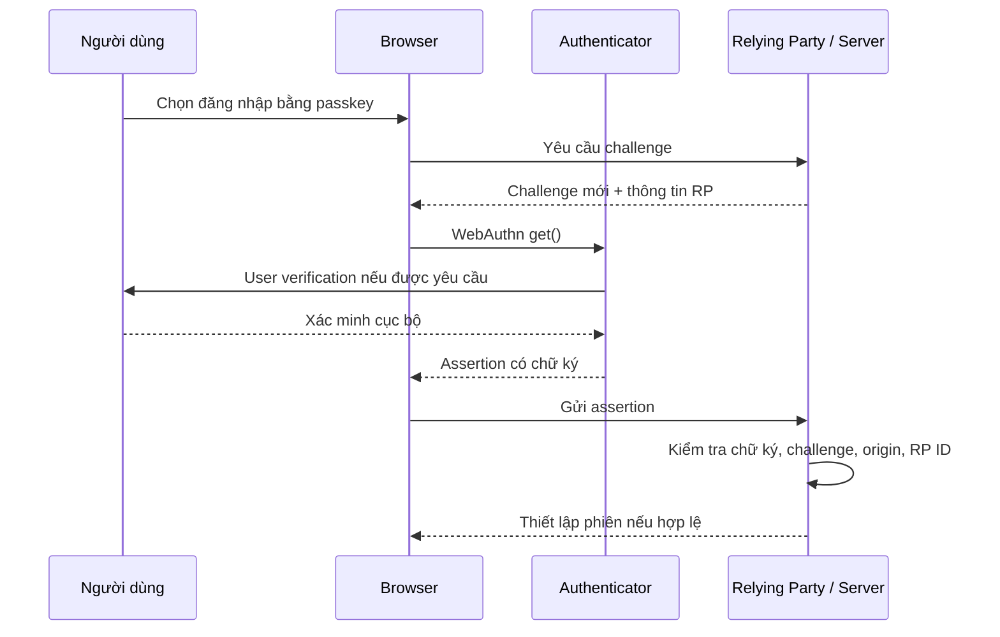

# Passwordless transition — Chuyển đổi sang xác thực không mật khẩu

## 1. Passwordless transition là gì?

**Passwordless transition** là quá trình chuyển hệ thống từ mô hình đăng nhập phụ thuộc vào mật khẩu sang mô hình người dùng chứng minh quyền kiểm soát danh tính bằng phương thức khác, chẳng hạn **passkey/WebAuthn**, khóa bảo mật, authenticator trên thiết bị hoặc cơ chế đăng nhập liên kết được bảo vệ. Mục tiêu là giảm việc tạo, ghi nhớ, nhập và lưu trữ mật khẩu, đồng thời nâng khả năng chống phishing và giảm các cuộc tấn công dựa trên mật khẩu.

Chuyển đổi này là một thay đổi về **mô hình xác thực và vòng đời tài khoản**, không đơn giản là thay ô nhập mật khẩu bằng nút “Đăng nhập bằng passkey”. Hệ thống cần xử lý đăng ký credential, liên kết với đúng tài khoản, xác thực, quản lý thiết bị, khôi phục khi mất phương thức đăng nhập, chuyển đổi người dùng hiện hữu, tích hợp ứng dụng cũ và cách xử lý các trường hợp ngoại lệ.

Trong mô-đun **SECURITY_AUTHENTICATION_FUNDAMENTALS**, passwordless kết nối trực tiếp với credential, MFA, passkey, chứng chỉ, token, phiên, liên kết danh tính và khôi phục tài khoản. Một luồng passwordless an toàn phải xác định rõ verifier tin cậy nào kiểm tra bằng chứng, ranh giới mạng và thiết bị nào được tin, cũng như cách chống phishing, replay và lạm dụng đăng nhập.

Ví dụ: trước đây nhân viên nhập email và mật khẩu, sau đó nhập mã OTP. Khi chuyển sang passkey, trình duyệt yêu cầu authenticator tạo chữ ký cho challenge mới; máy chủ kiểm tra chữ ký bằng public key đã đăng ký, đồng thời kiểm tra challenge, RP ID và origin. Người dùng có thể xác minh cục bộ bằng PIN hoặc sinh trắc học để mở khóa authenticator. Khóa riêng không cần gửi đến máy chủ.

### Mục tiêu học tập

Sau bài này, người học có thể:

- Giải thích passwordless và phân biệt với MFA, SSO và passwordless recovery.
- Mô tả vai trò của WebAuthn/FIDO2, passkey, authenticator và verifier.
- Thiết kế quy trình chuyển đổi người dùng hiện hữu mà không tự động gắn credential sai tài khoản.
- Xây dựng chiến lược triển khai theo giai đoạn, có fallback và kiểm soát rủi ro.
- Bảo vệ đăng ký, thêm/gỡ passkey, đồng bộ thiết bị, khôi phục và thu hồi.
- Đánh giá các giới hạn về thiết bị, khả năng truy cập, ứng dụng cũ, help desk và môi trường doanh nghiệp.

## 2. Passwordless không đồng nghĩa với “không cần xác thực”

Passwordless chỉ nói rằng người dùng không phải nhập mật khẩu theo luồng đăng nhập chính. Hệ thống vẫn cần bằng chứng xác thực được kiểm tra bằng giao thức và chính sách rõ ràng.

| Khái niệm | Ý nghĩa | Ví dụ |
|---|---|---|
| Passwordless | Đăng nhập không yêu cầu người dùng nhập mật khẩu | Passkey/WebAuthn |
| MFA | Xác thực bằng nhiều loại yếu tố theo chính sách | Mật khẩu + authenticator; hoặc authenticator đáp ứng yêu cầu đa yếu tố |
| SSO | Một lần xác thực được dùng để truy cập nhiều ứng dụng qua IdP | OIDC/SAML |
| Passwordless MFA | Luồng passwordless có thuộc tính đáp ứng yêu cầu nhiều yếu tố | Passkey với user verification phù hợp chính sách |
| Passwordless recovery | Khôi phục quyền truy cập mà không dựa vào mật khẩu | Recovery code, credential dự phòng hoặc quy trình hỗ trợ |

Một passkey có thể cung cấp trải nghiệm passwordless và, tùy cách authenticator được triển khai cùng các thuộc tính user verification, có thể đáp ứng yêu cầu đa yếu tố trong chính sách tương ứng. **Không phải mọi luồng passkey đều tự động đạt cùng mức assurance**, và không thể chỉ nhìn thấy biểu tượng vân tay để kết luận hệ thống đáp ứng một cấp tiêu chuẩn cụ thể.

Passwordless cũng không có nghĩa là bỏ mọi bí mật. Thiết bị có thể cần PIN mở khóa; authenticator có thể bảo vệ khóa riêng bằng cơ chế phần cứng; ứng dụng có thể cần recovery code. Điểm khác biệt là bí mật không được gửi như mật khẩu tài khoản tới verifier trong mỗi lần đăng nhập.

## 3. Vì sao tổ chức muốn chuyển khỏi mật khẩu?

Mật khẩu có một số vấn đề mang tính cấu trúc:

- Người dùng phải ghi nhớ và thường tái sử dụng mật khẩu giữa các dịch vụ.
- Credential stuffing tận dụng cặp tài khoản/mật khẩu bị lộ ở hệ thống khác.
- Phishing có thể thu thập mật khẩu, sau đó kẻ tấn công dùng lại trên trang thật.
- Reset mật khẩu và help desk tạo thêm đường tấn công vào quyền kiểm soát tài khoản.
- Máy chủ phải lưu password verifier an toàn, bảo vệ endpoint đăng nhập và xử lý lạm dụng.
- MFA dựa trên OTP vẫn có thể bị chuyển tiếp trong các cuộc tấn công phishing thời gian thực.

Passwordless dựa trên mật mã khóa công khai có thể giảm đáng kể các rủi ro này. Với WebAuthn, bằng chứng xác thực được gắn với challenge và nguồn gốc website; một trang phishing trên domain khác không thể đơn giản thu thập rồi phát lại chữ ký như mật khẩu/OTP.

Tuy nhiên, passwordless **không tự giải quyết**:

- Thiết bị của người dùng bị malware hoặc bị người khác chiếm quyền.
- Quy trình đăng ký passkey ban đầu bị chiếm đoạt.
- Kẻ tấn công lừa help desk reset hoặc thêm credential.
- Tài khoản email/IdP liên kết bị chiếm.
- Session cookie hoặc bearer token bị đánh cắp sau khi đăng nhập.
- Authorization sai khiến người dùng đã xác thực truy cập tài nguyên không thuộc quyền.

Do đó, lợi ích bảo mật chỉ đạt được khi toàn bộ vòng đời tài khoản được chuyển đổi phù hợp.

## 4. Passkey và WebAuthn: cơ chế cốt lõi của passwordless hiện đại

### 4.1. Mô hình khóa công khai

Trong đăng ký passkey, authenticator tạo cặp khóa:

- **Private key:** được giữ và sử dụng bởi authenticator; không gửi cho máy chủ.
- **Public key:** được gửi tới relying party (RP) và lưu để xác minh những lần đăng nhập sau.
- **Credential ID:** định danh credential mà RP dùng để tra cứu bản ghi tương ứng.
- **RP ID:** định danh relying party/domain mà credential được ràng buộc.

Máy chủ cũng lưu metadata cần thiết như account ID, credential ID, public key, thời điểm tạo, trạng thái và thông tin quản lý. Không lưu private key như một trường trong cơ sở dữ liệu ứng dụng.

### 4.2. Đăng ký passkey

Luồng đăng ký khái niệm:

1. Người dùng đã đăng nhập hoặc hoàn tất quy trình proofing/onboarding theo chính sách.
2. Máy chủ tạo challenge ngẫu nhiên, dùng một lần và liên kết với phiên/tài khoản đang được xác thực.
3. Trình duyệt gọi WebAuthn API để authenticator tạo credential.
4. Authenticator tạo khóa và trả về attestation/registration response theo giao thức.
5. Máy chủ kiểm tra challenge, origin, RP ID hash, cờ cần thiết, định dạng và các điều kiện chính sách.
6. Máy chủ lưu public key, credential ID và liên kết với đúng account ID.

Không được cho phép client gửi một public key tùy ý rồi gắn vào tài khoản chỉ dựa trên account ID trong JSON. Yêu cầu đăng ký phải gắn với một phiên được xác thực và quyền thêm credential.

### 4.3. Đăng nhập bằng passkey

1. Máy chủ tạo challenge mới.
2. Trình duyệt gọi WebAuthn để authenticator tạo assertion.
3. Người dùng có thể mở khóa authenticator bằng user verification như PIN hoặc sinh trắc học, tùy thiết bị và chính sách.
4. Máy chủ tìm public key đã đăng ký tương ứng.
5. Verifier kiểm tra chữ ký, challenge, origin, RP ID, credential và các cờ yêu cầu.
6. Nếu hợp lệ, máy chủ thiết lập phiên đăng nhập theo chính sách.



### 4.4. Vì sao passkey chống phishing tốt hơn mật khẩu?

WebAuthn gắn credential với RP ID và xác minh nguồn gốc trang. Một trang giả mạo có domain khác không thể yêu cầu authenticator tạo bằng chứng hợp lệ cho RP thật theo cách hoạt động như thu thập mật khẩu/OTP. Challenge mới cũng giúp chống việc phát lại assertion cũ.

Tuy nhiên, vẫn cần:

- Xác minh đúng origin được phép, RP ID và challenge.
- Kiểm tra chữ ký bằng public key đã đăng ký.
- Dùng TLS và bảo vệ phiên.
- Bảo vệ quá trình đăng ký và khôi phục.
- Xử lý đúng credential bị mất, bị gỡ, đồng bộ hoặc bị thu hồi.

**Không được bỏ qua xác minh server-side chỉ vì trình duyệt đã trả về WebAuthn response.**

## 5. Các loại passkey và lựa chọn triển khai

Passkey có thể có đặc tính khác nhau tùy authenticator và nền tảng:

| Kiểu triển khai | Đặc điểm | Điểm cần cân nhắc |
|---|---|---|
| Passkey đồng bộ (synced) | Credential có thể được đồng bộ qua hệ sinh thái tài khoản/thiết bị của nhà cung cấp | Thuận tiện khi đổi thiết bị; cần hiểu mô hình đồng bộ, bảo vệ tài khoản đồng bộ và chính sách doanh nghiệp |
| Passkey gắn thiết bị (device-bound) | Khóa gắn với authenticator/thiết bị cụ thể, thường không đồng bộ theo cách thông thường | Có thể phù hợp yêu cầu kiểm soát thiết bị; mất thiết bị cần phương thức dự phòng |
| Khóa bảo mật roaming | Thiết bị phần cứng ngoài kết nối qua USB/NFC/Bluetooth | Hữu ích cho quản trị viên hoặc môi trường yêu cầu khóa riêng; cần cấp phát, lưu trữ và thu hồi |
| Platform authenticator | Authenticator tích hợp trong thiết bị như máy tính/điện thoại | Trải nghiệm thuận tiện; phụ thuộc hệ điều hành, cơ chế bảo vệ và quy trình quản lý thiết bị |

Không nên áp đặt một loại cho tất cả người dùng. Ứng dụng tiêu dùng có thể ưu tiên synced passkeys để giảm mất quyền truy cập; tổ chức có yêu cầu thiết bị được quản lý hoặc khóa không xuất được có thể chọn device-bound authenticator cho một số nhóm nhạy cảm. Quyết định phải theo threat model và yêu cầu tuân thủ cụ thể.

### Usernameless và discoverable credential

Passkey có thể hỗ trợ trải nghiệm đăng nhập không cần nhập username trước. Authenticator trả về credential ID và máy chủ tìm account tương ứng. Điều này thường dựa trên discoverable credential (trước đây thường gọi là resident credential).

Luồng usernameless cần xử lý:

- Không tiết lộ thông tin tài khoản qua phản hồi hoặc thời gian xử lý.
- Chỉ tra cứu credential ID trong kho đã đăng ký, không tin account ID do client tự gửi.
- Xử lý nhiều tài khoản/credential trên cùng thiết bị.
- Có đường đăng nhập thay thế cho thiết bị không hỗ trợ hoặc người dùng không thể sử dụng authenticator.

## 6. Chiến lược chuyển đổi người dùng hiện hữu

Đây là phần khó nhất của passwordless transition. Người dùng hiện tại đã có account ID, password verifier, MFA, email/số điện thoại và có thể có phiên đang hoạt động. Hệ thống cần gắn passkey mới với **đúng tài khoản đã được xác thực**, không tạo tài khoản trùng hoặc chuyển quyền cho người khác.

### 6.1. Trước tiên, lập bản đồ tài khoản và phương thức hiện tại

Phân loại:

- Người dùng chỉ có mật khẩu.
- Người dùng có mật khẩu + MFA.
- Người dùng dùng SSO từ IdP doanh nghiệp.
- Tài khoản không hoạt động hoặc đã bị khóa.
- Tài khoản dịch vụ/workload không phải người dùng tương tác.
- Người dùng không có thiết bị tương thích hoặc không thể dùng sinh trắc học.
- Tài khoản có rủi ro cao hoặc quyền quản trị.

Không ép mọi loại tài khoản qua cùng một quy trình. Workload nên chuyển sang workload identity/certificate/token phù hợp, không phải passkey của nhân viên.

### 6.2. Xác minh tài khoản hiện hữu trước khi đăng ký

Luồng điển hình:

1. Người dùng đăng nhập bằng phương thức hiện tại còn được chính sách chấp nhận.
2. Hệ thống yêu cầu xác thực lại/step-up nếu phiên quá cũ hoặc thao tác thêm credential nhạy cảm.
3. Người dùng bắt đầu đăng ký passkey trong phiên gắn với account ID đã xác minh.
4. Máy chủ tạo challenge, kiểm tra WebAuthn và liên kết credential với account ID đó.
5. Gửi thông báo về phương thức mới; ghi audit và cho phép quản lý thiết bị/credential.

Nếu tài khoản cũ chỉ có email chưa xác minh hoặc phiên không đủ tin cậy, không tự động cho phép tạo passkey để “hợp thức hóa” quyền kiểm soát. Cần hoàn tất quy trình xác minh/khôi phục phù hợp trước.

### 6.3. Không tự gộp tài khoản dựa trên email

Giả sử tài khoản nội bộ `acc-101` có email `mai@example.com`. Người dùng đăng nhập qua một IdP ngoài trả về cùng email. Hệ thống không nên tự động gắn danh tính bên ngoài vào `acc-101` chỉ vì email trùng.

Trong OIDC, cặp `iss` + `sub` định danh chủ thể theo issuer. Liên kết phải được người đang kiểm soát tài khoản hiện hữu chấp thuận qua luồng xác thực đáng tin cậy, hoặc được xử lý bằng quy trình quản trị/khôi phục đã xác minh.

### 6.4. Không tắt mật khẩu trước khi có độ bao phủ đủ tốt

Một tổ chức có thể cho phép người dùng thêm passkey trước, sau đó dùng passkey mặc định cho đăng nhập, cuối cùng vô hiệu hóa mật khẩu khi đáp ứng tiêu chí. Việc chuyển đổi theo giai đoạn giúp tránh khóa nhầm người dùng và cho phép quan sát các tình huống thiết bị, hỗ trợ và recovery.

## 7. Các mô hình rollout

| Mô hình | Cách triển khai | Phù hợp khi | Rủi ro cần quản lý |
|---|---|---|---|
| Opt-in | Người dùng tự thêm passkey | Bắt đầu thử nghiệm, hệ thống có nhiều loại thiết bị | Tỷ lệ tham gia thấp; người dùng có thể tiếp tục chọn mật khẩu |
| Guided enrollment | Hướng dẫn người dùng thêm passkey sau lần đăng nhập thành công | Muốn tăng adoption có kiểm soát | Phải bảo vệ đúng phiên và không gây nhầm lẫn khi onboarding |
| Passkey-first | Ưu tiên passkey, vẫn có fallback trong giai đoạn chuyển tiếp | Đã có tỷ lệ hỗ trợ thiết bị tốt | Fallback có thể trở thành đường tấn công yếu |
| Passwordless by default | Đăng nhập thường dùng passkey; mật khẩu bị vô hiệu hóa hoặc loại bỏ theo chính sách | Hệ thống đã sẵn sàng về hỗ trợ và recovery | Mất credential, thiết bị không tương thích, tài khoản ngoại lệ |
| Enterprise SSO | IdP doanh nghiệp quản lý passwordless và truyền kết quả tới ứng dụng | Tổ chức có IdP và quản trị danh tính tập trung | Cần bảo vệ federation, issuer/audience, claim và quy trình IdP |

Một lộ trình thường gồm:

1. **Inventory và readiness:** kiểm kê client/browser, hệ điều hành, thiết bị, tài khoản và phương thức recovery.
2. **Pilot:** triển khai cho nhóm nhỏ, thu thập lỗi đăng ký/đăng nhập và phản hồi trợ giúp.
3. **Opt-in có hướng dẫn:** mở cho nhóm người dùng rộng hơn, đo adoption và tỷ lệ thành công.
4. **Passkey-first:** ưu tiên passkey ở UI, vẫn duy trì fallback được bảo vệ trong thời gian chuyển tiếp.
5. **Enforcement theo nhóm:** bắt buộc với nhóm phù hợp, có ngoại lệ và quy trình hỗ trợ.
6. **Retire password:** chỉ vô hiệu hóa password sau khi đã đáp ứng tiêu chí bao phủ, khôi phục, hỗ trợ và kiểm soát ứng dụng cũ.

Không chọn mốc thời gian cố định chỉ dựa vào lịch dự án. Dùng dữ liệu thực tế về người dùng, thiết bị, tỷ lệ lỗi và recovery để quyết định từng bước.

## 8. Fallback và recovery: nơi passwordless có thể thất bại

Nếu người dùng mất điện thoại, khóa bảo mật hoặc quyền truy cập tài khoản đồng bộ, họ cần một đường quay lại tài khoản. Nếu fallback chỉ cần SMS dễ bị SIM swap hoặc email có bảo mật yếu, attacker có thể bỏ qua toàn bộ lợi ích chống phishing của passkey.

### Các lựa chọn dự phòng

| Phương thức | Ưu điểm | Giới hạn/rủi ro |
|---|---|---|
| Passkey thứ hai trên thiết bị khác | Không phụ thuộc một thiết bị | Credential trên nhiều thiết bị cần được quản lý và thu hồi khi mất |
| Khóa bảo mật dự phòng | Có thể độc lập với điện thoại | Người dùng cần lưu giữ an toàn; tổ chức cần quy trình cấp phát |
| Recovery code dùng một lần | Hoạt động khi mất authenticator | Mã là bí mật có giá trị cao; cần entropy, TTL/chính sách, lưu trữ và chống replay |
| Tài khoản IdP doanh nghiệp | Tận dụng quy trình identity management hiện có | Bảo mật phụ thuộc IdP, federation và help desk của tổ chức |
| Help desk recovery | Hữu ích khi mất mọi phương thức | Social engineering, lạm quyền nhân viên, xác minh không nhất quán |
| Email/SMS | Dễ triển khai, phổ biến | Có thể yếu hơn passkey và làm giảm bảo đảm tổng thể |

### Quy tắc bảo vệ recovery

- Quy trình recovery phải được thiết kế theo mức rủi ro của tài khoản, không phải đường vòng tiện lợi.
- Thử thách khôi phục có thời hạn, dùng một lần, giới hạn số lần thử và chống dò tài khoản.
- Nếu yêu cầu thay credential, xác minh quyền kiểm soát tài khoản theo bằng chứng đủ mạnh; không chỉ dựa vào thông tin hồ sơ công khai.
- Gửi thông báo qua kênh đã tồn tại khi phù hợp, đặc biệt khi thêm/gỡ passkey hoặc đổi recovery factor.
- Ghi audit, đánh giá phiên cũ và thu hồi token/credential nghi bị chiếm đoạt.
- Với tài khoản đặc quyền, có thể yêu cầu xác minh độc lập, dual control hoặc thời gian chờ theo chính sách.

**Không thể gọi một hệ thống là passwordless an toàn nếu luồng khôi phục cho phép chiếm tài khoản bằng một bước yếu hơn nhiều so với đăng nhập chính.**

## 9. Tích hợp ứng dụng cũ và các loại tài khoản

### Ứng dụng cũ chỉ hỗ trợ password

Nếu ứng dụng legacy không hỗ trợ WebAuthn, có thể dùng IdP làm lớp đăng nhập trung tâm: người dùng xác thực passwordless tại IdP, sau đó ứng dụng nhận assertion/token theo SSO. Cần xác minh đúng giao thức và không chuyển ID token cho API như access token.

Nếu vẫn phải duy trì mật khẩu ở ứng dụng cũ, cân nhắc:

- Chỉ cho phép qua gateway/SSO được bảo vệ.
- Hạn chế truy cập trực tiếp vào login endpoint legacy.
- Đồng bộ trạng thái tài khoản và thu hồi phiên khi thay đổi credential.
- Lập kế hoạch thay thế hoặc cô lập ứng dụng, tránh tạo hai nguồn sự thật về danh tính.

### Tài khoản đặc quyền

Quản trị viên, người vận hành cloud và nhân viên hỗ trợ có thể cần khóa bảo mật chống phishing, thiết bị quản lý, step-up cho hành động nhạy cảm và recovery được kiểm soát độc lập. Không nên dùng cùng một quy tắc opt-in như tài khoản ít rủi ro.

### Tài khoản dịch vụ/workload

Tài khoản service không có người dùng cầm điện thoại để tạo passkey. Dùng workload identity, mTLS, certificate, short-lived token hoặc cơ chế quản lý khóa phù hợp. Xác định owner, quyền tối thiểu, cách xoay và thu hồi khi service bị xâm nhập.

### Người dùng không có thiết bị tương thích

Cần lựa chọn hỗ trợ phù hợp như khóa bảo mật ngoài, IdP doanh nghiệp hoặc phương thức thay thế theo chính sách. Không nên loại bỏ khả năng truy cập của người dùng khuyết tật hoặc thiết bị cũ mà không có quy trình ngoại lệ an toàn. Trải nghiệm accessibility phải được kiểm tra với công nghệ hỗ trợ, trình duyệt và thiết bị thực tế.

## 10. Quản lý phiên sau khi chuyển passwordless

Passkey chỉ chứng minh quyền kiểm soát authenticator tại thời điểm xác thực. Sau đó, ứng dụng thường phát hành session cookie hoặc access token. Nếu token bị đánh cắp, kẻ tấn công có thể dùng lại nó mà không cần ký assertion mới.

Vì vậy, passwordless vẫn cần:

- Cookie phù hợp với `Secure`, `HttpOnly` và `SameSite`; chống CSRF khi dùng cookie cho request thay đổi dữ liệu.
- Thời hạn phiên, idle timeout và thu hồi theo mức rủi ro.
- Bảo vệ token khỏi XSS, log, URL, referrer và lưu trữ client không an toàn.
- Kiểm tra issuer, audience, chữ ký/introspection và hạn token đúng loại.
- Step-up hoặc xác thực lại cho thêm/gỡ credential, thay recovery factor, cấp quyền và giao dịch nhạy cảm.
- Đánh giá phiên và token sau khi recovery, thu hồi passkey hoặc phát hiện thiết bị bị mất.

### Phân biệt assertion và session token

WebAuthn assertion là bằng chứng cho một lần xác thực; session cookie/access token là phương tiện duy trì quyền truy cập sau đó. Không nên lưu assertion rồi dùng lại như session token. Không thể phát lại assertion cũ để đăng nhập nếu challenge đã được tiêu thụ đúng cách.

## 11. Các lỗi chuyển đổi thường gặp

| Lỗi | Tác động | Cách xử lý |
|---|---|---|
| Cho phép thêm passkey chỉ bằng cookie cũ | Kẻ chiếm phiên có thể gắn credential của họ vào tài khoản | Reauthentication/step-up, kiểm tra phiên và audit |
| Gắn passkey dựa trên email trùng | Liên kết sai tài khoản, takeover | Dựa vào account ID đã xác thực; OIDC dùng issuer + subject và quy trình liên kết |
| Tắt password trước khi có recovery | Người dùng bị khóa tài khoản | Pilot, kiểm tra độ bao phủ và thiết kế recovery trước enforcement |
| Fallback SMS là đường duy nhất | SIM swap có thể vượt bảo vệ passkey | Nhiều phương thức dự phòng, chính sách recovery theo rủi ro |
| Tin client đã xác minh WebAuthn | Assertion giả có thể được chấp nhận | Verifier server-side kiểm tra đầy đủ giao thức |
| Chấp nhận origin/RP ID quá rộng | Tăng nguy cơ sai ranh giới relying party | Allowlist chính xác, kiểm thử cấu hình domain |
| Xem mọi passkey là AAL cao | Đánh giá sai mức bảo đảm | Xem authenticator, user verification, bảo vệ khóa và tiêu chuẩn áp dụng |
| Không quản lý thiết bị mất | Credential/phiên có thể tiếp tục bị sử dụng | Thu hồi, thông báo, kiểm tra thiết bị và phiên liên quan |
| Ứng dụng cũ bỏ qua IdP | Có hai nguồn xác thực và chính sách khác nhau | SSO/gateway, đồng bộ vòng đời, lộ trình retire |
| Không hỗ trợ accessibility | Người dùng không thể đăng nhập | Kiểm thử thiết bị/trình duyệt/công nghệ hỗ trợ, phương thức thay thế an toàn |
| Không giám sát rollout | Không nhận ra nhóm lỗi hoặc abuse | Telemetry, audit, support metrics và rollback plan |

## 12. Đo lường kết quả chuyển đổi

Không nên chỉ đo số lượng passkey đã đăng ký. Cần theo dõi cả mức sử dụng, trải nghiệm, bảo mật và khả năng vận hành:

| Nhóm chỉ số | Ví dụ |
|---|---|
| Adoption | Tỷ lệ tài khoản đủ điều kiện đã đăng ký ít nhất một passkey |
| Usage | Tỷ lệ đăng nhập passwordless thành công trên tổng lượt đăng nhập |
| Reliability | Tỷ lệ WebAuthn ceremony thất bại, timeout, lỗi browser/device |
| Recovery | Tỷ lệ yêu cầu recovery, thời gian xử lý, tỷ lệ bị từ chối/khôi phục thành công |
| Security | Phishing report, credential takeover, reset bất thường, thêm credential đáng ngờ |
| Support | Ticket về thiết bị, đồng bộ, mất passkey, không tương thích |
| Legacy | Tỷ lệ đăng nhập password còn lại, ứng dụng chưa hỗ trợ SSO |
| Accessibility | Tỷ lệ hoàn tất theo nhóm thiết bị/trình duyệt và các nhu cầu hỗ trợ |

Log/telemetry không nên ghi private key, assertion đầy đủ có thể phát lại, OTP, token hay cookie. Chỉ lưu metadata cần thiết như kết quả, loại phương thức, thời điểm, loại lỗi và ID sự kiện có thể điều tra mà không lộ bí mật.

### Điều kiện để chuyển sang passwordless-by-default

Một nhóm người dùng chỉ nên được chuyển mặc định khi:

- Thiết bị và trình duyệt hỗ trợ đủ tốt.
- Người dùng có thể đăng ký và sử dụng credential với tỷ lệ thành công phù hợp.
- Có ít nhất một phương thức dự phòng an toàn hoặc quy trình recovery được kiểm chứng.
- Help desk và quản trị viên được đào tạo, có quyền và audit phù hợp.
- Ứng dụng tích hợp và session management xử lý đúng sự kiện xác thực.
- Có cách xử lý tài khoản ngoại lệ, tài khoản đặc quyền và workload.
- Đã kiểm thử phishing, replay, account linking, session theft và recovery abuse.

## 13. Ví dụ chính sách đăng ký passkey bằng Java

Đoạn Java dưới đây minh họa điều kiện **cho phép bắt đầu** quá trình đăng ký passkey. Nó không tự triển khai WebAuthn; việc tạo challenge, xác minh attestation và kiểm tra origin/RP ID phải do thư viện WebAuthn đáng tin cậy đảm nhiệm:

```java
import java.time.Clock;
import java.time.Duration;
import java.time.Instant;

record AuthContext(
    String accountId,
    Instant authenticatedAt,
    boolean strongAuthentication,
    boolean sessionActive
) {}

enum AccountStatus { ACTIVE, SUSPENDED, CLOSED }

interface AccountRepository {
    AccountStatus statusOf(String accountId);
}

final class PasskeyEnrollmentPolicy {
    private final AccountRepository accounts;
    private final Clock clock;

    PasskeyEnrollmentPolicy(AccountRepository accounts, Clock clock) {
        this.accounts = accounts;
        this.clock = clock;
    }

    boolean mayEnroll(AuthContext actor, String targetAccountId) {
        if (actor == null || targetAccountId == null) return false;
        if (!actor.sessionActive()) return false;
        if (!actor.accountId().equals(targetAccountId)) return false;
        if (accounts.statusOf(targetAccountId) != AccountStatus.ACTIVE) {
            return false;
        }
        if (!actor.strongAuthentication() || actor.authenticatedAt() == null) {
            return false;
        }

        Instant now = clock.instant();
        Instant cutoff = now.minus(Duration.ofMinutes(5));
        return !actor.authenticatedAt().isAfter(now)
            && !actor.authenticatedAt().isBefore(cutoff);
    }
}
```

Ví dụ dùng xác thực mạnh trong 5 phút như một **chính sách minh họa**, không phải yêu cầu mặc định của WebAuthn. Trong hệ thống thực tế:

- `AuthContext` phải được tạo từ phiên/token đã xác minh, không từ JSON/header do client gửi.
- Sau khi policy cho phép, server tạo challenge ngẫu nhiên và lưu trạng thái một lần gắn với phiên/account.
- Thư viện WebAuthn kiểm tra client data, challenge, origin, RP ID, attestation/credential response theo chính sách.
- Credential ID phải được bảo đảm duy nhất trong phạm vi RP và liên kết đúng account ID.
- Việc ghi credential phải nhất quán, xử lý request đồng thời và ghi audit.
- Gửi thông báo sau khi thêm credential; cung cấp cách thu hồi nếu người dùng không nhận ra thiết bị.

## 14. Bài tập tình huống

Một nền tảng thương mại có 200.000 tài khoản đang dùng mật khẩu. Khoảng 40% người dùng có MFA qua TOTP, 15% sử dụng SSO doanh nghiệp và một nhóm nhỏ là quản trị viên. Sản phẩm muốn chuyển sang passkey trong sáu tháng.

Hãy xây dựng kế hoạch:

1. Nhóm người dùng nào nên pilot trước? Vì sao?
2. Làm thế nào xác minh người dùng hiện hữu trước khi gắn passkey?
3. Có nên tự gộp tài khoản theo email khi đăng nhập qua IdP không?
4. Khi người dùng mất thiết bị, phương thức recovery nào được chấp nhận?
5. Khi nào được phép tắt password login?
6. Cần đo chỉ số nào để quyết định rollout tiếp hay rollback?
7. Tài khoản admin và service account cần lộ trình riêng ra sao?

Một kế hoạch hợp lý có thể pilot nhóm nhân viên có thiết bị tương thích và quy trình hỗ trợ sẵn; yêu cầu đăng nhập/xác thực lại trước enrollment; giữ account ID ổn định; không gộp theo email; thiết kế recovery trước enforcement; đo adoption, lỗi, ticket và abuse; dùng khóa bảo mật chống phishing cho nhóm admin; chuyển workload sang workload identity thay vì passkey.

## 15. Checklist passwordless transition

- [ ] Xác định mục tiêu, nhóm tài khoản và threat model trước khi rollout.
- [ ] Phân biệt passwordless, MFA, SSO và recovery.
- [ ] Dùng WebAuthn/FIDO2 qua thư viện được duy trì; kiểm tra challenge, origin, RP ID và chữ ký phía server.
- [ ] Chỉ liên kết passkey sau khi đã xác minh quyền kiểm soát đúng account ID.
- [ ] Không tự gộp tài khoản theo email; với OIDC xác minh issuer và subject.
- [ ] Có chiến lược synced/device-bound/platform/roaming phù hợp từng nhóm.
- [ ] Bảo vệ thêm/gỡ credential bằng reauthentication/step-up và audit.
- [ ] Thiết kế fallback và recovery trước khi bắt buộc passwordless.
- [ ] Không để SMS/email yếu trở thành đường vòng duy nhất.
- [ ] Quản lý session/token, thu hồi và thiết bị bị mất.
- [ ] Có lộ trình cho legacy app, admin, service account và người dùng ngoại lệ.
- [ ] Kiểm thử accessibility, browser/device compatibility và help desk.
- [ ] Đo adoption, reliability, recovery, support và security abuse.
- [ ] Chỉ retire password khi điều kiện vận hành và bảo mật đã đạt.

## 16. Tổng kết

Passwordless transition là quá trình thay đổi cách người dùng chứng minh quyền kiểm soát tài khoản, trong đó passkey/WebAuthn là một lựa chọn quan trọng nhờ cơ chế khóa công khai và ràng buộc nguồn gốc website. Chuyển đổi thành công đòi hỏi **xác minh đúng tài khoản trước khi đăng ký, quản lý credential và thiết bị, bảo vệ phiên, thiết kế recovery và triển khai theo giai đoạn**.

Giảm phụ thuộc mật khẩu có thể giảm phishing và credential stuffing, nhưng không loại bỏ nhu cầu xác thực, authorization, quản lý phiên hay hỗ trợ người dùng. Hãy đánh giá toàn bộ đường đi từ enrollment đến recovery; chỉ khi các đường này được bảo vệ tương xứng, passwordless mới tạo ra cải thiện bảo mật bền vững.
