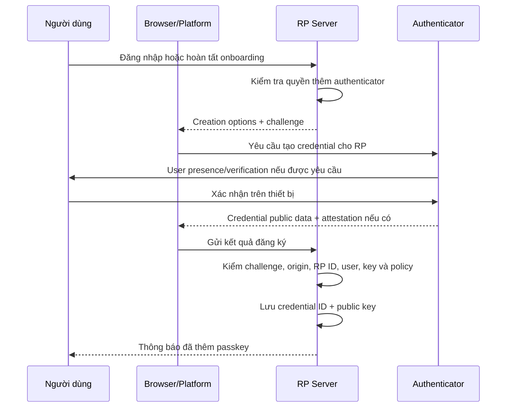
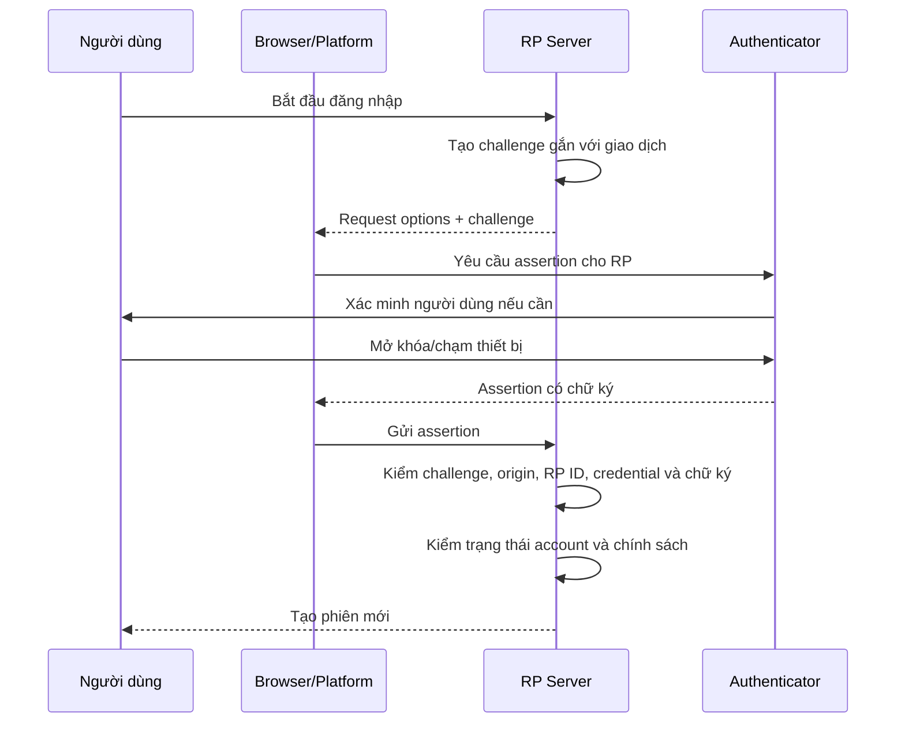

# Passwordless authentication

**Passwordless authentication** (xác thực không mật khẩu) là cách người dùng chứng minh quyền truy cập mà không phải nhập mật khẩu truyền thống ở mỗi lần đăng nhập. Thay cho mật khẩu, hệ thống có thể xác minh chữ ký từ passkey, chứng chỉ gắn với khóa riêng, mã dùng một lần, liên kết đăng nhập hoặc phản hồi từ thiết bị đã đăng ký.

Passwordless là một **mô hình trải nghiệm và kiến trúc xác thực**, không phải một giao thức duy nhất và cũng không tự động đồng nghĩa với xác thực mạnh hay chống phishing. Một liên kết đăng nhập qua email có thể không cần mật khẩu nhưng vẫn bị chuyển tiếp qua trang giả; passkey WebAuthn được triển khai đúng có khả năng chống phishing nhờ ràng buộc credential với relying party.

Bài này thuộc chương **Passwordless** của module **SECURITY_AUTHENTICATION_FUNDAMENTALS**. Người học sẽ phân biệt các phương thức passwordless, hiểu luồng đăng ký và đăng nhập bằng passkey, mô hình hóa ranh giới tin cậy, lựa chọn phương án theo rủi ro và bảo vệ cả vòng đời credential, phiên và khôi phục tài khoản.

## 1. Passwordless là gì và giải quyết vấn đề nào?

Trong đăng nhập truyền thống, người dùng nhập username/email và mật khẩu. Dịch vụ kiểm tra mật khẩu bằng verifier đã lưu. Mô hình này quen thuộc nhưng kéo theo nhiều vấn đề:

- Người dùng phải ghi nhớ và quản lý nhiều mật khẩu; dễ tái sử dụng hoặc chọn mật khẩu yếu.
- Mật khẩu có thể bị phishing, keylogging, lộ qua malware, database breach hoặc credential stuffing.
- Dịch vụ phải bảo vệ password verifier, quy trình reset và các hệ thống xử lý mật khẩu.
- MFA có thể tăng bảo đảm nhưng thêm bước và vẫn có thể bị chuyển tiếp nếu dùng OTP không chống phishing.

Passwordless thay đổi cách tạo bằng chứng. Thay vì gửi một bí mật dùng chung hoặc bí mật ghi nhớ tới server, thiết bị có thể giữ khóa riêng và ký challenge; hoặc người dùng chứng minh quyền kiểm soát một kênh đã đăng ký.

### 1.1. Passwordless không có nghĩa là không có bí mật

Passkey vẫn dựa trên khóa mật mã; chứng chỉ vẫn gắn với khóa riêng; email magic link phụ thuộc quyền truy cập hộp thư; TOTP dựa trên seed; thiết bị có thể yêu cầu PIN hoặc sinh trắc để mở khóa authenticator. Người dùng không nhập password vào ứng dụng, nhưng hệ thống vẫn quản lý **credential, khóa, thiết bị, trust, phiên và recovery**.

### 1.2. Passwordless không tự động là MFA

| Cơ chế | Không yêu cầu mật khẩu ứng dụng? | Khả năng chống phishing | Ghi chú |
| --- | --- | --- | --- |
| Passkey/WebAuthn có xác minh đúng | Có | Cao, khi kiểm tra RP ID/origin/challenge đúng | Có thể yêu cầu user verification cục bộ bằng PIN hoặc sinh trắc. |
| Chứng chỉ client/smart card | Có thể | Phụ thuộc giao thức, khóa và cách triển khai | Phải chứng minh kiểm soát private key và kiểm tra trust. |
| Email magic link | Có | Thấp hơn WebAuthn | Link có thể bị chuyển tiếp hoặc đánh cắp từ hộp thư. |
| Email/SMS OTP | Có thể | Thấp | Mã ngắn có thể bị phishing và relay. |
| Push approval | Có thể | Tùy thiết kế | Push chung chung dễ bị MFA fatigue; number matching chỉ giảm một số rủi ro. |
| Sinh trắc học trên thiết bị | Thường có trong trải nghiệm | Không tự xác định | Sinh trắc thường mở khóa khóa cục bộ; server không nên nhận mẫu sinh trắc. |

Một phương thức không có mật khẩu có thể chỉ là **một yếu tố**. Muốn tuyên bố MFA, phải xác định các yếu tố độc lập thực sự được yêu cầu và kiểm chứng. Ví dụ passkey có user verification bằng PIN hoặc sinh trắc có thể kết hợp possession của authenticator và yếu tố mở khóa cục bộ theo mô hình bảo đảm của giao thức/thiết bị; không thể suy điều này chỉ từ nhãn “passwordless”.

## 2. Các phương thức passwordless phổ biến

### 2.1. Passkey và WebAuthn/FIDO2

Passkey là credential dùng khóa công khai/khóa riêng theo mô hình WebAuthn. Trong quá trình đăng ký, authenticator tạo cặp khóa dành cho relying party (RP). Server lưu credential ID và public key; private key được giữ trong authenticator hoặc hệ sinh thái quản lý passkey. Khi đăng nhập, server gửi challenge ngẫu nhiên; authenticator ký dữ liệu phù hợp và server xác minh chữ ký.

Ưu điểm chính:

- Khóa được ràng buộc với RP ID, giúp chống phishing khi trình duyệt, authenticator và server kiểm tra đúng origin/RP ID.
- Không gửi password hoặc private key lên server.
- Có thể hỗ trợ trải nghiệm usernameless với discoverable credential.
- Có thể dùng khóa bảo mật vật lý, authenticator tích hợp trong thiết bị hoặc passkey đồng bộ, tùy nền tảng.

Các giới hạn cần hiểu:

- Passkey có thể là **device-bound** hoặc **syncable**. Passkey đồng bộ thuận tiện khi đổi thiết bị nhưng phụ thuộc bảo mật tài khoản/hệ sinh thái đồng bộ.
- Khả năng user verification, bảo vệ phần cứng, backup và attestation khác nhau giữa authenticator.
- Nếu quy trình recovery yếu, kẻ tấn công có thể chiếm account mà không phá được WebAuthn.
- Một passkey hợp lệ chỉ chứng minh kiểm soát credential gắn với account; nó không tự xác minh danh tính pháp lý hoặc quyền truy cập mọi tài nguyên.

### 2.2. Chứng chỉ và smart card

Trong xác thực bằng client certificate, smart card hoặc token phần cứng, thiết bị giữ private key; server kiểm tra chứng chỉ và bằng chứng sử dụng khóa tương ứng, thường qua TLS client authentication hoặc giao thức ký challenge.

Phương thức này phù hợp môi trường doanh nghiệp có PKI, quản lý thiết bị và quy trình cấp/thu hồi chứng chỉ. Cần bảo vệ CA, private key, PIN thẻ, trust store và vòng đời chứng chỉ. Chứng chỉ công khai có thể bị sao chép; chỉ kiểm tra file chứng chỉ mà không chứng minh quyền sử dụng private key là chưa đủ.

### 2.3. Email magic link và mã dùng một lần

Ứng dụng gửi liên kết hoặc mã tới email đã đăng ký. Người dùng mở link hoặc nhập OTP để hoàn thành đăng nhập.

Ưu điểm là triển khai và sử dụng đơn giản, hữu ích với dịch vụ ít rủi ro hoặc người dùng không muốn tạo mật khẩu. Tuy nhiên:

- Hộp thư có thể bị chiếm hoặc đang mở trên thiết bị dùng chung.
- Link có thể lộ qua browser history, log, analytics, referrer hoặc công cụ bảo mật email tự động quét.
- OTP có thể bị phishing/relay theo thời gian thực.
- Email đã xác minh không đồng nghĩa danh tính pháp lý đã được proofing.
- Nếu email được cấp lại cho người khác, việc tự liên kết account bằng địa chỉ email có thể gây account takeover.

Magic link/OTP cần thời hạn ngắn, dùng một lần, ràng buộc đúng giao dịch và account, giới hạn lần gửi/thử, chống enumeration và thông báo thay đổi.

### 2.4. Push và xác nhận trên thiết bị

Ứng dụng gửi yêu cầu đến thiết bị đã đăng ký. Người dùng chấp nhận hoặc từ chối. Để có giá trị xác thực, phản hồi phải gắn với thiết bị/khóa đáng tin và một giao dịch đăng nhập cụ thể.

Không nên dùng nút “Approve” chung chung. Có thể hiển thị thông tin dịch vụ và yêu cầu number matching, giới hạn số push, phát hiện yêu cầu bất thường và cung cấp nút báo “Không phải tôi”. Push không mặc nhiên chống phishing: người dùng vẫn có thể bị lừa phê duyệt phiên do kẻ tấn công tạo ra.

### 2.5. Sinh trắc học là cách mở khóa, không phải giao thức passwordless riêng

Vân tay hoặc khuôn mặt thường được xác minh cục bộ bởi hệ điều hành/authenticator để mở khóa private key. Ứng dụng web nhận kết quả xác minh qua giao thức, không cần thu thập mẫu sinh trắc. Vì thế:

- Không gửi hoặc lưu ảnh vân tay/khuôn mặt trong ứng dụng nếu không có nhu cầu và cơ sở riêng.
- Không coi một giao diện yêu cầu “chạm vân tay” là bằng chứng đủ nếu server không xác minh kết quả giao thức.
- Cần có phương án thay thế khi cảm biến không hoạt động, người dùng không thể sử dụng hoặc thiết bị bị mất.

## 3. Passkey/WebAuthn: đăng ký và xác thực

### 3.1. Thành phần tham gia

- **User:** người đăng nhập.
- **Relying party (RP):** website hoặc ứng dụng yêu cầu xác thực.
- **Authenticator:** thiết bị hoặc khóa bảo mật tạo và sử dụng credential.
- **Client/platform:** trình duyệt, hệ điều hành hoặc ứng dụng chuyển yêu cầu giữa RP và authenticator.
- **RP server:** tạo challenge, lưu public key/credential metadata và xác minh assertion.

### 3.2. Đăng ký passkey



Server cần:

1. Tạo challenge đủ ngẫu nhiên, thời hạn ngắn, gắn với phiên/account và chỉ dùng một lần.
2. Xác minh `clientDataJSON` có type đúng, challenge khớp và origin nằm trong danh sách cho phép.
3. Xác minh RP ID hash, dữ liệu authenticator, cờ user presence/user verification theo chính sách và cấu trúc credential.
4. Kiểm tra user/account đang hoạt động và người đăng ký có quyền thêm phương thức mới.
5. Lưu credential ID, public key và metadata cần thiết; không lưu private key hoặc mẫu sinh trắc.
6. Nếu dùng attestation, chỉ chấp nhận loại và trust chain đã được chính sách xác định; không bắt buộc attestation cho mọi ứng dụng.
7. Ghi audit và thông báo thay đổi trên kênh phù hợp.

Thao tác thêm passkey là thao tác nhạy cảm. Nếu account đã có phiên yếu hoặc phiên có dấu hiệu bị chiếm, kẻ tấn công có thể đăng ký khóa của họ rồi duy trì quyền truy cập. Có thể yêu cầu re-authentication/step-up hoặc quy trình proofing phù hợp trước enrollment.

### 3.3. Đăng nhập bằng passkey



Server cần xác minh ít nhất:

- Challenge khớp với giao dịch đang chờ, chưa hết hạn và chưa bị tiêu thụ.
- Origin đúng với RP đã cấu hình; RP ID hash đúng.
- Credential ID thuộc identity/account được phép đăng nhập.
- Chữ ký hợp lệ với public key đã lưu và dữ liệu được ký đúng theo WebAuthn.
- User presence và user verification đáp ứng policy.
- Account, credential và tenant còn hoạt động.
- Sau xác thực, tạo session an toàn và ghi nhận ngữ cảnh xác thực thực tế.

Không được chỉ giải mã JSON phía client rồi tin trường `userId`. Mọi xác minh mật mã và mapping identity phải diễn ra ở server hoặc thành phần xác minh được tin cậy.

### 3.4. Usernameless và discoverable credential

Với discoverable credential, authenticator có thể tìm credential phù hợp với RP mà không cần người dùng nhập username trước. Trình duyệt hiển thị lựa chọn passkey khả dụng; server dùng thông tin credential/user handle đã đăng ký để xác định identity.

Cần tránh lộ danh sách account qua endpoint tìm người dùng. Không trả lời chi tiết “email này có passkey hay không” cho client chưa được xác thực. Với luồng username-first, cần phản hồi nhất quán để hạn chế account enumeration.

### 3.5. Pseudocode xác minh assertion

Ví dụ dưới đây minh họa thứ tự kiểm tra, không thay thế thư viện WebAuthn chuẩn:

```text
verifyPasskeyLogin(assertion, transaction):
    require transaction is pending and not expired
    require transaction.challenge is unused

    clientData = parseClientData(assertion.clientDataJSON)
    require clientData.type == "webauthn.get"
    require clientData.challenge == transaction.challenge
    require clientData.origin in configuredOrigins

    credential = findCredential(assertion.credentialId)
    require credential exists and is active
    require credential belongs to expected RP and account policy

    authenticatorData = parseAndValidateAuthenticatorData(
        assertion.authenticatorData,
        expectedRpId
    )
    require userPresence satisfies policy
    require userVerification satisfies policy when required
    verifySignature(
        credential.publicKey,
        authenticatorData || hash(assertion.clientDataJSON),
        assertion.signature
    )

    atomicallyConsumeChallenge(transaction.id)
    require accountAndTenantAreActive(credential.account)
    return createSecureSession(credential.account)
```

Thư viện thực tế phải xử lý chính xác định dạng CBOR, authenticator data, extension, thuật toán, signature counter nếu có ý nghĩa và các yêu cầu WebAuthn tương ứng. Pseudocode không phải triển khai mật mã để tự viết.

## 4. Phòng chống phishing, replay và lạm dụng đăng nhập

### 4.1. Vì sao passkey chống phishing tốt hơn OTP?

TOTP hoặc SMS OTP là mã người dùng có thể đọc và nhập vào một trang giả. Kẻ tấn công có thể chuyển tiếp mã trong lúc còn hiệu lực. WebAuthn gắn credential với RP ID và kiểm tra origin; authenticator không ký như thể đang ở domain thật khi người dùng thực sự ở domain giả. Điều này làm giảm mạnh phishing kiểu thu thập/relay credential khi giao thức được triển khai đúng.

Tuy nhiên, passkey không giải quyết tất cả:

- Malware có thể chiếm phiên sau khi đăng nhập.
- Người dùng có thể bị lừa vào tài khoản đồng bộ passkey hoặc thiết bị của họ.
- Quy trình recovery hoặc enrollment yếu có thể bị lạm dụng.
- Người dùng có thể chấp nhận một giao dịch nguy hiểm dù credential không bị phishing.
- Một ứng dụng cấu hình origin/RP ID sai có thể phá vỡ giả định bảo vệ.

### 4.2. Challenge và replay

Challenge cần ngẫu nhiên, đủ dài, có thời hạn ngắn và ràng buộc với phiên/giao dịch. Mỗi challenge chỉ được tiêu thụ một lần theo thao tác nguyên tử để hai request đồng thời không cùng thành công. Không tái sử dụng challenge giữa account, tenant hoặc môi trường.

Đối với magic link/OTP, dùng token ngẫu nhiên có entropy cao, lưu verifier an toàn nếu phù hợp, thời hạn ngắn, ràng buộc đúng account và transaction, tiêu thụ một lần. Cần rate limit gửi và thử mã để tránh spam, dò mã và denial of service.

### 4.3. Bảo vệ session sau passwordless

Passwordless chỉ bảo vệ bước xác thực. Sau khi tạo phiên:

- Cookie web nên có `Secure`, `HttpOnly`, `SameSite` phù hợp; dùng HTTPS.
- Thay session ID sau khi xác thực hoặc tăng mức bảo đảm để tránh session fixation.
- Giới hạn idle timeout và absolute lifetime theo rủi ro.
- Có cơ chế revoke phiên khi mất thiết bị, account bị đình chỉ hoặc credential bị gỡ.
- Yêu cầu step-up cho thay đổi email khôi phục, thêm passkey, xuất dữ liệu hoặc thao tác quản trị.
- Bảo vệ API bằng token đúng audience/scope và authorization theo tenant/tài nguyên.

## 5. Vòng đời passkey và credential passwordless

### 5.1. Enrollment và liên kết identity

Một passkey chỉ có ý nghĩa khi được gắn với đúng user identity/account. Trước khi thêm credential, server cần xác định:

- Người dùng đã xác thực bằng phương thức nào và mức assurance có đủ không?
- Account đang hoạt động và thuộc tenant nào?
- Người thêm passkey có quyền kiểm soát account hiện tại không?
- Có yêu cầu xác thực lại, phê duyệt hoặc thông báo ngoài băng không?
- Credential ID đã được đăng ký chưa và có thuộc RP đúng không?

Không tự động gộp account chỉ vì email của passkey, IdP hoặc hồ sơ nội bộ giống nhau. Email là thuộc tính có thể đổi hoặc tái cấp, không phải khóa liên kết duy nhất.

### 5.2. Nhiều passkey và thiết bị dự phòng

Khuyến khích người dùng có phương án dự phòng phù hợp: passkey trên thiết bị thứ hai, khóa bảo mật phần cứng hoặc phương thức recovery có kiểm soát. Giao diện quản lý nên cho biết tên thiết bị do người dùng đặt, ngày thêm và tùy chọn thu hồi; tránh tiết lộ metadata không cần thiết.

Khi một thiết bị bị mất, người dùng có thể cần đăng nhập từ passkey khác hoặc qua recovery. Thu hồi credential bị mất cần xử lý session liên quan và thông báo. Không giả định xóa passkey trên một thiết bị sẽ tự động xóa mọi bản sao đồng bộ trong hệ sinh thái.

### 5.3. Passkey đồng bộ và passkey gắn thiết bị

| Loại | Đặc điểm | Cân nhắc |
| --- | --- | --- |
| **Device-bound** | Credential gắn với authenticator/thiết bị cụ thể hoặc khóa được bảo vệ tại thiết bị. | Quản lý mất thiết bị, backup, thay thiết bị và thu hồi. |
| **Syncable** | Credential có thể đồng bộ qua hệ sinh thái tài khoản của nhà cung cấp. | Bảo vệ account đồng bộ, recovery của nhà cung cấp, thiết bị tin cậy và quyền truy cập hệ sinh thái. |

Cả hai có thể dùng WebAuthn và chống phishing nhờ ràng buộc RP. Khác biệt nằm ở mô hình bảo vệ khóa, khả năng di chuyển/khôi phục và quản trị thiết bị. Không nên tuyên bố mọi passkey đều không thể sao chép hoặc luôn gắn với duy nhất một thiết bị.

### 5.4. Thu hồi và thay thế

Khi gỡ passkey, reset account hoặc phát hiện credential bị lộ:

1. Xác minh yêu cầu và người có quyền thay đổi credential.
2. Vô hiệu hóa credential cụ thể trong kho dữ liệu phía server.
3. Thu hồi hoặc đánh giá các session/token đã được tạo bởi credential đó.
4. Thông báo thay đổi và ghi audit.
5. Yêu cầu đăng ký credential mới theo quy trình đủ tin cậy.
6. Nếu nghi ngờ account đồng bộ hoặc thiết bị bị chiếm, xem xét các credential khác và phương thức recovery.

## 6. Recovery là phần yếu nhất nếu thiết kế không đồng bộ

Người dùng có thể mất tất cả thiết bị chứa passkey. Nếu dịch vụ cho phép khôi phục chỉ bằng email/SMS dễ chiếm, kẻ tấn công có thể bỏ qua cơ chế passwordless mạnh.

Recovery cần được thiết kế như một **luồng xác thực và liên kết danh tính riêng**:

- Đánh giá rủi ro account, dữ liệu và quyền đặc biệt.
- Dùng phương thức dự phòng đã đăng ký, recovery code dùng một lần hoặc quy trình proofing bổ sung phù hợp.
- Xác minh nguồn yêu cầu và ràng buộc với account/tenant.
- Thông báo qua kênh đã biết khi credential hoặc thông tin khôi phục thay đổi.
- Có thời gian chờ, phê duyệt bổ sung hoặc giới hạn giao dịch khi rủi ro cao.
- Thu hồi session và credential cũ theo chính sách; cung cấp cách báo cáo thao tác không phải do người dùng thực hiện.
- Không cho helpdesk tự bỏ MFA hoặc gắn passkey mà không có bằng chứng, phân tách nhiệm vụ và audit.

### 6.1. Recovery code

Recovery code là bí mật dự phòng có thể cho phép khôi phục quyền truy cập. Cần tạo bằng RNG an toàn, hiển thị một lần, khuyến khích lưu ở nơi bảo mật, lưu verifier phù hợp, tiêu thụ một lần và giới hạn thử. Không ghi code vào log hoặc gửi lại qua email sau khi tạo.

Recovery code không tự động là một yếu tố độc lập. Nếu code được lưu cùng nơi với credential chính, hai phương thức có thể bị chiếm cùng lúc.

### 6.2. Tránh fallback downgrade

Nếu tài khoản được bảo vệ bằng passkey chống phishing nhưng màn hình “Không có passkey? Nhập email để nhận mã” cho phép đăng nhập không có kiểm tra bổ sung, attacker sẽ nhắm vào fallback yếu nhất. Hãy bảo đảm fallback có mức bảo đảm phù hợp với giá trị account, hoặc giới hạn các hành động sau khi đăng nhập bằng phương thức yếu hơn.

## 7. Threat model cho passwordless

| Mối đe dọa | Phương thức bị ảnh hưởng | Kiểm soát |
| --- | --- | --- |
| Phishing/relay | OTP, magic link, push; cả flow bị cấu hình sai | Ưu tiên WebAuthn đúng RP/origin, hiển thị ngữ cảnh, chống lạm dụng fallback. |
| Replay | Challenge, OTP, magic link hoặc callback | Challenge/token dùng một lần, hết hạn, tiêu thụ nguyên tử và ràng buộc giao dịch. |
| Account enumeration | Username-first, endpoint gửi link/mã | Phản hồi nhất quán, rate limit và giám sát. |
| Enrollment takeover | Thêm passkey/IdP vào account | Re-authentication, step-up, kiểm tra quyền và thông báo. |
| Device loss/theft | Passkey, smart card, ứng dụng push/TOTP | Thu hồi credential, khóa thiết bị, phương thức dự phòng và recovery mạnh. |
| Sync-provider compromise | Passkey đồng bộ | Bảo vệ account nhà cung cấp, xác minh thiết bị, thông báo và phương án thu hồi. |
| Session theft | Mọi phương thức sau đăng nhập | Bảo vệ cookie/token, thời hạn, revoke và giám sát. |
| Recovery downgrade | Email/SMS/helpdesk | Bằng chứng phù hợp, SoD, hạn mức, thông báo và audit. |
| Misbinding | Mapping credential với account/tenant sai | Khóa nội bộ ổn định, kiểm tra RP, issuer, subject và tenant. |
| Push fatigue | Push approval | Number matching, giới hạn yêu cầu, giao dịch rõ và nút từ chối/báo cáo. |

## 8. Thiết kế triển khai passwordless theo từng bước

Một kế hoạch triển khai có thể tiến hành như sau:

1. **Phân loại người dùng và rủi ro:** Người dùng công khai, nhân viên, quản trị viên và workload có nhu cầu khác nhau.
2. **Chọn phương thức:** Ưu tiên WebAuthn/passkey cho đăng nhập tương tác cần chống phishing; cân nhắc chứng chỉ/smart card cho môi trường quản trị thiết bị; chỉ dùng email/OTP ở mức rủi ro phù hợp.
3. **Chuẩn bị identity/account mapping:** Có khóa nội bộ ổn định, tenant rõ ràng, chính sách liên kết và enrollment.
4. **Thiết kế recovery trước khi phát hành rộng:** Bảo đảm fallback không phá vỡ mục tiêu bảo mật.
5. **Triển khai song song và chuyển đổi:** Cho phép người dùng đăng ký passkey trong phiên đã xác thực; không tự tạo credential từ thông tin client chưa được kiểm chứng.
6. **Giám sát và hỗ trợ:** Theo dõi tỷ lệ thành công/thất bại, thiết bị không tương thích, recovery, phishing report và hành vi đăng ký bất thường.
7. **Giảm phụ thuộc password theo lộ trình:** Chỉ loại bỏ password khi phương thức thay thế, hỗ trợ, recovery và quy trình vận hành đã đáp ứng yêu cầu.
8. **Đánh giá định kỳ:** Kiểm tra cấu hình origin/RP ID, thư viện WebAuthn, vòng đời khóa, chính sách account và các đường fallback.

Không nên tắt password cho toàn bộ người dùng trước khi kiểm tra khả năng tương thích trình duyệt/thiết bị, accessibility, người dùng mất thiết bị và hỗ trợ doanh nghiệp.

## 9. Ví dụ thực hành: triển khai passkey cho nền tảng học tập

**Bối cảnh:** Nền tảng học tập hiện dùng email/password và TOTP. Nhóm sản phẩm muốn hỗ trợ passkey để giảm phishing và giảm yêu cầu reset mật khẩu.

**Thiết kế đề xuất:**

- Người dùng đang có phiên hợp lệ thực hiện enrollment; account được kiểm tra trạng thái và tenant trước khi bắt đầu.
- Server tạo WebAuthn challenge, ràng buộc với phiên và RP ID đã cấu hình.
- Trình duyệt gọi authenticator; người dùng xác nhận theo cơ chế thiết bị.
- Server kiểm challenge, origin, RP ID, credential, chữ ký và cờ user verification theo policy.
- Lưu credential ID/public key với `user_identity_id`; thông báo người dùng và ghi audit.
- Khi đăng nhập, server gửi challenge mới; xác minh assertion và kiểm trạng thái account.
- Sau thành công, tạo session an toàn, ghi nhận phương thức xác thực và mức user verification đã thực sự đạt.
- Người dùng có thể thêm thiết bị dự phòng hoặc khóa bảo mật; xóa credential cần xác minh lại.
- Recovery có thể dùng phương thức đã đăng ký hoặc quy trình proofing tương xứng; email đơn lẻ không tự động bỏ qua mọi kiểm soát.

**Kiểm thử các trường hợp:**

| Trường hợp | Kết quả mong đợi |
| --- | --- |
| Assertion có challenge cũ hoặc sai | Từ chối; không tạo session. |
| Origin không thuộc danh sách cho phép | Từ chối. |
| Credential ID không liên kết account | Từ chối, không tự gộp theo email. |
| Account bị đình chỉ | Không tạo session dù chữ ký hợp lệ. |
| Thiết bị mất | Credential có thể bị thu hồi; recovery theo policy. |
| Người dùng thêm passkey mới trong phiên đáng ngờ | Yêu cầu xác thực lại/step-up hoặc chặn. |
| Passkey sync account bị chiếm | Xem xét các credential/session liên quan, thông báo và xử lý recovery. |
| Fallback OTP bị thử hàng loạt | Rate limit, giám sát và không tiết lộ account tồn tại. |

## 10. Checklist đánh giá passwordless

- [ ] Xác định mục tiêu: giảm mật khẩu, tăng trải nghiệm hay chống phishing; không dùng “passwordless” làm nhãn chất lượng chung.
- [ ] Phân biệt passkey/WebAuthn, chứng chỉ, magic link, OTP, push và sinh trắc mở khóa cục bộ.
- [ ] Đánh giá phương thức theo phishing resistance, replay, bảo vệ khóa, khả năng mất thiết bị và mức assurance.
- [ ] Với WebAuthn, kiểm challenge, origin, RP ID, chữ ký, credential, user presence/verification và trạng thái account.
- [ ] Gắn credential với đúng user identity/account/tenant; không liên kết tự động chỉ vì email trùng.
- [ ] Bảo vệ enrollment và thay đổi authenticator bằng xác thực lại/step-up khi cần.
- [ ] Challenge, magic link, OTP và recovery code phải có thời hạn, dùng một lần, giới hạn thử và chống replay.
- [ ] Bảo vệ session/token sau đăng nhập; có revoke, timeout và authorization cho từng tài nguyên.
- [ ] Thiết kế recovery và fallback không yếu hơn mục tiêu bảo mật của account.
- [ ] Hỗ trợ nhiều thiết bị, thiết bị mất, khả năng tiếp cận và môi trường không hỗ trợ passkey.
- [ ] Không thu thập/lưu mẫu sinh trắc nếu xác minh được cục bộ trên thiết bị.
- [ ] Audit enrollment, đăng nhập, thu hồi, recovery và thay đổi liên kết; không ghi secret/token.
- [ ] Kiểm thử phishing, relay, replay, account enumeration, enrollment takeover và recovery downgrade.

## 11. Câu hỏi tự kiểm tra

**1. Passwordless có nghĩa hệ thống không còn quản lý credential không?**  
Không. Hệ thống vẫn quản lý public key, chứng chỉ, token, mã dùng một lần, liên kết identity, trạng thái credential và session.

**2. Email magic link có chống phishing tương đương passkey không?**  
Không. Link có thể bị thu thập/chuyển tiếp hoặc lộ qua hộp thư; WebAuthn ràng buộc credential với RP ID/origin khi triển khai đúng.

**3. Passkey có phải luôn nằm trên một thiết bị duy nhất không?**  
Không. Có passkey device-bound và passkey syncable. Mô hình đồng bộ, bảo vệ khóa và recovery khác nhau.

**4. Sinh trắc học có được gửi lên server để xác minh không?**  
Thông thường không. Thiết bị xác minh sinh trắc cục bộ để mở khóa authenticator; server kiểm tra assertion và các cờ theo giao thức.

**5. Vì sao thêm passkey là thao tác nhạy cảm?**  
Vì người thêm có thể tạo phương thức đăng nhập lâu dài cho account. Nếu phiên hiện tại bị chiếm, attacker có thể gắn credential của họ và duy trì truy cập.

**6. Có thể dùng email làm fallback duy nhất cho account quản trị không?**  
Không nên. Hộp thư có thể bị chiếm; recovery cần mức kiểm chứng và phê duyệt tương xứng giá trị account.

**7. Passwordless có tự động là MFA không?**  
Không. Cần xét các yếu tố độc lập thực sự được sử dụng. Một mã OTP hoặc một passkey không tự động chứng minh hai yếu tố.

**8. Passkey đã xác thực thành công thì có thể truy cập mọi tài nguyên không?**  
Không. Authentication tạo principal/phiên; authorization vẫn kiểm tra quyền, tenant và tài nguyên ở từng thao tác.

**Ghi nhớ:** Passwordless loại bỏ việc nhập mật khẩu truyền thống, nhưng vẫn cần quản lý credential và ranh giới tin cậy. Passkey/WebAuthn có thể chống phishing mạnh khi kiểm tra giao thức đúng; hiệu quả tổng thể còn phụ thuộc enrollment, mapping identity, session, recovery và các phương thức fallback.
