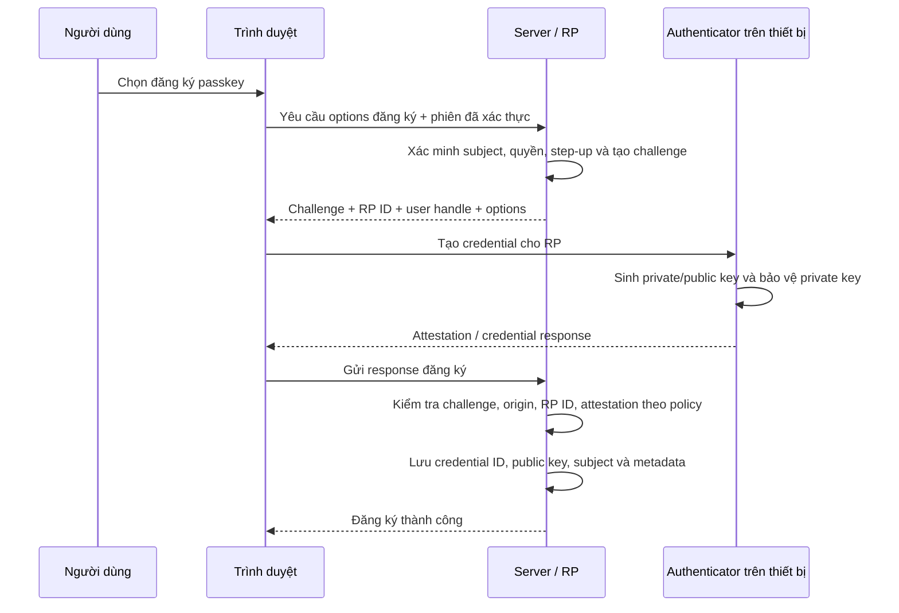
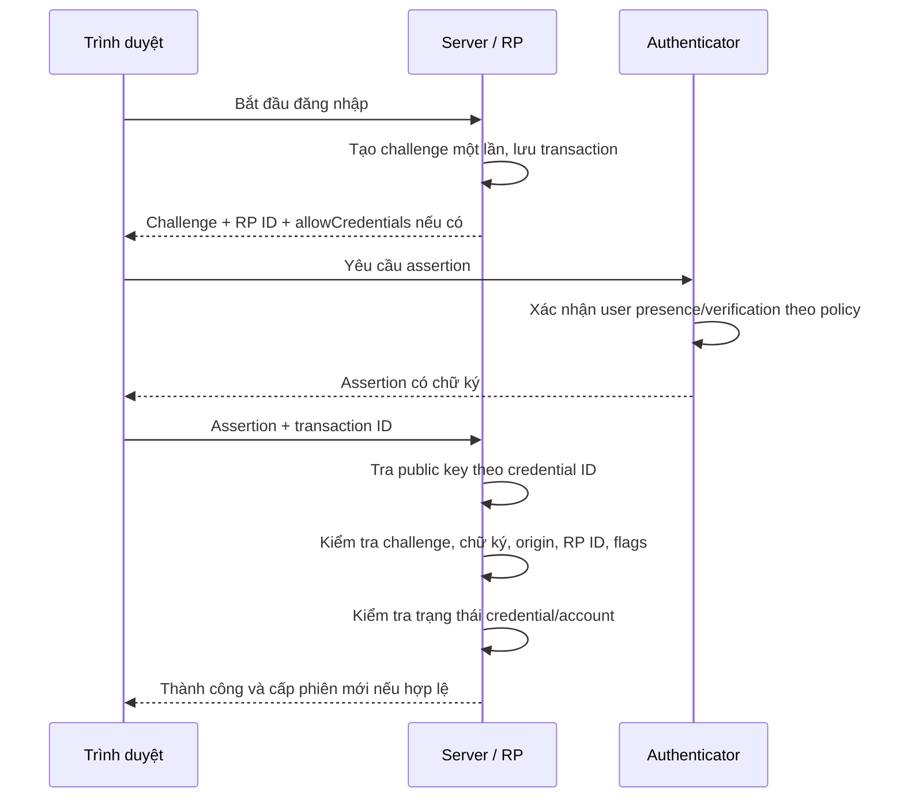

# Device-bound credential — Credential gắn với thiết bị

Một người dùng có thể đăng nhập không cần nhập mật khẩu bằng cách dùng một khóa mật mã được giữ trong thiết bị hoặc authenticator. Máy chủ gửi một thử thách ngẫu nhiên; thiết bị ký thử thách bằng private key; máy chủ xác minh chữ ký bằng public key đã đăng ký. Nếu private key được tạo và giữ trong một thiết bị cụ thể, không thể xuất hoặc đồng bộ sang thiết bị khác theo thiết kế, ta có một **device-bound credential** — credential gắn với thiết bị.

Ví dụ, nhân viên đăng ký passkey trên máy tính công ty có TPM hoặc Secure Enclave. Private key được bảo vệ trong phần cứng; khi đăng nhập, người dùng mở khóa authenticator bằng PIN hoặc sinh trắc học cục bộ. Máy chủ chỉ nhận assertion có chữ ký và xác minh bằng public key đã lưu. Nếu máy tính bị mất, quản trị viên có thể thu hồi credential của thiết bị đó và yêu cầu nhân viên đăng ký credential mới trên máy thay thế.

Trong module `SECURITY_AUTHENTICATION_FUNDAMENTALS`, device-bound credential là một cách triển khai xác thực không mật khẩu và tăng khả năng chống phishing. Nó liên quan trực tiếp đến passkey/WebAuthn, khóa phần cứng, chứng chỉ thiết bị, ranh giới tin cậy, xác thực workload, vòng đời credential, thu hồi và khôi phục tài khoản. Cần hiểu rõ credential chứng minh điều gì, thiết bị nào đang giữ khóa, và hệ thống có thể tin cậy đến mức nào về trạng thái thiết bị.

## 1. Device-bound credential là gì?

**Credential** là dữ liệu hoặc khóa được dùng làm bằng chứng xác thực cho một subject. Với credential bất đối xứng, thiết bị giữ private key; máy chủ giữ public key và metadata liên kết credential với tài khoản hoặc workload. Trong mô hình device-bound, private key được tạo và bảo vệ trên một authenticator cụ thể, và thiết kế không cho phép xuất hoặc đồng bộ private key sang thiết bị khác.

Thuật ngữ “device-bound” được dùng theo nhiều nghĩa trong sản phẩm. Có khi nó nói về khóa gắn với phần cứng của thiết bị; có khi nói về credential gắn với một authenticator vật lý như security key USB/NFC. Vì vậy cần nêu rõ credential bị ràng buộc với **máy chủ, thiết bị đầu cuối, phần cứng bảo mật hay authenticator** nào.

| Khái niệm | Ý nghĩa | Ví dụ |
| --- | --- | --- |
| **Device-bound credential** | Credential được tạo và giữ trong một thiết bị/authenticator cụ thể, không có cơ chế đồng bộ private key sang thiết bị khác | Passkey không backup-eligible được giữ trong Secure Enclave hoặc TPM-backed authenticator |
| **Synced / multi-device passkey** | Credential có thể được đồng bộ an toàn giữa các thiết bị trong hệ sinh thái nhà cung cấp | Passkey được đồng bộ qua tài khoản hệ điều hành hoặc password manager |
| **Roaming authenticator** | Authenticator rời có thể dùng với nhiều máy chủ hoặc máy tính, nhưng private key vẫn nằm trong authenticator | Khóa bảo mật FIDO2 USB/NFC |
| **Platform authenticator** | Authenticator tích hợp trong thiết bị hoặc hệ điều hành | Windows Hello, Secure Enclave, Android platform authenticator |
| **Hardware-backed key** | Khóa được tạo/giữ trong phần cứng bảo mật như TPM, Secure Enclave hoặc phần cứng chuyên dụng | Private key không được xuất ra dạng plaintext theo mô hình bảo vệ của phần cứng |
| **Device identity / device posture** | Thông tin về thiết bị, trạng thái quản lý hoặc tính toàn vẹn của thiết bị | Device certificate, trạng thái MDM, TPM attestation |

Các khái niệm trên có thể giao nhau nhưng không đồng nghĩa. Một hardware security key là roaming authenticator: nó có thể được cắm vào nhiều máy tính, dù credential vẫn gắn với khóa vật lý đó. Ngược lại, passkey đồng bộ có thể xuất hiện trên nhiều thiết bị và không phải device-bound theo nghĩa nghiêm ngặt, dù khóa được mã hóa và bảo vệ trong hệ sinh thái đồng bộ.

### Device-bound không tự động chứng minh điều gì?

- Không tự chứng minh danh tính pháp lý hoặc tên thật của người đang cầm thiết bị.
- Không chứng minh toàn bộ hệ điều hành, ứng dụng hoặc thiết bị không bị malware kiểm soát.
- Không chứng minh người dùng đã được cấp quyền cho mọi thao tác sau khi đăng nhập.
- Không đảm bảo thiết bị không bị đánh cắp, bị mở khóa trái phép hoặc bị sử dụng trong lúc phiên còn hoạt động.
- Không bảo đảm mọi nền tảng triển khai đều có cùng mức chống trích xuất khóa; mức bảo vệ phụ thuộc phần cứng, firmware, cấu hình và chuỗi cung ứng.

Do đó, device-bound credential là một **bằng chứng kiểm soát khóa** trong một mô hình tin cậy cụ thể. Muốn kết luận thêm về trạng thái thiết bị, cần cơ chế attestation hoặc quản lý thiết bị riêng.

## 2. Vì sao gắn credential với thiết bị?

Mật khẩu là bí mật có thể bị người dùng nhập vào trang giả, tái sử dụng ở nhiều dịch vụ hoặc bị lộ qua phishing và credential stuffing. Device-bound credential dùng khóa bất đối xứng: private key không được gửi đến máy chủ; mỗi lần xác thực, authenticator ký một challenge mới. Với WebAuthn triển khai đúng, assertion được ràng buộc với RP ID và origin, giúp ngăn một trang phishing ở domain khác dùng credential của RP thật.

Việc gắn khóa với thiết bị còn có một số lợi ích:

1. **Giảm khả năng sao chép credential:** private key được giữ trong phần cứng hoặc vùng bảo vệ, khó trích xuất hơn một secret lưu trong file.
2. **Giảm phishing:** passkey/WebAuthn tạo bằng chứng gắn với RP/origin; người dùng không cần nhập mật khẩu hoặc OTP vào trang web.
3. **Giảm replay:** chữ ký được tạo trên challenge mới, có hạn và được tiêu thụ một lần; assertion cũ không hợp lệ cho giao dịch mới.
4. **Kiểm soát vòng đời theo thiết bị:** tổ chức có thể gắn credential với thiết bị được quản lý, thu hồi credential khi thiết bị mất hoặc ngừng được tin cậy.
5. **Hỗ trợ xác thực mạnh:** phần cứng có thể yêu cầu PIN hoặc sinh trắc học cục bộ để cho phép sử dụng private key.

Đổi lại, người dùng có thể mất khả năng đăng nhập khi thiết bị hoặc authenticator hỏng/mất. Tổ chức cần chuẩn bị thiết bị thay thế, credential dự phòng hoặc recovery đủ mạnh. Nếu recovery yếu hơn đăng nhập chính, attacker có thể bỏ qua toàn bộ lợi ích của khóa gắn thiết bị.

## 3. Các mô hình triển khai phổ biến

### 3.1. Passkey/WebAuthn không đồng bộ

Trong WebAuthn, trình duyệt/ứng dụng gọi authenticator để tạo credential cho một Relying Party (RP). Authenticator sinh cặp khóa; server nhận credential ID và public key để lưu. Khi xác thực, server phát challenge; authenticator ký dữ liệu chứa challenge và ngữ cảnh RP; server kiểm tra chữ ký cùng các ràng buộc giao thức.

Một passkey **device-bound** thường có các đặc điểm:

- Private key được tạo và giữ trên một authenticator cụ thể.
- Credential không được đánh dấu là đủ điều kiện backup/đồng bộ sang authenticator khác.
- Khi thiết bị mất, người dùng cần dùng credential khác hoặc recovery để đăng ký một credential mới.
- Việc gỡ credential ở server làm server ngừng chấp nhận credential ID đó; nó không nhất thiết xóa private key vật lý khỏi thiết bị.

WebAuthn có các cờ trong authenticator data liên quan đến khả năng backup. Cờ **BE (Backup Eligibility)** cho biết credential có đủ điều kiện backup hay không; cờ **BS (Backup State)** cho biết trạng thái backup hiện tại theo thông tin authenticator cung cấp. Một credential device-bound thường có `BE=0`; credential đồng bộ thường có thể có `BE=1`. Server nên dùng các cờ này theo đặc tả và chính sách, không suy đoán từ nhãn sản phẩm hoặc user-agent. Cờ này không tự chứng minh thiết bị an toàn hay không bị xâm nhập.

### 3.2. Khóa bảo mật phần cứng (hardware security key)

Khóa bảo mật FIDO2/WebAuthn là authenticator rời, có thể kết nối qua USB, NFC hoặc BLE tùy thiết bị. Credential được lưu trong khóa; người dùng có thể cần chạm khóa hoặc nhập PIN để xác nhận. Khóa có thể dùng trên nhiều máy tính nhưng private key vẫn nằm trong thiết bị vật lý.

Mô hình này phù hợp cho nhân viên, quản trị viên hoặc người dùng cần credential độc lập với laptop. Cần quản lý mất khóa, hỏng khóa, nhiều khóa dự phòng và quy trình thu hồi. Nếu dùng một khóa cho nhiều tài khoản/RP, mỗi credential vẫn có phạm vi RP riêng theo giao thức; không nên coi việc sở hữu khóa vật lý là quyền truy cập tất cả dịch vụ.

### 3.3. Khóa phần cứng trong thiết bị: TPM, Secure Enclave và Android Keystore

Thiết bị hiện đại có thể cung cấp vùng bảo vệ khóa:

| Công nghệ | Vai trò thường gặp | Lưu ý |
| --- | --- | --- |
| **TPM** | Tạo/giữ khóa và thực hiện thao tác mật mã trong phần cứng; có thể hỗ trợ đo lường/attestation | Mức đảm bảo phụ thuộc TPM, firmware, chính sách và cách hệ điều hành dùng nó |
| **Secure Enclave** | Vùng bảo vệ khóa và xử lý thao tác mật mã trên thiết bị Apple tương thích | Không nên suy ra toàn bộ trạng thái hệ thống từ việc khóa được bảo vệ trong Secure Enclave |
| **Android Keystore / StrongBox** | API quản lý khóa; tùy thiết bị có thể được hỗ trợ bởi TEE hoặc phần cứng bảo mật chuyên dụng | Cần kiểm tra security level và attestation theo chính sách, không giả định mọi thiết bị đều có StrongBox |
| **Windows Hello / platform authenticator** | Dùng phương thức mở khóa cục bộ và authenticator tích hợp để tạo bằng chứng | Cần phân biệt xác thực cục bộ với quyết định xác thực từ server và mức quản lý thiết bị |

Khóa được tạo trong phần cứng có thể chống trích xuất tốt hơn khóa file, nhưng ứng dụng vẫn phải kiểm tra chữ ký, danh tính, thời hạn và trạng thái credential. Attestation, nếu có, là một bằng chứng bổ sung về authenticator hoặc môi trường tạo khóa, không phải lời bảo đảm tuyệt đối rằng thiết bị hiện không bị xâm nhập.

### 3.4. Chứng chỉ thiết bị và mTLS

Trong môi trường doanh nghiệp hoặc service-to-service, thiết bị/workload có thể được cấp chứng chỉ X.509. Private key được giữ trong TPM, secure element hoặc kho khóa; khi kết nối mTLS, client chứng minh quyền sở hữu private key. Server kiểm tra chuỗi CA, thời hạn, mục đích sử dụng, Subject Alternative Name (SAN), trust domain và trạng thái thu hồi theo chính sách.

Chứng chỉ thiết bị có thể xác định một thiết bị được quản lý hoặc workload, nhưng không tự chứng minh người dùng đang thao tác là ai. Nếu request đại diện cho người dùng, ứng dụng vẫn cần xác thực user và áp dụng chính sách ủy quyền tương ứng. Cũng cần phân biệt **device certificate** (định danh thiết bị) với **user certificate** (định danh người dùng theo chính sách PKI).

## 4. Luồng đăng ký và xác thực device-bound passkey

### 4.1. Đăng ký credential

Trước khi đăng ký, hệ thống cần xác minh tài khoản và quyền thêm phương thức xác thực. Không cho phép một session chưa xác thực hoặc chỉ mới hoàn tất mật khẩu yếu tự ý thêm authenticator mới vào tài khoản nhạy cảm.



Các bước kiểm soát chính:

1. Server tạo challenge ngẫu nhiên đủ mạnh, ngắn hạn và gắn với phiên, subject, RP ID cùng hành động `REGISTER_CREDENTIAL`.
2. Trình duyệt gọi WebAuthn API; authenticator tạo credential và trả về credential ID, public key cùng dữ liệu attestation/authenticator.
3. Server dùng thư viện WebAuthn được duy trì để kiểm tra challenge, origin, RP ID hash, cấu trúc client data/authenticator data và các thuộc tính được chính sách yêu cầu.
4. Nếu yêu cầu attestation, server xác minh theo định dạng và trust policy được công bố. Nếu không yêu cầu, server vẫn phải xác minh các thuộc tính WebAuthn cốt lõi và lưu public key đúng subject.
5. Server lưu bản ghi credential mới, trạng thái, thời điểm tạo, loại authenticator và các cờ liên quan; thông báo sự kiện thêm phương thức xác thực.

**Không lưu private key của passkey ở server.** Server lưu public key và dữ liệu cần để xác minh assertion. Cũng không dùng `userId` do client gửi để quyết định credential thuộc tài khoản nào; subject phải lấy từ phiên đã xác minh.

### 4.2. Xác thực bằng credential đã đăng ký



Server cần kiểm tra ít nhất:

- Challenge khớp với giao dịch đang chờ, còn hạn và chưa được tiêu thụ.
- `origin` nằm trong danh sách origin được phép; RP ID hash khớp RP ID dự kiến.
- Chữ ký hợp lệ với public key đã đăng ký cho credential ID; thuật toán và key type phù hợp.
- User Presence (UP) và User Verification (UV) đáp ứng chính sách. UV có thể là PIN, sinh trắc học hoặc phương thức cục bộ khác; server nhận cờ xác minh, không nhận dữ liệu sinh trắc học thô.
- Credential đang `ACTIVE`, chưa bị thu hồi; account và tenant vẫn được phép đăng nhập.
- Cờ BE/BS và thông tin authenticator được xử lý theo chính sách nếu ứng dụng cần phân biệt credential có thể đồng bộ với credential gắn thiết bị.

Signature counter có thể cung cấp tín hiệu phát hiện credential bị sao chép trong một số authenticator, nhưng không phải cơ chế chống clone đáng tin cậy cho mọi trường hợp. Một số authenticator không cung cấp counter tăng đơn điệu; credential đồng bộ có thể dùng counter bằng 0 hoặc không có hành vi như thiết bị đơn lẻ. Không từ chối người dùng chỉ vì counter không tăng nếu loại authenticator không đảm bảo điều đó; hãy dùng counter như một tín hiệu theo đúng đặc tả và threat model.

## 5. Attestation: biết gì về authenticator?

**Attestation** trong WebAuthn có thể cung cấp bằng chứng về nguồn gốc hoặc loại authenticator tạo credential, tùy định dạng và chính sách. Attestation có thể giúp tổ chức chỉ chấp nhận các loại authenticator đã được phê duyệt, nhưng cần hiểu giới hạn:

- Attestation không tự xác minh danh tính pháp lý của người dùng.
- Attestation không đảm bảo thiết bị không bị malware hoặc hệ điều hành đã bị chiếm quyền sau thời điểm đăng ký.
- Attestation có thể có tác động riêng tư vì một số loại chứa định danh model hoặc thông tin có thể liên kết thiết bị.
- Attestation không phải lúc nào cũng có hoặc phù hợp; nhiều dịch vụ người dùng phổ thông không cần thu thập attestation chi tiết.
- Trust metadata, root certificate và chính sách chấp nhận phải được quản lý, cập nhật và đánh giá theo vòng đời nhà cung cấp.

Với môi trường doanh nghiệp, có thể yêu cầu attestation hoặc device compliance khi cấp quyền truy cập dữ liệu nhạy cảm. Tuy nhiên cần tách rõ: **credential authentication** chứng minh quyền sử dụng khóa; **device attestation/posture** cung cấp thông tin về nguồn gốc hoặc trạng thái thiết bị; **authorization** quyết định có cho truy cập tài nguyên hay không.

### TPM quote và trạng thái thiết bị

Một TPM có thể cung cấp quote được ký bằng khóa attestation, bao gồm giá trị đo lường PCR theo chính sách. Verifier có thể đối chiếu các phép đo với baseline để đánh giá một số thuộc tính boot chain. Điều này khác với WebAuthn assertion: quote có mục tiêu attestation trạng thái nền tảng, còn assertion chứng minh quyền sử dụng credential cho RP. Không nên tự diễn giải một TPM quote là chứng minh toàn bộ ứng dụng an toàn; phạm vi đo lường, nguồn tham chiếu và thời điểm đo phải được xác định.

## 6. Ranh giới tin cậy và mô hình đe dọa

Device-bound credential thay đổi loại bí mật cần bảo vệ, nhưng không loại bỏ mọi điểm tấn công.

| Ranh giới | Nguy cơ | Kiểm soát |
| --- | --- | --- |
| Người dùng ↔ thiết bị | Người khác sử dụng thiết bị đã mở khóa; social engineering để đăng ký khóa mới | PIN/UV, khóa màn hình, xác thực lại trước enrollment, thông báo credential mới |
| Ứng dụng ↔ authenticator | Gọi sai RP/origin, challenge bị replay, thư viện xác minh lỗi | WebAuthn library chuẩn, allowlist origin/RP ID, challenge một lần và kiểm tra flags |
| Phần mềm ↔ secure hardware | Malware điều khiển API ký dù không trích xuất được khóa | Cập nhật OS, hardening, device posture/attestation khi cần, quyền tối thiểu |
| Thiết bị ↔ server | Network interception, endpoint giả, TLS sai | TLS đúng hostname, xác minh chứng chỉ, mTLS cho kênh phù hợp |
| Server ↔ kho credential | Thay public key hoặc ánh xạ credential sang subject khác | Kiểm soát database, audit thay đổi, transaction, phân tách quyền quản trị |
| Credential ↔ account recovery | Attacker dùng recovery yếu để thêm credential của mình | Recovery tương xứng assurance, thông báo, cooldown/risk review và thu hồi |
| Thiết bị ↔ hệ sinh thái đồng bộ | Credential có thể được backup/sync dù người dùng nghĩ là device-bound | Đọc cờ BE/BS và chính sách nền tảng; giải thích rõ cho người dùng |
| Thiết bị ↔ quản trị doanh nghiệp | Thiết bị bị mất hoặc nhân viên rời tổ chức | Inventory, MDM/IdP lifecycle, thu hồi credential và certificate |

### Các tình huống tấn công cần xét

1. **Mất hoặc trộm thiết bị:** attacker cầm thiết bị nhưng không biết PIN hoặc không vượt được user verification. Nếu thiết bị đang mở khóa hoặc phiên đã tồn tại, rủi ro vẫn còn.
2. **Malware điều khiển thiết bị:** malware có thể gọi API authenticator hoặc thao tác qua phiên người dùng, dù private key không xuất được.
3. **Đăng ký credential trái phép:** attacker chiếm một session hiện có rồi thêm passkey của họ; credential mới hợp lệ nhưng gắn sai ý định chủ tài khoản.
4. **Recovery bypass:** attacker không lấy được khóa gốc nhưng dùng email/điện thoại hoặc hỗ trợ khách hàng yếu để khôi phục tài khoản rồi đăng ký khóa mới.
5. **Server-side mapping attack:** lỗi ánh xạ credential ID → subject cho phép assertion của tài khoản A tạo phiên cho B.
6. **Attestation trust compromise:** trust anchor hoặc metadata bị quản lý sai, khiến server chấp nhận authenticator không nằm trong chính sách.
7. **Device replacement/ownership transfer:** thiết bị được bán, cho mượn hoặc tái cấp phát nhưng credential và phiên cũ chưa được gỡ bỏ.

## 7. So sánh device-bound và synced passkey

Không có lựa chọn tối ưu cho mọi người dùng. Device-bound giảm khả năng credential được sao chép hoặc đồng bộ, còn synced passkey giảm rủi ro khóa người dùng khỏi tài khoản khi mất một thiết bị.

| Tiêu chí | Device-bound credential | Synced / multi-device passkey |
| --- | --- | --- |
| Private key | Giữ trên authenticator/thiết bị đã tạo theo thiết kế | Có thể được đồng bộ bảo vệ giữa các thiết bị của hệ sinh thái |
| Khả năng dùng thiết bị khác | Thường cần credential khác hoặc đăng ký lại | Có thể sử dụng trên thiết bị đã đồng bộ hoặc qua quy trình cross-device |
| Rủi ro mất thiết bị | Có thể mất phương thức đăng nhập nếu không có dự phòng | Có thể khôi phục từ hệ sinh thái đồng bộ; phụ thuộc bảo mật tài khoản đồng bộ |
| Phạm vi kiểm soát doanh nghiệp | Dễ gắn với thiết bị cụ thể và chính sách thiết bị được quản lý | Phụ thuộc nền tảng đồng bộ, chính sách backup và quyền kiểm soát cá nhân/doanh nghiệp |
| Khả năng chống phishing | WebAuthn vẫn ràng buộc RP/origin; device-bound không phải yếu tố duy nhất tạo khả năng này | WebAuthn cũng có khả năng chống phishing; sync không làm mất ràng buộc origin |
| Vận hành | Cần inventory, dự phòng, thu hồi và quy trình thay thiết bị | Cần hiểu nhà cung cấp sync, bảo vệ tài khoản sync và trạng thái backup |
| Phù hợp | Tài khoản đặc quyền, môi trường quản lý thiết bị chặt, yêu cầu khóa không di chuyển | Người dùng phổ thông cần khả năng sử dụng nhiều thiết bị và recovery thuận tiện |

Device-bound không đồng nghĩa luôn an toàn hơn. Nếu tổ chức không có recovery đáng tin cậy, người dùng có thể bị khóa khỏi tài khoản hoặc nhân viên tìm cách né chính sách. Nếu synced passkey được bảo vệ bằng hệ sinh thái có xác thực mạnh và mã hóa phù hợp, nó có thể là lựa chọn tốt cho nhiều trường hợp. Hãy chọn theo threat model và khả năng vận hành.

## 8. Vòng đời credential gắn với thiết bị

### 8.1. Enrollment và phê duyệt

- Xác minh account và yêu cầu đăng ký bằng phiên có assurance phù hợp; yêu cầu step-up trước khi thêm credential cho tài khoản nhạy cảm.
- Ràng buộc challenge với subject, tenant, hành động và thời hạn; tiêu thụ challenge một lần.
- Nếu yêu cầu thiết bị được quản lý, kiểm tra trạng thái MDM/attestation từ nguồn tin cậy và chính sách thiết bị; không nhận `isManaged=true` do client tự gửi.
- Lưu public key, credential ID, authenticator metadata, thời điểm đăng ký, trạng thái và thông tin hiển thị thân thiện (ví dụ “Laptop công ty”) nhưng tránh thu thập dữ liệu quá mức.
- Gửi thông báo cho chủ tài khoản và ghi audit để phát hiện enrollment không mong đợi.

### 8.2. Sử dụng và đánh giá thiết bị

Mỗi lần xác thực, server kiểm tra assertion và trạng thái credential. Với ứng dụng doanh nghiệp, có thể kết hợp thêm device posture (thiết bị còn được quản lý, đã mã hóa ổ đĩa, OS còn được hỗ trợ) trước khi cấp quyền. Posture nên có thời điểm, nguồn và thời hạn; trạng thái thiết bị cũ không được dùng vô hạn. Nếu kiểm tra posture thất bại, có thể yêu cầu remediation hoặc giới hạn quyền thay vì tự động xóa credential.

### 8.3. Mất thiết bị, thay thiết bị và thu hồi

Khi người dùng báo mất thiết bị:

1. Xác minh người yêu cầu qua credential dự phòng hoặc recovery có assurance phù hợp.
2. Xác định đúng credential ID và thiết bị bị mất; tránh thu hồi nhầm mọi credential của người dùng nếu không cần.
3. Chuyển credential sang `REVOKED` ở server; không chấp nhận assertion mới từ credential đó.
4. Thu hồi hoặc đánh giá các session/refresh token được tạo từ thiết bị, theo chính sách và mức rủi ro.
5. Nếu có device certificate, thu hồi tại CA/verifier và cập nhật trạng thái tin cậy của thiết bị.
6. Đăng ký credential mới trên thiết bị thay thế bằng luồng enrollment chuẩn; ghi nhận audit và thông báo.

Gỡ credential ở server là bước cắt quyền quan trọng. Không thể giả định server có thể xóa private key khỏi một thiết bị đang offline. Nếu thiết bị quay lại mạng, quản lý thiết bị có thể xóa dữ liệu từ xa theo chính sách, nhưng thao tác đó là lớp quản trị bổ sung và có thể không thành công.

### 8.4. Thu hồi đồng bộ với phiên và quyền

Một assertion hợp lệ có thể đã tạo ra session cookie hoặc access token trước khi thiết bị bị báo mất. Vì vậy cần xác định quan hệ giữa `credential_id`, session, refresh token và account:

- Lưu phương thức/credential đã dùng trong authentication event hoặc session metadata khi cần điều tra và thu hồi có chọn lọc.
- Thu hồi các phiên phát sinh từ credential bị mất nếu chính sách yêu cầu; với rủi ro chiếm tài khoản, có thể thu hồi tất cả phiên.
- Access token tự chứa có thể vẫn hợp lệ tới `exp` nếu API không kiểm tra trạng thái. Dùng TTL ngắn, introspection, trạng thái account/session hoặc cơ chế thu hồi phù hợp.
- Khi tài khoản bị khóa/xóa, không chỉ thu hồi passkey mà còn phải xử lý các credential, token, session và liên kết đăng nhập khác.

## 9. Recovery: không để đường dự phòng yếu hơn khóa chính

Device-bound credential đánh đổi khả năng di chuyển để tăng kiểm soát khóa. Vì thế, **recovery là một phần của mô hình bảo mật**, không phải tiện ích thêm sau.

### Những lựa chọn recovery

| Phương án | Lợi ích | Rủi ro / điều kiện |
| --- | --- | --- |
| Credential dự phòng trên thiết bị thứ hai | Có phương thức khác khi thiết bị chính mất | Cần bảo vệ và kiểm kê thiết bị dự phòng; không để cùng một rủi ro làm mất cả hai |
| Hardware security key dự phòng | Tách khỏi thiết bị chính và có thể lưu an toàn | Cần quản lý vật lý, PIN và thu hồi khi mất |
| Recovery code | Có thể dùng khi mất authenticator | Mã phải đủ ngẫu nhiên, dùng một lần, lưu an toàn và không bị phishing |
| IdP doanh nghiệp / help desk | Hỗ trợ quy trình có xác minh tổ chức | Cần xác minh danh tính, phân tách nhiệm vụ, audit, chống social engineering và phê duyệt phù hợp |
| Synced passkey | Có thể phục hồi qua tài khoản hệ sinh thái | Bảo mật tài khoản sync trở thành một phần trust boundary; cần MFA và recovery của nhà cung cấp đủ mạnh |

Không nên cho phép khôi phục chỉ bằng email hoặc SMS nếu mức bảo đảm của tài khoản đòi hỏi chống phishing cao. Nếu quy trình recovery có thể bỏ qua device-bound credential bằng một cuộc gọi hỗ trợ dễ bị social engineering, attacker sẽ nhắm vào help desk thay vì phá khóa phần cứng.

### Quy trình recovery gợi ý

1. Thu thập yêu cầu và xác định subject/account mục tiêu mà không tiết lộ thông tin quá mức.
2. Xác minh người yêu cầu bằng credential dự phòng hoặc quy trình recovery đã được đánh giá rủi ro; áp dụng phê duyệt bổ sung cho tài khoản đặc quyền.
3. Ghi nhận sự kiện, thời gian, người phê duyệt và bằng chứng đã kiểm tra; không lưu dữ liệu bí mật không cần thiết.
4. Thu hồi credential thiết bị mất và các phiên có rủi ro; cân nhắc thời gian chờ, thông báo tới kênh đã xác minh trước đó.
5. Enroll credential mới qua luồng chuẩn; yêu cầu người dùng xác nhận danh sách credential đang hoạt động.
6. Theo dõi đăng nhập và thay đổi tài khoản sau recovery; cho phép báo cáo nếu người dùng không thực hiện thao tác.

## 10. Pseudocode: xác minh assertion và ánh xạ đúng subject

Ví dụ sau minh họa thứ tự kiểm soát ở server. Đây là **pseudocode Java**, không thay thế thư viện WebAuthn hoặc giao thức xác thực đã được kiểm thử.

```java
LoginResult finishPasskeyLogin(String transactionId, Assertion assertion) {
    // Challenge phải được lưu phía server, ngắn hạn và dùng một lần.
    PendingLogin tx = pendingLogins.consumeOnce(transactionId);
    if (tx == null || tx.isExpired(clock.instant())) return DENY;

    RegisteredCredential credential = credentials.findById(
        assertion.credentialId()
    );
    if (credential == null || credential.state() != ACTIVE) return DENY;

    // Không nhận subject/tenant từ request body.
    if (!credential.tenantId().equals(tx.expectedTenantId())) return DENY;
    if (tx.expectedSubjectId() != null
            && !credential.subjectId().equals(tx.expectedSubjectId())) {
        return DENY;
    }

    WebAuthnResult verified = webAuthnLibrary.verifyAssertion(
        assertion,
        credential.publicKey(),
        tx.challenge(),
        tx.expectedOrigin(),
        tx.expectedRpId(),
        tx.requireUserVerification()
    );
    if (!verified.isValid()) return DENY;

    Account account = accounts.findActive(
        credential.tenantId(), credential.subjectId()
    );
    if (account == null) return DENY;

    // Có thể đánh giá BE/BS, attestation metadata và device posture
    // theo policy riêng; không biến chúng thành niềm tin tuyệt đối.
    if (!policy.acceptsCredential(credential, verified, tx)) return DENY;

    Session session = sessions.createNew(
        credential.subjectId(), credential.tenantId(),
        verified.authenticatedAt(), "webauthn", credential.id()
    );
    return issueSecureSessionCookie(session);
}
```

Các điểm cần bảo đảm trong triển khai:

- `consumeOnce` phải nguyên tử, tránh hai request cùng dùng một challenge để tạo nhiều phiên không mong muốn.
- Thư viện WebAuthn cần kiểm tra client data, authenticator data, chữ ký, RP ID hash, origin và các flags theo chính sách.
- Credential ID phải tra ra đúng bản ghi và đúng subject; không chỉ tìm theo email hoặc username.
- Trạng thái account/credential phải được kiểm tra gần thời điểm tạo phiên để tránh race với thao tác thu hồi.
- Session mới phải có ID mới, TTL và cơ chế thu hồi; không cấp phiên nếu lưu session thất bại.
- Nếu có device posture, kết quả phải lấy từ nguồn đã xác thực và còn mới; không tin metadata do client tự khai.

## 11. Lựa chọn chính sách theo mức rủi ro

| Trường hợp | Hướng thiết kế gợi ý | Vì sao |
| --- | --- | --- |
| Người dùng phổ thông | Passkey có thể đồng bộ hoặc platform authenticator; recovery thân thiện nhưng được bảo vệ | Giảm phishing và giảm nguy cơ mất tài khoản khi đổi thiết bị |
| Tài khoản quản trị | Device-bound passkey hoặc hardware security key, credential dự phòng, step-up và recovery có phê duyệt | Hạn chế sao chép khóa và bảo vệ thao tác có tác động lớn |
| Nhân viên dùng thiết bị doanh nghiệp | Device-bound credential kết hợp MDM/device posture và thu hồi theo vòng đời nhân sự | Có thể ràng buộc quyền truy cập với thiết bị được quản lý |
| Workload/service | mTLS hoặc workload identity với khóa được bảo vệ, chứng chỉ/token ngắn hạn và audience giới hạn | Không cần mật khẩu tĩnh trong image hoặc biến môi trường lâu dài |
| Thiết bị dùng chung/kiosk | Xác thực theo người dùng và phiên ngắn; tránh để credential cá nhân lưu lại ngoài kiểm soát | Giảm nguy cơ người dùng tiếp theo sử dụng phiên hoặc authenticator của người trước |
| Môi trường có rủi ro mất thiết bị cao | Nhiều credential dự phòng, inventory, remote disable, quy trình help desk được kiểm soát | Giảm downtime mà không mở đường recovery yếu |

Không nên bắt buộc mọi người dùng dùng một loại thiết bị hoặc authenticator nếu sản phẩm không có khả năng hỗ trợ. Chính sách nên xác định assurance mục tiêu và các phương thức đạt được, đồng thời giải thích rõ thiết bị nào được chấp nhận và cách thay thế khi mất.

## 12. Kiểm thử bảo mật device-bound credential

| Kịch bản | Kết quả mong đợi |
| --- | --- |
| Assertion được tạo cho origin khác | Server từ chối vì origin/RP ID không khớp |
| Challenge cũ hoặc đã dùng | Server từ chối replay |
| Credential đã `REVOKED` nhưng chữ ký vẫn hợp lệ | Server từ chối credential |
| Client gửi `userId` khác với subject của credential | Không tạo phiên cho user ID do client gửi |
| Credential không đạt yêu cầu UV | Từ chối nếu policy yêu cầu user verification |
| Credential có `BE=1` trong policy chỉ chấp nhận device-bound `BE=0` | Từ chối hoặc yêu cầu phương thức khác theo policy; không suy diễn từ tên nền tảng |
| Thiết bị bị mất và báo thu hồi | Credential bị từ chối; các session/token liên quan được xử lý theo policy |
| User bị chiếm session rồi đăng ký passkey mới | Enrollment yêu cầu step-up; có audit/thông báo và khả năng xử lý sự kiện trái phép |
| Attestation không có hoặc không thuộc trust policy | Áp dụng đúng chính sách: từ chối hoặc chấp nhận loại không attestation nếu mô hình cho phép |
| Counter không tăng trên authenticator không hỗ trợ counter đơn điệu | Không kết luận clone chỉ từ counter; xử lý theo loại authenticator và tín hiệu khác |
| Thiết bị bị bán/tái cấp phát | Credential và phiên cũ được thu hồi; dữ liệu thiết bị được reset theo quy trình |
| Recovery qua help desk | Xác minh, phê duyệt và audit theo mức rủi ro; không chỉ dựa vào email dễ chiếm quyền |
| Private key không xuất được nhưng malware điều khiển thiết bị | Kiểm thử cho thấy device binding không được xem là thay thế endpoint protection/posture |
| Đăng nhập trên thiết bị khác | Chỉ thành công bằng credential riêng, synced passkey hoặc recovery được phép; không giả định khóa device-bound tự di chuyển |

### Tình huống thực hành

Một tổ chức yêu cầu tất cả quản trị viên dùng passkey. Nhóm bảo mật muốn passkey chỉ hoạt động trên laptop được quản lý, không đồng bộ sang thiết bị cá nhân. Khi laptop mất, nhân viên cần truy cập khẩn cấp để xử lý sự cố. Hiện tại help desk chỉ cần xác nhận email công ty là có thể xóa credential cũ và đăng ký khóa mới.

**Yêu cầu:** đề xuất mô hình credential và recovery đáp ứng cả bảo vệ tài khoản lẫn tính liên tục vận hành.

**Hướng giải:**

1. Dùng device-bound credential trên platform authenticator được chấp nhận hoặc hardware security key; kiểm tra thuộc tính credential theo WebAuthn, có thể yêu cầu attestation/device compliance nếu threat model cần.
2. Cấp ít nhất một authenticator dự phòng được lưu giữ an toàn hoặc quy trình recovery có phê duyệt nhiều bên cho tài khoản đặc quyền.
3. Khi mất laptop, thu hồi credential ID và session/token phát sinh từ thiết bị; vô hiệu device certificate/MDM identity nếu có.
4. Help desk không được chỉ dựa vào email. Cần xác minh người yêu cầu bằng phương thức độc lập, kiểm tra quản lý nhân sự/thiết bị, phê duyệt và audit; áp dụng cooldown/thông báo nếu phù hợp.
5. Thiết bị mới phải qua enrollment chuẩn, kiểm tra trạng thái quản lý, tạo credential mới và thông báo cho chủ tài khoản.
6. Kiểm thử cả tình huống attacker chiếm email, session đang hoạt động, thiết bị offline và yêu cầu recovery khẩn cấp.

## 13. Câu hỏi tự kiểm tra

1. **Device-bound credential khác synced passkey ở điểm nào?** Device-bound giữ private key trong authenticator/thiết bị cụ thể và không đồng bộ theo thiết kế; synced passkey có thể được sao lưu hoặc dùng trên nhiều thiết bị qua hệ sinh thái đồng bộ.
2. **Hardware security key có thể dùng trên nhiều máy tính mà vẫn là authenticator gắn phần cứng không?** Có. Khóa có thể roaming giữa các máy tính, nhưng private key vẫn ở trong thiết bị vật lý.
3. **Attestation chứng minh điều gì?** Nó có thể cung cấp bằng chứng về loại hoặc nguồn gốc authenticator theo trust policy; không tự chứng minh người dùng là ai hoặc thiết bị hiện không bị malware.
4. **Vì sao cần kiểm tra origin và RP ID khi xác thực passkey?** Để ràng buộc assertion với đúng relying party, ngăn trang phishing ở origin khác sử dụng bằng chứng cho RP thật.
5. **Thu hồi credential ở server có xóa private key khỏi thiết bị offline không?** Không. Server ngừng chấp nhận credential; xóa từ xa là cơ chế quản trị bổ sung và có thể không thực hiện được khi thiết bị offline.
6. **Vì sao recovery phải có assurance tương xứng với đăng nhập chính?** Vì nếu recovery yếu, attacker có thể bỏ qua device-bound credential bằng cách chiếm kênh khôi phục hoặc lừa help desk.

**Ghi nhớ:** Device-bound credential giúp chứng minh quyền sử dụng một khóa được giữ trong authenticator/thiết bị cụ thể, giảm khả năng sao chép và hỗ trợ xác thực chống phishing khi dùng giao thức như WebAuthn đúng cách. Thiết kế an toàn vẫn cần **xác minh origin, bảo vệ thiết bị, quản lý enrollment, attestation có giới hạn, thu hồi session/token và recovery đủ mạnh**. Ràng buộc khóa với thiết bị là một phần của mô hình tin cậy, không phải lời bảo đảm rằng toàn bộ thiết bị hoặc người dùng luôn an toàn.
