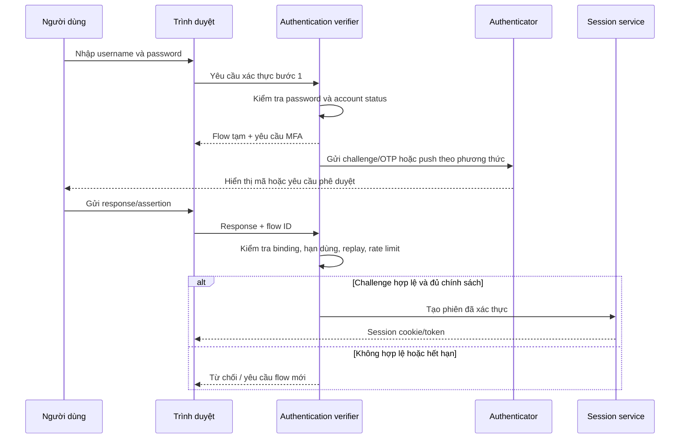
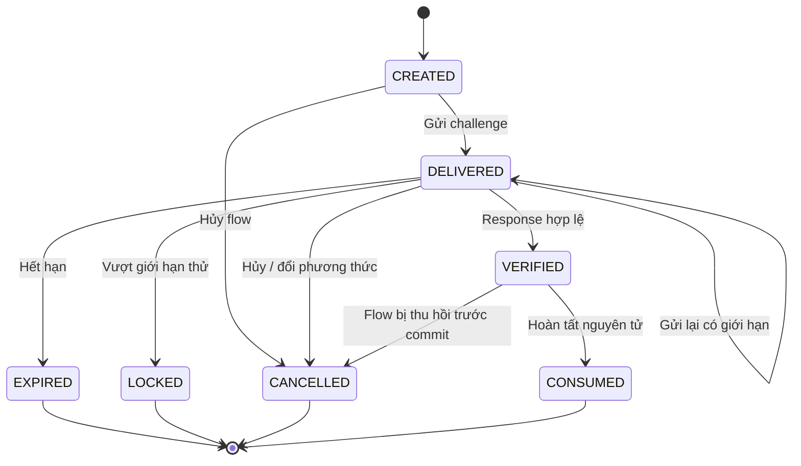

# MFA challenge — Thử thách xác thực đa yếu tố

## Mục tiêu học tập

Khi người dùng nhập đúng mật khẩu, hệ thống thường yêu cầu thêm mã OTP, phê duyệt push hoặc chữ ký passkey. Phần yêu cầu bổ sung đó là một **MFA challenge (thử thách xác thực đa yếu tố)**. Challenge giúp verifier xác định rằng bằng chứng thứ hai được tạo để đáp lại đúng yêu cầu đang chờ xử lý, thuộc đúng tài khoản và chưa bị sử dụng lại.

Nếu challenge dễ đoán, dùng chung giữa nhiều tài khoản, không có thời hạn, có thể phát lại hoặc được tiêu thụ không nguyên tử, MFA có thể bị vượt qua dù giao diện vẫn hiển thị hai bước.

Sau bài học, bạn có thể:

- Phân biệt challenge, OTP, authenticator, verifier, authentication flow và phiên đăng nhập.
- Mô hình hóa vòng đời challenge từ lúc tạo, gửi, xác minh, tiêu thụ đến hết hạn hoặc hủy.
- Ràng buộc challenge với đúng tài khoản, phiên tạm, phương thức, mục đích và giao dịch.
- Thiết kế challenge phù hợp cho TOTP, SMS/email OTP, push MFA và WebAuthn/passkey.
- Phòng chống brute force, replay, challenge substitution, MFA fatigue và ghép bằng chứng giữa các flow.
- Xử lý đồng thời, gửi lại mã, đổi phương thức, timeout, khôi phục và step-up an toàn.
- Kiểm thử cả đường thành công và các trường hợp challenge sai, cũ, lặp hoặc thuộc ngữ cảnh khác.

Bài học thuộc chương **MFA** trong mô-đun **SECURITY_AUTHENTICATION_FUNDAMENTALS**, nơi người học tìm hiểu credential, mật khẩu, MFA, passkey, chứng chỉ, token, phiên, liên kết danh tính và khôi phục tài khoản.

## 1. MFA challenge là gì?

**Challenge** là một yêu cầu xác thực có ngữ cảnh do verifier tạo ra để yêu cầu authenticator chứng minh quyền kiểm soát một yếu tố. Tùy giao thức, challenge có thể là:

- Một chuỗi ngẫu nhiên do server tạo để authenticator ký, như WebAuthn.
- Một mã giao dịch hoặc định danh flow để ràng buộc OTP/push với một yêu cầu đang chờ.
- Một yêu cầu phê duyệt có số đối chiếu hoặc chi tiết giao dịch, như push MFA.
- Một trạng thái server-side ghi nhận rằng bước đầu đã thành công và đang chờ bằng chứng tiếp theo.

**Challenge không đồng nghĩa với OTP.** OTP là một loại mã phản hồi được tạo từ secret, counter, thời gian hoặc được gửi qua một kênh. Challenge là ngữ cảnh và yêu cầu mà verifier muốn authenticator đáp lại. Một số hệ thống OTP không gửi challenge ngẫu nhiên riêng cho người dùng, nhưng vẫn cần authentication flow phía server để gắn mã OTP với tài khoản và mục đích.

### Các thành phần tham gia

| Thành phần | Vai trò |
| --- | --- |
| **Claimant / người dùng** | Người yêu cầu đăng nhập hoặc xác thực lại |
| **Authenticator** | Thiết bị/phần mềm tạo mã hoặc chữ ký, hay nhận yêu cầu phê duyệt |
| **Verifier** | Thành phần kiểm tra bằng chứng và quyết định challenge có được hoàn tất không |
| **Authentication flow** | Giao dịch xác thực tạm thời, chứa trạng thái các bước và ngữ cảnh |
| **Challenge** | Yêu cầu có giới hạn thời gian, gắn với flow và mục đích |
| **Response / assertion** | OTP, chữ ký hoặc kết quả phê duyệt được gửi lại |
| **Session/token service** | Chỉ cấp hoặc nâng quyền phiên sau khi toàn bộ chính sách xác thực đạt yêu cầu |

Một challenge tốt phải giúp verifier trả lời: **bằng chứng này được tạo để đáp lại yêu cầu nào, cho tài khoản nào, bằng phương thức nào, vào thời điểm nào và đã được sử dụng chưa?**

### Ví dụ đăng nhập hai bước

Người dùng nhập tên tài khoản và mật khẩu. Backend xác minh mật khẩu thành công nhưng chưa cấp phiên đăng nhập đầy đủ. Backend tạo flow tạm, yêu cầu authenticator TOTP cung cấp mã. Người dùng nhập mã; verifier kiểm tra mã và trạng thái flow. Chỉ khi cả hai bước được xác minh trong cùng flow, hệ thống mới tạo phiên theo chính sách.



Flow tạm **không phải phiên đã đăng nhập đầy đủ**. Nếu backend phát access token có quyền trước khi MFA hoàn tất, kẻ tấn công có thể bỏ qua challenge và dùng token đó trực tiếp.

## 2. Phân biệt challenge, OTP và các loại bằng chứng

| Cơ chế | Challenge/đầu vào | Response | Điều verifier phải kiểm tra |
| --- | --- | --- | --- |
| TOTP | Secret đã đăng ký và thời gian hiện tại theo thuật toán | Mã số theo time step | Secret thuộc tài khoản, mã đúng cửa sổ, giới hạn thử và chính sách chống dùng lại |
| HOTP | Secret và counter được quản lý | Mã số theo counter | Counter hợp lệ, không lùi, không chấp nhận lại response đã tiêu thụ |
| SMS/email OTP | Challenge/flow server-side và mã được tạo gửi qua kênh | Mã người dùng nhập | Account, purpose, flow, thời hạn, một lần sử dụng và giới hạn thử |
| Push MFA | Yêu cầu có transaction ID/ngữ cảnh | Phê duyệt/từ chối từ authenticator | Đúng thiết bị/tài khoản, challenge mới, ngữ cảnh hiển thị, chống fatigue và replay |
| WebAuthn/passkey | Challenge ngẫu nhiên do server tạo | Assertion có chữ ký | Chữ ký, challenge, origin, RP ID, credential/account và cờ UP/UV theo chính sách |
| Chứng chỉ client/mTLS | Handshake challenge của TLS và danh tính server/client | Chứng minh kiểm soát private key | Chuỗi chứng chỉ, mục đích, thời hạn, thu hồi và ánh xạ danh tính |

### Challenge và bằng chứng không giống nhau

Với WebAuthn, challenge là dữ liệu ngẫu nhiên được đưa vào quá trình tạo assertion; response có chữ ký bao phủ dữ liệu liên quan. Verifier kiểm tra chữ ký và đảm bảo challenge là challenge đang chờ của đúng flow.

Với TOTP, người dùng không nhập nonce mới từ server vào authenticator; mã được tính từ secret và thời gian. Vì thế verifier cần ràng buộc lần kiểm tra vào flow đang chờ, giới hạn cửa sổ thời gian và ngăn cùng một mã được chấp nhận nhiều lần nếu chính sách yêu cầu.

Với push, thông báo “Có đăng nhập mới, Approve?” là quá ít ngữ cảnh. Nếu người dùng không biết yêu cầu nào đang được phê duyệt, attacker có thể gửi lặp yêu cầu cho đến khi nạn nhân chấp thuận. Challenge cần có ngữ cảnh đủ rõ, có thể dùng number matching hoặc hiển thị thông tin thiết bị/phiên đã được kiểm chứng.

## 3. Vòng đời challenge

Một challenge không nên chỉ là chuỗi mã được tạo rồi so sánh. Nó là một thực thể có vòng đời và trạng thái rõ ràng.

### Các trạng thái cơ bản

| Trạng thái | Ý nghĩa | Chuyển tiếp hợp lệ |
| --- | --- | --- |
| `CREATED` | Server đã tạo challenge và gắn với flow | Gửi challenge, chờ response |
| `DELIVERED` | Challenge đã được gửi/đưa tới authenticator hoặc kênh người dùng | Chờ response; có thể gửi lại theo chính sách |
| `VERIFIED` | Response đã được verifier xác minh | Tiêu thụ/hoàn tất bước MFA |
| `CONSUMED` | Challenge đã được sử dụng thành công và không thể dùng lại | Trạng thái kết thúc |
| `EXPIRED` | Quá thời hạn hiệu lực | Không được chấp nhận; cần flow/challenge mới |
| `CANCELLED` | Flow bị hủy, đổi phương thức hoặc bị thu hồi | Không được chấp nhận |
| `LOCKED` | Vượt giới hạn thử hoặc bị chặn do rủi ro | Chờ quy trình mở khóa/khôi phục theo chính sách |

`VERIFIED` và `CONSUMED` có thể được gộp trong triển khai đơn giản, nhưng phải giữ được tính chất **response hợp lệ chỉ được dùng một lần**. Nếu tách hai trạng thái, cần bảo đảm không có khoảng thời gian mà response đã được xác minh nhưng challenge vẫn có thể hoàn tất lại ở request khác.

### Máy trạng thái minh họa



Một flow cũng cần trạng thái riêng, ví dụ `PASSWORD_VERIFIED`, `MFA_PENDING`, `MFA_VERIFIED`, `COMPLETED`, `EXPIRED`, `CANCELLED`. Trạng thái challenge không thay thế trạng thái flow; một flow có thể chứa nhiều challenge theo chính sách, nhưng chỉ challenge được chọn và xác minh trong đúng ngữ cảnh mới được tính.

### Các thuộc tính cần lưu

Một bản ghi challenge server-side có thể gồm:

| Trường | Mục đích |
| --- | --- |
| `challengeId` | Định danh ngẫu nhiên, không dùng làm bằng chứng duy nhất |
| `flowId` | Liên kết với authentication flow |
| `accountId` / `subjectId` | Tài khoản đã được xác định ở bước trước |
| `method` | TOTP, SMS, email, push, WebAuthn hoặc phương thức khác |
| `purpose` | Login, step-up, enrollment, recovery hay xác nhận giao dịch |
| `createdAt`, `expiresAt` | Thời điểm tạo và hạn cuối |
| `status` | Trạng thái vòng đời |
| `attemptCount`, `maxAttempts` | Giới hạn thử |
| `consumedAt` | Thời điểm sử dụng thành công |
| `verifierContext` | Tham chiếu credential/issuer/transaction cần thiết |
| `version` | Hỗ trợ cập nhật đồng thời và chống ghi đè |
| `riskContext` | Mã rủi ro hoặc thông tin tối thiểu cần thiết cho quyết định |

Không lưu plaintext OTP hoặc secret authenticator trong bản ghi challenge nếu không cần. Với mã do server tạo, có thể lưu hash/HMAC của mã cùng thông tin kiểm tra; cần dùng so sánh an toàn và bảo vệ khóa HMAC. Với TOTP, secret lâu dài phải được bảo vệ riêng, thường mã hóa bằng khóa quản lý an toàn; không nhầm secret TOTP với challenge ngắn hạn.

## 4. Ràng buộc challenge với đúng tài khoản, flow và mục đích

Một lỗi nghiêm trọng là kiểm tra response đúng nhưng không kiểm tra **response đó thuộc yêu cầu nào**.

Giả sử:

- Flow A xác minh mật khẩu của account A.
- Flow B đang chờ OTP cho account B.
- Người gửi có mã OTP hợp lệ của B và session tạm của A.

Nếu backend chỉ lưu cờ `passwordVerified=true` và `otpVerified=true`, nó có thể ghép hai kết quả để cấp phiên cho A. Đây là lỗi binding.

Mỗi challenge cần được ràng buộc với ít nhất:

1. **Account/principal:** tài khoản được xác định từ bước đã xác minh phía server.
2. **Flow ID:** giao dịch xác thực do server tạo, khó đoán và có thời hạn.
3. **Purpose:** login khác step-up, enrollment, recovery hoặc phê duyệt giao dịch.
4. **Authenticator:** credential ID hoặc kênh đã đăng ký thuộc đúng tài khoản.
5. **Thời gian:** challenge chưa hết hạn và response nằm trong cửa sổ chấp nhận.
6. **Session/browser context:** flow gắn với trình duyệt hoặc giao dịch đang thực hiện; cần chống CSRF và session swapping.
7. **Resource/transaction:** với step-up, ràng buộc tới hành động hoặc giao dịch cần được phê duyệt.
8. **Trạng thái tài khoản:** không cho challenge cũ hoàn tất sau khi tài khoản bị đình chỉ hoặc flow bị thu hồi.

### Purpose separation

Không tái sử dụng một mã cho nhiều mục đích:

| Mục đích | Ví dụ | Không được dùng thay cho |
| --- | --- | --- |
| `LOGIN` | Hoàn tất bước MFA khi đăng nhập | Reset password hoặc đổi email |
| `STEP_UP` | Nâng mức xác thực trước khi thêm passkey | Đăng nhập flow khác |
| `ENROLL_AUTHENTICATOR` | Xác minh khi đăng ký credential mới | Phê duyệt giao dịch |
| `RECOVERY` | Khôi phục sau khi mất yếu tố | MFA thường ngày |
| `TRANSACTION_APPROVAL` | Xác nhận giao dịch cụ thể | Xác nhận chung cho mọi giao dịch |

Challenge phải có purpose do server thiết lập. Không nhận purpose do client tự gửi để quyết định loại kiểm tra cần thực hiện.

## 5. Sinh challenge: độ ngẫu nhiên, entropy và thời hạn

Với challenge ngẫu nhiên, dùng bộ sinh số ngẫu nhiên mật mã (CSPRNG), không dùng timestamp, số tăng dần, Random không an toàn hoặc ID dễ đoán. Challenge cần đủ entropy để không thể đoán trong thời gian hiệu lực, được gắn với flow và hết hạn nhanh theo mục đích.

### Challenge ngẫu nhiên cho challenge–response

Ví dụ minh họa:

```java
import java.security.SecureRandom;
import java.util.Base64;

class ChallengeGenerator {
    private final SecureRandom random = new SecureRandom();

    String newChallenge() {
        byte[] bytes = new byte[32]; // 256 bit ngẫu nhiên
        random.nextBytes(bytes);
        return Base64.getUrlEncoder()
                .withoutPadding()
                .encodeToString(bytes);
    }
}
```

Độ dài 32 byte ở đây là lựa chọn minh họa phổ biến cho challenge ngẫu nhiên. Dữ liệu ngẫu nhiên phải được lưu hoặc kiểm tra theo cách phù hợp với giao thức; challenge không phải bí mật lâu dài nhưng cần khó đoán và không thể tái sử dụng ngoài flow.

### OTP ngắn có entropy thấp hơn

Mã sáu chữ số chỉ có một triệu khả năng; nếu không giới hạn thử, kẻ tấn công có thể brute force. Tăng độ dài có thể giúp, nhưng **rate limit, thời hạn, gắn tài khoản/flow và giám sát** là điều bắt buộc. Không coi thời hạn ngắn là đủ nếu endpoint cho phép thử hàng nghìn lần.

### Chọn thời hạn theo loại challenge

| Loại | Thời hạn/cửa sổ | Lưu ý |
| --- | --- | --- |
| SMS/email OTP | Vài phút theo chính sách sản phẩm | Cân bằng độ trễ nhận mã và thời gian phơi bày; giới hạn resend/attempt |
| TOTP | Cửa sổ time step ngắn theo cấu hình verifier | Cho phép clock skew rất hạn chế; không mở cửa sổ quá rộng |
| WebAuthn challenge | Hết hạn theo flow đăng nhập/step-up | Challenge phải mới và chỉ tiêu thụ một lần |
| Push approval | Ngắn, gắn request và context hiển thị | Có thể hủy khi user từ chối hoặc flow hết hạn |
| Recovery code/link | Theo chính sách recovery riêng | Một lần sử dụng, không tái dùng cho login/step-up khác |

Không có một TTL chung cho mọi challenge. Mã SMS có thể đến trễ do nhà mạng; WebAuthn response có thể cần người dùng tương tác; push có thể cần thời gian nhận thông báo. Thời hạn phải dựa vào rủi ro và độ trễ thực tế, nhưng không kéo dài vô hạn để giảm ticket hỗ trợ.

## 6. Xác minh response và tiêu thụ challenge nguyên tử

Một challenge hợp lệ phải chỉ được tiêu thụ thành công **một lần**, kể cả khi hai request đến gần như đồng thời.

### Race condition

Giả sử người dùng gửi cùng một OTP hai lần do double-click hoặc mạng retry. Hai request cùng đọc challenge trạng thái `DELIVERED`, cùng kiểm tra mã đúng, rồi cùng cấp phiên. Nếu việc đổi trạng thái không nguyên tử, một response có thể được sử dụng nhiều lần.

Cách xử lý:

- Dùng giao dịch cơ sở dữ liệu hoặc thao tác compare-and-set.
- Cập nhật có điều kiện `status = DELIVERED` và `expiresAt > now`.
- Chỉ một request được phép cập nhật sang `CONSUMED`.
- Chỉ request thắng thao tác tiêu thụ mới được phép hoàn tất flow/cấp phiên.
- Nếu response bị gửi lại, trả kết quả idempotent phù hợp hoặc từ chối; không cấp thêm phiên ngoài ý muốn.

Ví dụ SQL khái niệm:

```sql
-- Pseudocode SQL: cú pháp và kiểu dữ liệu tùy DBMS.
UPDATE mfa_challenges
SET status = 'CONSUMED',
    consumed_at = :now,
    version = version + 1
WHERE challenge_id = :challenge_id
  AND account_id = :account_id
  AND flow_id = :flow_id
  AND purpose = 'LOGIN'
  AND status = 'DELIVERED'
  AND expires_at > :now;
```

Sau lệnh cập nhật, ứng dụng phải kiểm tra số dòng bị ảnh hưởng bằng 1. Nếu là 0, challenge đã hết hạn, sai ngữ cảnh, bị hủy hoặc đã được request khác tiêu thụ. Việc xác minh OTP/chữ ký và tiêu thụ challenge phải được phối hợp sao cho không có khoảng trống cho request thứ hai.

Với challenge WebAuthn, việc xác minh chữ ký và cập nhật trạng thái challenge cũng cần được gắn với cùng transaction/flow; đừng chỉ kiểm tra chữ ký rồi bỏ qua việc challenge đã dùng.

### Idempotency và retry mạng

Có thể xảy ra tình huống server đã tiêu thụ challenge và tạo session nhưng response HTTP bị mất. Client retry có thể gửi lại response. Hệ thống nên có thiết kế idempotency cho flow: cùng flow có thể nhận lại kết quả đã hoàn tất theo cơ chế an toàn, nhưng **không tạo thêm phiên/quyền mới ngoài ý muốn**. Idempotency key cũng phải được gắn với đúng principal, flow và purpose; không để key của người này dùng cho người khác.

## 7. Giới hạn thử, resend và chống brute force

Challenge OTP ngắn có thể bị đoán. Cần giới hạn ở nhiều chiều thay vì chỉ khóa tài khoản toàn cục.

### Các chiều kiểm soát

- Theo challenge/flow: số lần response sai tối đa.
- Theo account: tần suất gửi mã và xác minh.
- Theo authenticator/kênh: số lần gửi SMS, email hoặc push.
- Theo IP/network/device signals: phát hiện lạm dụng nhưng không coi là bằng chứng danh tính.
- Theo toàn hệ thống: chống gửi SMS/push hàng loạt và chi phí phát sinh.
- Theo rủi ro: tăng kiểm soát hoặc yêu cầu phương thức khác khi có dấu hiệu tự động hóa.

Không nên chỉ dựa vào khóa tài khoản vĩnh viễn sau vài lần sai; attacker có thể cố tình khóa tài khoản nạn nhân. Dùng backoff, giới hạn thử, thời gian chờ, phát hiện bất thường và quy trình khôi phục. Thông báo ra ngoài nên tránh tiết lộ tài khoản tồn tại hay trạng thái bảo mật.

### Resend không được tạo nhiều challenge cùng quyền

Khi người dùng nhấn “Gửi lại mã”, hệ thống phải quyết định:

- Tái gửi cùng challenge nếu giao thức cho phép và chưa hết hạn.
- Hoặc hủy challenge cũ và tạo challenge mới, bảo đảm mã cũ không còn hiệu lực.
- Giới hạn số lần resend và thời gian giữa các lần gửi.
- Không tạo nhiều mã cùng lúc rồi chấp nhận tất cả, vì điều đó mở rộng cửa sổ tấn công.
- Không để mã resend dùng được cho account/purpose khác.

Nếu gửi lại SMS/email, mã cũ nên được vô hiệu hóa khi phát hành mã mới theo chính sách. Với TOTP, người dùng có thể thấy mã mới theo time step; verifier phải xử lý cửa sổ thời gian và chống chấp nhận lại phù hợp.

## 8. Challenge theo từng phương thức MFA

### 8.1. TOTP

TOTP dựa trên secret đã đăng ký và thời gian. Verifier tính mã kỳ vọng cho time step hiện tại (và có thể một số bước liền kề để bù clock skew). Verifier vẫn cần lưu account, flow, purpose, số lần thử và trạng thái.

Kiểm soát:

- Secret TOTP được tạo ngẫu nhiên và gắn với account sau enrollment đã xác minh.
- Bảo vệ secret ở server bằng mã hóa và quản lý khóa; chỉ tiết lộ QR/secret khi enrollment.
- Giới hạn số time step được chấp nhận lệch; không nới cửa sổ vô hạn.
- Rate limit endpoint kiểm tra mã.
- Có thể ghi nhận time step đã chấp nhận gần nhất để ngăn dùng lại mã trong cùng cửa sổ nếu chính sách yêu cầu.
- Khi mất authenticator, recovery là flow riêng; không tái tạo seed từ mã OTP cũ.

TOTP không gắn mật mã với website/origin. Người dùng có thể nhập mã vào trang phishing thời gian thực; challenge binding trong ứng dụng ngăn ghép sai flow nhưng không biến TOTP thành phishing-resistant.

### 8.2. SMS/email OTP

Server tạo mã ngẫu nhiên, gắn với account/flow/purpose, lưu bằng hash/HMAC và gửi qua kênh đã xác minh. Khi nhận response, kiểm tra đúng mã, chưa hết hạn, chưa tiêu thụ và chưa vượt rate limit.

Rủi ro cần xét:

- SIM swap, chuyển hướng SMS, chiếm hộp thư.
- Email có thể chính là kênh reset mật khẩu, tạo common-mode failure.
- OTP có thể bị phishing và relay thời gian thực.
- Mã có thể bị lộ qua notification preview, log hoặc analytics.
- Kẻ tấn công có thể lạm dụng resend để gây chi phí hoặc làm phiền nạn nhân.

SMS/email OTP có thể là phương thức dự phòng theo rủi ro nhưng không nên tự gắn nhãn chống phishing hoặc dùng làm đường khôi phục duy nhất cho tài khoản giá trị cao.

### 8.3. Push MFA

Push challenge cần hiển thị đủ thông tin để người dùng phân biệt yêu cầu thật:

- Thiết bị hoặc phiên đang yêu cầu xác thực, nếu có thông tin đáng tin.
- Thời điểm và vị trí/tín hiệu gần đúng chỉ khi có giá trị và không gây hiểu lầm.
- Number matching hoặc mã đối chiếu nhập trên thiết bị đăng nhập.
- Hành động đang được phê duyệt, đặc biệt với step-up/giao dịch.
- Nút từ chối và báo cáo yêu cầu đáng ngờ.

Giới hạn số push, gom hoặc trì hoãn yêu cầu lặp, tự hủy challenge cũ khi có flow mới theo chính sách, và ghi nhận các lần từ chối liên tiếp. Không coi việc bấm Approve là bằng chứng chống phishing nếu push không được ràng buộc với đúng challenge/transaction.

### 8.4. WebAuthn/passkey

Server tạo challenge ngẫu nhiên, gửi qua WebAuthn API. Authenticator dùng private key tương ứng credential để ký dữ liệu chứa challenge và context. Server xác minh:

1. Credential ID thuộc account đang đăng nhập.
2. Challenge khớp challenge đang chờ, chưa hết hạn và chưa dùng.
3. Chữ ký hợp lệ theo public key đã lưu.
4. Origin và RP ID hash phù hợp với relying party.
5. Cờ user presence (UP) và user verification (UV) đáp ứng chính sách.
6. Extension/attestation chỉ được kiểm tra khi chính sách yêu cầu và có hiểu đúng ý nghĩa.

Không tự gán AAL chỉ vì có passkey. Đặc tính đồng bộ khóa, bảo vệ phần cứng và chính sách authenticator ảnh hưởng đến mức bảo đảm. WebAuthn có ràng buộc origin mạnh, giúp chống phishing tốt hơn OTP nhập tay khi triển khai đúng.

### 8.5. Chứng chỉ và xác thực máy–máy

Trong mTLS, challenge phát sinh từ handshake TLS và client chứng minh kiểm soát private key của chứng chỉ. Không nên áp dụng nguyên xi UX OTP cho service-to-service; thay vào đó quản lý danh tính workload, cấp phát/rotation/thu hồi chứng chỉ, xác minh chuỗi và mục đích sử dụng, audience hoặc quyền dịch vụ. Chứng chỉ hợp lệ không có nghĩa service được phép gọi mọi API.

## 9. Step-up challenge cho hành động nhạy cảm

Một phiên đăng nhập đã có thể đủ để xem trang thông thường, nhưng chưa đủ để đổi email khôi phục, thêm passkey, gỡ MFA hoặc cấp quyền quản trị. Khi đó server tạo **step-up flow** có purpose rõ.

Ví dụ: người dùng đang ở trang bảo mật, yêu cầu thêm passkey. Server xác minh session và account status, tạo flow `ENROLL_AUTHENTICATOR`, yêu cầu xác thực lại bằng phương thức đủ mạnh. Challenge đăng ký passkey sau đó phải ràng buộc với flow này. Không cho phép dùng response MFA từ lần đăng nhập hôm qua để phê duyệt enrollment hôm nay nếu chính sách đòi xác thực gần đây.

Với giao dịch tài chính hoặc hành động có hậu quả cao, challenge nên ràng buộc **transaction details** (người nhận, số tiền, loại hành động). Nếu chỉ phê duyệt một thông báo chung “Bạn có muốn tiếp tục?”, attacker có thể thay nội dung giao dịch sau khi user đã approve. Cần hiển thị dữ liệu người dùng đang ký/phê duyệt và xác minh dữ liệu đó ở phía server.

## 10. Challenge, session và token sau khi xác thực

Khi challenge hoàn tất, verifier tạo kết quả xác thực đã kiểm chứng. Session/token service chỉ được nhận kết quả đó qua kênh tin cậy, cùng principal, phương thức, thời điểm và assurance context.

Một access token hoặc session có thể mang thông tin xác thực đã đạt, nhưng cần cẩn thận:

- `auth_time` biểu diễn thời điểm xác thực theo hợp đồng.
- `amr` mô tả phương thức đã dùng theo quy ước của issuer.
- `acr` biểu diễn lớp/ngữ cảnh xác thực theo thỏa thuận giữa issuer và relying party.
- Không gán `mfa=true` chỉ vì tài khoản đã đăng ký MFA.
- Không gán phishing-resistant khi lần xác thực dùng SMS/TOTP.
- Không cho token của flow chưa hoàn tất MFA truy cập API nghiệp vụ.
- Khi challenge bị hủy, tài khoản bị đình chỉ hoặc phiên bị thu hồi, không cho response cũ hoàn tất flow.

Sau login, session cookie cần cấu hình `Secure`, `HttpOnly`, `SameSite` phù hợp, xoay session ID sau xác thực và giới hạn thời gian sống. Với token, kiểm tra issuer, audience, chữ ký, expiry, scope và trạng thái thu hồi. **Challenge thành công là một bước trong xác thực, không thay thế kiểm tra account status hoặc authorization.**

## 11. Ví dụ Java: mô hình hóa challenge server-side

Ví dụ dưới đây minh họa phần quản lý trạng thái challenge. Nó **không tự xác minh mật khẩu, TOTP, SMS, push hoặc WebAuthn**. Các verifier chuyên biệt phải thực hiện kiểm tra giao thức trước khi gọi service hoàn tất challenge.

```java
import java.time.Instant;
import java.util.UUID;

enum ChallengeStatus {
    CREATED, DELIVERED, CONSUMED, EXPIRED, CANCELLED, LOCKED
}

enum ChallengePurpose {
    LOGIN, STEP_UP, ENROLL_AUTHENTICATOR, RECOVERY, TRANSACTION_APPROVAL
}

record Challenge(
        UUID id,
        UUID accountId,
        UUID flowId,
        ChallengePurpose purpose,
        String method,
        ChallengeStatus status,
        Instant expiresAt,
        int attempts,
        int maxAttempts,
        long version
) {}

record VerifiedResponse(
        UUID challengeId,
        UUID accountId,
        UUID flowId,
        ChallengePurpose purpose,
        Instant verifiedAt
) {}

interface ChallengeRepository {
    Challenge find(UUID challengeId);

    // Cập nhật có điều kiện status, version và expiresAt.
    // Chỉ một request đồng thời được phép tiêu thụ.
    boolean consumeAtomically(
            UUID challengeId,
            UUID accountId,
            UUID flowId,
            ChallengePurpose purpose,
            long expectedVersion,
            Instant now
    );
}

class ChallengeService {
    private final ChallengeRepository repository;

    ChallengeService(ChallengeRepository repository) {
        this.repository = repository;
    }

    boolean complete(
            VerifiedResponse proof,
            UUID expectedAccountId,
            UUID expectedFlowId,
            ChallengePurpose expectedPurpose,
            Instant now) {

        if (proof == null || now == null) {
            return false;
        }

        if (!expectedAccountId.equals(proof.accountId())
                || !expectedFlowId.equals(proof.flowId())
                || expectedPurpose != proof.purpose()) {
            return false;
        }

        Challenge challenge = repository.find(proof.challengeId());
        if (challenge == null
                || challenge.status() != ChallengeStatus.DELIVERED
                || !challenge.accountId().equals(expectedAccountId)
                || !challenge.flowId().equals(expectedFlowId)
                || challenge.purpose() != expectedPurpose
                || !challenge.expiresAt().isAfter(now)
                || challenge.attempts() >= challenge.maxAttempts()) {
            return false;
        }

        // Proof phải được authenticator-specific verifier xác minh trước đó.
        // Repository thực hiện compare-and-set trong transaction.
        return repository.consumeAtomically(
                challenge.id(),
                expectedAccountId,
                expectedFlowId,
                expectedPurpose,
                challenge.version(),
                now
        );
    }
}
```

**Các giới hạn của ví dụ:**

- `VerifiedResponse` chỉ được tạo bởi verifier nội bộ sau khi kiểm tra response thực tế. Không deserialize object này từ JSON client.
- Cần cập nhật attempt count nguyên tử khi response sai; code trên minh họa đường hoàn tất thành công, không triển khai rate limiter.
- `consumeAtomically` phải kiểm tra lại status, version, account, flow, purpose và expiry ngay trong thao tác cập nhật. Kiểm tra trước rồi cập nhật vô điều kiện vẫn có race condition.
- Chỉ sau khi tiêu thụ thành công mới cập nhật flow sang `MFA_VERIFIED` và cấp session/token; hai thao tác nên có transaction hoặc outbox/idempotency phù hợp.
- Cần kiểm tra account status, session context, risk policy và quyền trước khi cấp hoặc nâng phiên.
- Nếu challenge đã tiêu thụ mà response mạng bị mất, xử lý retry idempotent theo flow; không tạo thêm quyền hoặc phiên ngoài ý muốn.

### Ví dụ SQL cho tiêu thụ một lần

```sql
-- Pseudocode; dùng transaction và cú pháp phù hợp DBMS.
UPDATE mfa_challenges
SET status = 'CONSUMED',
    consumed_at = :now,
    version = version + 1
WHERE challenge_id = :challenge_id
  AND account_id = :account_id
  AND flow_id = :flow_id
  AND purpose = 'LOGIN'
  AND status = 'DELIVERED'
  AND expires_at > :now
  AND version = :expected_version;
```

Ứng dụng chỉ tiếp tục nếu đúng một bản ghi được cập nhật. Nếu không, từ chối hoặc đọc lại trạng thái flow để trả kết quả idempotent đã hoàn tất.

## 12. Lỗi triển khai thường gặp

| Lỗi | Hậu quả | Cách phòng tránh |
| --- | --- | --- |
| Challenge không gắn account ID | Có thể dùng response của tài khoản này cho tài khoản khác | Binding account/principal ở server |
| Challenge không gắn flow ID | Ghép response giữa các lần đăng nhập | Flow riêng, khó đoán và có thời hạn |
| Dùng chung purpose | OTP reset có thể bị dùng cho login/step-up | Purpose separation và kiểm tra server-side |
| Challenge không hết hạn | Response cũ có thể dùng lại lâu sau | Expiry ngắn theo loại và rủi ro |
| Không rate limit OTP | Brute force mã số ngắn | Giới hạn theo account, flow, kênh, nguồn và toàn hệ thống |
| Không chống replay | Cùng response hoàn tất nhiều lần | One-time consume, counter/nonce, rotation |
| Hai request cùng tiêu thụ | Tạo hai phiên hoặc xử lý giao dịch hai lần | Transaction/CAS/idempotency |
| Resend giữ mọi mã cũ hợp lệ | Tăng số response có thể đoán/được chấp nhận | Hủy mã cũ hoặc quản lý một challenge hiệu lực theo chính sách |
| Push không có context | Người dùng approve nhầm do MFA fatigue | Number matching, transaction details, giới hạn push |
| TOTP bị xem là chống phishing | Phishing thời gian thực vẫn chuyển tiếp được mã | Ghi nhận đúng đặc tính; dùng WebAuthn cho yêu cầu chống phishing |
| Cấp token trước MFA | Bỏ qua challenge bằng token đã cấp | Chỉ tạo full session sau khi flow hoàn tất |
| Lấy account/purpose từ client | Thay đổi ngữ cảnh challenge | Chỉ dùng context đã xác minh phía server |
| Không kiểm tra account status lần cuối | Tài khoản bị đình chỉ vẫn hoàn tất challenge cũ | Kiểm tra trạng thái khi hoàn tất và trước cấp session |
| Log OTP/challenge bí mật | Rò rỉ mã còn hiệu lực | Redact, không log response/secret/token |
| Recovery yếu hơn MFA | Attacker bỏ qua challenge chính qua đường phụ | Recovery policy riêng, hạn chế sau khôi phục |

## 13. Bảng kiểm thử MFA challenge

| Trường hợp | Dữ liệu/thao tác | Kết quả mong đợi |
| --- | --- | --- |
| Challenge hợp lệ | Response đúng account, flow, purpose và còn hạn | Chỉ một lần hoàn tất flow |
| Sai OTP | Mã không khớp | Từ chối, tăng attempt nguyên tử |
| Challenge hết hạn | Response đến sau expiresAt | Từ chối |
| Challenge đã tiêu thụ | Gửi lại cùng response | Không cấp thêm session |
| Sai account | Challenge của B gửi trong flow A | Từ chối |
| Sai flow | Response thuộc flow cũ | Từ chối |
| Sai purpose | Mã recovery dùng cho login | Từ chối |
| Replay WebAuthn | Assertion dùng challenge đã dùng | Từ chối |
| Replay HOTP/TOTP theo chính sách one-time | Mã/counter đã được chấp nhận | Từ chối dùng lại |
| Vượt max attempts | Nhiều response sai | Khóa/hủy challenge và áp dụng rate limit |
| Resend mã | Phát hành challenge mới | Mã cũ bị vô hiệu hóa theo chính sách |
| Hai request đồng thời | Cùng response được gửi hai lần | Chỉ một request tiêu thụ thành công |
| Push fatigue | Nhiều yêu cầu lặp | Rate limit, hiển thị context, cho phép từ chối/báo cáo |
| Account bị đình chỉ | Challenge cũ còn hạn | Không cấp phiên |
| Flow bị hủy | Người dùng đổi phương thức hoặc logout | Challenge cũ bị cancel |
| Token trước MFA | Client thử gọi API bằng token tạm | Không có quyền nghiệp vụ |
| Step-up sai giao dịch | Challenge tạo cho giao dịch A dùng cho B | Từ chối |
| Recovery yếu | Email recovery thành công nhưng account có security hold | Không tự gỡ hold hoặc cấp quyền cao |

Ngoài unit test, cần integration test cho race condition, clock skew, delivery delay, resend, nhiều tab trình duyệt, nhiều thiết bị, session fixation và lỗi mạng sau khi challenge đã tiêu thụ. Đo cả tỷ lệ timeout hợp lệ và tỷ lệ từ chối replay để điều chỉnh UX mà không nới lỏng kiểm soát.

## 14. Checklist thiết kế challenge

Trước khi triển khai MFA challenge, hãy tự hỏi:

1. Challenge do thành phần server nào tạo? Có dùng CSPRNG nếu giao thức cần nonce không?
2. Challenge gắn với account, flow, purpose và authenticator nào?
3. Challenge có hạn dùng, số lần thử và chính sách resend rõ ràng không?
4. Response được verifier chuyên biệt xác minh theo đúng giao thức chưa?
5. Có chống replay, challenge substitution và ghép bằng chứng khác flow không?
6. Tiêu thụ challenge có nguyên tử khi nhiều request đồng thời không?
7. Có xử lý retry mạng/idempotency mà không cấp phiên hai lần không?
8. Full session/token chỉ được cấp sau khi toàn bộ chính sách MFA hoàn tất?
9. Account status, session state và quyền được kiểm tra lại trước khi hoàn tất?
10. Enrollment, step-up, fallback và recovery có purpose riêng và không tạo đường vòng yếu hơn?
11. Log có loại bỏ OTP, secret, private key, bearer token và session ID không?
12. Người dùng có đủ ngữ cảnh để phân biệt yêu cầu push thật, từ chối và báo cáo lạm dụng không?

## 15. Bài tập vận dụng

Một ứng dụng dùng mật khẩu + OTP sáu chữ số qua SMS. Backend tạo mã, lưu mã trong database, gửi SMS và cho phép xác minh không giới hạn số lần trong 15 phút. Mỗi lần bấm resend, hệ thống tạo mã mới nhưng vẫn chấp nhận mọi mã chưa hết hạn. Endpoint xác minh chỉ nhận userId và code; sau khi mã đúng, nó phát JWT đầy đủ. Người dùng có thể dùng cùng endpoint này để đăng nhập, reset mật khẩu và thêm passkey.

**Yêu cầu:**

1. Vẽ vòng đời challenge hiện tại và chỉ ra ít nhất sáu lỗi thiết kế.
2. Thiết kế schema/flow mới với account ID, flow ID, purpose, thời hạn, attempt count, status và version.
3. Mô tả cách lưu mã, giới hạn resend, tiêu thụ nguyên tử và xử lý retry.
4. Phân biệt response cho login, recovery, enrollment và step-up; giải thích vì sao không được dùng chung purpose.
5. Viết test cho sai account, sai flow, replay, hết hạn, hai request đồng thời, account bị đình chỉ và resend.
6. Đề xuất một phương thức chống phishing cho thao tác thêm passkey hoặc thay đổi yếu tố khôi phục.

**Gợi ý tự đánh giá:** Một mã đúng chưa đủ để cấp phiên. Nó phải đúng tài khoản, flow và mục đích, còn hạn, chưa bị dùng, nằm trong giới hạn thử và được verifier kiểm tra. Việc tiêu thụ phải nguyên tử; sau đó server mới hoàn tất flow và kiểm tra account/session trước khi cấp quyền.

---

**Điểm cần nhớ:** MFA challenge là **một giao dịch xác thực có ngữ cảnh và vòng đời**, không chỉ là một mã OTP. Hệ thống phải ràng buộc response với đúng tài khoản, flow, purpose, authenticator và thời điểm; chống đoán, replay, resend abuse và race condition; chỉ cấp hoặc nâng phiên sau khi challenge được xác minh và tiêu thụ an toàn.
