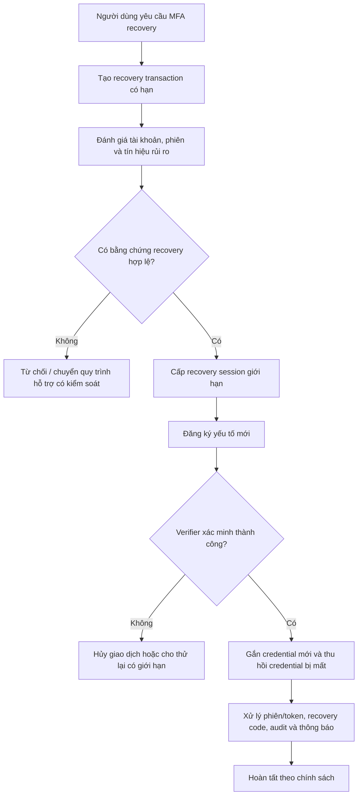

# MFA recovery — Khôi phục khi mất yếu tố xác thực đa yếu tố

## 1. MFA recovery là gì?

**MFA recovery** là tập hợp quy trình và cơ chế giúp người dùng lấy lại khả năng truy cập tài khoản khi họ mất, hỏng hoặc không còn sử dụng được một hay nhiều yếu tố xác thực đa yếu tố (MFA). Tình huống thường gặp gồm mất điện thoại chứa ứng dụng TOTP, mất khóa bảo mật, thay thiết bị, mất SIM, xóa nhầm authenticator, không còn mã dự phòng hoặc không thể truy cập phương thức xác minh đã đăng ký.

Khôi phục MFA là một phần của **vòng đời xác thực và quyền kiểm soát tài khoản**. Khi hệ thống cho phép một người bỏ qua yếu tố hiện tại và đăng ký yếu tố mới, hệ thống đang chấp nhận một bằng chứng khác để trao lại khả năng xác thực. Nếu bằng chứng khôi phục yếu hơn nhiều so với MFA chính, kẻ tấn công có thể đi vòng qua lớp bảo vệ mà không cần phá mật khẩu hay passkey.

Trong mô-đun **SECURITY_AUTHENTICATION_FUNDAMENTALS**, MFA recovery kết nối trực tiếp với credential, mật khẩu, passkey, chứng chỉ, token, phiên, liên kết danh tính và account ownership. Quy trình cần xác định ai có quyền yêu cầu khôi phục, bằng chứng nào đủ tin cậy, cách chống phishing/replay/lạm dụng và điều gì xảy ra với phiên cùng credential cũ sau khi hoàn tất.

**Ví dụ:** Một nhân viên đăng nhập bằng mật khẩu và khóa bảo mật FIDO2. Nhân viên làm mất khóa khi đi công tác. Bộ phận hỗ trợ nhận cuộc gọi và được yêu cầu gỡ MFA. Nếu chỉ cần người gọi đọc ngày sinh và mã nhân viên, kẻ tấn công biết thông tin cá nhân có thể chiếm quyền tài khoản. Quy trình recovery phải chứng minh đủ cơ sở rằng người yêu cầu có quyền kiểm soát tài khoản, sau đó mới cho đăng ký yếu tố mới.

### Mục tiêu học tập

Sau bài này, người học có thể:

- Giải thích vì sao recovery là một phần của xác thực, không phải ngoại lệ bỏ qua bảo mật.
- Phân biệt recovery code, yếu tố dự phòng, email/SMS, xác minh danh tính và hỗ trợ thủ công.
- Thiết kế quy trình khôi phục theo mức rủi ro của tài khoản và loại yếu tố bị mất.
- Bảo vệ token khôi phục khỏi đoán, replay, lộ qua log và sử dụng sai tài khoản.
- Xử lý phiên, token, credential cũ và thông báo sau khi recovery.
- Nhận diện social engineering, SIM swap, phishing, account takeover và lạm dụng help desk.

## 2. Tại sao recovery là một ranh giới tin cậy quan trọng?

MFA được triển khai để yêu cầu người dùng chứng minh quyền kiểm soát nhiều yếu tố theo chính sách. Khi người dùng mất một yếu tố, hệ thống phải quyết định có cho phép họ thay thế yếu tố đó hay không. **Recovery chính là một đường khác để thay đổi trạng thái xác thực của tài khoản.**

Giả sử đăng nhập chính yêu cầu:

1. Mật khẩu đã đăng ký.
2. Mã TOTP từ authenticator.

Nhưng luồng “Tôi mất điện thoại” chỉ yêu cầu một email có thể bị chiếm đoạt. Kẻ tấn công không cần vượt qua mật khẩu và TOTP; họ chỉ cần chiếm hộp thư hoặc phiên email để reset yếu tố thứ hai. Mức bảo vệ thực tế của tài khoản khi đó bị giới hạn bởi đường recovery yếu nhất.

### Recovery phải trả lời bốn câu hỏi

| Câu hỏi | Ý nghĩa |
|---|---|
| Ai đang yêu cầu? | Xác định account ID và chủ thể đang có phiên hoặc đang thực hiện yêu cầu |
| Bằng chứng nào chứng minh quyền khôi phục? | Yếu tố dự phòng, recovery code, phiên tin cậy, quy trình proofing hoặc kiểm tra hỗ trợ |
| Phạm vi được cấp là gì? | Chỉ cho phép thay yếu tố, hay được đăng nhập đầy đủ và thao tác nghiệp vụ? |
| Sau recovery, điều gì bị thay đổi/thu hồi? | Credential cũ, phiên, token, thiết bị, recovery code và thông báo |

Một yêu cầu khôi phục hợp lệ không tự động trao quyền quản trị hoặc quyền trên mọi dữ liệu. Sau khi lấy lại quyền đăng nhập, ứng dụng vẫn cần authorization cho từng hành động và tài nguyên.

## 3. Các tình huống thường cần MFA recovery

| Tình huống | Ví dụ | Hướng xử lý cần cân nhắc |
|---|---|---|
| Mất thiết bị | Điện thoại có TOTP bị mất | Dùng yếu tố dự phòng hoặc recovery code; đánh giá và thu hồi phiên/thiết bị mất |
| Thiết bị hỏng hoặc đổi máy | Ứng dụng authenticator không thể khôi phục dữ liệu | Dùng credential khác đã đăng ký hoặc quy trình recovery |
| Mất khóa bảo mật | Khóa FIDO2 bị thất lạc | Dùng khóa dự phòng; nếu không còn, xác minh theo chính sách rồi đăng ký khóa mới |
| Mất số điện thoại | Đổi SIM, mất SIM hoặc số bị thu hồi | Không mặc định SMS là bằng chứng duy nhất; xác minh kênh mới và quyền kiểm soát tài khoản |
| Mất hộp thư | Không truy cập email khôi phục | Dùng yếu tố độc lập đã đăng ký hoặc quy trình hỗ trợ có kiểm soát |
| Xóa nhầm authenticator | Người dùng gỡ TOTP khỏi ứng dụng | Dùng yếu tố dự phòng; nếu không có thì recovery có kiểm tra |
| Nghi bị chiếm đoạt | Có login lạ, phishing hoặc SIM swap | Ưu tiên khóa/giới hạn tài khoản, thu hồi phiên và xác minh lại trước khi cấp credential mới |
| Tài khoản doanh nghiệp | Nhân viên đổi điện thoại, quản trị viên nghỉ việc | Dùng quy trình IdP/help desk/administrator được phân quyền và audit |

Không phải mọi trường hợp mất thiết bị đều có cùng rủi ro. Mất một thiết bị nhưng vẫn còn khóa bảo mật thứ hai khác với việc mất đồng thời điện thoại, email và phiên đang đăng nhập. Recovery policy cần xem xét **bằng chứng còn lại, quyền của tài khoản, dấu hiệu lạm dụng và hậu quả nếu trao quyền nhầm**.

## 4. Các phương thức khôi phục

Không có một phương thức phù hợp cho tất cả tài khoản. Mỗi phương thức có đặc tính tin cậy, khả năng sử dụng và rủi ro riêng.

| Phương thức | Cách hoạt động | Ưu điểm | Hạn chế/rủi ro |
|---|---|---|---|
| Yếu tố MFA dự phòng | Người dùng xác thực bằng một authenticator khác đã đăng ký | Nhanh, không cần help desk | Nếu yếu tố dự phòng cùng thiết bị/kênh với yếu tố bị mất thì có thể mất cùng lúc |
| Recovery code | Mã bí mật được tạo trước, lưu ngoại tuyến hoặc trong kho an toàn | Có thể sử dụng khi mất thiết bị | Nếu bị chụp/lộ, người khác có thể dùng; cần entropy, dùng một lần và quản lý an toàn |
| Email recovery | Gửi link hoặc mã đến email đã đăng ký | Dễ triển khai và quen thuộc | Hộp thư có thể bị chiếm; email đổi chủ; phishing và session theft |
| SMS/voice | Gửi mã tới số điện thoại | Dễ tiếp cận với nhiều người dùng | SIM swap, port-out, chuyển tiếp, phishing và rủi ro nhà mạng |
| Passkey/khóa bảo mật thứ hai | Người dùng dùng credential độc lập đã đăng ký | Có thể chống phishing tốt | Phải đăng ký từ trước và có quy trình quản lý thiết bị |
| IdP doanh nghiệp | Quản trị viên/IdP xử lý recovery theo chính sách tổ chức | Có quy trình nhân sự và danh tính tập trung | Phụ thuộc bảo mật IdP, quyền admin và help desk |
| Help desk/manual proofing | Nhân viên hỗ trợ kiểm tra bằng chứng rồi khởi tạo reset | Hỗ trợ trường hợp mất mọi yếu tố | Social engineering, nhân viên lạm quyền hoặc quy trình xác minh không nhất quán |
| Khóa khôi phục phần cứng/quy trình tổ chức | Sử dụng thiết bị hoặc thủ tục dự phòng được cấp phát có kiểm soát | Có thể phù hợp tài khoản đặc quyền | Chi phí, vận hành, lưu giữ và phân tách trách nhiệm |

### Nguyên tắc lựa chọn

- Ưu tiên phương thức dự phòng **được đăng ký trước**, có tính độc lập với yếu tố bị mất.
- Không xem email hoặc SMS là bằng chứng mạnh mặc định chỉ vì người dùng nhận được mã.
- Với tài khoản có quyền cao hoặc dữ liệu nhạy cảm, yêu cầu recovery có assurance tương xứng với tác động.
- Không để một help desk agent đơn lẻ có thể bỏ qua mọi kiểm tra và reset MFA không có audit.
- Cung cấp nhiều lựa chọn hợp lý để tránh người dùng phải chọn đường yếu nhất vì không thể sử dụng thiết bị.

## 5. Recovery code: thiết kế, lưu trữ và sử dụng an toàn

**Recovery code** là bí mật dự phòng được tạo trước để người dùng chứng minh quyền truy cập khi mất authenticator chính. Một số hệ thống cấp một mã duy nhất; hệ thống khác cấp một tập nhiều mã, mỗi mã dùng một lần.

### Tạo mã

Recovery code cần:

- Được sinh bằng bộ sinh số ngẫu nhiên mật mã (CSPRNG).
- Có entropy đủ lớn để chống đoán trực tuyến và offline theo threat model.
- Gắn với đúng account ID và mục đích recovery.
- Không chứa thông tin dễ đoán như ngày sinh, username hoặc số điện thoại.
- Có thể được thay mới; khi tạo bộ mới, bộ cũ phải bị vô hiệu hóa theo chính sách.

Không tự chế mã bằng timestamp, số tăng tuần tự, mã ngắn dựa trên ID hoặc hàm băm không có nguồn entropy phù hợp.

### Lưu trữ

Recovery code là credential. Không ghi mã rõ vào log, analytics, email thông báo hoặc hệ thống ticket hỗ trợ. Có thể chỉ lưu giá trị kiểm chứng đã được bảo vệ (ví dụ hash phù hợp với entropy và threat model), cùng trạng thái đã dùng/chưa dùng và metadata cần thiết. Người dùng cần được hướng dẫn lưu mã ở nơi an toàn, không chụp ảnh công khai hoặc gửi qua chat.

Nếu hệ thống chỉ cần kiểm tra mã mà không bao giờ hiển thị lại mã gốc, thường không cần lưu mã rõ. Cách lưu cụ thể phụ thuộc thiết kế, nhưng phải bảo vệ khỏi đọc trái phép và sửa trạng thái sử dụng.

### Sử dụng

Khi người dùng gửi recovery code:

1. Xác định tài khoản và recovery transaction đang hoạt động.
2. Kiểm tra mã bằng cơ chế so khớp an toàn.
3. Kiểm tra mã còn hiệu lực, chưa dùng và đúng mục đích.
4. Đánh dấu mã đã sử dụng **một cách nguyên tử** để hai request đồng thời không thể cùng thành công.
5. Tạo phiên recovery có phạm vi giới hạn hoặc cho phép đăng ký yếu tố thay thế theo chính sách.
6. Ghi audit và thông báo sự kiện phù hợp.

Không để mã có thể replay vô hạn. Nếu người dùng làm mất toàn bộ mã, hệ thống phải cung cấp quy trình tạo lại sau khi xác minh đủ điều kiện; không được âm thầm cấp mã mới chỉ dựa trên một request chưa được xác thực.

## 6. Quy trình MFA recovery an toàn

Một quy trình tổng quát có thể chia thành các giai đoạn:

### Giai đoạn 1 — Khởi tạo yêu cầu

- Người dùng chọn tài khoản hoặc nhập định danh cần khôi phục.
- Hệ thống phản hồi theo cách hạn chế account enumeration; không tiết lộ tài khoản có tồn tại hoặc yếu tố nào đang đăng ký cho người không được xác thực.
- Tạo recovery transaction có ID ngẫu nhiên, thời hạn, trạng thái và giới hạn số lần thử.
- Thu thập tín hiệu rủi ro cần thiết như phiên hiện có, dấu hiệu đăng nhập bất thường hoặc thay đổi thông tin gần đây.

### Giai đoạn 2 — Xác minh quyền khôi phục

- Ưu tiên yếu tố dự phòng đã đăng ký hoặc recovery code.
- Nếu dùng email/SMS, đánh giá mức bảo đảm của kênh và rủi ro chiếm đoạt; không tự nâng mức tin cậy chỉ vì mã được nhập đúng.
- Nếu phải qua help desk, dùng playbook có bằng chứng, quyền hạn, phê duyệt và audit.
- Với tài khoản đặc quyền, có thể yêu cầu hai người phê duyệt hoặc kiểm tra độc lập theo chính sách.

### Giai đoạn 3 — Cấp quyền thay thế có giới hạn

Sau khi xác minh đủ điều kiện, hệ thống có thể cấp **recovery session** chỉ cho phép thực hiện các thao tác phục hồi như thêm passkey hoặc đăng ký MFA mới. Không nên mặc nhiên cấp một phiên đầy đủ có thể đọc dữ liệu nhạy cảm, chuyển tiền hoặc thay đổi quyền quản trị.

### Giai đoạn 4 — Đăng ký yếu tố mới

- Người dùng tạo/đăng ký authenticator mới qua giao thức hợp lệ.
- Máy chủ kiểm tra challenge, origin, RP ID, chữ ký hoặc điều kiện tương ứng với phương thức.
- Credential mới gắn với account ID đã xác minh.
- Nếu thay đổi kênh recovery, cần xác minh kênh mới và thông báo kênh cũ khi phù hợp.

### Giai đoạn 5 — Thu hồi và hoàn tất

- Đánh giá yếu tố bị mất: thu hồi credential cũ hoặc đánh dấu không còn tin cậy.
- Thu hồi phiên/token trên thiết bị bị mất hoặc nghi bị xâm nhập theo chính sách.
- Vô hiệu hóa recovery code đã dùng và cân nhắc cấp bộ mới.
- Gửi thông báo bảo mật, ghi audit và hướng dẫn người dùng kiểm tra hoạt động gần đây.
- Áp dụng thời gian chờ hoặc hạn chế một số thao tác rủi ro cao nếu chính sách yêu cầu.



## 7. Recovery session không phải phiên đăng nhập thông thường

Một lỗi thiết kế phổ biến là sau khi xác minh recovery code hoặc link email, hệ thống phát hành access token giống hệt phiên đăng nhập đầy đủ. Kẻ tấn công có thể tận dụng phiên này để truy cập dữ liệu hoặc thực hiện hành động không liên quan tới việc khôi phục.

Nên phân biệt:

| Thuộc tính | Phiên đăng nhập | Recovery session |
|---|---|---|
| Mục tiêu | Truy cập ứng dụng theo quyền đã cấp | Hoàn tất thay thế/khôi phục phương thức xác thực |
| Phạm vi | Theo authorization của người dùng | Giới hạn vào thao tác recovery được phép |
| Thời hạn | Theo chính sách session | Thường ngắn hơn và gắn với một recovery transaction |
| Hành động nhạy cảm | Có thể được phép nếu đủ quyền/assurance | Không mặc nhiên được phép |
| Kết thúc | Logout, timeout, revoke | Khi hoàn tất, hết hạn, bị hủy hoặc phát hiện rủi ro |

Recovery session cần được bảo vệ khỏi CSRF, fixation và replay giống phiên thông thường. ID giao dịch không phải bí mật duy nhất để xác thực; phải gắn với trạng thái server-side và bằng chứng đã xác minh.

## 8. Help desk recovery và chống social engineering

Help desk thường là đường khôi phục cuối cùng khi người dùng mất mọi yếu tố. Đây cũng là mục tiêu hấp dẫn vì nhân viên hỗ trợ có thể có quyền reset MFA, mở khóa tài khoản hoặc thay đổi số điện thoại.

### Những cách tấn công thường gặp

- Kẻ tấn công gọi điện giả danh nhân viên, nói rằng đang bị khóa tài khoản gấp.
- Dùng thông tin cá nhân rò rỉ để trả lời câu hỏi bảo mật.
- Giả mạo quản lý hoặc đồng nghiệp để yêu cầu reset cho nhân viên khác.
- Lạm dụng quy trình khẩn cấp ngoài giờ khi ít người kiểm tra.
- Lừa nhân viên hỗ trợ đọc OTP, recovery code hoặc nhấp link do attacker gửi.
- Chiếm tài khoản help desk hoặc workstation hỗ trợ để thực hiện reset hàng loạt.

### Kiểm soát help desk

- Không dùng ngày sinh, địa chỉ, số nhân viên hoặc câu hỏi bí mật dễ tìm làm bằng chứng duy nhất.
- Xác minh theo quy trình độc lập đã được phê duyệt; bằng chứng phải phù hợp loại tài khoản và hậu quả.
- Phân tách người yêu cầu, người xác minh và người phê duyệt khi rủi ro cao.
- Giới hạn quyền help desk theo nhóm tài khoản và thao tác; không cấp quyền admin toàn cục nếu không cần.
- Ghi audit người thực hiện, người phê duyệt, tài khoản mục tiêu, lý do, thời điểm và kết quả.
- Thông báo tới kênh hiện hữu của người dùng khi có thể; có đường báo cáo nếu họ không yêu cầu thay đổi.
- Đào tạo nhân viên không bao giờ yêu cầu người dùng đọc mật khẩu, OTP, private key hoặc recovery code qua điện thoại/chat.
- Theo dõi reset bất thường theo nhân viên hỗ trợ, nhóm tài khoản, thời điểm và số lượng.

### Break-glass account

Tài khoản khẩn cấp (break-glass) có thể cần thiết để khôi phục dịch vụ khi IdP hoặc MFA chính gặp sự cố. Tài khoản này phải có phạm vi sử dụng hẹp, credential lưu trữ đặc biệt an toàn, phê duyệt và audit sau sử dụng, kiểm tra định kỳ và cơ chế thay đổi credential. Không nên để break-glass trở thành tài khoản quản trị dùng hằng ngày.

## 9. Rủi ro của email, SMS và kênh khôi phục

### Email

Email là kênh phổ biến nhưng không phải lúc nào cũng độc lập với tài khoản cần khôi phục. Nếu người dùng dùng cùng một hộp thư làm username, recovery channel và nơi nhận thông báo, kẻ chiếm email có thể nắm nhiều mắt xích.

Khi dùng email:

- Xác minh địa chỉ trước khi cho phép làm recovery channel.
- Token/link có thời hạn, dùng một lần, gắn với đúng account và giao dịch.
- Không đưa thông tin nhạy cảm vào subject hoặc URL dễ lộ qua log/referrer.
- Không tự động gắn email mới vào tài khoản chỉ vì người dùng kiểm soát hộp thư đó.
- Thông báo thay đổi qua kênh cũ nếu phù hợp, nhưng tránh gửi thông tin cho địa chỉ đã bị thay đổi trái phép.

### SMS và SIM swap

Kẻ tấn công có thể lừa nhà mạng chuyển số điện thoại sang SIM do họ kiểm soát, khai thác quy trình port-out hoặc chiếm tài khoản nhà mạng. Do đó, SMS OTP không nên được xem là phương thức recovery mạnh duy nhất cho tài khoản đặc quyền hoặc dữ liệu có tác động lớn.

Nếu hệ thống vẫn hỗ trợ SMS vì lý do tiếp cận người dùng, cần giới hạn thử, phát hiện thay đổi SIM/thiết bị khi có tín hiệu, yêu cầu bằng chứng bổ sung cho hành động rủi ro cao và có phương thức dự phòng an toàn.

### Câu hỏi bảo mật

Câu hỏi như tên trường cũ, nơi sinh hoặc tên thú cưng thường có thể bị tìm qua mạng xã hội, dữ liệu rò rỉ hoặc người quen. Chúng có entropy thấp, dễ đoán và khó thay đổi khi lộ. Không nên dùng câu hỏi kiến thức cá nhân làm bằng chứng recovery duy nhất.

## 10. Thu hồi credential và phiên sau recovery

Recovery thành công không chỉ là thêm yếu tố mới. Hệ thống phải xác định điều gì xảy ra với credential cũ, phiên đang sống và token đã cấp:

| Thành phần | Hành động cần xem xét |
|---|---|
| TOTP secret | Vô hiệu hóa secret cũ nếu thiết bị bị mất/đã lộ; đăng ký secret mới |
| Passkey | Gỡ/đánh dấu revoked credential bị mất; giữ các credential khác nếu còn tin cậy |
| Security key/certificate | Thu hồi credential/certificate hoặc cập nhật trạng thái theo PKI |
| Recovery code | Đánh dấu mã đã dùng; hủy bộ cũ nếu có nguy cơ lộ; tạo bộ mới sau khi xác minh |
| Session cookie | Thu hồi session server-side; thay session ID nếu cần |
| Access/refresh token | Thu hồi, giảm thời hạn hoặc dùng introspection/revocation theo kiến trúc |
| Trusted device | Xóa trạng thái tin cậy hoặc yêu cầu đăng ký lại |
| Email/phone recovery | Xác minh kênh mới, gỡ kênh cũ và gửi cảnh báo phù hợp |

Với JWT tự chứa, không thể mặc nhiên thu hồi tức thời chỉ bằng cách xóa session ở database nếu API không tra cứu trạng thái. Có thể dùng access token ngắn hạn, token version/denylist, introspection hoặc kiến trúc thu hồi phù hợp yêu cầu.

Không nên thu hồi mọi yếu tố của người dùng chỉ vì họ mất một thiết bị nếu điều đó có thể khóa họ khỏi tài khoản mà không có quy trình recovery tiếp theo. Cần đánh giá từng credential và sự kiện cụ thể.

## 11. Phòng chống replay, phishing và lạm dụng recovery

### Replay

Một recovery link hoặc code bị lộ có thể bị dùng lại nếu không có trạng thái một lần. Hệ thống cần:

- Token ngẫu nhiên đủ mạnh, không thể đoán.
- Gắn token với đúng account ID và recovery transaction.
- TTL phù hợp và giới hạn số lần thử.
- Tiêu thụ token nguyên tử; request đồng thời không thể dùng cùng mã hai lần.
- Không để token xuất hiện trong log, analytics, referrer hoặc URL được chia sẻ.
- Hủy giao dịch cũ khi người dùng bắt đầu recovery mới hoặc khi phát hiện rủi ro.

### Phishing

Kẻ tấn công có thể gửi email giả về “khôi phục MFA” để dụ người dùng nhập mã hoặc passkey trên trang giả. Thông báo chính thức cần chỉ dẫn người dùng tự mở ứng dụng/site qua bookmark hoặc địa chỉ đã biết, không yêu cầu đọc mã cho nhân viên. Với passkey, ràng buộc RP ID/origin giúp chống phishing trong xác thực; nhưng người dùng vẫn có thể bị lừa vào một luồng help desk giả hoặc kênh email/SMS yếu.

### Rate limiting và account enumeration

Recovery endpoint dễ bị lạm dụng để dò tài khoản, spam email/SMS, đoán code hoặc gây khóa tài khoản. Cần:

- Giới hạn theo account, IP/device/network và tín hiệu phù hợp.
- Tránh khóa vĩnh viễn tài khoản chỉ vì attacker gửi nhiều yêu cầu.
- Trả thông báo trung tính để không tiết lộ account tồn tại.
- Giám sát số lần yêu cầu, tỷ lệ thất bại và phân bố bất thường.
- Có cơ chế xử lý người dùng thật bị chặn do rate limit.

## 12. Ví dụ mô hình recovery transaction bằng Java

Ví dụ dưới đây minh họa trạng thái server-side của một yêu cầu recovery và nguyên tắc tiêu thụ token một lần. Đây là **mã mô hình hóa**, không phải triển khai hoàn chỉnh cho token generator, database transaction hay password hashing:

```java
import java.time.Instant;

enum RecoveryStatus {
    PENDING, VERIFIED, COMPLETED, EXPIRED, CANCELLED
}

record RecoveryTransaction(
    String transactionId,
    String accountId,
    String tokenHash,
    Instant expiresAt,
    RecoveryStatus status,
    Instant consumedAt
) {}

interface RecoveryStore {
    RecoveryTransaction findByTransactionId(String transactionId);
    boolean consumeAtomically(
        String transactionId,
        String expectedTokenHash,
        Instant now
    );
}

final class RecoveryService {
    private final RecoveryStore store;

    RecoveryService(RecoveryStore store) {
        this.store = store;
    }

    boolean verifyAndConsume(
            String transactionId,
            String submittedTokenHash,
            Instant now) {
        RecoveryTransaction tx = store.findByTransactionId(transactionId);
        if (tx == null || tx.status() != RecoveryStatus.PENDING) {
            return false;
        }
        if (tx.expiresAt() == null || !now.isBefore(tx.expiresAt())) {
            return false;
        }
        if (tx.tokenHash() == null
                || !constantTimeEquals(tx.tokenHash(), submittedTokenHash)) {
            return false;
        }
        // Store phải thực hiện compare-and-set/transaction nguyên tử.
        return store.consumeAtomically(transactionId, tx.tokenHash(), now);
    }

    private boolean constantTimeEquals(String expected, String actual) {
        if (expected == null || actual == null) return false;
        byte[] a = expected.getBytes(java.nio.charset.StandardCharsets.UTF_8);
        byte[] b = actual.getBytes(java.nio.charset.StandardCharsets.UTF_8);
        return java.security.MessageDigest.isEqual(a, b);
    }
}
```

Ví dụ thể hiện các điểm:

- Recovery transaction có account ID, hạn dùng, trạng thái và token hash.
- Chỉ chấp nhận trạng thái `PENDING` và token chưa hết hạn.
- So sánh token theo cách giảm rò rỉ thông tin qua thời gian phản hồi.
- Việc tiêu thụ phải được thực hiện nguyên tử tại storage; chỉ kiểm tra trạng thái rồi cập nhật ở hai bước riêng có thể tạo race condition.

Trong hệ thống thực tế, token gốc phải được tạo bằng CSPRNG, không được log; hash/lookup scheme phải phù hợp entropy và khả năng chống dò; mọi lần thử cần rate limit; transaction cần gắn với account, mục đích và phiên; sau khi tiêu thụ thành công, dịch vụ mới cấp recovery session giới hạn. Mã ví dụ không thay thế các yêu cầu này.

## 13. Kiểm thử MFA recovery

Một hệ thống nên kiểm thử các trường hợp hợp lệ, thất bại và đồng thời:

| Trường hợp | Kết quả mong đợi |
|---|---|
| Recovery code hợp lệ, chưa dùng | Chấp nhận theo policy và đánh dấu dùng một lần |
| Dùng lại recovery code đã tiêu thụ | Từ chối |
| Recovery token hết hạn | Từ chối và yêu cầu giao dịch mới |
| Token thuộc account khác | Từ chối |
| Hai request đồng thời dùng cùng token | Chỉ một request thành công |
| Người dùng gửi nhiều mã sai | Rate limit và giám sát; không để lộ thông tin tài khoản |
| Recovery request bị hủy | Token/giao dịch cũ không thể tiếp tục |
| Người dùng mất thiết bị nhưng còn yếu tố dự phòng | Cho phép recovery theo policy; xử lý thiết bị/phiên bị mất |
| Email mới chưa xác minh | Không dùng làm recovery channel đáng tin cậy |
| Help desk reset MFA không có phê duyệt cần thiết | Từ chối và ghi audit |
| Sau recovery, session cũ bị đánh dấu compromised | Thu hồi theo cơ chế session/token của hệ thống |
| Tài khoản đặc quyền recovery bằng SMS đơn lẻ | Không đạt policy nếu yêu cầu assurance cao hơn |
| Kẻ tấn công giả mạo thông báo recovery | Không lấy mã/credential từ người dùng; có cách báo cáo sự kiện |

### Audit cần ghi gì?

Ghi nhận account ID, recovery transaction ID, phương thức xác minh ở mức metadata, người thực hiện/phê duyệt, thời điểm, kết quả, lý do và thay đổi credential/phiên. Không ghi recovery code, OTP, link token, mật khẩu, private key, session cookie hoặc access token.

## 14. Tình huống thực tế

### Tình huống A — Mất điện thoại có TOTP

Hương có mật khẩu, ứng dụng TOTP trên điện thoại và một khóa bảo mật dự phòng đã đăng ký. Điện thoại bị mất. Hương dùng khóa dự phòng để đăng nhập, xác thực lại theo chính sách, gỡ TOTP secret trên thiết bị mất, đăng ký authenticator mới và kiểm tra phiên. Hệ thống gửi cảnh báo về thay đổi.

**Bài học:** yếu tố dự phòng được đăng ký từ trước giúp recovery ít phụ thuộc vào help desk và email/SMS.

### Tình huống B — SIM swap

Kẻ tấn công thuyết phục nhà mạng chuyển số điện thoại của Dũng sang SIM mới. Dũng dùng SMS làm yếu tố thứ hai và recovery channel. Attacker nhận được OTP để reset MFA.

**Bài học:** dùng cùng một kênh dễ bị chiếm cho cả MFA và recovery tạo ra điểm lỗi đơn. Với tài khoản nhạy cảm, cần yếu tố dự phòng độc lập và cơ chế xác minh mạnh hơn.

### Tình huống C — Help desk bị social engineering

Một người gọi tổng đài, giả làm giám đốc và yêu cầu reset khóa bảo mật trước cuộc họp. Nhân viên hỗ trợ chỉ kiểm tra tên và mã nhân viên rồi thực hiện.

**Bài học:** chức danh và thông tin nội bộ không phải bằng chứng đủ. Quy trình hỗ trợ phải xác minh độc lập, giới hạn quyền và có phê duyệt/audit theo rủi ro.

### Tình huống D — Khôi phục thành công nhưng phiên cũ còn sống

Mai báo mất điện thoại, dùng recovery code để đăng ký passkey mới. Hệ thống không thu hồi phiên trên điện thoại cũ. Người nhặt được điện thoại vẫn có thể dùng session cookie còn hiệu lực.

**Bài học:** thay MFA không tự động vô hiệu hóa session. Recovery cần đánh giá thiết bị, phiên và token liên quan.

## 15. Checklist thiết kế MFA recovery

- [ ] Recovery được coi là một luồng xác thực nhạy cảm và có threat model riêng.
- [ ] Có yếu tố dự phòng độc lập hoặc quy trình recovery phù hợp trước khi bắt buộc MFA.
- [ ] Recovery code có entropy cao, dùng một lần, có hạn/chính sách và được lưu trữ an toàn.
- [ ] Recovery transaction gắn đúng account, mục đích, trạng thái và thời hạn.
- [ ] Token/link/code không thể replay; tiêu thụ được thực hiện nguyên tử.
- [ ] Rate limit, chống enumeration, chống spam và giám sát được triển khai.
- [ ] Email/SMS không được xem là bằng chứng mạnh mặc định.
- [ ] Help desk có xác minh, phân quyền, phê duyệt và audit phù hợp.
- [ ] Recovery session có phạm vi và thời hạn giới hạn.
- [ ] Credential bị mất, phiên và token cũ được đánh giá/thu hồi theo chính sách.
- [ ] Credential mới được đăng ký bằng giao thức chuẩn và liên kết đúng account ID.
- [ ] Người dùng được thông báo và có cách báo cáo recovery trái phép.
- [ ] Có kiểm thử replay, race condition, social engineering, SIM swap và account takeover.

## 16. Tổng kết

MFA recovery là quá trình **cấp lại khả năng xác thực** khi người dùng mất hoặc không thể sử dụng yếu tố đã đăng ký. Đây là ranh giới tin cậy có thể quyết định ai kiểm soát tài khoản, nên cần được bảo vệ tương xứng với đăng nhập chính.

Một thiết kế tốt kết hợp yếu tố dự phòng, recovery code an toàn, xác minh theo rủi ro, recovery session giới hạn, chống replay và lạm dụng help desk, thu hồi credential/phiên cũ, audit và thông báo. Hãy luôn kiểm tra toàn bộ đường từ yêu cầu khôi phục tới đăng ký yếu tố mới; nếu một đường recovery yếu có thể bỏ qua MFA, toàn bộ mô hình xác thực của tài khoản sẽ yếu theo.
