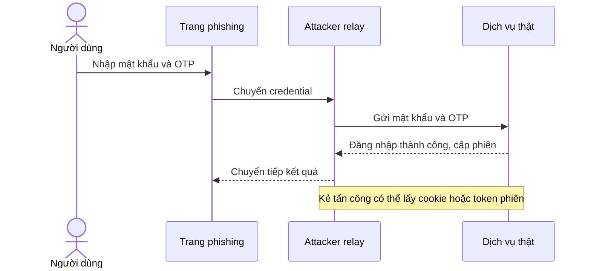
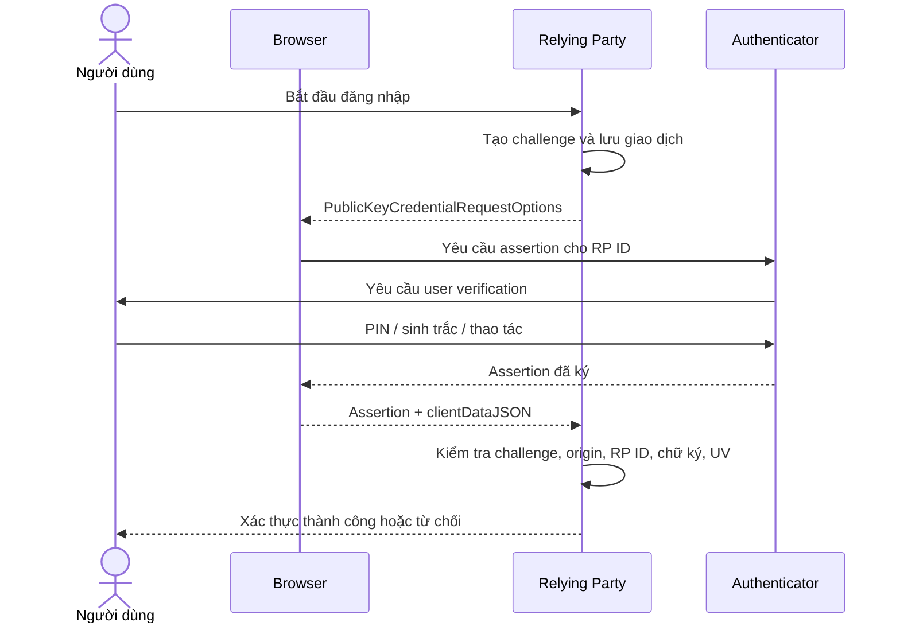
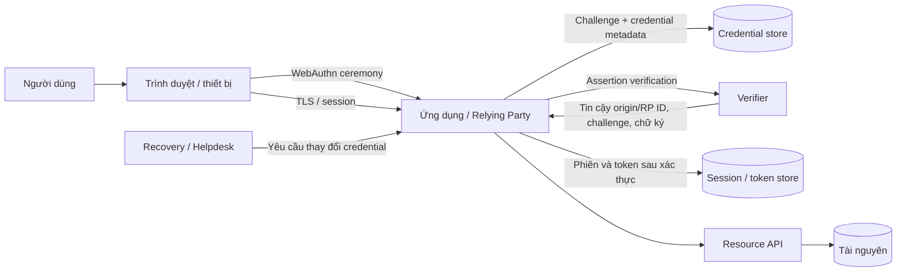

# Phishing-resistant MFA — Xác thực đa yếu tố chống phishing

MFA làm giảm nguy cơ tài khoản bị chiếm khi mật khẩu bị lộ, nhưng **không phải mọi phương thức MFA đều chống phishing**. Nếu người dùng nhập mật khẩu và mã OTP vào một trang giả mạo, kẻ tấn công có thể chuyển tiếp cả hai tới dịch vụ thật trong thời gian mã còn hiệu lực. Nếu người dùng phê duyệt một thông báo push không rõ ngữ cảnh, họ cũng có thể vô tình hoàn tất đăng nhập cho kẻ tấn công. Muốn chống kiểu tấn công này, hệ thống cần phương thức xác thực gắn bằng chứng mật mã với đúng dịch vụ hoặc đúng kênh giao tiếp.

Bài học thuộc chương **MFA** của học phần **SECURITY_AUTHENTICATION_FUNDAMENTALS**. Nội dung tập trung vào xác thực đa yếu tố có khả năng chống giả mạo verifier (phishing-resistant MFA), từ passkey/WebAuthn và khóa bảo mật đến chứng chỉ/thẻ thông minh, đồng thời xem xét token, phiên, liên kết danh tính và khôi phục tài khoản. Người học sẽ mô hình hóa ranh giới tin cậy, đánh giá đường tấn công và thiết kế chính sách MFA phù hợp với rủi ro.

## 1. Kết quả học tập

Sau bài này, người học có thể:

- Giải thích vì sao mật khẩu + OTP hoặc push approval thông thường vẫn có thể bị phishing thời gian thực.
- Mô tả hai ý tưởng cốt lõi: **verifier name binding** và **channel binding**.
- Phân biệt passkey, security key, smart card/chứng chỉ client với OTP, SMS và push MFA.
- Thiết kế chính sách xác thực chống phishing cho người dùng phổ thông, quản trị viên và workload/doanh nghiệp.
- Đánh giá yếu tố đồng bộ passkey, thiết bị, user verification, quy trình dự phòng và khôi phục.
- Nhận diện rủi ro còn lại sau khi MFA thành công, đặc biệt là session hijacking, token theft, malware và recovery bypass.
- Viết tiêu chí chấp nhận và kiểm thử chứng minh hệ thống không chấp nhận bằng chứng từ origin/verifier giả mạo.

## 2. MFA và phishing-resistant MFA khác nhau thế nào?

**Multi-factor authentication (MFA)** yêu cầu kết hợp ít nhất hai yếu tố thuộc các nhóm khác nhau:

- **Something you know:** mật khẩu, PIN.
- **Something you have:** thiết bị, khóa bảo mật, smart card, điện thoại giữ credential.
- **Something you are:** đặc điểm sinh trắc được thiết bị/hệ thống xác minh.

Một lần xác thực chỉ được xem là đa yếu tố khi các yếu tố thực sự độc lập theo mô hình của hệ thống. Ví dụ, mật khẩu và mã TOTP có thể đáp ứng MFA vì dựa trên bí mật ghi nhớ và thiết bị/seed sinh mã; hai mật khẩu khác nhau vẫn chỉ thuộc nhóm “biết”.

**Phishing-resistant MFA** là phương thức xác thực đa yếu tố được thiết kế để chống việc kẻ tấn công giả mạo dịch vụ/verifier rồi chuyển tiếp thông tin xác thực. Điểm mấu chốt là bằng chứng mật mã được ràng buộc với đúng verifier hoặc đúng kênh, khiến một trang giả mạo không thể lấy được câu trả lời có thể dùng tại dịch vụ thật chỉ bằng cách relay thông tin người dùng nhập.

Không nên đánh giá khả năng chống phishing chỉ bằng số yếu tố. Một luồng có hai yếu tố nhưng cả hai đều được nhập vào trang giả có thể yếu hơn một authenticator mật mã được ràng buộc với origin và yêu cầu user verification.

| Phương thức | Có thể là MFA? | Khả năng chống phishing |
| --- | --- | --- |
| Mật khẩu + SMS OTP | Có, theo mô hình yếu tố | Thấp; mã có thể bị phishing, chuyển tiếp hoặc chiếm qua SIM swap |
| Mật khẩu + TOTP | Có | Thấp trước phishing thời gian thực; OTP có thể bị relay |
| Mật khẩu + push approval thông thường | Có | Thường không chống được AiTM; dễ bị MFA fatigue hoặc phê duyệt nhầm |
| Push có number matching/ngữ cảnh | Có | Cải thiện chống fatigue và phê duyệt nhầm, nhưng tự nó không đảm bảo ràng buộc mật mã với origin |
| FIDO2/WebAuthn passkey hoặc security key với user verification | Có thể đáp ứng MFA tùy authenticator và chính sách | Có khả năng chống phishing mạnh nhờ ràng buộc với RP ID/origin |
| Smart card/client certificate với xác minh khóa và channel binding phù hợp | Có thể đáp ứng MFA tùy cách bảo vệ khóa và xác minh người dùng | Có thể chống phishing khi giao thức ràng buộc bằng chứng với đúng kênh/verifier |

## 3. Hai cơ chế cốt lõi: verifier name binding và channel binding

### 3.1. Verifier name binding

Verifier name binding ràng buộc credential hoặc phản hồi xác thực với **tên/định danh của dịch vụ đang yêu cầu xác thực**. Trong WebAuthn, trình duyệt và authenticator kiểm tra RP ID/origin theo quy tắc của nền tảng. Credential được tạo cho một relying party cụ thể; một trang giả mạo ở domain khác không thể đơn giản yêu cầu cùng credential và nhận assertion có thể xác minh cho domain thật.

Ví dụ:

- Dịch vụ thật: `https://login.example.com`.
- Trang giả mạo: `https://login-example.attacker.test`.
- Người dùng mở trang giả và cố đăng nhập. Passkey đã đăng ký cho RP ID `example.com` không được dùng để tạo assertion hợp lệ cho RP ID của kẻ tấn công.

Việc nhìn thấy logo hoặc tên hiển thị giống nhau không tạo ra verifier name binding. Ràng buộc đến từ origin/RP ID và việc xác minh đúng ở phía relying party.

### 3.2. Channel binding

Channel binding gắn bằng chứng xác thực với một kênh giao tiếp cụ thể, chẳng hạn kênh TLS đã được thiết lập với đúng máy chủ. Nếu kẻ tấn công tạo một kết nối khác tới dịch vụ thật, bằng chứng được tạo cho kênh giả không thể được dùng nguyên vẹn cho kênh thật.

Một số cơ chế xác thực dựa trên chứng chỉ hoặc giao thức mật mã có thể sử dụng channel binding. Tuy nhiên, chỉ dùng client certificate không tự động bảo đảm mọi triển khai chống phishing; cần xác định giao thức có ràng buộc bằng chứng với kênh/verifier đúng hay không, private key được bảo vệ thế nào và người dùng có được yêu cầu xác nhận phù hợp không.

### 3.3. Vì sao OTP dễ bị relay?

Một mã TOTP/SMS thường chứng minh người dùng đang kiểm soát seed hoặc thiết bị nhận mã tại thời điểm nhập. Mã không tự chứa thông tin mật mã rằng nó chỉ dành cho `login.example.com`. Trang giả có thể nhận mã rồi chuyển tiếp ngay tới dịch vụ thật.



Đây là một luồng AiTM giản lược. HTTPS giữa trình duyệt và trang phishing vẫn có thể hợp lệ đối với domain giả; vì vậy chỉ nói “đã dùng HTTPS” không giải quyết việc người dùng bị dụ tới sai origin.

## 4. FIDO2, WebAuthn, passkey và security key

WebAuthn là API web cho phép relying party đăng ký và xác thực credential khóa công khai. FIDO2 kết hợp WebAuthn với CTAP để hỗ trợ authenticator nền tảng hoặc roaming authenticator như khóa bảo mật USB/NFC/Bluetooth.

### 4.1. Đăng ký credential

1. Người dùng đã đăng nhập hoặc vượt qua quy trình xác minh ban đầu.
2. RP tạo challenge ngẫu nhiên, ngắn hạn và gắn với giao dịch đăng ký.
3. Trình duyệt gọi WebAuthn; authenticator tạo cặp khóa cho RP ID phù hợp.
4. Khóa riêng được giữ trong authenticator/secure environment; khóa công khai và credential metadata được gửi về RP.
5. RP kiểm tra challenge, origin, RP ID hash, chữ ký/attestation theo chính sách, user presence và user verification khi yêu cầu.
6. RP lưu credential public key, credential ID và thông tin cần thiết để xác minh lần sau.

### 4.2. Xác thực

1. RP tạo challenge mới, liên kết với phiên và thời hạn.
2. Trình duyệt yêu cầu authenticator thực hiện assertion cho RP ID.
3. Người dùng mở khóa authenticator bằng PIN/sinh trắc hoặc thao tác phù hợp.
4. Authenticator ký dữ liệu xác thực bằng khóa riêng.
5. RP kiểm tra challenge, origin, RP ID hash, chữ ký, credential ID và các cờ user presence/user verification theo chính sách.
6. Nếu hợp lệ, RP cập nhật trạng thái đăng nhập và tạo phiên mới.



### 4.3. Passkey đồng bộ và passkey gắn thiết bị

Passkey là cách triển khai credential FIDO cho đăng nhập không mật khẩu hoặc kết hợp với chính sách MFA. Có thể gặp:

- **Device-bound credential:** khóa gắn với một authenticator/thiết bị và thường không xuất được; mất thiết bị cần phương thức dự phòng.
- **Synced passkey:** credential có thể được đồng bộ an toàn qua hệ sinh thái/nhà cung cấp được người dùng chọn để dùng trên nhiều thiết bị.

Synced passkey vẫn có ràng buộc RP ID/origin khi xác thực với website, nên có thể chống phishing tốt. Tuy nhiên, mô hình rủi ro phải xét **tài khoản đồng bộ, quy trình khôi phục, thiết bị đã đăng nhập và khả năng truy cập kho passkey**. Không nên mặc định mọi passkey đều có cùng mức bảo đảm về khả năng chống trích xuất khóa, kiểm soát thiết bị hoặc quản lý doanh nghiệp.

### 4.4. User presence và user verification

- **User presence (UP):** authenticator ghi nhận người dùng đã thực hiện thao tác hiện diện, ví dụ chạm khóa bảo mật.
- **User verification (UV):** authenticator xác minh người dùng cục bộ bằng PIN, sinh trắc hoặc phương thức tương đương theo chính sách thiết bị.

Chỉ có UP không nhất thiết chứng minh đã có yếu tố thứ hai dựa trên “biết” hoặc “là”. Nếu yêu cầu MFA, RP phải chọn chính sách và authenticator bảo đảm user verification phù hợp, đồng thời xác minh cờ UV trong assertion. Sinh trắc thường được xử lý ngay trên thiết bị; RP nhận kết quả xác minh, không nhận ảnh vân tay hay khuôn mặt thô.

## 5. Chứng chỉ, smart card và xác thực bằng khóa

Trong môi trường doanh nghiệp, thẻ thông minh (smart card), PIV/CAC hoặc chứng chỉ client có thể cung cấp xác thực mật mã. Thiết bị giữ private key, máy chủ kiểm tra chữ ký và chuỗi chứng chỉ theo chính sách PKI.

Một mô hình thường có:

- CA đáng tin cấp chứng chỉ gắn với danh tính hoặc workload.
- Private key được lưu trong smart card, TPM, secure element hoặc phần cứng bảo vệ khóa.
- Người dùng mở khóa thẻ bằng PIN; thao tác ký chứng minh quyền sử dụng private key.
- Máy chủ xác minh chữ ký, chuỗi tin cậy, mục đích sử dụng, thời hạn và trạng thái thu hồi.
- Giao thức cần ràng buộc xác thực với đúng kênh hoặc verifier để chống phishing/relay.

**Lưu ý:** chứng chỉ là một phần của hệ thống tin cậy, không tự bảo đảm MFA. Nếu private key có thể xuất tự do, PIN yếu hoặc không cần user verification, mức bảo vệ sẽ khác. TLS client authentication cũng cần được thiết kế và cấu hình đúng; một chứng chỉ hợp lệ không thay thế kiểm tra quyền trên tài nguyên.

## 6. Chính sách chọn phương thức MFA theo rủi ro

Không phải mọi tài khoản đều cần cùng mức kiểm soát. Nên phân loại theo hậu quả khi bị chiếm và khả năng quản lý thiết bị:

| Nhóm tài khoản/hành động | Chính sách gợi ý |
| --- | --- |
| Người dùng phổ thông | Ưu tiên passkey; có phương thức dự phòng được đánh giá rủi ro và hướng dẫn rõ ràng |
| Tài khoản có dữ liệu nhạy cảm hoặc giao dịch tài chính | Yêu cầu phương thức chống phishing; step-up cho thao tác rủi ro cao |
| Quản trị viên và helpdesk | Bắt buộc authenticator chống phishing, thiết bị được quản lý khi phù hợp, phiên đặc quyền ngắn và audit đầy đủ |
| Tổ chức dùng SSO | Xác định mức bảo đảm từ IdP, kiểm tra claim theo hợp đồng và quản lý provisioning/deprovisioning |
| Workload/service account | Dùng danh tính workload, chứng chỉ hoặc khóa có bảo vệ; giới hạn audience/scope và vòng đời |
| Người dùng không có thiết bị hỗ trợ | Cung cấp phương thức thay thế có kiểm soát, đánh giá rủi ro và tránh hạ cấp âm thầm |

Các yếu tố cần xét:

- Giá trị dữ liệu và quyền tài khoản.
- Khả năng quản lý thiết bị và hỗ trợ người dùng.
- Mức chống phishing yêu cầu, bao gồm khả năng chống AiTM.
- Khả năng dự phòng khi mất thiết bị.
- Yêu cầu truy cập ngoại tuyến, thiết bị dùng chung hoặc khả năng tiếp cận.
- Cam kết doanh nghiệp, quy định và mức bảo đảm cần thiết.

## 7. MFA chống phishing không bảo vệ mọi thứ

Phương thức chống phishing bảo vệ **bước xác thực**, nhưng sau khi đăng nhập, hệ thống vẫn có thể bị tấn công theo những đường khác:

| Rủi ro còn lại | Vì sao vẫn xảy ra | Kiểm soát bổ sung |
| --- | --- | --- |
| Session hijacking | Cookie/phiên bị đánh cắp sau khi xác thực | HttpOnly/Secure/SameSite, XSS defense, rotate session ID, revoke và phát hiện bất thường |
| Access/refresh token theft | Token bearer bị lộ qua log, malware hoặc browser storage | TTL, scope/audience hẹp, secure storage, rotation, sender-constrained token |
| Endpoint malware | Malware điều khiển trình duyệt hoặc thao tác sau khi người dùng mở khóa thiết bị | Endpoint protection, device posture, giới hạn quyền và giám sát hành vi |
| Recovery bypass | Kẻ tấn công chiếm email/helpdesk hoặc dùng quy trình khôi phục yếu | Bằng chứng độc lập, xác thực hỗ trợ, thông báo, dual control và audit |
| MFA downgrade | Ứng dụng cho phép chuyển về OTP yếu mà không có kiểm soát | Chính sách fallback rõ, yêu cầu phê duyệt/step-up, cảnh báo và giới hạn |
| Account linking abuse | Danh tính bên ngoài của kẻ tấn công được gắn vào tài khoản nạn nhân | Xác thực lại tài khoản đích, xác minh IdP và không tự liên kết theo email |
| Authorization flaw | Người dùng đã xác thực nhưng API kiểm tra quyền sai | Kiểm tra quyền ở server cho từng hành động, đối tượng và tenant |

Đặc biệt, một passkey chống phishing không ngăn kẻ tấn công dùng **phiên đã bị đánh cắp**. Sau khi xác thực, cần tiếp tục bảo vệ token, cookie và các thao tác nhạy cảm.

## 8. Fallback và recovery: mắt xích quan trọng nhất

Nếu tài khoản yêu cầu passkey nhưng khi mất điện thoại người dùng có thể nhờ helpdesk tắt MFA chỉ bằng email/tên công ty, toàn bộ mức bảo vệ có thể bị hạ xuống quy trình yếu nhất.

### Thiết kế phương thức dự phòng

- Đăng ký trước nhiều authenticator khi có thể, ví dụ passkey trên thiết bị thứ hai hoặc security key dự phòng.
- Recovery code có entropy cao, hiển thị một lần, lưu an toàn, dùng một lần và có thể thu hồi/cấp lại.
- Quy trình khôi phục phải có bằng chứng phù hợp với rủi ro và độc lập với yếu tố bị mất.
- Thay đổi phương thức khôi phục hoặc thêm passkey mới cần xác thực đủ mới khi có thể, thông báo qua kênh đã xác minh và ghi audit.
- Với tài khoản đặc quyền, áp dụng xác minh nhiều bên hoặc quy trình quản trị có kiểm soát; nhân viên hỗ trợ không được tự ý bỏ qua MFA.
- Không cho phép fallback yếu hơn tự động chỉ vì trình duyệt/thiết bị không hỗ trợ passkey; phải áp dụng chính sách rõ ràng.

### Thời gian chờ và thông báo

Với hành động khôi phục có rủi ro cao, có thể áp dụng thời gian chờ trước khi credential mới được dùng cho giao dịch nhạy cảm. Thời gian chờ phải cân bằng an toàn và khả năng khôi phục thực tế; không dùng một con số cố định cho mọi dịch vụ.

Thông báo thay đổi credential cần gửi tới kênh đã xác minh trước đó, cung cấp cách báo cáo nếu không phải chủ tài khoản thực hiện. Thông báo không được chứa secret, reset token hoặc thông tin giúp người ngoài chiếm tài khoản.

## 9. Mô hình hóa ranh giới tin cậy



Khi lập sơ đồ cho hệ thống thật, hãy đánh dấu:

1. **Điểm phát challenge:** phải là server đáng tin, challenge đủ ngẫu nhiên, có TTL và gắn giao dịch.
2. **Điểm tạo chữ ký:** authenticator giữ private key; ứng dụng web không được tự quyết định kết quả xác minh.
3. **Điểm xác minh:** RP kiểm tra origin, RP ID, challenge, chữ ký và cờ xác thực.
4. **Điểm phát hành phiên/token:** chỉ sau khi xác thực thành công; xoay phiên và thiết lập thời hạn.
5. **Điểm fallback/recovery:** có thể thay đổi yếu tố, do đó phải được coi là ranh giới nhạy cảm.
6. **Điểm phân quyền:** API kiểm tra quyền tài nguyên riêng sau xác thực.

Không tin trạng thái do client tự gửi như `passkeyVerified=true`, `mfaLevel=2` hoặc `userId=...`. Các thuộc tính xác thực phải được suy ra từ kết quả giao thức đã kiểm chứng và lưu trong phiên phía máy chủ theo cách không thể bị sửa từ client.

## 10. Các lỗi triển khai WebAuthn cần tránh

- Không kiểm tra `challenge` hoặc chấp nhận challenge cũ/đã dùng.
- Không kiểm tra origin chính xác hoặc chấp nhận origin wildcard quá rộng.
- Không kiểm tra RP ID hash, credential ID hoặc chữ ký bằng khóa công khai đã đăng ký.
- Yêu cầu user verification nhưng không kiểm tra cờ UV trong assertion.
- Dùng lại challenge cho nhiều tài khoản/phiên hoặc không gắn challenge với giao dịch.
- Tin attestation mà không có chính sách xác minh; hoặc ngược lại bắt buộc attestation không cần thiết làm giảm khả năng tương thích và quyền riêng tư.
- Cho phép thêm passkey mới chỉ dựa trên phiên dài hạn có thể đã bị chiếm.
- Không có cơ chế thu hồi credential đã mất hoặc bị nghi xâm nhập.
- Đăng nhập thành công nhưng không xoay session ID.

### Pseudocode kiểm tra assertion

Ví dụ sau chỉ mô tả các điều kiện phải được thư viện WebAuthn đáng tin xác minh:

```ts
async function completePasskeyLogin(response, transactionId) {
  const tx = await challengeStore.consumeOnce(transactionId);
  if (!tx || tx.intent !== "LOGIN" || tx.expiresAt <= now()) {
    return rejectAuthentication();
  }

  const credential = await credentialStore.findById(response.id);
  if (!credential || credential.userId !== tx.expectedUserIdIfKnown) {
    return rejectAuthentication();
  }

  const result = await webauthn.verifyAuthenticationResponse({
    response,
    expectedChallenge: tx.challenge,
    expectedOrigin: tx.expectedOrigin,
    expectedRPID: tx.rpId,
    credentialPublicKey: credential.publicKey,
    requireUserVerification: true
  });

  if (!result.verified) return rejectAuthentication();
  await rotateAndCreateSession(credential.userId);
  return authenticationSucceeded();
}
```

Tên hàm và tham số phụ thuộc thư viện. Với discoverable credential, user ID có thể chưa biết trước challenge; khi đó server lấy credential ID/credential record từ response, rồi xác minh ràng buộc đúng người dùng theo bản ghi đã đăng ký. Không được bắt buộc `expectedUserIdIfKnown` theo cách làm hỏng luồng discoverable credential. Ngoài các điều kiện minh họa, triển khai cần kiểm tra user handle, backup eligibility/state và signature counter theo đúng mô hình authenticator/thư viện; counter không phải lúc nào cũng tăng đơn điệu với passkey đồng bộ.

## 11. Tình huống thực tế: bảo vệ tài khoản quản trị

Một nền tảng SaaS có hai nhóm:

- Nhân viên hỗ trợ có thể xem hồ sơ khách hàng và gửi yêu cầu xử lý.
- Quản trị viên có thể thay đổi cấu hình tenant, quản lý người dùng và cấp API key.

Nếu cả hai nhóm chỉ dùng mật khẩu + TOTP, một trang AiTM có thể lấy mã và chiếm phiên. Hệ thống quyết định bắt buộc passkey hoặc security key với user verification cho quản trị viên; nhân viên hỗ trợ cũng dùng phương thức chống phishing vì có quyền tác động tới quy trình khôi phục.

### Chính sách đề xuất

1. Tài khoản quản trị đăng ký ít nhất hai authenticator chống phishing đã được xác minh.
2. Đăng nhập yêu cầu WebAuthn với UV; phiên quản trị có thời hạn ngắn và được xoay sau xác thực.
3. Tạo API key, thay đổi MFA, liên kết IdP hoặc thay đổi email khôi phục yêu cầu step-up đủ mới.
4. Mọi thay đổi credential được audit và gửi thông báo qua kênh tin cậy.
5. Helpdesk không thể tự tắt MFA; recovery đặc quyền cần xác minh độc lập và phê duyệt bổ sung.
6. API key có scope hẹp, audience cụ thể, TTL và khả năng thu hồi; không kế thừa toàn bộ quyền quản trị người dùng.

### Kịch bản kiểm thử

- Đăng nhập từ domain giả không thể tạo assertion cho RP thật.
- Assertion có origin khác hoặc challenge sai bị từ chối.
- Thiếu UV khi chính sách yêu cầu bị từ chối.
- Phiên bị đánh cắp sau đăng nhập bị giới hạn bởi thời hạn, phát hiện và thu hồi.
- Helpdesk không thể bypass MFA nếu không đáp ứng quy trình recovery.
- Thêm passkey từ phiên cũ hoặc rủi ro cao yêu cầu step-up.
- Tài khoản quản trị bị vô hiệu hóa thì phiên/token bị chặn theo SLA đã xác định.

## 12. Tiêu chí lựa chọn và triển khai trong tổ chức

Một chương trình triển khai phishing-resistant MFA nên làm theo từng bước:

1. **Kiểm kê:** xác định người dùng, nhóm đặc quyền, IdP, thiết bị, ứng dụng cũ và phương thức MFA hiện tại.
2. **Phân loại rủi ro:** xác định tài khoản/hành động cần mức chống phishing bắt buộc; ưu tiên admin, helpdesk, tài khoản tài chính và workload nhạy cảm.
3. **Chọn authenticator:** passkey, security key, smart card hoặc chứng chỉ theo khả năng nền tảng, thiết bị và vận hành.
4. **Thiết kế enrollment:** xác thực tài khoản hiện tại trước khi thêm credential, xác minh thiết bị và thông báo đăng ký.
5. **Thiết kế recovery:** có thiết bị dự phòng, recovery code, quy trình helpdesk và kiểm soát chống bypass.
6. **Tích hợp ứng dụng:** chuẩn hóa OIDC/WebAuthn, kiểm tra claim mức bảo đảm, session policy và fallback.
7. **Triển khai theo giai đoạn:** pilot, đo tỷ lệ hoàn thành, hỗ trợ thiết bị, accessibility và lỗi tích hợp; sau đó mở rộng theo nhóm.
8. **Kiểm thử tấn công:** thử phishing giả lập trong môi trường được phép, AiTM test, replay, fallback abuse, session theft và recovery.
9. **Vận hành:** quản lý vòng đời credential, mất thiết bị, thu hồi, cảnh báo và cập nhật chính sách.

### Chỉ số cần theo dõi

| Nhóm | Chỉ số | Mục đích |
| --- | --- | --- |
| Phủ sóng | Tỷ lệ tài khoản/nhóm đặc quyền đã đăng ký phương thức chống phishing | Biết mức độ triển khai thực tế |
| Trải nghiệm | Tỷ lệ xác thực thành công, thời gian hoàn thành, lỗi theo thiết bị/trình duyệt | Phát hiện ma sát và vấn đề tương thích |
| Khôi phục | Tỷ lệ recovery, thời gian xử lý, số lần helpdesk can thiệp | Kiểm tra phương thức dự phòng và rủi ro bypass |
| An ninh | Số sự kiện phishing, AiTM, MFA fatigue, credential reset bất thường | Đánh giá hiệu quả phòng thủ và phát hiện |
| Vận hành | Thời gian thu hồi credential/phiên, số credential mồ côi, số tài khoản thiếu phương thức dự phòng | Đánh giá vòng đời và khả năng ứng phó |

Không chỉ đo số lượng passkey được đăng ký. Một tài khoản có passkey nhưng recovery yếu, phiên vô thời hạn hoặc helpdesk có thể bỏ qua xác minh vẫn có nguy cơ bị chiếm.

## 13. Tiêu chí chấp nhận và kiểm thử

| Tình huống | Kết quả mong đợi |
| --- | --- |
| Người dùng đăng nhập tại origin đã đăng ký bằng passkey | RP xác minh challenge, origin, RP ID, chữ ký và user verification theo chính sách |
| Assertion được tạo tại domain giả | RP từ chối vì origin/RP ID không khớp |
| Challenge hết hạn hoặc đã dùng | RP từ chối; không tạo phiên |
| Assertion bị sửa hoặc dùng credential ID chưa đăng ký | RP từ chối |
| UV bị thiếu khi chính sách bắt buộc | RP từ chối hoặc yêu cầu phương thức đủ mức bảo đảm; không hạ cấp âm thầm |
| TOTP bị relay qua trang giả | Kiểm thử chứng minh OTP không được xem là phương thức chống phishing; chính sách đặc quyền không cho fallback yếu ngoài quy trình |
| Push bị spam hoặc phê duyệt không rõ ngữ cảnh | Giới hạn/number matching/cảnh báo được áp dụng; không xem push thông thường là phishing-resistant |
| Người dùng mất thiết bị | Recovery yêu cầu bằng chứng độc lập và không cho helpdesk bypass tùy tiện |
| Người dùng thêm passkey mới | Xác thực lại/step-up theo rủi ro, ghi audit và thông báo |
| Phiên sau xác thực bị đánh cắp | Cookie/token có kiểm soát thời hạn, thu hồi và phát hiện; không giả định MFA chặn session theft |
| Token API sai audience hoặc scope | API từ chối dù đăng nhập bằng passkey thành công |
| Người dùng đồng bộ passkey trên thiết bị mới | Chính sách tin cậy tài khoản đồng bộ và thông báo được áp dụng; credential vẫn bị giới hạn theo RP ID |

### Kiểm thử chống phishing cần quan sát điều gì?

- Một trang giả ở origin khác không thể dùng passkey của RP thật để hoàn tất xác thực.
- RP không chấp nhận assertion nếu challenge, origin, RP ID hoặc chữ ký sai.
- Giao diện không yêu cầu người dùng nhập passkey secret hoặc chia sẻ PIN/OTP với support.
- Mọi fallback yếu hơn được ghi nhận, giới hạn và áp dụng đúng nhóm tài khoản.
- Sau xác thực, session/token được bảo vệ và có thể thu hồi.

## 14. Bài tập tự kiểm tra

Một tổ chức có hệ thống HR, bảng lương và cổng quản trị cloud. Nhân viên thường đăng nhập bằng mật khẩu + TOTP; quản trị viên cloud dùng push approval. Một số người làm việc trên thiết bị cá nhân, số khác dùng laptop do công ty quản lý.

Hãy:

1. Xếp hạng rủi ro của ba nhóm tài khoản và chọn nhóm cần triển khai phishing-resistant MFA trước.
2. So sánh passkey đồng bộ, security key gắn thiết bị và smart card cho từng nhóm.
3. Vẽ luồng đăng ký và xác thực WebAuthn; chỉ rõ nơi tạo challenge, nơi giữ private key và nơi xác minh origin/RP ID.
4. Đưa ra chính sách fallback khi người dùng mất thiết bị; giải thích vì sao fallback không được yếu hơn vô điều kiện.
5. Nêu ba nguy cơ còn lại sau khi passkey thành công và cách kiểm soát session/token.
6. Viết ít nhất năm tiêu chí chấp nhận để chứng minh trang giả không thể relay xác thực và helpdesk không thể bypass MFA.

**Gợi ý đánh giá:** câu trả lời tốt phải phân biệt MFA với chống phishing, chỉ ra verifier/channel binding, nêu yêu cầu user verification và cách xác minh ở RP, đồng thời mô hình hóa recovery và phiên sau xác thực. Không nên kết luận mọi phương thức dùng chứng chỉ hoặc mọi thông báo push đều tự động chống phishing.

---

**Ghi nhớ:** phishing-resistant MFA dựa trên bằng chứng mật mã gắn với **đúng verifier hoặc đúng kênh**, khiến credential không thể bị chuyển tiếp đơn giản từ trang giả sang dịch vụ thật. WebAuthn/passkey và security key là lựa chọn phổ biến; chứng chỉ/smart card cũng có thể phù hợp nếu giao thức và quản lý khóa đúng. Để bảo vệ toàn bộ tài khoản, cần giữ vững cả **enrollment, fallback, recovery, session, token và authorization** sau khi xác thực hoàn tất.
