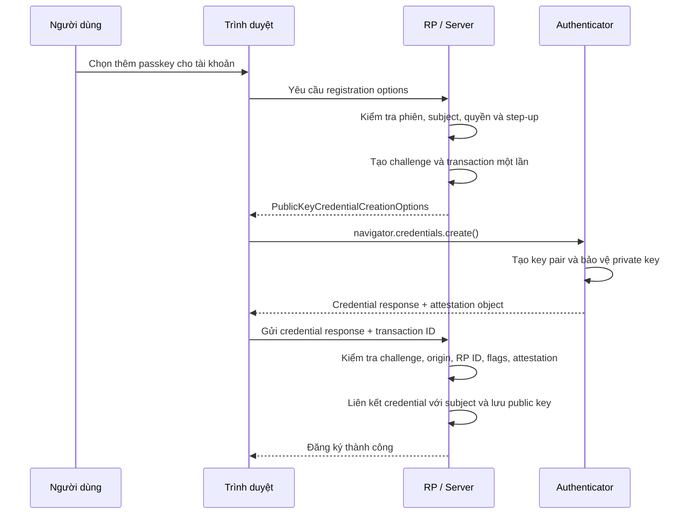

# Registration ceremony — Nghi thức đăng ký WebAuthn

Để đăng nhập bằng passkey, trước hết người dùng phải **đăng ký một credential** với dịch vụ. Trình duyệt yêu cầu authenticator tạo cặp khóa; authenticator giữ private key và gửi public key cùng thông tin credential về máy chủ. Máy chủ kiểm tra phản hồi đăng ký, liên kết public key với đúng tài khoản và lưu bản ghi để dùng trong những lần xác thực sau. Chuỗi trao đổi này được gọi là **registration ceremony** (nghi thức đăng ký) của WebAuthn.

Đăng ký credential là một thao tác nhạy cảm. Nếu kẻ tấn công chiếm được một phiên yếu rồi thêm passkey của mình vào tài khoản nạn nhân, họ có thể tiếp tục đăng nhập ngay cả khi nạn nhân đổi mật khẩu. Nếu máy chủ nhận public key mà không kiểm tra challenge, origin hoặc RP ID, một phản hồi được tạo cho giao dịch khác có thể bị gắn nhầm vào tài khoản. Vì vậy, registration ceremony phải bảo vệ cả giao thức mật mã lẫn **ý định của chủ tài khoản**.

Trong module `SECURITY_AUTHENTICATION_FUNDAMENTALS`, bài này trình bày cách thiết kế đăng ký passkey/WebAuthn từ lúc bắt đầu đến khi lưu credential: xác minh chủ thể, tạo options và challenge, gọi authenticator, kiểm tra attestation/authenticator data, lưu public key, xử lý thiết bị và credential lifecycle, đồng thời chống phishing, replay và enrollment trái phép.

## 1. Registration ceremony làm việc gì?

**WebAuthn** là API chuẩn của trình duyệt cho phép một Relying Party (RP) đăng ký và xác thực người dùng bằng public-key credential. Trong registration ceremony, authenticator tạo một credential mới dành cho RP. Máy chủ không nhận mật khẩu hay private key; máy chủ nhận credential ID, public key và dữ liệu chứng thực cần thiết theo chính sách.

| Thành phần | Vai trò trong đăng ký |
| --- | --- |
| **Relying Party (RP)** | Dịch vụ muốn đăng ký credential; có RP ID và tên hiển thị |
| **User** | Tài khoản nội bộ mà credential sẽ được liên kết |
| **Client** | Trình duyệt hoặc ứng dụng nền tảng gọi WebAuthn API |
| **Authenticator** | Thành phần tạo và giữ private key; có thể là platform authenticator hoặc security key rời |
| **Challenge** | Giá trị ngẫu nhiên do server tạo để ràng buộc response với giao dịch hiện tại và chống replay |
| **Attestation** | Dữ liệu có thể cung cấp bằng chứng về authenticator đã tạo credential, tùy định dạng và chính sách |
| **Credential ID** | Định danh credential do authenticator tạo, dùng để tra bản ghi public key sau này |
| **Public key** | Khóa server lưu để xác minh assertion trong các lần đăng nhập |

Registration ceremony **không phải là xác minh danh tính pháp lý**. Nó chứng minh một authenticator đã tạo credential và client gửi phản hồi phù hợp với giao dịch mà RP yêu cầu. Việc credential thuộc tài khoản nào phụ thuộc vào phiên đã xác thực và quyết định liên kết của server. Attestation, nếu được sử dụng, có thể cung cấp thông tin về loại hoặc nguồn gốc authenticator; nó không tự chứng minh người đăng ký là ai.

### Sơ đồ tổng quát



## 2. Trước khi đăng ký: xác minh tài khoản và ý định

Rủi ro lớn nhất không nhất thiết nằm ở thuật toán chữ ký. Một credential mới được tạo đúng chuẩn nhưng gắn vào sai tài khoản vẫn là một lỗ hổng nghiêm trọng.

Trước khi trả registration options, server cần:

1. **Xác định subject từ phiên đáng tin cậy.** Lấy `accountId` và `tenantId` từ principal đã được xác thực; không lấy từ `userId` do client gửi trong request.
2. **Kiểm tra tài khoản còn hoạt động.** Tài khoản không bị khóa, xóa hoặc đang trong trạng thái không cho phép thay đổi phương thức xác thực.
3. **Xác minh ý định và mức assurance.** Với việc thêm phương thức đăng nhập, nhất là tài khoản quản trị, yêu cầu xác thực lại/step-up bằng phương thức hiện có phù hợp rủi ro. Không để một session tiền xác thực hoặc một phiên quá cũ tự thêm credential.
4. **Bảo vệ request khỏi CSRF.** Nếu session được mang bằng cookie, dùng CSRF token và kiểm tra nguồn request phù hợp; không coi `SameSite` là biện pháp duy nhất.
5. **Thông báo và audit.** Ghi nhận ai yêu cầu, thời điểm, tài khoản, session, loại thao tác và kết quả; thông báo cho chủ tài khoản qua kênh đã xác minh khi credential mới được thêm.

### Vì sao enrollment cần step-up?

Giả sử attacker đánh cắp cookie phiên của An. Nếu ứng dụng cho phép mở trang “Add passkey” và đăng ký ngay, attacker có thể thêm khóa của mình vào tài khoản An. Sau đó, kể cả khi An phát hiện và đổi mật khẩu, attacker vẫn có credential hợp lệ.

Do đó, **thêm, xóa hoặc thay credential** là thao tác bảo mật nhạy cảm. Có thể yêu cầu xác thực lại bằng passkey hiện có, mật khẩu kết hợp MFA, hardware key hoặc một quy trình recovery đủ mạnh. Kết quả step-up phải gắn với đúng subject, session, hành động `REGISTER_CREDENTIAL`, thời hạn ngắn và được tiêu thụ một lần.

## 3. Server tạo PublicKeyCredentialCreationOptions

Trình duyệt không tự quyết định RP được phép đăng ký credential cho tài khoản nào. Server chuẩn bị `PublicKeyCredentialCreationOptions` dựa trên cấu hình RP và chính sách.

| Trường | Mục đích | Nguyên tắc |
| --- | --- | --- |
| `challenge` | Thử thách chống replay | Sinh ngẫu nhiên bằng CSPRNG, đủ mạnh, có hạn và gắn với transaction phía server |
| `rp.id` | RP ID, thường là domain của dịch vụ | Server cấu hình cố định; không nhận tùy ý từ client |
| `rp.name` | Tên hiển thị cho người dùng | Dùng tên thương hiệu/dịch vụ rõ ràng, không phải căn cứ bảo mật |
| `user.id` | User handle ổn định trong phạm vi RP | Dùng opaque ID, không dùng email hoặc dữ liệu PII trực tiếp; tối đa 64 byte |
| `user.name` | Tên tài khoản hiển thị trong authenticator | Chỉ để hiển thị, không dùng làm khóa định danh |
| `user.displayName` | Tên hiển thị thân thiện | Có thể thay đổi, không dùng để ánh xạ subject |
| `pubKeyCredParams` | Danh sách thuật toán COSE mà RP chấp nhận | Chỉ liệt kê thuật toán/key type được server hỗ trợ và có chính sách rõ |
| `timeout` | Thời gian client chờ thao tác | Là gợi ý cho client; server vẫn phải tự hết hạn transaction |
| `excludeCredentials` | Danh sách credential ID đã đăng ký cần tránh tạo trùng | Hỗ trợ UX; server vẫn phải kiểm tra credential ID duy nhất khi lưu |
| `authenticatorSelection` | Yêu cầu về loại authenticator, resident key và user verification | Chọn theo mục tiêu UX và assurance; không đặt tùy tiện |
| `attestation` | Mức attestation RP yêu cầu | Chỉ yêu cầu mức chi tiết cần thiết; cân nhắc quyền riêng tư và hỗ trợ nền tảng |
| `extensions` | Tính năng mở rộng được hỗ trợ | Chỉ bật và xác minh extension mà ứng dụng thực sự cần |

### 3.1. Challenge và transaction

Server sinh challenge mới bằng bộ sinh số ngẫu nhiên mật mã (CSPRNG). Nên dùng giá trị đủ dài, thường 32 byte là lựa chọn thực tế phổ biến. Lưu challenge phía server cùng:

- `transactionId` ngẫu nhiên;
- `subjectId`, `tenantId` lấy từ phiên đã xác thực;
- `sessionId` hoặc tham chiếu phiên;
- expected origin và RP ID;
- loại hành động (`REGISTER_CREDENTIAL`);
- thời điểm tạo, hạn hết hiệu lực và trạng thái chưa tiêu thụ;
- chính sách user verification, attestation và authenticator selection.

Không tin challenge client gửi lại nếu không tra nó với transaction đang chờ. Khi nhận response, tiêu thụ transaction **một lần theo thao tác nguyên tử** để hai request song song không cùng đăng ký credential. Nếu đăng ký thất bại, người dùng cần bắt đầu transaction mới thay vì dùng lại challenge cũ.

### 3.2. RP ID và origin

RP ID thường là hostname như `example.com` hoặc `login.example.com`, không chứa scheme hay port. Trình duyệt kiểm tra quan hệ giữa origin hiện tại và RP ID theo quy tắc WebAuthn; server cũng phải tự xác minh `origin` trong `clientDataJSON` và `rpIdHash` trong authenticator data.

Server nên có allowlist origin chính xác cho từng môi trường. Ví dụ `https://login.example.com` và `https://staging.example.com` không nên được gộp chung chỉ vì cùng domain gốc. Không lấy expected origin/RP ID từ request body, header không đáng tin hoặc redirect parameter.

### 3.3. User handle và dữ liệu người dùng

`user.id` là byte sequence ổn định mà RP gán cho tài khoản. Nên dùng ID ngẫu nhiên hoặc opaque internal identifier được mã hóa phù hợp, không dùng email, số điện thoại hay username có thể đổi. User handle giúp authenticator liên kết credential với tài khoản trong RP; nó không phải mật khẩu và không phải tên hiển thị.

`user.name` và `displayName` có thể là email/tên người dùng để họ nhận ra tài khoản trên authenticator. Chúng chỉ là thông tin hiển thị. Server vẫn phải liên kết credential ID với subject nội bộ từ transaction đã xác minh.

### 3.4. Thuật toán và authenticator selection

`pubKeyCredParams` liệt kê các thuật toán COSE mà RP chấp nhận. Chỉ đưa thuật toán được thư viện server hỗ trợ và phù hợp chính sách. Ví dụ ES256 (`-7`) được hỗ trợ rộng rãi; một số hệ thống cũng hỗ trợ RS256 (`-257`) hoặc thuật toán khác. Server không được chấp nhận một thuật toán chỉ vì client gửi nó; phải xác minh public key nhận được thuộc tập thuật toán đã cho phép.

`authenticatorSelection` cho phép nêu yêu cầu:

| Thuộc tính | Ý nghĩa |
| --- | --- |
| `authenticatorAttachment` | Có thể ưu tiên `platform` (tích hợp trong thiết bị) hoặc `cross-platform`/roaming; để trống nếu chấp nhận cả hai |
| `residentKey` | `required`, `preferred` hoặc `discouraged`; điều khiển yêu cầu discoverable credential theo nhu cầu |
| `requireResidentKey` | Thuộc tính legacy tương thích; khi dùng cần nhất quán với `residentKey` |
| `userVerification` | `required`, `preferred` hoặc `discouraged`; quy định yêu cầu xác minh người dùng cục bộ |

Nếu ứng dụng muốn đăng nhập không cần nhập username trước, có thể cần discoverable credential (`residentKey: "required"` hoặc chính sách phù hợp). Nếu ứng dụng luôn biết tài khoản trước và chỉ dùng `allowCredentials` trong lần xác thực, yêu cầu resident key có thể khác. Chọn theo trải nghiệm và threat model, không mặc định một cấu hình đúng cho mọi RP.

### 3.5. Exclude credentials

`excludeCredentials` có thể chứa các credential ID đã thuộc tài khoản để authenticator tránh tạo thêm credential trùng cho cùng RP. Đây là gợi ý cho authenticator và trải nghiệm người dùng, không thay thế ràng buộc duy nhất trong database. Server phải xử lý trường hợp credential ID đã tồn tại, transaction chạy đồng thời hoặc response bị gửi lặp.

## 4. Client gọi authenticator bằng navigator.credentials.create()

Sau khi nhận options từ server, trình duyệt chuyển các trường base64url về dạng byte cần thiết, rồi gọi WebAuthn API. Registration ceremony yêu cầu **secure context** (thông thường là HTTPS; `localhost` được xem là ngoại lệ phát triển theo quy tắc trình duyệt).

Ví dụ JavaScript ở phía client:

```javascript
function decodeBase64url(value) {
  const padded = value.replace(/-/g, "+").replace(/_/g, "/");
  const binary = atob(padded + "=".repeat((4 - padded.length % 4) % 4));
  return Uint8Array.from(binary, (c) => c.charCodeAt(0));
}

function encodeBase64url(buffer) {
  const bytes = new Uint8Array(buffer);
  let binary = "";
  for (const byte of bytes) binary += String.fromCharCode(byte);
  return btoa(binary).replace(/\+/g, "-")
    .replace(/\//g, "_").replace(/=+$/g, "");
}

async function registerPasskey() {
  // Options được server trả về sau khi kiểm tra session và step-up.
  const response = await fetch("/webauthn/register/options", {
    method: "POST",
    credentials: "same-origin",
    headers: {
      "Content-Type": "application/json",
      "X-CSRF-Token": readCsrfToken()
    },
    body: JSON.stringify({})
  });
  if (!response.ok) throw new Error("Không thể bắt đầu đăng ký");

  const payload = await response.json();
  const options = payload.publicKey;
  options.challenge = decodeBase64url(options.challenge);
  options.user.id = decodeBase64url(options.user.id);
  if (options.excludeCredentials) {
    options.excludeCredentials = options.excludeCredentials.map((item) => ({
      ...item,
      id: decodeBase64url(item.id)
    }));
  }

  // Trình duyệt gọi authenticator; private key không được gửi lên server.
  const credential = await navigator.credentials.create({ publicKey: options });
  if (!credential) throw new Error("Người dùng đã hủy hoặc không tạo được credential");

  const attestation = credential.response;
  const result = {
    transactionId: payload.transactionId,
    id: credential.id,
    rawId: encodeBase64url(credential.rawId),
    type: credential.type,
    response: {
      clientDataJSON: encodeBase64url(attestation.clientDataJSON),
      attestationObject: encodeBase64url(attestation.attestationObject),
      transports: attestation.getTransports?.() ?? []
    },
    clientExtensionResults: credential.getClientExtensionResults()
  };

  const finish = await fetch("/webauthn/register/finish", {
    method: "POST",
    credentials: "same-origin",
    headers: {
      "Content-Type": "application/json",
      "X-CSRF-Token": readCsrfToken()
    },
    body: JSON.stringify(result)
  });
  if (!finish.ok) throw new Error("Server không chấp nhận credential");
  return finish.json();
}
```

Đây là ví dụ minh họa việc chuyển đổi dữ liệu và trao đổi với server. Trong ứng dụng thật, dùng thư viện client/server đã được kiểm thử; xử lý `NotAllowedError`, timeout, user cancellation, lỗi mạng và trạng thái transaction; không hiển thị dữ liệu nhạy cảm trong log. Các trường base64url phải được serialize đúng theo giao thức, và server không được tin client chỉ vì JSON có cấu trúc hợp lệ.

### User gesture và hủy thao tác

Trình duyệt thường yêu cầu hành động có chủ đích của người dùng để gọi authenticator. Hãy giải thích rõ đang đăng ký passkey cho tài khoản nào, tránh tự bật prompt bất ngờ. Nếu người dùng hủy, hết thời gian hoặc authenticator không đáp ứng, transaction cần được kết thúc hoặc hết hạn; không để một transaction cũ tồn tại mãi để nhận response muộn.

## 5. Server xác minh attestation response

Client gửi `PublicKeyCredential` response, nhưng server phải xem toàn bộ dữ liệu là **đầu vào chưa tin cậy** cho tới khi kiểm tra xong. Không lưu public key từ JSON mà chưa xác minh nó được tạo trong đúng ceremony.

### 5.1. clientDataJSON

Server giải mã `clientDataJSON` và kiểm tra các thuộc tính quan trọng:

- `type` phải là `webauthn.create` cho registration ceremony.
- `challenge` phải khớp challenge đã lưu ở transaction và chưa hết hạn/chưa dùng.
- `origin` phải khớp chính xác một origin được phép.
- Nếu có ngữ cảnh cross-origin/iframe, kiểm tra các trường `crossOrigin`/`topOrigin` và chính sách tương ứng; tốt nhất chỉ bật luồng cross-origin khi có yêu cầu rõ ràng.
- Không lấy expected origin từ chính `clientDataJSON`; giá trị kỳ vọng phải đến từ cấu hình server.

### 5.2. Attestation object và authenticator data

`attestationObject` là dữ liệu CBOR có cấu trúc, thường chứa `fmt`, `attStmt` và `authData`. Server dùng thư viện WebAuthn để giải mã, sau đó xác minh:

| Phần dữ liệu | Nội dung | Kiểm tra |
| --- | --- | --- |
| `fmt` | Định dạng attestation | Chỉ xử lý định dạng được thư viện hỗ trợ và phù hợp policy |
| `attStmt` | Statement/chữ ký/chứng chỉ attestation theo format | Xác minh theo đặc tả nếu RP yêu cầu attestation; không tự bỏ qua lỗi chữ ký |
| `rpIdHash` | SHA-256 của RP ID | Phải khớp RP ID server dự kiến |
| Flags `UP` | User Presence | Phải được đặt theo yêu cầu của giao thức/policy |
| Flags `UV` | User Verification | Phải có nếu policy yêu cầu PIN/sinh trắc học hoặc xác minh cục bộ |
| Flags `AT` | Có attested credential data | Registration response cần có dữ liệu credential theo cấu trúc WebAuthn hợp lệ |
| Flags `BE` và `BS` | Backup eligibility và backup state | Lưu/đánh giá theo policy nếu cần phân biệt credential đồng bộ và device-bound |
| `AAGUID` | Định danh loại authenticator theo dữ liệu được cung cấp | Chỉ dùng theo policy attestation/metadata; không phải danh tính người dùng |
| Credential ID | Định danh credential | Phải khớp với ID trong response và được lưu duy nhất |
| COSE public key | Public key cùng thuật toán | Kiểm tra key type/algorithm nằm trong tập được chấp nhận |

Server phải xác minh tính toàn vẹn và cấu trúc của authenticator data theo WebAuthn. Không tự tách CBOR hoặc xác minh attestation bằng code tự viết nếu không có chuyên môn và kiểm thử phù hợp; thư viện WebAuthn được duy trì sẽ giảm rủi ro lỗi giao thức.

### 5.3. Attestation conveyance và quyền riêng tư

RP có thể chọn `attestation` conveyance preference như `none`, `indirect`, `direct` hoặc `enterprise` tùy hỗ trợ và chính sách. Với nhiều dịch vụ người dùng phổ thông, `none` là lựa chọn phù hợp vì RP chỉ cần public key và không cần biết model authenticator. Nếu tổ chức cần hạn chế loại authenticator hoặc kiểm tra nguồn gốc thiết bị, có thể yêu cầu mức attestation cao hơn và quản lý trust anchor/metadata tương ứng.

Không phải mọi authenticator hoặc nền tảng đều cung cấp attestation có thể xác minh theo cách giống nhau. Trình duyệt/nền tảng có thể ẩn danh hoặc thay đổi dữ liệu theo chính sách quyền riêng tư. Attestation không phải lúc nào cũng xác định được một thiết bị vật lý duy nhất; AAGUID thường nhận diện model/family chứ không nhất thiết là serial thiết bị.

**Không từ chối mọi registration chỉ vì không có attestation** trừ khi policy đã nêu rõ yêu cầu. Nếu không cần kiểm tra model authenticator, hãy tránh thu thập thông tin có thể tạo fingerprint người dùng. Nếu yêu cầu attestation, cần kiểm tra format, chain, metadata và trạng thái tin cậy theo nguồn cập nhật.

### 5.4. Signature counter và metadata

Authenticator data có thể chứa signature counter ban đầu. Counter tăng ở các assertion tiếp theo có thể giúp phát hiện một số tình huống credential bị clone. Tuy nhiên, nhiều authenticator hợp lệ có thể luôn trả counter bằng 0 hoặc không bảo đảm tăng đơn điệu; passkey đồng bộ cũng có thể có hành vi khác. Hãy lưu giá trị ban đầu và dùng counter như một tín hiệu theo loại authenticator, không xem nó là bằng chứng tuyệt đối về clone hoặc điều kiện bắt buộc phải tăng trong mọi lần đăng nhập.

## 6. Liên kết credential với đúng tài khoản và lưu trữ

Sau khi xác minh response, server mới tạo bản ghi credential. Ví dụ cấu trúc khái niệm:

| Trường | Mục đích |
| --- | --- |
| `credential_id` | Khóa định danh credential duy nhất |
| `subject_id`, `tenant_id` | Tài khoản nội bộ mà credential thuộc về, lấy từ transaction đã xác thực |
| `public_key_cose` | Public key đã xác minh để kiểm tra assertion sau này |
| `algorithm` | Thuật toán/key type được chấp nhận |
| `rp_id` | RP ID mà credential được đăng ký cho |
| `aaguid` / attestation metadata (nếu lưu) | Thông tin authenticator theo nhu cầu và chính sách riêng tư |
| `sign_count` | Giá trị counter ban đầu, nếu có |
| `backup_eligible`, `backup_state` | Thông tin BE/BS nếu được thư viện cung cấp |
| `transports` | Gợi ý transport như `usb`, `nfc`, `ble`, `internal` để hỗ trợ UX; không phải bằng chứng bảo mật |
| `created_at`, `last_used_at` | Vòng đời và quan sát hoạt động |
| `state` | `ACTIVE`, `REVOKED` hoặc trạng thái nội bộ khác |
| `display_name` | Tên thân thiện do người dùng đặt, không phải danh tính tin cậy |

**Không lưu private key.** Server chỉ lưu public key và metadata cần để xác minh. `credential_id` phải duy nhất; nếu đã tồn tại, không được ghi đè bản ghi cũ hoặc chuyển nó sang subject khác. `subject_id` phải lấy từ session/transaction đã xác minh, không từ `user.name`, `displayName` hoặc dữ liệu client tự khai.

### Transaction và concurrency

Hai tab có thể bắt đầu đăng ký gần như cùng lúc. Server cần xử lý transaction riêng cho từng lần và cập nhật trạng thái bằng thao tác nguyên tử. Nếu cùng một credential ID được gửi tới hai transaction hoặc hai subject, chỉ một kết quả hợp lệ được chấp nhận theo ràng buộc duy nhất; kết quả còn lại bị từ chối và audit. Không được dùng thao tác upsert mù làm thay đổi `subject_id` của credential đã tồn tại.

Nếu ghi database thất bại, không báo thành công. Transaction challenge đã tiêu thụ thì người dùng bắt đầu lại. Có thể lưu audit sự kiện đăng ký thành công sau commit, tránh log một credential như đã hoạt động khi bản ghi chưa tồn tại.

### Trạng thái và tên credential

Credential có thể được người dùng đặt tên như “Laptop công ty” hoặc “Khóa USB dự phòng”. Tên này chỉ là nhãn để quản lý; không dùng làm căn cứ xác thực. Người dùng cần xem được danh sách credential đang hoạt động, thời điểm tạo và lần sử dụng gần nhất ở mức thông tin phù hợp.

## 7. Những lỗi thường gặp trong registration ceremony

| Lỗi | Hậu quả | Kiểm soát |
| --- | --- | --- |
| Không xác minh session/step-up trước enrollment | Attacker có phiên bị chiếm có thể thêm passkey của họ | Xác thực lại đủ mạnh, ràng buộc transaction với subject/session/action |
| Lấy `userId` từ request body | Gắn public key vào tài khoản khác | Lấy subject từ principal đã xác minh ở server |
| Không kiểm tra challenge hoặc cho dùng lại | Replay response, đăng ký ngoài transaction hiện tại | Challenge CSPRNG, TTL ngắn, tiêu thụ nguyên tử một lần |
| Chấp nhận origin/RP ID do client khai | Credential được đăng ký cho ngữ cảnh không mong muốn | Allowlist origin/RP ID từ cấu hình server, kiểm tra clientDataJSON và rpIdHash |
| Chỉ giải mã response rồi lưu public key | Chấp nhận dữ liệu giả hoặc sai giao thức | Dùng thư viện WebAuthn, xác minh chữ ký/attestation và cấu trúc |
| Không kiểm tra credential ID duy nhất | Một credential bị ghi đè hoặc gắn nhiều subject | Unique constraint và transaction; không upsert chuyển chủ sở hữu |
| Dùng email làm user handle | Thay đổi email có thể phá liên kết, lộ PII | User handle opaque, ổn định và không chứa PII trực tiếp |
| Bắt buộc attestation chi tiết không cần thiết | Fingerprinting và giảm khả năng tương thích | Chọn `none` khi không cần; chỉ lưu metadata tối thiểu |
| Tin transports hoặc tên thiết bị client gửi | Client tự khai thuộc tính không được xác minh | Coi transport là hint, tên thiết bị là nhãn; không dùng làm proof |
| Bỏ qua BE/BS hoặc hiểu nhầm device-bound | Áp dụng sai policy cho passkey đồng bộ | Đọc cờ theo đặc tả, phân biệt backup eligibility với trạng thái hiện tại |
| Không thông báo credential mới | Chủ tài khoản khó phát hiện enrollment trái phép | Audit, notification và trang quản lý credential |
| Recovery yếu hơn enrollment | Attacker bỏ qua bảo vệ bằng cách chiếm recovery | Recovery assurance tương xứng, phê duyệt/audit khi cần |

## 8. Java pseudocode: hoàn tất đăng ký an toàn

Ví dụ sau mô tả thứ tự kiểm tra ở server. Đây là **pseudocode**, không thay thế thư viện WebAuthn hoặc code xử lý CBOR/COSE/attestation production.

```java
RegistrationResult finishRegistration(
    AuthenticatedPrincipal principal,
    String transactionId,
    RegistrationResponse response
) {
    // Consume once phải kiểm tra session, subject, action, expiry và challenge.
    RegistrationTransaction tx = transactions.consumeOnce(
        transactionId,
        principal.sessionId(),
        principal.subjectId(),
        "REGISTER_CREDENTIAL"
    );
    if (tx == null || tx.isExpired(clock.instant())) return DENY;

    Account account = accounts.findActive(
        principal.tenantId(), principal.subjectId()
    );
    if (account == null) return DENY;
    if (!stepUpPolicy.wasSatisfied(tx, principal)) return DENY;

    // Thư viện WebAuthn kiểm tra clientDataJSON, challenge, origin,
    // RP ID hash, authenticator data, flags và attestation theo policy.
    VerifiedRegistration verified = webAuthnVerifier.verifyRegistration(
        response,
        tx.challenge(),
        tx.expectedOrigin(),
        tx.expectedRpId(),
        tx.acceptedAlgorithms(),
        tx.attestationPolicy(),
        tx.requireUserVerification()
    );
    if (!verified.isValid()) return DENY;

    // Chỉ dùng subject lấy từ principal/transaction đã xác minh.
    return database.transaction(() -> {
        if (credentials.exists(verified.credentialId())) {
            return DENY; // Unique ID: không chuyển credential sang subject khác.
        }
        credentials.insert(new CredentialRecord(
            verified.credentialId(),
            principal.subjectId(),
            principal.tenantId(),
            verified.publicKey(),
            verified.algorithm(),
            tx.expectedRpId(),
            verified.signCount(),
            verified.backupEligible(),
            verified.backupState(),
            ACTIVE,
            clock.instant()
        ));
        audit.recordWithoutSecrets("PASSKEY_REGISTERED",
            principal.subjectId(), verified.credentialId());
        return RegistrationResult.success();
    });
}
```

Các điều kiện quan trọng:

- `consumeOnce` phải ràng buộc transaction với phiên và subject đã xác thực, không chỉ dựa vào ID do client gửi.
- Thư viện verifier phải thực hiện đầy đủ quy tắc WebAuthn; không tự xác minh bằng cách so sánh chuỗi JSON hoặc chỉ kiểm tra một chữ ký rời.
- `acceptedAlgorithms`, expected origin, RP ID và attestation policy phải đến từ cấu hình server.
- Unique constraint ở database là lớp cuối cùng chống đăng ký cùng credential ID nhiều lần hoặc chuyển chủ sở hữu do race.
- Thông báo và audit chỉ phát sau khi transaction lưu credential thành công; không log raw attestation hoặc dữ liệu bí mật không cần thiết.
- Nếu credential bị thu hồi ngay sau registration do một sự kiện cạnh tranh, trạng thái cuối phải tuân theo chính sách thu hồi; không để registration ghi đè và hồi sinh credential.

## 9. Credential lifecycle sau đăng ký

Registration ceremony chỉ tạo bản ghi ban đầu. Hệ thống cần quản lý credential trong toàn bộ vòng đời:

1. **Đặt tên và hiển thị:** người dùng nhận thông báo, có thể đặt nhãn và xem credential trong trang bảo mật.
2. **Sử dụng:** mỗi assertion xác minh challenge, origin, RP ID, chữ ký, trạng thái credential và chính sách UV/BE/BS.
3. **Đổi thiết bị:** đăng ký credential mới trên thiết bị mới bằng phiên hoặc recovery được xác minh; không sao chép public key cũ rồi giả định private key đã chuyển.
4. **Mất authenticator:** thu hồi credential ID tương ứng, đánh giá session/token được tạo từ credential đó và thông báo chủ tài khoản.
5. **Xóa credential:** gỡ bản ghi/đổi trạng thái ở server; server ngừng chấp nhận assertion. Server thường không thể xóa private key vật lý trên authenticator offline.
6. **Xóa tài khoản:** thu hồi tất cả credential và session/token liên quan, xử lý dữ liệu theo chính sách account lifecycle.

Không nên chỉ xóa một dòng credential mà quên session hoặc refresh token đang hoạt động. Cũng không nên tái sử dụng credential ID hoặc gắn credential đã thu hồi sang tài khoản mới.

## 10. Kiểm thử registration ceremony

| Kịch bản | Kết quả mong đợi |
| --- | --- |
| Người chưa đăng nhập gọi registration options | Từ chối; không phát transaction gắn tài khoản |
| Session quá cũ hoặc chưa step-up với account nhạy cảm | Yêu cầu xác thực lại trước khi cấp options |
| Client sửa `user.id`, `user.name` hoặc `subjectId` | Server vẫn liên kết theo subject từ transaction; không tin dữ liệu client |
| Challenge sai, hết hạn hoặc đã dùng | Từ chối response; không lưu credential |
| `clientDataJSON.type` không phải `webauthn.create` | Từ chối |
| Origin không nằm trong allowlist | Từ chối |
| `rpIdHash` không khớp RP ID | Từ chối |
| Attestation/authenticator data sai định dạng hoặc chữ ký không hợp lệ | Từ chối theo verifier và policy |
| Thuật toán COSE không được chấp nhận | Từ chối |
| User Verification không có trong khi policy yêu cầu | Từ chối |
| Credential ID đã thuộc tài khoản khác | Từ chối; không ghi đè hoặc chuyển subject |
| Hai request gửi cùng response đồng thời | Chỉ một transaction được tiêu thụ; không tạo hai bản ghi |
| Attestation `none` khi policy cho phép | Chấp nhận nếu mọi kiểm tra cốt lõi khác hợp lệ |
| Attestation không thuộc trust policy khi policy bắt buộc attestation | Từ chối |
| User hủy authenticator hoặc timeout | Không tạo credential; transaction hết hạn hoặc kết thúc an toàn |
| Server database lỗi sau khi verifier thành công | Không báo đăng ký thành công; transaction không được tái sử dụng ngoài chính sách |
| Credential bị thu hồi trong lúc registration hoàn tất | Không hồi sinh credential đã thu hồi; trạng thái cuối nhất quán |
| Thêm passkey trái phép qua session bị đánh cắp | Step-up, notification và audit giúp chặn/phát hiện; session không đủ tự động cho enrollment |

### Tình huống thực hành

Ứng dụng cho phép người dùng đăng nhập bằng mật khẩu rồi vào trang “Bảo mật” để thêm passkey. Endpoint `/register/options` nhận `{ "userId": "..." }`, tạo challenge và trả options. Endpoint `/register/finish` chỉ kiểm tra credential response có public key rồi lưu vào bảng `credentials`. Ứng dụng không yêu cầu MFA hoặc xác thực lại và không gửi thông báo khi thêm khóa mới.

**Yêu cầu:** xác định ít nhất sáu lỗi và đề xuất sửa luồng.

**Hướng giải:**

1. Bỏ `userId` từ request; subject lấy từ phiên đã xác thực và tenant context.
2. Yêu cầu step-up/reauthentication theo rủi ro trước khi tạo options; ràng buộc transaction với session, subject và action.
3. Challenge ngẫu nhiên, TTL ngắn, lưu server-side và tiêu thụ một lần.
4. Dùng WebAuthn verifier để kiểm tra `type`, challenge, origin, RP ID hash, flags, credential ID, COSE key và attestation theo policy.
5. Unique constraint cho credential ID; không upsert chuyển chủ sở hữu; xử lý race condition.
6. Lưu public key và metadata tối thiểu, không lưu private key; audit và thông báo credential mới.
7. Có trang quản lý credential, quy trình thu hồi và recovery đủ mạnh; xử lý session/token đã cấp.
8. Kiểm thử enrollment qua CSRF, session bị chiếm, replay response, origin sai và đăng ký đồng thời.

## 11. Câu hỏi tự kiểm tra

1. **Registration ceremony tạo ra điều gì?** Một credential public-key mới gắn với RP; server lưu credential ID và public key đã xác minh để dùng trong các lần authentication sau.
2. **Vì sao cần xác thực lại trước khi thêm passkey?** Vì enrollment là thay đổi phương thức xác thực; attacker có session bị chiếm có thể thêm khóa của họ nếu không có step-up.
3. **Challenge cần được quản lý thế nào?** Sinh ngẫu nhiên phía server, gắn với subject/session/action, có hạn và được tiêu thụ nguyên tử một lần.
4. **`user.id` khác `user.name` ở điểm nào?** `user.id` là user handle ổn định dạng opaque; `user.name` chỉ là thông tin hiển thị, không phải khóa liên kết bảo mật.
5. **Attestation có bắt buộc trong mọi trường hợp không?** Không. Chỉ yêu cầu mức attestation cần thiết cho threat model; attestation có thể ảnh hưởng quyền riêng tư và tương thích.
6. **Server có lưu private key của passkey không?** Không. Authenticator giữ private key; server lưu public key cùng metadata để xác minh assertion.
7. **Vì sao không được upsert credential ID đã tồn tại sang user khác?** Vì có thể chuyển quyền sở hữu credential, tạo lỗ hổng đăng nhập chéo tài khoản.

**Ghi nhớ:** Registration ceremony an toàn phải **bắt đầu từ phiên và ý định đã được xác minh, dùng challenge một lần, ràng buộc đúng origin/RP ID, kiểm tra authenticator response theo WebAuthn, rồi lưu public key vào đúng subject bằng thao tác nhất quán**. Việc đăng ký thành công chỉ là khởi đầu: credential cần được hiển thị, giám sát, thu hồi và phục hồi theo cùng một vòng đời bảo mật.
