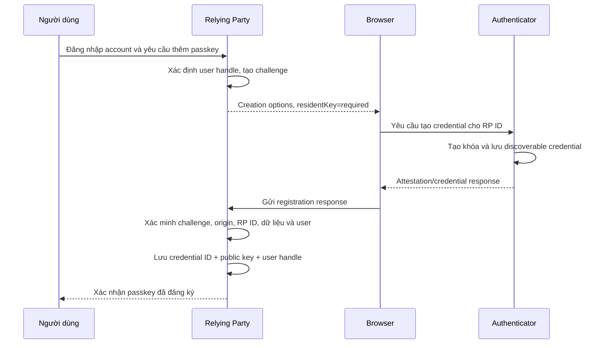
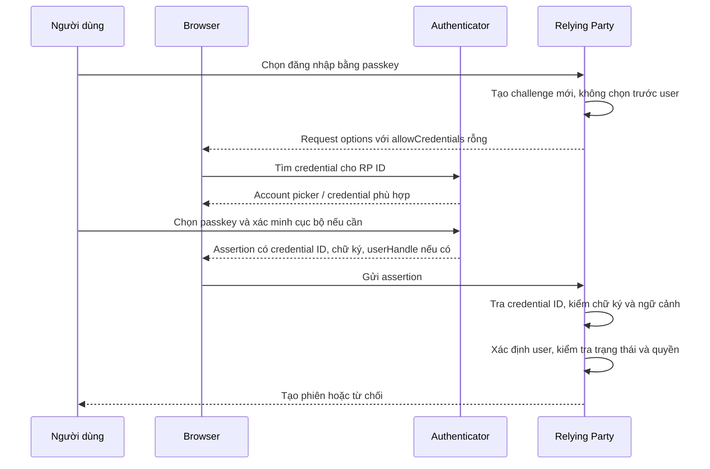
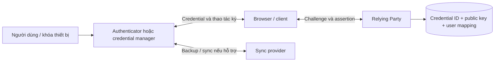

# Resident key

Trong WebAuthn, **resident key** là tên gọi trước đây của loại credential mà authenticator có thể lưu và tự tìm lại theo relying party (RP), mà không cần ứng dụng gửi trước credential ID cụ thể. Thuật ngữ hiện dùng trong WebAuthn là **discoverable credential**. Cách lưu này cho phép trải nghiệm đăng nhập không cần nhập username trước: trình duyệt yêu cầu authenticator tìm credential phù hợp với website, rồi người dùng chọn tài khoản hoặc phương thức đã đăng ký.

Resident key là một khái niệm quan trọng trong **Passkey và WebAuthn**. Nó giải thích vì sao passkey có thể hỗ trợ đăng nhập bằng cách chọn tài khoản, username-less flow và giao diện gợi ý credential; đồng thời ảnh hưởng đến enrollment, dung lượng authenticator, quyền riêng tư, đồng bộ passkey và khôi phục tài khoản.

Điểm cần nắm ngay: **resident key không có nghĩa khóa riêng được lưu trên server**. Authenticator hoặc credential manager giữ credential và sử dụng khóa riêng; relying party lưu credential ID, khóa công khai và thông tin liên kết với user account để xác minh chữ ký.

## 1. Resident key là gì?

Một WebAuthn credential thường được tạo trong quá trình đăng ký (*registration/credential creation*). Authenticator tạo cặp khóa cho một RP:

- **Private key:** được authenticator giữ và sử dụng để ký dữ liệu xác thực. Trong thiết kế bảo mật đúng, ứng dụng web không nhận private key.
- **Public key:** được RP nhận khi đăng ký và lưu để xác minh chữ ký trong các lần đăng nhập.
- **Credential ID:** định danh credential, được gửi trong các assertion để RP tìm bản ghi khóa công khai tương ứng.
- **User handle:** định danh opaque do RP cấp cho account, dùng để liên kết credential với user trong các luồng discoverable.

Khác biệt chính giữa hai kiểu credential:

| Kiểu credential | Cách authenticator tìm credential | Luồng đăng nhập điển hình |
| --- | --- | --- |
| **Non-discoverable credential** (trước đây thường gọi non-resident) | RP/client cung cấp danh sách credential ID được phép; authenticator dùng danh sách đó để tìm credential tương ứng. | Người dùng nhập username trước; server tìm credential ID của user rồi gửi trong `allowCredentials`. |
| **Discoverable credential** (resident key) | Authenticator có thể tìm credential phù hợp dựa trên RP ID mà không cần RP gửi trước credential ID. | RP có thể bỏ danh sách credential ID; authenticator/trình duyệt hiển thị các tài khoản phù hợp để người dùng chọn. |

Trong thực tế, thuật ngữ “resident key” vẫn xuất hiện trong cấu hình và tài liệu cũ. Khi đọc WebAuthn hiện đại, nên hiểu `residentKey` là lựa chọn yêu cầu khả năng tạo **discoverable credential**.

### 1.1. “Resident” không có nghĩa là lưu trên server

Khi một người đăng ký passkey cho `learn.example.org`, credential được tạo và lưu trong authenticator hoặc credential manager phù hợp. Server nhận credential ID và public key để lưu:

```text
Authenticator / credential manager
    - Private key (được bảo vệ và sử dụng tại đây)
    - Credential ID và metadata credential
    - Liên kết credential với RP ID và user handle

Relying party (server)
    - Credential ID
    - Public key
    - User identity / account liên kết
    - User handle và metadata cần thiết
    - Trạng thái, thời điểm tạo và lần sử dụng gần nhất
```

Vì vậy, **resident key nói về khả năng lưu và khám phá credential tại authenticator**, không phải loại khóa riêng được gửi lên server. Server không cần lưu private key để xác minh assertion.

### 1.2. Credential có thể gắn thiết bị hoặc đồng bộ

Discoverable credential có thể được lưu trong authenticator gắn với thiết bị hoặc được credential manager đồng bộ giữa các thiết bị. Hai thuộc tính này cần được phân biệt:

- **Discoverability:** authenticator có thể tìm credential theo RP ID mà không cần RP gửi credential ID trước.
- **Backup eligibility / syncability:** credential có được phép sao lưu hoặc đồng bộ theo hệ sinh thái hỗ trợ hay không.
- **Backup state:** trạng thái cho biết credential đã được backup theo cơ chế tương ứng hay chưa.

Một credential discoverable không mặc nhiên là syncable; một passkey syncable vẫn cần được sử dụng trong đúng ngữ cảnh RP. Các cờ backup trong WebAuthn authenticator data có thể cung cấp tín hiệu liên quan, nhưng RP phải diễn giải theo tiêu chuẩn và chính sách áp dụng. Không suy luận rằng “resident key” luôn nằm trên một thiết bị vật lý duy nhất.

## 2. Vì sao cần resident key?

### 2.1. Hỗ trợ đăng nhập không cần username trước

Với credential không discoverable, server thường cần biết account trước để tìm credential ID. Người dùng nhập username/email, server trả về danh sách credential được phép, rồi trình duyệt gọi authenticator.

Với discoverable credential, RP có thể khởi tạo yêu cầu xác thực mà không cần biết trước account. Authenticator tìm các credential thuộc RP, sau đó người dùng chọn một tài khoản. Đây là nền tảng của **username-less authentication**.

Ví dụ, người dùng truy cập `learn.example.org`, chọn “Đăng nhập bằng passkey”, sau đó trình duyệt hiển thị các passkey đã đăng ký cho website này. Người dùng chọn tài khoản; authenticator ký challenge và server nhận assertion để xác minh.

### 2.2. Giảm phụ thuộc vào username và mật khẩu

Khi dùng passkey discoverable, người dùng không cần nhớ username hoặc nhập mật khẩu để bắt đầu đăng nhập. Trải nghiệm này có thể giảm:

- Phishing mật khẩu và tái sử dụng mật khẩu.
- Lỗi nhập username hoặc chọn sai account.
- Nhu cầu lưu password verifier và xử lý reset mật khẩu cho luồng passkey-only.
- Rủi ro bị chuyển tiếp OTP trong một số luồng đăng nhập truyền thống.

Resident key không tự đảm bảo mọi rủi ro biến mất. Người dùng vẫn có thể bị lừa qua quy trình recovery, thiết bị bị chiếm, credential bị thêm trái phép hoặc session bị đánh cắp. Server vẫn phải xác minh origin, RP ID, challenge, chữ ký, trạng thái account và quyền truy cập.

### 2.3. Tạo trải nghiệm account picker

Authenticator có thể cung cấp danh sách credential tương ứng với RP để người dùng chọn. Tên hiển thị và tên tài khoản có thể giúp người dùng nhận ra credential, nhưng đây là **metadata giao diện**, không phải bằng chứng xác thực.

Server phải dựa vào credential ID, user handle và public key đã đăng ký. Không cấp quyền chỉ vì người dùng chọn một dòng có `displayName=Administrator` hoặc email trông có vẻ đáng tin.

## 3. Đăng ký discoverable credential

Trong WebAuthn, RP gửi `PublicKeyCredentialCreationOptions` cho trình duyệt. Thuộc tính `authenticatorSelection.residentKey` điều khiển yêu cầu về discoverability.

Các giá trị thường dùng:

| Giá trị | Ý nghĩa |
| --- | --- |
| `required` | RP yêu cầu authenticator tạo discoverable credential. Nếu không đáp ứng, quá trình tạo credential phải thất bại. |
| `preferred` | RP ưu tiên discoverable credential; authenticator có thể tạo loại credential khác nếu không hỗ trợ. |
| `discouraged` | RP không yêu cầu discoverable credential; phù hợp khi muốn tránh chiếm dung lượng lưu credential trên authenticator. |

Trường `requireResidentKey` cũ có thể còn thấy trong code để tương thích; khi dùng `residentKey` hiện đại, hãy theo thư viện và phiên bản WebAuthn đang triển khai. Không cấu hình hai trường mâu thuẫn nhau.

### 3.1. Ví dụ registration options

Ví dụ JSON rút gọn để minh họa ý nghĩa, không phải toàn bộ options sản xuất:

```json
{
  "challenge": "random-server-challenge",
  "rp": {
    "id": "learn.example.org",
    "name": "Learning Platform"
  },
  "user": {
    "id": "opaque-user-handle",
    "name": "mai@example.org",
    "displayName": "Mai Nguyen"
  },
  "pubKeyCredParams": [
    { "type": "public-key", "alg": -7 },
    { "type": "public-key", "alg": -257 }
  ],
  "authenticatorSelection": {
    "residentKey": "required",
    "userVerification": "preferred"
  },
  "timeout": 60000,
  "attestation": "none"
}
```

Ý nghĩa các trường liên quan:

- `rp.id`: RP ID mà credential được ràng buộc. Giá trị này phải phù hợp domain và cấu hình relying party.
- `user.id`: user handle opaque do server cấp. Đây là giá trị ổn định để liên kết credential, không nên là email hoặc dữ liệu cá nhân có thể thay đổi.
- `user.name` và `displayName`: thông tin giúp hiển thị/nhận diện credential cho người dùng. Không dùng chúng làm khóa phân quyền.
- `residentKey: required`: yêu cầu credential có khả năng discoverable.
- `userVerification`: chính sách yêu cầu authenticator xác minh người dùng, ví dụ bằng PIN hoặc sinh trắc tại thiết bị. Đây là lựa chọn khác với resident key.
- `challenge`: giá trị ngẫu nhiên do server tạo, có thời hạn và chỉ được tiêu thụ một lần.

WebAuthn quy định user handle là định danh opaque, tối đa 64 byte. RP nên tạo giá trị ngẫu nhiên/không mang ý nghĩa, duy trì liên kết ổn định với account và tránh dùng email hoặc username trực tiếp.

### 3.2. Luồng đăng ký



Server cần kiểm tra response theo WebAuthn và ràng buộc với phiên đăng ký ban đầu. Tối thiểu cần xác minh challenge chưa dùng, origin hợp lệ, RP ID hash, dữ liệu authenticator, thuật toán/credential hợp lệ và chính sách user verification/attestation nếu được yêu cầu. Chỉ sau khi xác minh thành công mới kích hoạt credential.

### 3.3. Enrollment cần được bảo vệ

Việc thêm passkey mới có thể cho người khác quyền đăng nhập vào account. Vì thế:

- Xác định account từ phiên đã xác thực và kiểm tra trạng thái account.
- Với account nhạy cảm, yêu cầu re-authentication hoặc step-up bằng phương thức hiện có trước khi thêm credential.
- Không nhận `user.id`, tenant hoặc account đích do client tự khai mà không kiểm tra.
- Hiển thị rõ thiết bị/phương thức vừa thêm, gửi thông báo và ghi audit.
- Cho phép thu hồi credential mới nếu người dùng báo không thực hiện thao tác.
- Khi registration không đạt `residentKey=required`, không âm thầm lưu credential non-discoverable như thể yêu cầu đã được đáp ứng.

## 4. Đăng nhập bằng discoverable credential

### 4.1. Không cần gửi trước danh sách credential ID

Đối với username-less flow, RP tạo challenge mới và gửi yêu cầu `PublicKeyCredentialRequestOptions`. Để authenticator tự khám phá credential, `allowCredentials` thường được để trống hoặc là mảng rỗng. Nếu RP gửi danh sách credential ID cụ thể, nó đang giới hạn credential được phép sử dụng thay vì để authenticator khám phá mọi credential phù hợp.

Ví dụ:

```json
{
  "challenge": "fresh-random-challenge",
  "rpId": "learn.example.org",
  "allowCredentials": [],
  "userVerification": "required",
  "timeout": 60000
}
```

Authenticator tìm credential phù hợp với RP ID, có thể hiển thị danh sách account. Sau khi người dùng chọn, nó sử dụng private key tương ứng để ký dữ liệu xác thực. Response chứa credential ID và có thể có user handle; RP dùng credential ID để tìm public key đã lưu.

### 4.2. Luồng xác thực username-less



### 4.3. Server xác định user như thế nào?

Trong discoverable flow, server có thể chưa biết account trước khi nhận assertion. Quy trình điển hình:

1. Tìm credential đã đăng ký theo `credentialId` nhận được.
2. Lấy public key, RP/account mapping và user handle đã lưu.
3. Xác minh challenge, origin, RP ID hash, chữ ký, thời hạn và cờ user verification theo chính sách.
4. Nếu response có `userHandle`, kiểm tra nó khớp user handle đã gắn với credential; không để một response trộn credential của user A với handle của user B.
5. Nạp user identity/account từ mapping nội bộ; kiểm tra tenant, trạng thái active, chính sách khóa và điều kiện đăng nhập.
6. Chỉ sau khi mọi kiểm tra đạt mới tạo session/principal.

`userHandle` có thể null trong một số response không discoverable hoặc luồng khác; với discoverable credential, RP nên xử lý đúng theo WebAuthn và dữ liệu đăng ký của mình. **Credential ID và public key đã lưu là căn cứ xác minh chính**, còn user handle hỗ trợ liên kết account trong discoverable flow.

### 4.4. Pseudocode phía server

```text
beginPasswordlessLogin():
    challenge = secureRandomChallenge()
    storePendingChallenge(challenge, shortExpiry, singleUse)
    return {
        challenge,
        rpId: configuredRpId,
        allowCredentials: [],
        userVerification: "required"
    }

finishPasswordlessLogin(assertion):
    pending = consumePendingChallenge(assertion.challengeContext)
    require pending exists and is not expired

    credential = findCredentialById(assertion.credentialId)
    require credential exists and credential.status == "active"

    verifyWebAuthnAssertion(
        assertion,
        publicKey = credential.publicKey,
        expectedChallenge = pending.challenge,
        expectedOrigin = configuredOrigins,
        expectedRpId = configuredRpId,
        requireUserVerification = true
    )

    if assertion.userHandle is present:
        require constantTimeEqual(assertion.userHandle, credential.userHandle)

    user = loadUserIdentity(credential.userIdentityId)
    require user.status == "active"
    require tenantAndAccountPolicyAllows(user, credential)

    return createScopedSession(user)
```

Đây là pseudocode để diễn đạt luồng, không thay thế thư viện WebAuthn đã được kiểm thử. Challenge cần được gắn với giao dịch đăng nhập và tiêu thụ một lần; không chỉ so sánh một chuỗi challenge client gửi mà không có trạng thái server.

## 5. Conditional UI và gợi ý passkey

Một trải nghiệm thường gặp là người dùng vào trang đăng nhập, đặt con trỏ trong ô username và thấy passkey được gợi ý ngay trong giao diện autofill. Trình duyệt có thể thực hiện **conditional mediation**: yêu cầu WebAuthn được khởi chạy ở chế độ có điều kiện và chỉ hiển thị credential khi người dùng tương tác với trường phù hợp.

Điều này có thể làm luồng đăng nhập mượt hơn:

1. Trang hiển thị trường username/email và nút đăng nhập.
2. Trình duyệt khởi chạy yêu cầu WebAuthn conditional nếu môi trường hỗ trợ.
3. Passkey tương ứng với RP xuất hiện như gợi ý trong giao diện.
4. Người dùng chọn credential; browser/authenticator thực hiện ceremony.
5. Server xác minh assertion và tạo phiên.

Conditional UI là **cách trình bày và khởi chạy luồng**, không phải một loại credential khác. Nó vẫn dựa trên discoverable credential để trình duyệt có thể gợi ý passkey mà không cần RP biết trước credential ID.

Ví dụ JavaScript khái niệm (xử lý lỗi và hỗ trợ trình duyệt cần được bổ sung trong ứng dụng thực):

```javascript
const options = await fetch("/webauthn/authentication-options")
  .then(response => response.json());

const assertion = await navigator.credentials.get({
  publicKey: options,
  mediation: "conditional"
});

if (assertion) {
  await fetch("/webauthn/authentication-result", {
    method: "POST",
    headers: { "Content-Type": "application/json" },
    body: serializeAssertion(assertion)
  });
}
```

Trang có thể đánh dấu trường username bằng `autocomplete="username webauthn"` theo hướng dẫn hỗ trợ của browser. Ứng dụng cần xử lý khi người dùng không chọn gợi ý, browser không hỗ trợ conditional mediation, credential không tồn tại hoặc người dùng hủy. Luôn có đường đăng nhập thay thế phù hợp chính sách; không tự động hạ mức bảo đảm mà không thông báo.

## 6. Dung lượng và vòng đời resident credential

Discoverable credential cần được authenticator/credential manager lưu để có thể tìm lại. Một số authenticator phần cứng có **giới hạn số credential discoverable** hoặc giới hạn tài nguyên; credential manager đồng bộ có cách quản lý dung lượng riêng.

### 6.1. Dung lượng và lỗi enrollment

Khi dung lượng đã đầy hoặc authenticator không hỗ trợ resident credential, thao tác `residentKey=required` có thể thất bại. Ứng dụng cần:

- Hiển thị lỗi dễ hiểu và hướng dẫn dùng authenticator khác nếu chính sách cho phép.
- Không coi việc tạo non-discoverable credential là thành công nếu RP đã yêu cầu discoverable bắt buộc.
- Không tự động đổi từ `required` sang `preferred` mà không có quyết định rõ ràng về trải nghiệm và bảo đảm.
- Cho phép quản lý danh sách passkey đã đăng ký ở cấp account, đồng thời hướng dẫn người dùng quản lý credential trong hệ sinh thái authenticator.
- Kiểm tra khả năng đồng bộ/backup theo chính sách; không giả định mọi authenticator lưu vô hạn.

### 6.2. Xóa credential ở đâu?

Có hai phía quản lý khác nhau:

- **RP/server:** có thể vô hiệu hóa hoặc xóa bản ghi credential ID/public key khỏi account. Khi đó assertion tiếp theo không còn được server chấp nhận.
- **Authenticator/credential manager:** có thể cần xóa passkey khỏi thiết bị hoặc hệ sinh thái đồng bộ. Xóa bản ghi server không nhất thiết tự xóa bản sao credential ở mọi thiết bị.

Nếu chỉ xóa credential trên thiết bị mà không vô hiệu hóa ở server, bản sao đã đồng bộ hoặc backup có thể vẫn được sử dụng. Nếu chỉ xóa trên server, credential còn nằm trong authenticator nhưng sẽ không đăng nhập thành công vào RP vì server không còn public key/mapping chấp nhận.

Quy trình thu hồi cần thông báo rõ credential nào bị thu hồi, kiểm tra session phát sinh từ credential đó và cho người dùng biết cách xóa passkey tại authenticator/credential manager nếu cần.

### 6.3. Thay thiết bị hoặc mất passkey

- Nếu passkey syncable, người dùng có thể khôi phục qua hệ sinh thái đồng bộ; độ tin cậy còn phụ thuộc bảo vệ account đồng bộ và quy trình recovery của nhà cung cấp.
- Nếu passkey device-bound, mất thiết bị có thể yêu cầu sử dụng passkey dự phòng hoặc quy trình khôi phục đã được proofing.
- Nên cho phép nhiều passkey hợp lệ theo chính sách để giảm nguy cơ mất phương tiện duy nhất.
- Thêm passkey mới phải yêu cầu xác thực lại hoặc quy trình recovery tương xứng, thông báo và audit.
- Khi nghi ngờ thiết bị bị chiếm, thu hồi credential và session liên quan theo chính sách.

**Recovery không được trở thành đường vòng yếu hơn đăng nhập bằng passkey.** Nếu chỉ cần truy cập email dễ chiếm để thêm passkey mới, attacker có thể bỏ qua toàn bộ lợi ích chống phishing của WebAuthn.

## 7. Quyền riêng tư và ranh giới tin cậy

Discoverable credential làm trải nghiệm account selection tiện lợi, nhưng cần cân nhắc dữ liệu và quyền truy cập:

### 7.1. Dữ liệu user handle

`user.id` trong WebAuthn registration là user handle được authenticator lưu cùng credential. Nên dùng định danh opaque, không chứa email, số điện thoại, tên thật hoặc mã nhân viên. User handle ổn định trong phạm vi RP và không nên dùng chung tùy tiện giữa các dịch vụ.

Các trường `name` và `displayName` có thể hiển thị trong account picker. Chúng không phải bí mật và có thể được lưu tại authenticator; hãy cung cấp giá trị tối thiểu cần thiết, cập nhật khi cần và không đưa dữ liệu nhạy cảm vào đó.

### 7.2. Ranh giới authenticator, browser, RP và sync provider



- **Authenticator/credential manager:** bảo vệ private key, lựa chọn credential, yêu cầu user presence/verification và có thể quản lý backup.
- **Browser/client:** ràng buộc thao tác với origin/RP ID và chuyển tiếp ceremony; ứng dụng không được tin dữ liệu tùy ý do client gửi.
- **Relying party:** tạo challenge, xác minh response, lưu public key và quyết định account/session.
- **Sync provider:** có thể giúp đồng bộ credential; đây là một miền tin cậy bổ sung với chính sách bảo vệ và recovery riêng.

RP không nhận được private key chỉ vì credential là discoverable. Tuy nhiên, việc lộ user handle hoặc metadata không cần thiết có thể ảnh hưởng quyền riêng tư. Không dùng user handle như một ID theo dõi toàn cục qua nhiều website.

### 7.3. Account enumeration

Username-less flow không có nghĩa server nên trả thông báo chi tiết về account hoặc credential có tồn tại hay không. Khi credential không hợp lệ, account bị khóa hoặc người dùng hủy, thông báo cần cân bằng trải nghiệm với nguy cơ liệt kê tài khoản. Áp dụng rate limit, logging phù hợp và phản hồi không tiết lộ thông tin nhạy cảm không cần thiết.

## 8. Mô hình dữ liệu phía relying party

Một bảng credential có thể lưu các trường khái niệm sau (ví dụ SQL rút gọn):

```sql
CREATE TABLE webauthn_credentials (
    credential_id       BYTEA PRIMARY KEY,
    user_identity_id    UUID NOT NULL,
    user_handle         BYTEA NOT NULL,
    public_key          BYTEA NOT NULL,
    rp_id               TEXT NOT NULL,
    status              TEXT NOT NULL
                        CHECK (status IN ('active', 'revoked')),
    created_at          TIMESTAMPTZ NOT NULL DEFAULT CURRENT_TIMESTAMP,
    last_used_at        TIMESTAMPTZ
);
```

Mô hình thực tế có thể cần thêm tenant, loại authenticator, transports, AAGUID nếu có mục đích sử dụng, backup eligibility/state, sign counter, metadata, audit và quan hệ tới account. Không lưu private key.

Các lưu ý:

- `credential_id` phải được lưu chính xác dưới dạng byte sequence; không tùy tiện lowercase hoặc chuẩn hóa chuỗi.
- `user_handle` liên kết credential với account và cần ổn định; kiểm tra giá trị nhận về khi phù hợp.
- `rp_id` và origin được xác định bởi cấu hình RP, không lấy từ request client để tự quyết định trust.
- `public_key` dùng xác minh assertion; chỉ cập nhật theo quy trình credential rotation/registration đã xác minh.
- `status` cho phép thu hồi ở server mà không cần chờ authenticator xóa bản sao.
- Nếu account bị đình chỉ, server vẫn từ chối đăng nhập dù chữ ký credential hợp lệ.

## 9. Các lỗi thiết kế thường gặp

| Sai lầm | Rủi ro | Cách xử lý |
| --- | --- | --- |
| Nghĩ resident key nghĩa là private key được lưu trên server | Thiết kế sai nơi lưu khóa, tăng nguy cơ lộ bí mật. | Authenticator giữ private key; RP lưu public key và credential mapping. |
| Dùng email làm `user.id` | Email thay đổi/tái cấp, có thể lộ thông tin cá nhân và làm mapping sai. | Tạo user handle opaque, ổn định. |
| Yêu cầu `residentKey=preferred` nhưng giả định mọi credential đều discoverable | Username-less login có thể thất bại với credential non-discoverable. | Dùng `required` nếu luồng bắt buộc discoverable; kiểm tra capability/kết quả. |
| Gửi danh sách `allowCredentials` đầy đủ rồi mong authenticator tự khám phá account | Đã giới hạn credential trước khi authenticator khám phá. | Dùng allowCredentials rỗng/không chỉ định cho discoverable username-less flow. |
| Tin `displayName` hoặc email trong account picker để cấp quyền | Metadata giao diện bị dùng như bằng chứng danh tính. | Tra credential ID, kiểm chữ ký và user handle/mapping server-side. |
| Không kiểm tra userHandle khi response có giá trị | Có thể liên kết sai credential/account nếu dữ liệu không nhất quán. | Kiểm tra mapping credential ↔ user handle đã lưu. |
| Bỏ kiểm tra challenge, origin hoặc RP ID | Assertion có thể bị replay hoặc dùng sai website/ngữ cảnh. | Xác minh đầy đủ WebAuthn ceremony. |
| Coi mọi passkey là device-bound | Đánh giá sai backup/sync và khả năng thu hồi. | Phân biệt discoverability, backup eligibility/state và chính sách đồng bộ. |
| Chỉ xóa passkey ở thiết bị | Bản sao sync hoặc server mapping vẫn còn hoạt động. | Thu hồi credential ở RP; hướng dẫn xóa tại authenticator/credential manager. |
| Recovery chỉ dựa trên email | Kẻ chiếm mailbox có thể gắn passkey mới. | Recovery có kiểm chứng, notification, audit và step-up. |
| Không xử lý account bị đình chỉ | Credential hợp lệ vẫn đăng nhập vào account không còn quyền. | Kiểm tra trạng thái account/tenant sau khi xác minh assertion. |

## 10. Tình huống thực hành: triển khai username-less cho nền tảng học tập

**Bối cảnh:** Nền tảng `learn.example.org` hiện dùng email + mật khẩu. Nhóm phát triển muốn thêm nút “Đăng nhập bằng passkey” để người dùng chọn account mà không cần nhập email trước.

**Yêu cầu thiết kế:**

1. Khi enrollment, server xác định account đã xác thực, tạo user handle opaque và challenge mới.
2. Gửi creation options với `rp.id=learn.example.org`, `residentKey=required` và `userVerification` theo chính sách.
3. Xác minh registration response, lưu credential ID, public key, user handle, RP mapping và trạng thái.
4. Khi đăng nhập username-less, tạo challenge mới và request với `allowCredentials=[]`.
5. Authenticator khám phá credential thuộc RP và người dùng chọn passkey.
6. Server tìm credential ID, kiểm challenge/origin/RP ID/chữ ký/UV và userHandle nếu có.
7. Nạp account, kiểm tenant và trạng thái active, sau đó mới tạo session.
8. Khi người dùng mất passkey, dùng phương thức dự phòng hoặc recovery có kiểm chứng; thu hồi credential cũ và thông báo.

**Các câu hỏi thiết kế cần trả lời:**

- Nếu authenticator không hỗ trợ discoverable credential, có cho đăng ký passkey không? Nếu luồng username-less là yêu cầu bắt buộc, registration phải báo không đáp ứng thay vì giả vờ thành công.
- Nếu người dùng có ba passkey trên ba thiết bị, server lưu ba credential riêng liên kết cùng user identity hay không? Thông thường có; mỗi credential có trạng thái và thời điểm sử dụng riêng.
- Nếu passkey được đồng bộ sang thiết bị mới, server có cần đăng ký credential mới không? Tùy cơ chế sync của credential manager; không suy ra từ việc đổi thiết bị. Server vẫn phải xác minh assertion.
- Nếu account bị khóa sau khi passkey ký thành công, có tạo session không? Không. Kiểm tra trạng thái account và quyền vẫn bắt buộc sau xác thực.
- Nếu người dùng đổi email, user handle có thay đổi không? Thông thường không; email là thuộc tính, user handle là định danh liên kết ổn định.

## 11. Checklist triển khai resident key

- [ ] Hiểu resident key là discoverable credential; không nhầm với nơi server lưu private key.
- [ ] Chọn `residentKey` phù hợp: `required` cho username-less bắt buộc, `preferred` khi có fallback có chủ đích, `discouraged` khi không cần discoverability.
- [ ] Tạo user handle opaque, ổn định, không chứa email hoặc dữ liệu cá nhân, tuân thủ giới hạn WebAuthn.
- [ ] Ràng buộc credential với đúng RP ID và origin; tạo challenge ngẫu nhiên, ngắn hạn, dùng một lần.
- [ ] Xác minh registration response đầy đủ trước khi lưu public key và kích hoạt credential.
- [ ] Bảo vệ enrollment bằng phiên/account đã xác thực và step-up khi cần.
- [ ] Dùng `allowCredentials=[]` cho username-less discovery; hiểu tác động nếu truyền danh sách credential cụ thể.
- [ ] Khi assertion về, tra credential ID, xác minh chữ ký, challenge, origin, RP ID và UV theo chính sách.
- [ ] Kiểm tra userHandle với mapping đã lưu khi response có giá trị.
- [ ] Phân biệt discoverability với backup eligibility/state và device-bound/syncable.
- [ ] Có xử lý khi authenticator đầy, không hỗ trợ, người dùng hủy hoặc conditional UI không khả dụng.
- [ ] Quản lý nhiều passkey, thu hồi phía server, xóa phía authenticator và recovery an toàn.
- [ ] Không cấp quyền dựa trên displayName/email trong account picker.
- [ ] Kiểm tra trạng thái identity/account/tenant và authorization trước khi tạo session.
- [ ] Có kiểm thử replay, sai origin/RP ID, credential không tồn tại, userHandle không khớp và account bị đình chỉ.

## 12. Câu hỏi tự kiểm tra

**1. Resident key trong WebAuthn hiện được gọi là gì?**  
Là discoverable credential: authenticator có thể tìm credential theo RP ID mà không cần RP gửi trước credential ID cụ thể.

**2. Private key của resident credential được lưu ở đâu?**  
Trong authenticator hoặc credential manager được sử dụng; relying party lưu public key, credential ID và mapping cần thiết để xác minh.

**3. Vì sao discoverable credential hỗ trợ username-less login?**  
Vì authenticator có thể tự tìm credential cho RP ID, hiển thị account phù hợp và trả assertion mà RP không cần biết trước username/credential ID.

**4. `residentKey=preferred` có bảo đảm tạo discoverable credential không?**  
Không. Nó chỉ thể hiện ưu tiên; nếu luồng cần bắt buộc discoverable, dùng `required` và xử lý trường hợp authenticator không đáp ứng.

**5. User handle có nên là email không?**  
Không nên. User handle nên là định danh opaque, ổn định, không mang dữ liệu cá nhân và được server liên kết với user identity.

**6. Nếu response có userHandle, server có thể tin ngay giá trị đó không?**  
Không. Phải kiểm tra nó khớp với user handle đã lưu cho credential/account tương ứng.

**7. Discoverable credential có nhất thiết là passkey đồng bộ không?**  
Không. Discoverability là khả năng tìm credential theo RP; syncability/backup là thuộc tính khác.

**8. Xóa passkey trên server có xóa mọi bản sao trên thiết bị không?**  
Không. Server có thể từ chối credential bằng cách thu hồi mapping; việc xóa bản sao trong authenticator hoặc credential manager là bước riêng.

**9. Nếu chữ ký WebAuthn hợp lệ nhưng account đã bị đình chỉ thì sao?**  
Từ chối tạo session. Authentication chỉ chứng minh quyền kiểm soát credential; trạng thái account và authorization vẫn phải được kiểm tra.

**Ghi nhớ:** Resident key (discoverable credential) cho phép authenticator tìm passkey theo RP ID và mở ra username-less login. Để triển khai an toàn, hãy dùng user handle opaque, yêu cầu đúng mức discoverability, xác minh đầy đủ WebAuthn assertion, liên kết credential với account server-side và bảo vệ vòng đời enrollment, sync, thu hồi cùng recovery.
