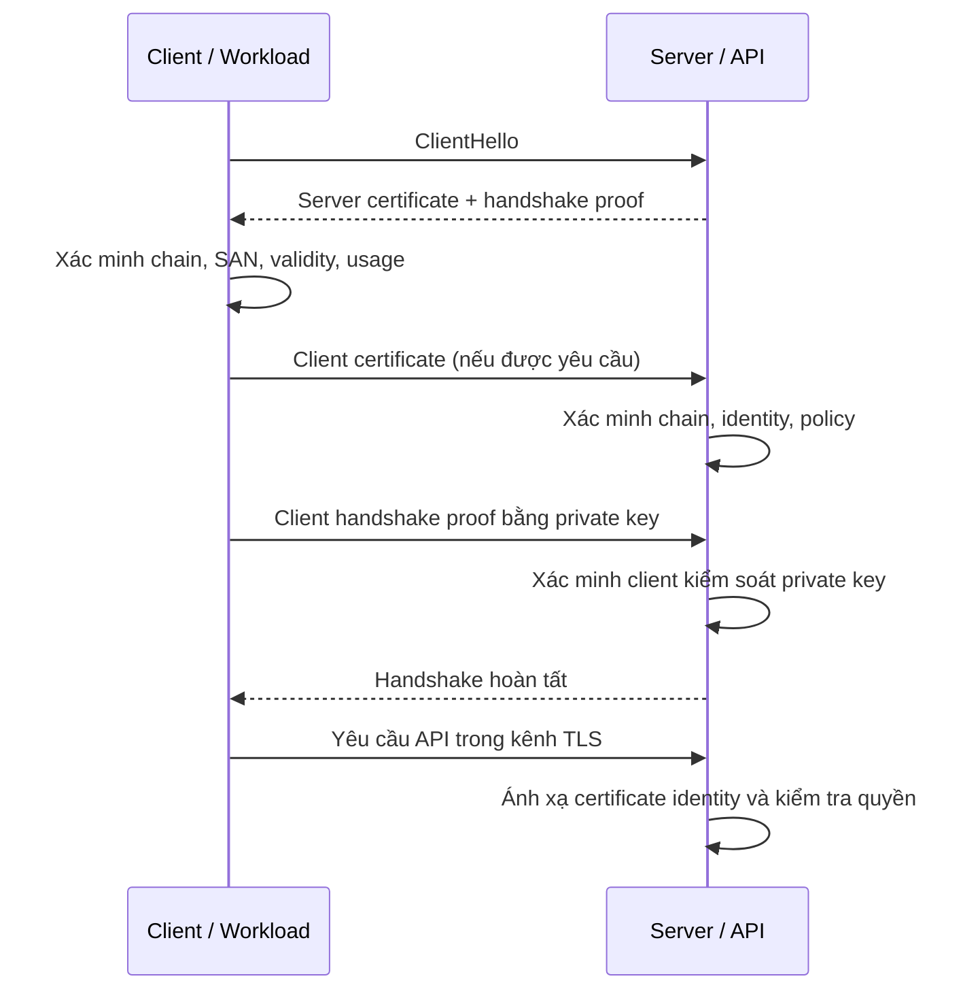

# Private key — Bảo vệ và sử dụng khóa riêng trong xác thực chứng chỉ

Trong xác thực bằng chứng chỉ, chứng chỉ số thường được chia sẻ công khai để bên khác kiểm tra danh tính và chữ ký. **Private key (khóa riêng)** là phần bí mật cho phép chủ thể tạo chữ ký hoặc thực hiện thao tác mật mã tương ứng với public key trong chứng chỉ. Nếu khóa riêng bị sao chép hoặc bị lạm dụng, kẻ tấn công có thể mạo danh chủ thể trong phạm vi các bên nhận tin tưởng chứng chỉ đó.

Khóa riêng vì thế là một trong những tài sản quan trọng nhất của hệ thống xác thực. Việc bảo vệ không chỉ là đặt file vào thư mục khó truy cập: cần kiểm soát cách sinh khóa, nơi lưu, ai được yêu cầu sử dụng, cách cấp chứng chỉ, thời hạn, xoay vòng, thu hồi và ứng phó khi khóa bị lộ.

Bài học thuộc chương **Certificate authentication** của học phần **SECURITY_AUTHENTICATION_FUNDAMENTALS**. Nội dung liên hệ khóa riêng với credential, chứng chỉ, TLS/mTLS, token, phiên, MFA và vòng đời danh tính. Người học sẽ mô hình hóa ranh giới tin cậy và thiết kế cách bảo vệ khóa nhằm giảm nguy cơ giả mạo, phishing, replay và lạm dụng xác thực.

## 1. Kết quả học tập

Sau bài này, người học có thể:

- Giải thích quan hệ giữa private key, public key, chứng chỉ số và danh tính được xác minh.
- Phân biệt ký số, xác minh chữ ký, mã hóa và thỏa thuận khóa; tránh suy luận rằng private key luôn dùng để giải mã dữ liệu.
- Mô tả vòng đời khóa: sinh, lưu, sử dụng, sao lưu (nếu phù hợp), gia hạn chứng chỉ, xoay vòng, thu hồi và hủy.
- Chọn nơi lưu khóa phù hợp như OS keystore, TPM, secure element, HSM hoặc KMS.
- Hiểu CSR, CA, certificate chain, key usage, extended key usage và xác minh chứng chỉ trong TLS/mTLS.
- Xác định các đường tấn công khi khóa bị trích xuất, dùng sai quyền, lộ qua backup hoặc bị lợi dụng như signing oracle.
- Viết tiêu chí chấp nhận và kiểm thử cho quản lý khóa, xác thực client/server, thu hồi và ứng phó sự cố.

## 2. Private key là gì?

Trong mật mã khóa công khai (public-key cryptography), một cặp khóa có quan hệ toán học:

- **Private key:** bí mật, chỉ chủ thể được phép sử dụng. Khóa có thể nằm trong phần cứng và không bao giờ được xuất ra dạng file.
- **Public key:** được chia sẻ để người khác xác minh chữ ký hoặc thực hiện thao tác mật mã tương ứng.

Trong hệ thống chứng chỉ, CA (Certificate Authority) ký một chứng chỉ chứa public key cùng các thông tin định danh và mục đích sử dụng. Bên xác minh kiểm tra chữ ký CA, chuỗi tin cậy, thời hạn, tên/định danh và trạng thái chứng chỉ. **Chứng chỉ không chứa private key.** Nó là bằng chứng có chữ ký của CA liên kết public key với danh tính/thuộc tính theo chính sách cấp phát.

Ví dụ khái niệm:

```text
Chủ thể / workload
    ├── Private key (bí mật, được bảo vệ)
    └── Public key
          │
          ▼
    Certificate Signing Request (CSR)
          │  CA kiểm tra danh tính và chính sách
          ▼
    X.509 certificate
    ├── Subject / Subject Alternative Name
    ├── Public key
    ├── Validity
    ├── Key Usage / Extended Key Usage
    └── CA signature
```

Một certificate có thể được công bố cho peer. Private key tương ứng phải được giữ trong vùng kiểm soát của chủ thể. Nếu private key bị mất, chứng chỉ vẫn có thể được đọc nhưng chủ thể không còn chứng minh được quyền kiểm soát khóa; nếu private key bị đánh cắp, kẻ tấn công có thể tạo bằng chứng chữ ký hợp lệ cho tới khi các bên ngừng tin chứng chỉ/khóa đó.

### Khóa riêng có tự chứng minh danh tính không?

Không. Private key chỉ chứng minh bên thực hiện thao tác có khả năng sử dụng khóa tương ứng. Việc ánh xạ public key tới một người, thiết bị hoặc workload phụ thuộc vào chứng chỉ, quy trình cấp phát, CA và chính sách xác minh. Một khóa tự tạo không tự chứng minh người tạo là nhân viên của tổ chức hay là máy chủ của domain cụ thể.

## 3. Private key được dùng để làm gì?

### 3.1. Tạo và xác minh chữ ký số

Chủ thể dùng private key để ký dữ liệu hoặc một giá trị băm theo thuật toán chữ ký. Bên nhận dùng public key tương ứng để xác minh chữ ký. Nếu xác minh thành công, bên nhận có bằng chứng rằng dữ liệu được ký bởi bên kiểm soát khóa riêng tương ứng và chưa bị thay đổi kể từ lúc ký, với các giả định mật mã và quản lý khóa đúng.

Chữ ký không tự chứng minh người cụ thể đang ngồi trước thiết bị. Nếu private key được dùng chung, bị xuất ra hoặc ứng dụng ký tự động không yêu cầu xác nhận người dùng, chữ ký chỉ chứng minh khóa đã được sử dụng.

### 3.2. Thỏa thuận khóa và thiết lập kênh bảo mật

Trong một số giao thức, khóa riêng tham gia vào quá trình trao đổi khóa hoặc xác thực các tham số bắt tay. TLS hiện đại thường sử dụng trao đổi khóa tạm thời (ephemeral key exchange) để tạo khóa phiên; private key trong chứng chỉ máy chủ chủ yếu dùng để ký/xác thực handshake, không phải mặc định giải mã toàn bộ dữ liệu ứng dụng.

### 3.3. Mã hóa và giải mã

Một số hệ mật mã khóa công khai hỗ trợ mã hóa bất đối xứng: bên gửi mã hóa bằng public key và bên giữ private key giải mã. Tuy nhiên, đây không phải cách duy nhất hay mặc định để xác thực chứng chỉ. Trong nhiều hệ thống hiện đại, mã hóa dữ liệu khối lượng lớn dùng thuật toán đối xứng, còn khóa công khai hỗ trợ trao đổi khóa hoặc chữ ký.

| Thao tác | Khóa thường được sử dụng | Mục tiêu |
| --- | --- | --- |
| Ký số | Private key | Tạo bằng chứng mật mã gắn với khóa |
| Xác minh chữ ký | Public key | Kiểm tra chữ ký và tính toàn vẹn |
| Mã hóa cho người nhận | Public key của người nhận (trong hệ mã hóa phù hợp) | Chỉ bên giữ private key tương ứng có thể giải mã |
| Giải mã | Private key | Khôi phục dữ liệu được mã hóa cho cặp khóa |
| Xác thực TLS | Private key của endpoint ký dữ liệu handshake | Chứng minh khả năng kiểm soát khóa tương ứng với certificate |

Không tự thiết kế thuật toán hoặc giao thức mật mã. Dùng thư viện, giao thức và cấu hình được đánh giá; lựa chọn thuật toán phải theo chính sách hiện hành và khả năng tương thích của hệ thống.

## 4. Khóa riêng trong TLS và mTLS

### 4.1. TLS server authentication

Khi trình duyệt kết nối HTTPS:

1. Server gửi chứng chỉ chứa public key và danh tính máy chủ.
2. Client xác minh certificate chain tới trust anchor được chấp nhận, thời hạn, tên máy chủ (SAN), mục đích sử dụng, chữ ký và trạng thái theo chính sách.
3. Trong TLS handshake, server chứng minh quyền kiểm soát private key tương ứng, ví dụ ký dữ liệu handshake theo phiên bản TLS/cipher suite.
4. Hai bên thiết lập khóa phiên để bảo vệ dữ liệu trao đổi.

Nếu server gửi certificate hợp lệ nhưng không thể chứng minh đang kiểm soát private key tương ứng, handshake không được hoàn tất như một endpoint đã xác thực. Ngược lại, chỉ có private key mà không có chứng chỉ hợp lệ hoặc không được client tin cậy cũng không đủ để xác thực domain.

### 4.2. Mutual TLS (mTLS)

Với mTLS, client cũng trình chứng chỉ và chứng minh quyền kiểm soát private key. Server xác minh certificate chain và chính sách client; client đồng thời xác minh server như TLS thông thường.



**mTLS không tự động là xác thực con người.** Trong service-to-service, chứng chỉ thường đại diện cho workload hoặc client. Nếu chứng chỉ được cấp cho một máy, việc chứng minh máy kiểm soát khóa không cho biết nhân viên nào đang điều khiển máy đó. Hệ thống cần ánh xạ danh tính chứng chỉ sang principal và kiểm tra quyền theo tài nguyên/tenant.

### 4.3. Channel binding và chống relay

Chứng chỉ client có thể tăng khả năng chống mạo danh, nhưng phải xem xét giao thức và cách ràng buộc bằng chứng. Nếu private key chỉ được dùng để xác thực một kết nối TLS, bằng chứng gắn với handshake/kênh đó; không thể đơn giản sao chép một mật khẩu/OTP để dùng ở verifier khác. Tuy nhiên, proxy được ủy quyền, endpoint bị chiếm, private key exportable hoặc ứng dụng ký tự động có thể làm suy yếu bảo vệ.

Không nên tuyên bố “dùng mTLS là chống phishing hoàn toàn”. Cần kiểm tra nơi private key được giữ, cách người dùng/workload cho phép ký, quy trình cấp chứng chỉ, endpoint và chính sách authorization.

## 5. Sinh khóa riêng an toàn

Khóa yếu hoặc sinh từ nguồn ngẫu nhiên kém có thể bị đoán hoặc khôi phục. Các nguyên tắc:

- Dùng CSPRNG và thư viện mật mã chuẩn của nền tảng để sinh khóa.
- Chọn thuật toán và kích thước khóa theo profile hiện hành, tuổi thọ dự kiến, yêu cầu tương thích và hướng dẫn của tổ chức.
- Không tự tạo seed từ thời gian, tên máy, email, số serial hoặc giá trị dễ đoán.
- Không tái sử dụng cùng private key cho nhiều mục đích, môi trường hoặc danh tính nếu chính sách không cho phép.
- Tách khóa CA/root, khóa ký code, khóa TLS server, khóa client authentication và khóa mã hóa dữ liệu.
- Ưu tiên sinh khóa ngay trong TPM, secure element, smart card hoặc HSM khi cần hạn chế khả năng xuất private key.
- Ghi nhận metadata không bí mật: key ID, thuật toán, chủ sở hữu, mục đích, ngày tạo, nơi lưu và trạng thái.

### Lựa chọn thuật toán

Các lựa chọn phổ biến gồm RSA, ECDSA và EdDSA (ví dụ Ed25519) tùy hệ sinh thái/protocol. Mỗi loại có yêu cầu tham số, định dạng khóa, hỗ trợ thư viện và khả năng tương thích khác nhau. Không nên chọn chỉ dựa vào tốc độ hoặc kích thước nhỏ; cần tuân theo profile TLS/PKI và tiêu chuẩn của môi trường. Thuật toán cũ hoặc cấu hình yếu có thể bị loại bỏ theo chính sách.

Khóa phải đủ mạnh cho khoảng thời gian được dự kiến sử dụng. Hãy lập kế hoạch crypto agility: có thể thay thuật toán/chứng chỉ/khóa khi chuẩn thay đổi mà không cần viết lại toàn bộ hệ thống.

## 6. Lưu trữ và kiểm soát sử dụng private key

Mức bảo vệ phụ thuộc vào nơi khóa tồn tại và ai có thể yêu cầu dùng khóa.

| Nơi lưu | Đặc điểm | Trường hợp phù hợp và lưu ý |
| --- | --- | --- |
| File được bảo vệ bằng quyền hệ điều hành | Dễ triển khai, có thể mã hóa bằng passphrase | Phù hợp môi trường đơn giản/legacy; tiến trình hoặc admin có quyền vẫn có thể đọc/đánh cắp khóa |
| OS keystore / credential store | Nền tảng quản lý quyền truy cập và có thể tích hợp phần cứng | Phù hợp ứng dụng desktop/mobile; cần kiểm tra backup, export và quyền ứng dụng |
| TPM / Secure Enclave / Secure Element | Có thể giữ khóa trong phần cứng và thực hiện thao tác mà không xuất khóa | Phù hợp xác thực thiết bị/người dùng; phụ thuộc phần cứng và khả năng quản lý |
| Smart card / security token | Khóa nằm trên thiết bị rời, có PIN hoặc xác nhận thao tác | Phù hợp xác thực nhân viên/quản trị; cần quy trình mất thiết bị và cấp lại |
| HSM | Thiết bị chuyên dụng quản lý và thực hiện thao tác khóa | Phù hợp CA, khóa ký quan trọng, workload lớn; cần quản lý quyền, HA, backup và vận hành |
| KMS / cloud key service | Quản lý key policy, audit và thao tác mật mã qua API | Phù hợp cloud workload; cần bảo vệ IAM, policy, role và API endpoint |

### 6.1. Không xuất khóa khi không cần

Nếu hệ thống chỉ cần ký, hãy cân nhắc API ký trong HSM/KMS thay vì đọc private key vào bộ nhớ ứng dụng. Ứng dụng gửi dữ liệu cần ký hoặc digest theo API được phép; thiết bị trả chữ ký. Điều này giảm khả năng trích xuất khóa nhưng không ngăn ứng dụng bị chiếm dụng như **signing oracle** nếu kẻ tấn công có quyền gọi API ký.

### 6.2. Least privilege và separation of duties

- Chỉ tiến trình/dịch vụ cần thiết mới được yêu cầu sử dụng khóa.
- Tách quyền quản trị key policy, quyền sử dụng khóa và quyền phát hành chứng chỉ.
- Khóa CA/root nên được bảo vệ nghiêm ngặt, thường offline hoặc trong HSM với quy trình phê duyệt.
- Tài khoản workload chỉ được dùng khóa thuộc workload và môi trường của nó.
- Các thao tác tạo, export, backup, rotate, disable và destroy phải được audit.
- Quản trị viên không nên có quyền vừa tự phê duyệt vừa thực hiện thay đổi nhạy cảm mà không có kiểm soát bổ sung.

### 6.3. Mã hóa file khóa không giải quyết mọi rủi ro

Mã hóa private key bằng passphrase có thể bảo vệ khi file bị sao chép ở trạng thái nghỉ. Nhưng nếu ứng dụng phải tự giải mã khóa để sử dụng, malware có thể lấy khóa trong bộ nhớ hoặc đánh cắp passphrase. Cần xét toàn bộ đường sử dụng: nơi nhập passphrase, process memory, crash dump, backup, CI/CD, log và quyền admin.

## 7. CSR, CA và vòng đời chứng chỉ

### 7.1. Certificate Signing Request

CSR thường chứa public key, thông tin subject/SAN được yêu cầu và chữ ký tạo bằng private key tương ứng. Chữ ký CSR chứng minh bên gửi có khả năng sử dụng private key tại thời điểm tạo yêu cầu; **nó không tự xác minh rằng bên gửi sở hữu domain, là nhân viên hay có quyền đại diện tổ chức**.

CA phải thực hiện xác minh danh tính/quyền theo chính sách cấp phát (ví dụ kiểm soát domain, tổ chức, thiết bị hoặc workload) trước khi phát hành certificate. Không được cấp certificate chỉ vì CSR có chữ ký hợp lệ.

### 7.2. Certificate chain và validation

Một certificate thường được xác minh thông qua chuỗi:

```text
Leaf certificate (server/client/workload)
        │ được ký bởi
        ▼
Intermediate CA
        │ được ký bởi
        ▼
Root CA / Trust anchor
```

Bên xác minh cần kiểm tra:

- Chữ ký từng certificate trong chain và đường dẫn tới trust anchor được cấu hình.
- Thời hạn `Not Before`/`Not After` và đồng hồ hệ thống.
- Subject Alternative Name (SAN) khớp hostname hoặc danh tính được yêu cầu; không chỉ dựa vào Common Name cũ.
- Basic Constraints, Key Usage và Extended Key Usage đúng mục đích (serverAuth, clientAuth, codeSigning...).
- Chính sách CA, path length, name constraints và các extension liên quan.
- Trạng thái thu hồi qua OCSP, CRL hoặc cơ chế quản lý khác theo profile và yêu cầu hệ thống.

Certificate chain hợp lệ không đồng nghĩa chủ thể được phép truy cập mọi API. Sau validation, ứng dụng cần ánh xạ certificate identity tới principal và kiểm tra authorization.

### 7.3. Vòng đời khóa/chứng chỉ

| Giai đoạn | Việc cần làm | Rủi ro nếu bỏ qua |
| --- | --- | --- |
| Tạo khóa | Sinh bằng CSPRNG, chọn thuật toán/profile, gắn owner và purpose | Khóa yếu, dùng sai mục đích hoặc không truy vết được |
| Yêu cầu cấp | Tạo CSR, xác minh danh tính và quyền yêu cầu | Cấp nhầm chứng chỉ cho kẻ tấn công |
| Phát hành | CA ký certificate, ghi serial, validity, SAN và usage | Certificate vượt quyền hoặc sai danh tính |
| Triển khai | Cài certificate và private key vào đúng môi trường, bảo vệ quyền | Lộ khóa qua image, backup hoặc config |
| Vận hành | Theo dõi hạn, lỗi handshake, truy cập key và trạng thái thu hồi | Hết hạn bất ngờ hoặc sử dụng trái phép kéo dài |
| Gia hạn/xoay vòng | Sinh khóa mới khi cần, cấp certificate mới, chuyển dịch vụ | Dùng một khóa quá lâu hoặc không thay được khi thuật toán lỗi thời |
| Thu hồi | Revoke certificate/khóa, cập nhật verifier và phân phối trạng thái | Certificate bị xâm phạm vẫn được chấp nhận |
| Hủy | Xóa bản sao/backup theo chính sách, xác nhận không còn nơi sử dụng | Khóa cũ tiếp tục bị lạm dụng hoặc khôi phục ngoài ý muốn |

Không phải mọi certificate renewal đều cần giữ nguyên private key. Khi nghi ngờ khóa bị lộ hoặc theo chính sách, cần sinh key pair mới và cấp certificate mới. Gia hạn với cùng khóa chỉ kéo dài thời gian sử dụng của một khóa cũ, không khắc phục sự cố compromise.

## 8. Thu hồi, xoay vòng và xử lý khóa bị lộ

Private key thường không thể “thu hồi” trực tiếp sau khi đã bị sao chép; hệ thống phải làm cho public key/certificate tương ứng không còn được tin cậy và ngăn tiếp tục sử dụng khóa.

### Khi nào cần rotate hoặc revoke?

- Private key bị lộ, thất lạc thiết bị hoặc nghi ngờ malware truy cập.
- Nhân viên/workload rời tổ chức hoặc thay đổi quyền.
- Certificate sắp hết hạn hoặc thông tin danh tính/SAN không còn đúng.
- Thuật toán/độ dài khóa không còn đáp ứng chính sách.
- Phát hiện sử dụng khóa bất thường hoặc signing oracle.
- HSM/KMS, CA hoặc quy trình cấp phát bị xâm nhập.

### Xử lý khi nghi ngờ private key compromise

1. Xác định key ID, certificate serial, owner, môi trường, mục đích và mọi bản sao/backup.
2. Ngăn sử dụng mới: disable key hoặc quyền gọi HSM/KMS, khóa thiết bị, cô lập workload theo tình huống.
3. Thu hồi certificate và cập nhật CRL/OCSP hoặc hệ thống trust distribution; xác nhận các verifier thực sự kiểm tra trạng thái.
4. Sinh key pair mới trong môi trường tin cậy, cấp certificate mới sau khi xác minh danh tính và làm sạch nguyên nhân.
5. Triển khai certificate mới, xác nhận handshake và quyền hoạt động, sau đó loại bỏ key cũ khỏi hệ thống.
6. Kiểm tra log ký, TLS, API, phát hành certificate và truy cập secret để đánh giá hoạt động trong thời gian bị lộ.
7. Xem xét token/phiên được cấp trong giai đoạn compromise; certificate revoke không tự thu hồi access token hoặc cookie đã phát hành.
8. Bảo toàn bằng chứng, thông báo bên liên quan và cập nhật playbook.

### Giới hạn thu hồi

Không phải mọi client đều kiểm tra OCSP/CRL theo cùng cách; một số có thể dùng cache hoặc chính sách soft-fail khi không liên lạc được dịch vụ trạng thái. Với workload nội bộ, có thể cần denylist/identity registry hoặc cơ chế thu hồi tập trung ngoài PKI. Phải kiểm thử thời gian từ lúc revoke tới khi mọi API/endpoint ngừng tin khóa cũ.

## 9. Các mối đe dọa đối với private key

| Mối đe dọa | Đường tấn công | Kiểm soát |
| --- | --- | --- |
| **Key extraction** | Đọc file, backup, process memory, container image hoặc keystore | HSM/TPM/secure enclave, quyền tối thiểu, không export, bảo vệ backup và endpoint |
| **Weak key generation** | RNG yếu, seed dễ đoán hoặc thuật toán/tham số lỗi thời | CSPRNG, thư viện chuẩn, profile thuật toán được duyệt, kiểm kê và crypto agility |
| **Signing oracle** | Kẻ tấn công có quyền gọi API ký và ký dữ liệu tùy ý | Policy theo loại dữ liệu, caller identity, authorization, rate limit, approval và audit |
| **Privilege escalation** | Tài khoản admin hoặc process không cần thiết được quyền dùng key | Separation of duties, least privilege, IAM policy và kiểm tra định kỳ |
| **Supply-chain compromise** | Dependency/pipeline lấy khóa hoặc yêu cầu ký trong lúc build | Secret scanning, build isolation, workload identity, provenance và quyền ngắn hạn |
| **Backup/replica exposure** | Khóa được sao chép sang backup, staging hoặc DR không bảo vệ tương đương | Mã hóa, kiểm soát truy cập, audit, phân tách môi trường và thử khôi phục |
| **Certificate mis-issuance** | CA cấp chứng chỉ sai danh tính hoặc sai SAN/usage | Xác minh domain/organization/workload, CA policy, approval và giám sát issuance |
| **Stale trust** | Verifier vẫn chấp nhận certificate đã revoke/hết hạn | Kiểm tra chain, validity, revocation và cache theo chính sách |
| **Key reuse** | Dùng cùng khóa cho TLS, code signing và nhiều môi trường | Tách key theo purpose, identity, environment và policy |
| **Insider misuse** | Người có quyền dùng khóa để ký hoặc mạo danh ngoài mục đích | Audit, dual control, giới hạn thao tác, cảnh báo và điều tra |

### Signing oracle là gì?

Nếu private key nằm trong HSM và không thể export, nhưng một API cho phép bất kỳ caller nào gửi dữ liệu để ký, kẻ tấn công có thể không cần lấy khóa. Chúng chỉ cần chiếm quyền gọi API. Vì vậy, bảo vệ khóa phải bao gồm cả **quyền sử dụng khóa**, không chỉ bí mật vật lý của key material.

## 10. Ví dụ thực tế: mTLS giữa hai dịch vụ

Một nền tảng thương mại điện tử có `orders-service` gọi `payments-service` qua mTLS. Mỗi workload có certificate riêng:

- CA nội bộ xác minh danh tính workload và cấp certificate có SAN phù hợp.
- Private key của mỗi workload được sinh/lưu trong môi trường được quản lý; workload chỉ có quyền dùng key của chính nó.
- `payments-service` xác minh chain, thời hạn, EKU `clientAuth`, SAN/identity và trạng thái thu hồi.
- Sau TLS handshake, service ánh xạ certificate identity tới principal như `spiffe://prod.example/orders-service` hoặc định danh nội bộ tương đương.
- API kiểm tra principal có quyền gọi thao tác thanh toán nào, trên tenant/tài nguyên nào.

**Trường hợp sai:** mọi certificate do CA nội bộ cấp đều được phép gọi mọi endpoint. Khi một workload ít quyền bị chiếm, kẻ tấn công có thể dùng certificate hợp lệ để gọi API thanh toán. Đây là lỗi authorization sau xác thực.

**Trường hợp khác:** private key được đóng gói trong container image. Bất kỳ ai có quyền pull image đều có thể trích xuất khóa và mạo danh workload ở nơi khác. Cần dùng secret/key service hoặc workload identity, không nhúng private key dài hạn trong image.

**Khi workload bị xâm nhập:** disable identity/key, revoke certificate, cấp lại key/certificate sau khi làm sạch, kiểm tra access log và xác nhận mọi verifier ngừng chấp nhận certificate cũ trong thời gian cam kết.

## 11. Pseudocode: kiểm tra chứng chỉ client

Đoạn mã dưới đây biểu diễn trách nhiệm của một service; tên hàm là khái niệm, không phải API của một thư viện cụ thể:

```ts
async function authorizeMutualTlsRequest(tlsPeerCertificate, request) {
  const result = await certificateVerifier.validate({
    certificate: tlsPeerCertificate,
    trustedRoots: configuredWorkloadTrustAnchors,
    requiredExtendedKeyUsage: "clientAuth",
    checkValidity: true,
    checkRevocation: true,
    expectedIdentityPolicy: configuredWorkloadIdentityPolicy
  });

  if (!result.valid) return unauthorized();

  const principal = mapCertificateIdentity(result.san, result.issuer);
  if (!principal || !principal.isActive) return unauthorized();

  if (!authorizationPolicy.mayCall(
    principal,
    request.method,
    request.path,
    request.tenant
  )) {
    return forbidden();
  }

  return continueRequestAs(principal);
}
```

Một triển khai thực còn phải đảm bảo certificate lấy từ **TLS peer state do server/network stack xác minh**, không nhận chuỗi certificate do client tự gửi trong header tùy ý. Phải xử lý proxy termination rõ ràng: nếu TLS kết thúc tại proxy, backend cần tin đúng proxy, bảo vệ metadata truyền tiếp và ngăn client giả mạo header danh tính. Cần kiểm tra SAN theo namespace được phép, chain policy, revocation và quyền API độc lập.

## 12. Kiểm thử và tiêu chí chấp nhận

| Tình huống | Kết quả mong đợi |
| --- | --- |
| CSR có chữ ký hợp lệ nhưng người yêu cầu không chứng minh được quyền với domain/identity | CA không cấp certificate |
| Certificate hợp lệ về chữ ký nhưng sai SAN/hostname | Client từ chối endpoint |
| Certificate hết hạn hoặc chưa tới thời điểm hiệu lực | Verifier từ chối theo chính sách |
| Certificate có EKU không đúng mục đích | Không dùng certificate cho TLS client/server authentication ngoài usage |
| Private key không khớp public key trong certificate | Handshake/signature verification thất bại |
| Certificate đã revoke | Verifier từ chối trong thời gian thu hồi đã cam kết |
| Workload A dùng certificate của workload B | Bị từ chối hoặc ánh xạ đúng identity B rồi kiểm tra quyền; không giả thành A |
| Caller không được phép yêu cầu ký qua HSM/KMS | Thao tác ký bị từ chối và audit |
| Key backup được khôi phục ở môi trường không được phép | Không thể sử dụng nếu không có quyền/kiểm soát cần thiết |
| Key rotation | Certificate mới hoạt động, certificate cũ bị ngừng tin cậy đúng SLA |
| Private key bị disable/revoke | Các yêu cầu xác thực mới bằng key/certificate cũ thất bại |
| Proxy chuyển tiếp client identity | Backend chỉ tin metadata từ proxy được xác thực; client không thể giả header |
| Certificate hợp lệ nhưng principal thiếu quyền trên API | API trả từ chối authorization |

### Chỉ số vận hành

Theo dõi số certificate sắp hết hạn, số certificate không rõ owner, thời gian cấp/gia hạn, thời gian revoke hiệu lực, số lần truy cập key, số thao tác ký bất thường, lỗi handshake theo nguyên nhân, key rotation overdue và số workload dùng key tĩnh. Không log private key, passphrase hoặc dữ liệu bí mật để đo các chỉ số này.

## 13. Bài tập tự kiểm tra

Một công ty vận hành ba hệ thống: web server công khai, API nội bộ dùng mTLS và pipeline ký phần mềm. Web server có certificate TLS; mỗi workload API có client certificate; pipeline dùng private key ký artifact.

Hãy trả lời:

1. Ba loại private key có mục đích và mức rủi ro khác nhau thế nào? Vì sao không nên dùng chung một key?
2. Với mỗi key, chọn nơi lưu phù hợp (OS keystore, TPM, HSM/KMS hoặc thiết bị bảo mật) và giải thích quyền sử dụng.
3. CSR chứng minh điều gì và không chứng minh điều gì? CA cần xác minh thêm những thông tin nào?
4. API mTLS nên kiểm tra certificate chain, SAN, EKU và authorization theo thứ tự nào?
5. Nếu private key pipeline bị lộ, các bước thu hồi, xoay vòng, kiểm tra artifact đã ký và ứng phó cần làm gì?
6. Nêu ba cách kẻ tấn công lạm dụng HSM signing API mà không cần trích xuất private key.

**Gợi ý đánh giá:** câu trả lời tốt phân biệt bí mật private key với public certificate, chứng minh quyền kiểm soát khóa với danh tính được CA xác minh, nêu rõ nơi lưu/ai được dùng khóa, và mô tả được quy trình thu hồi thực tế ở tất cả verifier.

---

**Ghi nhớ:** certificate liên kết public key với danh tính theo chữ ký và chính sách của CA; **private key là tài sản bí mật cho phép chủ thể tạo bằng chứng mật mã**. Bảo vệ khóa đòi hỏi sinh an toàn, lưu đúng mức, giới hạn quyền sử dụng, tách mục đích, quản lý vòng đời và kiểm thử thu hồi. Ngay cả khi private key không thể export khỏi HSM, quyền gọi API ký và quyền tin cậy certificate vẫn phải được kiểm soát như những ranh giới bảo mật quan trọng.
