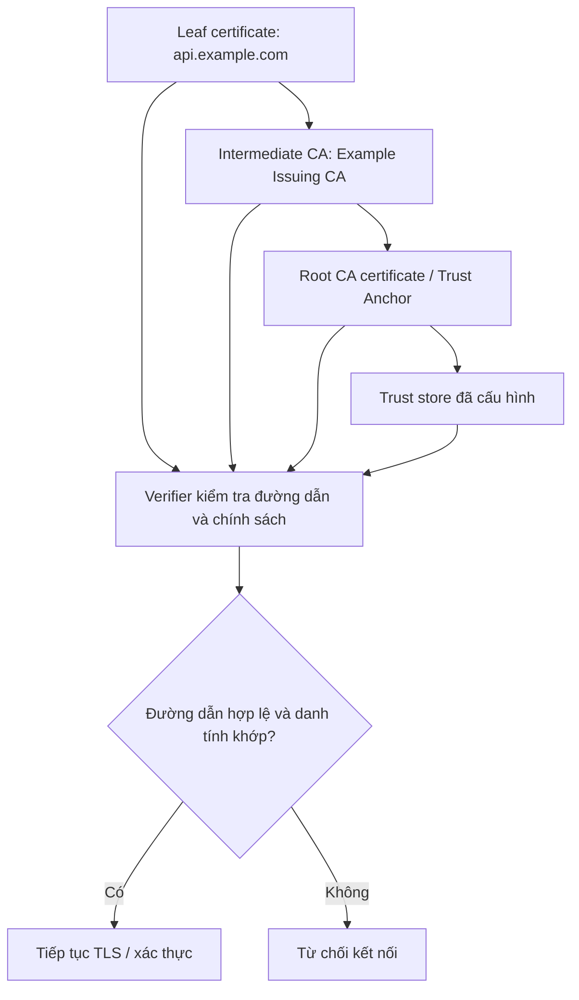
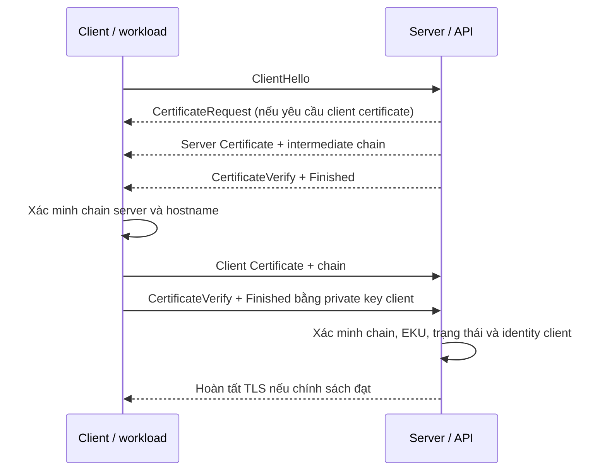
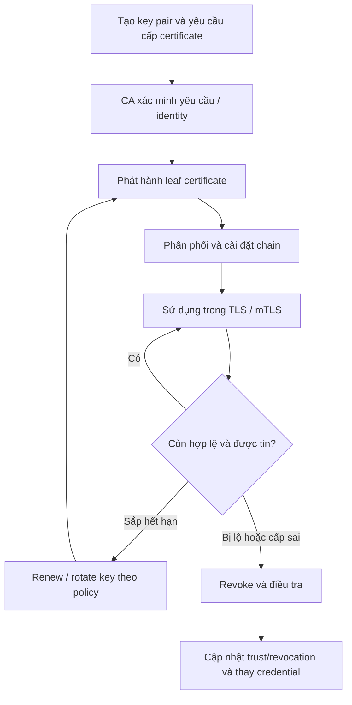

# Certificate chain — Chuỗi chứng chỉ số

## 1. Certificate chain là gì?

**Certificate chain** (chuỗi chứng chỉ số) là đường liên kết các chứng chỉ X.509 từ chứng chỉ đầu cuối đang được kiểm tra tới một **trust anchor** (điểm neo tin cậy) mà bên xác minh đã cấu hình và chấp nhận. Mỗi chứng chỉ trong đường dẫn thường được CA cấp và ký bằng khóa riêng của CA cấp trên. Bên xác minh dùng khóa công khai tương ứng để kiểm tra chữ ký và các điều kiện của đường dẫn.

Chuỗi chứng chỉ thường có dạng:

```text
Leaf / End-entity certificate
        |
        | được Intermediate CA ký
        v
Intermediate CA certificate
        |
        | được Root CA hoặc CA cấp trên ký
        v
Root CA / Trust Anchor
```

Ví dụ: trình duyệt truy cập https://shop.example.com. Máy chủ gửi chứng chỉ TLS của hostname và các intermediate certificate cần thiết. Trình duyệt xây dựng đường dẫn từ chứng chỉ máy chủ tới một root CA đã nằm trong trust store của hệ điều hành/trình duyệt. Nếu đường dẫn hợp lệ, hostname khớp và các kiểm tra TLS khác đạt yêu cầu, trình duyệt mới có cơ sở tin rằng đầu bên kia đang trình bày chứng chỉ hợp lệ cho tên miền đó.

Trong mô-đun **SECURITY_AUTHENTICATION_FUNDAMENTALS**, certificate chain là nền tảng cho xác thực bằng chứng chỉ, TLS và mutual TLS (mTLS), xác thực workload, token và ranh giới tin cậy giữa các dịch vụ. Chứng chỉ chỉ là một phần của bằng chứng: hệ thống còn phải kiểm tra chuỗi, danh tính mong đợi, trạng thái thu hồi và bằng chứng bên giữ khóa riêng thực sự kiểm soát khóa đó.

### Mục tiêu học tập

Sau bài này, người học có thể:

- Phân biệt leaf certificate, intermediate CA, root CA và trust anchor.
- Mô tả cách xây dựng và xác minh đường dẫn chứng chỉ X.509.
- Giải thích vì sao chữ ký CA hợp lệ chưa đủ để tin một chứng chỉ.
- Phân biệt xác minh certificate chain với xác minh hostname/danh tính và proof-of-possession.
- Hiểu vai trò của trust store, CA, CRL, OCSP và vòng đời chứng chỉ.
- Áp dụng certificate chain vào TLS server authentication, client certificate và mTLS.
- Nhận diện lỗi cấu hình chuỗi, trust anchor, EKU, SAN, thu hồi và quản lý private key.

## 2. Các thành phần trong chuỗi chứng chỉ

### 2.1. Leaf certificate — chứng chỉ đầu cuối

Leaf certificate (còn gọi end-entity certificate) thường đại diện cho máy chủ, người dùng, thiết bị hoặc workload cần được xác thực. Nó chứa public key và các thuộc tính được CA ký xác nhận, chẳng hạn:

- Subject và Subject Alternative Name (SAN).
- Issuer — CA phát hành chứng chỉ.
- Serial number.
- Thời điểm bắt đầu và kết thúc hiệu lực: notBefore và notAfter.
- Public key và thuật toán khóa.
- Key Usage và Extended Key Usage (EKU).
- Các extension và chính sách chứng chỉ liên quan.

Leaf certificate **không chứa private key**. Private key được bên sở hữu bảo vệ và dùng để chứng minh quyền kiểm soát trong giao thức như TLS.

### 2.2. Intermediate CA — CA trung gian

Intermediate CA là CA được một CA cấp trên ủy quyền phát hành chứng chỉ. Intermediate giúp phân tách hoạt động phát hành: root CA có thể được giữ ngoại tuyến hoặc bảo vệ rất nghiêm ngặt; intermediate CA xử lý việc cấp chứng chỉ thường ngày.

Chứng chỉ CA trung gian cần có các thuộc tính CA phù hợp, ví dụ:

- Basic Constraints cho biết chứng chỉ được phép làm CA (CA:TRUE).
- Key Usage cho phép ký chứng chỉ (keyCertSign) và có thể ký CRL (cRLSign) khi cần.
- Các giới hạn pathLenConstraint, Name Constraints hoặc chính sách CA nếu được áp dụng.

Không phải chứng chỉ nào do CA ký cũng được quyền ký chứng chỉ khác. Nếu một leaf certificate bị dùng như CA hoặc intermediate không có quyền phù hợp, đường dẫn phải bị từ chối.

### 2.3. Root CA và trust anchor

Root CA thường là CA ở đỉnh của một hệ phân cấp PKI. Chứng chỉ root thường tự ký, nhưng **tự ký không đồng nghĩa đáng tin cậy**. Bên xác minh tin root vì public key/certificate của nó được cài đặt hoặc cấu hình qua một kênh tin cậy: trust store của hệ điều hành, trình duyệt, thiết bị, ứng dụng hoặc tổ chức.

Trong mô hình PKIX, trust anchor là điểm mà quá trình xác minh đường dẫn kết thúc. Trust anchor có thể được biểu diễn bằng chứng chỉ hoặc thông tin khóa tin cậy theo cách triển khai; không nhất thiết mọi trust anchor phải là một root certificate tự ký theo cùng một định dạng.

**Quyền kiểm soát trust store là quyền kiểm soát ranh giới tin cậy.** Nếu một root không đáng tin được thêm vào trust store, hệ thống có thể chấp nhận các chứng chỉ do CA đó phát hành.

### So sánh các thành phần

| Thành phần | Vai trò | Có được ký chứng chỉ khác không? |
|---|---|---|
| Leaf / end-entity | Đại diện server, client, user, device hoặc workload | Thông thường không |
| Intermediate CA | Phát hành leaf hoặc CA cấp dưới theo quyền được giao | Có, nếu Basic Constraints và Key Usage cho phép |
| Root CA | Điểm gốc của hệ phân cấp PKI | Có thể ký intermediate; trust dựa trên việc được cấu hình làm trust anchor |
| Trust anchor | Điểm tin cậy được bên xác minh cấu hình | Là điểm kết thúc kiểm tra đường dẫn, không nhất thiết là một chứng chỉ tự ký theo nghĩa thông thường |

## 3. Certificate chain được xây dựng như thế nào?

Khi nhận một leaf certificate, verifier cần tìm issuer phù hợp cho nó, rồi tiếp tục tìm issuer của intermediate cho đến khi gặp trust anchor được chấp nhận. Việc xây dựng đường dẫn có thể dùng thông tin như:

- Issuer và Subject Distinguished Name (DN).
- Authority Key Identifier (AKI) và Subject Key Identifier (SKI).
- Chữ ký trên chứng chỉ.
- Các intermediate certificate được gửi kèm trong TLS handshake.
- Intermediate có sẵn trong cache hoặc được lấy từ nguồn phân phối được chính sách cho phép.
- Những đường dẫn thay thế do cross-signing hoặc nhiều CA phát hành.

Ví dụ một server gửi chuỗi:

```text
1. shop.example.com              (leaf)
2. Example TLS Issuing CA 02     (intermediate)
3. [có thể không gửi] Example Root CA (trust anchor)
```

Trong TLS, server thường gửi leaf cùng các intermediate cần thiết; root thường được lược bỏ vì client đã phải có trust anchor trong trust store. Việc server gửi một root certificate **không khiến client tự động tin root đó**. Client phải dựa vào trust store/chính sách cục bộ của mình.

### Sơ đồ đường dẫn



Sơ đồ là mô hình đơn giản. Trong thực tế, path builder có thể tìm nhiều đường dẫn khác nhau, có nhiều intermediate hoặc cross-signed certificate. Một leaf có thể xây dựng được hơn một path; verifier chọn đường dẫn đáp ứng trust store và chính sách hiện hành.

### Path building và path validation là hai việc khác nhau

- **Path building:** tìm một chuỗi chứng chỉ có quan hệ issuer/subject và chữ ký phù hợp để nối leaf tới một trust anchor.
- **Path validation:** kiểm tra đường dẫn được xây dựng có hợp lệ theo các quy tắc PKIX và chính sách của verifier hay không.

Tìm thấy chuỗi có chữ ký khớp chưa có nghĩa là chuỗi được chấp nhận. Path validation còn phải xét hạn dùng, CA constraints, key usage, thuật toán, chính sách và thu hồi theo yêu cầu.

## 4. Verifier cần kiểm tra những gì?

Không nên chỉ kiểm tra “chữ ký leaf được CA ký đúng”. Một quá trình xác minh certificate chain đầy đủ cần xét các nhóm điều kiện sau:

### 4.1. Trust anchor và đường dẫn

- Đường dẫn kết thúc tại trust anchor nằm trong trust store/chính sách được cấu hình.
- Chữ ký của mỗi chứng chỉ được xác minh bằng public key của issuer tương ứng.
- Quan hệ issuer/subject và thông tin định danh khóa phù hợp.
- Intermediate có quyền CA, keyCertSign và các giới hạn path phù hợp.
- Không có CA trung gian vượt quá pathLenConstraint, Name Constraints hoặc chính sách liên quan.

### 4.2. Thời hạn hiệu lực

Mỗi chứng chỉ trong đường dẫn phải nằm trong khoảng notBefore và notAfter tại thời điểm kiểm tra theo chính sách. Đồng hồ máy chủ/client cần được đồng bộ; sai lệch thời gian có thể khiến chứng chỉ hợp lệ bị xem là chưa có hiệu lực hoặc đã hết hạn.

Không nên chỉ kiểm tra leaf rồi bỏ qua intermediate. Một CA trung gian hết hạn có thể làm path validation thất bại ngay cả khi leaf vẫn còn thời hạn.

### 4.3. Key Usage và Extended Key Usage

Chứng chỉ phải được sử dụng đúng mục đích:

- TLS server thường cần EKU serverAuth.
- TLS client certificate thường cần EKU clientAuth.
- CA certificate cần các cờ/usage phù hợp để ký chứng chỉ khác.

Một chứng chỉ hợp lệ cho client authentication không mặc nhiên được chấp nhận làm server certificate. Verifier phải kiểm tra mục đích sử dụng và chính sách ứng dụng.

### 4.4. Danh tính mong đợi: SAN và hostname

Certificate chain hợp lệ chỉ cho biết chứng chỉ có thể được tin theo PKI đã cấu hình. Khi xác thực TLS server, client còn phải kiểm tra **tên máy chủ mà nó định kết nối** có khớp với danh tính trong SAN hay không.

Ví dụ, một chứng chỉ được CA tin cậy cấp cho api.internal.example không chứng minh server đang phục vụ payroll.example.com là đúng. Nếu hostname không khớp, client phải từ chối theo chính sách.

Đối với TLS server, kiểm tra hostname hiện đại dựa vào Subject Alternative Name (SAN); không nên dựa vào Common Name (CN) như cách thay thế chung. Với client certificate hoặc workload certificate, hệ thống cần có quy tắc ánh xạ identity rõ ràng từ SAN/URI/DNS name/subject hoặc thuộc tính đã được quản lý sang account/service ID. Không lấy một chuỗi CN tùy ý làm quyền truy cập.

### 4.5. Thuật toán và độ mạnh mật mã

Verifier cần áp dụng algorithm constraints cho:

- Chữ ký chứng chỉ (ví dụ loại hash/signature).
- Kích thước khóa và loại khóa.
- Thuật toán trao đổi khóa hoặc chữ ký trong TLS handshake.
- Các thuật toán đã yếu hoặc bị chính sách loại bỏ.

Một chuỗi có chữ ký toán học hợp lệ nhưng sử dụng thuật toán đã bị cấm vẫn có thể phải bị từ chối.

### 4.6. Certificate policy và các extension

Trong PKI có yêu cầu cụ thể, verifier có thể phải kiểm tra Certificate Policies, Policy Constraints, Name Constraints, Critical Extensions và các extension liên quan. Extension critical mà verifier không hiểu hoặc không thể xử lý đúng phải khiến chứng chỉ bị từ chối theo quy tắc chuẩn, thay vì bỏ qua.

### 4.7. Trạng thái thu hồi

Chứng chỉ có thể bị CA thu hồi trước ngày hết hạn, ví dụ private key bị lộ, chứng chỉ cấp sai hoặc chủ thể không còn được phép sử dụng. Verifier có thể kiểm tra:

- **CRL (Certificate Revocation List):** danh sách serial number của chứng chỉ bị thu hồi do CA phát hành.
- **OCSP (Online Certificate Status Protocol):** truy vấn trạng thái chứng chỉ tới OCSP responder.
- **OCSP stapling:** server gửi kèm phản hồi OCSP được ký để client không phải tự truy vấn trong một số luồng TLS.

Phải đánh giá tính mới, chữ ký, thời gian hiệu lực và nguồn của dữ liệu thu hồi. Hệ thống cần quy định rõ cách xử lý khi không thể truy vấn trạng thái: fail closed/hard-fail hay chấp nhận có điều kiện/soft-fail. Lựa chọn phụ thuộc rủi ro, khả năng sẵn sàng và chính sách; soft-fail có thể cải thiện khả năng kết nối nhưng cũng làm giảm khả năng phát hiện chứng chỉ đã bị thu hồi.

### Bảng kiểm tra tổng hợp

| Nhóm kiểm tra | Câu hỏi |
|---|---|
| Trust | Có nối tới trust anchor được cấu hình không? |
| Signature | Chữ ký từng chứng chỉ có hợp lệ không? |
| Path constraints | Intermediate có quyền CA và không vi phạm path/name constraints không? |
| Time | Mọi chứng chỉ cần thiết còn hiệu lực tại thời điểm xác minh không? |
| Usage | Key Usage/EKU có cho phép mục đích hiện tại không? |
| Identity | SAN có khớp hostname hoặc danh tính workload mong đợi không? |
| Algorithm | Thuật toán và độ dài khóa có đáp ứng chính sách không? |
| Revocation | Có dữ liệu thu hồi đủ mới và cách xử lý khi responder không khả dụng không? |
| Proof of possession | Bên kết nối có chứng minh đang giữ private key tương ứng không? |

## 5. Certificate chain trong TLS server authentication

Khi browser kết nối HTTPS, TLS server gửi chứng chỉ và các intermediate cần thiết trong handshake. Client thực hiện các bước khái quát:

1. Nhận certificate list từ server.
2. Xây dựng path tới trust anchor đã cấu hình.
3. Xác minh path, chữ ký, thời hạn, usage, extension và trạng thái thu hồi theo chính sách.
4. Kiểm tra SAN có khớp hostname mà người dùng yêu cầu.
5. Kiểm tra server chứng minh quyền kiểm soát private key tương ứng trong TLS handshake.
6. Hoàn tất các kiểm tra TLS khác trước khi bảo vệ dữ liệu ứng dụng.

Ở TLS 1.3, server dùng thông điệp CertificateVerify để ký transcript handshake bằng private key tương ứng với chứng chỉ. Điều này giúp chứng minh server đang kiểm soát khóa riêng và ràng buộc bằng chứng với handshake hiện tại. Chỉ gửi một file certificate không đủ để chứng minh quyền kiểm soát private key.

### Chứng chỉ hợp lệ nhưng sai hostname

Giả sử server gửi certificate chain nối tới một root CA được browser tin cậy, nhưng leaf certificate chỉ có SAN login.example.net trong khi client đang truy cập login.example.com. Path có thể hợp lệ, nhưng danh tính server không khớp. Client phải từ chối kết nối theo kiểm tra hostname.

### Chứng chỉ đúng hostname nhưng chain không tin cậy

Một certificate có SAN login.example.com và còn hạn nhưng được ký bởi CA riêng chưa được cài vào trust store của client. Nếu ứng dụng không được cấu hình tin CA đó qua kênh quản trị đáng tin cậy, client không có cơ sở chấp nhận chuỗi.

Hai ví dụ cho thấy **path validation và identity matching là các bước riêng nhưng đều cần thiết**.

## 6. Certificate chain trong client authentication và mTLS

Trong mutual TLS, cả server và client đều có thể trình bày chứng chỉ:

- Server gửi chain để client xác thực server.
- Server gửi yêu cầu client certificate.
- Client gửi certificate chain của mình và chứng minh sở hữu private key bằng chữ ký trong handshake.
- Server xây dựng và xác minh chain của client dựa trên trust store dành cho client authentication.
- Server kiểm tra EKU clientAuth, trạng thái, SAN/identity mapping và chính sách cấp quyền.



Đây là mô tả khái niệm; thứ tự và thông điệp thực tế phụ thuộc phiên bản TLS và handshake. Trong TLS 1.3, client certificate được gửi sau CertificateRequest của server, và client gửi CertificateVerify để chứng minh sở hữu khóa riêng.

### mTLS không tự quyết định quyền nghiệp vụ

Giả sử orders-service có client certificate được cấp cho workload billing-worker. payments-api xác minh chain và nhận ra caller là workload đó. Điều này chưa có nghĩa billing-worker được quyền hoàn tiền mọi giao dịch. API vẫn cần authorization theo service identity, scope, tenant, transaction và hành động.

Client certificate cũng không tự chứng minh người dùng cuối nào đang thao tác. Nếu workload đại diện người dùng, hệ thống phải truyền user context qua token/delegation được xác minh và giữ riêng hai danh tính:

- **Workload identity:** service nào đang mở kết nối mTLS?
- **User identity:** người dùng nào được đại diện, đã xác thực bằng phương thức nào?

### TLS termination tại proxy

Nếu mTLS kết thúc ở API gateway/reverse proxy, backend không trực tiếp xác minh certificate gốc của client. Backend chỉ có thể tin thông tin identity được proxy chuyển tiếp khi:

- Backend chỉ nhận kết nối từ proxy được xác thực và giới hạn ở tầng mạng.
- Proxy xác minh chain và ánh xạ danh tính đúng chính sách.
- Proxy loại bỏ header identity do client tự gửi và ghi lại header tin cậy.
- Kết nối proxy-to-backend được bảo vệ, có thể dùng mTLS riêng.
- Backend không coi một header đơn lẻ là danh tính nếu không có ranh giới tin cậy và cơ chế bảo vệ tương ứng.

## 7. Trust store và quản trị CA

Trust store là tập hợp trust anchor mà một ứng dụng hoặc môi trường sử dụng để xác minh certificate chain. Trust store có thể đến từ hệ điều hành, runtime, browser, thiết bị hoặc cấu hình riêng của ứng dụng.

### Trust store công khai và PKI nội bộ

| Mô hình | Đặc điểm | Rủi ro/quản trị |
|---|---|---|
| Public Web PKI | Browser/OS tin một tập root CA được quản lý theo chương trình root | Phải tuân thủ chính sách cấp phát, audit và yêu cầu của hệ sinh thái |
| Private PKI | Tổ chức vận hành root/intermediate CA cho domain, thiết bị và workload nội bộ | Phải phân phối trust anchor an toàn, quản lý CA key, issuance, revocation và audit |
| Application-specific trust store | Ứng dụng chỉ tin một tập CA/anchor riêng | Phạm vi tin cậy hẹp hơn nhưng cần cập nhật, xoay và triển khai nhất quán |

Không nên thêm root CA vào trust store chỉ vì một kết nối đang lỗi. Việc cài một root mới có thể cho phép CA đó phát hành chứng chỉ được nhiều ứng dụng chấp nhận. Cần xác minh fingerprint/kênh phân phối, mục đích, phạm vi và owner của CA trước khi tin cậy.

### Bảo vệ CA private key

CA private key có giá trị rất cao: nếu bị chiếm, attacker có thể phát hành certificate giả trong phạm vi CA được tin cậy. Kiểm soát thường gồm:

- Giữ root CA offline hoặc trong môi trường/HSM được bảo vệ khi kiến trúc cho phép.
- Hạn chế quyền phát hành, tách nhiệm vụ và yêu cầu phê duyệt.
- Dùng audit bất biến hoặc cơ chế ghi nhận phát hành/thu hồi.
- Bảo vệ backup, quy trình khôi phục và quyền truy cập khóa.
- Giới hạn intermediate CA theo mục đích, namespace, domain hoặc loại chứng chỉ.
- Theo dõi hoạt động bất thường và có kế hoạch ứng phó khi CA/key bị xâm phạm.

### Cross-signing và nhiều đường dẫn

Một intermediate hoặc root có thể được cross-sign bởi CA khác để hỗ trợ tương thích giữa các hệ sinh thái trust. Vì vậy, cùng một leaf có thể có nhiều đường dẫn tới các trust anchor khác nhau. Client có trust store khác nhau có thể xây dựng path khác nhau và cho kết quả khác nhau.

Khi debug lỗi certificate, cần xem **toàn bộ chain server gửi, trust store thực tế của client, đường dẫn được path builder chọn và chính sách xác minh**, không chỉ nhìn leaf certificate.

## 8. CRL, OCSP và chiến lược thu hồi

Chứng chỉ thường có thời hạn hữu hạn, nhưng một sự kiện bảo mật có thể đòi hỏi thu hồi trước hạn:

- Private key bị mất hoặc bị sao chép.
- Certificate cấp nhầm hostname, user hoặc workload.
- Thiết bị/workload bị loại khỏi tổ chức.
- Intermediate CA bị xâm phạm hoặc không còn được tin.
- Quyền của chủ thể thay đổi và certificate không còn phù hợp.

### CRL

CA phát hành Certificate Revocation List chứa serial number của chứng chỉ đã thu hồi, cùng thông tin thời gian và chữ ký. Verifier cần xác minh chữ ký CRL, issuer, thời hạn cập nhật và trạng thái của chứng chỉ. CRL lớn hoặc cập nhật chậm có thể tạo vấn đề về hiệu năng và độ mới.

### OCSP

OCSP cho phép hỏi trạng thái một chứng chỉ cụ thể. Verifier cần xác minh chữ ký response, responder được ủy quyền, serial number và thời điểm response còn hợp lệ. OCSP stapling cho phép server gửi response được ký kèm handshake, giảm truy vấn trực tiếp từ client tới responder.

### Hard-fail hay soft-fail?

- **Hard-fail:** không thể xác minh trạng thái thu hồi thì từ chối. Phù hợp một số hệ thống có rủi ro cao, nhưng sự cố responder/mạng có thể làm gián đoạn dịch vụ.
- **Soft-fail:** không lấy được trạng thái thì tiếp tục theo điều kiện cho phép. Có thể tăng khả năng sẵn sàng nhưng tạo cửa sổ chấp nhận chứng chỉ đã bị thu hồi.

Chính sách cần xác định rõ loại certificate, mức độ rủi ro, khả năng cache, thời gian tối đa chấp nhận dữ liệu cũ và quy trình khi responder không khả dụng. Không nên mặc định soft-fail cho mọi certificate hoặc hard-fail mà không có phương án vận hành.

### Thu hồi root/intermediate

Nếu CA trung gian bị xâm phạm, chỉ thu hồi leaf certificate đã biết có thể không đủ. Tổ chức có thể cần gỡ intermediate khỏi trust path hoặc cập nhật trust store/policy. Nếu root CA bị xâm phạm, phạm vi ứng phó còn lớn hơn: thay trust anchor, phát hành lại certificate và phối hợp cập nhật mọi client tin root đó.

## 9. Vòng đời certificate

Certificate chain chỉ đáng tin nếu quá trình phát hành và quản lý các certificate trong chain được kiểm soát.



Các giai đoạn:

1. **Key generation:** tạo cặp khóa ở môi trường phù hợp; private key không được gửi cho CA nếu mô hình là client-generated key pair.
2. **Enrollment/CSR:** bên yêu cầu tạo Certificate Signing Request (CSR) và chứng minh quyền yêu cầu cấp certificate theo chính sách.
3. **Identity validation:** CA hoặc registration authority kiểm tra domain, workload, user, thiết bị hay tổ chức theo loại certificate.
4. **Issuance:** CA phát hành certificate với SAN, Key Usage, EKU, thời hạn và extension đúng mục đích.
5. **Deployment:** cài leaf và intermediate chain, bảo vệ private key, cấu hình server/client.
6. **Monitoring:** theo dõi expiry, lỗi handshake, thay đổi certificate, revocation và hoạt động CA.
7. **Renewal/rotation:** cấp certificate mới trước khi hết hạn; thay key theo chu kỳ hoặc khi có sự kiện rủi ro.
8. **Revocation/retirement:** thu hồi khi bị lộ, cấp sai hoặc không còn sử dụng; xóa khóa và trust configuration theo quy trình.

### Tự động hóa cấp và gia hạn

Với TLS server certificate công khai, ACME có thể tự động hóa việc chứng minh quyền kiểm soát domain và gia hạn. Với private PKI, tổ chức có thể dùng workload identity, CA nội bộ hoặc hệ thống cấp certificate tự động. Tự động hóa giúp tránh certificate hết hạn do thao tác thủ công, nhưng cần bảo vệ credential/permission của client ACME hoặc agent cấp phát, giới hạn domain và giám sát thay đổi.

### Private key phải được bảo vệ riêng

Certificate thường là dữ liệu công khai; private key mới là bí mật cần bảo vệ. Không commit private key vào repository, container image, ticket hoặc log. Dùng HSM, TPM, keystore hoặc secret manager theo khả năng của workload. Khi key bị lộ, thu hồi certificate đơn thuần chưa đủ nếu attacker vẫn có thể dùng key trong một giao thức không kiểm tra thu hồi; cần thay key và đánh giá mọi hệ thống tin certificate đó.

## 10. Ví dụ cấu hình Java sử dụng trust store

Đoạn Java sau minh họa cách cấu hình SSLContext để ứng dụng dùng trust store riêng khi tạo kết nối HTTPS. Trust store phải được phân phối qua kênh quản trị tin cậy và chứa đúng CA/anchor cần thiết:

```java
import javax.net.ssl.SSLContext;
import javax.net.ssl.TrustManagerFactory;
import javax.net.ssl.HttpsURLConnection;
import java.io.InputStream;
import java.nio.file.Files;
import java.nio.file.Path;
import java.security.KeyStore;

char[] trustStorePassword = obtainPasswordFromSecretManager();

KeyStore trustStore = KeyStore.getInstance("PKCS12");
try (InputStream input = Files.newInputStream(Path.of("app-truststore.p12"))) {
    trustStore.load(input, trustStorePassword);
}

TrustManagerFactory tmf = TrustManagerFactory.getInstance(
    TrustManagerFactory.getDefaultAlgorithm()
);
tmf.init(trustStore);

SSLContext sslContext = SSLContext.getInstance("TLS");
sslContext.init(null, tmf.getTrustManagers(), null);

HttpsURLConnection connection = (HttpsURLConnection)
    new java.net.URL("https://api.example.com").openConnection();
connection.setSSLSocketFactory(sslContext.getSocketFactory());
// Giữ hostname verification mặc định của HttpsURLConnection.
connection.connect();
```

Đây là ví dụ minh họa trust configuration, không phải mã hoàn chỉnh cho mọi ứng dụng:

- Trust store cần chứa trust anchor được phê duyệt và được cập nhật khi CA thay đổi.
- Không cài TrustManager chấp nhận mọi certificate hoặc bỏ qua lỗi chain.
- Không cài HostnameVerifier luôn trả về true; hostname verification là bước riêng cần được giữ.
- Chính sách thu hồi có thể cần cấu hình thêm qua JSSE/PKIX provider và môi trường chạy; không giả định mọi runtime tự kiểm tra CRL/OCSP giống nhau.
- Trong ứng dụng production, quản lý password trust store qua secret manager, hạn chế quyền file và theo dõi quá trình xoay trust anchor.

### Khi cần mTLS client certificate

Client còn cần nạp private key cùng certificate chain vào key store và cấu hình KeyManagerFactory cho SSLContext. Server phải yêu cầu client certificate, xác minh chain theo trust store dành cho client và ánh xạ identity sang workload/account. Chỉ nạp một client certificate vào key store không khiến server tự động tin nó; server vẫn phải có CA phù hợp và chính sách kiểm tra.

## 11. Các lỗi certificate chain thường gặp

| Lỗi | Nguyên nhân | Hướng xử lý |
|---|---|---|
| unable to get local issuer certificate | Thiếu intermediate hoặc không tìm được issuer | Cài/gửi đúng intermediate; kiểm tra chain và nguồn phân phối |
| self signed certificate | Chain kết thúc ở chứng chỉ tự ký không được tin | Cấu hình trust anchor đúng qua kênh đáng tin; không tắt validation |
| certificate has expired | Leaf hoặc intermediate hết hạn, hoặc đồng hồ sai | Kiểm tra toàn chain và đồng bộ thời gian; gia hạn/đổi certificate |
| hostname mismatch | SAN không khớp hostname client yêu cầu | Cấp lại certificate có SAN đúng; không bỏ hostname verification |
| unsupported certificate purpose | EKU/Key Usage không phù hợp | Cấp certificate đúng mục đích serverAuth/clientAuth/CA |
| path length constraint exceeded | Intermediate chain vượt giới hạn CA | Sửa cấu trúc CA và phát hành lại chain đúng |
| certificate revoked | Serial đã bị CA thu hồi | Điều tra nguyên nhân, thay key/certificate và kiểm tra trạng thái |
| unknown CA | Client/server không có trust anchor tương ứng | Phân phối trust anchor đúng và kiểm tra issuer/path |
| bad certificate trong mTLS | Client cert, chain, proof-of-possession hoặc policy không hợp lệ | Kiểm tra trust store phía server, EKU, handshake và private key |
| Hoạt động ở máy này, lỗi ở máy khác | Trust store, cache, path building hoặc runtime khác nhau | So sánh trust store, chain thực gửi, phiên bản runtime và policy |

### Đừng “sửa” bằng cách tắt xác minh

Các workaround như trust-all X509TrustManager, tắt hostname verification hoặc chấp nhận mọi chứng chỉ tự ký có thể biến TLS thành kết nối mã hóa tới đúng kẻ tấn công. Hãy tìm nguyên nhân ở chain, trust store, hostname, thời hạn, EKU hoặc cấu hình CA rồi sửa đúng thành phần.

## 12. Tình huống thực tế

### Tình huống A — Server gửi thiếu intermediate

Certificate leaf của api.example.com được intermediate CA ký. Trình duyệt của một số người dùng có intermediate trong cache nên kết nối thành công; một client mới không có intermediate thì báo không xây dựng được chain.

**Bài học:** server phải gửi các intermediate cần thiết theo cấu hình; không phụ thuộc vào cache hoặc khả năng tải AIA của mọi client.

### Tình huống B — Chain hợp lệ nhưng hostname sai

Một load balancer dùng certificate do CA công khai cấp, chain hoàn toàn hợp lệ nhưng SAN chỉ có staging.example.com. Client truy cập production.example.com và phải nhận lỗi hostname mismatch.

**Bài học:** tin CA không có nghĩa tin mọi hostname; identity matching là bước riêng.

### Tình huống C — mTLS xác thực workload nhưng thiếu authorization

report-worker có client certificate được private CA cấp. finance-api xác minh chain và nhận ra workload. Tuy nhiên, worker chỉ được quyền đọc báo cáo của tenant A; nó không được quyền xóa dữ liệu tenant B.

**Bài học:** certificate chain xác minh danh tính kết nối; authorization vẫn kiểm tra hành động và tài nguyên.

### Tình huống D — Private key bị lộ

Private key của intermediate CA bị sao chép. Attacker có thể tìm cách phát hành certificate giả trong phạm vi CA được phép. Chỉ gia hạn leaf certificate của một server không giải quyết được sự cố.

**Bài học:** phải ứng phó ở cấp CA: dừng phát hành, thu hồi/loại bỏ intermediate khỏi trust path, thay khóa, cập nhật trust store và điều tra certificate đã phát hành.

## 13. Kiểm thử và rà soát certificate chain

Một bộ kiểm thử nên bao gồm:

| Ca kiểm thử | Kết quả mong đợi |
|---|---|
| Leaf + intermediate + trust anchor hợp lệ | Chấp nhận nếu hostname/usage/policy cũng đạt |
| Thiếu intermediate | Từ chối nếu không thể xây dựng path hợp lệ |
| Root tự ký không có trong trust store | Từ chối |
| Root trong trust store nhưng leaf sai hostname | Từ chối |
| Certificate hết hạn hoặc chưa tới notBefore | Từ chối |
| Intermediate không có CA constraint phù hợp | Từ chối |
| EKU không phù hợp mục đích | Từ chối |
| Chữ ký sai hoặc thuật toán bị cấm | Từ chối |
| Certificate đã bị thu hồi | Xử lý theo chính sách thu hồi, thường từ chối |
| Client certificate không có proof-of-possession hợp lệ | Từ chối handshake |
| Chain đi tới CA khác ngoài trust store | Từ chối |
| Hai chain path khác nhau do cross-signing | Chấp nhận path đáp ứng trust anchor và policy đã cấu hình |

Khi vận hành, giám sát certificate sắp hết hạn, lỗi handshake theo issuer/serial, OCSP/CRL responder, thay đổi trust store, certificate phát hành ngoài dự kiến và lỗi mTLS theo workload. Log có thể ghi issuer, serial, fingerprint, SAN đã chuẩn hóa, kết quả và lý do; không ghi private key hoặc dữ liệu bí mật trong handshake.

## 14. Checklist thiết kế và vận hành

- [ ] Trust anchor được phân phối qua kênh quản trị đáng tin cậy và có owner.
- [ ] Server gửi leaf cùng intermediate chain cần thiết.
- [ ] Verifier phân biệt path building và path validation.
- [ ] Kiểm tra chữ ký, thời hạn, CA constraints, Key Usage và EKU.
- [ ] Kiểm tra SAN/hostname hoặc identity mapping theo đúng mục đích.
- [ ] Áp dụng thuật toán và độ mạnh khóa được chấp nhận.
- [ ] Có chính sách CRL/OCSP, cache và hành vi khi responder không khả dụng.
- [ ] TLS handshake xác minh proof-of-possession của private key.
- [ ] mTLS giữ riêng workload identity và user identity; authorization thực hiện tại service.
- [ ] Proxy termination có ranh giới tin cậy và cách chuyển tiếp identity được bảo vệ.
- [ ] CA private key được bảo vệ; quyền phát hành, backup và audit được kiểm soát.
- [ ] Có tự động hóa renewal/rotation và cảnh báo hết hạn.
- [ ] Có quy trình ứng phó khi leaf, intermediate hoặc root key bị lộ.
- [ ] Kiểm thử hostname mismatch, thiếu intermediate, revoked cert và trust store sai.
- [ ] Không tắt certificate validation để xử lý lỗi kết nối.

## 15. Tổng kết

Certificate chain là đường dẫn tin cậy từ leaf certificate tới trust anchor mà verifier đã cấu hình. Để chấp nhận chứng chỉ, hệ thống phải **xây dựng và xác minh đường dẫn**, kiểm tra trust anchor, chữ ký, thời hạn, CA constraints, usage, thuật toán và thu hồi. Với TLS server, còn phải xác minh hostname; trong handshake, bên kết nối phải chứng minh quyền kiểm soát private key tương ứng.

Trong mTLS, certificate chain giúp xác thực workload hoặc client certificate, nhưng không tự cấp quyền nghiệp vụ và không tự chứng minh người dùng cuối. Quản trị trust store, CA private key, vòng đời certificate, revocation và các ranh giới proxy là một phần của cùng mô hình tin cậy. Khi hiểu rõ các bước này, hệ thống có thể dùng chứng chỉ để xác thực dịch vụ và thiết bị một cách có kiểm soát thay vì chỉ dựa vào vị trí mạng hoặc một chữ ký CA đơn lẻ.
