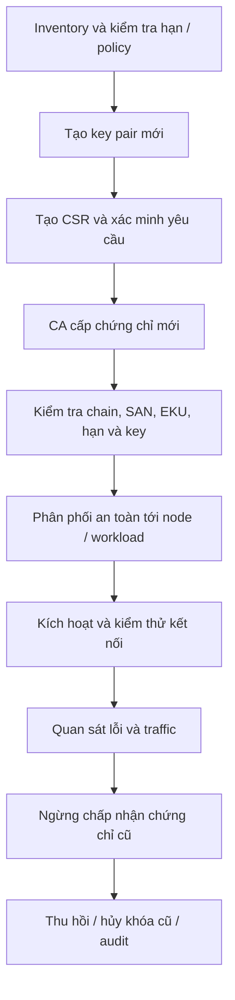
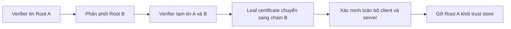
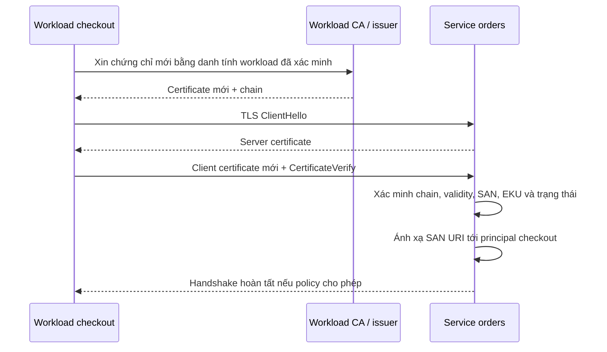

# Certificate rotation — Xoay vòng chứng chỉ và khóa

Chứng chỉ số (digital certificate) gắn một public key với danh tính được CA hoặc hệ thống cấp phát xác nhận. Ứng dụng dùng chứng chỉ để xác thực máy chủ trong TLS, xác thực client trong mTLS, hoặc nhận diện workload và thiết bị. Nhưng chứng chỉ có thời hạn, private key có thể bị lộ, thuật toán có thể lỗi thời, và CA/trust policy có thể thay đổi. Vì vậy, hệ thống phải có quy trình **certificate rotation**: cấp và đưa chứng chỉ mới vào sử dụng, chuyển các bên tin cậy sang chứng chỉ/khóa mới, rồi ngừng chấp nhận và xử lý chứng chỉ cũ theo kế hoạch.

Ví dụ, API `orders.example.com` đang dùng chứng chỉ TLS có private key được lưu trên load balancer. Chứng chỉ sắp hết hạn. Đội vận hành tạo một cặp khóa mới, gửi CSR tới CA, kiểm tra chứng chỉ mới, cài lên các node, xác minh client vẫn kết nối được rồi thu hồi hoặc để chứng chỉ cũ hết hạn theo chính sách. Nếu chỉ gia hạn chứng chỉ nhưng tiếp tục dùng private key đã bị lộ, rủi ro giả mạo máy chủ vẫn còn.

Trong module `SECURITY_AUTHENTICATION_FUNDAMENTALS`, certificate rotation là một phần của vòng đời credential: quản lý private key, danh tính subject/SAN, issuer, trust chain, mTLS, thu hồi và phiên/token phát sinh từ credential. Mục tiêu là giữ luồng xác thực liên tục trong thay đổi có kế hoạch, đồng thời cắt quyền nhanh khi khóa hoặc CA bị xâm phạm.

## 1. Chứng chỉ, khóa và trust chain

**Chứng chỉ X.509** là cấu trúc dữ liệu được CA ký, chứa thông tin về subject, public key, issuer, thời hạn và các extension. Private key tương ứng được giữ riêng bởi chủ thể hoặc hệ thống sử dụng chứng chỉ. Khi TLS client xác minh chứng chỉ máy chủ, nó kiểm tra chữ ký và đường dẫn tin cậy tới trust anchor được cấu hình, tên máy chủ, thời hạn và các điều kiện liên quan.

| Thành phần | Chức năng | Điều cần bảo vệ |
| --- | --- | --- |
| **Private key** | Tạo chữ ký hoặc chứng minh quyền sở hữu khóa trong TLS/mTLS | Bí mật, quyền truy cập, backup, HSM/TPM/secret manager, vòng đời khóa |
| **Public key** | Được nhúng trong chứng chỉ để bên khác xác minh | Tính toàn vẹn và liên kết đúng với subject |
| **Certificate** | Gắn public key với danh tính và thuộc tính được CA ký | SAN, EKU, Key Usage, validity, serial, issuer và chain |
| **CSR** | Yêu cầu CA cấp chứng chỉ cho public key và thông tin subject | CSR không phải chứng chỉ; CA phải xác minh requester và policy |
| **CA / issuer** | Ký chứng chỉ theo chính sách cấp phát | Khóa CA, quyền cấp, audit, HSM và quy trình thu hồi |
| **Trust store / trust bundle** | Chứa CA hoặc trust anchor mà verifier chấp nhận | Nguồn cập nhật, phân phối, versioning và chuyển đổi CA |
| **CRL / OCSP** | Cung cấp thông tin thu hồi chứng chỉ | Tính mới, khả dụng, cache và hành vi fail-open/fail-closed |

Chứng chỉ không phải private key. Việc gửi CSR cho CA không gửi private key đi; CSR thường chứa public key và được ký bằng private key tương ứng để chứng minh quyền kiểm soát khóa. Server thường lưu chứng chỉ cùng private key trong kho khóa, còn client/verifier lưu trust anchor hoặc chain phù hợp để xác minh.

### Những trường quan trọng khi xoay chứng chỉ

| Trường | Ý nghĩa | Kiểm tra trong rotation |
| --- | --- | --- |
| `Subject` | Tên chủ thể trong chứng chỉ | Không luôn là định danh chính; nhiều hệ thống hiện dựa vào SAN |
| `Subject Alternative Name (SAN)` | DNS name, URI, IP hoặc định danh khác được chứng chỉ xác nhận | Hostname/service identity phải khớp endpoint dự kiến |
| `Issuer` | CA đã ký chứng chỉ | Có thuộc trust chain mà verifier chấp nhận không? |
| `Serial Number` | Số định danh chứng chỉ do issuer cấp | Dùng tra cứu audit và trạng thái thu hồi |
| `Not Before` / `Not After` | Khoảng thời gian chứng chỉ có hiệu lực | Kiểm tra đồng hồ và không để gián đoạn do hết hạn |
| `Key Usage` | Mục đích sử dụng khóa | Phải phù hợp với thao tác như digital signature hoặc key encipherment theo profile |
| `Extended Key Usage (EKU)` | Mục đích cấp cao, ví dụ serverAuth/clientAuth | Không chấp nhận chứng chỉ sai vai trò |
| `Basic Constraints` | Chứng chỉ có phải CA hay không và giới hạn path length | Không được nhầm leaf certificate với CA certificate |
| `Authority Key Identifier` / `Subject Key Identifier` | Hỗ trợ xây dựng đường dẫn chứng chỉ | Hữu ích khi CA có nhiều khóa hoặc chuyển đổi CA |

Với TLS server, SAN phải bao gồm hostname client thực sự truy cập. Với mTLS client, SAN thường chứa định danh workload hoặc service theo policy; verifier không nên chỉ tin `Common Name` hay một chuỗi tên tùy ý. EKU, Key Usage, CA constraints và policy của ứng dụng phải được kiểm tra đúng vai trò.

## 2. Phân biệt renewal, reissue và key rotation

Các từ này thường bị dùng lẫn, nhưng mức thay đổi và ý nghĩa bảo mật khác nhau.

| Thao tác | Điều thay đổi | Khi nào phù hợp | Giới hạn |
| --- | --- | --- | --- |
| **Renewal** (gia hạn) | Cấp chứng chỉ mới có thời hạn mới; có thể giữ nguyên key pair | Chứng chỉ sắp hết hạn và private key vẫn đáng tin | Không loại bỏ rủi ro nếu khóa cũ đã bị lộ hoặc cần thay thuật toán |
| **Reissue** (cấp lại) | CA phát hành lại chứng chỉ sau thay đổi SAN/thuộc tính hoặc sửa lỗi; có thể dùng cùng public key hoặc key mới | Thay đổi thông tin chứng chỉ hoặc khắc phục lỗi cấp phát | Cần kiểm tra có thực sự đổi key hay không |
| **Key rotation / rekey** | Tạo cặp khóa mới và cấp chứng chỉ chứa public key mới | Theo lịch, thay thuật toán/độ dài khóa, nghi ngờ khóa cũ bị lộ hoặc chính sách yêu cầu | Cần phân phối private key mới và chuyển tất cả verifier/client liên quan |
| **CA rotation** | Thay khóa CA, intermediate CA hoặc trust anchor | CA hết hạn, đổi thuật toán, khóa CA có rủi ro hoặc chuyển nhà cung cấp | Phải phối hợp cập nhật trust store và chain ở nhiều bên |
| **Revocation** (thu hồi) | Tuyên bố một chứng chỉ không còn được chấp nhận trước `Not After` | Private key bị lộ, chứng chỉ cấp sai, subject không còn hợp lệ | Hiệu quả phụ thuộc verifier kiểm tra CRL/OCSP hoặc chính sách tương ứng |

**Renewal không đồng nghĩa rekey.** Nếu private key cũ đã bị sao chép, việc xin một chứng chỉ mới nhưng giữ nguyên key pair vẫn để attacker ký bằng khóa đó. Khi có nghi ngờ compromise, phải tạo khóa mới, phát hành chứng chỉ mới, cập nhật verifier và xử lý chứng chỉ/khóa cũ theo quy trình ứng cứu.

### Khi nào cần xoay khóa?

- Chứng chỉ sắp hết hạn hoặc private key đã vượt thời gian sử dụng theo policy.
- Khóa/thuật toán không còn đáp ứng baseline an toàn hoặc cần chuyển sang thuật toán được phê duyệt.
- Private key có thể đã xuất hiện trong log, repository, backup không kiểm soát hoặc máy chủ bị xâm nhập.
- Thiết bị/workload đổi chủ, kết thúc vòng đời hoặc chuyển trust domain.
- CA, intermediate CA hoặc trust anchor cần thay đổi.
- Có thay đổi danh tính SAN, tenant, môi trường hoặc quyền sở hữu khiến chứng chỉ hiện tại không còn phù hợp.

## 3. Vòng đời rotation có kế hoạch

Xoay vòng định kỳ nên là quy trình tự động, có thể lặp lại và quan sát được. Trước khi thay đổi, phải biết chứng chỉ nào đang được dùng, ai sở hữu, endpoint nào phục vụ và verifier nào tin nó.



### Bước 1 — Inventory và preflight

Lập danh mục chứng chỉ gồm `certificate_id`/serial, subject/SAN, issuer, loại (server/client/CA), môi trường, owner, endpoint, nơi giữ private key, ngày hết hạn, thuật toán, verifier và phụ thuộc. Kiểm tra:

- Chứng chỉ còn hiệu lực đủ lâu cho thời gian rollout và rollback dự kiến.
- Private key hiện tại có bị nghi ngờ lộ không; nếu có, quy trình phải chuyển sang xử lý compromise.
- SAN, EKU, Key Usage, chain, trust store và policy hiện tại có tương thích với chứng chỉ mới không.
- Mọi node/replica, job, agent và client có phụ thuộc chứng chỉ đã được xác định chưa.
- Đồng hồ hệ thống được đồng bộ; sai lệch thời gian có thể khiến chứng chỉ mới bị xem là chưa có hiệu lực hoặc đã hết hạn.

Không chỉ quét file chứng chỉ trên một máy. Chứng chỉ có thể được nạp vào load balancer, ingress controller, secret manager, Java keystore, sidecar proxy, container, thiết bị hoặc nhiều vùng triển khai.

### Bước 2 — Tạo khóa mới và CSR

Tạo private key mới bằng CSPRNG hoặc cơ chế key generation được bảo vệ. Với khóa cần chống xuất, dùng HSM, TPM hoặc secure key store phù hợp. Chọn thuật toán và tham số theo baseline hiện hành của tổ chức; không tự chọn key size hoặc cipher suite theo cảm tính.

CSR chứa public key và thông tin yêu cầu. CA phải xác minh quyền yêu cầu chứng chỉ cho SAN/domain/URI tương ứng. Không tin SAN do requester tự khai nếu requester chưa được cấp quyền sở hữu danh tính đó.

Ví dụ tạo private key và CSR RSA bằng OpenSSL trong môi trường lab:

```bash
# Tạo private key; bảo vệ file và passphrase theo quy trình vận hành.
openssl genpkey -algorithm RSA \
  -pkeyopt rsa_keygen_bits:3072 \
  -out orders-server.key

# Tạo CSR với subject; SAN/EKU phải được cấu hình theo profile CA.
openssl req -new \
  -key orders-server.key \
  -out orders-server.csr \
  -subj "/CN=orders.example.com"
```

Đây là ví dụ minh họa tạo khóa/CSR, không phải cấu hình policy hoàn chỉnh. Trong môi trường thật, cần chỉ định SAN và profile cấp phát phù hợp, giữ private key trong kho an toàn, hạn chế quyền đọc file, và không gửi private key cho CA.

### Bước 3 — Xác minh chứng chỉ mới trước khi cài

Sau khi CA cấp chứng chỉ, kiểm tra tối thiểu:

- Public key trong certificate khớp với private key mới; kiểm tra bằng công cụ hoặc thư viện chuẩn.
- Chain dẫn tới đúng trust anchor và intermediate CA được dự kiến.
- SAN đúng endpoint/service identity; không thiếu hostname hoặc thêm tên ngoài phạm vi.
- EKU/Key Usage phù hợp vai trò server hoặc client; Basic Constraints không cho leaf certificate làm CA.
- `Not Before`/`Not After` phù hợp thời gian rollout, đồng hồ và policy.
- Thuật toán/chữ ký/key size nằm trong baseline được chấp nhận.
- Serial number, issuer, fingerprint và metadata được ghi vào inventory/audit.

Không đưa chứng chỉ mới vào production chỉ vì CA đã ký. Một certificate hợp lệ về chữ ký nhưng sai SAN hoặc EKU vẫn có thể gây lỗi xác thực hoặc mở rộng danh tính sai.

### Bước 4 — Phân phối và kích hoạt an toàn

Phân phối private key qua secret manager, HSM integration hoặc kênh quản lý cấu hình đã được bảo vệ. Tránh nhúng private key vào image/container, source repository, CI artifact hoặc command line có thể lưu vào history. Chỉ cấp quyền đọc cho đúng process/service.

Kích hoạt theo từng node hoặc nhóm canary:

1. Cài certificate và key vào đúng store/secret version.
2. Kiểm tra process có đọc được key và certificate pair hay không.
3. Reload TLS listener hoặc sidecar theo cơ chế hỗ trợ; tránh restart toàn bộ hệ thống nếu không cần.
4. Từ client kiểm thử kết nối thật, xác minh chain, hostname, EKU và mTLS policy.
5. Quan sát handshake failure, tỷ lệ kết nối, lỗi xác minh client certificate và các cảnh báo.

### Bước 5 — Overlap có kiểm soát và cutover

Với rotation định kỳ, có thể có một khoảng chuyển tiếp để hệ thống chấp nhận chứng chỉ cũ và mới song song. Khoảng này giúp triển khai theo từng nhóm mà không làm gián đoạn toàn bộ dịch vụ. Nhưng overlap phải có **thời hạn, phạm vi và tiêu chí kết thúc**; không để hai khóa cùng được tin vô thời hạn.

Ví dụ khi thay server certificate, một load balancer có thể phục vụ chứng chỉ mới trong khi node còn lại đang được cập nhật. Với client certificate, server verifier có thể tạm tin cả hai public key/serial trong một khoảng ngắn để workload chuyển credential. Sau khi mọi client đã dùng chứng chỉ mới, loại chứng chỉ cũ khỏi allowlist/trust mapping và thu hồi theo policy.

**Không áp dụng overlap dài khi nghi ngờ private key cũ bị lộ.** Khi compromise, giữ chứng chỉ cũ được chấp nhận để thuận tiện rollout đồng nghĩa tiếp tục cho attacker sử dụng khóa. Cần ưu tiên cắt quyền, thu hồi và triển khai khóa mới theo quy trình ứng cứu, chấp nhận gián đoạn có kiểm soát nếu cần.

### Bước 6 — Thu hồi và tiêu hủy

Sau cutover, kiểm tra không còn traffic hợp lệ dùng chứng chỉ cũ. Tùy policy, thu hồi chứng chỉ cũ qua CA, cập nhật CRL/OCSP hoặc trust/allowlist nội bộ, xóa key khỏi node và secret manager, xử lý backup và bản sao. Lưu metadata cần thiết cho audit nhưng không giữ private key không còn mục đích.

Thu hồi chứng chỉ không tự động xóa private key khỏi mọi nơi. Nếu key đã được copy, phải coi các bản sao là có khả năng tồn tại và xử lý như compromise. Đối với key được tạo không xuất trong HSM/TPM, việc hủy object/key handle cần theo quy trình của thiết bị và có xác minh.

## 4. Overlap, rollback và tính liên tục dịch vụ

Một kế hoạch rotation tốt phải biết điều gì xảy ra khi một phần hệ thống chưa cập nhật hoặc chứng chỉ mới bị cấp sai.

### Rollout theo từng lớp

| Lớp | Hành động | Kiểm tra trước khi sang bước tiếp |
| --- | --- | --- |
| CA / trust bundle | Phân phối trust anchor/intermediate mới nếu có thay đổi CA | Tất cả verifier cần thiết đã tin chain mới; không tin CA ngoài phạm vi |
| Certificate issuer | Cấp certificate mới cho đúng subject/SAN | Chain, EKU, validity, key pair và policy đạt |
| Server/ingress | Cài certificate/key mới và reload | TLS handshake thành công; hostname và chain đúng |
| Client/workload | Cấp và triển khai client cert mới | mTLS thành công; principal ánh xạ đúng workload |
| Authorization mapping | Cập nhật allowlist/identity mapping nếu serial/key thay đổi | Không mở quyền rộng hơn; subject mới vẫn đúng |
| Cleanup | Thu hồi và xóa key cũ | Không còn client hợp lệ phụ thuộc credential cũ |

### Rollback cần giới hạn

Trong rotation có kế hoạch, nếu certificate mới có lỗi cấu hình nhưng key cũ chưa bị lộ và vẫn còn hiệu lực, có thể rollback về phiên bản cũ trong khoảng được policy cho phép. Rollback không được tự động khôi phục một certificate đã bị thu hồi hoặc bị đánh dấu compromise. Nếu private key cũ bị nghi lộ, không dùng nó làm phương án rollback; hãy sửa cấu hình certificate mới hoặc phát hành key pair mới khác.

Mỗi bước nên có health check và tiêu chí dừng: handshake success rate, certificate serial đang được phục vụ, số client cert được chấp nhận, tỷ lệ lỗi chain/hostname, latency và số request thất bại. Cần kiểm tra từ cả bên trong và bên ngoài mạng, vì trust store có thể khác nhau.

## 5. Xoay vòng CA và trust anchor

CA rotation phức tạp hơn thay leaf certificate vì trust anchor có thể được cài ở hàng trăm verifier. Nếu thay CA mà client chưa tin CA mới, toàn bộ kết nối có thể thất bại. Nếu giữ CA cũ quá lâu sau khi bị compromise, attacker vẫn có thể cấp chứng chỉ được tin.

### Thay intermediate CA

Nếu root CA vẫn giữ nguyên nhưng intermediate CA đổi, có thể phân phối chain mới và đảm bảo verifier có thể xây dựng path tới root tin cậy. Kiểm tra `Issuer`, AKI/SKI, Basic Constraints, path length và policy cấp phát. Một số client có thể cần intermediate được gửi kèm trong TLS handshake; không giả định mọi client có cùng cache.

### Thay root CA / trust anchor

Một quy trình planned root rotation thường có các giai đoạn:

1. Phân phối root CA mới vào trust store của verifier trước khi server bắt đầu dùng chain mới.
2. Trong thời gian chuyển tiếp, verifier có thể tin cả root cũ và root mới nếu threat model cho phép và root cũ chưa bị compromise.
3. Cấp leaf/intermediate certificate dưới root mới, triển khai theo nhóm và kiểm tra tất cả client/server.
4. Khi mọi bên đã chuyển, loại root cũ khỏi trust store và xác nhận không còn chain nào phụ thuộc nó.
5. Nếu root cũ bị compromise, quy trình khẩn cấp có thể phải bỏ trust ngay; không giữ dual trust chỉ để tránh gián đoạn.



Đây là mô hình chuyển đổi có kế hoạch. Cần quản lý trust bundle theo version, kiểm tra hash/fingerprint qua kênh độc lập, ký và audit thay đổi. Không nhận CA mới chỉ vì nó được gửi kèm trong certificate chain; trust anchor phải được cài đặt theo chính sách tin cậy.

## 6. Thu hồi: CRL, OCSP và chứng chỉ ngắn hạn

**Revocation** là việc CA hoặc hệ thống quản lý tuyên bố chứng chỉ không còn đáng tin trước ngày hết hạn. Lý do có thể là private key bị lộ, chứng chỉ cấp sai, subject đổi trạng thái hoặc CA phát hiện lỗi cấp phát.

| Cơ chế | Cách hoạt động | Đánh đổi |
| --- | --- | --- |
| **CRL** (Certificate Revocation List) | CA phát danh sách serial đã thu hồi; verifier tải và kiểm tra | Có thể lớn, cần cập nhật và phân phối; cache cũ làm chậm hiệu lực thu hồi |
| **OCSP** | Verifier hỏi responder trạng thái của một chứng chỉ | Phụ thuộc mạng và responder; cần xử lý timeout, privacy và cache |
| **OCSP stapling** | Server gửi kèm phản hồi OCSP đã ký trong handshake khi hỗ trợ | Giảm truy vấn từ client; server phải cập nhật response còn hiệu lực |
| **Short-lived certificate** | Chứng chỉ có thời hạn ngắn và được tự động cấp lại | Giảm thời gian tồn tại khi không thu hồi kịp; cần issuer và automation sẵn sàng |
| **Internal allowlist / identity registry** | Verifier kiểm tra serial, public key hoặc identity mapping trong kho nội bộ | Phải đồng bộ, cache và bảo vệ nguồn dữ liệu; phù hợp một số hệ thống mTLS/workload |

Không phải mọi TLS client đều kiểm tra CRL/OCSP theo cùng cách. Một số client soft-fail khi không truy cập được responder; số khác có chính sách khác. Phải biết chính xác thư viện, runtime, proxy và nền tảng của mình xử lý ra sao. Nếu dùng chứng chỉ sống ngắn, TTL và quy trình cấp mới phải đủ ngắn để giới hạn rủi ro, nhưng không được làm hệ thống sụp đổ khi CA tạm thời không khả dụng.

### Độ trễ thu hồi

Định nghĩa **revocation latency**: thời gian từ lúc quyết định thu hồi đến khi mọi verifier có liên quan ngừng chấp nhận chứng chỉ. Độ trễ có thể đến từ CRL cache, OCSP cache, trust bundle chưa cập nhật, connection pool TLS cũ, proxy chưa reload hoặc service giữ identity mapping cũ. Với hệ thống nhạy cảm, cần đo và kiểm thử độ trễ này, không chỉ kiểm tra rằng CA đã đánh dấu serial là revoked.

## 7. mTLS và certificate rotation cho workload

Trong mTLS, cả client và server đều trình chứng chỉ và chứng minh quyền sở hữu private key trong TLS handshake. Chứng chỉ client thường mang định danh workload/service trong SAN URI hoặc DNS theo policy. Rotation phải bảo đảm peer xác minh được chứng chỉ mới và vẫn ánh xạ nó tới đúng principal.

Ví dụ, `checkout` gọi `orders`:



Các nguyên tắc:

- Dùng issuer xác minh danh tính workload trước khi cấp; không cho workload tự chọn URI SAN tùy ý.
- Cấp chứng chỉ ngắn hạn và tự động rotation khi hạ tầng hỗ trợ; giữ private key trong vùng bảo vệ phù hợp.
- Verifier kiểm tra trust domain, SAN, EKU `clientAuth`, chain và trạng thái; không chỉ kiểm tra “chứng chỉ được CA ký”.
- Khi đổi key/certificate, xử lý connection pool và long-lived TLS connection; certificate cũ có thể vẫn đang được dùng trên kết nối đã thiết lập trước đó.
- Khi workload bị xóa hoặc đổi quyền, thu hồi identity mapping và credential; không để chứng chỉ cũ tiếp tục được phép gọi API chỉ vì còn hạn.
- Danh tính workload không thay thế quyền nghiệp vụ; `checkout` đã xác thực vẫn chỉ được phép gọi các operation trong policy.

Trong service mesh, sidecar hoặc proxy có thể tự nhận chứng chỉ và xoay vòng. Cần biết nơi giữ key, nơi kết thúc TLS, cách trust bundle phân phối, cách reload và cách ứng dụng quan sát identity. Một mesh cấu hình sai có thể xác thực proxy nhưng không xác thực workload gốc, hoặc tin header do client tự đặt.

## 8. Rủi ro thường gặp khi rotation

| Sai sót | Hậu quả | Cách giảm thiểu |
| --- | --- | --- |
| Gia hạn nhưng giữ private key đã bị lộ | Attacker tiếp tục chứng minh quyền sở hữu khóa | Rekey, phát hành certificate mới và cắt key cũ |
| Tạo cert mới nhưng SAN/EKU sai | Client từ chối hoặc danh tính bị mở rộng ngoài ý muốn | Kiểm tra SAN/EKU/Key Usage và endpoint thực tế trước cutover |
| Triển khai cert mới nhưng quên một replica | Một phần traffic lỗi hoặc tiếp tục dùng chứng chỉ cũ | Inventory đầy đủ, rollout theo nhóm, giám sát serial từng node |
| Phân phối private key qua repository/log/CI artifact | Tăng bề mặt lộ khóa | Secret manager/HSM, quyền tối thiểu, log redaction và kiểm tra artifact |
| Thu hồi CA/leaf nhưng verifier cache trạng thái cũ | Chứng chỉ bị thu hồi vẫn được chấp nhận | Đo revocation latency, invalidation và kiểm thử cache/connection pool |
| Xoay root CA mà chưa cập nhật trust store | Kết nối TLS hàng loạt thất bại | Trust bundle transition, dual trust có hạn và kiểm tra client |
| Giữ trust root cũ sau compromise | Attacker tiếp tục cấp chain được tin | Emergency distrust, gỡ trust anchor và xử lý incident |
| Đồng hồ hệ thống sai | Chứng chỉ mới bị xem là chưa có hiệu lực hoặc chứng chỉ cũ vẫn được tin | Đồng bộ thời gian và kiểm tra skew |
| Rollback về private key compromise | Khôi phục chính credential attacker có thể sử dụng | Cấm rollback về credential bị thu hồi/compromise; phát hành key mới |
| Chỉ thay file certificate mà không reload service | Process tiếp tục phục vụ certificate cũ | Reload/restart có kiểm soát và xác minh serial trên kết nối thật |
| Bỏ qua TLS hop nội bộ sau load balancer | Attacker trong mạng nội bộ can thiệp hoặc giả mạo peer | mTLS/backend TLS và xác thực nguồn proxy theo threat model |

## 9. Mẫu rotation có kiểm soát bằng pseudocode Java

Đoạn dưới mô tả điều phối nghiệp vụ, không phải API cụ thể của một CA hoặc thư viện TLS. Phần tạo khóa, CSR, xác minh X.509 và lưu khóa cần dùng thư viện/thiết bị bảo mật được duy trì.

```java
RotationResult rotateCertificate(CertificateRecord current) {
    requireRotationPermission(current.owner(), current.environment());
    requireCurrentCertificateNotCompromisedOrUseEmergencyFlow(current);

    // Key pair mới; private key được tạo trong HSM/secure key store
    // nếu policy yêu cầu và không xuất ra dạng plaintext.
    KeyHandle newKey = keyProvider.generateKey(current.keyPolicy());
    Csr csr = csrBuilder.create(
        newKey.publicKey(),
        current.approvedSubject(),
        current.approvedSans(),
        current.approvedKeyUsage()
    );

    Certificate issued = caClient.issue(csr, current.profile());
    certificateVerifier.verifyIssuedCertificate(
        issued,
        newKey.publicKey(),
        current.expectedTrustChain(),
        current.approvedSans(),
        current.expectedEku(),
        clock.instant()
    );

    secretStore.stage(current.owner(), newKey, issued);
    deployment.rolloutCanary(current.owner(), issued.serialNumber());
    healthChecks.requireHandshakeAndIdentityMatch(current.owner(), issued);
    deployment.rolloutRemaining(current.owner(), issued.serialNumber());
    healthChecks.requireAllReplicasUse(current.owner(), issued.serialNumber());

    // Chỉ cutover sau khi toàn bộ consumer hợp lệ đã dùng cert mới.
    trustRegistry.stopAccepting(current.serialNumber());
    revocationService.revokeIfPolicyRequires(current);
    keyProvider.destroyWhenSafe(current.privateKeyHandle());
    audit.recordRotation(current, issued, "COMPLETED");
    return RotationResult.completed(issued.serialNumber());
}
```

Trong triển khai thật, cần xử lý các trường hợp CA timeout, CSR bị từ chối, chứng chỉ sai profile, rollout chỉ thành công một phần, một replica không reload, client còn dùng connection cũ và lỗi khi thu hồi. Quy trình phải có trạng thái như `PREPARING`, `ISSUED`, `STAGED`, `ACTIVE`, `OLD_REVOKED`, `COMPLETED` để có thể retry và audit. Không đánh dấu hoàn tất khi chưa xác minh certificate đang được phục vụ và chứng chỉ cũ đã ngừng được chấp nhận theo policy.

**Emergency rotation** phải tách riêng: nếu private key hoặc CA bị compromise, ưu tiên cắt trust và phát hành khóa/chứng chỉ mới theo quy trình incident response. Không áp dụng overlap hoặc rollback bình thường nếu chúng tiếp tục cho phép credential bị xâm phạm.

## 10. Tự động hóa và vận hành

Certificate rotation có thể tự động bằng ACME cho TLS server, CA nội bộ, cert-manager, workload identity agent hoặc service mesh. Tự động hóa giúp giảm lỗi quên hạn nhưng không thay thế policy và quan sát.

Một hệ thống tự động nên có:

- **Inventory:** owner, subject/SAN, issuer, serial, endpoint, key location, expiry và consumer.
- **Renewal window:** bắt đầu xin mới trước hạn đủ lâu để xử lý lỗi CA hoặc rollout; không chờ đến sát giờ hết hạn.
- **Policy validation:** kiểm tra SAN, EKU, Key Usage, algorithm, trust chain và validity trước khi phân phối.
- **Secure key generation:** tạo key tại nơi được bảo vệ; tránh gửi private key qua pipeline không đáng tin.
- **Atomic rollout/reload:** hỗ trợ thay thế certificate/key theo version, rollback chỉ với credential còn tin cậy.
- **Observability:** metric về thời gian hết hạn, serial đang được phục vụ, lỗi handshake, số verifier đã cập nhật, trạng thái revocation.
- **Alerting:** cảnh báo khi cert sắp hết hạn, renewal thất bại, trust bundle không đồng bộ hoặc certificate lạ xuất hiện.
- **Audit:** ghi actor, thời điểm, serial cũ/mới, issuer, lý do, kết quả và phê duyệt; không ghi private key.
- **Incident path:** có khả năng thu hồi nhanh, thay khóa và cập nhật trust khi compromise.

ACME có thể tự động hóa cấp/gia hạn chứng chỉ domain validation, nhưng quyền chứng minh domain cần được bảo vệ. Attacker chiếm DNS hoặc HTTP challenge path có thể xin chứng chỉ cho domain. Bảo vệ DNS, tài khoản CA, API token ACME và quyền triển khai là một phần của trust boundary.

### Các metric nên theo dõi

| Metric | Câu hỏi vận hành |
| --- | --- |
| Số chứng chỉ hết hạn trong 7/30 ngày | Có đủ thời gian xử lý renewal không? |
| Renewal success/failure rate | Issuer, DNS challenge hoặc pipeline có ổn định không? |
| Serial đang được phục vụ theo node | Có replica nào chưa cutover không? |
| TLS handshake failure theo nguyên nhân | Sai chain, hostname, EKU, expiry hay trust store? |
| Revocation latency | Bao lâu sau quyết định thu hồi thì mọi verifier từ chối? |
| Key access / export events | Private key có bị truy cập hoặc xuất bất thường không? |
| Trust bundle version drift | Có verifier nào đang tin root/intermediate cũ không? |

## 11. Kiểm thử certificate rotation

| Kịch bản | Kết quả mong đợi |
| --- | --- |
| Certificate mới có SAN không khớp hostname | Bị từ chối trước cutover |
| Certificate mới thiếu EKU `serverAuth` hoặc `clientAuth` theo vai trò | Verifier từ chối |
| Certificate mới có chain không tới trust anchor dự kiến | Kết nối thất bại trong test; không đưa vào production |
| Public key trong certificate không khớp private key được cài | Service không kích hoạt và cảnh báo |
| Một replica chưa reload certificate mới | Metric/health check phát hiện; chưa đánh dấu rotation hoàn tất |
| Client certificate cũ bị thu hồi | Verifier từ chối sau độ trễ thu hồi cam kết |
| Root CA mới chưa được phân phối tới một số client | Rollout dừng hoặc xử lý theo kế hoạch dual trust; không cutover toàn bộ |
| Root CA cũ bị compromise | Emergency distrust; không giữ dual trust vì tiện lợi |
| Đồng hồ node sai | Health check phát hiện `Not Before`/`Not After` bất thường |
| CA không khả dụng khi cần renewal | Cảnh báo sớm, retry và phương án continuity không dùng khóa compromise |
| Private key cũ bị lộ | Tạo key pair mới, cắt trust key cũ, rà soát sử dụng và thu hồi liên quan |
| Rollback được yêu cầu sau khi key cũ bị thu hồi | Hệ thống từ chối rollback về credential không còn tin cậy |
| Long-lived connection dùng certificate cũ | Xác định và tái lập connection theo chính sách; không chỉ nhìn file mới trên disk |
| Secret xuất hiện trong log hoặc CI artifact | Kiểm thử phát hiện và quy trình xử lý lộ khóa được kích hoạt |

### Tình huống thực hành

Một cụm Kubernetes có 20 replica của `orders-api`, dùng cùng một certificate và private key được mount từ secret. Chứng chỉ hết hạn sau 5 ngày. Đội vận hành tạo certificate mới nhưng chỉ cập nhật secret; 3 replica chưa reload. Một tuần trước, có log cho thấy private key cũ có thể đã bị in ra bởi pipeline CI.

**Yêu cầu:** xây dựng kế hoạch rotation và quyết định có được giữ certificate cũ trong thời gian overlap hay không.

**Hướng giải:**

1. Xem private key cũ là có khả năng compromise; phân loại đây là **emergency key rotation**, không phải renewal bình thường.
2. Kiểm kê mọi nơi key cũ được mount, cache hoặc sao chép; xác định certificate serial, issuer, SAN, verifier và traffic đang dùng.
3. Tạo key pair mới trong vùng bảo vệ, phát hành certificate mới đúng SAN/EKU; xác minh chain, validity và key match.
4. Triển khai tới 20 replica theo cơ chế có kiểm soát; buộc reload hoặc rolling restart, xác minh serial qua handshake thật và metric từng replica.
5. Cắt chấp nhận certificate/key cũ nhanh nhất theo quy trình incident; không giữ overlap dài chỉ để đợi replica cũ nếu điều đó cho attacker tiếp tục sử dụng key. Xử lý 3 replica chưa reload bằng cách cô lập/khởi động lại hoặc loại khỏi traffic.
6. Thu hồi certificate cũ, cập nhật CRL/OCSP hoặc trust registry, xử lý cache/connection pool, điều tra pipeline và xóa các bản sao private key.
7. Kiểm thử verifier từ chối certificate cũ, xác nhận toàn bộ replica dùng serial mới, rà soát truy cập bất thường và cải thiện log redaction/secret handling.

## 12. Câu hỏi tự kiểm tra

1. **Renewal khác key rotation như thế nào?** Renewal cấp chứng chỉ mới và có thể giữ nguyên key pair; key rotation tạo cặp khóa mới. Nếu private key cũ bị lộ, renewal dùng lại khóa không khắc phục được rủi ro.
2. **Vì sao cần kiểm tra SAN và EKU trước cutover?** SAN xác định danh tính endpoint; EKU/Key Usage giới hạn mục đích dùng. Chứng chỉ được CA ký nhưng sai hostname hoặc vai trò vẫn không hợp lệ cho kết nối.
3. **Overlap có phải luôn an toàn?** Không. Nó chỉ phù hợp với rotation có kế hoạch khi credential cũ còn đáng tin, có giới hạn thời gian và tiêu chí kết thúc. Khi compromise, phải cắt trust credential cũ.
4. **Thu hồi trên CA có đồng nghĩa mọi verifier từ chối ngay lập tức?** Không. CRL/OCSP, cache, trust registry, proxy và connection pool có thể tạo độ trễ; cần đo và kiểm thử.
5. **Vì sao CA rotation cần cập nhật trust store trước?** Nếu verifier chưa tin root/intermediate mới, chain mới sẽ bị từ chối. Cần chuyển đổi trust có kế hoạch hoặc emergency distrust khi CA cũ bị compromise.
6. **Xoay chứng chỉ client mTLS cần kiểm tra gì ở service đích?** Chain, validity, SAN/identity, EKU `clientAuth`, trạng thái thu hồi và ánh xạ principal/quyền theo policy.
7. **Có nên rollback về private key cũ sau khi phát hiện key bị lộ?** Không. Phải phát hành key pair mới và xử lý credential cũ như đã compromise.

**Ghi nhớ:** Certificate rotation an toàn là quá trình thay đổi **khóa, chứng chỉ và niềm tin của verifier** có kiểm soát. Phải phân biệt renewal với rekey, xác minh SAN/EKU/chain, bảo vệ private key, rollout và quan sát toàn bộ node, quản lý overlap có thời hạn, đo độ trễ thu hồi và chuyển trust store đúng cách. Khi private key hoặc CA bị compromise, ưu tiên cắt trust cũ và phục hồi bằng khóa mới thay vì giữ credential nguy hiểm để duy trì tiện lợi.
