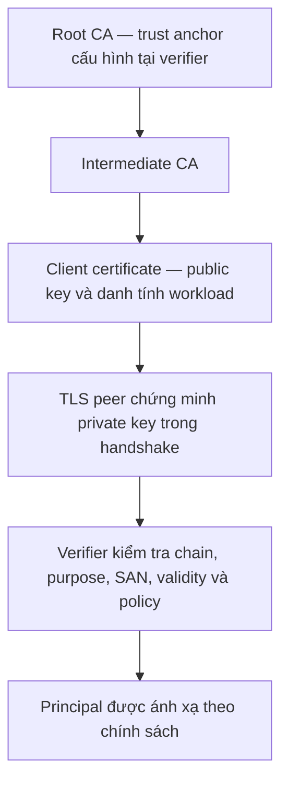
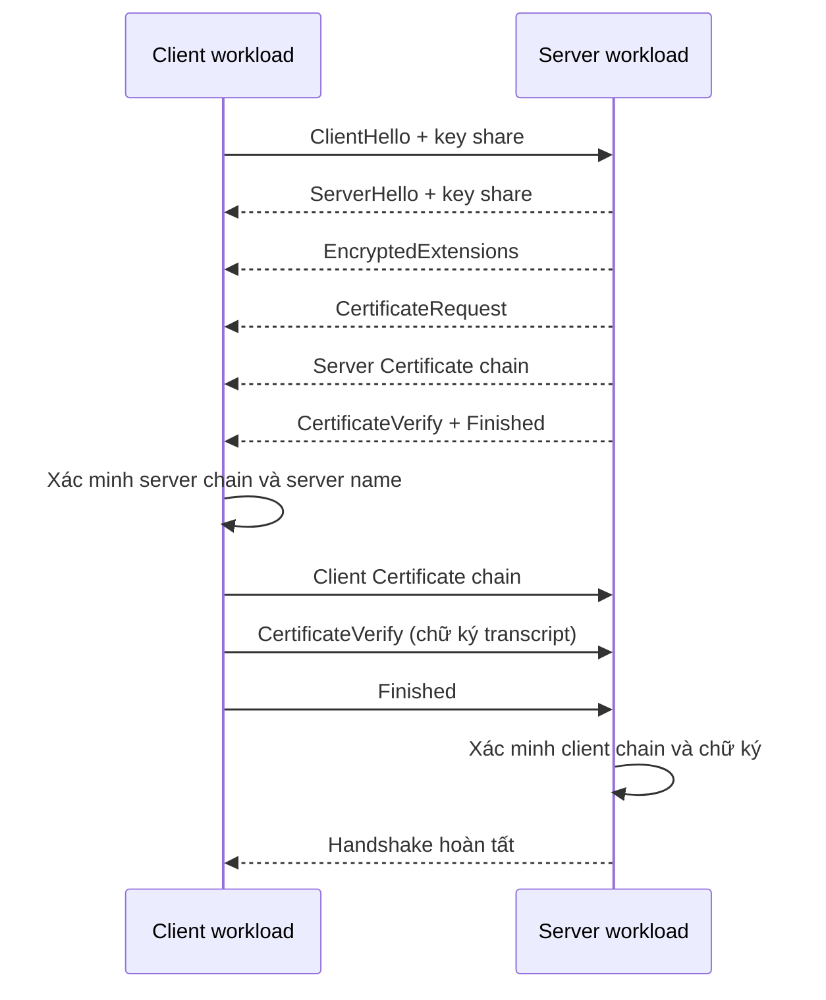
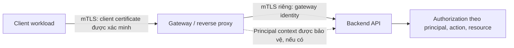

# mTLS authentication — Xác thực TLS hai chiều

## Mục tiêu học tập

Trong HTTPS thông thường, máy khách xác minh chứng chỉ máy chủ để biết mình đang kết nối tới đúng website hoặc API. Với **mutual TLS (mTLS)**, máy chủ cũng yêu cầu và xác minh chứng chỉ của máy khách. Hai đầu kết nối chứng minh quyền kiểm soát khóa riêng tương ứng với chứng chỉ được chấp nhận trong phiên TLS.

mTLS thường được dùng để xác thực service-to-service, workload trong hạ tầng nội bộ, API đối tác, thiết bị và một số ứng dụng doanh nghiệp dùng chứng chỉ người dùng. Tuy nhiên, **chứng chỉ hợp lệ chỉ xác minh danh tính ở một ranh giới giao thức**. Nó không tự quyết định principal được phép gọi endpoint nào, đọc dữ liệu tenant nào hoặc thay mặt người dùng cuối thực hiện hành động gì.

Bài học thuộc chương **Certificate authentication** của mô-đun **SECURITY_AUTHENTICATION_FUNDAMENTALS**. Mô-đun khảo sát credential, mật khẩu, MFA, passkey, chứng chỉ, token, phiên, liên kết danh tính và khôi phục tài khoản.

Sau bài học, bạn có thể:

- Giải thích cách TLS xác thực máy chủ và máy khách trong mTLS.
- Phân biệt chứng chỉ, khóa riêng, CA, trust store, certificate chain và danh tính workload.
- Mô tả cách verifier kiểm tra đường dẫn chứng chỉ, mục đích sử dụng, SAN, thời hạn và trạng thái thu hồi.
- Thiết kế ánh xạ danh tính từ chứng chỉ sang principal ổn định mà không nhầm xác thực với phân quyền.
- Phân tích rủi ro khi TLS kết thúc ở proxy, service mesh hoặc gateway và cách bảo vệ context chuyển tiếp.
- Quản lý vòng đời chứng chỉ: cấp phát, phân phối, xoay vòng, thu hồi và xử lý khóa riêng bị lộ.
- Kết hợp mTLS với access token, scope, audience và kiểm tra quyền ở dịch vụ đích.
- Kiểm thử chứng chỉ giả, sai CA, sai SAN/EKU, hết hạn, bị thu hồi và truy cập vượt quyền.

## 1. mTLS là gì và bảo vệ điều gì?

**TLS (Transport Layer Security)** tạo kênh liên lạc được bảo vệ giữa hai đầu: xác thực đầu kia theo cấu hình, thỏa thuận khóa phiên và bảo vệ tính bí mật/toàn vẹn dữ liệu truyền qua kết nối.

Trong HTTPS phổ biến, xác thực chứng chỉ chủ yếu diễn ra ở phía client: trình duyệt kiểm tra chứng chỉ server và tên host. Server thường không yêu cầu chứng chỉ client. Với **mTLS**, hai đầu cùng tham gia xác thực bằng chứng chỉ:

- Client xác minh chứng chỉ server, chuỗi tin cậy và tên máy chủ.
- Server yêu cầu client trình chứng chỉ, kiểm tra chuỗi tin cậy và mục đích, rồi xác minh client chứng minh được quyền kiểm soát private key.
- Sau handshake thành công, hai bên dùng khóa phiên để bảo vệ dữ liệu trên kết nối.

mTLS phù hợp khi các bên cần xác thực máy hoặc workload ở tầng kết nối. Ví dụ, service xử lý đơn hàng chỉ chấp nhận kết nối TLS từ workload thanh toán có danh tính được CA dành riêng cho môi trường production cấp.

### HTTPS một chiều và mTLS

| Thuộc tính | TLS server authentication thông thường | mTLS |
| --- | --- | --- |
| Client xác minh server certificate | Có | Có |
| Server yêu cầu client certificate | Thường không | Có |
| Client chứng minh kiểm soát private key của chứng chỉ client | Không bắt buộc | Có |
| Mã hóa/toàn vẹn dữ liệu trong TLS | Có | Có |
| Tự cấp quyền gọi API | Không | Không |
| Tự xác định người dùng cuối phía sau service | Không | Không |

mTLS không phải một thuật toán mã hóa riêng và cũng không phải “mật khẩu được gửi dưới dạng chứng chỉ”. Nó là cách sử dụng TLS với **xác thực chứng chỉ ở cả hai phía**.

### mTLS không thay thế các lớp bảo vệ khác

Một kết nối mTLS thành công cho biết peer trình chứng chỉ phù hợp và chứng minh quyền kiểm soát khóa riêng theo handshake. Nó không tự chứng minh:

- Người dùng cuối là ai nếu kết nối được thực hiện bởi một service trung gian.
- Service được phép gọi mọi API hoặc mọi tenant.
- Tài khoản người dùng còn ACTIVE.
- Request hiện tại không phải hành động lạm dụng.
- Token trong HTTP request đúng audience/scope hoặc chưa bị thu hồi.
- Chứng chỉ không bị sao chép cùng private key sang nơi khác, nếu khóa không được bảo vệ chống trích xuất.

Vì vậy, mTLS thường là **một lớp xác thực peer** trong kiến trúc, kết hợp với authorization, token hoặc identity delegation khi cần.

## 2. Thành phần của PKI và chứng chỉ X.509

mTLS dựa trên hạ tầng khóa công khai (PKI) và chứng chỉ số, thường theo định dạng X.509.

### Những thành phần cơ bản

| Thành phần | Vai trò |
| --- | --- |
| **Private key** | Bí mật dùng để ký/chứng minh quyền kiểm soát; phải được bảo vệ, không gửi cho peer |
| **Public key** | Khóa công khai tương ứng, có thể được phân phối qua chứng chỉ |
| **Certificate** | Liên kết public key với danh tính/thuộc tính được CA xác nhận, có thời hạn và mục đích sử dụng |
| **Subject** | Trường định danh trong chứng chỉ; không nên mặc định CN luôn là khóa danh tính duy nhất |
| **SAN (Subject Alternative Name)** | Nơi chứa DNS name, URI, IP hoặc danh tính thay thế theo loại SAN |
| **CA (Certificate Authority)** | Tổ chức/dịch vụ ký chứng chỉ và quản lý chính sách cấp phát |
| **Root CA** | Trust anchor được cấu hình tin cậy trực tiếp |
| **Intermediate CA** | CA trung gian ký chứng chỉ cuối hoặc CA khác |
| **Certificate chain** | Đường dẫn chữ ký từ chứng chỉ cuối qua CA trung gian tới trust anchor |
| **Trust store** | Tập trust anchor/chứng chỉ được cấu hình cho verifier |
| **CRL/OCSP** | Cơ chế phân phối/truy vấn thông tin thu hồi chứng chỉ, tùy PKI và chính sách |

Chứng chỉ không chứa private key. Khi cấp chứng chỉ, chủ thể thường tạo cặp khóa và gửi Certificate Signing Request (CSR) chứa public key cùng thông tin cần xác nhận. CA kiểm tra danh tính/ủy quyền theo chính sách rồi ký chứng chỉ. Private key phải ở lại nơi được bảo vệ.

### Các trường và extension quan trọng

- **Subject:** thông tin chủ thể, có thể có Common Name (CN).
- **Subject Alternative Name (SAN):** DNS, URI, IP hoặc các loại tên khác.
- **Issuer:** CA đã ký chứng chỉ.
- **Validity:** Not Before và Not After.
- **Subject Public Key Info:** thuật toán và public key.
- **Basic Constraints:** chứng chỉ có phải CA hay không; giới hạn path length nếu có.
- **Key Usage:** mục đích mật mã như digitalSignature, keyCertSign, keyEncipherment theo thuật toán/profile.
- **Extended Key Usage (EKU):** mục đích như clientAuth hoặc serverAuth.
- **Serial Number:** số sê-ri duy nhất trong phạm vi CA.
- **Signature Algorithm:** thuật toán CA dùng để ký chứng chỉ.
- **Policy, Name Constraints, CRL Distribution Points, AIA:** các extension khác theo chính sách PKI.

Một chứng chỉ có chữ ký CA hợp lệ vẫn có thể bị từ chối nếu hết hạn, sai EKU, sai tên, sai trust anchor, sai policy hoặc không đáp ứng trạng thái thu hồi theo yêu cầu.

### Certificate chain



Verifier không nên tin một chứng chỉ chỉ vì client tự gửi kèm. Nó cần xây dựng và xác minh đường dẫn tới trust anchor đã được cấu hình. Intermediate certificate có thể được peer gửi trong handshake, nhưng root trust anchor thường được lấy từ trust store của verifier.

## 3. mTLS handshake diễn ra như thế nào?

Chi tiết handshake phụ thuộc phiên bản TLS, cipher suite và cấu hình. Với TLS 1.3, luồng điển hình khi server yêu cầu xác thực client có thể khái quát như sau:

1. Client gửi ClientHello, gồm tham số phiên bản, cipher suites và key share.
2. Server phản hồi ServerHello, chọn tham số và key share.
3. Server gửi EncryptedExtensions; nếu yêu cầu xác thực client, server gửi CertificateRequest ở giai đoạn này.
4. Server gửi Certificate, CertificateVerify và Finished để client xác minh danh tính server và khóa phiên.
5. Client kiểm tra chain, mục đích và tên server theo policy.
6. Client gửi Certificate chứa chain phù hợp, rồi gửi CertificateVerify để chứng minh quyền kiểm soát private key bằng chữ ký trên transcript handshake.
7. Client gửi Finished; server xác minh client và hoàn tất handshake.

Luồng trên lược giản các chi tiết như extension và thông điệp tùy chọn, nhưng giữ thứ tự chính của TLS 1.3 khi server yêu cầu client authentication. Trong TLS 1.2, thông điệp và cơ chế handshake có khác biệt.

### Sơ đồ mTLS TLS 1.3 giản lược



Điểm quan trọng: gửi certificate chỉ cung cấp public key và thông tin danh tính. **CertificateVerify** chứng minh peer đang kiểm soát private key tương ứng trong handshake. Kẻ tấn công chỉ sao chép file chứng chỉ mà không có private key sẽ không thể hoàn tất bằng chứng chữ ký hợp lệ.

### TLS session resumption

TLS session resumption có thể sử dụng PSK/session ticket để giảm chi phí handshake. Trong một số cấu hình, client không gửi lại chứng chỉ ở mọi lần nối lại; bảo đảm xác thực client dựa trên ngữ cảnh phiên đã xác thực trước đó và cách ticket được quản lý.

Do đó cần xem xét:

- Ticket/session có được ràng buộc với danh tính client ban đầu không?
- Ticket có thời hạn và có thể thu hồi khi chứng chỉ/khóa bị xâm phạm không?
- Khi policy thay đổi hoặc certificate bị thu hồi, có cần vô hiệu hóa ticket hoặc giới hạn resumption không?
- Có phân biệt session resumption hợp lệ với một kết nối mới chưa xác thực client không?

Không nên giả định mọi handshake/resumption đều thực hiện lại đầy đủ client certificate validation giống một kết nối mới. Cần kiểm tra hành vi của TLS stack, proxy và service mesh đang triển khai.

## 4. Xác minh chứng chỉ client đúng cách

Khi server nhận client certificate, việc kiểm tra không dừng ở “chữ ký certificate đúng”. Verifier cần áp dụng một policy xác minh đầy đủ.

### 4.1. Xác minh đường dẫn chứng chỉ (path validation)

Các bước thường gồm:

1. Xây dựng chain từ chứng chỉ cuối tới trust anchor được cấu hình.
2. Kiểm tra chữ ký từng chứng chỉ và ràng buộc CA.
3. Kiểm tra Basic Constraints, Key Usage, path length và policy liên quan.
4. Kiểm tra thời gian hiệu lực của toàn chain.
5. Kiểm tra EKU phù hợp với mục đích client authentication.
6. Kiểm tra name constraints và policy nếu profile PKI yêu cầu.
7. Xử lý trạng thái thu hồi qua CRL/OCSP hoặc cơ chế quản lý khác theo policy.
8. Áp dụng quy tắc danh tính: SAN/URI/DNS hoặc subject phải khớp với workload/client dự kiến.

### 4.2. EKU và Key Usage

Một chứng chỉ được cấp cho server TLS không nên tự động được chấp nhận làm client certificate. EKU giúp giới hạn mục đích:

- clientAuth: TLS Web Client Authentication.
- serverAuth: TLS Web Server Authentication.

Key Usage phải phù hợp với thuật toán và profile chứng chỉ. Ví dụ, chữ ký trong handshake cần khả năng ký phù hợp; không nên tự suy luận rằng một chứng chỉ có public key là có thể dùng cho mọi mục đích.

Verifier phải áp dụng đúng policy của PKI. Nếu trust store chấp nhận CA dùng chung cho nhiều loại chứng chỉ, cần giới hạn thêm EKU, name constraints hoặc CA chuyên biệt để tránh chứng chỉ từ mục đích khác được dùng làm client identity.

### 4.3. Kiểm tra danh tính bằng SAN

Đối với server, client phải xác minh tên server (thường theo SAN DNS/IP) khớp hostname mà nó định kết nối.

Đối với client, server cần ánh xạ danh tính theo quy ước rõ ràng, chẳng hạn SAN URI chứa workload identity. Không nên chỉ dùng CN như một chuỗi tùy ý hoặc dùng email làm định danh ổn định nếu email có thể thay đổi/tái sử dụng.

Ví dụ SAN URI theo mô hình workload:

```text
URI:spiffe://prod.example/ns/payments/sa/ledger
```

Verifier có thể ánh xạ URI này thành principal payments-ledger sau khi chain được xác minh và CA trust domain được cấu hình. URI không tự có ý nghĩa nếu issuer không được tin hoặc nếu policy cho phép bất kỳ ai tự khai SAN đó.

### 4.4. Thời hạn và thu hồi

Chứng chỉ có Not After không phải vô thời hạn. Verifier phải kiểm tra hiệu lực tại thời điểm handshake, có clock đồng bộ và chính sách clock skew phù hợp.

Chứng chỉ bị thu hồi có thể không được phát hiện tức thời nếu verifier không kiểm tra CRL/OCSP, dùng cache cũ hoặc fail-open khi dịch vụ trạng thái không sẵn sàng. Cần quyết định rõ:

- Dùng CRL, OCSP, OCSP stapling hay registry nội bộ?
- Cache thông tin thu hồi bao lâu?
- Khi không truy vấn được trạng thái, có fail closed cho workload nhạy cảm không?
- Làm sao truyền sự kiện thu hồi tới gateway, service mesh và connection pool?
- Kết nối TLS đang mở có bị ngắt khi chứng chỉ bị thu hồi không?

Thu hồi certificate không nhất thiết tự đóng mọi kết nối đã thiết lập. Nếu cần chặn tức thời, hệ thống cần cơ chế đóng connection/session, cập nhật policy và vô hiệu hóa ticket/token liên quan.

## 5. Ánh xạ certificate identity thành principal

Sau khi xác minh certificate, ứng dụng cần biến danh tính được chứng minh thành một principal nội bộ. Đây là bước **identity mapping**.

Một mapping tốt cần:

- Dùng định danh ổn định, duy nhất trong trust domain, ví dụ SAN URI hoặc một subject identifier được CA quản lý.
- Gắn danh tính với issuer/trust domain và môi trường (dev, staging, production).
- Không dựa vào display name, CN không duy nhất hoặc địa chỉ IP làm khóa principal.
- Có quy trình khi service đổi tên, namespace hoặc owner.
- Không cho cùng một danh tính certificate ánh xạ sang nhiều principal có quyền không tương thích.
- Audit được certificate serial, issuer, SAN identity và kết quả mapping mà không ghi private key hoặc secret.

### Certificate authentication không phải authorization

Ví dụ, mTLS xác minh kết nối đến từ workload có SAN URI đại diện cho payments/ledger. Điều đó không tự có nghĩa workload này được phép:

- Đọc mọi dữ liệu ngân hàng.
- Gọi endpoint quản trị.
- Thay mặt một người dùng bất kỳ.
- Truy cập tenant khác.
- Gọi mọi dịch vụ trong cluster.

Authorization phải được kiểm tra riêng theo principal, action, resource, tenant và policy.

| Lớp | Câu hỏi | Ví dụ |
| --- | --- | --- |
| TLS peer authentication | Peer kiểm soát private key của certificate được chấp nhận không? | Certificate chain hợp lệ và CertificateVerify đúng |
| Identity mapping | Certificate đại diện principal nào? | SAN URI ánh xạ thành payments-ledger |
| Service authorization | Principal được gọi service/action nào? | payments-ledger được gọi ledger:post |
| End-user authorization | Người dùng cuối được thao tác trên tài nguyên nào? | User có quyền chuyển tiền trong tài khoản của mình |
| Tenant isolation | Principal/user có membership và quyền trong tenant nào? | Chỉ truy cập tenant đã được cấp quyền |

### Service identity và end-user identity

Trong kiến trúc nhiều tầng, một service có thể gọi service khác thay mặt người dùng. mTLS chứng minh **service gọi** là workload nào; nó không tự chứng minh **người dùng cuối** là ai.

Nếu cần delegation, request phải mang một token hoặc context được phát hành/ủy quyền có kiểm soát, với subject người dùng, actor/service, audience, scope và thời hạn rõ. Service đích cần kiểm tra cả workload identity từ mTLS lẫn delegated user context. Không tin header X-User-Id do service trung gian tự đặt nếu không có kênh và hợp đồng bảo vệ tính toàn vẹn.

## 6. TLS termination ở proxy và service mesh

mTLS chỉ xác thực hai đầu của **một kết nối TLS cụ thể**. Trong kiến trúc có load balancer, API gateway hoặc service mesh, cần biết chính xác TLS kết thúc ở đâu.

### Trường hợp A: TLS passthrough

Proxy chuyển tiếp luồng TLS mà không giải mã. Client và backend là hai đầu TLS; backend có thể trực tiếp yêu cầu và xác minh client certificate. Proxy không tự nhìn thấy HTTP payload.

### Trường hợp B: TLS terminate tại proxy

Client thiết lập mTLS với proxy. Proxy xác minh client certificate rồi tạo kết nối mới đến backend. Backend chỉ nhìn thấy proxy là peer TLS của kết nối thứ hai, không trực tiếp xác minh certificate client ban đầu.

Nếu proxy chuyển thông tin client identity qua header, backend chỉ được tin header đó khi:

- Backend chỉ nhận kết nối từ proxy đã xác thực, tốt nhất có mTLS riêng proxy–backend.
- Proxy xóa header identity do client gửi và chỉ tự tạo header sau xác minh.
- Context được bảo vệ toàn vẹn, không thể bị một service khác giả mạo.
- Có hợp đồng rõ về certificate fields, trust domain, thời điểm xác minh và trạng thái thu hồi.
- Backend vẫn thực hiện authorization theo resource/action và không coi certificate mapping là quyền toàn cục.

### Trường hợp C: mTLS giữa các workload trong service mesh

Sidecar/proxy có thể tự động cấp chứng chỉ workload, xác thực peer và mã hóa kết nối. Điều này giảm gánh nặng triển khai TLS trong từng ứng dụng, nhưng không loại bỏ trách nhiệm:

- Quản lý CA và trust domain.
- Phân quyền workload-to-workload.
- Phân tách môi trường và namespace.
- Xử lý certificate rotation/revocation.
- Bảo vệ control plane cấp chứng chỉ.
- Không tin workload chỉ vì nó nằm trong cùng cluster.
- Kiểm tra end-user identity và authorization ở ứng dụng.

### Sơ đồ proxy termination



Ở sơ đồ này, backend xác thực gateway qua kết nối thứ hai. Nếu backend cần tin danh tính client ban đầu, phải có cơ chế truyền context được bảo vệ và kiểm soát gateway. Không thể suy ra certificate của client ban đầu chỉ từ việc kết nối TLS backend–gateway hợp lệ.

## 7. Quản lý vòng đời certificate và private key

mTLS chỉ an toàn khi private key và certificate được quản lý xuyên suốt vòng đời. Một chứng chỉ hợp lệ nhưng private key bị sao chép có thể cho phép kẻ tấn công giả danh workload cho tới khi bị thu hồi hoặc các policy khác chặn.

### 7.1. Cấp phát

Quy trình cấp phát thường gồm:

1. Workload hoặc hệ thống quản lý danh tính tạo cặp khóa.
2. Private key được tạo tại nơi an toàn; với workload nhạy cảm có thể dùng HSM, TPM hoặc cơ chế bảo vệ khóa của nền tảng.
3. Tạo Certificate Signing Request (CSR) chứa public key và danh tính được yêu cầu.
4. CA/issuer xác minh workload có quyền xin danh tính đó.
5. CA phát hành certificate với SAN, EKU, Key Usage và thời hạn theo policy.
6. Certificate được phân phối tới đúng workload; private key không đi cùng certificate qua kênh phân phối không an toàn.
7. Ghi nhận owner, serial, issuer, thời hạn, môi trường và trạng thái trong inventory.

Không để client tự chọn một SAN bất kỳ rồi CA ký mà không xác minh quyền sở hữu danh tính đó. Nếu workload trong namespace payments có thể xin certificate cho admin hoặc identity-service, trust boundary của CA đã bị phá vỡ.

### 7.2. Phân phối và lưu trữ khóa

- Hạn chế quyền đọc private key theo process/identity cần thiết.
- Không đưa private key vào source code, container image, Git, log hoặc artifact build.
- Dùng secret manager, HSM/TPM hoặc workload identity integration phù hợp.
- Mã hóa khi lưu trữ và bảo vệ kênh phân phối.
- Có inventory để biết key nào thuộc workload nào, môi trường nào và ai chịu trách nhiệm.
- Tách khóa production khỏi dev/test; không tái sử dụng cùng key giữa nhiều service nếu không cần.
- Giới hạn khả năng export private key nếu nền tảng hỗ trợ non-exportable key.

### 7.3. Rotation

Xoay vòng chứng chỉ trước khi hết hạn giúp giảm outage. Một quy trình an toàn:

1. Cấp certificate mới và triển khai song song với certificate cũ.
2. Đảm bảo verifier tin CA/chain mới trong giai đoạn chuyển tiếp có kiểm soát.
3. Cập nhật workload để sử dụng certificate/key mới.
4. Kiểm tra handshake, identity mapping, authorization và telemetry.
5. Xác nhận không còn kết nối phụ thuộc certificate cũ.
6. Thu hồi hoặc loại bỏ certificate cũ theo policy.
7. Gỡ trust anchor cũ khi không còn workload nào cần dùng.

Rotation cần tránh cả hai cực: trust overlap quá rộng kéo dài làm tăng bề mặt tấn công; loại bỏ CA cũ quá sớm gây gián đoạn hàng loạt.

### 7.4. Khi private key bị lộ

Nếu nghi ngờ private key bị sao chép:

- Thu hồi certificate tương ứng và đánh dấu workload identity có nguy cơ.
- Ngừng hoặc cách ly workload bị ảnh hưởng.
- Phát hành cặp khóa/chứng chỉ mới qua quy trình xác minh danh tính workload.
- Đóng kết nối, xóa session/ticket liên quan nếu policy yêu cầu.
- Kiểm tra log kết nối và hành động của principal trong thời gian phơi bày.
- Xem xét liệu CA hoặc hệ thống cấp phát có bị lạm dụng không; nếu có, có thể cần xoay CA/intermediate và trust store.
- Cập nhật downstream authorization hoặc deny policy trong thời gian điều tra.

Chỉ thay file certificate mà giữ nguyên private key đã lộ không khắc phục được sự cố. Cần tạo **key pair mới** và thu hồi danh tính cũ.

## 8. Kết hợp mTLS với OAuth access token

mTLS và OAuth access token giải quyết các câu hỏi khác nhau:

- mTLS xác thực peer ở tầng kết nối và có thể cung cấp workload identity.
- Access token thể hiện quyền truy cập được authorization server cấp cho client/principal theo audience và scope.
- Resource server kiểm tra cả hai khi policy yêu cầu: kết nối đến từ workload nào và token cho phép hành động nào.

### Certificate-bound access token

Một số profile OAuth cho phép ràng buộc access token với chứng chỉ client, ví dụ cơ chế certificate-bound access token theo RFC 8705. Resource server kiểm tra token và đối chiếu dấu vân tay chứng chỉ trong token với certificate được dùng ở kết nối TLS.

Điều này làm token khó bị sử dụng từ client khác chỉ bằng cách đánh cắp chuỗi token, vì client sử dụng cần chứng minh kiểm soát khóa riêng tương ứng certificate đã ràng buộc.

Tuy nhiên:

- Phải triển khai đúng profile và issuer/resource server hỗ trợ.
- Không chỉ decode claim certificate thumbprint mà bỏ xác minh chữ ký token.
- Proxy termination phải bảo đảm certificate binding được kiểm tra ở đúng ranh giới.
- Token vẫn cần đúng issuer, audience, scope, expiry và trạng thái thu hồi.
- Certificate-bound token không tự thay thế kiểm tra quyền tài nguyên.

### Phân biệt mTLS, bearer token và certificate-bound token

| Cơ chế | Bằng chứng | Rủi ro chính |
| --- | --- | --- |
| Bearer access token | Ai có token có thể trình token | Token bị đánh cắp có thể bị dùng lại nếu chưa hết hạn/thu hồi |
| mTLS client certificate | Peer chứng minh kiểm soát private key của certificate | Private key bị lộ, CA cấp sai danh tính, authorization quá rộng |
| Certificate-bound access token | Token hợp lệ và kết nối TLS dùng đúng certificate được ràng buộc | Lỗi mapping/proxy hoặc token/certificate lifecycle không được đồng bộ |

## 9. mTLS cho người dùng cuối và workload

### Workload-to-workload

Đây là trường hợp phổ biến: service, agent, gateway, thiết bị hoặc workload cần xác thực với nhau. Có thể dùng SPIFFE/SPIRE hoặc nền tảng PKI nội bộ để cấp danh tính workload ngắn hạn. Dù dùng nền tảng tự động, vẫn phải kiểm tra trust domain, SAN, CA, authorization và lifecycle.

### Client certificate cho người dùng

Một số tổ chức cấp chứng chỉ cho nhân viên, smart card hoặc thiết bị quản lý. Người dùng có thể cần PIN để mở khóa private key trên smart card. Khi đó cần phân biệt:

- Certificate xác định public key và danh tính được CA xác nhận.
- Chữ ký trong handshake chứng minh kiểm soát private key.
- PIN có thể là biện pháp mở khóa key tại thiết bị, nhưng verifier từ xa không tự biết PIN đã được nhập trừ khi giao thức/authenticator cung cấp bằng chứng phù hợp.
- Việc người dùng có certificate không đồng nghĩa họ được quyền truy cập mọi ứng dụng.
- Mất smart card hoặc nghi ngờ PIN/key bị lộ cần quy trình thu hồi, cấp lại và khôi phục.

Với trình duyệt, client certificate prompt có thể gây ma sát, khó lựa chọn giữa nhiều chứng chỉ và khó hỗ trợ thiết bị cá nhân. Cần thiết kế enrollment, UX, dự phòng và hỗ trợ tiếp cận; không ép client certificate vào mọi sản phẩm nếu passkey/OIDC đáp ứng nhu cầu tốt hơn.

## 10. Ví dụ cấu hình mTLS trong ứng dụng Java

Cấu hình cụ thể tùy framework và phiên bản. Ví dụ dưới đây minh họa Spring Boot dùng HTTPS listener và trust store chứa CA được phép phát hành client certificate.

```yaml
server:
  port: 8443
  ssl:
    enabled: true
    key-store: classpath:server-keystore.p12
    key-store-type: PKCS12
    key-store-password: value-from-secret-manager
    trust-store: classpath:client-ca-truststore.p12
    trust-store-type: PKCS12
    trust-store-password: value-from-secret-manager
    client-auth: need
```

client-auth: need yêu cầu client cung cấp chứng chỉ trong handshake. want thường yêu cầu nhưng có thể cho phép client không có certificate tiếp tục; nếu dùng want, ứng dụng phải phân biệt rõ endpoint nào được phép anonymous và không vô tình coi kết nối không có certificate là đã xác thực.

Các lưu ý:

- Trust store cần chứa trust anchor/CA phù hợp cho client certificates, không phải tùy tiện import mọi CA hệ thống.
- Server key store chứa private key và certificate chain của server.
- Password trong ví dụ lấy từ secret manager hoặc môi trường triển khai; không commit giá trị thật vào cấu hình.
- Cấu hình TLS không tự ánh xạ SAN thành principal nghiệp vụ; cần mapping và authorization ở ứng dụng.
- Khi triển khai sau proxy, cấu hình listener và trust boundary khác với trường hợp ứng dụng trực tiếp kết thúc TLS.

### Ví dụ Java: policy sau khi TLS xác minh peer

Ứng dụng nên nhận principal đã được TLS stack/framework xác minh. Không tự đọc certificate từ header do client gửi. Ví dụ dưới đây mô hình hóa authorization của workload sau identity mapping:

```java
import java.util.Set;

record WorkloadPrincipal(
        String trustDomain,
        String workloadId,
        Set<String> authorities
) {}

enum Operation {
    READ_LEDGER,
    POST_PAYMENT,
    ADMINISTER_CERTIFICATES
}

class WorkloadPolicy {
    static boolean isAllowed(
            WorkloadPrincipal principal,
            Operation operation) {

        if (principal == null
                || !"prod.example".equals(principal.trustDomain())) {
            return false;
        }

        return switch (principal.workloadId()) {
            case "payments/ledger" ->
                    operation == Operation.READ_LEDGER
                    || operation == Operation.POST_PAYMENT;
            case "identity/certificate-manager" ->
                    operation == Operation.ADMINISTER_CERTIFICATES;
            default -> false;
        };
    }
}
```

WorkloadPrincipal trong ví dụ phải được tạo từ certificate đã qua path validation và mapping SAN theo policy. Không được khởi tạo từ request JSON. Danh sách operation chỉ minh họa; hệ thống thực tế cần kiểm tra resource, tenant, delegation và trạng thái workload.

### Pseudocode kiểm tra peer certificate

```java
// PSEUDOCODE: API cụ thể tùy TLS framework.
X509Certificate[] peerChain = tlsSession.getPeerCertificates();

VerifiedCertificateIdentity identity =
        certificateVerifier.verify(
                peerChain,
                trustedClientCaSet,
                requiredEku = "clientAuth",
                requiredSanUriPrefix = "spiffe://prod.example/"
        );

WorkloadPrincipal principal =
        identityMapper.map(identity);

authorizationService.requireAllowed(
        principal,
        requestedOperation,
        requestedResource
);
```

Đây là pseudocode để mô tả các bước. Trong ứng dụng Java, TLS stack thường đã thực hiện phần xác minh certificate chain khi handshake; không nên tự triển khai path validation bằng vài lệnh kiểm tra ngày hết hạn. Ứng dụng lấy peer principal/certificate từ API bảo mật của framework, sau đó áp dụng mapping và authorization theo policy. Nếu framework chạy sau proxy, cần xác định rõ principal đến từ TLS peer hiện tại hay context được gateway bảo vệ.

## 11. Lỗi triển khai thường gặp

| Lỗi | Hậu quả | Cách phòng tránh |
| --- | --- | --- |
| Tin mọi certificate do client gửi | Certificate tự ký hoặc từ CA không tin cậy được chấp nhận | Xác minh chain tới trust anchor được cấu hình |
| Trust store chứa quá nhiều CA | CA không liên quan có thể phát hành danh tính ngoài dự kiến | Dùng CA chuyên biệt, giới hạn EKU/SAN/policy |
| Chỉ kiểm tra certificate còn hạn | Bỏ qua issuer, chain, EKU, SAN, revocation | Dùng TLS path validation và identity policy đầy đủ |
| Dùng CN làm định danh duy nhất | CN có thể trùng, thay đổi hoặc không được chuẩn hóa | Dùng SAN/URI ổn định và mapping theo issuer/trust domain |
| Chấp nhận serverAuth certificate làm client | Chứng chỉ sai mục đích được dùng để xác thực client | Kiểm tra EKU và Key Usage |
| Không bảo vệ private key | Kẻ tấn công sao chép key có thể giả danh workload | HSM/TPM/secret manager, quyền tối thiểu và rotation |
| TLS terminate ở proxy rồi tin header tùy ý | Client giả mạo principal hoặc certificate identity | Bảo vệ proxy–backend, strip header client, context toàn vẹn |
| mTLS thành công được coi là admin | Workload hợp lệ có quyền quá rộng | Authorization theo action/resource/tenant |
| Không đồng bộ thu hồi | Certificate bị thu hồi nhưng kết nối/ticket/cache cũ còn hoạt động | Revocation policy, đóng connection, invalidate session/ticket |
| Chỉ thay certificate khi key lộ | Private key cũ vẫn dùng được | Tạo key pair mới, thu hồi cert cũ, điều tra |
| Dùng certificate của dev ở production | Môi trường yếu có thể trở thành đường vào production | Tách CA, trust store, namespace và policy theo môi trường |
| Không xử lý TLS resumption | Phiên nối lại có thể giữ ngữ cảnh cũ sau thay đổi policy | Quản lý ticket lifetime, rotation và invalidation |
| Certificate identity thay cho user identity | Service bị coi là người dùng cuối | Tách workload principal và delegated user context |
| Không kiểm tra hostname server | Client kết nối nhầm server dù chain hợp lệ | Xác minh SAN hostname theo endpoint dự kiến |

## 12. Bảng kiểm thử mTLS

| Trường hợp | Đầu vào/thao tác | Kết quả mong đợi |
| --- | --- | --- |
| Client certificate hợp lệ | Chain tin cậy, đúng EKU/SAN, còn hạn, proof-of-possession hợp lệ | Handshake thành công; principal được mapping |
| Không có client certificate khi client-auth là need | Client không gửi certificate | Handshake thất bại |
| Certificate tự ký không được tin | Chain không tới trust anchor | Từ chối handshake |
| Sai CA/trust domain | Certificate từ CA dev gửi vào production | Từ chối |
| Hết hạn | Not After đã qua | Từ chối |
| Chưa có hiệu lực | Not Before ở tương lai | Từ chối |
| Sai EKU | Chỉ có serverAuth, thiếu mục đích client phù hợp | Từ chối theo policy |
| Sai SAN | URI/DNS không thuộc workload được phép | Không mapping principal; từ chối |
| Chứng chỉ bị thu hồi | CRL/OCSP/registry cho biết revoked | Từ chối theo revocation policy |
| Private key không khớp | Certificate gửi nhưng không chứng minh được private key tương ứng | Handshake thất bại |
| Certificate hợp lệ nhưng không có quyền API | Peer xác thực thành công nhưng gọi operation ngoài policy | 403 / deny |
| Service tenant A gọi tài nguyên tenant B | Workload identity hợp lệ nhưng không có delegation/membership | Từ chối |
| Proxy chuyển header do client đặt | Client gửi header X-Client-Cert giả | Header bị strip/không được tin |
| Backend nhận request trực tiếp ngoài gateway | Không có service identity hợp lệ | Từ chối kết nối |
| Certificate mới trong rotation | Trust overlap đúng policy | Kết nối mới thành công với identity mới |
| Certificate cũ sau khi hết overlap | CA/cert cũ đã bị loại bỏ hoặc thu hồi | Từ chối |
| Key bị lộ | Cert cũ bị thu hồi, key mới được cấp | Cert cũ bị từ chối; cert mới hoạt động |
| TLS session resumption | Ticket được tạo trước khi policy thay đổi | Hành vi theo ticket lifetime/revocation policy đã định nghĩa |
| Client xác minh server sai hostname | Chain hợp lệ nhưng SAN không khớp host | Client từ chối kết nối |
| Chứng chỉ người dùng hợp lệ nhưng account bị đình chỉ | TLS handshake xác thực certificate thành công | Ứng dụng từ chối truy cập theo account status |

Ngoài unit/integration test, nên kiểm thử rotation CA, mất kết nối OCSP/CRL, clock skew, key compromise, nhiều certificate trong trust store, kết nối keep-alive lâu, proxy failover và session resumption. Ghi nhận lý do từ chối ở mức an toàn, không ghi private key, token hoặc bí mật.

## 13. Checklist thiết kế mTLS

Trước khi triển khai, hãy trả lời:

1. **Peer:** Client/server nào phải chứng minh danh tính? Có cần mTLS cho mọi kết nối hay chỉ workload/API cụ thể?
2. **Trust anchor:** CA nào được tin ở môi trường này? Trust store có bị mở rộng quá mức không?
3. **Path validation:** Có kiểm tra chain, Basic Constraints, Key Usage, EKU, validity, policy và revocation theo yêu cầu không?
4. **Identity mapping:** Dùng SAN DNS/URI hay định danh nào? Có duy nhất, ổn định và ràng buộc với issuer/trust domain không?
5. **Private key:** Key được tạo, lưu, truy cập và xoay vòng ra sao? Có thể export hay bị sao chép không?
6. **Authorization:** Sau mTLS, principal được gọi operation/resource/tenant nào? Có phân biệt workload và end-user không?
7. **Proxy:** TLS kết thúc ở đâu? Backend xác minh trực tiếp client hay tin context được proxy bảo vệ?
8. **Lifecycle:** Có inventory, expiry alert, rotation overlap, revocation và quy trình key compromise không?
9. **Resumption:** Ticket/session có giữ identity cũ quá lâu sau thu hồi hoặc thay policy không?
10. **Token binding:** Có cần ràng buộc OAuth access token với certificate không? Resource server xác minh thumbprint và token đúng profile chưa?
11. **Failure mode:** CA/OCSP/CRL/control plane không sẵn sàng thì hành vi từ chối có phù hợp rủi ro không?
12. **Observability:** Có audit được issuer, serial, SAN identity, principal, operation và kết quả mà không lộ secret không?

## 14. Bài tập vận dụng

Một công ty có ba service: web-api, payment-service và ledger-service. Hiện tại mọi service giao tiếp qua mạng nội bộ và dùng HTTP. Đội vận hành dự định bật mTLS tại API gateway, sau đó gateway gửi header X-Client-Cert-CN cho các service. Trust store của gateway chứa cả CA development lẫn production. payment-service được phép gọi mọi endpoint của ledger-service. Certificate được cấp một lần và không có quy trình rotation; khi key bị lộ, nhóm chỉ xóa file certificate khỏi máy.

**Yêu cầu:**

1. Vẽ trust boundary trước và sau khi bật mTLS; xác định kết nối nào thực sự được xác thực hai chiều.
2. Phân tích vì sao header CN sau TLS termination chưa đủ làm principal tin cậy.
3. Thiết kế CA/trust store tách môi trường, SAN identity, EKU và mapping principal.
4. Đề xuất authorization giữa payment và ledger theo operation/resource, cùng cách chuyển end-user context nếu cần.
5. Thiết kế cấp phát, bảo vệ private key, rotation, thu hồi và xử lý session/ticket/connection cũ.
6. Viết test cho certificate sai CA, sai SAN/EKU, hết hạn, bị thu hồi, proxy giả header, service vượt quyền và key compromise.

**Gợi ý tự đánh giá:** mTLS xác thực peer và bảo vệ kênh; CA/trust store quyết định ai có thể trình danh tính được chấp nhận; SAN mapping quyết định principal; authorization quyết định principal làm gì; vòng đời khóa/chứng chỉ quyết định danh tính đó còn được tin hay không. Không lớp nào thay thế hoàn toàn lớp còn lại.

---

**Điểm cần nhớ:** mTLS chỉ có giá trị khi **certificate chain, private-key proof, mục đích sử dụng, danh tính và policy** đều được xác minh tại đúng ranh giới. Sau handshake, ứng dụng vẫn phải ánh xạ principal, kiểm tra authorization, tách workload khỏi end-user identity và quản lý thu hồi/rotation. Chứng chỉ hợp lệ chứng minh peer kiểm soát một khóa được tin cậy; nó không tự cấp quyền truy cập nghiệp vụ.
