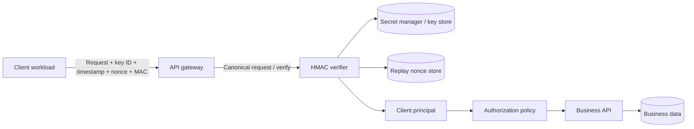

# HMAC authentication — Xác thực yêu cầu bằng HMAC

Một API nhận yêu cầu từ dịch vụ đối tác và cần biết yêu cầu có được tạo bởi một client đã đăng ký hay không, dữ liệu có bị thay đổi trên đường truyền hay không, và yêu cầu cũ có đang bị phát lại hay không. Một cách thường gặp là dùng **HMAC (Hash-based Message Authentication Code)**: client và server cùng giữ một bí mật, client tạo mã xác thực cho nội dung yêu cầu, còn server dùng bí mật tương ứng để kiểm tra.

HMAC có thể giúp xác thực nguồn gửi theo mô hình **shared secret** và bảo vệ tính toàn vẹn của thông điệp. Tuy nhiên, HMAC không mã hóa nội dung, không tự chống replay, không chứng minh danh tính con người và không quyết định client được phép truy cập tài nguyên nào. Những phần đó cần TLS, timestamp/nonce, quản lý khóa, xác thực danh tính và authorization phù hợp.

Bài học thuộc chương **HMAC request authentication** của học phần **SECURITY_AUTHENTICATION_FUNDAMENTALS**. Nội dung liên hệ HMAC với credential, token, phiên, chứng chỉ và luồng xác thực; người học sẽ biết mô hình hóa ranh giới tin cậy, phòng chống giả mạo, replay và lạm dụng API.

## 1. Kết quả học tập

Sau bài này, người học có thể:

- Giải thích HMAC và phân biệt message authentication với hash thông thường, chữ ký số và mã hóa.
- Mô tả mô hình client/server cùng giữ shared secret và cách HMAC xác nhận tính toàn vẹn/thông điệp được tạo bởi bên biết khóa.
- Thiết kế cấu trúc canonical request có method, path, query, headers, timestamp, nonce và body digest.
- Xác minh HMAC an toàn bằng thuật toán chuẩn, so sánh constant-time và kiểm tra ràng buộc request.
- Phòng chống replay bằng timestamp, nonce và lưu trạng thái dùng một lần.
- Quản lý key ID, cấp phát, lưu trữ, xoay vòng, thu hồi và giới hạn quyền của từng client.
- Phân biệt HMAC request authentication với xác thực người dùng, OAuth access token, mTLS và authorization.
- Viết tiêu chí chấp nhận cho chữ ký sai, request bị sửa, replay, key rotation và canonicalization.

## 2. HMAC là gì?

HMAC là một cơ chế tạo **message authentication code (MAC)** dựa trên hàm băm mật mã và khóa bí mật. Hai bên cần biết cùng một khóa bí mật (hoặc các khóa tương ứng được dẫn xuất theo quy tắc an toàn):

- Bên gửi lấy message và secret key để tính MAC.
- Bên nhận tính lại MAC trên message nhận được bằng secret key của client.
- Nếu MAC khớp theo so sánh an toàn, bên nhận có bằng chứng rằng thông điệp không bị sửa và được tạo bởi một bên biết khóa, với giả định thuật toán và khóa còn an toàn.

Một cách biểu diễn khái niệm:

```text
message = canonical_request
tag = HMAC-SHA-256(secret_key, message)

Client gửi:
    key_id
    signature_version
    timestamp
    nonce
    signature = tag
    request (method, path, headers, body...)

Server:
    tra key theo key_id
    kiểm tra timestamp/nonce
    tự dựng canonical_request từ request nhận được
    expected = HMAC-SHA-256(secret_key, canonical_request)
    so sánh expected với signature theo constant-time
```

HMAC thường dùng với các hàm băm như SHA-256. Tên gọi **HMAC-SHA-256** chỉ định cấu trúc HMAC kết hợp SHA-256; không phải chỉ tính SHA-256 của chuỗi nối secret và message.

### 2.1. HMAC khác hash thông thường

Hash mật mã như SHA-256 có thể tạo fingerprint của dữ liệu nhưng không cần bí mật. Bất kỳ ai biết message đều có thể tính hash đó. HMAC sử dụng khóa bí mật, nên bên không biết khóa không thể dễ dàng tạo tag hợp lệ cho một message mới.

| Cơ chế | Có dùng secret key? | Mục tiêu chính | Giới hạn quan trọng |
| --- | --- | --- | --- |
| Hash (ví dụ SHA-256) | Không | Fingerprint/tính toàn vẹn khi có kênh tin cậy khác | Không chứng minh ai tạo message |
| HMAC | Có, khóa chia sẻ | Xác thực thông điệp và toàn vẹn | Cả hai bên biết khóa đều có thể tạo tag; không có non-repudiation |
| Chữ ký số | Có private key ở bên ký; public key ở bên xác minh | Xác minh chữ ký bằng public key | Cần PKI/key lifecycle; không tự mã hóa nội dung |
| Mã hóa | Có khóa mã hóa/giải mã hoặc khóa phiên | Bảo mật nội dung | Mã hóa đơn thuần không luôn cung cấp xác thực thông điệp |

### 2.2. HMAC không phải mã hóa

HMAC không che giấu nội dung. Nếu request có email, mã đơn hàng hoặc dữ liệu nhạy cảm, người quan sát vẫn có thể đọc được chúng nếu không có lớp mã hóa truyền tải. Vì vậy, **dùng HTTPS/TLS cho API HMAC**; HMAC bổ sung xác thực và toàn vẹn, không thay thế TLS.

## 3. Mô hình shared secret

Trong mô hình đơn giản, mỗi client được cấp một cặp định danh:

- **Key ID:** định danh công khai để server tra cứu cấu hình/khóa; không phải bí mật.
- **Secret key:** bí mật ngẫu nhiên, chỉ client được cấp và server có quyền xác minh được giữ.

Ví dụ:

```text
Client partner-42
    key_id: partner-42-prod-2026-01
    secret: [high-entropy secret stored securely]

Server API
    key_id -> client identity -> secret reference -> policy
```

Secret phải được sinh bằng CSPRNG, có entropy cao và đủ dài theo profile thuật toán. Không dùng mật khẩu người dùng, email, API endpoint, timestamp hoặc chuỗi có thể đoán làm HMAC key. Không tự chuyển mật khẩu thành HMAC key bằng một hash nhanh; nếu hệ thống cần dẫn xuất khóa từ một bí mật gốc, dùng cơ chế KDF phù hợp như HKDF trong bối cảnh có input key material đủ entropy và có quy trình quản lý rõ ràng.

### 3.1. HMAC chứng minh điều gì?

Khi server xác minh thành công HMAC, nó có bằng chứng rằng người tạo request biết shared secret tương ứng. Điều này có thể xác thực **client/integration** trong mô hình đã đăng ký. HMAC không chứng minh người dùng cuối nào đang ngồi trước client, cũng không chứng minh một nhân viên cụ thể đã phê duyệt hành động.

Do cả client và server cùng biết secret, cả hai đều có khả năng tạo tag. HMAC vì thế không cung cấp tính không thể chối bỏ (non-repudiation) như chữ ký số có private key do riêng bên ký kiểm soát.

### 3.2. Không đặt shared secret trong ứng dụng công khai

Một ứng dụng web chạy trong trình duyệt (SPA) hoặc mã client được phân phối rộng rãi không thể giữ một secret tĩnh an toàn: người dùng có thể xem mã, bộ nhớ hoặc gói cài đặt. Nếu đặt HMAC secret trong JavaScript, app binary hoặc mobile package, kẻ tấn công có thể trích xuất và giả mạo client.

HMAC shared secret phù hợp hơn cho server-to-server, workload hoặc môi trường mà secret có thể được giữ trong secret manager, HSM/KMS hoặc vùng bảo vệ tương đương. Với public client, cân nhắc OAuth/OIDC với PKCE, backend-for-frontend, sender-constrained token hoặc cơ chế khóa riêng phù hợp.

## 4. Canonical request: hai bên phải ký cùng một thông điệp

Một lỗi triển khai phổ biến là client ký một chuỗi, còn server dựng một chuỗi hơi khác do khác biệt về thứ tự query, percent encoding, header, newline hoặc body. HMAC khi đó thất bại dù secret đúng; tệ hơn, canonicalization không nhất quán có thể tạo lỗ hổng xác thực hoặc cho phép request bị diễn giải khác nhau ở proxy và ứng dụng.

Một canonical request minh họa có thể gồm:

```text
HTTP_METHOD
CANONICAL_PATH
CANONICAL_QUERY
KEY_ID
SIGNATURE_VERSION
CANONICAL_HEADERS
SIGNED_HEADER_NAMES
BODY_DIGEST
TIMESTAMP
NONCE
```

Ví dụ dữ liệu request:

```http
POST /v1/transfers?currency=VND&reference=INV-42 HTTP/1.1
Host: api.example.test
Content-Type: application/json
X-Client-Key-Id: partner-42-prod-2026-01
X-Signature-Version: hmac-sha256-v1
X-Request-Timestamp: 2026-11-22T05:00:00Z
X-Request-Nonce: 6qN7mY8p2A
X-Content-SHA256: <hex-body-digest>
X-Request-Signature: <base64url-hmac>

{"amount":250000,"currency":"VND","recipient":"acct-73"}
```

Đây là định dạng minh họa, không phải chuẩn HTTP hay chuẩn HMAC phổ quát. Nếu thiết kế giao thức riêng, phải đặc tả canonicalization chính xác và có test vector cho mọi trường hợp. Khi có thể, dùng một chuẩn/request-signing profile đã được đánh giá thay vì tự tạo giao thức mới.

### 4.1. Method và path

- Chuẩn hóa method theo một cách duy nhất, thường uppercase.
- Path phải được chuẩn hóa theo quy tắc đã định; xử lý percent encoding, dấu slash, dot segment và Unicode nhất quán.
- Proxy, gateway và backend phải hiểu cùng một path; nếu proxy giải mã/viết lại path sau khi ký, cần xác định chính xác thành phần nào là nguồn canonical.
- Không ký một path nhưng để backend định tuyến theo path khác.

### 4.2. Query parameters

Quy định rõ:

- Có sắp xếp tham số theo tên và giá trị hay giữ thứ tự?
- Tham số lặp như `tag=a&tag=b` được xử lý thế nào?
- Khoảng trắng, dấu `+`, percent encoding và tham số không có giá trị được biểu diễn ra sao?
- Có bỏ tham số rỗng hoặc tham số không được ký không?

Client và server phải tuân thủ cùng một quy tắc. Không dùng parser khác nhau ở gateway và ứng dụng nếu chúng có thể diễn giải cùng URL theo cách khác nhau.

### 4.3. Headers

Chỉ ký những header có ý nghĩa bảo mật/ngữ nghĩa request và phải xác định danh sách rõ ràng. Thường cân nhắc host, content-type, timestamp, nonce, body digest và các header ảnh hưởng đến định tuyến/ngữ nghĩa. Chuẩn hóa tên header, khoảng trắng và giá trị theo một profile thống nhất.

Không cho phép header quan trọng bị proxy sửa sau khi xác minh. Tránh ký các header không ổn định như hop-by-hop hoặc header do proxy tự thêm nếu chúng không được kiểm soát.

### 4.4. Body digest

Với request có body, client có thể tính SHA-256 trên **đúng byte sequence** sẽ gửi và đưa digest vào canonical request. Server phải tính lại trên đúng byte sequence nhận được. Cần xác định request có được giải nén, chuyển mã hoặc chuẩn hóa JSON trước/sau khi kiểm tra hay không. Nếu một middleware parse rồi serialize lại JSON, byte sequence có thể khác dù dữ liệu logic tương đương.

Body digest chỉ bảo vệ body nếu nó thực sự được ràng buộc vào HMAC. Không ký body nhưng vẫn cho phép client gửi dữ liệu nhạy cảm chưa được xác thực là lỗi thiết kế.

## 5. Tạo HMAC request signature

Một client tạo signature theo các bước:

1. Lấy key ID và secret key được cấp cho môi trường.
2. Tạo timestamp và nonce mới cho request.
3. Serialize body đúng byte sequence sẽ gửi.
4. Tính body digest.
5. Dựng canonical request theo profile.
6. Tính HMAC-SHA-256 trên canonical bytes.
7. Mã hóa tag (ví dụ Base64url) và gửi kèm key ID, timestamp, nonce, digest và signature qua HTTPS.

Pseudocode:

```ts
function signRequest(request, credentials) {
  const timestamp = currentUtcTimestamp();
  const nonce = secureRandomBase64Url(24);
  const bodyBytes = serializeBodyExactlyOnce(request.body);
  const bodyDigest = sha256Hex(bodyBytes);

  const canonical = buildCanonicalRequest({
    method: request.method,
    path: request.path,
    query: request.query,
    keyId: credentials.keyId,
    signatureVersion: "hmac-sha256-v1",
    headers: selectAndNormalizeSignedHeaders(request.headers),
    signedHeaders: ["host", "content-type"],
    bodyDigest,
    timestamp,
    nonce
  });

  const tag = hmacSha256(credentials.secretKey, utf8(canonical));
  return {
    bodyBytes,
    headers: {
      "X-Client-Key-Id": credentials.keyId,
      "X-Signature-Version": "hmac-sha256-v1",
      "X-Request-Timestamp": timestamp,
      "X-Request-Nonce": nonce,
      "X-Content-SHA256": bodyDigest,
      "X-Request-Signature": base64url(tag)
    }
  };
}
```

Đây là pseudocode mô tả ý tưởng, không phải chuẩn tương thích giữa các nhà cung cấp. Hàm `buildCanonicalRequest` phải có đặc tả và test vector chung cho client/server. Secret key phải được lấy từ kho bí mật an toàn, không hardcode trong source hoặc in ra log.

## 6. Xác minh request ở server

Server cần kiểm tra theo thứ tự hợp lý để tránh tốn tài nguyên hoặc tạo side channel:

1. Xác thực kết nối TLS và giới hạn kích thước request.
2. Đọc key ID theo định dạng cho phép; tra cấu hình client đang active.
3. Kiểm tra timestamp nằm trong cửa sổ thời gian cho phép và nonce có định dạng/độ dài hợp lệ.
4. Tính body digest từ byte sequence nhận được; so sánh với digest khai báo theo constant-time nếu cần so sánh bí mật.
5. Dựng canonical request từ dữ liệu server thực sự sẽ xử lý.
6. Tính HMAC bằng secret key của client và so sánh signature bằng hàm constant-time.
7. Chỉ sau khi chữ ký hợp lệ, ghi nhận nonce theo cách nguyên tử để ngăn request trùng; kiểm tra replay phải được thiết kế đồng bộ với bước thực thi nghiệp vụ.
8. Ánh xạ key ID thành principal/client và áp dụng authorization: endpoint, scope, tenant, hạn mức và quyền thao tác.
9. Ghi audit event không chứa secret hoặc signature cần giữ bí mật; tiếp tục xử lý request.

Ví dụ pseudocode:

```ts
async function verifySignedRequest(req) {
  const keyId = req.headers["x-client-key-id"];
  const signatureVersion = req.headers["x-signature-version"];
  if (signatureVersion !== "hmac-sha256-v1") return reject401();
  const client = await clientKeyStore.findActive(keyId);
  if (!client) return reject401();

  const timestamp = parseTimestamp(req.headers["x-request-timestamp"]);
  const nonce = parseNonce(req.headers["x-request-nonce"]);
  if (!timestamp || !nonce || !withinAllowedSkew(timestamp)) {
    return reject401();
  }

  const actualDigest = sha256Hex(req.rawBodyBytes);
  if (!constantTimeEqual(
    hexToBytes(actualDigest),
    hexToBytes(req.headers["x-content-sha256"])
  )) {
    return reject401();
  }

  const canonical = buildCanonicalRequestFromReceivedRequest(req, {
    keyId,
    signatureVersion,
    bodyDigest: actualDigest
  });
  const expected = hmacSha256(client.secretKey, utf8(canonical));
  const supplied = decodeBase64Url(req.headers["x-request-signature"]);
  if (!supplied || !constantTimeEqual(expected, supplied)) {
    return reject401();
  }

  // Atomic uniqueness: client + nonce; retain until timestamp window expires.
  const fresh = await replayStore.insertIfAbsent(client.id, nonce, timestamp);
  if (!fresh) return rejectReplay();

  if (!authorizationPolicy.allows(client.principal, req)) {
    return reject403();
  }
  return acceptAs(client.principal);
}
```

Các hàm là minh họa. Trong hệ thống thực:

- Dùng thư viện HMAC và hàm constant-time đáng tin; không tự viết so sánh byte bằng vòng lặp dừng ở byte khác đầu tiên.
- Validate độ dài, encoding và format trước khi giải mã; từ chối signature sai độ dài/không hợp lệ.
- Không trả thông báo phân biệt quá chi tiết giữa key ID không tồn tại, signature sai hay client bị vô hiệu hóa nếu điều đó giúp dò thông tin.
- Chống race condition khi lưu nonce và khi thực thi nghiệp vụ. Nếu request có tác dụng chuyển tiền/tạo đơn, cần idempotency key và transaction semantics riêng; HMAC nonce chỉ chống replay theo chính sách, không tự đảm bảo exactly-once business execution.
- Kiểm tra authorization sau xác thực client; HMAC hợp lệ không có nghĩa client được phép gọi mọi endpoint.

## 7. Chống replay bằng timestamp và nonce

HMAC trên request không tự ngăn phát lại. Nếu kẻ tấn công ghi lại một request hợp lệ cùng signature, họ có thể gửi lại chính request đó; tag vẫn đúng vì message và secret không đổi.

### 7.1. Timestamp

Timestamp gắn thời điểm tạo request vào canonical message. Server chỉ chấp nhận request trong một cửa sổ thời gian nhỏ, ví dụ một vài phút tùy đồng hồ, độ trễ mạng và yêu cầu nghiệp vụ.

Timestamp giúp giới hạn khoảng thời gian replay nhưng không ngăn gửi lại nhiều lần trong cửa sổ đó. Đồng hồ client/server cần đồng bộ; sai lệch đồng hồ phải được giám sát. Không chấp nhận timestamp quá xa trong quá khứ hoặc tương lai.

### 7.2. Nonce

Nonce là giá trị ngẫu nhiên dùng một lần cho mỗi request. Server lưu nonce đã chấp nhận trong một khoảng thời gian ít nhất bao phủ cửa sổ timestamp và từ chối nếu nonce của cùng client xuất hiện lại.

Khóa duy nhất thường là `(client_id, nonce)` hoặc `(key_id, nonce)`, tùy chính sách. Ghi nonce phải nguyên tử trên toàn bộ cụm server; cache cục bộ ở từng instance không đủ nếu request có thể đến instance khác. Bản ghi replay có thể hết hạn sau khi request không còn được chấp nhận theo timestamp.

### 7.3. Idempotency cho hành động nghiệp vụ

Nonce ngăn cùng một signed request được chấp nhận nhiều lần nếu replay store hoạt động đúng. Nhưng client có thể tạo một request mới với nonce mới và cùng nội dung chuyển tiền. Nếu nghiệp vụ không được lặp, cần thêm idempotency key hoặc mã giao dịch duy nhất được kiểm tra ở tầng nghiệp vụ.

Ví dụ:

```text
Request signature nonce: chống phát lại cùng một thông điệp đã ký
Idempotency key: chống thực thi lặp cùng một thao tác nghiệp vụ
Timestamp: giới hạn tuổi của request
```

Ba cơ chế giải quyết các vấn đề khác nhau và có thể cần kết hợp.

## 8. Quản lý HMAC secret

HMAC an toàn phụ thuộc trực tiếp vào độ bí mật và vòng đời của khóa.

### 8.1. Cấp phát và lưu trữ

- Sinh secret bằng CSPRNG với độ dài/entropy phù hợp profile.
- Cấp secret riêng cho từng client, môi trường và mục đích; không dùng chung một khóa toàn hệ thống.
- Chỉ hiển thị secret khi cấp phát theo quy trình an toàn; không gửi qua chat, ticket hoặc email không bảo vệ.
- Lưu phía server trong secret manager/KMS hoặc kho bí mật có kiểm soát truy cập.
- Phía client lưu trong secret store/keystore phù hợp; không đưa vào source, image, frontend bundle hoặc log.
- Giới hạn ai có thể đọc secret và ai chỉ có thể yêu cầu dịch vụ sử dụng secret.
- Audit việc đọc, thay đổi, export, disable và rotate secret.

### 8.2. Key ID và xoay vòng

Key ID giúp server chọn đúng secret mà không thử mọi khóa. Key ID không cần bí mật, nhưng không được dùng làm căn cứ authorization duy nhất.

Quy trình rotation điển hình:

1. Sinh secret mới và gắn key ID mới.
2. Cấp secret mới cho client qua kênh an toàn.
3. Server tạm thời chấp nhận cả key ID cũ và mới trong cửa sổ chuyển đổi được kiểm soát.
4. Theo dõi client đã chuyển sang khóa mới.
5. Ngừng chấp nhận khóa cũ và thu hồi nó.
6. Xác nhận request ký bằng khóa cũ bị từ chối; xóa/thu hồi bản sao secret cũ theo chính sách.

Không để cửa sổ hai khóa kéo dài vô thời hạn. Nếu secret bị compromise, bỏ qua quy trình chuyển đổi êm dịu khi cần: disable/revoke khóa cũ ngay, cấp lại sau khi kiểm tra client và đánh giá request đã bị giả mạo.

### 8.3. Tách khóa theo mục đích

Không dùng cùng một secret cho HMAC request signing, password reset, session signing và mã hóa dữ liệu. Tách khóa giới hạn phạm vi ảnh hưởng và tránh một giao thức có thể tạo tag hợp lệ cho giao thức khác. Nếu cần dẫn xuất nhiều khóa từ một key-encryption/root key, dùng KDF có domain separation, context và quản lý phiên bản rõ ràng.

## 9. HMAC và authorization

Sau khi HMAC hợp lệ, server biết request được tạo bởi một client nắm secret. Server vẫn phải quyết định client đó được làm gì.

Ví dụ:

| Client | Có thể được xác thực bằng HMAC | Quyền có thể cấp |
| --- | --- | --- |
| `warehouse-sync` | Secret riêng của workload kho | Chỉ đọc tồn kho và gửi cập nhật trong phạm vi kho được gán |
| `billing-partner` | Secret riêng của đối tác thanh toán | Chỉ tạo/tra cứu giao dịch thuộc merchant đã đăng ký |
| `report-exporter` | Secret riêng của job báo cáo | Chỉ đọc tập dữ liệu báo cáo đã được phê duyệt |

Không cho phép `billing-partner` gọi endpoint quản trị chỉ vì signature hợp lệ. Quyền cần được kiểm tra theo principal, method, path, scope, tenant, đối tượng và trạng thái client.

HMAC cũng không tự mang danh tính người dùng cuối. Nếu một API cần cả client identity lẫn user identity, có thể kết hợp HMAC client authentication với access token/user context đã được xác minh, nhưng phải ràng buộc hai danh tính và tránh confused deputy. Không tin `user_id` do client đưa vào body nếu chưa có bằng chứng/ủy quyền tương ứng.

## 10. So sánh HMAC với OAuth bearer token và mTLS

| Tiêu chí | HMAC request authentication | OAuth bearer access token | mTLS |
| --- | --- | --- | --- |
| Vật liệu xác thực | Shared secret | Token do authorization server cấp | Private key và certificate |
| Bằng chứng | Tạo tag cho canonical request | Sở hữu token hợp lệ | Kiểm soát private key trong TLS handshake |
| Bảo vệ toàn vẹn request | Có, nếu canonicalization bao phủ đầy đủ dữ liệu cần bảo vệ | Không mặc định ký toàn bộ request body | TLS bảo vệ dữ liệu trên kênh |
| Chống replay | Cần timestamp/nonce và replay store | Cần cơ chế token/session phù hợp; bearer token có thể bị replay | TLS chống replay ở mức kênh theo giao thức, request nghiệp vụ vẫn cần idempotency |
| Quản lý credential | Phân phối secret tới hai bên | Issuer, client, token, refresh/revoke | CA, certificate, private key, rotation/revocation |
| Phù hợp | Server-to-server/integration có shared secret | Ủy quyền API, người dùng và client | Workload/device identity, kênh TLS hai chiều |
| Hạn chế | Mỗi bên giữ secret đều có thể ký; khó phân phối secret cho public client | Bearer token bị đánh cắp có thể dùng lại; quyền phụ thuộc token profile | Vận hành PKI và bảo vệ private key phức tạp |

Không có cơ chế nào thay thế mọi cơ chế khác. Chọn theo mô hình client, khả năng quản lý credential, yêu cầu replay, quyền và vận hành. Có thể kết hợp TLS với HMAC; có thể dùng OAuth token ràng buộc mTLS/DPoP; nhưng phải xác định rõ từng lớp bảo vệ điều gì.

## 11. Ranh giới tin cậy và threat model



Các ranh giới cần xem xét:

- Client có thể bị chiếm; secret trong bộ nhớ hoặc filesystem có thể bị trích xuất.
- API gateway có thể sửa path/header/body; verifier và backend phải thống nhất dữ liệu đã ký.
- Secret manager có thể bị lạm dụng qua IAM policy quá rộng.
- Replay store có thể mất đồng bộ giữa nhiều node hoặc bị xóa dữ liệu.
- Log/observability có thể làm lộ signature, request body hoặc key ID; tuyệt đối không log secret.
- Business API có thể kiểm tra HMAC đúng nhưng authorization sai.

### Bảng mối đe dọa và kiểm soát

| Mối đe dọa | Tác động | Kiểm soát |
| --- | --- | --- |
| Secret theft | Kẻ tấn công giả mạo request như client | Secret manager, least privilege, rotate/revoke, phân tách key |
| Request tampering | Thay đổi method/path/body/header sau khi ký | Canonical request bao phủ dữ liệu quan trọng; xác minh trước xử lý |
| Replay | Gửi lại request đã ký hợp lệ | Timestamp, nonce, replay store nguyên tử và idempotency |
| Canonicalization mismatch | Client và server ký/kiểm tra khác thông điệp | Đặc tả chuẩn, test vector, kiểm tra proxy/parser |
| Timing side channel | So sánh tag tiết lộ vị trí byte khác nhau | Constant-time comparison và thông báo lỗi chung |
| Key confusion | Dùng khóa một client hoặc mục đích khác | Key ID, key scope, tách khóa và ràng buộc principal |
| Public-client secret extraction | Lấy secret từ frontend/mobile package | Không nhúng shared secret trong public client; dùng cơ chế phù hợp |
| Authorization bypass | Client hợp lệ gọi endpoint vượt quyền | Authorization riêng theo principal/resource/tenant |
| Clock manipulation/skew | Request cũ được chấp nhận hoặc request hợp lệ bị từ chối | Đồng bộ thời gian, cửa sổ hợp lý, giám sát skew |
| DoS qua nonce store | Lưu lượng lớn làm phình replay cache | Rate limit, TTL, quota, capacity planning và kiểm tra trước khi ghi |

## 12. Tình huống thực tế: webhook từ đối tác

Một đối tác thanh toán gửi webhook thông báo trạng thái giao dịch tới nền tảng của merchant. Merchant cấp một secret riêng cho đối tác. Mỗi webhook có timestamp, event ID và HMAC signature.

### Luồng phù hợp

1. Đối tác tạo payload JSON và serialize đúng byte sequence.
2. Đối tác tạo timestamp và event ID ngẫu nhiên/duy nhất.
3. Đối tác dựng canonical message từ method, path, timestamp, event ID và body digest.
4. Đối tác tính HMAC-SHA-256 và gửi request qua HTTPS.
5. Merchant tra secret theo key ID, kiểm tra timestamp, body digest, signature bằng constant-time và event ID chưa từng xử lý.
6. Merchant ánh xạ key ID tới đối tác/merchant cụ thể và kiểm tra event type được phép.
7. Merchant ghi nhận event ID và cập nhật giao dịch bằng transaction/idempotency để webhook gửi lại không làm ghi nhận thanh toán hai lần.

### Trường hợp lỗi

- Nếu chỉ kiểm tra HMAC mà không kiểm tra timestamp/event ID, attacker có thể phát lại webhook cũ.
- Nếu chỉ ký body mà không ràng buộc HTTP method/path, signature có thể bị dùng ở endpoint khác trong cùng hệ thống.
- Nếu key ID được phép chọn merchant tùy ý, request hợp lệ của đối tác A có thể bị gán vào tenant B.
- Nếu secret được dùng chung cho tất cả merchant, compromise một đối tác có thể ảnh hưởng toàn hệ thống.
- Nếu endpoint cập nhật giao dịch trước khi lưu event ID một cách nguyên tử, hai webhook đồng thời có thể xử lý trùng.

## 13. Kiểm thử và tiêu chí chấp nhận

| Tình huống | Kết quả mong đợi |
| --- | --- |
| Request đúng key, canonical message và signature | Được xác thực thành client principal tương ứng |
| Một byte body thay đổi sau khi ký | HMAC không khớp, request bị từ chối |
| Method hoặc path thay đổi | Signature không khớp |
| Query param bị đổi, thêm hoặc lặp theo cách không được canonicalize | Request bị từ chối hoặc xử lý đúng quy tắc đã đặc tả; không diễn giải khác nhau giữa gateway và backend |
| Header đã ký bị sửa | Request bị từ chối |
| Signature sai độ dài hoặc encoding lỗi | Từ chối an toàn, không crash hoặc lộ chi tiết nội bộ |
| Timestamp ngoài cửa sổ cho phép | Request bị từ chối |
| Nonce đã được dùng cho cùng client | Replay bị từ chối trên mọi node |
| Hai request đồng thời cùng nonce | Tối đa một request được chấp nhận |
| Secret/key ID bị thu hồi | Request mới ký bằng khóa cũ bị từ chối |
| Key rotation có giai đoạn chuyển đổi | Khóa mới hoạt động; khóa cũ chỉ được chấp nhận trong cửa sổ đã định |
| HMAC hợp lệ nhưng client thiếu quyền endpoint/tenant | Bị từ chối authorization |
| Request không dùng TLS | Không được chấp nhận theo chính sách truyền tải |
| Client secret được tìm thấy trong frontend bundle/log | Kiểm thử bảo mật thất bại; phải loại bỏ và rotate secret |
| Webhook hợp lệ được gửi lại với event ID cũ | Không lặp tác dụng nghiệp vụ |

### Test vector và interoperability

Client và server cần dùng cùng bộ test vector cho:

- Chuỗi canonical mẫu và byte encoding.
- HMAC-SHA-256 output mẫu.
- Body rỗng, body Unicode, newline, JSON whitespace và content encoding.
- Query parameter có thứ tự khác nhau, giá trị lặp và percent encoding.
- Header hoa/thường, khoảng trắng và header thiếu.
- Timestamp/nonce hợp lệ, hết hạn và trùng lặp.

Test vector giúp phát hiện mismatch giữa các ngôn ngữ/thư viện trước khi tích hợp thật. Không tự chọn một quy tắc canonical hóa ngầm mà không ghi thành giao thức.

## 14. Vận hành và ứng phó khi secret bị lộ

Khi nghi ngờ HMAC secret bị compromise:

1. Xác định key ID, client, môi trường, endpoint và phạm vi quyền của secret.
2. Kiểm tra log request, thời điểm sử dụng, IP/network, nonce và hành động nghiệp vụ để đánh giá phạm vi giả mạo.
3. Disable/revoke key bị lộ; nếu có rotation song song, đảm bảo khóa cũ không còn được chấp nhận.
4. Cấp secret mới qua kênh an toàn và cập nhật client; không gửi lại secret cũ.
5. Rà soát request đã được chấp nhận trong khoảng compromise, hoàn tác/đối soát giao dịch nếu cần.
6. Kiểm tra nơi secret đã lưu: source, CI, image, log, backup, workstation và secret manager.
7. Thu hẹp scope, tách key theo client/môi trường và thêm phát hiện bất thường nếu nguyên nhân là quyền quá rộng.
8. Ghi nhận sự cố và kiểm thử rằng secret cũ thực sự bị từ chối.

Không chỉ đổi secret ở server mà quên cập nhật client; cũng không để cả secret cũ và mới cùng hợp lệ vô thời hạn. Cần có quy trình rotation được kiểm thử trước khi sự cố xảy ra.

## 15. Bài tập tự kiểm tra

Một hệ thống logistics có API nhận cập nhật trạng thái giao hàng từ nhiều đối tác. Mỗi đối tác được cấp một HMAC secret. API có các endpoint `POST /shipments/{id}/status` và `GET /shipments/{id}`.

Hãy thiết kế:

1. Cấu trúc canonical request cần ký và lý do chọn từng trường.
2. Cách server ánh xạ key ID thành đối tác và giới hạn đối tác chỉ cập nhật lô hàng thuộc phạm vi của mình.
3. Cách dùng timestamp, nonce và idempotency key để chống replay và cập nhật trùng.
4. Nơi lưu secret ở phía client/server và quy trình xoay vòng.
5. Các test case cho body bị sửa, query/path thay đổi, nonce trùng, timestamp cũ và key bị thu hồi.
6. Giải thích vì sao không thể đặt secret chung vào JavaScript frontend và vì sao HMAC không thay thế TLS.

**Gợi ý đánh giá:** lời giải tốt phải phân biệt xác thực client với authorization, mô tả canonicalization nhất quán, so sánh MAC constant-time, lưu nonce nguyên tử và có quy trình key lifecycle. Cần nói rõ HMAC không mã hóa dữ liệu và không chứng minh danh tính người dùng cuối.

---

**Ghi nhớ:** HMAC xác thực thông điệp bằng shared secret và bảo vệ tính toàn vẹn của dữ liệu được ký. Để an toàn trong thực tế, phải **ký đúng canonical request, giữ secret kín, xác minh constant-time, chống replay bằng timestamp/nonce, dùng TLS, quản lý key lifecycle và kiểm tra authorization riêng**. Một HMAC hợp lệ chỉ chứng minh bên gửi biết khóa tương ứng; nó không tự cấp quyền truy cập hay xác nhận con người đứng sau request.
