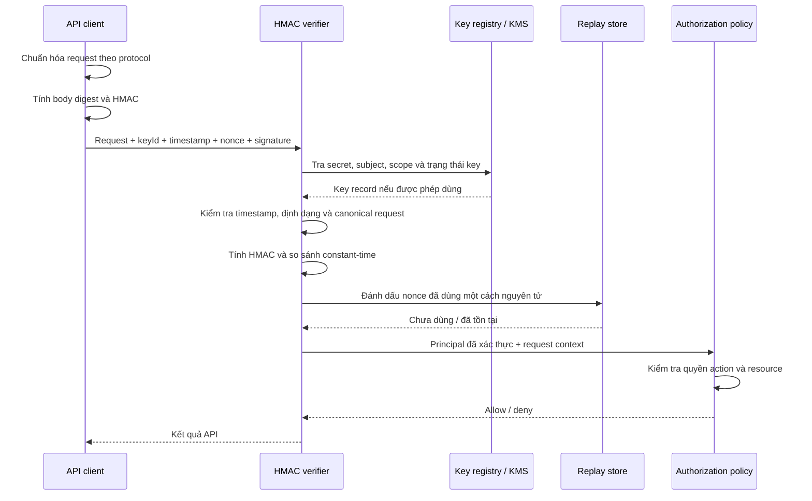

# Signature verification — Xác minh chữ ký HMAC của request

Trong xác thực request bằng HMAC, client và server chia sẻ một khóa bí mật. Client tính **Message Authentication Code (MAC)** trên nội dung request theo một quy tắc chuẩn hóa đã thống nhất, rồi gửi MAC cùng request. Server dựng lại đúng thông điệp được ký, tính HMAC bằng khóa tương ứng và so sánh với chữ ký nhận được. Nếu MAC khớp, server có bằng chứng rằng request được tạo bởi một bên biết khóa bí mật và các thành phần đã ký không bị thay đổi trên đường truyền.

Ví dụ, service `inventory-agent` gọi API `warehouse` để cập nhật số lượng hàng. Request có method `POST`, path, query, timestamp, nonce và body. Nếu chỉ ký body, kẻ tấn công có thể đổi path từ `/inventory/read` sang `/inventory/delete` mà chữ ký vẫn hợp lệ. Nếu ký cả request nhưng không chống replay, một request hợp lệ có thể bị gửi lại nhiều lần. Vì vậy, xác minh chữ ký cần kiểm tra **đúng khóa, đúng canonical request, đúng ngữ cảnh, tính mới và trạng thái credential**.

Trong module `SECURITY_AUTHENTICATION_FUNDAMENTALS`, bài học này kết nối HMAC request authentication với credential, danh tính workload/client, token, phiên và ranh giới tin cậy. Người học cần biết cách xác minh chữ ký, tránh lỗi canonicalization, chống replay, bảo vệ khóa, xoay vòng và thu hồi credential, đồng thời phân biệt xác thực request với phân quyền nghiệp vụ.

## 1. HMAC chứng minh điều gì?

**HMAC (Hash-based Message Authentication Code)** là cơ chế tạo MAC dựa trên hàm băm mật mã và khóa bí mật. Với HMAC-SHA-256, hai bên cùng biết khóa `K` có thể tính:

\[
\operatorname{MAC} = \operatorname{HMAC\text{-}SHA256}(K, M)
\]

Trong đó `M` là thông điệp được ký, thường là biểu diễn canonical của request. Server tính lại MAC và so sánh với giá trị client gửi.

| Thuộc tính | HMAC cung cấp? | Giải thích |
| --- | --- | --- |
| Xác thực bên biết shared secret | Có, trong phạm vi quản lý khóa | Request hợp lệ cho thấy bên tạo MAC có thể truy cập khóa được cấp |
| Toàn vẹn thông điệp đã ký | Có | Thay đổi một byte trong thông điệp đã ký làm MAC không khớp với xác suất rất cao |
| Mã hóa nội dung | Không | Người quan sát vẫn có thể đọc request nếu kênh không mã hóa; cần TLS |
| Chống replay tự động | Không | Cùng request và khóa tạo ra cùng MAC; cần timestamp, nonce và lưu trạng thái chống dùng lại |
| Chứng minh danh tính pháp lý của người dùng | Không | HMAC xác nhận quyền kiểm soát khóa, không xác minh người thật đứng sau request |
| Không thể chối bỏ (non-repudiation) | Không | Cả client và server đều có shared secret và đều có thể tạo MAC |
| Phân quyền hành động | Không | Server vẫn phải kiểm tra principal được phép thực hiện action/resource nào |

HMAC phù hợp cho service-to-service, webhook, API client hoặc thiết bị có thể bảo vệ shared secret. Nếu cần bên xác minh kiểm tra chữ ký mà không giữ khả năng tạo chữ ký, hãy cân nhắc chữ ký bất đối xứng như Ed25519 hoặc ECDSA theo chuẩn và thư viện phù hợp. Với HMAC, mọi bên giữ cùng secret đều có khả năng tạo MAC.

### Các bên trong luồng

- **Client/signer:** giữ secret và tạo MAC cho request.
- **Server/verifier:** tra key theo `keyId`, kiểm tra trạng thái và scope, tái tạo canonical request, tính MAC và so sánh.
- **Key manager:** cấp, lưu, phân phối, xoay vòng và thu hồi secret.
- **Replay store:** lưu nonce hoặc request identifier đã dùng trong khoảng thời gian chấp nhận.
- **Authorization layer:** quyết định principal đã xác thực có được phép gọi API cụ thể không.

## 2. Luồng xác minh chữ ký



Một verifier an toàn thực hiện các kiểm tra theo thứ tự hợp lý:

1. Kiểm tra kích thước, cú pháp và trường bắt buộc trước khi xử lý tốn tài nguyên.
2. Tra `keyId` trong registry; chỉ chấp nhận key đang hoạt động, đúng tenant/environment và đúng mục đích sử dụng.
3. Kiểm tra timestamp nằm trong cửa sổ thời gian cho phép và nonce đúng định dạng.
4. Dựng canonical request từ dữ liệu request mà server thực sự nhận được, theo đúng protocol.
5. Tính HMAC bằng secret phía server và so sánh MAC theo cách chống timing side-channel.
6. Chỉ sau khi MAC hợp lệ, kiểm tra/đánh dấu nonce đã dùng bằng thao tác nguyên tử để chống replay.
7. Tạo principal từ bản ghi key đã xác minh và chạy authorization cho action/resource.

Việc kiểm tra timestamp trước HMAC giúp loại request quá cũ/sai định dạng sớm; timestamp không phải bằng chứng xác thực. Server không được tạo principal hoặc thực hiện nghiệp vụ trước khi MAC và chống replay đạt.

## 3. Canonical request: phần quan trọng nhất của giao thức

HMAC chỉ xác minh chính xác những byte đã được ký. Client và server phải tạo **cùng một biểu diễn byte duy nhất** cho request. Nếu mỗi bên chuẩn hóa URL, query hoặc header khác nhau, request hợp lệ có thể bị từ chối; nghiêm trọng hơn, nếu bỏ sót trường quan trọng, attacker có thể thay đổi trường đó mà MAC vẫn khớp.

Không có một canonicalization HTTP duy nhất áp dụng cho mọi API. Client và server phải định nghĩa protocol rõ ràng, có version, quy tắc byte-level và test vectors. Ví dụ dưới đây là một thiết kế minh họa.

### 3.1. Các trường nên ràng buộc

| Thành phần | Vì sao cần ký | Quy tắc cần thống nhất |
| --- | --- | --- |
| Protocol version | Ngăn hiểu khác nhau giữa phiên bản canonicalization | Ví dụ `HMAC-SHA256-V1` |
| `keyId` | Ràng buộc MAC với credential được tra cứu | Dùng ID không bí mật, chuẩn hóa chính xác |
| HTTP method | Ngăn đổi `GET` thành `DELETE` hoặc method khác | Quy định chữ hoa ASCII, reject method ngoài policy |
| Authority/host | Ngăn chuyển request sang host/service khác | Dùng authority server xác định từ request đã được proxy xử lý đáng tin |
| Path | Ngăn đổi endpoint | Định nghĩa xử lý percent-encoding, slash, dot segment và Unicode |
| Query string | Ngăn thay tham số, giá trị hoặc thứ tự theo semantics API | Quy định duplicate parameter, sort/order, encoding và empty value |
| Selected headers | Ràng buộc content type, content encoding hoặc idempotency key | Header allowlist, lowercase tên, quy tắc trim/duplicate rõ ràng |
| Timestamp | Giới hạn tuổi request | Định dạng và đơn vị thống nhất, ví dụ Unix epoch seconds |
| Nonce/request ID | Chống dùng lại request trong cửa sổ hiệu lực | Sinh ngẫu nhiên, duy nhất theo key và được lưu chống replay |
| Body digest | Bảo vệ toàn bộ body mà server xử lý | Hash trên đúng byte representation được định nghĩa |

Ví dụ canonical string:

```text
HMAC-SHA256-V1
key-7f21
POST
api.example.com
/v1/inventory/items
location=HCM&sku=SKU-100
content-type:application/json
content-encoding:identity
1700000123
3J8f5vQn4P2r6dXw
sha256=4f8c...64-hex-characters...
```

Đây là ví dụ minh họa cấu trúc, không phải test vector mật mã. Protocol cần quy định chính xác dấu xuống dòng, encoding UTF-8, xử lý newline trong header, trường rỗng, byte cuối và cách biểu diễn digest. Tốt nhất dùng một serialization có phân tách không nhập nhằng (hoặc length-prefix cho từng trường) để tránh trường chứa newline làm thay đổi cấu trúc thông điệp.

### 3.2. Path và query string

Path/query là nguồn lỗi canonicalization phổ biến:

- `%2F` và `/` có thể có ý nghĩa khác nhau tùy server/router; không decode rồi encode lại tùy tiện.
- `%2e`, `..`, repeated slash và dot segments có thể được proxy và ứng dụng diễn giải khác nhau.
- `+` trong query có thể được hiểu là dấu cộng hoặc space tùy parser/encoding.
- Query có thể chứa key lặp như `role=user&role=admin`; framework khác nhau có thể chọn giá trị đầu, cuối hoặc danh sách.
- Thứ tự query có thể không quan trọng về mặt nghiệp vụ nhưng lại quan trọng với byte ký nếu protocol không sắp xếp.
- Unicode có thể có nhiều dạng chuẩn hóa; không tự normalize ở một bên mà không làm giống bên kia.

Chọn một quy tắc duy nhất. Một lựa chọn an toàn là ký **raw request target** theo đúng byte mà verifier nhận được sau một lớp ingress được xác định, đồng thời từ chối các dạng path/query mơ hồ mà router có thể diễn giải khác. Nếu canonicalize semantic query, phải quy định rõ parse, duplicate key, sorting và re-encoding. Proxy, gateway và application router phải thống nhất điểm canonicalization.

### 3.3. Header

Không nên ký mọi header tùy tiện. Chọn một allowlist nhỏ, ví dụ `content-type`, `content-encoding`, `idempotency-key`. Với mỗi header:

- Tên header chuyển về lowercase ASCII.
- Quy định trim optional whitespace và xử lý khoảng trắng nội bộ.
- Từ chối CR/LF và giá trị header bất hợp lệ để ngăn header injection.
- Quy định cách xử lý header lặp: reject hoặc nối theo quy tắc chuẩn; không để proxy và framework hiểu khác nhau.
- Chỉ ký header mà server kiểm soát và có ý nghĩa với hành động. Không tin `X-Forwarded-Host` hoặc header định danh nếu proxy chưa được xác thực và cấu hình rõ.

Nếu request đi qua reverse proxy, server phải xác định header/host nào là giá trị gốc đáng tin. Kẻ tấn công có thể tự gửi `X-Forwarded-Host`, `X-Original-URL` hoặc header tương tự nếu ingress không loại bỏ và ghi lại chúng. Canonicalization dựa trên header do client tự đặt có thể ký một ngữ cảnh khác với endpoint thực thi.

### 3.4. Body digest

Một cách phổ biến là tính SHA-256 trên body bytes rồi đưa digest vào canonical string:

\[
H = \operatorname{SHA256}(\text{body bytes})
\]

Nhờ vậy MAC bao phủ body mà không phải nhúng toàn bộ body vào canonical string. Server phải hash đúng byte representation mà ứng dụng sẽ xử lý. Nếu proxy giải nén, nén lại hoặc biến đổi body, hai bên phải xác định hash ở cùng một ranh giới. Với request không có body, protocol phải quy định rõ digest của chuỗi rỗng.

Không parse JSON rồi serialize lại theo mặc định để hash, vì thứ tự field, khoảng trắng, số, Unicode và escaping có thể thay đổi. Nếu muốn ký dữ liệu JSON theo semantic, phải sử dụng canonical JSON chuẩn đã thống nhất; nếu không, hash raw bytes của body đã truyền.

## 4. Key ID, danh tính và phạm vi khóa

Client gửi `keyId` để server biết phải tra secret nào. `keyId` không phải bí mật và không được xem như bằng chứng xác thực. Chỉ sau khi HMAC hợp lệ, server mới được gắn request với principal trong key registry.

Một key record nên có thông tin như:

| Trường | Mục đích |
| --- | --- |
| `keyId` | Định danh credential, không phải secret |
| `subjectId` / `clientId` | Principal mà key đại diện |
| `tenantId` / `environment` | Phạm vi tổ chức và môi trường |
| `secretReference` | Tham chiếu tới secret trong KMS/secret manager; không cần lưu plaintext ở registry |
| `state` | `ACTIVE`, `SUSPENDED`, `REVOKED`, `EXPIRED` |
| `createdAt`, `expiresAt`, `lastUsedAt` | Vòng đời và quan sát |
| `scopes` / allowed operations | Phạm vi hành động mà key có thể yêu cầu |
| `allowedAudiences` / service | Dịch vụ hoặc API được phép nhận request |
| `rotationVersion` / owner | Theo dõi thay đổi và người chịu trách nhiệm |

**Một key riêng cho mỗi client/service/environment** giúp thu hồi có chọn lọc và giới hạn thiệt hại. Không dùng chung một secret giữa staging và production hoặc giữa nhiều workload không cùng vòng đời. Nếu một secret bị lộ, key registry giúp xác định principal, scope, nơi dùng và phiên bản cần thu hồi.

HMAC xác nhận bên tạo request biết shared secret. Nếu nhiều ứng dụng cùng biết secret, server không thể phân biệt ứng dụng nào trong số đó đã tạo MAC. Muốn phân tách danh tính, phải cấp key riêng hoặc dùng cơ chế chữ ký bất đối xứng.

## 5. Chống replay: timestamp, nonce và idempotency

Một request HMAC hợp lệ có thể bị kẻ tấn công sao chép và gửi lại. MAC không tự chứa trạng thái “đã dùng”. Cần kết hợp **timestamp** và **nonce**.

### 5.1. Timestamp

Client ký timestamp, thường là Unix epoch seconds. Server chỉ chấp nhận request trong một cửa sổ nhỏ, ví dụ ±5 phút tùy độ lệch đồng hồ và độ trễ hệ thống. Cả hai bên cần đồng bộ thời gian; server không nên tự chấp nhận timestamp quá xa trong tương lai hoặc quá cũ.

Timestamp giảm thời gian attacker có thể replay nhưng không ngăn replay trong cửa sổ hợp lệ. Một request bị chặn có thể được gửi lại nhiều lần trong vài phút nếu không có nonce tracking.

### 5.2. Nonce

Nonce là giá trị ngẫu nhiên duy nhất cho mỗi request, được tạo bằng CSPRNG. Server lưu dấu nonce đã sử dụng theo `keyId` trong khoảng thời gian bao phủ cửa sổ timestamp. Sau khi MAC hợp lệ, server thực hiện thao tác **insert-if-absent** nguyên tử:

- Nếu nonce chưa tồn tại, ghi nhận và tiếp tục xử lý.
- Nếu nonce đã tồn tại, từ chối request như replay.
- Nếu hai request cùng nonce đến đồng thời, chỉ một request được phép thắng thao tác atomic insert.

Không đánh dấu nonce đã dùng trước khi xác minh MAC, nếu không attacker có thể gửi request giả với nonce của người khác để làm cạn replay store. Cũng không xử lý nghiệp vụ trước khi nonce được ghi thành công.

### 5.3. Retry và idempotency key

Chống replay có thể làm request retry hợp lệ bị từ chối. Ví dụ client không nhận được response sau khi server đã xử lý, rồi gửi lại cùng request. Cần phân biệt:

- **Nonce:** đảm bảo một bản request ký chỉ được chấp nhận một lần.
- **Idempotency key:** giúp API trả lại kết quả của cùng một thao tác nghiệp vụ khi client retry theo hợp đồng đã định nghĩa.

Nếu hỗ trợ retry, client có thể tạo request ký mới với nonce/timestamp mới nhưng cùng `Idempotency-Key`. Server lưu kết quả nghiệp vụ theo principal và idempotency key, kiểm tra body/action trùng khớp, rồi trả kết quả cũ thay vì thực hiện tác vụ lần hai. Idempotency không thay thế HMAC hoặc chống replay.

## 6. Tính HMAC và so sánh chữ ký an toàn

Với HMAC-SHA-256, MAC đầu ra dài 32 byte. Có thể truyền dạng Base64url không padding hoặc hex; protocol phải chọn một dạng duy nhất và từ chối encoding sai/canonical khác nhau. Không tự cắt MAC xuống độ dài quá ngắn. Dùng khóa ngẫu nhiên có entropy cao, ví dụ 32 byte, được tạo bằng CSPRNG.

**Không tự xây MAC bằng `SHA256(secret || message)` hoặc `SHA256(message || secret)`.** Dùng HMAC chuẩn (`HmacSHA256` trong Java JCA hoặc thư viện tương đương). HMAC đã định nghĩa cách kết hợp khóa và hàm băm.

### Ví dụ Java: tạo MAC và so sánh constant-time

```java
import javax.crypto.Mac;
import javax.crypto.SecretKey;
import java.security.MessageDigest;
import java.util.Base64;

static byte[] hmacSha256(SecretKey key, byte[] canonicalRequest)
        throws Exception {
    Mac mac = Mac.getInstance("HmacSHA256");
    mac.init(key);
    return mac.doFinal(canonicalRequest);
}

static String encodeSignature(byte[] mac) {
    return Base64.getUrlEncoder().withoutPadding().encodeToString(mac);
}

static boolean verifySignature(
        SecretKey key,
        byte[] canonicalRequest,
        String suppliedSignature) throws Exception {

    final byte[] supplied;
    try {
        supplied = Base64.getUrlDecoder().decode(suppliedSignature);
    } catch (IllegalArgumentException invalidEncoding) {
        return false;
    }

    byte[] expected = hmacSha256(key, canonicalRequest);
    if (supplied.length != expected.length) return false;

    // Tránh so sánh byte bằng vòng lặp dừng ở byte đầu tiên khác nhau.
    return MessageDigest.isEqual(expected, supplied);
}
```

Đoạn mã chỉ minh họa MAC và so sánh. Trong hệ thống thật, cần kiểm tra input length/encoding, xử lý lỗi, tra khóa từ secret manager, canonicalization chính xác và replay protection. `Mac` không nên được chia sẻ giữa các thread; tạo instance riêng cho mỗi lần tính hoặc dùng cơ chế thread-safe phù hợp. Không ghi key hoặc request signature nguyên vẹn vào log.

### 6.1. Ví dụ canonical request trong Java

Một canonicalization đơn giản có thể dùng các trường được kiểm soát và byte encoding UTF-8. Đây là **pseudocode minh họa**, vì xử lý raw path/query/header phụ thuộc framework và reverse proxy:

```java
static byte[] canonicalize(RequestData r) {
    // Mỗi trường đã được validate và chuẩn hóa theo protocol V1.
    // Không lấy host/path từ header client không đáng tin.
    String text = String.join("\n",
        "HMAC-SHA256-V1",
        r.keyId(),
        r.methodUpperAscii(),
        r.trustedAuthority(),
        r.canonicalRawPath(),
        r.canonicalQuery(),
        "content-type:" + r.canonicalContentType(),
        "content-encoding:" + r.canonicalContentEncoding(),
        r.timestampEpochSeconds(),
        r.nonce(),
        "sha256=" + r.bodySha256Hex()
    );
    return text.getBytes(java.nio.charset.StandardCharsets.UTF_8);
}
```

Không dùng `String.join` trực tiếp nếu một trường có thể chứa newline hoặc delimiter. Protocol production nên reject các ký tự không hợp lệ, encode từng trường an toàn hoặc dùng length-prefix/binary serialization có version. Cần tạo test vectors cố định để client và server cho ra cùng canonical bytes và MAC.

## 7. Pseudocode verifier hoàn chỉnh hơn

```java
VerificationResult verifyRequest(HttpRequest request) {
    // 1. Kiểm tra cú pháp và giới hạn đầu vào.
    ParsedSignature headers = parseHmacHeaders(request);
    if (headers == null || request.bodyTooLarge()) return DENY;

    // 2. Tra key và kiểm tra trạng thái/phạm vi trước khi dùng secret.
    KeyRecord key = keyRegistry.find(headers.keyId());
    if (key == null || key.state() != ACTIVE) return DENY;
    if (key.isExpired(clock.instant())) return DENY;
    if (!key.allowsAudience(request.expectedService())) return DENY;

    // 3. Kiểm tra thời gian và nonce có định dạng hợp lệ.
    Instant signedAt = parseEpochSeconds(headers.timestamp());
    if (signedAt == null || outsideAllowedWindow(signedAt, clock.instant())) {
        return DENY;
    }
    if (!isValidRandomNonce(headers.nonce())) return DENY;

    // 4. Tạo canonical bytes từ đúng request mà ứng dụng sẽ xử lý.
    byte[] body = readBoundedBodyBytes(request);
    byte[] bodyHash = sha256(body);
    byte[] canonical = canonicalizeTrustedRequest(
        request, key.id(), headers.timestamp(), headers.nonce(), bodyHash
    );

    // 5. Tính và so sánh MAC.
    byte[] expected = hmacSha256(key.secret(), canonical);
    byte[] supplied = decodeExpectedSignature(headers.signature());
    if (supplied == null || supplied.length != expected.length
            || !MessageDigest.isEqual(expected, supplied)) {
        return DENY;
    }

    // 6. Chỉ sau MAC hợp lệ mới tiêu thụ nonce; thao tác atomic.
    boolean firstUse = replayStore.putIfAbsent(
        key.id(), headers.nonce(), replayExpiry(signedAt)
    );
    if (!firstUse) return REPLAY_REJECTED;

    // 7. Dựng principal từ key record; authorization là bước riêng.
    AuthenticatedPrincipal principal = new AuthenticatedPrincipal(
        key.subjectId(), key.tenantId(), key.scopes()
    );
    if (!authorization.allows(principal, request.action(), request.resource())) {
        return FORBIDDEN;
    }

    return VERIFIED(principal);
}
```

Đây là mô hình thứ tự kiểm tra, không phải implementation hoàn chỉnh. Cần đảm bảo `readBoundedBodyBytes` không làm request body bị đọc khác với body mà business handler xử lý; có thể dùng middleware/filter để hash đúng byte stream rồi buffer có giới hạn. Replay store cần có TTL và atomic insert trên hạ tầng phân tán. Nếu replay store lỗi, API nhạy cảm nên từ chối hoặc áp dụng chính sách fail-closed đã định nghĩa, không âm thầm bỏ qua chống replay.

## 8. Những lỗi chữ ký và canonicalization thường gặp

| Lỗi | Hậu quả | Kiểm soát |
| --- | --- | --- |
| Chỉ ký body | Attacker đổi method, path, host hoặc query | Ký toàn bộ thành phần ảnh hưởng tới định tuyến và semantics |
| Client/server chuẩn hóa URL khác nhau | False reject hoặc request được diễn giải khác với request đã ký | Canonicalization versioned, test vectors và reject input mơ hồ |
| Bỏ query duplicate parameter | Router chọn giá trị khác với canonicalizer | Quy định duplicate key; thường reject hoặc canonicalize theo một rule duy nhất |
| Không ký `Host`/authority | MAC có thể được dùng ở service khác nếu key bị chia sẻ | Ràng buộc trusted authority/audience và key scope |
| Hash JSON sau parse ở một bên, raw bytes ở bên kia | MAC không khớp hoặc có cách hiểu dữ liệu khác nhau | Hash đúng byte stream hoặc dùng canonical JSON chuẩn |
| Bỏ qua `Content-Encoding` | Body được nén/giải nén khác nhau ở các lớp | Ký content encoding và định nghĩa điểm hash trong pipeline |
| So sánh MAC bằng `String.equals`/vòng lặp dừng sớm | Có thể lộ tín hiệu timing | So sánh constant-time với độ dài cố định |
| Dùng `SHA256(secret + message)` | Dùng sai primitive, có thể tạo lỗi mật mã | Dùng HMAC chuẩn từ thư viện |
| Dùng key yếu hoặc secret chung nhiều client | Brute force/compromise một client ảnh hưởng nhiều hệ thống | Secret ngẫu nhiên mạnh, key riêng theo client/environment |
| Không có timestamp/nonce | Request đã ký có thể bị phát lại | Timestamp có cửa sổ nhỏ và nonce atomic one-time |
| Đánh dấu nonce trước khi verify MAC | Attacker có thể làm cạn nonce store | Chỉ consume nonce sau MAC hợp lệ |
| Hai node replay store không đồng bộ | Cùng request có thể qua hai replica | Shared atomic store hoặc partitioning bảo đảm uniqueness |
| Key đã thu hồi vẫn được tra từ cache | Request tiếp tục được xác thực | Cache TTL/invalidation và kiểm tra trạng thái có giới hạn trễ |
| Tin `keyId` là danh tính đã xác thực | Attacker tự khai key ID | Chỉ tạo principal sau khi MAC hợp lệ |
| MAC hợp lệ được xem là đã được phép | Client gọi API ngoài scope | Authorization riêng theo action/resource/tenant |

### Reverse proxy và request smuggling

Nếu proxy và application server hiểu request framing khác nhau, có thể xảy ra request smuggling hoặc mismatch giữa phần được ký và phần được thực thi. Ví dụ, `Content-Length`, `Transfer-Encoding`, duplicate headers hoặc path rewrite có thể khiến proxy và backend xử lý các byte khác nhau. HMAC không tự khắc phục parser differential.

Các lớp ingress cần thống nhất HTTP parsing, reject request mơ hồ, giới hạn body, loại header nguy hiểm, và xác định rõ request target/body bytes mà verifier ký. Tốt nhất xác minh chữ ký tại một lớp có quyền kiểm soát chính xác representation được chuyển tới business handler; nếu gateway biến đổi request, protocol phải xác định canonicalization ở ranh giới đó.

## 9. Khóa, rotation và thu hồi

HMAC chỉ an toàn khi shared secret được quản lý tốt. Khóa nên được tạo bằng CSPRNG, có entropy cao (ví dụ 256 bit), không suy ra từ password, email, timestamp hoặc UUID không được thiết kế làm secret. Lưu khóa trong KMS/HSM/secret manager; hạn chế ai và process nào được đọc. Không commit key vào source code, image, config repo hoặc log.

### Rotation có kế hoạch

1. Tạo `keyId` mới và secret mới cho đúng client/subject.
2. Phân phối secret mới qua kênh an toàn; triển khai signer có thể dùng key mới.
3. Server tạm chấp nhận cả key cũ và mới trong một cửa sổ chuyển tiếp ngắn, có ngày kết thúc.
4. Quan sát request theo `keyId`, xác nhận traffic đã chuyển sang key mới.
5. Thu hồi key cũ, xóa khỏi cache và secret store theo policy; kiểm tra request dùng key cũ bị từ chối.

### Khi key bị lộ

Nếu nghi ngờ key bị lộ, không giữ overlap dài chỉ để tránh gián đoạn. Thu hồi key, ngăn verifier chấp nhận nó, tạo key mới qua quy trình cấp phát đã xác minh, rà soát log và request đã được ký, xác định scope bị ảnh hưởng, rồi cập nhật client. Nếu secret được dùng chung nhiều service, cần xem toàn bộ service đó là nằm trong phạm vi sự cố.

### Phân tách key và purpose

Không dùng cùng một HMAC key cho request signing, webhook signing, password reset token hoặc một giao thức khác. Dùng key riêng hoặc cơ chế key derivation có domain separation được thiết kế chuẩn. Nếu một secret bị dùng cho nhiều mục đích, lỗi hoặc compromise ở một giao thức có thể ảnh hưởng giao thức còn lại.

## 10. HMAC và TLS bổ trợ cho nhau

HMAC request signing và TLS giải quyết các lớp khác nhau:

| Thuộc tính | TLS | HMAC request signature |
| --- | --- | --- |
| Mã hóa nội dung trên kết nối | Có | Không |
| Toàn vẹn dữ liệu trên kết nối | Có | Có đối với thành phần được ký |
| Xác thực server | Có, qua chứng chỉ và hostname | Không tự xác thực server |
| Xác thực client/workload | Có thể qua mTLS | Có thể qua shared key |
| Bảo vệ request khi đi qua nhiều hop | Tùy từng TLS connection | Có thể bảo vệ thành phần đã ký nếu các hop không thay đổi representation |
| Chống replay ở tầng ứng dụng | TLS có bảo vệ record/connection; không thay thế chống replay nghiệp vụ | Cần timestamp/nonce/idempotency theo protocol |
| Thu hồi danh tính | Certificate/session/token lifecycle | Key registry và key revocation |

Nên dùng HTTPS/TLS ngay cả khi request đã có HMAC. TLS bảo vệ tính bí mật và kênh truyền; HMAC có thể cung cấp xác thực request ở tầng ứng dụng, nhất là khi request đi qua nhiều thành phần hoặc cần kiểm tra chữ ký tại gateway. HMAC không che giấu payload, key ID, timestamp, nonce hoặc metadata.

## 11. Kiểm thử và vận hành verifier

### Test vectors

Client và server nên chia sẻ bộ test vectors cố định gồm:

- Secret test không dùng trong production.
- Method, authority, raw path, query và headers cụ thể.
- Body bytes và SHA-256 digest kỳ vọng.
- Timestamp, nonce và canonical byte sequence.
- HMAC output dạng raw bytes, hex hoặc Base64url đã thống nhất.
- Các trường hợp input sai: encoding không hợp lệ, header lặp, query duplicate, newline, body rỗng, path percent-encoding và timestamp lệch.

Một test vector phải cho kết quả canonical bytes và MAC giống nhau ở mọi ngôn ngữ client/server. Kiểm thử cả trường hợp MAC sai một bit, key ID không tồn tại, key bị thu hồi, nonce lặp và request đi qua proxy rewrite.

### Ma trận kiểm thử

| Kịch bản | Kết quả mong đợi |
| --- | --- |
| Request đúng key, canonicalization, timestamp và nonce mới | MAC hợp lệ; tiếp tục authorization |
| Thay một byte trong body | MAC không khớp |
| Đổi method hoặc path sau khi ký | MAC không khớp |
| Đổi host/authority hoặc audience | Từ chối |
| Đổi query value hoặc duplicate parameter mơ hồ | Từ chối hoặc xử lý đúng quy tắc canonicalization đã định nghĩa |
| Header đã ký bị thay đổi hoặc thêm duplicate | Từ chối theo protocol |
| Signature sai encoding hoặc độ dài | Từ chối trước so sánh |
| MAC không hợp lệ | Không consume nonce và không chạy nghiệp vụ |
| Timestamp quá cũ/quá xa tương lai | Từ chối |
| Nonce đã dùng | Từ chối replay |
| Hai request cùng nonce tới hai replica đồng thời | Chỉ một request được chấp nhận |
| Replay store không khả dụng | Thực thi chính sách fail-closed cho endpoint nhạy cảm |
| Key `REVOKED` nhưng secret vẫn đúng | Từ chối |
| Key hợp lệ nhưng scope không cho phép action | Xác thực có thể thành công, authorization từ chối |
| Body bị proxy biến đổi sau khi ký | Verifier phát hiện mismatch hoặc protocol xác định đúng điểm hash |
| Request retry cùng idempotency key nhưng nonce mới | Trả kết quả đã lưu nếu body/action khớp; không thực hiện hai lần |
| Key cũ sau khi cutover rotation | Từ chối sau thời điểm kết thúc overlap |
| Log và tracing | Không chứa secret; hạn chế ghi signature/request nhạy cảm nguyên vẹn |

### Giám sát

Theo dõi số lượng MAC thất bại, key ID không tồn tại, key hết hạn/thu hồi, timestamp ngoài cửa sổ, nonce replay, lỗi canonicalization, replay-store latency, key rotation status và authorization denial. Phân biệt lỗi do client clock skew với dấu hiệu tấn công; không mở rộng cửa sổ thời gian vô hạn để khắc phục client sai đồng hồ.

Log nên có `keyId`, subject nội bộ sau khi xác thực, thời gian, endpoint, request correlation ID và loại lỗi ở mức cần thiết. Không log raw secret. Cần cân nhắc không log đầy đủ signature hoặc canonical request nếu chúng có thể bị replay trong cửa sổ hợp lệ hay chứa dữ liệu nhạy cảm.

## 12. Tình huống thực hành

Một webhook receiver dùng HMAC-SHA-256. Client ký body JSON và gửi `X-Key-Id`, `X-Signature`. Server tra secret, tính HMAC trên body rồi so sánh. Sau đó server thực hiện `POST /payments/refund`. Không có timestamp, nonce, method/path trong chữ ký; mọi client dùng chung một secret. Một reverse proxy chuẩn hóa path trước khi chuyển đến ứng dụng.

**Yêu cầu:** tìm các lỗ hổng và đề xuất thiết kế xác minh request an toàn hơn.

**Hướng giải:**

1. Chỉ ký body cho phép attacker thay đổi method/path/query hoặc chuyển chữ ký sang endpoint khác nếu body giống nhau. Ký method, trusted authority, path, query, selected headers, timestamp, nonce và body digest.
2. Không có timestamp/nonce khiến request hợp lệ có thể bị replay. Thêm timestamp cửa sổ nhỏ và nonce CSPRNG, lưu nonce nguyên tử theo key ID.
3. Dùng key riêng theo client và environment; key registry ánh xạ tới subject, tenant, scope, trạng thái và hạn.
4. Xác định canonicalization ở ranh giới proxy/application. Nếu proxy rewrite path, client và verifier phải ký cùng representation hoặc gateway xác minh trước rewrite rồi truyền principal qua kênh nội bộ tin cậy.
5. So sánh MAC constant-time, kiểm tra độ dài/encoding, giới hạn body và không xử lý nghiệp vụ trước khi verify + chống replay đạt.
6. Dùng TLS để bảo vệ nội dung và xác thực endpoint; HMAC không mã hóa body.
7. Tách xác thực và authorization: key hợp lệ không đồng nghĩa được hoàn tiền; kiểm tra scope, account, transaction và quyền của client.
8. Thêm idempotency key để xử lý retry nghiệp vụ, không tái sử dụng nonce đã ký.
9. Có quy trình rotation/revocation, giám sát key ID và ứng phó khi secret bị lộ.

## 13. Câu hỏi tự kiểm tra

1. **HMAC hợp lệ chứng minh điều gì?** Request khớp với MAC được tạo bởi bên biết shared secret và các byte đã ký không bị thay đổi; nó không chứng minh người dùng ngoài đời hay cấp quyền nghiệp vụ.
2. **Vì sao cần canonical request?** Để client và server tính MAC trên cùng một biểu diễn byte, đồng thời bao phủ method, endpoint, query, headers và body cần bảo vệ.
3. **Tại sao không chỉ ký body?** Vì attacker có thể thay method/path/host/query mà body vẫn nguyên vẹn, khiến chữ ký được dùng ở ngữ cảnh khác.
4. **Timestamp có đủ chống replay không?** Không. Nó chỉ giới hạn cửa sổ thời gian; nonce được lưu và tiêu thụ nguyên tử mới ngăn dùng lại request trong cửa sổ đó.
5. **Vì sao phải so sánh MAC constant-time?** Để giảm rò rỉ thông tin qua thời gian xử lý khi chữ ký sai; cũng cần kiểm tra độ dài và encoding trước.
6. **HMAC có thay thế TLS không?** Không. HMAC không mã hóa và không xác thực server; TLS vẫn bảo vệ kênh và hostname.
7. **Key ID có phải danh tính đã xác thực không?** Không. Nó chỉ là chỉ mục tra key; chỉ sau khi MAC hợp lệ mới được gắn principal từ key registry.
8. **Rotation HMAC cần thay đổi gì?** Cấp key ID/secret mới, chuyển signer, có overlap ngắn nếu key cũ còn an toàn, quan sát và thu hồi key cũ; khi compromise phải cắt key cũ nhanh.

**Ghi nhớ:** Xác minh chữ ký HMAC không chỉ là tính lại một digest. Verifier phải dùng **đúng secret và trạng thái key, canonicalize đúng request, so sánh MAC constant-time, chống replay bằng timestamp/nonce, rồi mới tạo principal và phân quyền**. TLS bảo vệ kênh; key lifecycle, canonicalization và replay store bảo vệ danh tính request ở tầng ứng dụng.
