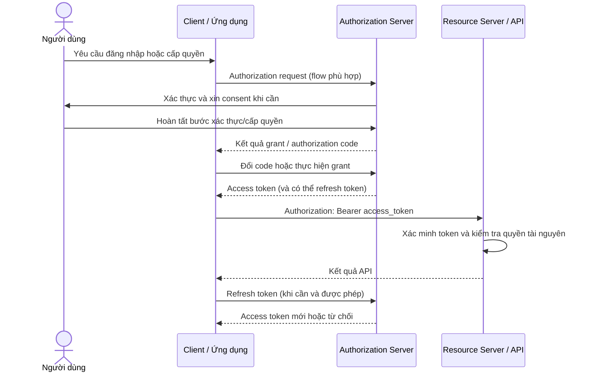
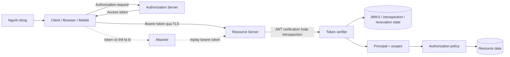

# Bearer token — Xác thực và bảo vệ token dạng bearer

Một ứng dụng di động đăng nhập thành công rồi nhận access token để gọi API. Trong các request tiếp theo, ứng dụng gửi token tới máy chủ thay vì nhập lại mật khẩu cho từng thao tác. Cách làm này tiện lợi, nhưng token dạng **bearer** có một đặc điểm quan trọng: bên nào sở hữu token hợp lệ đều có thể thử sử dụng nó trong phạm vi mà token cho phép. Nếu token bị lấy qua malware, log, XSS hoặc kho lưu trữ không an toàn, kẻ tấn công có thể truy cập như client được cấp token mà không cần biết mật khẩu ban đầu.

Bài học thuộc chương **Token authentication** của học phần **SECURITY_AUTHENTICATION_FUNDAMENTALS**. Nội dung tập trung vào bearer token trong xác thực/ủy quyền API, liên hệ với credential, mật khẩu, MFA, passkey, chứng chỉ, phiên, liên kết danh tính và khôi phục tài khoản. Người học sẽ biết mô hình hóa ranh giới tin cậy, xác minh token đúng mục đích, giảm rủi ro phishing/replay và xử lý token bị lộ.

## 1. Kết quả học tập

Sau bài này, người học có thể:

- Giải thích bearer token và vì sao việc sở hữu token có thể đủ để truy cập.
- Phân biệt access token với ID token, refresh token, session cookie, API key và reset token.
- Mô tả cách gửi bearer token qua HTTP Authorization header và các giới hạn của cơ chế.
- Xác minh token tại resource server: chữ ký/introspection, issuer, audience, thời hạn, loại token, scope và quyền tài nguyên.
- Bảo vệ token khi phát hành, lưu trữ, truyền tải, sử dụng, làm mới và thu hồi.
- Phân tích các đường lộ token như XSS, malware, log, browser storage, referrer và proxy.
- Hiểu replay, token substitution, scope confusion và giới hạn của JWT tự xác minh.
- Chọn cơ chế giảm rủi ro như token TTL ngắn, rotation, introspection, sender-constrained token (DPoP/mTLS) và authorization theo tài nguyên.

## 2. Bearer token là gì?

**Bearer token** là một credential mà bên nhận chấp nhận dựa trên việc bên gọi trình ra token hợp lệ. Trong mô hình này, token hoạt động giống một tấm vé: hệ thống kiểm tra vé còn hiệu lực, dành cho đúng dịch vụ và có quyền cần thiết; người cầm vé có thể sử dụng nó theo chính sách.

Một request API phổ biến:

```http
GET /v1/profile HTTP/1.1
Host: api.example.test
Authorization: Bearer <access-token-placeholder>
```

Chuỗi trong header là placeholder, không phải token thực. Theo chuẩn Bearer Token Usage của OAuth 2.0 (RFC 6750), cách truyền khuyến nghị là header `Authorization: Bearer` qua TLS. Không nên đặt access token trong query string vì URL dễ bị lưu ở browser history, proxy log, analytics và referrer.

### 2.1. Tại sao gọi là bearer?

Với bearer token, API không yêu cầu client ký từng request bằng một khóa riêng gắn với token. Nếu token bị sao chép, người có bản sao có thể sử dụng nó cho tới khi token hết hạn hoặc bị hệ thống từ chối/thu hồi. Chữ ký số trên JWT chỉ giúp phát hiện token bị sửa và xác minh nguồn phát hành; nó **không chứng minh người gửi request hiện tại là người nhận token ban đầu**.

Điều này khác với sender-constrained token, nơi client phải chứng minh kiểm soát khóa/chứng chỉ tương ứng ngoài việc gửi token. Hai mô hình có yêu cầu triển khai và mức bảo vệ khác nhau.

### 2.2. Bearer token chứng minh điều gì?

Bearer token chứng minh rằng bên gọi đang sở hữu một token mà hệ thống chấp nhận. Nếu token được cấp sau một lần đăng nhập, nó có thể mang thông tin về chủ thể hoặc quyền đã được cấp. Nhưng API không nên suy diễn rằng:

- Người đang gửi request chính là người dùng đã nhập mật khẩu/passkey ban đầu.
- Người dùng vừa hoàn tất MFA ở thời điểm request.
- Người gọi được truy cập mọi tài nguyên của tài khoản.
- Token còn hợp lệ đồng nghĩa tài khoản vẫn đang hoạt động hoặc quyền chưa bị thu hồi.

Resource server cần xác minh token theo hợp đồng và kiểm tra quyền cụ thể trước khi trả dữ liệu.

## 3. Phân biệt các loại token và credential

| Loại | Vai trò | Bên thường kiểm tra | Không nên dùng thay cho |
| --- | --- | --- | --- |
| **Access token** | Đại diện quyền truy cập đã được cấp cho API/resource | Resource server | ID token hoặc refresh token |
| **ID token (OIDC)** | Chứa kết quả xác thực danh tính cho OIDC client | Relying Party/client | Bearer access token gọi API |
| **Refresh token** | Xin access token mới theo phiên/ủy quyền | Authorization server | Token gửi tới API nghiệp vụ |
| **Session cookie/ID** | Tham chiếu tới phiên do ứng dụng quản lý | Backend ứng dụng | Token OAuth ở mọi kiến trúc |
| **API key** | Nhận diện hoặc xác thực client/integration theo thiết kế | API gateway/backend | Danh tính người dùng cuối mặc định |
| **Reset token** | Cho phép thực hiện hành động khôi phục giới hạn | Account/recovery service | Phiên truy cập thông thường |
| **HMAC signature** | Chứng minh request được tạo bởi bên biết shared secret | API verifier | Bearer token hoặc chữ ký số private key |
| **Client certificate** | Chứng minh client kiểm soát private key tương ứng | TLS endpoint | Quyền truy cập nghiệp vụ |

Một access token có thể là opaque hoặc JWT. Cả hai có thể được dùng theo mô hình bearer. Định dạng token và cách truyền token là hai khái niệm riêng: JWT không tự động là bearer hoặc proof-of-possession; cơ chế xác minh và ràng buộc của profile quyết định cách token được chấp nhận.

## 4. Vòng đời bearer access token trong OAuth 2.0

Trong một hệ thống OAuth 2.0, authorization server cấp access token sau khi client hoàn tất một grant/flow được phép và đáp ứng chính sách. Client dùng access token để gọi resource server.



Sơ đồ khái niệm này không thay thế việc chọn flow theo loại client. Ứng dụng web có backend, SPA, mobile và machine-to-machine có cách bảo vệ credential khác nhau. Với ứng dụng tương tác người dùng, Authorization Code Flow + PKCE là lựa chọn phổ biến; không dùng Resource Owner Password Credentials grant cho ứng dụng mới. Client credentials phù hợp workload/client và đại diện quyền của ứng dụng, không tự chứng minh người dùng cuối.

### 4.1. Access token không phải bằng chứng đăng nhập mới

Access token thường đại diện quyền được cấp cho resource server trong một khoảng thời gian. API không nên coi token còn hạn là bằng chứng người dùng vừa xác thực bằng MFA/passkey. Nếu thao tác cần xác thực đủ mới, cần kiểm tra thông tin xác thực đáng tin cậy như `auth_time`, `acr` hoặc ngữ cảnh phiên theo hợp đồng với authorization server, hoặc khởi tạo step-up riêng.

### 4.2. Audience và scope

- **Audience (`aud`):** token dành cho resource server hoặc bên nhận nào.
- **Scope:** nhóm hành động/quyền mà token được cấp, ví dụ `orders:read`.
- **Subject (`sub`):** chủ thể trong phạm vi issuer; với workload có thể là client/workload chứ không phải con người.
- **Issuer (`iss`):** authorization server phát hành token.

API chỉ nên nhận token dành cho chính nó. Token có chữ ký hợp lệ nhưng audience là API khác vẫn phải bị từ chối. Scope là điều kiện cần nhưng không thay thế kiểm tra quyền trên từng đối tượng và tenant.

## 5. Truyền bearer token an toàn

### 5.1. Dùng Authorization header qua TLS

Gửi token trong header:

```http
Authorization: Bearer <token>
```

Không gửi qua:

- Query string: `?access_token=...`
- URL path hoặc fragment được lưu/chia sẻ.
- Cookie không có chính sách bảo vệ rõ ràng nếu token được thiết kế cho header.
- Form field, analytics event, telemetry, crash report hoặc thông báo lỗi.

TLS bảo vệ token trên đường truyền giữa các điểm kết thúc TLS. Nếu TLS kết thúc tại reverse proxy/gateway, phải bảo vệ kết nối từ proxy tới backend và ngăn log/forward header không cần thiết. TLS không ngăn token bị lấy từ trình duyệt, thiết bị, process memory hoặc server log.

### 5.2. Tránh rò rỉ qua log

Gateway, web server, APM, tracing và debug middleware có thể ghi header request. Cần cấu hình redact `Authorization`, cookie và mọi trường nhạy cảm trước khi log. Không đưa token vào exception message hoặc support ticket. Nếu cần đối chiếu sự kiện, dùng token ID/`jti` hoặc fingerprint được thiết kế không thể khôi phục token.

### 5.3. CORS không phải cơ chế bảo vệ token

CORS kiểm soát cách trình duyệt cho JavaScript đọc phản hồi cross-origin; nó không phải xác thực client và không ngăn mọi request gửi tới server. Không coi cấu hình CORS là biện pháp bảo vệ access token khỏi XSS hoặc malware. API vẫn phải xác minh token và quyền ở phía server.

## 6. Lưu trữ bearer token ở client

Token phải được giữ ở nơi giảm khả năng bị đọc hoặc sử dụng trái phép.

| Môi trường | Hướng thiết kế | Rủi ro cần xét |
| --- | --- | --- |
| Backend web/BFF | Giữ access/refresh token phía server; browser dùng cookie phiên bảo vệ | CSRF, session hijacking, backend compromise |
| SPA | Cân nhắc BFF; nếu giữ token trong browser, ưu tiên thời gian tồn tại ngắn và giảm token persistent | XSS có thể đọc token trong storage hoặc dùng token qua script đang chạy |
| Mobile | Dùng OS keystore/secure storage cho credential dài hạn; tránh hardcode secret | Malware, backup, thiết bị đã root/jailbreak, crash log |
| Server-to-server | Secret manager/KMS, workload identity và quyền tối thiểu | Lộ CI/CD, container image, IAM quá rộng |

### 6.1. localStorage và sessionStorage

JavaScript cùng origin có thể đọc dữ liệu trong `localStorage` và `sessionStorage`. Nếu ứng dụng có XSS, mã độc có thể trích xuất bearer token. `sessionStorage` có thời gian tồn tại theo tab/session nhưng vẫn đọc được bởi script cùng origin; nó không tự chống XSS.

Không nên xem `localStorage` là kho bí mật cho access token dài hạn. Dùng BFF hoặc kiến trúc giảm token exposure khi có thể. Nếu SPA buộc giữ token, cần threat model rõ, CSP/XSS defense, dependency hygiene, token TTL ngắn và cơ chế thu hồi.

### 6.2. HttpOnly cookie và CSRF

Cookie `HttpOnly` ngăn JavaScript đọc trực tiếp cookie, nhưng trình duyệt tự động gửi cookie theo điều kiện domain/path/SameSite. Điều đó làm xuất hiện rủi ro CSRF. Cần đặt `Secure`, `HttpOnly`, `SameSite` phù hợp, chống CSRF cho thao tác thay đổi trạng thái và cân nhắc kiểm tra Origin/Referer theo kiến trúc.

Cookie phiên của BFF và bearer access token trong Authorization header có semantics khác nhau. Không chỉ đổi token sang cookie rồi cho rằng mọi rủi ro đã được giải quyết.

## 7. Xác minh bearer token ở resource server

API không được tin token chỉ vì parse được hoặc giải mã được payload. Với JWT, base64url decode không phải xác minh chữ ký. Với opaque token, cần tra cứu trạng thái qua kho tin cậy hoặc introspection endpoint đã xác thực.

### 7.1. Checklist xác minh

1. **Chọn đúng loại token:** endpoint chỉ nhận access token theo profile; không chấp nhận ID token, refresh token hoặc reset token.
2. **Xác minh nguồn phát hành:** kiểm tra issuer được cấu hình tin cậy; không lấy issuer/JWKS URL từ token hoặc input client tùy ý.
3. **Xác minh chữ ký:** với JWT, dùng khóa công khai đúng issuer, thuật toán cho phép và thư viện đáng tin; từ chối thuật toán không được phép hoặc cấu hình `none` không an toàn.
4. **Kiểm tra audience:** token phải dành cho đúng API/resource server.
5. **Kiểm tra thời hạn:** `exp`, `nbf` và các ràng buộc thời gian liên quan; chỉ chấp nhận clock skew nhỏ theo chính sách.
6. **Kiểm tra profile/claim:** token type, subject/client, scope, tenant và các claim bắt buộc của giao thức.
7. **Kiểm tra trạng thái:** introspection, denylist, session version hoặc trạng thái tài khoản nếu yêu cầu thu hồi nhanh.
8. **Kiểm tra sender constraint:** nếu token gắn với DPoP/mTLS, phải xác minh proof/chứng chỉ và quan hệ với token; không fallback thành bearer khi thiếu proof.
9. **Authorization:** kiểm tra principal có quyền thực hiện hành động trên đúng tài nguyên/tenant.

### 7.2. JWT access token minh họa

```json
{
  "iss": "https://identity.example.test",
  "sub": "user-204",
  "aud": "orders-api",
  "exp": 1900003600,
  "iat": 1900000000,
  "scope": "orders:read",
  "jti": "at-7f29"
}
```

Payload chỉ là ví dụ minh họa, không phải token dùng được. Các claim không tự đáng tin cho tới khi token được xác minh. `sub` có ý nghĩa trong phạm vi `iss`; không dùng `sub` đơn lẻ để ánh xạ danh tính giữa các IdP. `jti` có thể hỗ trợ truy vết hoặc thu hồi nếu hệ thống lưu trạng thái tương ứng; chỉ có `jti` không tự chống replay.

### 7.3. Opaque token và introspection

Opaque token không chứa claim mà API tự đọc. Resource server gọi introspection endpoint của authorization server hoặc tra cứu kho token đã tin cậy để biết token có active không, thuộc client/subject nào và có scope/audience nào. Introspection giúp phản ánh thu hồi nhanh hơn, nhưng tạo phụ thuộc vào độ sẵn sàng và bảo mật của AS; cần cache có TTL phù hợp và xử lý lỗi theo nguyên tắc fail closed cho tài nguyên nhạy cảm.

### 7.4. Pseudocode xác minh access token

```ts
async function handleOrdersRequest(req) {
  const token = readBearerHeader(req);
  if (!token) return unauthorized();

  const claims = await verifyAccessToken(token, {
    trustedIssuer: "https://identity.example.test",
    expectedAudience: "orders-api",
    allowedAlgorithms: ["RS256"],
    requiredTokenProfile: "access"
  });
  if (!claims) return unauthorized();

  if (!hasScope(claims, "orders:read")) return forbidden();

  const principal = await resolveActivePrincipal(claims.iss, claims.sub);
  if (!principal) return unauthorized();

  const order = await loadOrder(req.params.orderId);
  if (!order || !mayReadOrder(principal, order)) return notFoundOrForbidden();
  return success(order);
}
```

Đây là pseudocode, không phải API thư viện cụ thể. `verifyAccessToken` phải xác minh chữ ký/issuer/audience/time/profile; `resolveActivePrincipal` và `mayReadOrder` phải kiểm tra trạng thái danh tính và quyền tài nguyên. Không chỉ kiểm tra scope rồi trả dữ liệu theo ID do client gửi.

## 8. Rủi ro chính: token theft và replay

### 8.1. Token theft

Token có thể bị lộ qua:

- XSS hoặc dependency JavaScript bị xâm nhập.
- Infostealer/malware đọc browser storage, memory hoặc file.
- Log, trace, proxy, crash dump và hệ thống hỗ trợ.
- Query string, referrer, analytics hoặc ảnh chụp màn hình.
- Máy dùng chung, backup không bảo vệ hoặc container image.
- Kẻ tấn công chiếm backend, secret manager hoặc thiết bị phát hành token.

Khi token bị lộ, kẻ tấn công có thể sử dụng token như bearer trong phạm vi audience/scope/thời hạn. Nếu access token ngắn hạn nhưng refresh token bị lộ, kẻ tấn công có thể tiếp tục xin token mới; do đó refresh token cần được bảo vệ nghiêm ngặt hơn.

### 8.2. Replay

Nếu một bearer token còn hiệu lực bị sao chép, request mới có thể sử dụng lại token đó. Chữ ký JWT không ngăn việc này. Các cách giảm rủi ro:

- TTL ngắn, scope và audience hẹp.
- Sender-constrained token (DPoP hoặc mTLS) khi client có thể bảo vệ khóa.
- Kiểm tra trạng thái phiên/token và thu hồi khi phát hiện bất thường.
- Với thao tác một lần hoặc nhạy cảm, dùng nonce/idempotency và chống replay ở tầng nghiệp vụ.
- Không dùng cùng token cho nhiều API hoặc mục đích không liên quan.

### 8.3. DPoP và mTLS sender-constrained token

**DPoP** yêu cầu client ký một proof cho từng HTTP request bằng khóa riêng; resource server kiểm tra proof, token binding và các claim ràng buộc như method/URI/thời gian/nonce theo profile. **mTLS-bound access token** ràng buộc token với chứng chỉ client; API xác minh chứng chỉ trên kênh TLS và quan hệ `cnf` tương ứng.

Các cơ chế này giảm giá trị của token bị sao chép một mình, nhưng không loại bỏ mọi rủi ro: khóa riêng có thể bị chiếm, endpoint bị kiểm soát hoặc API xác minh sai proof. Cần bảo vệ khóa và thực thi sender constraint ở mọi resource server nhận token.

## 9. Access token, refresh token và session lifecycle

### 9.1. Access token

Access token nên có:

- Audience đúng API.
- Scope tối thiểu cần thiết.
- Thời hạn phù hợp với rủi ro và khả năng thu hồi.
- Loại token/profile rõ ràng.
- Ràng buộc client/khóa nếu cần.

Không có một TTL đúng cho mọi hệ thống. Token tồn tại quá ngắn làm tăng chi phí refresh và phụ thuộc AS; token quá dài làm tăng thời gian kẻ tấn công có thể sử dụng khi bị lộ.

### 9.2. Refresh token

Refresh token thường có quyền xin access token mới và có vòng đời dài hơn. Vì vậy:

- Chỉ gửi tới authorization server trong luồng token endpoint, không gửi tới API nghiệp vụ.
- Lưu ở backend/secure storage phù hợp; tránh log hoặc đưa vào URL.
- Dùng rotation và phát hiện reuse khi profile/AS hỗ trợ.
- Ràng buộc với client và phiên, giới hạn thời gian, revoke khi logout hoặc sự kiện rủi ro.
- Nếu phát hiện refresh token cũ bị dùng lại, có thể thu hồi cả token family/phiên theo chính sách.

### 9.3. Logout và thu hồi

Logout ở giao diện chỉ xóa token phía client chưa chắc thu hồi token ở server. Đặc biệt, JWT tự xác minh có thể tiếp tục được chấp nhận tới `exp` nếu API không tra trạng thái. Cần quyết định:

- Thu hồi refresh token và phiên ở authorization server.
- Xóa cookie/session phía ứng dụng.
- Kiểm tra session version hoặc trạng thái người dùng tại API nhạy cảm.
- Dùng introspection/denylist khi cần thu hồi access token nhanh.
- Xác định SLA từ lúc logout/reset/disable account tới khi mọi API ngừng chấp nhận token cũ.

Đừng khẳng định “đã logout nên token không còn dùng được” nếu kiến trúc không có cơ chế chứng minh điều đó.

## 10. Phòng chống lạm dụng và xử lý lỗi

API nên trả lỗi theo semantics của HTTP/OAuth:

| Tình huống | Phản hồi thường dùng | Ý nghĩa |
| --- | --- | --- |
| Không có token hoặc token không hợp lệ/hết hạn | `401 Unauthorized` và `WWW-Authenticate: Bearer` phù hợp | Cần credential hợp lệ |
| Token hợp lệ nhưng thiếu scope | `403 Forbidden`, có thể kèm `insufficient_scope` theo RFC 6750 | Đã xác thực nhưng quyền được cấp chưa đủ |
| Token sai audience hoặc sai loại | Từ chối như credential không hợp lệ | Token không dành cho resource server này |
| Tài khoản bị disable hoặc token bị revoke | Từ chối truy cập theo chính sách | Trạng thái danh tính/ủy quyền không còn hiệu lực |
| Resource không tồn tại hoặc không muốn tiết lộ | Có thể trả `404` theo chính sách | Tránh tiết lộ tồn tại tài nguyên; vẫn cần kiểm tra quyền |

Không trả token, claim nhạy cảm, key material hoặc chi tiết nội bộ trong error response. Log mã lỗi có phân loại nhưng redact credential.

### 10.1. Giới hạn tốc độ

Bearer token hợp lệ không loại bỏ nguy cơ DoS hoặc scraping. API cần rate limit theo client/principal, endpoint và tài nguyên; giới hạn request đắt đỏ; theo dõi bất thường; tránh chỉ dựa vào IP vì nhiều người dùng có thể dùng chung NAT. Rate limit không thay thế authorization.

### 10.2. Confused deputy và scope quá rộng

Nếu API nhận token của một client có scope rộng rồi dùng quyền của server để đọc tài nguyên tùy ý theo ID client gửi, nó có thể trở thành confused deputy. Cần giới hạn scope/audience, ánh xạ principal rõ ràng và kiểm tra quyền trên từng đối tượng, tenant, hành động. Không dùng role do frontend gửi hoặc claim không được issuer tin cậy xác nhận.

## 11. Mô hình hóa ranh giới tin cậy



Khi lập threat model, hãy đánh dấu:

- Nơi access token được phát hành và loại client nhận token.
- Mọi nơi token được lưu, truyền, cache, log và xóa.
- Issuer, audience, scope, subject và token profile.
- Thành phần kết thúc TLS và nơi header được forward.
- Cơ chế xác minh JWT/opaque token, key rotation và introspection.
- Cơ chế revoke, logout, refresh rotation và phát hiện replay.
- API kiểm tra quyền tài nguyên và tenant như thế nào.

Một bearer token bị lộ ở client có thể đi qua nhiều API nếu audience/scope quá rộng. Hãy giảm phạm vi tin cậy: mỗi resource server chỉ chấp nhận token dành cho nó, và quyền truy cập phải được kiểm tra ở server.

## 12. Tình huống thực tế: ứng dụng quản lý đơn hàng

Một ứng dụng web cho phép khách hàng xem đơn hàng và cập nhật địa chỉ giao hàng. Sau khi đăng nhập bằng passkey, authorization server cấp access token với audience `orders-api` và scope `orders:read orders:update`. Ứng dụng gửi token tới API qua Authorization header.

### Luồng đúng

1. Client gửi token qua HTTPS.
2. API xác minh issuer, chữ ký, audience, hạn dùng và token profile.
3. API kiểm tra scope phù hợp với endpoint.
4. API tải đơn hàng và xác minh đơn thuộc đúng chủ thể/tenant.
5. Với thay đổi nhạy cảm, API kiểm tra thêm phiên/độ mới xác thực và xác nhận nghiệp vụ.

### Luồng sai

- API chỉ giải mã JWT và đọc `sub`, không xác minh chữ ký.
- API chấp nhận token có audience của `billing-api` vì cùng issuer.
- Client gửi `userId` trong body và API tin giá trị đó để chọn đơn hàng.
- Token được ghi vào log; attacker lấy token rồi gửi request trước khi hết hạn.
- Logout chỉ xóa token trong browser, nhưng refresh token còn hiệu lực và có thể xin access token mới.

### Giảm thiệt hại

- Dùng access token audience riêng cho API và scope tối thiểu.
- Không log token; bảo vệ browser storage hoặc dùng BFF.
- TTL và refresh rotation phù hợp; revoke phiên khi có sự cố.
- Dùng DPoP/mTLS nếu yêu cầu ràng buộc token với client.
- Kiểm tra quyền theo từng đơn hàng và tenant, không tin ID do client khai báo.

## 13. Pseudocode: client gọi API và API xác minh

Client:

```ts
async function loadOrders(accessToken) {
  return fetch("https://api.example.test/v1/orders", {
    method: "GET",
    headers: {
      "Authorization": `Bearer ${accessToken}`,
      "Accept": "application/json"
    }
  });
}
```

Không log `accessToken`; ví dụ chỉ minh họa header. Nếu ứng dụng là browser SPA, cần cân nhắc BFF và nơi giữ token. Không tạo access token trực tiếp trong frontend bằng secret nhúng sẵn.

Server:

```ts
async function getOrders(request) {
  const token = parseBearerHeader(request);
  if (!token) return unauthorizedWithBearerChallenge();

  const access = await tokenVerifier.verify(token, {
    issuer: configuredIssuer,
    audience: "orders-api",
    tokenType: "access",
    allowedAlgorithms: configuredAlgorithms
  });
  if (!access) return invalidTokenResponse();

  const principal = await principalStore.resolve(access.iss, access.sub);
  if (!principal?.active) return invalidTokenResponse();
  if (!access.scopes.includes("orders:read")) return insufficientScope();

  const orders = await orderStore.findVisibleTo(principal);
  return json(orders);
}
```

Pseudocode không thay thế cấu hình verifier thực tế. Cần kiểm tra trạng thái thu hồi, sender constraint nếu có, tenant, quyền đối tượng và cách xử lý key rotation/JWKS. Không dùng thư viện tự viết để parse/verify JWT khi đã có thư viện chuẩn được duy trì.

## 14. Tiêu chí chấp nhận và kiểm thử

| Tình huống | Kết quả mong đợi |
| --- | --- |
| Token hợp lệ, đúng issuer/audience/expiry/scope | API cho phép hành động được cấp nếu quyền tài nguyên hợp lệ |
| Không có Authorization header | API trả 401 và challenge Bearer phù hợp |
| Token sai chữ ký hoặc token bị sửa | API từ chối |
| Token đúng chữ ký nhưng sai audience | API từ chối |
| ID token được gửi tới endpoint chỉ nhận access token | API từ chối |
| Token hết hạn hoặc chưa có hiệu lực | API từ chối |
| Token thiếu scope | API từ chối 403/insufficient_scope theo hợp đồng |
| Token có scope nhưng tài nguyên thuộc tenant khác | API từ chối theo authorization |
| Token đã bị revoke hoặc principal bị disable | API từ chối trong SLA đã cam kết |
| Token bị lộ trong log/analytics | Kiểm thử xác nhận không ghi credential |
| Dùng refresh token tại resource API | API từ chối |
| Token ràng buộc DPoP/mTLS nhưng thiếu proof/certificate | API từ chối, không hạ cấp sang bearer |
| Bearer token bị phát lại | Hệ thống giới hạn thiệt hại theo TTL, revoke, sender constraint và kiểm soát nghiệp vụ |
| Logout/reset/disable account | Phiên/refresh/access token bị xử lý đúng chính sách và thời gian đã công bố |

### Chỉ số vận hành

Theo dõi tỷ lệ token bị từ chối theo nguyên nhân, độ trễ xác minh, lỗi introspection/JWKS, thời gian thu hồi hiệu lực, refresh token reuse, số lần phát hiện token lộ, tỷ lệ request thiếu scope và false positive. Không ghi token thô để tạo số liệu.

## 15. Bài tập tự kiểm tra

Một nền tảng đặt lịch khám có web app và mobile app. Người dùng đăng nhập bằng passkey, sau đó nhận access token để đọc lịch và refresh token để duy trì phiên. API có ba nhóm dữ liệu: lịch cá nhân, hồ sơ xét nghiệm và cấu hình quản trị.

Hãy:

1. Chọn audience và scope cho từng API; giải thích vì sao không dùng một token quyền rộng cho tất cả.
2. Mô tả cách lưu access/refresh token trên web và mobile.
3. Liệt kê những nơi bearer token có thể bị lộ và biện pháp giảm rủi ro.
4. Thiết kế logout và thu hồi khi thiết bị bị mất; phân tích giới hạn JWT tự xác minh.
5. Giải thích khi nào DPoP hoặc mTLS-bound token phù hợp hơn bearer thuần.
6. Viết test case chứng minh API từ chối ID token, sai audience, thiếu scope và token đã thu hồi.

**Gợi ý đánh giá:** lời giải tốt phải phân biệt token với danh tính con người, nêu rõ issuer/audience/scope/expiry, mô tả cách lưu và thu hồi, kiểm tra quyền theo tài nguyên và chỉ ra bearer token bị sao chép có thể được dùng lại nếu không có biện pháp bổ sung.

---

**Ghi nhớ:** bearer token là credential dạng “ai sở hữu token hợp lệ có thể sử dụng”. Bảo vệ nó bằng **TLS, lưu trữ an toàn, không log, audience/scope tối thiểu, thời hạn phù hợp, xác minh đầy đủ ở resource server và cơ chế thu hồi**. Nếu rủi ro token theft cao, cân nhắc sender-constrained token như DPoP hoặc mTLS. Xác thực token không thay thế authorization trên từng tài nguyên.
