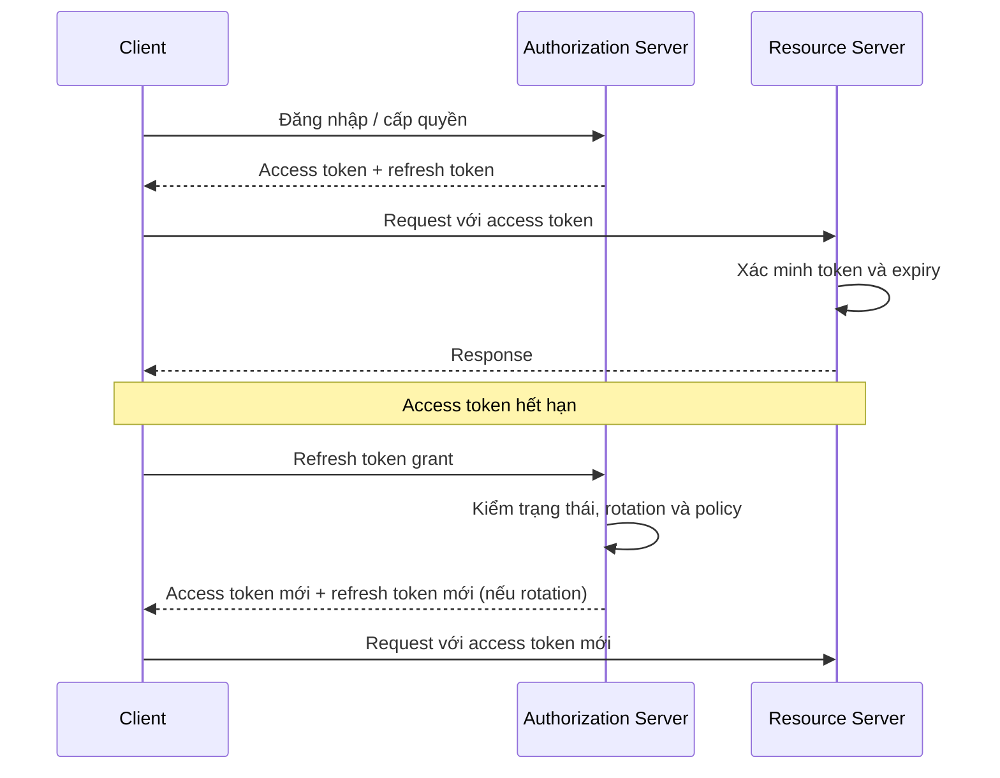
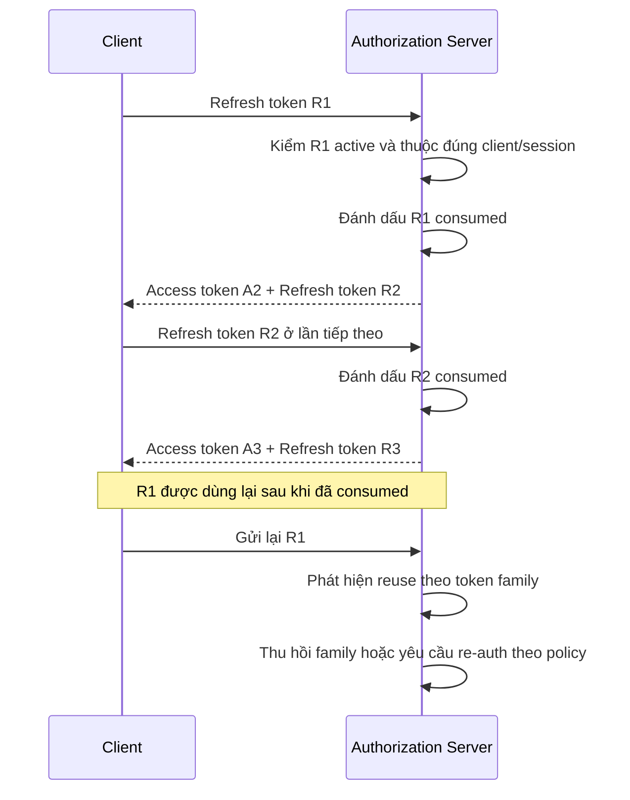

# Token expiry

**Token expiry** (thời hạn hiệu lực của token) xác định khoảng thời gian một token được chấp nhận để thực hiện mục đích mà nó được phát hành. Khi token hết hạn, resource server hoặc authorization server phải từ chối sử dụng token đó theo chính sách giao thức. Thời hạn ngắn giúp giới hạn khoảng thời gian token bị đánh cắp có thể bị lạm dụng; thời hạn dài giảm số lần cấp mới nhưng làm tăng hậu quả nếu credential bị lộ hoặc quyền của chủ thể đã thay đổi.

Trong module **SECURITY_AUTHENTICATION_FUNDAMENTALS**, token expiry liên quan trực tiếp đến access token, refresh token, ID token, phiên đăng nhập, thu hồi quyền và khôi phục tài khoản. Thiết kế tốt phải trả lời: token nào hết hạn ở đâu, ai kiểm tra, thời hạn được tính từ lúc nào, có chấp nhận sai lệch đồng hồ không, điều gì xảy ra khi refresh đồng thời và làm thế nào vô hiệu hóa quyền trước khi token tự hết hạn.

Điểm cốt lõi: **hết hạn là giới hạn thời gian của một credential; nó không tự giải quyết mọi trường hợp thu hồi, thay đổi quyền hoặc chấm dứt phiên**. Các cơ chế expiry, revocation, refresh và session management phải được thiết kế cùng nhau.

## 1. Token expiry giải quyết vấn đề gì?

Token thường là một credential được phát hành sau khi người dùng hoặc client đã được xác thực/ủy quyền. Token có thể cho phép truy cập API mà không cần gửi lại mật khẩu ở mỗi request. Nhưng nếu token tồn tại vô thời hạn, người lấy được token có thể tiếp tục sử dụng nó rất lâu, kể cả sau khi người dùng đổi mật khẩu, mất thiết bị hoặc bị đình chỉ.

Expiry tạo một giới hạn thời gian rõ ràng:

- **Giảm cửa sổ lạm dụng:** token bị đánh cắp chỉ có thể được sử dụng trong thời gian còn hiệu lực, nếu không có cơ chế khác kéo dài quyền.
- **Buộc đánh giá lại:** client cần xin token mới theo quy trình được kiểm soát.
- **Giới hạn độ cũ của quyền:** token mới có thể phản ánh policy, scope hoặc trạng thái account mới hơn.
- **Giảm phụ thuộc vào thu hồi tức thời:** token ngắn hạn có thể tự hết hiệu lực trong thời gian đã định, dù vẫn cần revocation cho các trường hợp khẩn cấp.

Expiry không tự động làm người dùng đăng xuất khỏi mọi thiết bị, xóa cookie phiên, thu hồi refresh token hoặc hủy mọi quyền đã cấp. Mỗi loại credential có vòng đời riêng.

## 2. Phân biệt các loại token và thời hạn

Không phải mọi token đều có cùng vai trò. Một lỗi phổ biến là đặt cùng một thời hạn cho tất cả hoặc dùng token dành cho mục đích này ở nơi khác.

| Loại token | Mục đích | Ai thường kiểm tra? | Lưu ý về expiry |
| --- | --- | --- | --- |
| **Access token** | Trình bày quyền truy cập API/resource. | Resource server/API. | Thường có thời hạn tương đối ngắn; hết hạn thì client cần lấy token mới. |
| **Refresh token** | Xin access token mới mà không yêu cầu người dùng đăng nhập lại ngay. | Authorization server. | Thường có vòng đời dài hơn access token nhưng cần bảo vệ chặt, rotation và khả năng thu hồi. |
| **ID token (OIDC)** | Mang thông tin xác thực về người dùng cho OIDC client. | OIDC client/relying party. | Có expiry riêng; không dùng như access token gọi API. |
| **Session cookie/token** | Duy trì trạng thái phiên đăng nhập của ứng dụng. | Ứng dụng quản lý session. | Thời hạn cookie, idle timeout và absolute session lifetime có thể khác nhau. |
| **API key / service credential** | Xác thực client hoặc workload theo cơ chế riêng. | API gateway/resource server. | Có thể có expiry hoặc rotation policy; không mặc định có claim `exp`. |

Một người dùng có thể có session còn hoạt động nhưng access token đã hết hạn; ứng dụng có thể dùng refresh token để xin access token mới. Ngược lại, refresh token bị thu hồi có thể khiến client không xin được token mới dù access token hiện tại vẫn còn hiệu lực đến khi hết hạn hoặc bị từ chối bởi cơ chế kiểm tra khác.

### 2.1. Access token không phải session

Access token là credential dùng tại resource server. Session là trạng thái đăng nhập do ứng dụng hoặc identity provider quản lý. Chúng có thể liên kết nhưng không đồng nhất.

Ví dụ:

- Session web còn hiệu lực 8 giờ.
- Access token cho API có thời hạn 10 phút.
- Client làm mới access token khi cần bằng refresh token hoặc cơ chế BFF.
- Nếu người dùng đăng xuất, ứng dụng cần chấm dứt session và xử lý refresh token; access token đã phát hành có thể vẫn được chấp nhận tới expiry nếu resource server không kiểm tra revocation.

Các con số trên chỉ minh họa sự khác nhau, không phải giá trị khuyến nghị chung.

### 2.2. ID token không dùng để gọi API

Trong OpenID Connect, ID token cho client biết một lần xác thực đã diễn ra và mang claims về subject. Access token dành cho resource server. Việc ID token có chữ ký hợp lệ và chưa hết hạn không có nghĩa nó có đúng audience hoặc quyền để gọi API.

Mỗi loại token cần kiểm tra đúng issuer, audience, thời hạn và mục đích sử dụng. Không chấp nhận một token chỉ vì nó là JWT có chữ ký hợp lệ.

## 3. Claim thời gian trong JWT

JWT có thể chứa các registered claims liên quan đến thời gian. Chúng được biểu diễn theo **NumericDate** (số giây kể từ Unix epoch, theo quy tắc của JWT), thường được mã hóa thành số trong JSON.

| Claim | Ý nghĩa | Cách sử dụng |
| --- | --- | --- |
| `exp` | Expiration time: thời điểm sau đó token không được chấp nhận. | Resource server từ chối token khi thời điểm hiện tại đạt/vượt quá `exp`, có thể áp dụng clock-skew leeway nhỏ theo policy. |
| `iat` | Issued at: thời điểm token được phát hành. | Hỗ trợ kiểm tra tuổi token, điều tra và policy; không tự thay thế `exp`. |
| `nbf` | Not before: token không được chấp nhận trước thời điểm này. | Từ chối token khi chưa tới thời điểm hiệu lực, có thể áp dụng leeway nhỏ. |

Ví dụ payload:

```json
{
  "iss": "https://auth.example.org",
  "sub": "user-57",
  "aud": "learning-api",
  "iat": 1795320000,
  "nbf": 1795320000,
  "exp": 1795320600,
  "scope": "courses.read"
}
```

Đây là payload minh họa. Giá trị NumericDate phải được diễn giải theo đơn vị giây; không nhầm với Unix timestamp milliseconds thường gặp trong một số API JavaScript. Server phải xác minh chữ ký và các claim khác trước khi tin nội dung payload.

### 3.1. `exp` là thời điểm, không phải khoảng thời gian

Nếu token có `iat=1000` và `exp=1600`, khoảng hiệu lực danh nghĩa là 600 giây, với điều kiện các claim còn lại và policy đều hợp lệ. Server không nên tự suy ra expiry bằng cách cộng một khoảng thời gian mặc định nếu token đã mang `exp` do issuer phát hành.

Với JWT, `exp` là thời điểm mà token không còn được chấp nhận. Theo cách diễn giải thông thường, token bị từ chối khi current time lớn hơn hoặc bằng `exp`, trừ sai lệch nhỏ được cho phép trong policy. Không đặt leeway lớn để che giấu vấn đề đồng hồ.

### 3.2. Claim thời gian không chứng minh token đáng tin

Attacker có thể tự tạo JSON chứa `exp` ở tương lai. Vì vậy thứ tự kiểm tra đúng là:

1. Chọn issuer và thuật toán được tin cậy theo cấu hình.
2. Xác minh chữ ký hoặc dùng introspection theo loại token.
3. Kiểm tra issuer, audience, thời hạn và claim bắt buộc.
4. Kiểm tra scope/permission, subject, trạng thái account và policy.
5. Chỉ sau đó mới sử dụng claims làm căn cứ tạo principal hoặc cấp quyền.

Không decode JWT rồi chỉ nhìn `exp` để quyết định token hợp lệ.

## 4. Token opaque và JWT: expiry được kiểm tra ở đâu?

### 4.1. JWT tự chứa

JWT access token có thể được resource server xác minh cục bộ bằng khóa công khai của issuer. Resource server kiểm chữ ký, issuer, audience, expiry và claims theo policy. Cách này giảm phụ thuộc vào một request introspection cho mỗi lần gọi API, nhưng thay đổi trạng thái/revoke có thể khó áp dụng tức thời nếu API chỉ xác minh chữ ký và thời gian.

### 4.2. Opaque token

Opaque token là chuỗi không mang claims có thể được resource server tự đọc. API có thể gọi authorization server/introspection endpoint để biết token còn active, subject, scope, audience và thông tin liên quan. Việc kiểm tra trạng thái có thể giúp áp dụng thu hồi nhanh hơn, nhưng phụ thuộc vào tính sẵn sàng, độ trễ và cache của introspection service.

| Đặc điểm | JWT tự xác minh | Opaque token với introspection |
| --- | --- | --- |
| Kiểm tra expiry | Resource server kiểm claim `exp`. | Authorization server trả trạng thái active/expiry theo giao thức. |
| Thay đổi quyền | Token đã phát hành có thể giữ claims cũ đến khi hết hạn nếu không có kiểm tra bổ sung. | Có thể phản ánh trạng thái mới qua introspection, tùy cache và triển khai. |
| Phụ thuộc mạng | Có thể xác minh cục bộ sau khi có khóa phù hợp. | Cần introspection hoặc cache trạng thái. |
| Thu hồi | Cần denylist, version check, key strategy hoặc chờ expiry. | Có thể đánh dấu inactive ở authorization server; hiệu lực phụ thuộc cache. |
| Quy mô | Giảm truy vấn trung tâm nhưng cần quản lý key/JWKS và policy nhất quán. | Tăng kiểm soát tập trung nhưng cần capacity và availability cho introspection. |

Không có lựa chọn luôn tốt hơn. Cần cân bằng latency, khả năng thu hồi, quy mô, độ sẵn sàng và mức rủi ro.

## 5. Chọn thời hạn access token

Thời hạn access token là một quyết định bảo mật và vận hành. Token càng ngắn, cửa sổ sử dụng token bị đánh cắp càng nhỏ, nhưng client phải làm mới thường xuyên hơn. Token càng dài, hệ thống giảm traffic cấp mới nhưng quyền cũ tồn tại lâu hơn sau khi có sự cố.

### 5.1. Các yếu tố cần cân nhắc

- **Giá trị tài nguyên:** API đọc dữ liệu công khai có thể có rủi ro khác API quản trị, thanh toán hoặc dữ liệu nhạy cảm.
- **Khả năng bảo vệ token:** Token bearer dễ bị sử dụng lại nếu bị lấy; token sender-constrained giảm một số rủi ro nhưng cần triển khai đúng.
- **Khả năng thu hồi:** Nếu có introspection/revocation/version check hiệu quả, policy có thể linh hoạt hơn.
- **Mức độ thay đổi quyền:** Hệ thống có quyền thay đổi thường xuyên cần giới hạn độ cũ của claims hoặc kiểm tra policy hiện tại.
- **Loại client:** Browser, mobile, backend service và workload có khả năng lưu giữ/refresh token khác nhau.
- **Tính sẵn sàng:** Authorization server hoặc introspection service không nên trở thành điểm lỗi gây mất khả năng truy cập ngoài dự kiến.
- **Trải nghiệm:** Người dùng không nên bị yêu cầu đăng nhập lại liên tục nếu có refresh/session được bảo vệ hợp lý.

Không có con số expiry duy nhất phù hợp mọi hệ thống. Hãy đặt mục tiêu theo threat model, đo tần suất refresh và đánh giá hậu quả của token bị lộ.

### 5.2. Access token ngắn hạn và refresh token dài hơn

Một mô hình phổ biến là access token có thời hạn ngắn hơn, refresh token được bảo vệ tốt hơn và chỉ dùng tại authorization server. Khi access token hết hạn, client gửi refresh token để xin access token mới; resource server không chấp nhận refresh token như quyền gọi API.



Refresh token có giá trị cao vì nó có thể tạo ra nhiều access token. Cần lưu giữ an toàn, giới hạn client, rotation hoặc sender-constraining khi phù hợp, phát hiện reuse và thu hồi khi có dấu hiệu compromise.

## 6. Refresh token rotation và phát hiện reuse

Với refresh token rotation, mỗi lần sử dụng refresh token hợp lệ, authorization server cấp refresh token mới và vô hiệu hóa token cũ theo chính sách. Nếu token cũ bị dùng lại sau khi đã rotation, đây có thể là dấu hiệu token đã bị sao chép.

### 6.1. Luồng rotation cơ bản



Việc xử lý reuse cần cân nhắc giao thức, khả năng đồng thời và client retry. Không thể chỉ nhìn một request trùng rồi luôn kết luận attacker, vì client có thể gửi refresh đồng thời từ nhiều tab/device hoặc retry sau timeout.

### 6.2. Race condition khi refresh đồng thời

Giả sử hai tab cùng dùng R1 gần như đồng thời. Server nhận request thứ nhất, tiêu thụ R1 và phát R2. Request thứ hai đến sau có thể bị coi là reuse. Nếu server thu hồi toàn bộ family ngay, người dùng hợp lệ có thể bị đăng xuất.

Giải pháp phụ thuộc thiết kế:

- Client điều phối refresh bằng một cơ chế single-flight/lock để một thời điểm chỉ có một refresh request cho session.
- Server thực hiện rotation nguyên tử trong transaction, bảo đảm cùng một token không thể tạo hai nhánh token mới ngoài policy.
- Nếu cần retry tolerance, định nghĩa cửa sổ hoặc cơ chế idempotent có ràng buộc chặt; không chấp nhận token cũ vô thời hạn.
- Ghi nhận token family, client/session và sự kiện rotation để phát hiện reuse bất thường.
- Khi có bằng chứng compromise, thu hồi family và yêu cầu xác thực lại.

Không lưu refresh token dạng rõ trong log. Nếu cần quản lý trạng thái, lưu verifier/hash phù hợp và metadata cần thiết.

## 7. Session expiry: idle timeout và absolute lifetime

Phiên ứng dụng thường có hai giới hạn khác nhau:

- **Idle timeout:** phiên hết hiệu lực sau một khoảng không có hoạt động phù hợp.
- **Absolute lifetime:** phiên hết hiệu lực sau tổng thời gian tối đa kể từ lúc tạo, kể cả khi người dùng vẫn hoạt động.

Nếu chỉ dùng sliding expiration, mỗi request có thể gia hạn phiên và một session bị đánh cắp có thể tồn tại rất lâu. Absolute lifetime giới hạn tổng tuổi của phiên. Với hành động nhạy cảm, ứng dụng có thể yêu cầu re-authentication hoặc step-up dù session vẫn còn hiệu lực.

Ví dụ chính sách minh họa:

| Loại session | Idle timeout | Absolute lifetime | Yêu cầu bổ sung |
| --- | --- | --- | --- |
| Người dùng phổ thông | Theo mức rủi ro và UX | Có giới hạn tối đa | Bảo vệ cookie, revoke khi logout. |
| Quản trị viên | Ngắn hơn theo policy | Ngắn hơn hoặc có step-up định kỳ | MFA phishing-resistant, xác thực lại cho thao tác nhạy cảm. |
| Workload/service | Theo credential và workload policy | Gắn với vòng đời workload | Token ngắn hạn, rotation và workload identity. |

Không áp dụng cùng một thời hạn cho mọi phiên. Các giá trị phải dựa trên threat model, loại dữ liệu và yêu cầu vận hành.

### 7.1. Cookie expiry khác server-side session expiry

Cookie có thuộc tính `Expires` hoặc `Max-Age` để trình duyệt biết khi nào ngừng gửi cookie. Server vẫn cần kiểm tra session record và trạng thái session. Xóa cookie ở trình duyệt không đảm bảo session server đã bị thu hồi; ngược lại, server có thể đã thu hồi session trong khi cookie còn lưu.

Đối với cookie session, cân nhắc `Secure`, `HttpOnly`, `SameSite`, domain/path hẹp và chống CSRF phù hợp. Không đặt access/refresh token trong cookie mà không đánh giá CSRF, XSS và kiến trúc BFF. Cookie chỉ là phương tiện mang session identifier, không phải cơ chế expiry hoàn chỉnh.

## 8. Expiry không giống revocation

**Expiry** là thời điểm credential tự hết hiệu lực theo thời gian. **Revocation** là quyết định vô hiệu hóa credential trước expiry vì lý do bảo mật hoặc nghiệp vụ.

Ví dụ cần revocation:

- Người dùng báo mất thiết bị hoặc nghi bị chiếm tài khoản.
- Nhân viên nghỉ việc hoặc bị đình chỉ.
- Refresh token bị reuse sau rotation.
- Signing key hoặc client credential bị lộ.
- Admin phát hiện token được cấp sai scope/audience.
- Người dùng đổi mật khẩu và policy yêu cầu chấm dứt phiên khác.

### 8.1. Các cách thu hồi

| Cơ chế | Cách hoạt động | Giới hạn |
| --- | --- | --- |
| **Opaque token introspection** | Resource server hỏi authorization server token còn active không. | Phụ thuộc availability và cache; trạng thái có thể chưa cập nhật tức thì. |
| **Revocation endpoint** | Client hoặc hệ thống có thẩm quyền yêu cầu thu hồi token theo giao thức. | Resource server cần có cách nhận biết trạng thái thu hồi. |
| **Denylist / revoked jti** | API kiểm tra token ID trong danh sách bị thu hồi. | Tốn lưu trữ/lookup; cần đồng bộ giữa các node. |
| **Session/token version** | So sánh version trong token/session với version hiện tại của account. | Cần truy vấn/caching trạng thái và thiết kế version đúng. |
| **Short expiry** | Giảm thời gian token cũ còn hiệu lực. | Không thu hồi tức thì; chỉ giới hạn cửa sổ. |
| **Signing key rotation** | Ngừng tin khóa đã bị compromise. | Có thể ảnh hưởng nhiều token; cần kế hoạch key rollover và trust update. |

JWT tự chứa được xác minh offline không tự biết account vừa bị khóa nếu resource server không kiểm tra thêm. Nếu yêu cầu thu hồi nhanh, cần chọn cơ chế phù hợp như introspection, denylist, version check hoặc access token ngắn hạn kết hợp session control.

### 8.2. Logout cần xử lý những gì?

Logout có thể có nhiều phạm vi:

1. Xóa cookie/session ở client.
2. Thu hồi session phía server.
3. Thu hồi refresh token hoặc token family.
4. Thu hồi token tại authorization server nếu giao thức hỗ trợ.
5. Đánh dấu thiết bị hoặc credential cần kiểm tra lại.
6. Nếu dùng single sign-on, xử lý session tại IdP và các RP liên quan theo khả năng giao thức.

Logout ở một ứng dụng không tự động đăng xuất khỏi mọi ứng dụng SSO, trừ khi có cơ chế phối hợp. Access token đã phát hành có thể vẫn hoạt động đến expiry nếu resource server không kiểm tra revocation.

## 9. Clock skew và đồng bộ thời gian

Token thường được phát hành ở một máy và xác minh ở máy khác. Đồng hồ lệch có thể khiến token bị từ chối sớm hoặc được chấp nhận lâu hơn dự kiến.

### 9.1. Nguyên nhân lệch đồng hồ

- VM/container host có clock drift.
- Máy client, authorization server và resource server đồng bộ thời gian khác nhau.
- NTP bị lỗi hoặc cấu hình sai.
- Test dùng clock giả lập không nhất quán.
- Hệ thống nhiều region có độ lệch và latency khác nhau.

### 9.2. Leeway cần nhỏ và có chủ đích

Một số thư viện cho phép clock-skew leeway khi kiểm tra `exp` và `nbf`. Leeway giúp chịu sai lệch nhỏ giữa các node, nhưng nếu đặt quá lớn, token có thể được chấp nhận sau expiry hoặc trước `nbf` lâu hơn policy mong muốn.

Nguyên tắc:

- Đồng bộ clock của issuer và resource server bằng cơ chế thời gian đáng tin.
- Chọn leeway nhỏ dựa trên số liệu drift thực tế.
- Dùng cùng policy ở các service; tránh mỗi API tự đặt một giá trị.
- Giám sát drift và cảnh báo khi vượt ngưỡng.
- Không sửa `exp` ở resource server hoặc gia hạn token chỉ để che lỗi clock.
- Dùng UTC/NumericDate cho thời điểm token; không diễn giải timestamp bằng timezone cục bộ.

### 9.3. Wall clock và monotonic clock

Token claim như `exp` là thời điểm tuyệt đối nên cần đồng hồ thực (wall clock) đồng bộ. Trong khi đó, đo elapsed time nội bộ, timeout hoặc thời lượng request nên dùng monotonic clock để tránh bước nhảy khi hệ điều hành điều chỉnh thời gian. Hai loại đồng hồ giải quyết hai bài toán khác nhau.

## 10. Thiết kế thời hạn trong hệ thống phân tán

Trong hệ thống nhiều API, gateway, cache và nhiều region, expiry phải được thực thi nhất quán.

### 10.1. Resource server tự xác minh JWT

Mỗi service cần cùng trust configuration: issuer, audience, thuật toán, JWKS/key set, leeway và yêu cầu claim. Nếu một service chấp nhận token đã hết hạn vì leeway lớn hơn, attacker có thể chọn đường gọi yếu nhất.

### 10.2. Cache token/introspection

Nếu API cache kết quả introspection hoặc trạng thái session, TTL cache phải ngắn hơn hoặc phù hợp với yêu cầu thu hồi. Cache active quá lâu có thể tiếp tục chấp nhận token đã bị revoke. Cache inactive quá lâu có thể làm người dùng hợp lệ bị từ chối sau khi token được cấp mới.

### 10.3. Key rotation khác token expiry

Signing key có thể được xoay vòng trong khi token ký bằng key cũ vẫn chưa hết hạn. Resource server cần quản lý JWKS/key rollover: tin khóa cũ trong khoảng chuyển tiếp có chủ đích, sau đó ngừng tin khi an toàn. Nếu khóa bị compromise, có thể phải loại bỏ sớm và chấp nhận tác động tới token hợp lệ còn tồn tại.

### 10.4. Tác vụ dài hơn thời hạn token

Một request bắt đầu trước expiry có thể hoàn tất sau thời điểm token hết hạn. Hệ thống phải xác định thời điểm kiểm tra authorization có hiệu lực: lúc bắt đầu request, lúc bắt đầu transaction hay tại mỗi bước quan trọng. Với stream/job dài, không nên giả định việc kiểm tra đầu tiên đủ cho toàn bộ tác vụ nếu quyền có thể bị thu hồi giữa chừng.

## 11. Xử lý token expiry ở client

Client không nên chờ API trả lỗi liên tục hoặc yêu cầu người dùng nhập mật khẩu ở mọi lần access token hết hạn.

### 11.1. Khi nhận 401 do token hết hạn

Một luồng phổ biến:

1. API trả lỗi xác thực theo hợp đồng, có thể kèm mã lỗi cho biết token hết hạn.
2. Client kiểm tra session/refresh state.
3. Nếu refresh token còn hợp lệ, client thực hiện một refresh duy nhất cho phiên.
4. Client retry request ban đầu tối đa theo policy, chỉ với request có thể retry an toàn.
5. Nếu refresh thất bại do revoked/expired/reuse, xóa trạng thái local phù hợp và yêu cầu đăng nhập lại.

Không retry vô hạn. Không gửi lại thao tác không idempotent nếu không có idempotency key hoặc cơ chế xác nhận trạng thái giao dịch.

### 11.2. Tránh refresh storm

Nếu 20 request đồng thời đều nhận 401, mỗi request không nên tự gửi refresh token. Client nên dùng single-flight/lock: một request refresh, các request khác đợi kết quả mới rồi tiếp tục. Trên nhiều tab, cần coordination phù hợp và không chia sẻ refresh token qua nơi không an toàn.

### 11.3. Lưu token an toàn theo loại client

- **Browser SPA:** Ưu tiên kiến trúc BFF khi phù hợp để giữ token phía server; tránh lưu bearer token dài hạn trong localStorage nếu có phương án an toàn hơn. Cookie cần bảo vệ CSRF và XSS theo kiến trúc.
- **Mobile:** Dùng secure storage do hệ điều hành cung cấp; bảo vệ thiết bị và xử lý backup/restore theo policy.
- **Backend service:** Dùng secret manager, workload identity hoặc token exchange; không hardcode refresh token vào source code.
- **CLI:** Dùng kho credential của hệ điều hành hoặc flow device authorization phù hợp; tránh ghi token vào file world-readable.

Expiry không bù được cho nơi lưu token không an toàn. Token ngắn hạn nhưng refresh token bị lộ vẫn có thể dẫn đến chiếm quyền kéo dài.

## 12. Pseudocode kiểm tra expiry và refresh

### 12.1. Resource server kiểm tra JWT access token

```text
validateAccessToken(token):
    claims = verifySignatureWithTrustedIssuerKey(token)
    require claims.iss == configuredIssuer
    require expectedResource in claims.aud
    require claims.exp exists

    now = trustedUtcClock()
    require now < claims.exp + configuredSmallLeeway

    if claims.nbf exists:
        require now + configuredSmallLeeway >= claims.nbf

    require tokenAlgorithmIsAllowed(token)
    require requiredScopeIsPresent(claims)
    require subjectAndTenantPolicyAllows(claims)

    return authenticatedPrincipal(claims)
```

Pseudocode chỉ minh họa. Cách áp dụng leeway cần thống nhất với thư viện và policy; điều kiện `exp` phải phản ánh đúng ngữ nghĩa thời điểm hết hạn. Thư viện xác minh JWT nên xử lý chuẩn claim thời gian, thuật toán, key selection và lỗi parsing; không tự viết cryptographic verification.

### 12.2. Authorization server xoay refresh token

```text
refreshSession(presentedRefreshToken, clientContext):
    tokenRecord = lookupRefreshTokenVerifier(presentedRefreshToken)
    require tokenRecord exists
    require tokenRecord.status == "active"
    require tokenRecord.clientId == clientContext.clientId
    require tokenRecord.expiresAt > trustedUtcClock()
    require tokenRecord.session.status == "active"

    with atomicTransaction:
        consumeExactlyOnce(tokenRecord.id)
        newRefreshToken = generateHighEntropyToken()
        storeVerifier(newRefreshToken, sameFamily, clientContext)
        newAccessToken = issueAccessToken(
            subject = tokenRecord.subject,
            audience = clientContext.allowedAudience,
            scopes = currentAllowedScopes(tokenRecord.subject)
        )
        return newAccessToken, newRefreshToken
```

Trong triển khai thực, phát hiện token đã consumed phải được phân biệt với token không tồn tại; policy reuse có thể thu hồi token family. Giao dịch phải nguyên tử để hai request đồng thời không tạo hai refresh branch trái ý muốn. Client authentication, sender-constraining, rotation, retry tolerance và logging cũng cần được xử lý.

## 13. Tình huống thực hành: token chưa hết hạn nhưng nhân viên đã nghỉ việc

**Bối cảnh:** Nhân viên An đăng nhập bằng passkey. Authorization server cấp access token có expiry sau 15 phút và refresh token dài hạn. Sau 2 phút, hệ thống nhân sự cập nhật An đã nghỉ việc. Một service chỉ xác minh chữ ký và `exp` của JWT nên vẫn chấp nhận token đến hết 15 phút. Refresh token đã bị đánh dấu revoked ở authorization server nhưng access token hiện tại chưa được thu hồi tại resource server.

**Phân tích:**

1. Passkey xác thực đúng tại thời điểm đăng nhập; thông tin xác thực ban đầu không sai.
2. Account/membership thay đổi sau khi token được cấp.
3. JWT tự chứa không tự biết trạng thái nghỉ việc nếu API không kiểm tra trạng thái hoặc revocation.
4. Refresh token bị revoke ngăn cấp token mới nhưng không tự vô hiệu access token đã phát hành.
5. Trong cửa sổ còn lại, request vẫn có thể được chấp nhận nếu resource server chỉ kiểm tra signature và expiry.

**Các phương án kiểm soát:**

- Access token có thời hạn ngắn phù hợp mức rủi ro để giới hạn cửa sổ cũ.
- Resource server kiểm tra trạng thái account/session hoặc token version cho thao tác nhạy cảm.
- Dùng introspection hoặc denylist khi cần thu hồi nhanh, cân nhắc cache TTL.
- Phát sự kiện account disable tới hệ thống session/token và các service cần cập nhật.
- Thu hồi session và refresh token; đánh giá token sender-constrained và các phiên đang mở.
- Không dựa duy nhất vào sự kiện nhân sự; có quy trình xử lý lỗi đồng bộ và audit.

**Câu hỏi:** Có nên kiểm tra trạng thái account trên mọi request? Tùy độ nhạy, độ trễ và kiến trúc. Một số API đọc ít rủi ro có thể dựa trên access token ngắn hạn; thao tác quản trị, tài chính hoặc thay đổi credential có thể cần kiểm tra trạng thái mới nhất. Chính sách phải nêu rõ khoảng thời gian chấp nhận rủi ro.

## 14. Checklist thiết kế token expiry

- [ ] Phân biệt access token, refresh token, ID token, session cookie và API key.
- [ ] Mỗi loại credential có expiry, owner, nơi kiểm tra và mục đích rõ ràng.
- [ ] Với JWT, xác minh chữ ký/issuer/audience trước khi tin `exp`, `iat`, `nbf`.
- [ ] Hiểu NumericDate là giây theo Unix epoch; tránh nhầm milliseconds.
- [ ] Chọn access token lifetime theo giá trị tài nguyên, khả năng thu hồi, loại client và UX.
- [ ] Refresh token được bảo vệ, giới hạn client, rotation/reuse detection và thu hồi.
- [ ] Xử lý refresh đồng thời, retry và token family atomically.
- [ ] Phân biệt idle timeout, absolute session lifetime, cookie expiry và access token expiry.
- [ ] Có cơ chế revocation khi mất thiết bị, nghỉ việc, đổi quyền hoặc compromise.
- [ ] Nếu dùng JWT offline, hiểu giới hạn thu hồi trước expiry; cân nhắc introspection/version/denylist.
- [ ] Đồng bộ clock, đặt leeway nhỏ và thống nhất giữa các service.
- [ ] Kiểm soát cache TTL, key rotation và nhiều region.
- [ ] Client có single-flight refresh, giới hạn retry và idempotency cho request phù hợp.
- [ ] Lưu token trong nơi phù hợp với browser/mobile/backend; không ghi token vào log.
- [ ] Kiểm thử expiry, nbf, clock skew, revoked token, refresh reuse, race condition và logout nhiều thiết bị.

## 15. Câu hỏi tự kiểm tra

**1. Access token hết hạn có đồng nghĩa session đăng nhập hết hạn không?**  
Không. Access token và session có thể có vòng đời riêng. Ứng dụng có thể refresh access token khi session và refresh credential còn hợp lệ.

**2. JWT có `exp` ở tương lai có đủ để chấp nhận không?**  
Không. Phải xác minh chữ ký, issuer, audience, thuật toán, thời hạn và claims/policy cần thiết. Payload tự khai không đáng tin.

**3. Refresh token có được gửi tới resource server để gọi API không?**  
Không. Refresh token được trình bày cho authorization server để xin access token mới, không phải quyền gọi API.

**4. Revoked refresh token có tự làm access token hiện tại mất hiệu lực không?**  
Không nhất thiết. Access token có thể còn được chấp nhận tới expiry nếu resource server không kiểm tra revocation hoặc trạng thái khác.

**5. Vì sao access token thường ngắn hạn hơn refresh token?**  
Vì access token được gửi thường xuyên tới resource server và có thể bị lộ; thời hạn ngắn giới hạn cửa sổ lạm dụng. Refresh token cần được bảo vệ mạnh vì nó có thể tạo token mới.

**6. Clock-skew leeway lớn có tác động gì?**  
Nó kéo dài hoặc dịch chuyển cửa sổ chấp nhận token, có thể khiến token được chấp nhận lâu hơn sau expiry hoặc trước nbf. Leeway cần nhỏ, thống nhất và dựa trên drift thực tế.

**7. Vì sao refresh rotation cần xử lý race condition?**  
Nhiều tab hoặc request đồng thời có thể cùng dùng một refresh token. Nếu không điều phối và cập nhật nguyên tử, hệ thống có thể tạo nhiều nhánh token hoặc nhầm retry hợp lệ là reuse độc hại.

**8. Khi nhân viên nghỉ việc, cách nào thu hồi quyền nhanh hơn chỉ chờ JWT hết hạn?**  
Kết hợp revoke session/refresh token, introspection, denylist hoặc token-version check và phát sự kiện trạng thái account tới resource server theo mức rủi ro.

**9. Có nên gia hạn session vô hạn mỗi khi người dùng hoạt động không?**  
Không nên mặc định. Sliding/idle timeout cần đi cùng absolute lifetime và step-up/re-authentication cho hành động nhạy cảm.

**Ghi nhớ:** Token expiry giới hạn thời gian một credential được chấp nhận, nhưng không thay thế revocation, session management hay authorization. Hãy phân biệt từng loại token, kiểm tra claim thời gian đúng giao thức, bảo vệ refresh token và xử lý rotation/reuse, đồng bộ clock, cache và trạng thái account để quyền truy cập chấm dứt đúng lúc trong cả hệ thống phân tán.
