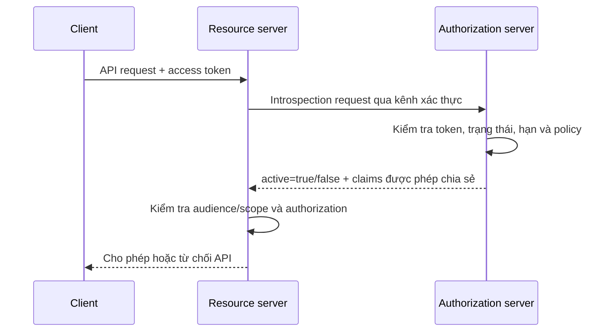
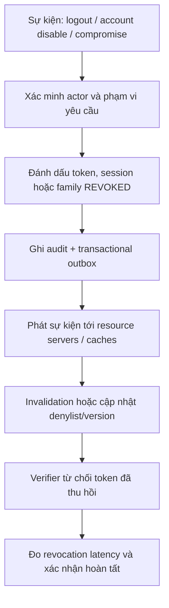
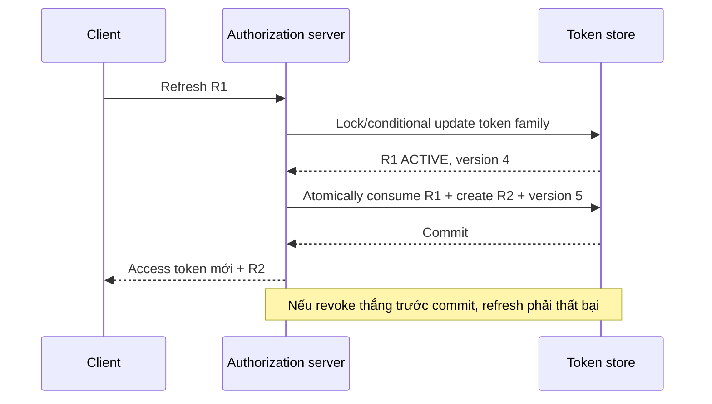
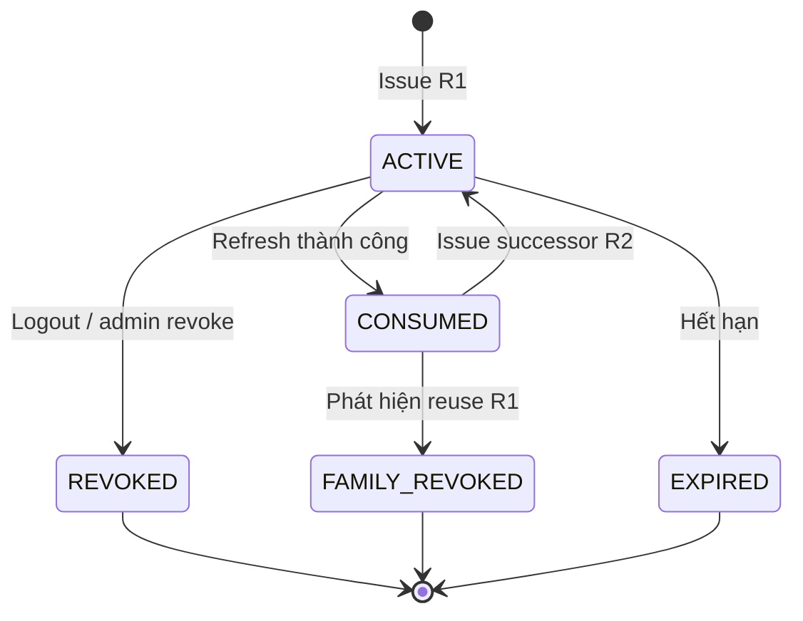

# Token revocation — Thu hồi token

Token thường được cấp sau khi người dùng hoặc workload đã xác thực. Client gửi token trong những request tiếp theo để chứng minh quyền truy cập. Nhưng token có thể bị lộ, tài khoản bị khóa, người dùng đăng xuất, quyền bị thay đổi hoặc một ứng dụng tích hợp bị xâm nhập. Khi đó, hệ thống cần **thu hồi token (token revocation)**: làm cho token không còn được chấp nhận trước thời điểm hết hạn dự kiến, tại tất cả nơi có trách nhiệm xác minh nó.

Ví dụ, An đăng nhập ứng dụng và nhận access token có thời hạn 30 phút cùng refresh token. Sau đó An báo máy tính bị mất. Nếu API chỉ kiểm tra chữ ký JWT và `exp`, access token đã phát hành vẫn có thể được sử dụng trong thời gian còn hạn. Nếu refresh token vẫn hoạt động, attacker có thể đổi nó lấy access token mới. Vì vậy, chỉ xóa cookie ở trình duyệt hoặc đánh dấu tài khoản đã logout trong một service là chưa đủ.

Trong module `SECURITY_AUTHENTICATION_FUNDAMENTALS`, thu hồi token là một phần của vòng đời credential và phiên. Thiết kế cần xác định loại token, nơi phát hành, nơi xác minh, cách cắt quyền, độ trễ lan truyền, quan hệ với refresh token/session/account và cách xử lý replay. Mục tiêu là thu hồi đúng chủ thể, đúng phạm vi, có thể kiểm chứng và không vô tình làm sống lại token đã bị vô hiệu.

## 1. Token là gì và token nào cần thu hồi?

Token là một credential mang thông tin hoặc quyền được issuer cấp. Token có thể là chuỗi opaque cần tra cứu tại server, hoặc token tự chứa như JWT có chữ ký. Không phải token nào cũng có cùng mục đích.

| Loại token | Công dụng | Điều cần lưu ý khi thu hồi |
| --- | --- | --- |
| **Access token** | Gọi API/resource server trong scope và audience được cấp | Cần làm cho API ngừng chấp nhận token đã phát hành |
| **Refresh token** | Xin access token mới mà không yêu cầu người dùng đăng nhập lại | Phải chặn việc làm mới; nếu rotation, có thể thu hồi cả token family khi phát hiện reuse |
| **ID token (OIDC)** | Mang thông tin xác thực về người dùng cho client | Không dùng ID token làm access token; logout tại RP/IdP có thể cần xử lý phiên riêng |
| **Opaque token** | Giá trị ngẫu nhiên, ý nghĩa nằm trong kho dữ liệu phía issuer | Verifier thường introspect hoặc tra trạng thái; thu hồi có thể có hiệu lực tập trung |
| **JWT access token** | Token tự chứa claim và chữ ký để API xác minh cục bộ | Chữ ký hợp lệ vẫn còn hợp lệ về mật mã sau khi bị thu hồi; cần kiểm tra trạng thái hoặc cơ chế giới hạn thời gian |
| **Password reset / email verification token** | Cho phép hoàn thành một hành động nhạy cảm | Cần ngắn hạn, một lần, ràng buộc subject và action; thu hồi khi dùng hoặc thay đổi trạng thái |
| **API token / service token** | Đại diện client hoặc workload | Thu hồi credential nguồn và token/session đã được phát hành từ credential đó theo policy |

Một token thường có các thuộc tính như `iss` (issuer), `sub` (subject), `aud` (audience), `exp` (expiration), `nbf`, `iat`, `jti`, scope/role và có thể có `client_id`, session ID hoặc authentication context. Những claim này chỉ đáng tin sau khi verifier kiểm tra chữ ký hoặc cơ chế bảo vệ tương ứng, issuer, audience, thời hạn và policy.

### Phân biệt thu hồi token với các thao tác gần nghĩa

- **Expiration:** token hết hiệu lực theo thời hạn đã cấp. Không cần sự kiện thu hồi riêng.
- **Revocation:** issuer hoặc hệ thống quản lý tuyên bố token không còn được chấp nhận trước hạn.
- **Logout:** kết thúc phiên hoặc quan hệ đăng nhập ở client/IdP/RP; có thể cần thu hồi refresh token và session phía server.
- **Account disable/delete:** trạng thái tài khoản thay đổi; các token gắn với account đó cần bị từ chối theo chính sách.
- **Signing key rotation:** thay khóa ký JWT. Đây là thay đổi trust của issuer; nó không giống thu hồi một token đơn lẻ và có thể ảnh hưởng hàng loạt token.

## 2. Vì sao thu hồi JWT khó hơn opaque token?

Với opaque token, API thường hỏi authorization server hoặc một kho trạng thái để biết token còn active hay không. Issuer có thể đánh dấu token `revoked` và các verifier thấy thay đổi khi truy vấn trạng thái cập nhật. Đổi lại, hệ thống phải vận hành endpoint/kho trạng thái, xử lý độ trễ và khả năng không kết nối được.

JWT tự chứa claim và chữ ký. API có thể xác minh cục bộ mà không gọi issuer ở mỗi request. Nhưng sau khi token được phát hành, chữ ký không thay đổi khi issuer ghi nhận token bị thu hồi. Nếu API chỉ kiểm tra chữ ký, `iss`, `aud` và `exp`, nó không tự biết sự kiện thu hồi vừa xảy ra.

| Cách xác minh | Thu hồi sớm | Chi phí/đánh đổi |
| --- | --- | --- |
| Opaque token + introspection | Có thể phản ánh trạng thái tập trung | Phụ thuộc network/authorization server; cache có thể tạo độ trễ |
| JWT kiểm tra chữ ký và hạn בלבד | Không có thu hồi tức thời theo từng token | Đơn giản và ít phụ thuộc issuer, nhưng token còn hạn tiếp tục được chấp nhận |
| JWT + denylist theo `jti` | Có thể thu hồi từng token | Cần store/cache và tra cứu trạng thái ở API |
| JWT + session/account version | Có thể thu hồi theo phiên hoặc account | Cần tra version/trạng thái; phải xử lý cache và các replica |
| Access token sống ngắn + refresh token có quản lý | Giới hạn thời gian token cũ còn dùng được; chặn token mới | Không cắt tức thời access token đã cấp nếu API không kiểm tra trạng thái |
| Sender-constrained token (mTLS/DPoP) | Giảm khả năng attacker dùng token bị lấy | Không thay thế thu hồi; yêu cầu quản lý khóa và kiểm tra proof |

Không có một phương án tốt nhất cho mọi hệ thống. Cần xác định **revocation latency** chấp nhận được: từ lúc sự kiện thu hồi được ghi nhận đến lúc mọi resource server thực sự từ chối token. API ngân hàng hoặc thao tác quản trị có thể yêu cầu độ trễ rất thấp; nội dung ít rủi ro có thể chấp nhận token sống ngắn và độ trễ lớn hơn.

## 3. Các cơ chế thu hồi phổ biến

### 3.1. Revocation endpoint cho OAuth 2.0

OAuth 2.0 Token Revocation (RFC 7009) định nghĩa endpoint để client yêu cầu authorization server thu hồi token. Client gửi token cần thu hồi và có thể kèm `token_type_hint`; server xác thực client theo policy và xử lý token. Endpoint thường trả phản hồi thành công ngay cả khi token gửi lên không hợp lệ hoặc đã bị thu hồi, để không tiết lộ trạng thái token cho bên gọi.

Ví dụ request minh họa:

```http
POST /oauth/revoke HTTP/1.1
Host: auth.example.com
Authorization: Basic <client-credentials>
Content-Type: application/x-www-form-urlencoded

token=<token-value>&token_type_hint=refresh_token
```

Đây là ví dụ giao thức, không phải token thật. Endpoint cần dùng HTTPS, xác thực client theo loại client, kiểm soát rate limit và tránh log raw token. Việc nhận request revocation không tự bảo đảm mọi API đã dừng chấp nhận access token JWT tự chứa; authorization server và resource server phải có cơ chế chia sẻ trạng thái hoặc thời hạn phù hợp.

### 3.2. Token introspection

OAuth 2.0 Token Introspection (RFC 7662) cho phép resource server hỏi authorization server về trạng thái token. Phản hồi có thể chứa `active`, `scope`, `client_id`, `sub`, `aud`, `iss`, `exp`, `iat`, `jti` và thông tin liên quan theo profile.

Luồng khái niệm:



Introspection giúp resource server không phải tự duy trì toàn bộ trạng thái token. Tuy nhiên:

- Endpoint introspection phải được bảo vệ; chỉ resource server được ủy quyền mới được hỏi.
- Không gửi token qua URL hoặc log; request introspection dùng kênh bảo vệ.
- `active=true` không tự động có nghĩa token được phép gọi mọi endpoint; resource server vẫn kiểm tra audience, scope và quyền tài nguyên.
- Cache kết quả introspection có thể làm token đã thu hồi tiếp tục được chấp nhận đến khi cache hết hạn. TTL cache phải nằm trong ngân sách revocation latency.
- Nếu authorization server không khả dụng, quyết định fail-open hay fail-closed phải được chọn theo rủi ro; thao tác nhạy cảm thường cần fail-closed.

### 3.3. Denylist theo `jti` hoặc token hash

Với JWT có claim `jti`, issuer có thể ghi nhận ID token bị thu hồi trong denylist. API xác minh chữ ký và claim như bình thường, sau đó kiểm tra `jti` có trong denylist hay không. Chỉ lưu `jti` hoặc hash/identifier cần thiết; không lưu raw bearer token nếu không cần.

Denylist entry chỉ cần tồn tại tới lúc token chắc chắn hết hạn cộng biên an toàn về clock skew. Nếu giữ vô thời hạn, kho dữ liệu sẽ tăng không cần thiết; nếu xóa quá sớm, token còn hạn có thể được chấp nhận lại.

Điều kiện quan trọng: `jti` phải duy nhất đủ mạnh theo issuer/token profile, và API phải kiểm tra đúng issuer/namespace để tránh va chạm hoặc nhầm token giữa nhiều authorization server. Không chấp nhận một `jti` từ JWT chưa xác minh chữ ký.

### 3.4. Session version hoặc account authentication version

Một cách thu hồi theo nhóm là lưu `authVersion` hoặc `sessionVersion` trong account/session store. Khi phát JWT, issuer đưa version vào claim. Khi cần logout tất cả thiết bị hoặc thay credential quan trọng, server tăng version. API so sánh version trong token với version hiện tại.

- **Account version:** thay đổi có thể vô hiệu hóa mọi token gắn với account.
- **Session version:** có thể giới hạn trong một session hoặc thiết bị nếu token mang session ID/version.
- **Credential version:** có thể gắn token với credential cụ thể nếu hệ thống cần thu hồi theo phương thức xác thực.

Nếu API chỉ đọc version từ cache cũ, token có thể tiếp tục được chấp nhận. Cần quy định nguồn version đáng tin, cách cập nhật/invalidate và thời gian tối đa dữ liệu được stale. Không dùng một claim do client tự khai làm version hiện tại.

### 3.5. Access token ngắn hạn và refresh token rotation

Một mô hình phổ biến là access token sống ngắn, refresh token được lưu ở authorization server và thay mới mỗi lần sử dụng. Khi refresh token được dùng, server phát refresh token mới và vô hiệu token cũ. Nếu token cũ được dùng lại sau khi rotation đã hoàn tất, đó có thể là dấu hiệu token family bị sao chép.

Khi phát hiện reuse, server có thể thu hồi **toàn bộ token family** liên quan tới phiên/thiết bị và yêu cầu đăng nhập lại. Cần xử lý race condition: hai request refresh hợp lệ đồng thời hoặc client retry sau timeout có thể khiến token cũ xuất hiện lại. Protocol cần có quy tắc rotation, grace window hoặc đồng bộ phía client rõ ràng; không để attacker lợi dụng khoảng chuyển tiếp kéo dài.

Access token ngắn hạn giới hạn thời gian token cũ còn dùng được, nhưng **không phải thu hồi tức thời**. Nếu rủi ro yêu cầu cắt quyền ngay, cần introspection, denylist, session/account state hoặc một cơ chế khác được kiểm tra tại resource server.

## 4. Chọn phạm vi thu hồi: một token, một phiên hay cả tài khoản?

Thu hồi quá hẹp có thể để attacker tiếp tục truy cập bằng token khác. Thu hồi quá rộng có thể làm gián đoạn toàn bộ người dùng hoặc dịch vụ. Hệ thống nên lưu quan hệ giữa token và nguồn phát hành: account, client, session, refresh-token family, authentication event và credential khi cần.

| Sự kiện | Phạm vi thường cần xem xét |
| --- | --- |
| Người dùng logout một thiết bị | Session của thiết bị; refresh-token family gắn với session; access token liên quan theo policy |
| Logout tất cả thiết bị | Tất cả session và refresh token của account; access token còn hạn theo cơ chế thu hồi |
| Refresh token bị reuse | Toàn bộ token family hoặc session liên quan; điều tra thiết bị/client |
| Mất thiết bị hoặc nghi session hijack | Session/token trên thiết bị; có thể thu hồi toàn account nếu không xác định được phạm vi |
| Mật khẩu/passkey/MFA bị thay trái phép | Credential bị ảnh hưởng, session và token phát sinh từ trạng thái không tin cậy |
| Account bị khóa hoặc xóa | Chặn cấp token mới, thu hồi refresh token/session và từ chối access token theo chính sách account state |
| Client application bị compromise | Token của client, refresh token, client secret/certificate và các grant liên quan |
| Workload certificate bị compromise | Credential workload và token được cấp dựa trên nó; các quyền và kết nối đang hoạt động |

Không phải mọi thay đổi mật khẩu đều bắt buộc logout tất cả phiên trong mọi sản phẩm; đó là quyết định policy dựa trên rủi ro. Nhưng khi có dấu hiệu chiếm quyền, nên ưu tiên bảo vệ chủ thể và thu hồi các phiên không còn đáng tin.

## 5. Luồng thu hồi end-to-end

Một quy trình thu hồi an toàn cần xác minh actor, ghi trạng thái có tính nhất quán, lan truyền tới verifier và có thể kiểm tra kết quả.



### Bước 1 — Xác minh yêu cầu thu hồi

Yêu cầu có thể đến từ người dùng, quản trị viên, hệ thống phát hiện rủi ro hoặc service quản lý vòng đời. Server phải xác định actor và quyền trên phạm vi cần thu hồi. Ví dụ, người dùng chỉ được logout account của họ; quản trị viên tenant A không được thu hồi token của tenant B nếu không có quyền.

Nếu yêu cầu dựa trên token gửi kèm, không ghi token vào log. Token phải được xác minh hoặc tra cứu theo quy trình; không dùng `sub` hoặc `jti` từ token chưa kiểm chứng để thu hồi tài khoản khác.

### Bước 2 — Cập nhật trạng thái tại nguồn có thẩm quyền

Đánh dấu token/session/family/account state trong kho dữ liệu của issuer. Dùng transaction hoặc cập nhật có điều kiện để hai thao tác logout/refresh/rotation chạy đồng thời không làm token đã thu hồi sống lại. Ghi actor, lý do, phạm vi, thời điểm và correlation ID vào audit.

### Bước 3 — Phát sự kiện và đồng bộ verifier

Nếu nhiều resource server có cache hoặc denylist riêng, phát sự kiện thu hồi qua transactional outbox hoặc cơ chế tin cậy tương đương. Consumer phải idempotent, xử lý retry và phát hiện event bị trễ. Không đánh dấu thu hồi hoàn tất chỉ vì một message đã được enqueue.

### Bước 4 — Kiểm chứng khả năng từ chối

Kiểm tra token bị thu hồi trên các resource server/region/replica có liên quan. Theo dõi cache, introspection, connection pool và session store. Xác nhận token cũ bị từ chối, refresh token không thể tạo token mới và request nhạy cảm không được xử lý.

### Bước 5 — Dọn dữ liệu và thông báo

Xóa hoặc hết hạn cookie phía client như bước UX, dọn token/secret theo retention policy, thông báo cho người dùng khi phù hợp và cung cấp hướng recovery. Không xóa audit cần thiết để điều tra hoặc làm mất thông tin về credential đã bị thu hồi.

## 6. Race condition giữa refresh và revoke

Một lỗi thực tế xảy ra khi refresh token và yêu cầu thu hồi đến gần như đồng thời:

1. Refresh handler đọc token `R1` và thấy `ACTIVE`.
2. Người dùng logout; revoke handler đánh dấu `R1` và token family là `REVOKED`.
3. Refresh handler tiếp tục tạo `R2` dựa trên trạng thái đã đọc cũ.
4. Attacker hoặc client vẫn dùng được `R2` dù phiên đã logout.

Để tránh, cập nhật trạng thái và phát token mới phải được bảo vệ bằng transaction/optimistic locking hoặc cơ chế atomic theo token family. Refresh handler phải kiểm tra lại trạng thái trong cùng ranh giới commit; nếu family đã bị thu hồi, không phát token mới. Event phát ra sau commit thông qua outbox để verifier nhận được trạng thái mới.



Sơ đồ mô tả transaction lý tưởng. Thực tế có thể dùng lock theo family, compare-and-swap version hoặc lưu trạng thái tiêu thụ token với unique constraint. Điều quan trọng là không có đường code phát refresh token mới từ một bản ghi đã bị thu hồi.

## 7. Token family và phát hiện refresh token reuse

Với refresh token rotation, mỗi token mới có quan hệ với token trước đó và cùng thuộc một **token family**. Khi `R1` được đổi thành `R2`, server đánh dấu `R1` đã dùng. Nếu `R1` xuất hiện lần nữa sau khi đã tiêu thụ, có thể có hai bên đang giữ cùng token: client hợp lệ và attacker đã sao chép token.

Một mô hình trạng thái:



Sơ đồ là mô hình khái niệm; thực tế mỗi token có bản ghi riêng và family có trạng thái chung. Khi reuse được xác nhận theo policy, thu hồi family và các token con, đồng thời ghi nhận tín hiệu rủi ro. Không nên tự động khóa toàn bộ account chỉ dựa vào một lỗi mạng hoặc retry không rõ ràng; client và server cần có quy tắc đồng bộ, idempotency và xử lý concurrency.

### Lưu refresh token an toàn

- Dùng token ngẫu nhiên đủ mạnh; lưu hash/verifier hoặc dạng bảo vệ phù hợp thay vì raw token nếu kiến trúc cho phép.
- Ràng buộc token với `client_id`, subject, session/family, scope, audience và thời hạn.
- Rotation khi sử dụng; đánh dấu token cũ đã tiêu thụ một cách atomic.
- Hạn chế số lần và tốc độ refresh; theo dõi reuse, thiết bị và hành vi bất thường.
- Thu hồi family khi logout, account disable hoặc nghi token bị lộ theo policy.
- Không ghi refresh token vào URL, log, analytics hoặc crash report.

## 8. Cache, phân tán và độ trễ thu hồi

Một hệ thống có nhiều API gateway, microservice, region hoặc CDN có thể lưu trạng thái token ở nhiều nơi. Việc issuer đánh dấu token `REVOKED` không đảm bảo mọi verifier biết ngay.

### Nguồn gây stale state

- Introspection response được cache quá lâu.
- Denylist được replicate bất đồng bộ hoặc consumer bị dừng.
- Account/session version được cache trong process và không invalidate.
- Resource server kiểm tra JWT cục bộ nhưng không tra trạng thái account.
- Proxy giữ session/principal đã xác thực trong connection hoặc request context lâu hơn dự kiến.
- Event revocation bị mất, retry không idempotent hoặc outbox chưa được xử lý.

### Thiết kế ngân sách revocation latency

Đặt một mục tiêu cụ thể, ví dụ “token bị thu hồi phải bị mọi API nhạy cảm từ chối trong tối đa 30 giây”. Đây chỉ là ví dụ; con số thực tế phụ thuộc rủi ro và hạ tầng. Sau đó phân bổ ngân sách cho:

| Thành phần | Câu hỏi cần trả lời |
| --- | --- |
| Commit nguồn | Bao lâu để trạng thái `REVOKED` được commit? |
| Event delivery | Bao lâu để các region nhận sự kiện? Có retry/dead-letter không? |
| Cache TTL | Verifier có thể dùng trạng thái cũ tối đa bao lâu? |
| Introspection | Có cache kết quả `active=true` không và trong bao lâu? |
| Connection/session | Có kết nối hoặc session đã được xác thực trước đó cần cắt không? |
| Failure mode | Nếu store/event bus/introspection lỗi, endpoint nhạy cảm có fail-closed không? |

Không thể tuyên bố thu hồi tức thời nếu thiết kế có cache stale không giới hạn. Cần đo bằng kiểm thử từ thời điểm commit revoke tới request đầu tiên bị từ chối trên mọi verifier quan trọng.

### Fail-open hay fail-closed?

Nếu API không thể kiểm tra trạng thái token, có hai lựa chọn:

- **Fail-closed:** từ chối request khi không thể xác minh trạng thái. Bảo vệ tốt hơn cho thao tác nhạy cảm, nhưng giảm availability khi authorization server hoặc store lỗi.
- **Fail-open:** tiếp tục chấp nhận token dựa trên chữ ký và thời hạn. Tăng availability nhưng token đã thu hồi có thể còn hiệu lực trong thời gian sự cố.

Có thể áp dụng theo mức rủi ro: API đọc ít nhạy cảm có policy khác với thanh toán, thay đổi MFA hoặc thao tác quản trị. Quyết định cần được ghi trong threat model và kiểm thử, không để mặc định của thư viện quyết định thay sản phẩm.

## 9. Thu hồi theo từng kiến trúc

| Kiến trúc | Cách làm phù hợp | Giới hạn |
| --- | --- | --- |
| Web app server-side session | Xóa session record, refresh token và cookie; kiểm tra session store ở request | Replica/cache cần đồng bộ; cookie client còn giữ nhưng server phải từ chối |
| OAuth opaque access token | Revocation endpoint cập nhật token store; resource server introspect | Cache introspection tạo độ trễ |
| JWT access token | Short TTL kết hợp denylist, account/session version hoặc introspection khi cần | Verify chữ ký đơn thuần không biết token đã bị revoke |
| Mobile app | Thu hồi refresh token/device session; access token sống ngắn hoặc có kiểm tra trạng thái | Token đã lưu trong secure storage có thể còn dùng tới khi API từ chối |
| BFF web architecture | Thu hồi session BFF và token server-side; xóa cookie | Cần đảm bảo backend không dùng cache token cũ |
| Service-to-service | Thu hồi workload credential, token family và mapping; rotation key/certificate khi cần | Kết nối mTLS dài hạn có thể tiếp tục tồn tại tới khi bị đóng/re-handshake |
| OIDC login | Kết thúc phiên RP và/hoặc IdP theo logout protocol; xử lý refresh token/grant | Logout ở một RP không tự động logout mọi RP nếu không có cơ chế phối hợp |

### Logout local và logout toàn hệ thống

**Local logout** kết thúc phiên tại ứng dụng hiện tại. **Global logout** có thể yêu cầu IdP, nhiều RP hoặc thiết bị khác cùng kết thúc phiên. Các giao thức như OIDC RP-Initiated Logout và Back-Channel Logout có thể hỗ trợ phối hợp, nhưng cần cấu hình và xác minh đúng `sid`/`sub`, issuer, audience và logout token. Không giả định xóa cookie ở một ứng dụng sẽ kết thúc phiên IdP hoặc các ứng dụng khác.

## 10. Rủi ro đặc biệt và những điều không nên nhầm

### 10.1. Thu hồi access token không nhất thiết thu hồi refresh token

Nếu chỉ denylist access token hiện tại, refresh token vẫn có thể xin token mới. Khi xử lý sự cố hoặc logout, phải xác định cả token family/grant/session liên quan. Ngược lại, thu hồi refresh token không tự làm access token JWT đã cấp mất hiệu lực nếu resource server không kiểm tra trạng thái.

### 10.2. Thu hồi token không giống xoay signing key

Xoay JWT signing key giúp ngừng dùng khóa ký cũ hoặc chuyển verifier sang khóa mới. Nếu verifier loại bỏ khóa cũ ngay, tất cả JWT được ký bằng khóa đó có thể bị từ chối, kể cả token hợp lệ không liên quan sự cố. Nếu verifier vẫn giữ khóa cũ trong JWKS cache, token có thể tiếp tục được chấp nhận. Đây là hoạt động trust-key lifecycle, cần rollout và cache policy riêng.

Khi signing key bị compromise, có thể cần emergency key rotation và vô hiệu trust đối với key ID (`kid`) bị ảnh hưởng. Nhưng nếu một key ký token cho nhiều subject, tác động rộng; phải xác định token nào được cấp trong thời gian compromise và xử lý theo incident response.

### 10.3. Token bị đánh cắp nhưng có sender constraint

mTLS-bound access token hoặc DPoP có thể yêu cầu client chứng minh sở hữu private key tương ứng. Kẻ chỉ lấy được chuỗi token có thể không sử dụng được nếu không có khóa. Tuy vậy, nếu endpoint/khóa client bị xâm nhập, token vẫn có thể bị dùng; thu hồi token và credential vẫn cần thiết.

### 10.4. Không để token xuất hiện trong log

Log proxy, tracing, exception, analytics và crash dump có thể làm lộ bearer token. Dùng redaction cho `Authorization`, cookie, refresh token và query parameter nhạy cảm. Audit chỉ nên ghi token identifier hoặc hash theo policy. Nếu token đã bị ghi vào log không được bảo vệ, coi nó là credential có khả năng lộ và đánh giá thu hồi.

## 11. Pseudocode Java: thu hồi token và refresh family

Ví dụ dưới đây mô tả logic phía authorization server. Đây là **pseudocode**, không phải triển khai OAuth server hoàn chỉnh.

```java
enum TokenState { ACTIVE, CONSUMED, REVOKED, EXPIRED }

void revokeSession(AuthenticatedPrincipal actor, String sessionId) {
    sessionStore.transaction(() -> {
        Session session = sessionStore.lock(sessionId);
        if (session == null) return; // Có thể trả kết quả idempotent.
        if (!policy.canRevoke(actor, session)) throw new ForbiddenException();

        sessionStore.markRevoked(sessionId, clock.instant());
        refreshTokens.revokeFamily(session.refreshFamilyId());
        outbox.append("SessionRevoked", sessionId);
        audit.recordWithoutSecrets("SESSION_REVOKED", actor.subjectId(), sessionId);
    });
}

RefreshResult rotateRefreshToken(String presentedToken) {
    // Tìm bằng hash/verifier; không log raw refresh token.
    TokenRecord old = refreshTokens.findByVerifier(hashToken(presentedToken));
    if (old == null) return DENY;

    return database.transaction(() -> {
        TokenRecord current = refreshTokens.lock(old.id());
        TokenFamily family = refreshTokens.lockFamily(current.familyId());

        if (family.state() != ACTIVE || current.state() == REVOKED
                || current.state() == EXPIRED) {
            return DENY;
        }

        if (current.state() == CONSUMED) {
            // Reuse: policy có thể revoke toàn bộ family và phát cảnh báo.
            refreshTokens.revokeFamily(family.id());
            outbox.append("RefreshTokenReuseDetected", family.id());
            audit.recordWithoutSecrets("REFRESH_REUSE", family.subjectId(), family.id());
            return REUSE_DETECTED;
        }

        if (!current.isValidAt(clock.instant())) return DENY;

        refreshTokens.markConsumed(current.id());
        String nextRawToken = secureRandomRefreshToken();
        refreshTokens.insertSuccessor(
            family.id(), hashToken(nextRawToken), ACTIVE, policy.nextExpiry()
        );
        return issueNewAccessToken(family.subjectId(), family.clientId(), nextRawToken);
    });
}
```

Các điểm phải hoàn thiện khi triển khai:

- Hash/verifier cần được thiết kế cho token ngẫu nhiên đủ entropy; không dùng hash nhanh cho mật khẩu do người dùng chọn. Token raw chỉ xuất hiện trong response cần thiết, không log hoặc lưu plaintext không cần thiết.
- Khóa theo token family và cập nhật trạng thái phải atomic; refresh handler không được phát successor sau khi family đã bị revoke.
- Xử lý retry/concurrency để request hợp lệ không tự tạo nhiều successor hoặc bị nhận nhầm là attacker reuse; quy tắc phải nhất quán ở client và server.
- `revokeFamily` phải ảnh hưởng tới việc cấp access token mới; resource server cũng cần kiểm tra trạng thái access token theo ngân sách revocation latency.
- Outbox consumer phải idempotent, retry và có giám sát; không đánh dấu hoàn tất khi event chưa tới verifier cần thiết.
- Audit không ghi token, cookie, secret hoặc authorization header nguyên vẹn.

## 12. Ma trận kiểm thử thu hồi token

| Kịch bản | Kết quả mong đợi |
| --- | --- |
| Token active, đúng issuer/audience/scope và chưa hết hạn | Được chấp nhận nếu authorization cho phép |
| Token đã revoke nhưng JWT signature vẫn hợp lệ | Resource server từ chối theo cơ chế revoke/state |
| Refresh token đã revoke được dùng lại | Không cấp access token mới |
| Refresh token cũ đã consume xuất hiện lại | Phát hiện reuse và xử lý family theo policy |
| Logout một thiết bị | Session/token family của thiết bị bị thu hồi; thiết bị khác giữ nguyên nếu policy yêu cầu |
| Logout tất cả thiết bị | Các session/refresh family thuộc account bị vô hiệu; access token xử lý theo policy |
| Account bị disable/delete | Không cấp token mới và token hiện tại bị từ chối theo cam kết thu hồi |
| Introspection cache vẫn trả `active=true` sau revoke | Kiểm thử xác nhận độ trễ không vượt ngân sách đã đặt |
| Denylist replica chưa nhận event | Cảnh báo và xử lý theo consistency/fail-closed policy |
| Revoke và refresh chạy đồng thời | Không có successor được cấp sau khi revoke đã thắng commit |
| Hai refresh request cùng token chạy đồng thời | Kết quả đúng theo rotation policy; không phát hai successor hợp lệ |
| Token sai `iss`, `aud`, `exp` hoặc chữ ký | Từ chối dù chưa có bản ghi revoke |
| `jti` trùng giữa issuer khác nhau | Không gây thu hồi nhầm token của issuer khác |
| Authorization server/introspection không khả dụng | Endpoint nhạy cảm áp dụng fail-closed hoặc policy được tài liệu hóa |
| Token raw xuất hiện trong log | Redaction test phát hiện và ngăn log credential |
| Signing key bị rotate | Verifier chuyển trust đúng; không nhầm key rotation với token revocation |
| Back-channel logout token giả hoặc sai issuer | RP từ chối, không thu hồi nhầm session |

### Tình huống thực hành

Một ứng dụng web dùng JWT access token 45 phút và refresh token 30 ngày. API gateway chỉ xác minh chữ ký JWT và `exp`. Người dùng bấm logout; backend xóa refresh token trong database và xóa cookie ở trình duyệt. Sau đó một access token đã sao chép trước logout vẫn gọi API được thêm 40 phút.

**Yêu cầu:** đề xuất thiết kế để logout và xử lý mất thiết bị có hiệu lực theo thời gian thu hồi xác định.

**Hướng giải:**

1. Xác định yêu cầu revocation latency theo mức nhạy cảm API; không tuyên bố logout tức thời nếu gateway chỉ kiểm tra JWT cục bộ.
2. Dùng access token ngắn hạn hơn nếu phù hợp, nhưng hiểu đây chỉ giới hạn cửa sổ token cũ còn hiệu lực.
3. Thêm introspection, denylist `jti` hoặc session/account version cho API cần thu hồi sớm; đặt cache TTL trong ngân sách.
4. Thu hồi refresh token family và session ở nguồn có thẩm quyền; không chỉ xóa cookie client.
5. Phát event qua outbox tới gateway/region, invalidation cache và đo thời gian đến khi mọi verifier từ chối.
6. Kiểm thử token cũ sau logout, refresh sau revoke, replica nhận event trễ và tình huống introspection store lỗi.
7. Khi mất thiết bị, thu hồi phiên/refresh family trên thiết bị, kiểm tra credential nguồn, thông báo và yêu cầu recovery an toàn.

## 13. Câu hỏi tự kiểm tra

1. **Vì sao JWT đúng chữ ký vẫn có thể đã bị thu hồi?** Chữ ký chỉ chứng minh token được ký bởi issuer và chưa bị sửa; trạng thái revoke là thông tin bên ngoài JWT mà verifier phải kiểm tra riêng.
2. **Thu hồi refresh token có tự động vô hiệu access token đã cấp không?** Không nhất thiết. Access token cần TTL, introspection, denylist hoặc kiểm tra session/account state phù hợp.
3. **Opaque token và JWT khác nhau thế nào về thu hồi?** Opaque token thường tra trạng thái tập trung; JWT có thể xác minh cục bộ nên cần cơ chế bổ sung nếu muốn thu hồi trước `exp`.
4. **Refresh token reuse có thể chỉ là retry hợp lệ không?** Có thể, nếu thiết kế client/server không xử lý concurrency và timeout tốt. Cần protocol rotation rõ ràng, nhưng reuse sau khi token đã được tiêu thụ vẫn là tín hiệu rủi ro cần policy xử lý.
5. **Vì sao cache introspection có thể làm chậm thu hồi?** Vì resource server có thể tiếp tục dùng kết quả `active=true` cũ tới khi cache hết hạn hoặc được invalidation.
6. **Global logout khác local logout ở đâu?** Local logout kết thúc phiên của một ứng dụng/thiết bị; global logout cần phối hợp IdP, RP hoặc các phiên khác theo giao thức và policy.
7. **Signing key rotation có giống revoke từng token không?** Không. Rotation thay trust key và có thể ảnh hưởng nhiều token cùng lúc; token revocation nhắm tới token/session/grant cụ thể.

**Ghi nhớ:** Thu hồi token chỉ hoàn tất khi **nguồn có thẩm quyền đã đánh dấu token/session/family bị vô hiệu và mọi verifier cần thiết thực sự từ chối nó trong độ trễ đã cam kết**. Cần xử lý cả access token, refresh token, session, account state, cache và race condition; chữ ký JWT hợp lệ hoặc việc xóa cookie không tự chứng minh token còn được phép sử dụng.
