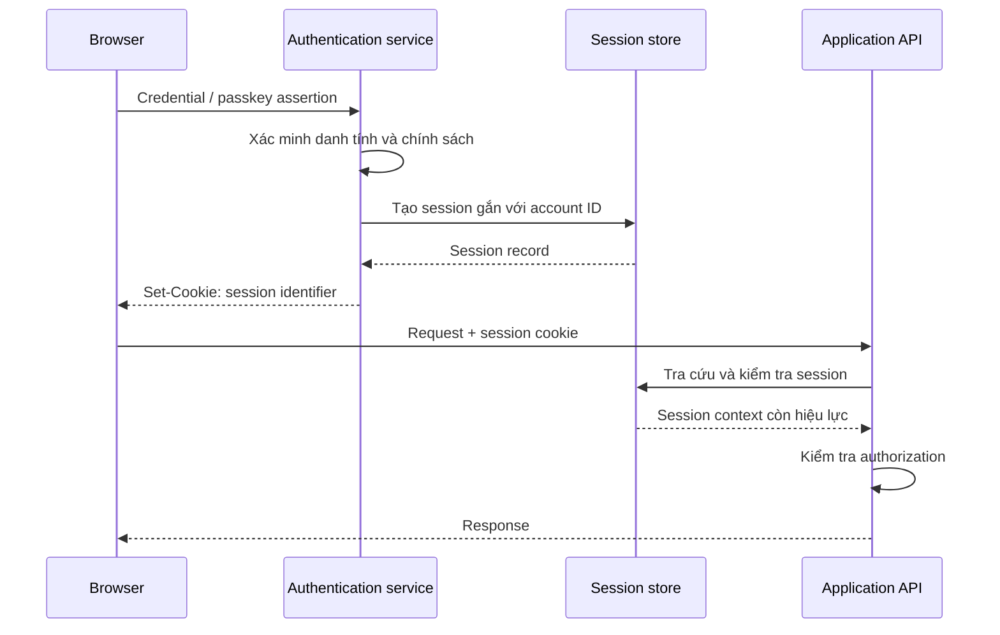
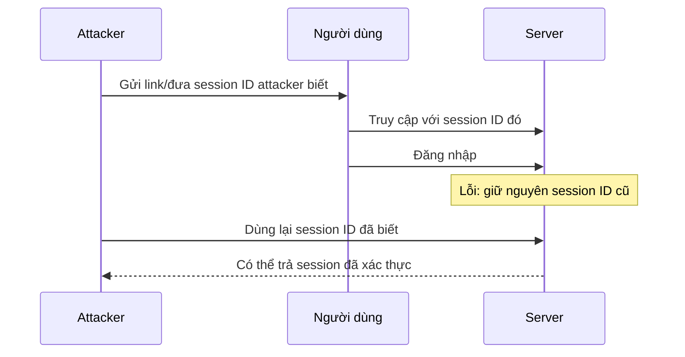
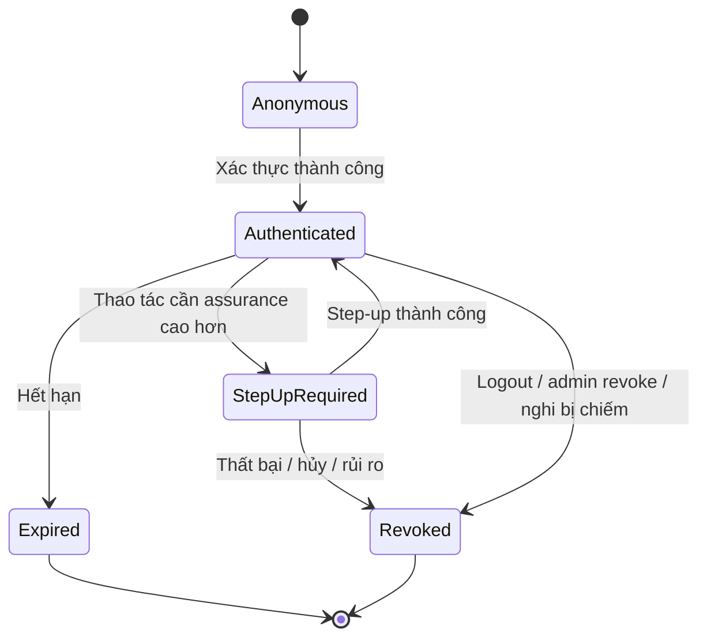

# Session là gì?

## 1. Khái niệm session trong xác thực

**Session (phiên)** là trạng thái tương tác mà hệ thống duy trì cho một chủ thể trong một khoảng thời gian, thường bắt đầu sau khi người dùng hoặc workload được xác thực. Nhờ session, client có thể gửi nhiều request liên tiếp mà không phải thực hiện lại toàn bộ quy trình đăng nhập ở mỗi request. Máy chủ dùng thông tin phiên để nhận biết ngữ cảnh xác thực, tài khoản, thời điểm đăng nhập, phương thức đã dùng và các điều kiện bảo mật liên quan.

Ví dụ: Mai đăng nhập vào ứng dụng quản lý công việc bằng passkey. Sau khi verifier kiểm tra assertion WebAuthn hợp lệ, ứng dụng tạo session và gửi cookie chứa một session identifier ngẫu nhiên cho trình duyệt. Những request tiếp theo gửi cookie đó; server tra cứu session, xác định tài khoản của Mai và tiếp tục xử lý request theo quyền hiện tại. Nếu cookie bị đánh cắp, người khác có thể dùng lại session trong thời gian nó còn hợp lệ.

Trong mô-đun **SECURITY_AUTHENTICATION_FUNDAMENTALS**, session nối kết quả xác thực từ credential, mật khẩu, MFA, passkey và chứng chỉ với các request tiếp theo, token, liên kết danh tính và khôi phục tài khoản. Thiết kế session an toàn cần xác định ranh giới tin cậy, bảo vệ cookie/token, chống session fixation và hijacking, quản lý thời hạn, thu hồi và yêu cầu xác thực lại khi rủi ro tăng.

### Mục tiêu học tập

Sau bài này, người học có thể:

- Giải thích session là gì và vì sao cần duy trì trạng thái sau xác thực.
- Phân biệt authentication session, HTTP session, cookie, access token và refresh token.
- Mô tả cách session ID được tạo, truyền, lưu trữ, xoay vòng và thu hồi.
- Thiết kế cookie và thời hạn phiên phù hợp với mức rủi ro.
- Nhận diện session fixation, session hijacking, replay, CSRF và rò rỉ token.
- Quản lý nhiều phiên trên nhiều thiết bị và triển khai session trong hệ thống phân tán.
- Thiết kế logout, revoke, reauthentication và step-up authentication.

## 2. Session giải quyết vấn đề gì?

HTTP là giao thức request/response không tự duy trì trạng thái đăng nhập giữa các request. Một request tới server về cơ bản không tự mang theo bằng chứng rằng nó thuộc về lần đăng nhập trước đó. Nếu không có cơ chế duy trì trạng thái, server sẽ phải yêu cầu người dùng xác thực lại cho từng thao tác.

Session tạo ra một ngữ cảnh có thể được tham chiếu ở các request tiếp theo:

1. Người dùng gửi credential hoặc bằng chứng xác thực.
2. Verifier kiểm tra bằng chứng và xác định account ID.
3. Ứng dụng tạo session gắn với tài khoản và metadata cần thiết.
4. Server gửi session identifier cho client qua cơ chế phù hợp, thường là cookie.
5. Client gửi lại cookie trong các request tiếp theo.
6. Server kiểm tra session còn hợp lệ, tải ngữ cảnh và tiếp tục xử lý.



Session giúp:

- Giữ trạng thái đăng nhập giữa nhiều request.
- Gắn request với một tài khoản hoặc workload đã xác thực.
- Lưu thời điểm xác thực, phương thức, mức assurance và trạng thái bảo mật.
- Hỗ trợ logout, quản lý thiết bị, giới hạn thời gian và thu hồi truy cập.
- Cho phép yêu cầu step-up cho thao tác nhạy cảm mà không phải tạo lại toàn bộ tài khoản.

Session **không chứng minh rằng người đang gửi request hiện tại chắc chắn là người đã đăng nhập ban đầu**. Nó chứng minh request đang mang một tham chiếu phiên được server chấp nhận. Nếu tham chiếu đó bị đánh cắp, attacker có thể mạo danh phiên.

## 3. Phân biệt session với các khái niệm liên quan

| Khái niệm | Vai trò | Ví dụ |
|---|---|---|
| Authentication | Kiểm tra bằng chứng để xác nhận một tuyên bố danh tính | Kiểm tra mật khẩu, TOTP, WebAuthn assertion |
| Session | Duy trì ngữ cảnh truy cập sau xác thực | Phiên đăng nhập của Mai trên trình duyệt |
| Session ID | Giá trị tham chiếu tới session; thường là bearer secret | Chuỗi ngẫu nhiên trong cookie |
| Cookie | Cơ chế trình duyệt lưu và gửi dữ liệu theo domain/path/policy | Cookie có tên __Host-session |
| Access token | Credential/token được API chấp nhận trong phạm vi và thời hạn | OAuth access token |
| Refresh token | Credential dùng để xin access token mới theo chính sách | OAuth refresh token |
| ID token | Assertion trong OpenID Connect về sự kiện xác thực dành cho client | OIDC ID token |
| Authorization | Quyết định chủ thể có quyền làm gì trên tài nguyên nào | Cho phép Mai sửa task của nhóm |

Một ứng dụng có thể triển khai session phía server, token tự chứa, hoặc kết hợp cả hai. Không nên đồng nhất mọi token với session. Access token thường là credential để gọi API; session là ngữ cảnh truy cập kéo dài. Một token có thể đại diện một số thuộc tính của session, nhưng vòng đời, phạm vi và cách thu hồi phụ thuộc kiến trúc.

### Authentication session và HTTP session

- **Authentication session:** ngữ cảnh bảo mật thể hiện người dùng đã xác thực bằng phương thức nào, lúc nào, mức assurance nào và có cần xác thực lại không.
- **HTTP/application session:** trạng thái ứng dụng lưu cho một client, có thể chứa dữ liệu giao diện, giỏ hàng, CSRF state hoặc tham chiếu authentication context.

Hai khái niệm có thể cùng được triển khai trong một session record, nhưng không phải mọi dữ liệu ứng dụng đều là bằng chứng xác thực. Ví dụ, giỏ hàng của khách chưa đăng nhập có thể có application session nhưng không có authenticated user.

### Session cookie và persistent cookie

Session cookie thường không có thuộc tính Expires hoặc Max-Age, nên trình duyệt có thể xóa khi kết thúc phiên trình duyệt. Tuy nhiên, hành vi khôi phục session của browser có thể giữ lại cookie; server vẫn cần áp dụng hạn phiên và thu hồi riêng. Persistent cookie có thời hạn lưu rõ ràng, nhưng cookie tồn tại lâu không có nghĩa server phải chấp nhận session lâu như vậy.

**Thời hạn cookie ở client và thời hạn session ở server là hai điều kiện khác nhau.** Server phải tự kiểm tra thời gian hết hạn và trạng thái thu hồi.

## 4. Session stateful và stateless

### 4.1. Stateful session

Với stateful session, client thường giữ một session ID ngẫu nhiên; dữ liệu phiên được lưu phía server hoặc session store. Mỗi request mang ID, server tra cứu record tương ứng.

```text
Browser                         Application
  |                                  |
  | Cookie: session_id=random_value  |
  |--------------------------------->|
  |                                  | lookup session_id
  |                                  | load account, auth time,
  |                                  | status, expiry, metadata
  |<---------------------------------|
  |              response            |
```

Ưu điểm:

- Có thể thu hồi phiên ngay bằng cách xóa/đổi trạng thái record.
- Dễ quản lý danh sách phiên theo tài khoản và thiết bị.
- Có thể lưu metadata xác thực, idle timeout và trạng thái rủi ro.
- Có thể giới hạn phạm vi session hoặc chuyển sang trạng thái cần step-up.

Đổi lại, server phải quản lý kho session, tính sẵn sàng, đồng bộ và hiệu năng. Nếu ứng dụng chạy nhiều instance, session store phải được chia sẻ hoặc có cơ chế phân phối phù hợp.

### 4.2. Stateless token-based session

Một hệ thống có thể phát hành token tự chứa, ví dụ JWT, chứa subject, issuer, audience, expiry, scope hoặc các claim khác. API xác minh chữ ký và claim mà không cần tra một session record cho mỗi request.

Ưu điểm:

- Có thể giảm truy vấn session store trên đường request.
- Phù hợp hệ thống API phân tán và một số kiến trúc federation.
- Token có thể mang thông tin giới hạn phạm vi truy cập.

Giới hạn:

- Token bearer bị đánh cắp có thể được phát lại cho tới khi hết hạn hoặc bị vô hiệu hóa theo cơ chế bổ sung.
- JWT tự chứa không tự biến mất khỏi mọi API khi người dùng logout hoặc admin khóa tài khoản.
- Thay đổi role hoặc trạng thái tài khoản có thể không phản ánh ngay nếu API chỉ tin claim cũ.
- Muốn thu hồi nhanh có thể cần introspection, denylist, token version, thời hạn ngắn hoặc trạng thái server-side.

**Stateless không có nghĩa là không có session theo nghĩa nghiệp vụ.** Nó chỉ mô tả cách hệ thống lưu/kiểm tra trạng thái hoặc thông tin phiên. Một hệ thống vẫn có thể có vòng đời đăng nhập, logout và reauthentication ngay cả khi dùng token.

### So sánh

| Tiêu chí | Stateful session | Stateless token |
|---|---|---|
| Trạng thái chính | Lưu phía server/session store | Mang một phần thông tin trong token |
| Kiểm tra request | Tra cứu session hoặc cache | Xác minh token và claim |
| Thu hồi tức thời | Thường đơn giản hơn qua record | Cần cơ chế bổ sung hoặc tra cứu trạng thái |
| Mở rộng nhiều instance | Cần store dùng chung hoặc affinity | Dễ xác minh độc lập nếu có cùng trust configuration |
| Cập nhật quyền | Có thể cập nhật record tập trung | Claim cũ có thể tồn tại tới khi token hết hạn/kiểm tra trạng thái |
| Rủi ro chính | Session ID bị đánh cắp, store bị xâm nhập | Bearer token bị đánh cắp, token quá rộng hoặc khó thu hồi |

Có thể kết hợp: access token ngắn hạn cho API, refresh token được quản lý phía server, và session record để theo dõi thiết bị/thu hồi.

## 5. Session ID: tạo và quản lý an toàn

Session ID thường hoạt động như **bearer secret**: ai có ID hợp lệ có thể được server nhận diện là session tương ứng. Vì vậy, ID phải khó đoán, được truyền qua kênh bảo vệ và không bị lộ.

### Yêu cầu với session identifier

- Sinh bằng CSPRNG, có entropy đủ cao để chống brute force.
- Không chứa account ID, email, username, role hoặc thông tin cá nhân có thể suy ra.
- Không tạo từ timestamp, bộ đếm, UUID yếu hoặc hash của dữ liệu công khai.
- Không truyền trong URL, query string hoặc fragment.
- Không ghi vào log, analytics, exception message hoặc telemetry ở dạng rõ.
- Có thể thay mới và thu hồi khi có sự kiện bảo mật.

Không cần tự thiết kế thuật toán tạo session ID nếu framework bảo mật đã cung cấp bộ sinh ngẫu nhiên phù hợp. Cần kiểm tra cấu hình và cách framework lưu/đưa ID vào cookie.

### Session fixation

Session fixation xảy ra khi attacker khiến nạn nhân sử dụng một session ID mà attacker đã biết trước. Nạn nhân đăng nhập thành công, nhưng nếu ứng dụng giữ nguyên ID cũ, attacker có thể dùng ID đó để truy cập session đã xác thực.

Biện pháp quan trọng:

- Tạo session ID mới sau khi xác thực thành công.
- Xoay ID sau khi nâng quyền hoặc hoàn thành step-up nếu chính sách yêu cầu.
- Vô hiệu hóa ID cũ sau khi xoay.
- Không chấp nhận session ID do URL hoặc client tự chọn.
- Dùng cơ chế chống session fixation của framework và kiểm thử cấu hình thực tế.



Luồng an toàn thay ID khi xác thực, khiến ID cũ không còn tham chiếu tới session đã đăng nhập. Khi session ID cũ bị hủy, attacker không thể dựa vào nó để tiếp tục phiên.

## 6. Cookie session an toàn

Với ứng dụng web, cookie thường là cách phù hợp để trình duyệt gửi session ID tự động. Cấu hình cookie phải xét domain, path, HTTPS, JavaScript, cross-site request và các luồng SSO.

### Các thuộc tính chính

| Thuộc tính | Ý nghĩa | Lưu ý |
|---|---|---|
| Secure | Chỉ gửi cookie qua kết nối HTTPS | Không bảo vệ cookie nếu endpoint/thiết bị bị xâm nhập |
| HttpOnly | JavaScript phía trang không đọc trực tiếp cookie | Giảm khả năng lấy cookie qua một số XSS; không ngăn XSS thực hiện request thay mặt người dùng |
| SameSite | Điều khiển gửi cookie trong một số ngữ cảnh cross-site | Strict, Lax, None có hành vi khác nhau; None cần Secure trong browser hiện đại |
| Path | Giới hạn path gửi cookie | Không nên xem là ranh giới bảo mật mạnh giữa ứng dụng cùng host |
| Domain | Quy định host/subdomain nhận cookie | Bỏ thuộc tính Domain để tạo host-only cookie khi phù hợp |
| Max-Age / Expires | Thời hạn lưu cookie ở client | Không thay thế timeout và expiry kiểm tra phía server |

Với session cookie nhạy cảm, có thể cân nhắc prefix __Host- khi đáp ứng điều kiện của browser: phải có Secure, Path=/ và không có Domain. Ví dụ tên cookie là __Host-session. Prefix này giúp giảm một số rủi ro ghi đè cookie từ subdomain, nhưng không thay thế xác thực hay bảo vệ phiên ở server.

### SameSite không thay thế CSRF protection

Cookie được browser tự động gửi theo request có thể tạo rủi ro **Cross-Site Request Forgery (CSRF)**. SameSite giúp hạn chế một số request cross-site, nhưng có thể không đủ cho mọi luồng, đặc biệt khi ứng dụng có SSO, subdomain, form hoặc yêu cầu tương thích trình duyệt.

Với thao tác thay đổi trạng thái, nên có CSRF token hoặc cơ chế chống CSRF phù hợp, kiểm tra Origin/Referer khi khả thi và thiết kế SameSite đúng nhu cầu. HttpOnly không chống CSRF vì browser vẫn gửi cookie tự động.

### XSS và cookie

HttpOnly làm JavaScript khó đọc cookie, nhưng nếu attacker thực thi script trong origin của ứng dụng, họ vẫn có thể gửi request thay mặt người dùng hoặc lấy dữ liệu mà trang được phép đọc. Cần chống XSS bằng output encoding, CSP phù hợp, kiểm soát dependency và tránh chèn HTML/JavaScript không an toàn.

## 7. Vòng đời session

Một session an toàn có trạng thái và chuyển đổi rõ ràng:



### Tạo session

Sau khi verifier xác thực thành công, server tạo session ID mới và lưu record gắn với account ID. Record có thể chứa:

- Session ID hash hoặc khóa tra cứu nội bộ.
- Account ID / subject.
- Thời điểm tạo và thời điểm xác thực gần nhất.
- Phương thức xác thực và mức assurance do server/IdP tin cậy xác định.
- Thời điểm hoạt động gần nhất.
- Thời hạn tuyệt đối và idle timeout.
- Trạng thái active/revoked.
- Metadata thiết bị hoặc client ở mức cần thiết.
- Thông tin phiên bản/token version hoặc dấu hiệu cần step-up.

Không lưu mật khẩu, private key, OTP secret hoặc toàn bộ bearer token trong session record nếu không có nhu cầu và biện pháp bảo vệ đặc biệt. Tránh lưu quá nhiều dữ liệu cá nhân/thiết bị không cần thiết.

### Sử dụng session

Mỗi request cần:

1. Đọc session ID từ vị trí được phép (ví dụ cookie).
2. Tra cứu session hoặc xác minh token theo kiến trúc.
3. Kiểm tra trạng thái, thời hạn, thu hồi và các ràng buộc.
4. Xác định account/subject từ dữ liệu đã được server kiểm chứng.
5. Đánh giá assurance/độ mới nếu hành động yêu cầu.
6. Kiểm tra authorization trên hành động và tài nguyên.
7. Thực hiện thao tác và ghi audit phù hợp.

Không tin account ID, role hoặc trạng thái xác thực do client gửi trong JSON/header. Nếu request có userId trong payload, server phải kiểm tra người dùng hiện tại có quyền thao tác trên tài khoản/tài nguyên mục tiêu hay không.

### Hết hạn phiên

Hai giới hạn thường dùng:

- **Idle timeout:** phiên hết hạn sau một khoảng thời gian không hoạt động.
- **Absolute timeout:** phiên hết hạn sau tổng thời gian tối đa kể từ khi tạo/xác thực, kể cả có hoạt động liên tục.

Có thể thêm thời hạn tối đa kể từ lần xác thực mạnh gần nhất cho thao tác nhạy cảm. Không nên gia hạn vô hạn chỉ vì browser gửi request nền hoặc heartbeat; phải xác định loại hoạt động nào được tính là tương tác có ý nghĩa theo chính sách.

### Logout và thu hồi

Logout an toàn cần:

- Vô hiệu hóa session phía server/session store hoặc cập nhật trạng thái thu hồi.
- Xóa cookie ở client với cùng tên, path và domain phù hợp.
- Thu hồi refresh token hoặc token liên quan khi kiến trúc hỗ trợ.
- Ghi audit; không ghi session ID hoặc token rõ.
- Có khả năng logout một thiết bị hoặc tất cả phiên theo nhu cầu.

Chỉ xóa cookie ở trình duyệt mà không thu hồi session server-side có thể để session ID bị sao chép tiếp tục hoạt động trên thiết bị khác.

## 8. Session timeout và reauthentication

Không có một thời gian timeout phù hợp cho mọi hệ thống. Chính sách phải dựa trên:

- Độ nhạy cảm dữ liệu và hậu quả khi tài khoản bị chiếm.
- Loại client và khả năng bảo vệ thiết bị.
- Phương thức xác thực ban đầu và mức assurance.
- Có MFA chống phishing hay không.
- Mức độ khó khăn khi người dùng đăng nhập lại.
- Yêu cầu pháp lý, hợp đồng hoặc chính sách nội bộ.

| Loại ứng dụng/thao tác | Hướng thiết kế tham khảo |
|---|---|
| Ứng dụng nội dung ít nhạy cảm | Idle timeout và absolute timeout cân bằng trải nghiệm |
| Ứng dụng doanh nghiệp | Session giới hạn, thu hồi khi nhân sự đổi trạng thái hoặc thiết bị bị mất |
| Trang quản trị | Timeout ngắn hơn, xác thực lại cho thay đổi quyền/cấu hình |
| Tài chính/giao dịch | Xác thực mới/step-up gắn với thao tác và chi tiết giao dịch |
| Tài khoản đặc quyền | MFA chống phishing, session riêng, quản lý thiết bị và audit nghiêm ngặt |

### Reauthentication

Reauthentication là yêu cầu người dùng chứng minh lại quyền kiểm soát authenticator trước một thao tác hoặc khi session quá cũ. Ví dụ:

- Đổi mật khẩu hoặc recovery factor.
- Thêm/gỡ passkey hay khóa bảo mật.
- Thay email khôi phục.
- Xuất dữ liệu nhạy cảm.
- Thay đổi quyền quản trị.
- Phê duyệt thanh toán hoặc giao dịch.

Nếu dùng OIDC, ứng dụng có thể yêu cầu IdP thực hiện xác thực mới qua tham số/chính sách được hỗ trợ và kiểm tra các claim như auth_time, acr, amr sau khi xác minh token. Không được tự suy luận ý nghĩa mức assurance chỉ từ tên claim; hai bên cần thống nhất mapping và nguồn phát hành đáng tin cậy.

### Step-up authentication

Step-up yêu cầu bằng chứng mạnh hơn hoặc mới hơn so với session hiện tại. Sau step-up, server cập nhật ngữ cảnh xác thực hoặc tạo phiên mới theo chính sách. API vẫn cần kiểm tra quyền riêng; một người dùng vừa xác thực bằng passkey không tự động được cấp quyền admin.

## 9. Session hijacking và các nguy cơ thường gặp

### 9.1. Session hijacking

Session hijacking xảy ra khi attacker lấy được session ID, cookie hoặc token hợp lệ rồi sử dụng nó để mạo danh phiên. Nguồn rò rỉ có thể gồm:

- XSS hoặc malware trên thiết bị.
- HTTP không mã hóa hoặc cấu hình TLS sai.
- Log, analytics, URL, referrer hoặc crash report chứa token.
- Extension/browser profile bị xâm nhập.
- Thiết bị dùng chung không logout.
- Backup hoặc database session bị truy cập trái phép.
- Proxy/gateway ghi lại header Cookie hoặc Authorization.

Biện pháp:

- TLS toàn bộ đường truyền.
- Cookie Secure, HttpOnly, SameSite phù hợp.
- Session ID ngẫu nhiên, không đoán được và không nằm trong URL.
- XSS/CSRF protection.
- TTL và revoke phù hợp; quản lý phiên theo thiết bị.
- Không log secret; giới hạn quyền đọc session store.
- Step-up cho thao tác rủi ro cao.

### 9.2. Session fixation

Attacker ép nạn nhân sử dụng session ID mà attacker biết, sau đó nạn nhân đăng nhập và session giữ nguyên ID. Cần xoay session ID sau authentication và privilege elevation, vô hiệu hóa ID cũ.

### 9.3. CSRF

Browser tự gửi cookie session tới site đích. Nếu người dùng đang đăng nhập và truy cập trang độc hại, trang đó có thể cố gửi request thay đổi dữ liệu tới ứng dụng thật. Dùng CSRF token, SameSite phù hợp, kiểm tra Origin và yêu cầu xác nhận bổ sung cho thao tác nhạy cảm.

### 9.4. Replay và bearer token

Session ID hoặc bearer token bị đánh cắp có thể được gửi lại. TTL ngắn giảm cửa sổ tấn công nhưng không loại bỏ replay. Với một số hệ thống, sender-constrained token hoặc proof-of-possession có thể giảm khả năng token bị dùng từ client khác; phải chọn cơ chế tương thích kiến trúc.

### 9.5. Session confusion và cross-site/cross-subdomain

Cookie domain quá rộng có thể khiến nhiều subdomain cùng nhận cookie. Một subdomain yếu hoặc bị chiếm quyền có thể làm tăng rủi ro ghi đè/đánh cắp hoặc gửi cookie sai ngữ cảnh. Dùng host-only cookie khi phù hợp, prefix __Host-, tách origin và cấu hình SSO/callback có chủ đích.

## 10. Quản lý nhiều session và thiết bị

Một người dùng có thể đăng nhập trên điện thoại, laptop, tablet và nhiều browser profile. Mỗi phiên nên có định danh server-side riêng, để người dùng và quản trị viên có thể xem/thu hồi đúng phiên.

### Metadata phiên có thể hiển thị

- Tên thiết bị hoặc loại client ở mức suy luận thận trọng.
- Thời điểm đăng nhập và hoạt động gần nhất.
- Phương thức xác thực được sử dụng.
- Vị trí gần đúng/IP ở mức hỗ trợ phát hiện, không xem là bằng chứng danh tính.
- Trạng thái hiện tại.

Không nên thu thập quá mức hoặc khẳng định chắc chắn tên thiết bị/vị trí từ user-agent hay IP. Các dữ liệu này có thể sai, bị giả mạo hoặc thay đổi.

### Chức năng quản lý session

- Xem danh sách phiên hiện tại.
- Logout phiên hiện tại.
- Thu hồi một phiên cụ thể.
- Logout tất cả phiên khác.
- Thu hồi phiên sau khi đổi mật khẩu, recovery hoặc phát hiện rủi ro.
- Gửi thông báo khi có đăng nhập/thiết bị mới theo chính sách.

### Session concurrency

Một số hệ thống giới hạn số phiên đồng thời. Khi vượt giới hạn, có thể từ chối phiên mới hoặc thu hồi phiên cũ theo quy tắc rõ ràng. Không nên âm thầm thu hồi phiên quản trị hoặc phiên đang có giao dịch quan trọng mà không có thông báo/kiểm soát thích hợp.

## 11. Session trong hệ thống phân tán

Khi ứng dụng chạy trên nhiều instance, request tiếp theo có thể tới máy chủ khác với request tạo session. Có một số cách triển khai:

| Cách triển khai | Mô tả | Đánh đổi |
|---|---|---|
| Shared session store | Các instance đọc/ghi cùng Redis/database hoặc store chuyên dụng | Cần bảo vệ, HA, TTL, consistency và kiểm soát truy cập |
| Sticky sessions | Load balancer cố gắng đưa client về cùng instance | Giảm một phần truy vấn store nhưng khó chịu lỗi instance và scale |
| Stateless token | Mỗi instance tự xác minh token | Khó thu hồi tức thời và đồng bộ thay đổi trạng thái |
| Hybrid | Access token ngắn hạn + refresh/session state phía server | Linh hoạt nhưng cần quản lý vòng đời và luồng refresh |

### Shared session store

Nếu dùng Redis hoặc database:

- Không mở store công khai; chỉ workload được phép mới kết nối.
- Xác thực và mã hóa kết nối khi phù hợp, phân quyền theo ứng dụng.
- Đặt TTL cho record và cơ chế dọn dữ liệu.
- Không lưu session ID rõ trong log/metrics.
- Kiểm soát backup, replication và quyền truy cập vận hành.
- Thiết kế HA và xử lý khi store mất kết nối; không tự động cho phép request nhạy cảm khi không thể kiểm tra session.

### Sticky session không phải bảo đảm bảo mật

Sticky session chỉ là quyết định định tuyến. Nó không chứng minh client là ai và không thay thế session validation. Nếu instance bị xâm nhập hoặc session local bị lộ, attacker vẫn có thể chiếm phiên.

### Cache và consistency

Cache session giúp giảm tải nhưng có thể khiến revoke không có hiệu lực tức thời nếu các instance giữ dữ liệu cũ. Cần xác định độ trễ chấp nhận được, invalidation, TTL cache và hành vi khi session bị khóa. Với tài khoản đặc quyền, có thể yêu cầu kiểm tra trạng thái tập trung hơn.

## 12. Session và OAuth 2.0 / OpenID Connect

Trong kiến trúc OAuth/OIDC, cần phân biệt:

- **IdP/Authorization Server session:** phiên đăng nhập của người dùng tại nhà cung cấp danh tính.
- **Client application session:** phiên của người dùng tại ứng dụng relying party.
- **Access token:** credential được resource server chấp nhận theo audience/scope.
- **Refresh token:** credential dùng xin access token mới theo chính sách.
- **ID token:** assertion OIDC dành cho client về sự kiện xác thực.

Người dùng logout khỏi ứng dụng không nhất thiết đã logout khỏi IdP. Ngược lại, logout tại IdP không tự động xóa session ở mọi ứng dụng nếu không có cơ chế phối hợp.

### Local logout

Ứng dụng hủy session cục bộ, xóa cookie và thu hồi token liên quan theo kiến trúc. Phiên SSO tại IdP có thể vẫn còn, nên lần đăng nhập sau có thể được IdP xác thực lại tự động.

### Global logout / federated logout

Một số hệ thống hỗ trợ OIDC RP-Initiated Logout, Front-Channel Logout hoặc Back-Channel Logout theo khả năng của IdP/client. Cần cấu hình đúng post_logout_redirect_uri, state và session association; không giả định mọi ứng dụng đều nhận được sự kiện logout tức thời.

### Refresh token rotation

Với refresh token rotation, server cấp refresh token mới sau khi token cũ được dùng. Nếu token cũ bị dùng lại, hệ thống có thể phát hiện dấu hiệu token theft và thu hồi token family theo chính sách. Refresh token cần được bảo vệ như credential có giá trị cao, lưu trữ an toàn và gắn với client/session.

### Không dùng ID token thay access token

ID token xác nhận kết quả xác thực dành cho client theo OIDC. Resource server phải nhận access token được phát hành cho API và xác minh audience/scope/policy đúng cách. Decode JWT không phải xác minh chữ ký hoặc nguồn phát hành.

## 13. Ví dụ Java quản lý session trong Servlet

Ví dụ sau minh họa một số nguyên tắc với Jakarta Servlet: sau khi xác thực thành công, đổi session ID để giảm session fixation, lưu account ID phía server và cấu hình cookie. Đây là đoạn minh họa, giả định lớp authentication đã xác minh credential và account ID đáng tin cậy:

```java
import jakarta.servlet.ServletContext;
import jakarta.servlet.SessionCookieConfig;
import jakarta.servlet.http.HttpServletRequest;
import jakarta.servlet.http.HttpSession;

final class SessionConfiguration {
    static void configureCookie(ServletContext context) {
        SessionCookieConfig config = context.getSessionCookieConfig();
        config.setName("__Host-session");
        config.setHttpOnly(true);
        config.setSecure(true);
        config.setPath("/");
        // Không đặt Domain để cookie chỉ thuộc host hiện tại.
        // Cấu hình SameSite tùy container/framework đang sử dụng.
    }
}

final class LoginSessionHandler {

    void onAuthenticationSuccess(HttpServletRequest request,
                                 String verifiedAccountId) {

        // Tạo/lấy session sau khi authentication đã thành công.
        HttpSession session = request.getSession(true);
        // Xoay ID của session; ID cũ không còn được dùng cho phiên này.
        request.changeSessionId();
        session = request.getSession(false);
        session.setAttribute("accountId", verifiedAccountId);
        session.setAttribute("authenticatedAt", System.currentTimeMillis());
        session.setMaxInactiveInterval(15 * 60);
    }
}
```

Lưu ý khi áp dụng:

- Cấu hình cookie phải được áp dụng lúc khởi tạo ứng dụng; ví dụ trên dùng SessionCookieConfig để container phát hành cookie session thống nhất, không tự tạo thêm cookie chứa cùng session ID.
- request.changeSessionId() yêu cầu container hỗ trợ Servlet API tương ứng và phải có session hiện tại; với framework khác, dùng cơ chế session fixation protection của framework.
- setMaxInactiveInterval chỉ đặt idle timeout ở ví dụ; cần absolute timeout và policy reauthentication riêng.
- Không dùng System.currentTimeMillis() làm nguồn thời gian bảo mật tổng quát trong code production nếu cần đồng hồ kiểm thử/đồng bộ; nên dùng abstraction Clock và metadata server-side phù hợp.
- verifiedAccountId phải đến từ kết quả authentication đã kiểm chứng, không lấy từ request body.
- SameSite không có setter chuẩn trong SessionCookieConfig của mọi Servlet version; cấu hình qua container/framework theo môi trường thực tế. Ví dụ không thể hiện CSRF token, logout/revoke, distributed session store hoặc authorization; các phần đó vẫn phải triển khai.

### Logout minh họa

```java
import jakarta.servlet.http.HttpServletRequest;
import jakarta.servlet.http.HttpServletResponse;
import jakarta.servlet.http.HttpSession;

void logout(HttpServletRequest request, HttpServletResponse response) {
    HttpSession session = request.getSession(false);
    if (session != null) {
        session.invalidate(); // Thu hồi trạng thái phía server/container
    }

    var cookie = new jakarta.servlet.http.Cookie("__Host-session", "");
    cookie.setHttpOnly(true);
    cookie.setSecure(true);
    cookie.setPath("/");
    cookie.setMaxAge(0);
    response.addCookie(cookie);
}
```

Trong hệ thống production, cần xác nhận cookie thực tế có cùng tên/path/domain và store đã invalidated. Nếu dùng refresh token hoặc token tự chứa, logout phải xử lý thêm token theo cơ chế tương ứng; chỉ invalidate HTTP session không tự thu hồi mọi token đã phát hành.

## 14. Tình huống thực tế

### Tình huống A — Session fixation sau đăng nhập

Một ứng dụng nhận session ID từ URL và giữ nguyên ID sau khi người dùng đăng nhập. Attacker biết ID đó từ trước nên dùng lại được session đã xác thực.

**Bài học:** không nhận session ID qua URL và phải xoay ID sau authentication/privilege elevation, vô hiệu hóa ID cũ.

### Tình huống B — Cookie bị lộ qua log

Reverse proxy ghi toàn bộ header Cookie vào access log. Một nhân viên hoặc hệ thống log bị xâm nhập có thể đọc session cookie rồi sử dụng lại.

**Bài học:** redact cookie và Authorization header ở proxy, ứng dụng, APM và log pipeline; giới hạn quyền đọc log.

### Tình huống C — Logout chỉ xóa cookie

Ứng dụng xóa cookie trên browser nhưng không hủy session record. Attacker đã sao chép cookie trước đó vẫn truy cập được.

**Bài học:** logout phải vô hiệu hóa session phía server và xử lý token liên quan.

### Tình huống D — JWT còn quyền cũ

Nhân viên bị gỡ role quản trị, nhưng access token cũ chứa claim role=admin còn hạn thêm một giờ. API chỉ xác minh chữ ký và tin claim nên tiếp tục cho phép thao tác.

**Bài học:** xác minh token chưa đủ; cần chính sách cập nhật/revoke quyền, token ngắn hạn hoặc kiểm tra trạng thái tập trung theo mức rủi ro.

## 15. Kiểm thử session security

| Ca kiểm thử | Kết quả mong đợi |
|---|---|
| Đăng nhập thành công | Session ID mới được tạo và gắn với account đã xác thực |
| Đăng nhập từ session ID attacker biết trước | ID được xoay; ID cũ không còn truy cập session authenticated |
| Session hết idle timeout | Request tiếp theo bị từ chối hoặc yêu cầu đăng nhập lại |
| Session vượt absolute timeout | Không thể tiếp tục chỉ bằng heartbeat |
| Logout | Session server-side bị invalidated; cookie bị xóa |
| Cookie thiếu Secure trên HTTPS app nhạy cảm | Kiểm thử cấu hình thất bại |
| Cookie không có HttpOnly khi không cần JavaScript đọc | Cảnh báo/không đạt policy |
| CSRF request từ origin không tin cậy | Bị chặn bởi token/origin/SameSite policy |
| Session ID trong URL hoặc log | Không được phát sinh/lưu lại |
| Token sai issuer/audience/signature/expiry | Từ chối |
| JWT role đã cũ sau khi thu hồi quyền | Không tiếp tục cho phép nếu policy yêu cầu quyền hiện hành |
| Một phiên bị revoke trong shared store | Các instance khác nhận biết theo SLA thu hồi |
| Recovery MFA thành công | Xử lý phiên cũ và credential bị mất theo policy |
| Mất kết nối session store | Không fail-open cho thao tác nhạy cảm |
| Nhiều phiên trên nhiều thiết bị | Có thể liệt kê và thu hồi đúng phiên |

### Audit và giám sát

Ghi nhận session created, rotated, renewed, revoked, expired; account ID; phương thức xác thực ở mức metadata; thời điểm; thiết bị/client ở mức cần thiết; lý do thu hồi và kết quả. Không ghi session ID, cookie, access token, refresh token, OTP, mật khẩu hoặc private key ở dạng rõ.

Theo dõi các tín hiệu như session ID thay đổi bất thường, một session xuất hiện từ nhiều môi trường không phù hợp, thêm credential ngay sau đăng nhập đáng ngờ, nhiều lần thất bại, logout hàng loạt hoặc sử dụng phiên sau recovery.

## 16. Checklist thiết kế session

- [ ] Session chỉ được tạo sau khi authentication đạt yêu cầu.
- [ ] Session ID được sinh bằng CSPRNG, khó đoán và không chứa thông tin cá nhân.
- [ ] Session ID được xoay sau authentication và privilege elevation.
- [ ] Cookie có Secure, HttpOnly, SameSite, Path và Domain phù hợp.
- [ ] Không truyền session ID qua URL và không ghi secret vào log.
- [ ] Có idle timeout, absolute timeout và chính sách reauthentication.
- [ ] Có CSRF protection cho request thay đổi trạng thái.
- [ ] Có chống XSS và bảo vệ token/cookie phía client.
- [ ] Logout thu hồi session server-side và xử lý token liên quan.
- [ ] Có quản lý nhiều phiên/thiết bị và chức năng revoke.
- [ ] Session store được bảo vệ, có TTL, HA và kiểm soát quyền truy cập.
- [ ] Token có issuer, audience, expiry, scope và được xác minh đúng loại.
- [ ] Authorization được kiểm tra riêng ở server cho từng hành động/tài nguyên.
- [ ] Có kiểm thử fixation, hijacking, replay, CSRF, timeout và revoke.
- [ ] Recovery và thay đổi credential có thể thu hồi/đánh giá phiên liên quan.

## 17. Tổng kết

Session là trạng thái tương tác giúp hệ thống duy trì ngữ cảnh xác thực sau khi người dùng hoặc workload đã chứng minh danh tính. Session có thể được lưu phía server với một session ID opaque, biểu diễn bằng token hoặc kết hợp nhiều cơ chế. Dù triển khai theo cách nào, session identifier/token thường có giá trị cao vì có thể đại diện quyền truy cập đang hoạt động.

Thiết kế session an toàn cần bảo vệ từ lúc tạo đến lúc thu hồi: ID khó đoán, cookie đúng thuộc tính, chống fixation/hijacking/CSRF, timeout, reauthentication, quản lý nhiều thiết bị, logout server-side và xử lý token trong hệ thống phân tán. **Session hợp lệ không thay thế authorization**; mỗi request vẫn phải được kiểm tra theo chủ thể, hành động, tài nguyên và chính sách hiện hành.
