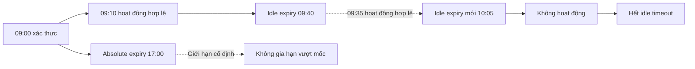
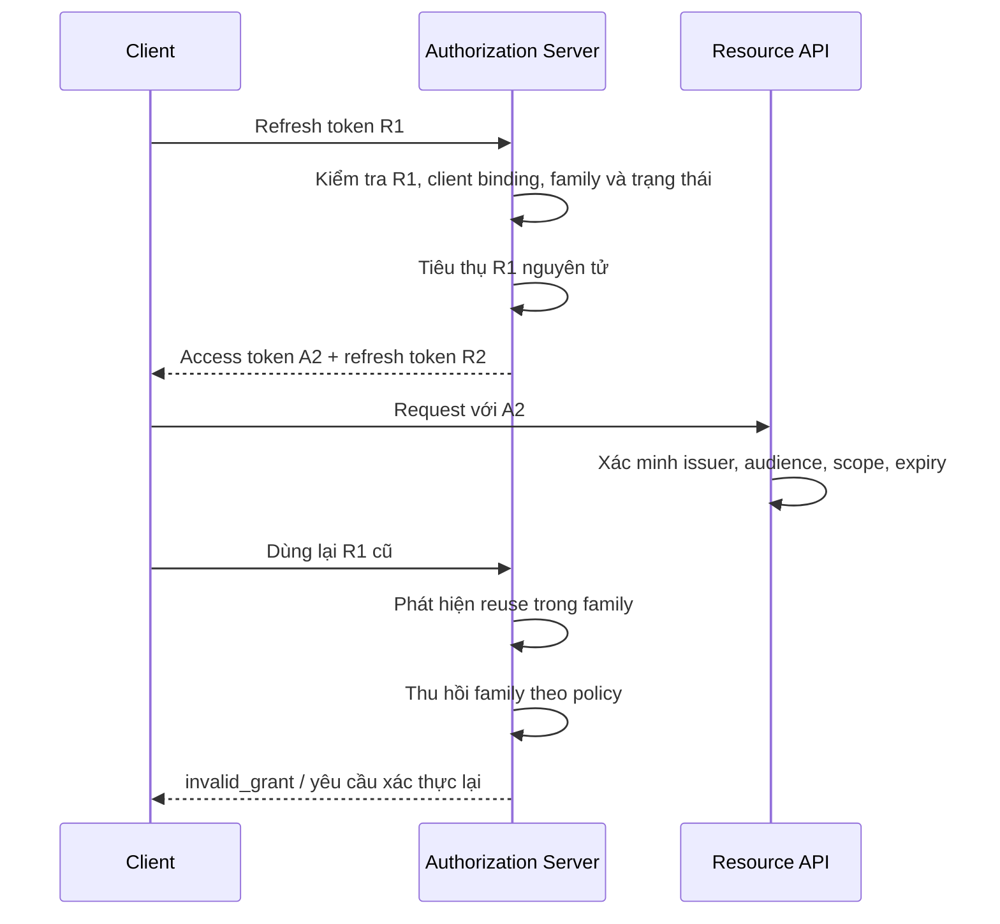

# Session renewal — Gia hạn phiên xác thực

## Mục tiêu học tập

Người dùng đăng nhập một lần rồi tiếp tục làm việc trong nhiều giờ. Nếu phiên hết hạn sau vài phút, họ phải đăng nhập liên tục và dễ tìm cách né chính sách. Nếu phiên được kéo dài vô hạn mỗi khi có request, một cookie hoặc refresh token bị đánh cắp có thể tiếp tục có giá trị trong thời gian rất dài.

**Session renewal (gia hạn phiên)** là quá trình cập nhật thời hạn hoặc thay credential phiên để người dùng tiếp tục sử dụng hệ thống sau khi đã xác thực. Gia hạn cần dựa trên trạng thái phiên, mức xác thực ban đầu, hoạt động gần đây, chính sách rủi ro và khả năng thu hồi. Gia hạn không phải một lần xác thực mới và không được tự nâng mức assurance.

Bài học thuộc chương **Session** của mô-đun **SECURITY_AUTHENTICATION_FUNDAMENTALS**. Mô-đun tìm hiểu credential, mật khẩu, MFA, passkey, chứng chỉ, token, phiên, liên kết danh tính và khôi phục tài khoản. Session renewal nối kết quả xác thực ban đầu với việc duy trì quyền truy cập an toàn trong suốt vòng đời tài khoản.

Sau bài học, bạn có thể:

- Phân biệt session renewal, reauthentication, session rotation, access-token refresh và refresh-token rotation.
- Thiết kế idle timeout, absolute lifetime và giới hạn thời gian của phiên đã được nâng mức xác thực.
- Giải thích sliding expiration và vì sao hoạt động liên tục không nên kéo dài phiên vô hạn.
- Xoay session ID hoặc refresh token mà không tạo cửa sổ replay hay lỗi đồng thời.
- Phát hiện refresh-token reuse, thu hồi token family và xử lý retry nhiều tab/thiết bị.
- Giữ nguyên hoặc giảm assurance context khi gia hạn; yêu cầu xác thực lại trước hành động nhạy cảm.
- Thiết kế renewal an toàn cho cookie session, OAuth token, ứng dụng web và hệ thống nhiều dịch vụ.
- Kiểm thử hết hạn, thu hồi, account suspension, race condition, clock skew và session fixation.

## 1. Session renewal là gì?

Sau khi verifier xác minh thông tin đăng nhập, ứng dụng thường tạo **session**. Session biểu diễn trạng thái truy cập đã được thiết lập: chủ thể nào đã xác thực, bằng phương thức nào, vào thời điểm nào, được phép sử dụng tới khi nào và có bị thu hồi hay không.

**Session renewal** là cập nhật một phiên đang còn hợp lệ hoặc cấp credential phiên kế tiếp để người dùng tiếp tục làm việc mà không phải thực hiện lại toàn bộ đăng nhập. Cách thực hiện tùy kiến trúc:

- Với server-side session, server cập nhật idle expiry và có thể xoay session ID.
- Với access token ngắn hạn, client dùng refresh token để xin access token mới.
- Với hệ thống kết hợp cookie và token, server có thể gia hạn cookie/session và đồng thời quản lý vòng đời token.
- Với session đã gần hết absolute lifetime hoặc cần nâng assurance, hệ thống có thể yêu cầu reauthentication thay vì gia hạn.

Một điểm quan trọng: **renewal chỉ tiếp tục quyền truy cập đã được cấp trong giới hạn chính sách**. Nó không biến một lần đăng nhập bằng mật khẩu thành đăng nhập bằng passkey, không làm phiên cũ trở nên phishing-resistant và không cấp thêm quyền nghiệp vụ.

### Phân biệt các khái niệm

| Khái niệm | Ý nghĩa | Ví dụ |
| --- | --- | --- |
| **Session renewal** | Gia hạn hoặc thay credential để tiếp tục phiên đang hợp lệ | Cập nhật idle expiry hoặc cấp session ID mới |
| **Sliding expiration** | Idle expiry được đẩy về phía trước khi có hoạt động đủ điều kiện | Phiên có 30 phút idle timeout, hoạt động hợp lệ làm mới mốc idle |
| **Absolute lifetime** | Thời gian tối đa tính từ lúc xác thực ban đầu hoặc mốc chính sách | Dù có hoạt động, phiên không sống quá 12 giờ |
| **Reauthentication** | Xác minh lại người dùng bằng authenticator | Yêu cầu passkey/MFA trước khi đổi email khôi phục |
| **Session rotation** | Thay session ID/credential hiện tại bằng giá trị mới | Xoay ID sau đăng nhập hoặc nâng quyền |
| **Access-token refresh** | Xin access token mới từ authorization server | Dùng refresh token để lấy access token có expiry mới |
| **Refresh-token rotation** | Mỗi lần refresh cấp refresh token mới và vô hiệu hóa token cũ theo policy | Token cũ bị đánh dấu đã dùng, token mới thay thế |
| **Revocation** | Làm phiên hoặc token không còn được chấp nhận | Logout, đình chỉ tài khoản hoặc phát hiện token reuse |

Renewal và reauthentication giải quyết hai vấn đề khác nhau. Renewal dựa vào phiên còn đáng tin theo chính sách; reauthentication tạo bằng chứng mới về quyền kiểm soát authenticator. Khi rủi ro tăng hoặc cần assurance mới, không thể chỉ gia hạn phiên để thay cho reauthentication.

## 2. Vì sao phải gia hạn phiên?

Một phiên quá ngắn làm trải nghiệm gián đoạn, nhưng phiên quá dài tăng thời gian kẻ tấn công có thể dùng cookie/token bị đánh cắp.

### Nếu không có renewal phù hợp

- Người dùng phải nhập mật khẩu/MFA quá thường xuyên.
- Các tác vụ dài như soạn biểu mẫu, tải báo cáo hoặc xử lý giao dịch có thể bị ngắt giữa chừng.
- Người dùng có thể chia sẻ tài khoản, lưu credential không an toàn hoặc tìm cách tắt kiểm soát.
- Ứng dụng di động phải đăng nhập lại thường xuyên, làm tăng hỗ trợ và giảm tỷ lệ hoàn tất.

### Nếu gia hạn quá dễ dàng

- Cookie bị đánh cắp có thể được dùng kéo dài.
- Malware hoặc attacker có refresh token có thể duy trì access token mới.
- Kẻ tấn công duy trì phiên sau khi người dùng đã logout ở một thiết bị nếu thu hồi không đồng bộ.
- Tài khoản bị đình chỉ vẫn có thể tiếp tục truy cập qua token còn hạn.
- Phiên cũ có thể tiếp tục sau khi credential, quyền hoặc tenant membership thay đổi.

**Mục tiêu là duy trì phiên khi còn đủ điều kiện, nhưng giới hạn tuổi thọ và khả năng gia hạn của quyền truy cập.** Chính sách cần cân bằng rủi ro, loại ứng dụng, độ nhạy dữ liệu, thiết bị và hành động.

## 3. Idle timeout, absolute lifetime và sliding expiration

Ba khái niệm này cần được cấu hình riêng.

### 3.1. Idle timeout

Idle timeout là khoảng thời gian tối đa một phiên được phép không có hoạt động hợp lệ. Nếu người dùng không hoạt động quá thời hạn, phiên hết hiệu lực.

Ví dụ: ứng dụng đặt idle timeout là 30 phút. Người dùng có hoạt động hợp lệ lúc 10:00, mốc idle expiry được đặt ở 10:30. Nếu tiếp tục hoạt động hợp lệ lúc 10:20, mốc có thể chuyển sang 10:50.

Không phải mọi request đều nên được coi là hoạt động hợp lệ. Ping nền, polling, tải ảnh, analytics hoặc request do script tự động có thể làm mới idle timer nếu backend cập nhật mốc cho mọi request. Điều đó khiến người dùng thực tế không còn hoạt động nhưng phiên vẫn sống.

Nên xác định rõ request nào được tính là hoạt động:

- Request đã xác thực và được phép theo policy.
- Có tương tác người dùng hoặc hành động nghiệp vụ phù hợp, nếu ứng dụng cần tiêu chí này.
- Không tính health check, telemetry, static assets hoặc polling nền không cần thiết.
- Không cho request thất bại hoặc request của attacker tự kéo dài phiên.

### 3.2. Absolute lifetime

Absolute lifetime là thời gian tối đa một phiên được phép tồn tại kể từ mốc xác thực hoặc mốc policy xác định. Khi đạt giới hạn, phiên phải kết thúc hoặc yêu cầu reauthentication.

Ví dụ: idle timeout 30 phút, absolute lifetime 12 giờ. Người dùng có hoạt động liên tục có thể giữ phiên trong 12 giờ, nhưng không vượt quá mốc đó nếu chưa xác thực lại.

Absolute lifetime giúp giới hạn trường hợp attacker duy trì phiên bị đánh cắp bằng cách tạo hoạt động giả. Nó cũng tạo điểm định kỳ để hệ thống đánh giá lại tài khoản, credential, quyền và rủi ro.

### 3.3. Sliding expiration

Sliding expiration đẩy thời điểm hết hạn idle về phía trước khi có hoạt động hợp lệ. Đây là cách phổ biến để tránh bắt người dùng đăng nhập lại trong lúc đang làm việc.

Không nên chỉ có sliding expiration mà thiếu absolute lifetime. Nếu mỗi request cứ đặt expiry thành `now + 30 phút`, một phiên có thể sống vô hạn miễn là có request nền hoặc attacker tiếp tục gửi request.

### Minh họa hai loại expiry



Trong ví dụ, mỗi hoạt động hợp lệ làm mới idle expiry. Tuy nhiên absolute lifetime vẫn cố định ở 17:00. Thời gian cụ thể chỉ là ví dụ, không phải ngưỡng áp dụng cho mọi hệ thống.

### 3.4. Quy tắc tính thời gian

Có thể mô hình hóa:

```text
idleExpiresAt = lastEligibleActivityAt + idleTimeout
absoluteExpiresAt = authenticatedAt + absoluteLifetime

effectiveExpiresAt = min(idleExpiresAt, absoluteExpiresAt)
```

Phiên chỉ còn hiệu lực nếu thời điểm hiện tại nhỏ hơn cả hai mốc và mọi điều kiện khác đều đạt. Nếu có giới hạn riêng cho lần xác thực mạnh gần nhất, hệ thống cũng phải kiểm tra giới hạn đó khi thực hiện hành động nhạy cảm.

### 3.5. Clock và độ nhất quán

Thời gian được kiểm tra ở server, không tin đồng hồ client. Trong hệ thống phân tán:

- Đồng bộ clock giữa node bằng cơ chế thời gian tin cậy.
- Quy định clock skew nhỏ và nhất quán.
- Lưu timestamp theo UTC hoặc epoch; tránh phụ thuộc timezone của người dùng.
- Dùng thời điểm server/database làm nguồn thẩm quyền cho expiry và tiêu thụ token.
- Tránh hai node tính expiry khác nhau vì clock drift hoặc cache cũ.
- Với thao tác gia hạn/thu hồi quan trọng, cần cập nhật trạng thái có điều kiện và nhất quán phù hợp.

## 4. Chính sách renewal theo loại phiên

Không phải mọi phiên có cùng rủi ro.

| Loại phiên | Rủi ro/đặc điểm | Chính sách gợi ý |
| --- | --- | --- |
| Ứng dụng nội dung ít nhạy cảm | Hậu quả chiếm phiên thấp hơn | Idle timeout vừa phải, absolute lifetime rõ |
| Bảng điều khiển nhân viên | Có dữ liệu nội bộ | Session ngắn hơn, MFA theo policy, reauthentication cho thay đổi bảo mật |
| Quản trị hệ thống | Có quyền rộng, tác động lớn | Idle ngắn, absolute lifetime giới hạn, step-up chống phishing cho thao tác đặc quyền |
| Ứng dụng tài chính | Có giao dịch và dữ liệu nhạy cảm | Xác thực lại theo hành động, ràng buộc giao dịch, thu hồi nhanh |
| Ứng dụng di động | Có thể chạy nền và đổi mạng | Refresh token được bảo vệ, rotation/reuse detection, thiết bị và trạng thái phiên được quản lý |
| Workload/service | Không có người dùng tương tác | Certificate/token ngắn hạn, tự động rotation, workload identity và authorization hẹp |

Các giá trị timeout phải được chọn theo mô hình đe dọa, yêu cầu nghiệp vụ và tiêu chuẩn áp dụng. Không lấy một giá trị chung rồi áp cho tất cả user, service và hành động.

## 5. Gia hạn server-side session

Với server-side session, trình duyệt giữ một session ID ngẫu nhiên trong cookie. Server lưu trạng thái phiên trong database/cache hoặc session store.

### Các thuộc tính cần lưu

| Trường | Mục đích |
| --- | --- |
| `sessionIdHash` | Hash/HMAC của session ID để tra cứu an toàn hơn |
| `subjectId` | Người dùng đã xác thực |
| `authenticatedAt` | Thời điểm xác thực ban đầu |
| `lastEligibleActivityAt` | Hoạt động gần nhất được phép làm mới idle timer |
| `idleExpiresAt` | Mốc hết hạn do không hoạt động |
| `absoluteExpiresAt` | Mốc hết hạn tuyệt đối |
| `authMethods` / `assuranceContext` | Phương thức và ngữ cảnh đã được xác minh |
| `authTime` / `stepUpAt` | Mốc xác thực hoặc step-up gần nhất |
| `status` | ACTIVE, REVOKED, EXPIRED, SUSPENDED |
| `sessionVersion` | Phiên bản phục vụ rotation/thu hồi |
| `deviceContext` | Thông tin tối thiểu phục vụ quản lý phiên, không phải bằng chứng danh tính |
| `createdAt`, `updatedAt` | Theo dõi vòng đời và audit |

Không lưu session ID dạng plaintext nếu có thể tránh; cookie vẫn cần chứa giá trị ngẫu nhiên để server tra cứu qua hash/HMAC. Hash session ID không thay thế entropy cao và bảo vệ cookie.

### Quy trình renewal

1. Nhận cookie qua HTTPS.
2. Tìm phiên từ session ID đã xác minh.
3. Kiểm tra trạng thái phiên, account status và trạng thái thu hồi.
4. Kiểm tra idle expiry và absolute expiry.
5. Kiểm tra session version, credential/tenant changes và risk policy.
6. Nếu request đủ điều kiện làm mới, cập nhật `lastEligibleActivityAt` và `idleExpiresAt` nhưng không vượt `absoluteExpiresAt`.
7. Nếu cần rotation, tạo session ID mới và vô hiệu hóa ID cũ trong cùng thao tác nguyên tử.
8. Phát cookie mới với thuộc tính bảo mật phù hợp.
9. Audit sự kiện renewal/rotation mà không ghi session ID hoặc token.

### Session rotation và session fixation

Sau đăng nhập hoặc khi nâng quyền, phải xoay session ID để tránh attacker cố định trước một ID rồi nạn nhân đăng nhập vào cùng ID đó (session fixation). Khi gia hạn, có thể xoay session ID định kỳ hoặc khi có thay đổi bảo mật, tùy kiến trúc.

Nếu xoay session ID, cần:

- Tạo ID mới bằng CSPRNG.
- Chuyển context đã xác minh sang phiên mới.
- Đánh dấu ID cũ không còn dùng được.
- Thực hiện chuyển trạng thái nguyên tử để hai request không tạo hai phiên độc lập.
- Xử lý request đang chạy hoặc retry mạng theo idempotency.
- Không để cookie cũ tiếp tục được chấp nhận vô thời hạn như alias.

### Cookie cần bảo vệ

- `Secure`: chỉ gửi qua HTTPS.
- `HttpOnly`: JavaScript không đọc trực tiếp cookie.
- `SameSite`: chọn theo luồng ứng dụng/SSO và vẫn đánh giá CSRF.
- `Path` và `Domain`: thu hẹp phạm vi cookie phù hợp.
- Prefix `__Host-` khi điều kiện cookie đáp ứng yêu cầu của prefix đó.
- Không đặt session ID trong URL, query string hoặc log.
- Xoay session ID sau login, reauthentication hoặc thay đổi quyền quan trọng.

Cookie expiry ở trình duyệt chỉ điều khiển việc client gửi cookie; **server-side expiry mới là nguồn quyết định**. Một cookie vẫn còn trong browser không làm phiên đã hết hạn trở nên hợp lệ.

## 6. Access token và refresh token renewal

Trong OAuth 2.0, access token thường có thời hạn ngắn để giới hạn thời gian sử dụng khi bị lộ. Refresh token cho phép client xin access token mới mà không yêu cầu người dùng nhập lại credential mỗi lần.

### Vai trò của từng token

| Token | Dùng để | Bảo vệ |
| --- | --- | --- |
| Access token | Gọi resource server trong scope/audience được cấp | Thời hạn ngắn, audience/scope hẹp, chữ ký hoặc introspection theo profile |
| Refresh token | Gửi tới authorization server để xin token mới | Lưu an toàn, ràng buộc client khi phù hợp, rotation/reuse detection |
| ID token | Truyền kết quả xác thực người dùng cho OIDC client | Xác minh issuer, audience, signature, expiry, nonce theo flow |
| Session cookie | Duy trì phiên browser với ứng dụng | Cookie flags, CSRF, server-side state/expiry và thu hồi |

Không gửi refresh token tới resource server như bearer access token. Không dùng ID token thay access token để gọi API.

### Refresh-token rotation

Một chính sách phổ biến là **refresh-token rotation**: mỗi lần refresh thành công, authorization server cấp access token mới và refresh token mới; refresh token cũ bị đánh dấu đã sử dụng hoặc bị vô hiệu hóa.

Luồng:

1. Client gửi refresh token hiện tại tới token endpoint.
2. Authorization server xác minh token, client binding, expiry, trạng thái và family.
3. Server tiêu thụ token hiện tại theo thao tác nguyên tử.
4. Server cấp access token mới cùng refresh token kế tiếp.
5. Client lưu refresh token mới an toàn và xóa token cũ.
6. Nếu token cũ được dùng lại sau khi đã rotation, server đánh giá đây là reuse có thể cho thấy token bị sao chép; có thể thu hồi toàn bộ token family và yêu cầu đăng nhập lại.



### Refresh-token reuse detection

Reuse có thể do attacker đánh cắp token, nhưng cũng có thể do race condition: hai request refresh cùng dùng R1, hoặc client retry vì response đầu tiên bị mất.

Thiết kế cần phân biệt và xử lý có chủ đích:

- Một refresh token single-use chỉ có một request được tiêu thụ thành công.
- Client nên điều phối refresh để chỉ một request đang chạy cho mỗi session/token family.
- Server dùng transaction/CAS để tránh hai request cùng rotation token.
- Nếu response bị mất sau khi server đã cấp R2, client không thể mặc nhiên gửi lại R1 và mong nhận R2 mới một cách vô hạn.
- Có thể thiết kế idempotency/retry window rất hẹp, ràng buộc với client/session và lưu kết quả đã cấp; phải tránh biến token cũ thành token dùng lại tự do.
- Nếu reuse không thể phân biệt an toàn với retry hợp lệ, áp dụng policy rõ: thu hồi family và yêu cầu xác thực lại, đồng thời hỗ trợ người dùng khôi phục.

### Refresh token dạng opaque hay JWT?

Refresh token thường nên là opaque random credential do authorization server quản lý trạng thái. Điều này giúp rotation, reuse detection và revocation dễ thực hiện hơn. Nếu dùng JWT refresh token, vẫn cần server-side state/rotation registry để kiểm soát reuse và thu hồi; chữ ký JWT không tự giải quyết lifecycle.

### Lưu trữ refresh token

- Browser public client: ưu tiên kiến trúc giảm khả năng JavaScript đọc refresh token, ví dụ Backend-for-Frontend (BFF) giữ token phía server và browser chỉ dùng cookie session.
- Native app: dùng secure storage của hệ điều hành, giới hạn backup/export và bảo vệ theo platform.
- Confidential client: bảo vệ token trong server-side secret storage, không gửi qua log hoặc telemetry.
- Dùng sender-constrained token (mTLS hoặc DPoP) khi profile và client hỗ trợ để giảm nguy cơ token bị dùng từ nơi khác.
- Không lưu refresh token trong URL, analytics, localStorage nếu có phương án an toàn hơn, hay file cấu hình chia sẻ.

## 7. Renewal phải giữ đúng assurance context

Một lần xác thực có thể đạt một mức bảo đảm tại thời điểm auth_time. Khi session được gia hạn, không được tự đổi phương thức hoặc nâng assurance.

Ví dụ: người dùng đăng nhập bằng mật khẩu + TOTP, sau đó refresh access token. Token mới có thể phản ánh cùng ngữ cảnh MFA đã được xác minh theo policy, nhưng không được gán passkey hoặc phishing-resistant nếu không có bằng chứng tương ứng.

### Các thuộc tính cần duy trì

- Chủ thể (sub/subject) và issuer.
- Phương thức đã dùng (amr) theo quy ước.
- Assurance class (acr) nếu issuer và relying party có hợp đồng.
- Thời điểm xác thực (auth_time), không ghi thời điểm refresh như thể vừa xác thực lại.
- Mốc step-up gần nhất và mục đích của step-up.
- Audience, scope, client và session/token family.
- Trạng thái tài khoản, credential, tenant membership và thu hồi.

Nếu access token mới được phát hành sau refresh, claim về thời điểm xác thực người dùng cần giữ đúng ý nghĩa. `iat` là thời điểm token được phát hành; `auth_time` là thời điểm người dùng được xác thực. Hai trường này không thể thay thế nhau.

### Renewal không làm mới reauthentication timer

Giả sử thao tác cấp quyền quản trị yêu cầu xác thực chống phishing trong 10 phút gần nhất. Người dùng đăng nhập bằng passkey lúc 09:00 và refresh token lúc 09:08. Việc refresh không làm auth_time thành 09:08. Nếu thao tác xảy ra lúc 09:15, hệ thống phải áp dụng policy theo mốc xác thực thật, có thể yêu cầu step-up.

## 8. Khi nào nên gia hạn, khi nào phải reauthenticate?

| Tình huống | Hành vi gợi ý |
| --- | --- |
| Người dùng hoạt động bình thường, phiên còn hạn và rủi ro không tăng | Renewal theo idle policy |
| Gần idle expiry nhưng còn absolute lifetime | Gia hạn nếu request đủ điều kiện |
| Đã chạm absolute lifetime | Kết thúc phiên hoặc yêu cầu reauthentication |
| Đổi mật khẩu hoặc thêm/gỡ authenticator | Reauthentication phù hợp; xoay session ID và đánh giá thu hồi phiên khác |
| Đổi email/số điện thoại khôi phục | Step-up, thông báo kênh cũ, có thể giới hạn thao tác sau thay đổi |
| Cấp quyền quản trị hoặc giao dịch nhạy cảm | Reauthentication đủ mạnh và đủ mới; có thể ràng buộc nội dung giao dịch |
| Thiết bị hoặc phiên có tín hiệu chiếm đoạt nghiêm trọng | Từ chối renewal, thu hồi/chặn và xử lý sự cố |
| Tài khoản bị SUSPENDED/DELETED | Không gia hạn; chặn session và token theo policy |
| Refresh token bị reuse | Thu hồi token family, đánh giá phiên liên quan và yêu cầu xác thực lại |
| User logout | Thu hồi session/refresh token; không cho request nền tự tạo phiên mới |

Không nên yêu cầu reauthentication chỉ vì IP thay đổi hoặc user mở tab mới; đó là tín hiệu cần đánh giá theo bối cảnh, không tự chứng minh tấn công. Ngược lại, token bị thu hồi hoặc account bị đình chỉ phải được xử lý theo chính sách ngay cả khi IP và thiết bị quen thuộc.

## 9. Renewal trong hệ thống nhiều dịch vụ và nhiều thiết bị

Một người dùng có thể có nhiều session trên laptop, điện thoại và trình duyệt khác. Không nên mặc định gia hạn một phiên là gia hạn mọi phiên.

### Session registry

Có thể quản lý registry theo account:

- Mỗi session có session ID, nhãn thiết bị/phiên, createdAt, lastActivityAt, absoluteExpiresAt và status.
- Người dùng có thể xem và thu hồi thiết bị/phiên cụ thể.
- Logout hiện tại thu hồi phiên hiện tại; logout everywhere thu hồi toàn bộ session family theo policy.
- Khi đổi mật khẩu hoặc nghi ngờ chiếm tài khoản, thu hồi các phiên khác nếu chính sách yêu cầu.
- Mỗi service phải kiểm tra token/session context theo đúng audience và trạng thái, không tin header do gateway tự khai báo nếu không có bảo vệ.

### Cache và phân tán

Nếu session state được cache ở nhiều node, thu hồi có thể bị trễ. Cần xác định:

- Cache TTL tối đa.
- Cơ chế invalidation khi logout/suspension/revocation.
- Xử lý khi cache không truy cập được.
- Cách đồng bộ session version/auth epoch.
- Có cần introspection hoặc kiểm tra server-side cho thao tác nhạy cảm không.

JWT tự chứa có thể được xác minh offline, nhưng khó thu hồi tức thời nếu không có trạng thái server-side. Chọn trade-off theo rủi ro; không coi exp là cơ chế thu hồi duy nhất.

### Nhiều tab và refresh đồng thời

Nhiều tab có thể cùng phát hiện access token sắp hết hạn và gửi refresh request. Nếu cả hai dùng cùng refresh token single-use, request thứ hai có thể bị xem là reuse.

Các giải pháp:

- Phía client điều phối refresh qua shared worker, BFF hoặc cơ chế single-flight phù hợp.
- Server dùng transaction/CAS để chỉ một request rotation thành công.
- Client lưu token mới nguyên tử trước khi tiếp tục request tiếp theo.
- Với browser, cân nhắc BFF để giữ refresh token ở server và chia sẻ session cookie.
- Nếu dùng retry grace, giới hạn thời gian, số lần, client binding và kết quả được replay; không mở lại token cũ không giới hạn.

## 10. Ví dụ Java: tính expiry và quyết định renewal

Ví dụ dưới đây mô hình hóa policy cho server-side session. Nó không triển khai cookie parser, cryptographic token verification, distributed lock hoặc database transaction.

```java
import java.time.Duration;
import java.time.Instant;

enum SessionStatus {
    ACTIVE, REVOKED, EXPIRED, SUSPENDED
}

record SessionState(
        String subjectId,
        Instant authenticatedAt,
        Instant lastEligibleActivityAt,
        Instant idleExpiresAt,
        Instant absoluteExpiresAt,
        SessionStatus status,
        long version
) {}

enum RenewalDecision {
    RENEW,
    KEEP,
    REAUTHENTICATE,
    DENY
}

class SessionRenewalPolicy {
    private static final Duration IDLE_TIMEOUT = Duration.ofMinutes(30);

    RenewalDecision decide(
            SessionState session,
            Instant now,
            boolean eligibleActivity,
            boolean accountActive,
            boolean takeoverSuspected) {

        if (session == null || now == null
                || session.idleExpiresAt() == null
                || session.absoluteExpiresAt() == null
                || session.status() != SessionStatus.ACTIVE
                || !accountActive
                || takeoverSuspected) {
            return RenewalDecision.DENY;
        }

        if (!now.isBefore(session.absoluteExpiresAt())) {
            return RenewalDecision.REAUTHENTICATE;
        }

        if (!now.isBefore(session.idleExpiresAt())) {
            return RenewalDecision.REAUTHENTICATE;
        }

        return eligibleActivity
                ? RenewalDecision.RENEW
                : RenewalDecision.KEEP;
    }

    Instant nextIdleExpiry(SessionState session, Instant now) {
        Instant candidate = now.plus(IDLE_TIMEOUT);
        return candidate.isBefore(session.absoluteExpiresAt())
                ? candidate
                : session.absoluteExpiresAt();
    }
}
```

Trong ví dụ, `decide` chỉ quyết định phiên còn đủ điều kiện để tiếp tục; việc gia hạn thực tế cần ghi last activity và idle expiry vào kho trạng thái bằng cập nhật có điều kiện theo version. Khi không có hoạt động đủ điều kiện, không nên kéo dài idle timer chỉ vì một background request. Một implementation production cũng cần phân biệt RENEW với “không cần thay đổi expiry” và kiểm tra idle expiry trước khi xử lý request nghiệp vụ.

### Pseudocode SQL cập nhật idle expiry

```sql
-- Pseudocode SQL: dùng thời gian server/database và transaction phù hợp.
UPDATE sessions
SET last_eligible_activity_at = :now,
    idle_expires_at = LEAST(
        :now + :idle_timeout,
        absolute_expires_at
    ),
    version = version + 1
WHERE session_id_hash = :session_id_hash
  AND subject_id = :subject_id
  AND status = 'ACTIVE'
  AND idle_expires_at > :now
  AND absolute_expires_at > :now
  AND version = :expected_version;
```

Ứng dụng chỉ coi renewal thành công nếu một bản ghi được cập nhật. Truy vấn phải dùng session principal đã xác minh, không lấy subject ID từ request body. Nếu không có dòng nào được cập nhật, phiên có thể đã hết hạn, bị thu hồi, bị cập nhật bởi request khác hoặc không thuộc chủ thể đang dùng.

### Pseudocode rotation refresh token

```sql
-- Pseudocode: refresh token được lưu dạng hash/HMAC, không lưu plaintext.
BEGIN;

UPDATE refresh_tokens
SET status = 'CONSUMED',
    consumed_at = :now
WHERE token_hash = :presented_token_hash
  AND family_id = :family_id
  AND status = 'ACTIVE'
  AND expires_at > :now
  AND client_id = :client_id;

-- Chỉ nếu đúng một dòng được cập nhật:
-- tạo token kế tiếp, lưu hash, gắn cùng family/client/session,
-- rồi commit cùng transaction.

COMMIT;
```

Nếu không cập nhật được dòng nào, không phát token mới. Authorization server cần xác định token không tồn tại, hết hạn, đã dùng, sai client hoặc thuộc family đã thu hồi; reuse của token đã tiêu thụ có thể kích hoạt thu hồi family theo policy.

## 11. Lỗi triển khai thường gặp

| Lỗi | Hậu quả | Cách phòng tránh |
| --- | --- | --- |
| Chỉ dùng sliding expiration | Phiên có thể sống vô hạn do request nền | Kết hợp idle timeout và absolute lifetime |
| Mọi request đều reset idle timer | Polling/attacker kéo dài phiên | Chỉ tính hoạt động đủ điều kiện |
| Cookie còn hạn được coi là phiên còn hợp lệ | Server đã thu hồi nhưng client vẫn gửi cookie | Server-side expiry/status là nguồn thẩm quyền |
| Refresh token không rotation | Token bị đánh cắp dùng lâu dài | Rotation hoặc sender-constrained token theo profile |
| Không phát hiện refresh-token reuse | Attacker duy trì phiên sau khi token bị sao chép | Token family và reuse detection |
| Hai tab refresh cùng lúc | Token hợp lệ bị xem là reuse hoặc tạo hai nhánh | Single-flight, CAS, idempotency có giới hạn |
| Retry sau khi response mất | Client dùng lại token cũ, server không xử lý nhất quán | Retry protocol/idempotency có ràng buộc |
| Gia hạn cập nhật auth_time | Phiên cũ bị coi như vừa xác thực | Giữ nguyên thời điểm xác thực thật |
| Renewal nâng amr/acr | Token mới tuyên bố assurance chưa đạt | Kế thừa đúng assurance context đã xác minh |
| Không kiểm tra account status | Tài khoản đình chỉ vẫn refresh/renew | Kiểm tra trạng thái trước mỗi renewal quan trọng |
| Không thu hồi phiên khác khi cần | Attacker giữ session sau đổi credential | Session registry, auth epoch và revoke policy |
| Không xoay ID sau login/step-up | Session fixation hoặc quyền cũ tiếp tục dùng | Rotation nguyên tử và invalidation ID cũ |
| Chỉ dựa vào JWT expiry | Token còn hạn sau logout hoặc suspension | Revocation/version/introspection phù hợp rủi ro |
| Dùng refresh token cho resource API | Token có quyền sai mục đích | Tách token endpoint và resource server |
| Lưu refresh token trong log/local storage không an toàn | Token bị đánh cắp | Secret storage/BFF/secure storage và redaction |
| Revocation cache quá lâu | Token/phiên bị thu hồi vẫn được chấp nhận | Giới hạn TTL và invalidation theo SLA |

## 12. Bảng kiểm thử session renewal

| Trường hợp | Thao tác/dữ liệu | Kết quả mong đợi |
| --- | --- | --- |
| Phiên còn hạn, có hoạt động hợp lệ | Request nghiệp vụ hợp lệ | Gia hạn idle expiry, không vượt absolute expiry |
| Phiên còn hạn nhưng chỉ có polling nền | Gửi heartbeat liên tục | Không kéo dài idle timer nếu polling không đủ điều kiện |
| Vượt idle timeout | Request sau thời gian không hoạt động | Yêu cầu đăng nhập lại |
| Vượt absolute lifetime | Người dùng hoạt động liên tục quá giới hạn | Reauthentication hoặc kết thúc phiên |
| Cookie browser chưa hết hạn nhưng session server đã revoke | Gửi cookie cũ | Từ chối |
| Account bị SUSPENDED | Refresh/renew session | Từ chối và áp dụng thu hồi |
| Session ID bị cố định trước login | Đăng nhập với ID cũ | Xoay ID; ID cũ không còn quyền |
| Hai request renewal đồng thời | Cùng session version | Cập nhật nguyên tử; không tạo nhánh phiên không kiểm soát |
| Refresh token hợp lệ | Dùng token đang ACTIVE | Cấp access token mới và refresh token kế tiếp |
| Refresh token đã dùng | Gửi lại token cũ | Phát hiện reuse, xử lý family theo policy |
| Hai tab refresh cùng lúc | Cùng refresh token | Single-flight/CAS; không cấp hai nhánh |
| Response refresh bị mất | Client retry | Kết quả idempotent hoặc yêu cầu xác thực lại theo policy |
| Refresh token sai client | Client khác gửi token | Từ chối |
| Refresh token hết hạn | Gửi sau expiry | Từ chối |
| Logout hiện tại | Thu hồi session và refresh token liên quan | Request tiếp theo bị từ chối |
| Logout everywhere | Thu hồi registry/family theo policy | Các thiết bị khác không thể tiếp tục renewal |
| Đổi mật khẩu | Credential thay đổi | Thu hồi hoặc đánh giá lại session cũ theo policy |
| Reauthentication bằng TOTP | Step-up hoàn tất | Không tự gắn cờ phishing-resistant |
| Refresh access token | Xin token mới | iat mới nhưng auth_time phản ánh lần xác thực thật |
| JWT chưa hết hạn nhưng auth epoch cũ | Gọi API sau thu hồi | Từ chối theo cơ chế revocation/version |
| Clock skew giữa hai node | Gia hạn tại node có đồng hồ lệch | Quyết định nhất quán theo thời gian server/database |
| Service cache chưa nhận revoke | Request tới node cũ | Bị chặn trong SLA thu hồi đã định nghĩa |

Ngoài unit test, cần integration test với nhiều tab, nhiều thiết bị, retry sau timeout, cache invalidation, node restart, database failover và rotation key/token. Kiểm tra rằng log không chứa session ID, access token, refresh token hoặc cookie.

## 13. Checklist thiết kế renewal

Trước khi phát hành chính sách session renewal, hãy trả lời:

1. **Loại phiên:** Server-side cookie session, OAuth token hay mô hình kết hợp?
2. **Idle timeout:** Request nào được tính là hoạt động? Polling/background có vô tình giữ phiên sống không?
3. **Absolute lifetime:** Có giới hạn tuổi phiên độc lập với hoạt động không?
4. **Reauthentication:** Hành động nào yêu cầu bằng chứng mới? Mốc auth_time có được giữ đúng không?
5. **Rotation:** Khi login, step-up hoặc refresh, session ID/token có được thay và token cũ vô hiệu hóa không?
6. **Concurrency:** Hai tab/device refresh cùng lúc xử lý thế nào? Có CAS/transaction/single-flight không?
7. **Reuse detection:** Token family được quản lý và thu hồi ra sao khi token cũ bị dùng lại?
8. **Assurance:** Renewal có vô tình nâng amr, acr hoặc gắn phishing-resistant sai không?
9. **Revocation:** Logout, password change, account suspension, credential compromise có chặn renewal không?
10. **Distributed state:** Cache/replica có độ trễ thu hồi bao lâu? Khi không truy cập được state store, hành vi ra sao?
11. **Client storage:** Cookie/refresh token được bảo vệ theo nền tảng và threat model nào?
12. **Observability:** Có đo renewal success/failure, timeout, reuse, revoke latency và retry mà không log bí mật không?

## 14. Bài tập vận dụng

Một ứng dụng nội bộ cấp session cookie có idle timeout 20 phút. Mỗi request, kể cả polling nền mỗi 30 giây, đều đặt lại idle expiry thành `now + 20 phút`. Không có absolute lifetime. Cookie có thời hạn 30 ngày. Khi người dùng đổi mật khẩu, hệ thống chỉ đổi password hash nhưng không thu hồi session cũ. Ứng dụng mobile dùng một refresh token tồn tại 90 ngày và không rotation. Hai tab có thể đồng thời refresh access token.

**Yêu cầu:**

1. Chỉ ra ít nhất sáu rủi ro trong chính sách hiện tại.
2. Thiết kế lại idle timeout và absolute lifetime; xác định request nào đủ điều kiện làm mới idle timer.
3. Đề xuất session rotation sau login/step-up và thu hồi session khi đổi mật khẩu hoặc account suspension.
4. Thiết kế refresh-token rotation, token family, reuse detection và cách xử lý hai tab cùng refresh.
5. Nêu cách giữ đúng auth_time, amr, acr khi cấp access token mới.
6. Viết test cho polling, idle expiry, absolute expiry, logout, password change, token reuse, concurrency và account suspension.

**Gợi ý tự đối chiếu:** Cookie expiry không thay thế server-side expiry; sliding expiration cần absolute lifetime; refresh token phải được quản lý như credential có quyền cao; renewal không phải reauthentication; và việc refresh không được tự nâng assurance.

---

**Điểm cần nhớ:** Gia hạn phiên phải dựa trên **idle timeout, absolute lifetime, trạng thái thu hồi và ngữ cảnh xác thực đã được xác minh**. Với cookie session, quản lý server-side state và xoay ID an toàn; với OAuth, bảo vệ refresh token, rotation và phát hiện reuse. Không để request nền kéo dài phiên vô hạn, không làm mới auth_time chỉ vì refresh và không gia hạn phiên của tài khoản đã bị đình chỉ hoặc thu hồi.
