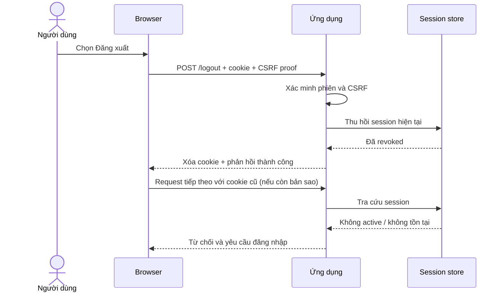

# Hủy phiên — Kết thúc và thu hồi phiên xác thực an toàn

Người dùng bấm “Đăng xuất” trên một thiết bị dùng chung. Giao diện chuyển về trang đăng nhập và cookie biến mất. Nhưng nếu máy chủ vẫn chấp nhận session ID cũ, hoặc refresh token vẫn có thể cấp access token mới, người khác có thể tiếp tục truy cập bằng credential đã sao chép. Vì vậy, **hủy phiên (session revocation/termination) là một thao tác phía máy chủ nhằm chấm dứt quyền sử dụng một phiên**, đồng thời xử lý các token và thiết bị liên quan theo chính sách.

Bài học thuộc chương **Session** của học phần **SECURITY_AUTHENTICATION_FUNDAMENTALS**. Nội dung kết nối phiên với credential, mật khẩu, MFA, passkey, chứng chỉ, token, liên kết danh tính và khôi phục tài khoản. Người học sẽ mô hình hóa ranh giới tin cậy, phân biệt đăng xuất cục bộ với thu hồi phiên trên nhiều dịch vụ, phòng chống replay/chiếm phiên và thiết kế cách kết thúc truy cập có thể kiểm chứng.

## 1. Kết quả học tập

Sau bài này, người học có thể:

- Phân biệt đăng xuất ở giao diện, xóa cookie, hủy session phía máy chủ và thu hồi access/refresh token.
- Mô tả vòng đời phiên và các trạng thái active, expired, revoked, idle timeout và absolute timeout.
- Thiết kế chức năng đăng xuất một thiết bị, đăng xuất mọi thiết bị và thu hồi phiên khi phát hiện rủi ro.
- Xử lý phiên trong hệ thống phân tán, nhiều API, SSO và các loại token khác nhau.
- Hiểu giới hạn của JWT tự xác minh, introspection, denylist, session version và refresh token revocation.
- Bảo vệ endpoint logout khỏi CSRF, replay và lạm dụng; xử lý race condition giữa request đang chạy và lệnh thu hồi.
- Viết tiêu chí chấp nhận để chứng minh phiên cũ không còn truy cập được trong SLA đã cam kết.

## 2. Phiên xác thực là gì?

**Session (phiên)** là trạng thái tương tác được hệ thống duy trì sau khi một chủ thể đã xác thực hoặc được cấp quyền. Phiên thường liên kết với một tài khoản, client, thiết bị/trình duyệt, thời điểm xác thực, mức bảo đảm và các điều kiện truy cập.

Một phiên có thể được triển khai bằng:

- **Session ID opaque:** một chuỗi ngẫu nhiên do server tạo; client giữ cookie/ID, server tra cứu trạng thái trong kho phiên.
- **Token tự chứa:** token có chữ ký, ví dụ JWT, mang claim để resource server kiểm tra mà không cần tra cứu trạng thái mỗi lần.
- **Kết hợp:** cookie phiên ở browser, access token cho API, refresh token ở authorization server và bản ghi phiên trung tâm liên kết chúng.

Không nên đánh đồng session với access token. Một phiên web có thể được duy trì bằng cookie, trong khi API nhận access token được cấp từ phiên đó. Hủy một thành phần chưa chắc hủy tất cả thành phần còn lại.

### Thông tin phiên thường được quản lý

| Thuộc tính | Mục đích |
| --- | --- |
| Session ID / session handle | Tra cứu phiên hoặc trạng thái xác thực |
| User/principal ID | Xác định tài khoản/chủ thể đã xác thực |
| Client/device metadata | Hỗ trợ hiển thị và quản lý thiết bị/phiên |
| Created/last activity time | Áp dụng idle timeout và absolute timeout |
| Authentication time/method | Đánh giá độ mới và mức bảo đảm xác thực |
| Tenant/authorization context | Ràng buộc phiên với ngữ cảnh tổ chức/quyền |
| Status/version | Phân biệt active, revoked, expired và phiên bản credential |
| Refresh token family/reference | Liên kết việc làm mới token với phiên |

Chỉ lưu metadata cần thiết; tránh thu thập dấu vân tay thiết bị quá mức hoặc lưu dữ liệu nhạy cảm không cần thiết.

## 3. Phân biệt logout, session termination và token revocation

Những thuật ngữ này thường được dùng lẫn nhau nhưng phạm vi khác nhau:

| Thao tác | Điều gì xảy ra? | Điều gì chưa chắc xảy ra? |
| --- | --- | --- |
| **Client-side logout** | Client xóa cookie/token cục bộ hoặc chuyển về trang đăng nhập | Server có thể vẫn chấp nhận bản sao session/token đã bị đánh cắp |
| **Local session termination** | Ứng dụng đánh dấu phiên cụ thể không còn active và từ chối request tiếp theo | Phiên SSO ở IdP hoặc token do hệ thống khác phát hành có thể vẫn tồn tại |
| **Refresh token revocation** | Authorization server không cho dùng refresh token/family để xin access token mới | Access token đã phát hành có thể còn hiệu lực đến hết hạn nếu API không kiểm tra trạng thái |
| **Access token revocation** | Hệ thống làm cho access token bị từ chối qua introspection, denylist hoặc cơ chế trạng thái | API tự xác minh JWT không tra trạng thái có thể vẫn chấp nhận token cũ |
| **Identity Provider logout** | Kết thúc phiên đăng nhập tại IdP theo giao thức/chính sách | Không tự động đảm bảo mọi ứng dụng đã xóa local session |
| **Global logout / revoke all sessions** | Thu hồi các phiên được quản lý của tài khoản trên nhiều thiết bị/dịch vụ | Có thể cần phối hợp với IdP, ứng dụng liên kết, workload và token đã phát hành |

Một nút “Đăng xuất” đúng nghĩa cần mô tả rõ phạm vi: chỉ thiết bị hiện tại, mọi phiên của ứng dụng, hay cả phiên SSO ở nhà cung cấp danh tính. Giao diện nên nói chính xác điều gì được kết thúc.

## 4. Vì sao cần hủy phiên?

Các tình huống thường yêu cầu thu hồi:

- Người dùng chủ động đăng xuất, đặc biệt trên thiết bị dùng chung.
- Người dùng chọn “Đăng xuất khỏi tất cả thiết bị”.
- Thiết bị bị mất, bị đánh cắp hoặc có dấu hiệu nhiễm malware.
- Phát hiện session cookie, access token hoặc refresh token bị lộ.
- Người dùng đổi mật khẩu, reset credential hoặc thay đổi MFA theo chính sách.
- Quản trị viên khóa tài khoản, nhân viên nghỉ việc hoặc chấm dứt hợp đồng.
- Quyền truy cập/tenant bị thu hồi hoặc người dùng bị loại khỏi tổ chức.
- Hệ thống phát hiện hành vi bất thường, đăng nhập rủi ro hoặc refresh token reuse.
- Phiên quá hạn idle/absolute timeout hoặc chính sách yêu cầu xác thực lại.

Hủy phiên giới hạn thời gian kẻ tấn công có thể tiếp tục sử dụng credential đã bị chiếm. Tuy nhiên, nếu kẻ tấn công vẫn giữ mật khẩu, private key, passkey hoặc quyền kiểm soát email khôi phục, họ có thể đăng nhập lại. Vì vậy, ứng phó sự cố cần xem xét **thu hồi phiên cùng với credential và thiết bị liên quan**.

## 5. Hủy phiên trong ứng dụng dùng server-side session

Với session ID opaque, server lưu bản ghi phiên và cookie chỉ mang một mã ngẫu nhiên không thể đoán. Khi logout:

1. Client gửi yêu cầu logout có xác thực và bảo vệ CSRF.
2. Server xác định phiên từ cookie đã kiểm tra, không nhận session ID tùy ý trong body để thu hồi tài khoản khác.
3. Server đánh dấu phiên revoked hoặc xóa bản ghi trong kho phiên.
4. Server xóa cookie ở client với đúng tên, domain, path và thuộc tính cần thiết.
5. Request tiếp theo dùng session ID cũ bị từ chối vì bản ghi không còn active.

### Ví dụ luồng



### Xóa cookie không thay thế thu hồi server-side

Xóa cookie chỉ xóa bản sao ở trình duyệt hiện tại. Nếu session cookie đã bị sao chép sang thiết bị khác, bản sao đó vẫn có thể hoạt động khi server chưa thu hồi. Ngược lại, xóa bản ghi server mà quên xóa cookie làm trình duyệt tiếp tục gửi một giá trị vô hiệu, gây trải nghiệm lỗi nhưng không còn cấp quyền nếu backend kiểm tra đúng.

Cookie logout phải được xóa với thuộc tính tương ứng với cookie đã tạo, đặc biệt là `Path` và `Domain`. Có thể gửi `Set-Cookie` với giá trị rỗng và thời hạn đã hết. Thuộc tính `Secure`, `HttpOnly` và `SameSite` phải phù hợp với cấu hình cookie gốc.

## 6. Hủy phiên trong hệ thống dùng access token và refresh token

OAuth/OIDC thường tách access token và refresh token:

- **Access token:** resource server dùng để cho phép truy cập API; có thể là opaque hoặc JWT.
- **Refresh token:** authorization server dùng để cấp access token mới theo grant/phiên đã được cấp.

Khi logout, cần xử lý ít nhất:

1. Xóa token phía client hoặc kết thúc cookie/BFF session.
2. Thu hồi refresh token hoặc refresh token family tại authorization server.
3. Xác định cách resource server ngừng chấp nhận access token đã cấp.
4. Xử lý các phiên ứng dụng và token liên quan khác theo chính sách.

### Giới hạn của JWT tự xác minh

JWT có chữ ký có thể được API xác minh độc lập bằng public key. Nếu API chỉ kiểm tra chữ ký và `exp`, nó có thể tiếp tục chấp nhận token cũ tới khi hết hạn dù refresh token đã bị revoke. Chữ ký hợp lệ không cho biết token đã bị thu hồi sau thời điểm phát hành.

Các cách thường dùng:

| Cơ chế | Cách hoạt động | Đánh đổi |
| --- | --- | --- |
| Access token TTL ngắn | Giới hạn khoảng thời gian token bị lộ còn dùng được | Request refresh nhiều hơn; vẫn có cửa sổ sử dụng tới khi hết hạn |
| Token introspection | Resource server hỏi authorization server token còn active không | Phụ thuộc độ sẵn sàng/độ trễ của AS; cache có thể làm chậm hiệu lực revoke |
| Denylist theo `jti`/token ID | API kiểm tra token ID có bị thu hồi không | Cần lưu trạng thái, đồng bộ và dọn dữ liệu đúng TTL |
| Session/credential version | Token/session gắn với version; tăng version để vô hiệu hóa phiên cũ | API phải tra version hoặc trạng thái; claim trong JWT tự nó không cập nhật |
| Central session registry | Các dịch vụ tra trạng thái phiên trung tâm | Cần thiết kế HA, cache invalidation và xử lý khi registry lỗi |

Không có lựa chọn nào miễn phí. Hãy chọn theo yêu cầu thu hồi: nếu doanh nghiệp yêu cầu nhân viên nghỉ việc mất quyền gần như tức thì, TTL dài và JWT tự xác minh hoàn toàn có thể không đáp ứng.

### OAuth token revocation

OAuth 2.0 Token Revocation (RFC 7009) định nghĩa endpoint để client yêu cầu authorization server thu hồi token. Với refresh token, AS có thể thu hồi quyền làm mới; hành vi liên quan tới access token và các token cùng grant phụ thuộc implementation/policy. Resource server phải có cơ chế nhận biết trạng thái bị thu hồi nếu cần hiệu lực trước `exp`.

Không gửi token tới endpoint revocation không đáng tin và không log token trong request. Client authentication và bảo vệ TLS phải theo yêu cầu của AS.

## 7. Hủy phiên trong hệ thống SSO và liên kết danh tính

Người dùng có thể đăng nhập một lần tại IdP rồi truy cập nhiều ứng dụng (RP). Mỗi ứng dụng thường có local session riêng, trong khi IdP duy trì phiên SSO. Vì vậy, logout tại một ứng dụng không nhất thiết kết thúc các ứng dụng khác.

### Các phạm vi logout

- **RP/local logout:** ứng dụng hiện tại hủy phiên cục bộ và xóa cookie của mình.
- **IdP logout:** kết thúc phiên đăng nhập tại nhà cung cấp danh tính.
- **Federated/global logout:** cố gắng thông báo cho các RP liên quan để chúng hủy local session theo giao thức.

### OIDC logout patterns

Trong OpenID Connect, có một số cơ chế liên quan:

- **RP-Initiated Logout:** RP điều hướng người dùng tới endpoint logout của OP/IdP, có thể gửi `id_token_hint` và `post_logout_redirect_uri` theo cấu hình. RP vẫn cần kết thúc local session của chính nó.
- **Front-Channel Logout:** OP dùng trình duyệt để thông báo tới các RP (thường qua iframe/URL) nhằm yêu cầu kết thúc phiên. Việc này phụ thuộc trình duyệt, cookie và chính sách chặn third-party context; không nên giả định luôn thành công.
- **Back-Channel Logout:** OP gửi logout token trực tiếp tới endpoint của RP qua kênh server-to-server. RP xác minh logout token theo đặc tả, xác định session/user liên quan và hủy local session. Cần kiểm tra chữ ký, issuer, audience, event claim và các ràng buộc `sid`/`sub` theo profile.

Không được tin một request logout bất kỳ chỉ vì nó chứa `sub` hoặc `sid`. Logout token phải được xác minh như một thông điệp giao thức, chống replay và ánh xạ đúng session. Với SAML, Single Logout có cơ chế riêng; không nên trộn các endpoint/claim OIDC vào luồng SAML.

### Điều gì xảy ra khi IdP không truy cập được?

Ứng dụng vẫn có thể và nên hủy local session của mình ngay khi người dùng yêu cầu logout. Nếu IdP gián đoạn, việc kết thúc phiên SSO hoặc thông báo tới các RP khác có thể chưa hoàn tất. Giao diện nên mô tả phạm vi đã thực hiện và hệ thống cần retry/giám sát phần logout liên kết nếu chính sách yêu cầu.

## 8. Hủy phiên và bảo vệ CSRF

Logout là hành động thay đổi trạng thái phía server. Nếu endpoint logout chấp nhận request cross-site tự động kèm cookie, kẻ tấn công có thể buộc người dùng bị đăng xuất (logout CSRF). Điều này thường không trực tiếp chiếm tài khoản nhưng có thể gây gián đoạn hoặc hỗ trợ một chuỗi tấn công.

Biện pháp:

- Dùng POST hoặc phương thức thay đổi trạng thái phù hợp, không thực hiện logout chỉ bằng GET có thể bị prefetch/crawler kích hoạt.
- Áp dụng CSRF token hoặc cơ chế xác minh Origin/Referer phù hợp.
- Đặt cookie `SameSite` thích hợp; không coi SameSite là biện pháp duy nhất.
- Không nhận session ID hoặc user ID tùy ý trong query/body để chọn phiên cần hủy.
- Với “đăng xuất tất cả”, yêu cầu phiên đã xác thực và step-up khi rủi ro phù hợp.

Đối với back-channel logout từ IdP, không dùng CSRF token của browser vì đây là server-to-server; thay vào đó phải xác minh logout token, issuer, audience, sự kiện logout và ràng buộc session theo giao thức.

## 9. Hủy một phiên hay tất cả phiên?

Giao diện quản lý thiết bị nên cung cấp thông tin đủ để người dùng nhận biết phiên, nhưng tránh thu thập quá mức:

| Chức năng | Phạm vi | Khi phù hợp |
| --- | --- | --- |
| Đăng xuất thiết bị hiện tại | Phiên browser/app đang dùng | Người dùng kết thúc phiên thường ngày |
| Đăng xuất phiên khác | Một phiên/thiết bị được chọn | Người dùng thấy thiết bị lạ hoặc đã bán thiết bị |
| Đăng xuất tất cả thiết bị | Tất cả phiên của tài khoản trong phạm vi ứng dụng | Thiết bị mất, nghi lộ credential hoặc người dùng muốn làm mới mọi phiên |
| Thu hồi mọi phiên và refresh token | Phiên + token làm mới liên quan | Sự cố bảo mật, reset mật khẩu hoặc quản trị viên vô hiệu hóa tài khoản |
| Thu hồi credential cụ thể | Passkey, chứng chỉ, API key hoặc phương thức xác thực được chọn | Credential bị mất/lộ; cần ngăn đăng nhập lại bằng credential đó |

Một bảng “Thiết bị đang đăng nhập” có thể hiển thị thời điểm hoạt động gần nhất, loại client, tên thiết bị do người dùng đặt và vị trí ở mức khái quát nếu có cơ sở. Không nên coi địa chỉ IP hay vị trí ước lượng là danh tính chắc chắn của thiết bị.

## 10. Thiết kế dữ liệu và xử lý thu hồi nguyên tử

Một bản ghi phiên server-side có thể được mô hình hóa:

```text
session_id_hash
user_id
client_id
device_label
created_at
last_seen_at
expires_at
revoked_at
revocation_reason
auth_time
auth_methods / assurance
credential_version
refresh_token_family_id
```

Session ID nên là giá trị ngẫu nhiên đủ mạnh; cân nhắc lưu hash/handle thay vì giá trị cookie thô để giảm tác động khi kho phiên bị đọc. Không lưu access/refresh token đầy đủ trong bản ghi quản lý phiên nếu không cần thiết; dùng reference tới token store an toàn.

### Hủy phiên phải nguyên tử

Nếu hai request cùng dùng một phiên và một request logout xảy ra trong lúc request kia đang chạy, hệ thống cần xác định chính sách:

- Request bắt đầu trước thời điểm revoke có được hoàn tất không?
- Các request mới sau thời điểm revoke phải bị từ chối ở đâu?
- Có cần kiểm tra trạng thái phiên lại trước thao tác nhạy cảm/commit dữ liệu không?
- Cache của từng API được invalidation như thế nào?

Đối với hành động rủi ro cao, có thể kiểm tra session/version ngay trước khi commit. Với hệ thống phân tán, cần định nghĩa một mốc thu hồi có thể quan sát, đồng bộ trạng thái và giới hạn cache TTL. Không thể hứa thu hồi tức thì nếu các API vẫn dùng cache không có cơ chế invalidation.

### Idempotency

Logout/revoke nên idempotent: gọi lặp lại cho cùng session/token đã revoked vẫn trả kết quả an toàn và không khôi phục phiên. Nếu session không còn tồn tại, hệ thống có thể trả thành công theo cách không tiết lộ session ID hợp lệ.

## 11. Pseudocode: hủy phiên hiện tại

Ví dụ khái niệm cho backend dùng session store:

```ts
async function logoutCurrentSession(request) {
  const session = await authenticateSessionCookie(request);
  if (!session) {
    clearSessionCookie(response);
    return success();
  }

  verifyCsrfForStateChange(request, session);

  await database.transaction(async (tx) => {
    await tx.revokeSessionIfActive(session.id, {
      revokedAt: now(),
      reason: "USER_LOGOUT"
    });
    await tx.revokeRefreshFamilyForSession(session.id);
    await tx.recordSecurityEvent("SESSION_REVOKED", {
      userId: session.userId,
      sessionId: session.safeAuditId
    });
  });

  clearSessionCookie(response);
  return success();
}
```

Tên hàm minh họa, không phải thư viện cụ thể. Trong hệ thống thực:

- Xác minh cookie/session ở server trước khi chọn phiên.
- Bảo vệ CSRF cho request thay đổi trạng thái.
- Thu hồi session và refresh token theo transaction/outbox phù hợp.
- Không ghi session cookie hoặc token vào audit.
- Xóa cookie đúng domain/path và thuộc tính.
- Xử lý trường hợp session đã bị revoke theo cách idempotent.

### Đăng xuất tất cả phiên

```ts
async function logoutAllSessions(authenticatedUser, request) {
  requireRecentAuthenticationIfPolicyNeeds(request, authenticatedUser);
  verifyCsrfForStateChange(request, authenticatedUser.session);

  await database.transaction(async (tx) => {
    await tx.incrementSessionVersion(authenticatedUser.userId);
    await tx.revokeAllSessions(authenticatedUser.userId, now());
    await tx.revokeAllRefreshFamilies(authenticatedUser.userId);
    await tx.recordSecurityEvent("ALL_SESSIONS_REVOKED", {
      userId: authenticatedUser.userId
    });
  });

  clearCurrentSessionCookie(response);
  return success();
}
```

Tăng session version chỉ có tác dụng nếu các API/session verifier kiểm tra version hiện tại hoặc trạng thái tương ứng. Nếu JWT tự xác minh hoàn toàn mà không tra version/denylist, token cũ có thể vẫn hoạt động tới khi hết hạn. Cần nêu rõ cơ chế thực tế của hệ thống thay vì dựa vào tên hàm `revokeAllSessions`.

## 12. Xử lý sự cố và các trường hợp đặc biệt

### Thiết bị bị mất hoặc nghi bị chiếm

1. Người dùng dùng một phiên/thiết bị đáng tin cậy khác hoặc quy trình recovery đã xác minh.
2. Thu hồi phiên của thiết bị mất và refresh token liên quan.
3. Nếu có dấu hiệu credential bị lộ, thu hồi/đăng ký lại passkey, chứng chỉ, API key hoặc phương thức tương ứng.
4. Xem xét access token đã cấp, các hành động gần đây và thay đổi thông tin khôi phục.
5. Thông báo qua kênh đã xác minh; không gửi bí mật vào thiết bị có thể đã bị chiếm.

### Nhân viên nghỉ việc

Vô hiệu hóa tài khoản tại nguồn danh tính và áp dụng provisioning/deprovisioning; thu hồi local sessions, refresh tokens và quyền workload; kiểm tra token còn hiệu lực tại API; vô hiệu hóa chứng chỉ/API key do nhân viên hoặc workload quản lý. SSO logout đơn lẻ không thay thế việc disable principal và thu hồi quyền.

### Reset mật khẩu

Reset password có thể kích hoạt thu hồi phiên theo chính sách. Nhưng đổi mật khẩu không tự động làm mọi access token hoặc cookie cũ mất hiệu lực. Cần kiểm tra các session store, refresh token family, API token validation và các dịch vụ tích hợp.

### Người dùng chỉ muốn đăng xuất khỏi một ứng dụng SSO

Hủy local session của ứng dụng. Nếu điều hướng tới IdP logout, các ứng dụng khác có thể bị đăng xuất theo chính sách SSO. Giao diện phải giải thích phạm vi để tránh người dùng tưởng rằng chỉ ứng dụng hiện tại bị ảnh hưởng.

## 13. Mối đe dọa và biện pháp kiểm soát

| Mối đe dọa | Tình huống | Kiểm soát |
| --- | --- | --- |
| Session replay | Cookie cũ bị dùng lại sau khi người dùng logout | Server-side revoke, session registry/version, cookie rotation |
| Stolen refresh token | Kẻ tấn công xin access token mới sau logout | Refresh token revoke/rotation/reuse detection và bảo vệ token store |
| Stale JWT | API vẫn chấp nhận JWT đã phát hành trước khi revoke | TTL ngắn, introspection, denylist hoặc version check |
| Logout CSRF | Trang ngoài ép trình duyệt gửi request logout | POST, CSRF protection, Origin validation, SameSite |
| Global logout không đầy đủ | Một dịch vụ hủy phiên nhưng dịch vụ khác vẫn chấp nhận token | Session inventory, back-channel/central revoke, SLA và kiểm thử tích hợp |
| Race condition | Request nhạy cảm commit sau khi session đã revoke | Kiểm tra trạng thái/version gần thời điểm commit, transaction và policy |
| Cookie không được xóa đúng | Browser tiếp tục gửi cookie cũ gây lỗi hoặc confusion | Xóa đúng domain/path, đồng thời revoke server-side |
| Logout token giả | Attacker gửi thông điệp logout giả tới RP | Xác minh chữ ký, issuer, audience, event, sid/sub và chống replay |
| Re-authentication bypass | Phiên cũ được dùng để thu hồi phiên khác hoặc đổi phương thức | Step-up theo rủi ro, CSRF và authorization phía server |
| DoS qua revoke | Kẻ tấn công ép người dùng logout liên tục | Chống CSRF, rate limit, audit và thông báo phù hợp |

## 14. Tình huống thực tế: thu hồi phiên sau khi điện thoại bị mất

Một người dùng truy cập dịch vụ ngân hàng qua web và mobile. Họ đã đăng nhập trên laptop, điện thoại và máy tính bảng. Điện thoại bị mất khi đang mở khóa; người dùng báo sự cố từ laptop.

### Hệ thống cần làm gì?

1. Xác minh người dùng trên laptop bằng phương thức đủ tin cậy; yêu cầu step-up nếu thao tác thu hồi tất cả thiết bị có rủi ro cao.
2. Hiển thị các phiên/thiết bị đã đăng ký để người dùng chọn thiết bị mất hoặc thu hồi toàn bộ.
3. Thu hồi session ID của điện thoại, refresh token family và mọi credential gắn với thiết bị nếu phù hợp.
4. Đánh giá access token đang tồn tại: nếu API dùng JWT tự xác minh, cần cơ chế version/introspection/denylist hoặc chờ TTL ngắn theo chính sách.
5. Xóa/thu hồi thiết bị tin cậy, passkey hoặc khóa thiết bị theo khả năng của nền tảng; không xóa các passkey khác không liên quan.
6. Gửi thông báo qua kênh đã xác minh và ghi audit event.
7. Kiểm thử rằng request mới từ điện thoại bằng cookie/token cũ bị từ chối; laptop vẫn có thể tiếp tục hoặc được yêu cầu đăng nhập lại theo lựa chọn.

### Tiêu chí thành công

- Không có request mới nào từ phiên điện thoại bị mất được chấp nhận sau mốc thu hồi đã cam kết.
- Refresh token cũ không cấp được access token mới.
- Access token đã cấp không còn được API chấp nhận trong giới hạn SLA.
- Người dùng không bị đăng xuất nhầm khỏi các phiên không nằm trong phạm vi nếu chỉ chọn một thiết bị.
- Hệ thống có dấu vết kiểm toán nhưng không lưu token/cookie bí mật.

## 15. Tiêu chí chấp nhận và kiểm thử

| Tình huống | Kết quả mong đợi |
| --- | --- |
| Người dùng logout khỏi phiên hiện tại | Server đánh dấu session revoked, cookie được xóa đúng và request dùng cookie cũ bị từ chối |
| Cookie chỉ bị xóa ở browser nhưng bản sao cookie được gửi lại | Server vẫn từ chối vì session đã bị revoke |
| Người dùng chọn revoke một thiết bị khác | Chỉ phiên/credential nằm trong phạm vi được chọn bị thu hồi |
| Người dùng chọn logout all | Các phiên và refresh token thuộc tài khoản trong phạm vi bị thu hồi |
| Refresh token bị revoke rồi gửi tới token endpoint | AS từ chối cấp access token mới |
| JWT cũ được gửi tới API sau revoke | API từ chối theo cơ chế revoke/version/introspection đã thiết kế và SLA |
| Logout request cross-site không có CSRF proof | Không thay đổi trạng thái phiên |
| Logout được gửi lặp lại | Kết quả idempotent; không khôi phục phiên |
| Back-channel logout token sai chữ ký/issuer/audience/event | RP từ chối thông điệp, không hủy phiên tùy tiện |
| Back-channel logout token hợp lệ với sid cụ thể | Chỉ local session liên quan bị thu hồi theo đặc tả |
| IdP không truy cập được khi user logout local | Local session vẫn bị hủy; trạng thái federated logout được báo/giám sát đúng |
| Request bắt đầu trước revoke nhưng commit sau revoke | Hành động nhạy cảm tuân theo chính sách kiểm tra lại trạng thái tại thời điểm commit |
| Tài khoản bị disable | Phiên/token bị chặn trong thời gian đã cam kết trên các API liên quan |
| Session store/cache gặp sự cố | Hệ thống xử lý theo fail-closed cho tài nguyên nhạy cảm hoặc chính sách outage đã phê duyệt; không tự tin session cũ |

### Chỉ số vận hành

Theo dõi thời gian từ yêu cầu revoke đến khi mọi API từ chối phiên cũ, tỷ lệ logout thành công, số refresh token reuse, số phiên tồn tại sau disable account, lỗi back-channel logout, độ trễ invalidation cache và số sự cố session hijacking. Phân biệt logout do người dùng chủ động với thu hồi do quản trị/sự cố; không ghi session cookie hoặc token thô.

## 16. Bài tập tự kiểm tra

Một SaaS dùng OIDC SSO cho nhân viên. Mỗi ứng dụng có local session cookie; API nhận JWT access token; authorization server cấp refresh token. Nhân viên nghỉ việc và tài khoản bị disable tại IdP. Doanh nghiệp yêu cầu mọi truy cập dừng trong vòng hai phút.

Hãy:

1. Liệt kê các loại phiên/token cần xử lý khi nhân viên nghỉ việc.
2. Giải thích vì sao chỉ xóa cookie trên browser hoặc revoke refresh token chưa đủ.
3. Chọn cơ chế để API ngừng chấp nhận JWT cũ trong SLA hai phút.
4. Mô tả cách phối hợp local logout, RP-Initiated Logout và back-channel logout.
5. Nêu cách xử lý khi một API đang có cache trạng thái session và IdP bị gián đoạn.
6. Viết ít nhất năm test case xác minh thu hồi trên nhiều dịch vụ, bao gồm race condition và token đã cấp.

**Gợi ý đánh giá:** lời giải tốt phải phân biệt session cookie, local session, access token, refresh token và IdP session; nêu rõ cơ chế invalidation thực tế, cache TTL, trạng thái lỗi và SLA đo được. Không khẳng định JWT đã hết hiệu lực chỉ vì refresh token bị revoke.

---

**Ghi nhớ:** hủy phiên an toàn phải được thực hiện ở phía server và bao phủ đúng phạm vi của session, refresh token, access token và phiên SSO liên quan. Xóa cookie là bước phía client; nó không vô hiệu hóa bản sao đã bị đánh cắp. Hãy xác định **ai yêu cầu thu hồi, phiên nào bị thu hồi, API nào kiểm tra trạng thái, token nào còn hiệu lực và mất bao lâu để toàn hệ thống ngừng chấp nhận truy cập cũ**.
